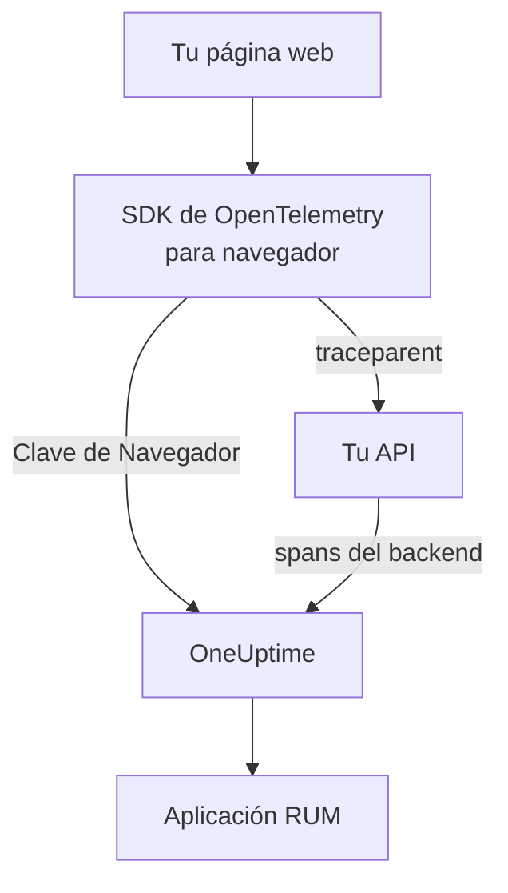

# Configuración para navegadores

Instrumenta una aplicación web con el SDK de OpenTelemetry para navegador para que se informe a OneUptime como aplicación RUM. Las cargas de página y las solicitudes llegan como trazas, y la misma configuración lleva tus errores, registros, métricas y Core Web Vitals.

:::cards
- [Configurarlo](#configurarlo): Seis pasos desde una clave de Navegador hasta tu primera carga de página.
- [Enlazar con tu backend](#enlazar-con-tus-trazas-de-backend): Unir los spans del navegador a las trazas de backend que inician.
- [Informar de errores](#informar-de-errores-no-capturados): Enviar los errores no capturados a la vista de Excepciones.
- [Solución de problemas](#solución-de-problemas): Qué revisar cuando no llega nada.
:::

## Cómo funciona

El SDK se ejecuta en los navegadores de tus visitantes. Registra un span por cada carga de página y cada solicitud, y los exporta directamente a OneUptime con una clave de ingesta de **Navegador**, sin un collector ni un proxy propio de por medio.



## Antes de empezar

- Una aplicación web cuyo código puedas cambiar y volver a desplegar, con sus dependencias instaladas mediante npm.
- Los orígenes desde los que se sirven tus páginas, por ejemplo `https://app.example.com`. Una clave de Navegador solo acepta solicitudes de los orígenes que indiques en ella.
- Un rol que pueda crear claves de ingesta: pueden hacerlo los propietarios y administradores del proyecto, y también cualquiera con el permiso **Create Telemetry Ingestion Key**.

## Configurarlo

:::steps
### Crear una clave de ingesta de Navegador

1. Ve a **Productos → Ajustes del proyecto**.
2. En el menú lateral, despliega **Telemetría y APM** y selecciona **Claves de ingesta**.
3. Haz clic en **Crear clave de ingesta** y elige **Navegador** como **Tipo de clave**.
4. En el paso **Ajustes del navegador**, indica tus orígenes en **Orígenes permitidos** como una matriz JSON, por ejemplo `["https://app.example.com"]`, y crea la clave. En el plan gratuito de OneUptime Cloud, un último paso **Facturación** muestra antes el precio de la telemetría.


La nueva clave se abre en su propia página. Copia su **Clave secreta**: es el token que el SDK envía como `x-oneuptime-token`.


### Instalar los paquetes

```bash
npm install @opentelemetry/api \
  @opentelemetry/sdk-trace-web \
  @opentelemetry/resources \
  @opentelemetry/semantic-conventions \
  @opentelemetry/opentelemetry-browser-detector \
  @opentelemetry/exporter-trace-otlp-http \
  @opentelemetry/context-zone \
  @opentelemetry/instrumentation \
  @opentelemetry/instrumentation-document-load \
  @opentelemetry/instrumentation-fetch \
  @opentelemetry/instrumentation-xml-http-request
```

### Crear el archivo de telemetría

Crea `src/telemetry.ts`. `browserDetector` añade los atributos `browser.*` que clasifican la telemetría como RUM, y `service.name` da nombre a la aplicación.

```ts title="src/telemetry.ts"
import {
  WebTracerProvider,
  BatchSpanProcessor,
} from "@opentelemetry/sdk-trace-web";
import { OTLPTraceExporter } from "@opentelemetry/exporter-trace-otlp-http";
import { ZoneContextManager } from "@opentelemetry/context-zone";
import { registerInstrumentations } from "@opentelemetry/instrumentation";
import { DocumentLoadInstrumentation } from "@opentelemetry/instrumentation-document-load";
import { FetchInstrumentation } from "@opentelemetry/instrumentation-fetch";
import { XMLHttpRequestInstrumentation } from "@opentelemetry/instrumentation-xml-http-request";
import {
  defaultResource,
  detectResources,
  resourceFromAttributes,
} from "@opentelemetry/resources";
import { browserDetector } from "@opentelemetry/opentelemetry-browser-detector";
import { ATTR_SERVICE_NAME } from "@opentelemetry/semantic-conventions";

const ONEUPTIME_URL = "https://oneuptime.com";
// Public: it ships in your page. It must be a Browser ingestion key.
const ONEUPTIME_TOKEN = "YOUR_TELEMETRY_INGESTION_TOKEN";

/*
 * browserDetector supplies the browser.* attributes. Without them this
 * telemetry is classified as a backend Service, not a RUM application.
 * The attributes set last win, so service.name here overrides the
 * "unknown_service" that defaultResource() provides.
 */
const resource = defaultResource()
  .merge(detectResources({ detectors: [browserDetector] }))
  .merge(
    resourceFromAttributes({
      [ATTR_SERVICE_NAME]: "storefront-web",
    }),
  );

const provider = new WebTracerProvider({
  resource: resource,
  spanProcessors: [
    new BatchSpanProcessor(
      new OTLPTraceExporter({
        url: `${ONEUPTIME_URL}/otlp/v1/traces`,
        headers: { "x-oneuptime-token": ONEUPTIME_TOKEN },
      }),
    ),
  ],
});

provider.register({
  contextManager: new ZoneContextManager(),
});

registerInstrumentations({
  instrumentations: [
    new DocumentLoadInstrumentation(),
    new FetchInstrumentation({
      // See "Linking to your backend traces" before widening this.
      propagateTraceHeaderCorsUrls: [/^https:\/\/api\.example\.com/],
    }),
    new XMLHttpRequestInstrumentation({
      propagateTraceHeaderCorsUrls: [/^https:\/\/api\.example\.com/],
    }),
  ],
});
```

### Importarlo primero

Haz que sea la primera importación de tu aplicación. Las instrumentaciones parchean `fetch` y `XMLHttpRequest`, y una solicitud hecha antes del parche no se traza.

```ts
// src/index.tsx (React), src/main.ts (Vue / Angular), etc.
import "./telemetry";
import React from "react";
// ... the rest of your app
```

### Comprobar la clave

Pregunta a OneUptime si acepta la clave antes de buscar en otro sitio:

```bash
curl -i https://oneuptime.com/otlp/v1/validate \
  -H "x-oneuptime-token: YOUR_TELEMETRY_INGESTION_TOKEN"
```

`200` con `"valid": true` significa que la clave se acepta; para una clave de Navegador, el mensaje añade que solo funciona desde un navegador y desde uno de sus orígenes permitidos. `401` significa que la clave es desconocida, se revocó, se desactivó o caducó.

### Cargar una página

Abre tu sitio. En menos de un minuto, la aplicación aparece en **Productos → Recursos → Monitoreo de usuarios reales**, con el nombre de su `service.name`.
:::

## Qué permite una clave de Navegador

Todo lo que hay en el fragmento llega a tus visitantes, así que cualquiera puede copiar el token de tu página. Una clave de Navegador limita lo que puede hacer una copia:

| Ajuste | Qué hace |
| --- | --- |
| **Orígenes permitidos** | Solo se aceptan solicitudes de estos orígenes, cada uno con su esquema y su puerto, si lo hay. Un host puede empezar con un único comodín `*.`: `https://*.example.com` cubre todos los subdominios de `example.com`, pero no `example.com` en sí. |
| **Límite de solicitudes por minuto** | Un único tope para todos los visitantes que usan la clave: 6000 solicitudes por minuto, salvo que fijes el tuyo. |
| **Nombre de servicio fijado** | Impone `service.name` en todo lo que escribe la clave, para que una copia no pueda hacer pasar su telemetría por uno de tus servicios backend. |
| **Caduca el** | Después de esta fecha, la clave deja de aceptarse. |
| **Habilitado** | Desactívalo para detener al instante una clave filtrada. |

Una clave de Navegador escribe trazas, registros y métricas OTLP, además de reproducciones de sesiones; todas las demás vías de ingesta la rechazan. Estos ajustes se cambian en la propia página de la clave. El tipo de clave no se puede cambiar una vez creada la clave.

> [!WARNING]
> No pongas nunca una clave de **Servidor** en una página. Una clave de Servidor escribe cualquier tipo de telemetría desde cualquier lugar, sin comprobar el origen, así que cualquiera que lea tu página podría escribir en tu proyecto.

## Definir `browser.*` sin el detector

`browserDetector` lee la [API UA Client Hints](https://wicg.github.io/ua-client-hints/), que solo tienen los navegadores Chromium. En Safari y Firefox define `browser.language` y `user_agent.original`, pero no `browser.platform`, `browser.brands` ni `browser.mobile`.

Aun así, eso basta para clasificar la telemetría como RUM, porque `browser.language` por sí solo marca un lote como RUM de navegador. Sin embargo, la página **Clientes** lista las plataformas a partir de `browser.platform`, por lo que las visitas desde Safari y Firefox no añaden ninguna fila allí.

Para prescindir del detector, o para dar una plataforma a todos los navegadores, define tú los atributos:

```ts
const resource = defaultResource().merge(
  resourceFromAttributes({
    [ATTR_SERVICE_NAME]: "storefront-web",
    // browser.language or browser.platform marks the telemetry as browser RUM.
    "browser.language": navigator.language,
    "browser.platform":
      (navigator as any).userAgentData?.platform ?? "unknown",
    "browser.mobile": (navigator as any).userAgentData?.mobile ?? false,
    "user_agent.original": navigator.userAgent,
  }),
);
```

Mantén `browser.platform` poco detallado. Cada valor distinto se convierte en una fila de la página **Clientes**, así que una cadena de user-agent completa o un valor por usuario crea allí una lista interminable y, además, un problema de privacidad.

## Trazar los cambios de ruta

`DocumentLoadInstrumentation` solo traza la primera carga. En una aplicación de una sola página, los cambios de ruta siguen siendo invisibles hasta que los registres, lo que requiere unas pocas líneas en tu router:

```ts
import { trace } from "@opentelemetry/api";

const tracer = trace.getTracer("app-router");

function onRouteChange(to: string): void {
  const span = tracer.startSpan("route-change", {
    attributes: { "app.route": to },
  });
  // End it when the route's data has loaded and the view has painted.
  requestAnimationFrame(() => {
    return span.end();
  });
}
```

Añade `@opentelemetry/instrumentation-user-interaction` para trazar también los clics y otros eventos del DOM. Para el INP de cada ruta, consulta [Aplicaciones de una sola página](/docs/rum/web-vitals#aplicaciones-de-una-sola-página).

## Enlazar con tus trazas de backend

`propagateTraceHeaderCorsUrls` decide qué solicitudes de origen cruzado llevan un encabezado W3C `traceparent`, que une el span del navegador con la traza de backend que inició. Las solicitudes al propio origen de tu página lo llevan sin ninguna configuración.

> [!WARNING]
> No lo pongas en `/.*/`. El encabezado convierte una solicitud de origen cruzado simple en una con preflight, así que cualquier API de terceros que no incluya `traceparent` en su `Access-Control-Allow-Headers` empieza a fallar.

Incluye solo orígenes que controles y hayas configurado:

```ts
new FetchInstrumentation({
  propagateTraceHeaderCorsUrls: [
    /^https:\/\/api\.example\.com/,
    /^https:\/\/auth\.example\.com/,
  ],
});
```

Con la [Reproducción de sesiones](/docs/telemetry/session-replay) instalada, las solicitudes a tu propio origen llevan además el ID de sesión de la reproducción, que archiva tu telemetría de backend bajo la grabación: consulta [Unir las trazas a la reproducción de sesiones](#unir-las-trazas-a-la-reproducción-de-sesiones).

## Unir las trazas a la reproducción de sesiones

Si también usas la [Reproducción de sesiones](/docs/telemetry/session-replay), tu telemetría de **backend** se une a la grabación sin ningún código aquí. Mientras una sesión se sube, el grabador añade un miembro `tracestate` con el ID de sesión a las solicitudes que tu página hace a su propio origen, y deja el `traceparent` a tu `FetchInstrumentation` / `XMLHttpRequestInstrumentation`. Los spans de tu backend reciben el ID de sesión en la ingesta, en cada servicio que continúa el contexto de traza W3C, y sus registros y excepciones se unen a la grabación por ID de traza. Consulta [Correlacionar con el resto de tu telemetría](/docs/telemetry/session-replay#correlating-with-your-other-telemetry) para saber cómo funciona, qué no cubre y qué interruptor lo desactiva.

El grabador también lee el `traceparent` que definen tus instrumentaciones, tanto si la llamada pasa una URL (con o sin objeto init) como un objeto `Request`, de modo que cada fila de solicitud de la reproducción enlaza con su traza de backend. Para una API en otro origen, inclúyela arriba en `propagateTraceHeaderCorsUrls`; sus solicitudes no llevan ID de sesión y se unen a la grabación por ID de traza. **Orígenes de propagación de trazas** en la política de reproducción de la aplicación hace lo mismo para las páginas *sin* este SDK.

Lo que los encabezados no alcanzan son los spans de navegador del propio SDK: cargas de documento, cambios de ruta y los errores que informas. Para archivarlos también bajo la grabación, marca cada span con `session.id` al iniciarse. El grabador te da el ID mediante `onSessionChange`, que se dispara al momento si ya existe una sesión y de nuevo cada vez que el ID cambia: cuando el visitante vuelve tras 30 minutos inactivo, al llegar al tope de 4 horas, cuando `identify()` nombra a otro usuario o cuando otra pestaña del mismo visitante lo cambió antes.

```ts title="src/replaySession.ts"
import type { Context } from "@opentelemetry/api";
import type {
  ReadableSpan,
  Span,
  SpanProcessor,
} from "@opentelemetry/sdk-trace-web";

declare global {
  interface Window {
    OneUptimeReplayQueue?: Array<Array<unknown>>;
  }
}

let replaySessionId: string | null = null;

// The recorder script loads asynchronously. The queue is applied the
// moment it starts and stays live afterwards, so this works either way.
(window.OneUptimeReplayQueue = window.OneUptimeReplayQueue || []).push([
  "onSessionChange",
  (sessionId: string): void => {
    replaySessionId = sessionId;
  },
]);

export class ReplaySessionSpanProcessor implements SpanProcessor {
  public onStart(span: Span, _parentContext: Context): void {
    if (replaySessionId) {
      span.setAttribute("session.id", replaySessionId);
    }
  }

  public onEnd(_span: ReadableSpan): void {}

  public forceFlush(): Promise<void> {
    return Promise.resolve();
  }

  public shutdown(): Promise<void> {
    return Promise.resolve();
  }
}
```

Después ponlo el primero entre los procesadores de spans del provider en `src/telemetry.ts`:

```ts
import { ReplaySessionSpanProcessor } from "./replaySession";

const provider = new WebTracerProvider({
  resource: resource,
  spanProcessors: [
    new ReplaySessionSpanProcessor(),
    new BatchSpanProcessor(
      new OTLPTraceExporter({
        url: `${ONEUPTIME_URL}/otlp/v1/traces`,
        headers: { "x-oneuptime-token": ONEUPTIME_TOKEN },
      }),
    ),
  ],
});
```

Los spans iniciados a partir de entonces llevan el ID, la pestaña **Trazas** del reproductor los lista en el reloj de la grabación, y cada uno de ellos enlaza en el panel con el momento de la reproducción. Un procesador de spans marca cada span con el ID vigente cuando se inició; escribir el ID en `resource.attributes` en su lugar volvería a etiquetar los spans que aún esperaban en el lote de exportación cuando la sesión cambió. El listener recibe el ID en cuanto arranca el grabador, antes de cualquier consentimiento o disparador de captura, así que, si eso te importa, marca los spans solo cuando tu página tenga el consentimiento.

## Content Security Policy

Si tu sitio envía una Content Security Policy, el navegador bloquea las solicitudes del exportador hasta que permitas OneUptime en `connect-src`. Nada falla de forma visible: la página simplemente no informa nada.

```text
connect-src 'self' https://oneuptime.com;
```

Combínalo con tu directiva `connect-src` existente. Si alojas OneUptime tú mismo, usa tu propio host.

## Informar de errores no capturados

El SDK de OpenTelemetry para navegador no captura los errores no capturados. Infórmalos tú, y aparecerán en **Excepciones** junto a tus errores de backend:

```ts
import { trace, SpanStatusCode } from "@opentelemetry/api";

const tracer = trace.getTracer("app-errors");

window.addEventListener("error", (event: ErrorEvent) => {
  const span = tracer.startSpan("window.onerror");
  span.recordException(event.error ?? new Error(event.message));
  span.setStatus({ code: SpanStatusCode.ERROR });
  span.end();
});

window.addEventListener("unhandledrejection", (event: PromiseRejectionEvent) => {
  const span = tracer.startSpan("unhandledrejection");
  span.recordException(
    event.reason instanceof Error ? event.reason : new Error(String(event.reason)),
  );
  span.setStatus({ code: SpanStatusCode.ERROR });
  span.end();
});
```

Con la [Reproducción de sesiones](/docs/telemetry/session-replay), el grabador también captura los errores no capturados y los marca en la línea de tiempo de la reproducción. La página de la excepción muestra entonces una tarjeta **Ver lo que vio el usuario**, que abre la reproducción diez segundos antes del error. Con la política predeterminada se graba cada sesión, falle algo o no; el error solo decide dónde se abre la tarjeta.

## Añadir registros y métricas

Las trazas bastan para llenar la vista general. Añade los pipelines de registros y de métricas si quieres los registros del navegador en OneUptime, o para enviar los [Core Web Vitals](/docs/rum/web-vitals):

```bash
npm install @opentelemetry/api-logs @opentelemetry/sdk-logs \
  @opentelemetry/exporter-logs-otlp-http \
  @opentelemetry/sdk-metrics @opentelemetry/exporter-metrics-otlp-http
```

```ts
import { LoggerProvider, BatchLogRecordProcessor } from "@opentelemetry/sdk-logs";
import { OTLPLogExporter } from "@opentelemetry/exporter-logs-otlp-http";
import { MeterProvider, PeriodicExportingMetricReader } from "@opentelemetry/sdk-metrics";
import { OTLPMetricExporter } from "@opentelemetry/exporter-metrics-otlp-http";
import { logs } from "@opentelemetry/api-logs";
import { metrics } from "@opentelemetry/api";

const headers = { "x-oneuptime-token": ONEUPTIME_TOKEN };

logs.setGlobalLoggerProvider(
  new LoggerProvider({
    resource: resource,
    processors: [
      new BatchLogRecordProcessor({
        exporter: new OTLPLogExporter({
          url: `${ONEUPTIME_URL}/otlp/v1/logs`,
          headers,
        }),
      }),
    ],
  }),
);

metrics.setGlobalMeterProvider(
  new MeterProvider({
    resource: resource,
    readers: [
      new PeriodicExportingMetricReader({
        exporter: new OTLPMetricExporter({
          url: `${ONEUPTIME_URL}/otlp/v1/metrics`,
          headers,
        }),
        exportIntervalMillis: 30000,
      }),
    ],
  }),
);
```

Constrúyelos con el mismo objeto `resource`. Un pipeline de registros o de métricas cuyo recurso no tenga `browser.*` se archiva como un servicio backend aparte.

## Referencia de endpoints

| Señal | Endpoint | Encabezado |
| --- | --- | --- |
| Trazas | `POST {host}/otlp/v1/traces` | `x-oneuptime-token: <token>` |
| Métricas | `POST {host}/otlp/v1/metrics` | `x-oneuptime-token: <token>` |
| Registros | `POST {host}/otlp/v1/logs` | `x-oneuptime-token: <token>` |

`{host}` es `https://oneuptime.com`, o tu propio host si ejecutas OneUptime tú mismo; cámbialo en las URL de OTLP y en la entrada de la Content Security Policy. OneUptime acepta OTLP/JSON y OTLP/protobuf. Los endpoints responden a solicitudes de origen cruzado desde cualquier origen y permiten el encabezado `x-oneuptime-token`, así que un navegador exporta directamente a ellos.

## Solución de problemas

:::details No hay ninguna solicitud a OneUptime en la pestaña Red
Abre las herramientas para desarrolladores de tu navegador, ve a la pestaña Red y filtra por `otlp`: buscas `POST /otlp/v1/traces`. Si no hay ninguna solicitud, el SDK nunca se inició:

- `telemetry.ts` no es la primera importación, o tu bundler la descartó.
- El procesador de lotes aún no ha exportado. Espera unos segundos para llenar un lote, así que espera, o cambia de página, antes de decidir que no se envía nada.
- Una variable de entorno de compilación quedó como `undefined`, así que la URL del exportador está rota. Registra la URL una vez al iniciar.
:::

:::details El navegador bloquea la solicitud
- Un error de Content Security Policy en la consola significa que `connect-src` aún no permite OneUptime: consulta [Content Security Policy](#content-security-policy).
- Un error de CORS casi siempre significa que la solicitud nunca llegó a OneUptime, cuyos endpoints permiten cualquier origen: busca un proxy corporativo, un bloqueador de anuncios o una errata en el host.
:::

:::details OneUptime rechaza la solicitud
- `422` con `Origin https://app.example.com is not allowed for this browser ingestion key.` significa que el origen exacto de la página (esquema, host y puerto) falta en los **Orígenes permitidos** de la clave.
- `422` con `This telemetry ingestion key has been disabled.` significa que alguien desactivó la clave. Vuelve a activarla o usa otra clave.
- `401` significa que la clave es desconocida, se revocó o caducó. Ejecuta la comprobación de clave de [Configurarlo](#configurarlo) y luego crea una clave de Navegador válida.
- `404` significa que la URL es incorrecta. El exportador de trazas necesita la ruta completa, `/otlp/v1/traces`.
:::

:::details La aplicación aparece en Servicios en lugar de en Monitoreo de usuarios reales
El recurso no tiene ningún atributo `browser.*`, así que la telemetría se archivó como servicio backend. Añade `browserDetector` o define los atributos como en [Definir `browser.*` sin el detector](#definir-browser-sin-el-detector).

Revisa lo que envías en la pestaña Red, en la carga útil de la solicitud: `resourceSpans[0].resource.attributes` es la lista que lo decide. El servicio ya creado no se convierte en una aplicación RUM, así que elimínalo en **Productos → Servicios** cuando llegue la telemetría RUM.
:::

:::details La página Clientes está vacía en Safari o Firefox
Las filas de clientes salen de `browser.platform`, que `browserDetector` solo define en los navegadores Chromium. Defínelo tú para listar las visitas desde Safari y Firefox: consulta [Definir `browser.*` sin el detector](#definir-browser-sin-el-detector).
:::

## Próximos pasos

:::cards
- [Core Web Vitals](/docs/rum/web-vitals): Enviar LCP, INP, CLS, FCP y TTFB desde la misma página.
- [Reproducción de sesiones](/docs/telemetry/session-replay): Grabar lo que vio el usuario, junto a estas trazas.
- [Gestionar aplicaciones](/docs/rum/applications): Nombres, etiquetas, propietarios y retención.
- [Solución de problemas de RUM](/docs/rum/troubleshooting): Cada comprobación, en el orden en que suelen aparecer los problemas.
:::
