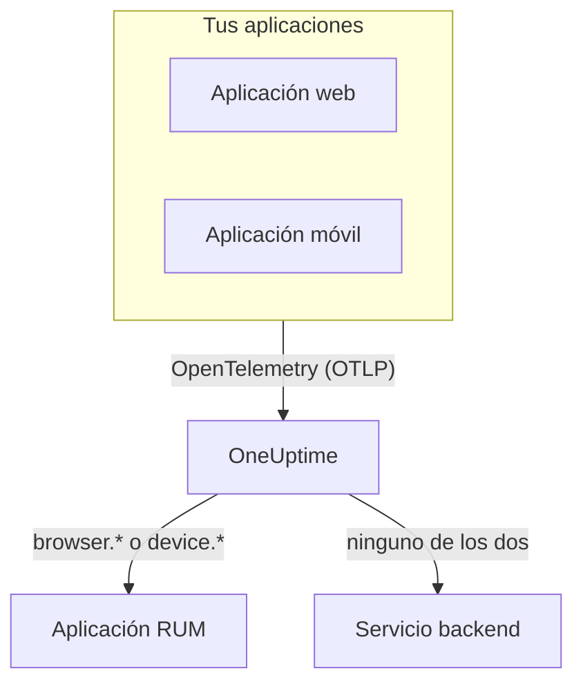

# Visión general de RUM

El Real User Monitoring (RUM) muestra lo que viven los usuarios reales en tus aplicaciones web y móviles: cargas de página, solicitudes, errores y Core Web Vitals, informados por la propia aplicación en lugar de por una sonda. OneUptime guarda esa telemetría en una aplicación RUM que puedes graficar, consultar y vigilar con alertas.

:::cards
- [Cómo funciona](#cómo-funciona): Un único pipeline de OpenTelemetry, clasificado como RUM al llegar.
- [Cómo reconoce OneUptime el RUM](#cómo-reconoce-oneuptime-el-rum): Los atributos de recurso que lo deciden.
- [Qué obtienes](#qué-obtienes): La vista general, los vitals, los exploradores y las reproducciones.
- [Primeros pasos](#primeros-pasos): De una clave de ingesta a tu primera carga de página.
:::

## Cómo funciona

El RUM usa el mismo pipeline de OpenTelemetry que el resto de OneUptime. No hay agente RUM ni un formato de transmisión propio: apuntas un SDK de OpenTelemetry para navegador o móvil a OneUptime, y la telemetría se clasifica como RUM al llegar.

- **Una aplicación por app.** Su identidad es el `service.name` que informa tu SDK, y OneUptime crea la aplicación con su primer lote de telemetría.
- **Nunca se cuenta dos veces.** La telemetría del cliente pertenece solo a su aplicación RUM; no aparece además como servicio backend.
- **La reproducción de sesiones es una capa aparte y opcional.** Tiene su propio fragmento de código y sus propios controles de privacidad: consulta [Reproducción de sesiones](/docs/telemetry/session-replay).

## Dónde encontrarlo

Abre **Productos → Recursos → Monitoreo de usuarios reales**. **Todas las aplicaciones** muestra tus aplicaciones con su **Tipo de cliente**, su **Estado** y **Visto por última vez**. Otras dos secciones del menú lateral empiezan plegadas:

- **Ajustes**: **Reglas del propietario**, **Reglas de etiquetas** y el interruptor **Reproducción de sesiones** de todo el proyecto.
- **Avanzado**: **Archivado**, las aplicaciones que archivaste.

El menú lateral de una aplicación agrupa sus páginas así; **Ajustes**, **Desarrolladores** y **Avanzado** empiezan plegadas:

| Sección | Páginas |
| --- | --- |
| **Básico** | **Vista general**, **Recomendaciones**, **Documentación** |
| **Observabilidad** | **Métricas**, **Registros**, **Trazas**, **Clientes** |
| **Reproducción de sesiones** | **Reproducción de sesiones**, **Flujos de usuarios**, **Usuarios de la reproducción**, **Salud**, **Política de reproducción**, **Registro de acceso a las reproducciones**, **Documentación** |
| **Ajustes** | **Ajustes** |
| **Desarrolladores** | **Terraform**, **API**, **Asistentes de IA** |
| **Avanzado** | **Eliminar aplicación** |

## Cómo reconoce OneUptime el RUM

La mayoría de las preguntas del tipo «mi aplicación no aparece» terminan aquí. OneUptime decide, para cada lote de telemetría al llegar, a partir de sus **atributos de recurso**:

1. Un lote cuyo recurso tiene `browser.platform`, `browser.language` o un `browser.brands` no vacío es RUM de **navegador**.
2. Si no, un lote con `device.id` o `device.model.identifier` es RUM **móvil**.
3. Si no, un lote con `device.manufacturer` y sin identidad de host (`host.name`, `host.id` o `k8s.node.name`) también es RUM **móvil**.
4. Todo lo demás es un servicio backend.

Los SDK de backend nunca definen `browser.*`, `device.id` ni `device.model.identifier`, así que son señales claras. `device.manufacturer` es la excepción: el inventario de un host también informa con él el fabricante de una máquina, por lo que solo cuenta en un recurso sin identidad de host. Consulta [Atributos de inventario](/docs/telemetry/host-otel-collector#atributos-de-inventario-ip-mac-número-de-serie-fabricante-modelo-firmware).

| Atributo | Obligatorio | Qué hace |
| --- | --- | --- |
| `service.name` | **Sí** | La identidad de la aplicación, por ejemplo `storefront-web`. Sin él no se crea ninguna aplicación RUM. |
| `browser.platform`, `browser.language`, `browser.brands` | Uno de ellos, en la web | Marca el lote como RUM de navegador. `browser.platform` también llena la página **Clientes**. |
| `device.id`, `device.model.identifier` | Uno de ellos, en móvil | Marca el lote como RUM móvil. `device.model.identifier` también llena la página **Clientes**. |
| `device.manufacturer` | No | Marca el lote como RUM móvil solo cuando el recurso no lleva identidad de host. |
| `telemetry.sdk.language` | No | Se muestra en la vista general, por ejemplo `webjs` o `swift`. |
| `telemetry.sdk.version` | No | Se muestra como versión del SDK; si falta, se lee `oneuptime.agent.version`. |
| `oneuptime.label.<name>` | No | Añade la etiqueta de proyecto `<name>:<value>` a la aplicación. |

OneUptime encuentra la aplicación por su `service.name`, sin distinguir mayúsculas y minúsculas, y la crea cuando el proyecto no tiene ninguna. Un `service.name` nuevo inicia una aplicación nueva, así que mantenlo estable y distingue los entornos con una etiqueta en lugar de con un nombre nuevo. [Gestionar aplicaciones](/docs/rum/applications) trata los nombres, las etiquetas, los propietarios y la retención.

> [!IMPORTANT]
> El SDK de OpenTelemetry para navegador no añade atributos `browser.*` a menos que añadas el detector de recursos del navegador o los definas tú. Con solo `service.name`, la telemetría se convierte en un servicio backend, no en una aplicación RUM. [Configuración para navegadores](/docs/rum/browser-setup) muestra las dos formas.

## Qué obtienes

| Dónde | Qué muestra |
| --- | --- |
| **Vista general** | Mosaicos de **Cargas de página**, **Tiempo de carga de la página (p95)**, **Eventos**, **Tasa de errores**, **Duración del evento (p95)**, **Excepciones**, **Clientes** y **Sesiones grabadas**, y gráficos de tendencia del intervalo de tiempo que elijas. |
| **Core Web Vitals** | Una tarjeta en la vista general con LCP, INP, CLS, FCP y TTFB, cada uno calificado según los límites de Google, y el INP de cada ruta de una aplicación de una sola página. Consulta [Core Web Vitals](/docs/rum/web-vitals) y [Aplicaciones de una sola página](/docs/rum/web-vitals#aplicaciones-de-una-sola-página). |
| **Métricas**, **Registros**, **Trazas** | Los exploradores de telemetría, limitados a esta aplicación. |
| **Clientes** | Las plataformas de navegador y los modelos de dispositivo en los que se ha usado la aplicación: una lista corta por plataforma, nunca una fila por usuario. |
| **Reproducción de sesiones** | Grabaciones de sesiones reales, junto a sus errores, trazas y registros: consulta [Reproducción de sesiones](/docs/telemetry/session-replay). |
| **Recomendaciones** | Monitores listos para usar con la aplicación: Core Web Vitals deficientes, solicitudes fallidas, excepciones del navegador y, en cuanto graba, presupuestos de reproducción de sesiones. |

Los recuentos salen de los spans que envía tu instrumentación. **Cargas de página** cuenta el span `documentLoad` que la instrumentación de carga de página registra en cada carga completa, así que un cambio de ruta dentro de una aplicación de una sola página no es una carga de página.

Una aplicación muestra **Conectado** mientras llega telemetría y **Desconectado** tras 15 minutos sin ella. El tiempo en que OneUptime estuvo caído o poniéndose al día con su cola de ingesta no cuenta para esos 15 minutos.

## Primeros pasos

:::steps
### Crear una clave de ingesta

Abre **Ajustes del proyecto → Telemetría y APM → Claves de ingesta** y haz clic en **Crear clave de ingesta**. Una aplicación web necesita una clave de **Navegador**, que solo funciona desde los orígenes que indiques. Una aplicación móvil necesita una clave de **Servidor**, porque un SDK móvil no envía el encabezado `Origin`.

### Instrumentar tu aplicación

Sigue [Configuración para navegadores](/docs/rum/browser-setup) para una aplicación web, o [Configuración para móviles](/docs/rum/mobile-setup) para Android, iOS, React Native y otras plataformas.

### Abrir una página

Carga una página de tu sitio o abre tu aplicación. La aplicación aparece en **Productos → Recursos → Monitoreo de usuarios reales** con su primer lote de telemetría, con el nombre de su `service.name`. No hace falta crearla antes.

### Añadir vitals y reproducciones

Cuando lleguen los datos básicos, envía los [Core Web Vitals](/docs/rum/web-vitals) y añade la [Reproducción de sesiones](/docs/telemetry/session-replay). Ambos son opcionales.
:::

Si no aparece nada, [Solución de problemas de RUM](/docs/rum/troubleshooting) repasa las causas en el orden en que suelen ocurrir.

## Próximos pasos

:::cards
- [Configuración para navegadores](/docs/rum/browser-setup): Instrumentar una aplicación web con el SDK de OpenTelemetry para navegador.
- [Configuración para móviles](/docs/rum/mobile-setup): Android, iOS, React Native y cualquier otro SDK de OpenTelemetry.
- [Core Web Vitals](/docs/rum/web-vitals): Enviar LCP, INP, CLS, FCP y TTFB, y leer el INP ruta por ruta.
- [Reproducción de sesiones](/docs/telemetry/session-replay): Ver lo que vio el usuario, junto a sus errores y trazas.
:::
