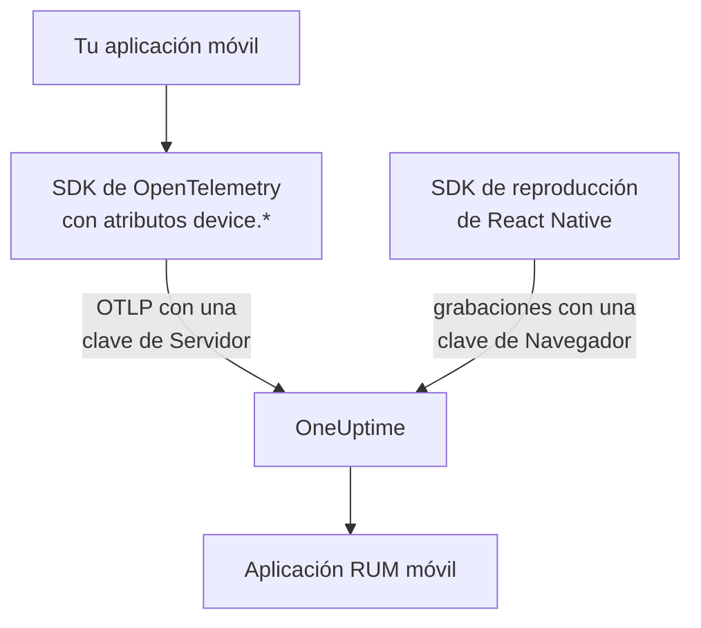

# Configuración para móviles

Instrumenta una aplicación Android, iOS o React Native con OpenTelemetry para que se informe a OneUptime como aplicación RUM móvil. Cualquier otra plataforma con un SDK de OpenTelemetry funciona igual.

:::cards
- [Qué necesita OneUptime](#qué-necesita-oneuptime): Dos atributos de recurso, enviados con una clave de Servidor.
- [Configurar tu plataforma](#configurar-tu-plataforma): Android, iOS, React Native y el resto.
- [Comprobar que llega](#comprobar-que-llega): Probar la clave y luego encontrar la aplicación.
- [Reproducción de sesiones en móviles](#reproducción-de-sesiones-en-móviles): Grabaciones para aplicaciones React Native.
:::

## Cómo funciona

Tu aplicación exporta OTLP directamente a OneUptime con una clave de ingesta de **Servidor**. Los atributos `device.*` de su recurso son los que la clasifican como RUM móvil en lugar de como servicio backend.



## Qué necesita OneUptime

Dos atributos de recurso, en cada lote que exporta tu aplicación:

| Atributo | Qué es |
| --- | --- |
| `service.name` | La identidad de la aplicación, por ejemplo `storefront-android`. |
| `device.id` o `device.model.identifier` | Marca la telemetría como RUM móvil. `device.model.identifier` también llena la página **Clientes**. |

Sin un atributo de dispositivo, la telemetría llega igualmente y puedes consultarla, pero se archiva como servicio backend en lugar de como aplicación RUM.

`device.manufacturer` también marca un lote como móvil, pero solo en un recurso sin identidad de host, porque el inventario de un host informa con él el fabricante de una máquina. Define además `device.id` o `device.model.identifier`, como hace cada receta de abajo, y esto nunca importará.

Haz que `device.id` sea un identificador propio de cada instalación, nunca un ID de publicidad ni nada que identifique a una persona. OneUptime solo lo lee para reconocer la telemetría móvil.

## Antes de empezar

- Una aplicación con un SDK de OpenTelemetry: el SDK de OpenTelemetry para Java u OpenTelemetry Android, opentelemetry-swift o el SDK de OpenTelemetry para JavaScript en React Native.
- Una clave de ingesta de **Servidor**, creada en **Ajustes del proyecto → Telemetría y APM → Claves de ingesta** con **Crear clave de ingesta**. Una clave de **Navegador** se rechaza desde una aplicación móvil: se comprueba contra el encabezado `Origin`, que los SDK móviles no envían.
- Estos ajustes de OTLP. Si alojas OneUptime tú mismo, sustituye `https://oneuptime.com` por tu propio host.

| Ajuste | Valor |
| --- | --- |
| Endpoint de OTLP | `https://oneuptime.com/otlp` |
| Encabezado | `x-oneuptime-token: YOUR_TELEMETRY_INGESTION_TOKEN` |
| Trazas | `POST https://oneuptime.com/otlp/v1/traces` |
| Métricas | `POST https://oneuptime.com/otlp/v1/metrics` |
| Registros | `POST https://oneuptime.com/otlp/v1/logs` |

> [!WARNING]
> La clave viaja dentro de tu aplicación, y una aplicación se puede desempaquetar, así que da por hecho que alguien la copiará. En la página de la clave, define un **Nombre de servicio fijado** para que una copia no pueda escribir con los nombres de tus servicios backend, añade un **Límite de solicitudes por minuto** y una fecha en **Caduca el**, y rota la clave con cada versión.

## Configurar tu plataforma

Los fragmentos muestran la forma de la configuración. Los SDK móviles de OpenTelemetry cambian sus API entre versiones, así que comprueba los nombres de los métodos en la versión que fijes. Lo que necesita OneUptime nunca cambia: el endpoint, el encabezado, `service.name` y un atributo `device.*`.

:::tabs
@tab Android
Usa el SDK de OpenTelemetry para Java y su exportador OTLP, que funcionan en Android:

```kotlin title="app/build.gradle.kts"
dependencies {
    implementation(platform("io.opentelemetry:opentelemetry-bom:<latest>"))
    implementation("io.opentelemetry:opentelemetry-sdk")
    implementation("io.opentelemetry:opentelemetry-exporter-otlp")
}
```

```kotlin title="StorefrontApplication.kt"
import android.app.Application
import android.os.Build
import io.opentelemetry.exporter.otlp.http.trace.OtlpHttpSpanExporter
import io.opentelemetry.sdk.OpenTelemetrySdk
import io.opentelemetry.sdk.resources.Resource
import io.opentelemetry.sdk.trace.SdkTracerProvider
import io.opentelemetry.sdk.trace.export.BatchSpanProcessor

class StorefrontApplication : Application() {
    override fun onCreate() {
        super.onCreate()

        val resource = Resource.getDefault().toBuilder()
            .put("service.name", "storefront-android")
            .put("device.manufacturer", Build.MANUFACTURER)
            .put("device.model.identifier", Build.MODEL)
            .build()

        val exporter = OtlpHttpSpanExporter.builder()
            .setEndpoint("https://oneuptime.com/otlp/v1/traces")
            .addHeader("x-oneuptime-token", BuildConfig.ONEUPTIME_TOKEN)
            .build()

        OpenTelemetrySdk.builder()
            .setTracerProvider(
                SdkTracerProvider.builder()
                    .setResource(resource)
                    .addSpanProcessor(BatchSpanProcessor.builder(exporter).build())
                    .build()
            )
            .buildAndRegisterGlobal()
    }
}
```

El agente [OpenTelemetry Android](https://github.com/open-telemetry/opentelemetry-android) añade instrumentación automática por encima y define atributos de dispositivo en su propio recurso. Si lo usas, apunta su exportador al mismo endpoint y encabezado, y comprueba que `device.model.identifier` llega al recurso en tu versión.
@tab iOS
Usa [opentelemetry-swift](https://github.com/open-telemetry/opentelemetry-swift) y define tú los atributos de dispositivo: el recurso que cada versión añade por su cuenta ha cambiado entre versiones.

```swift
let resource = Resource(attributes: [
    "service.name": .string("storefront-ios"),
    "device.model.identifier": .string(UIDevice.current.model),
    "device.manufacturer": .string("Apple"),
    "telemetry.sdk.language": .string("swift"),
])

let exporter = OtlpHttpTraceExporter(
    endpoint: URL(string: "https://oneuptime.com/otlp/v1/traces")!,
    config: OtlpConfiguration(
        headers: [("x-oneuptime-token", oneUptimeToken)]
    )
)

OpenTelemetry.registerTracerProvider(
    tracerProvider: TracerProviderBuilder()
        .with(resource: resource)
        .add(spanProcessor: BatchSpanProcessor(spanExporter: exporter))
        .build()
)
```

`UIDevice.current.model` da un nombre corto como `iPhone`, lo que deja la página **Clientes** en una fila por tipo de dispositivo.
@tab React Native
React Native ejecuta el SDK de OpenTelemetry para JavaScript, así que construye el provider, el exportador OTLP y el procesador de lotes como en [Configuración para navegadores](/docs/rum/browser-setup), con tres cambios: envía con una clave de **Servidor**, quita `browserDetector` y `DocumentLoadInstrumentation`, y define tú los atributos de dispositivo.

```ts
import { Platform } from "react-native";
import * as Device from "expo-device"; // or react-native-device-info
import {
  defaultResource,
  resourceFromAttributes,
} from "@opentelemetry/resources";

const resource = defaultResource().merge(
  resourceFromAttributes({
    "service.name": "storefront-mobile",
    "device.manufacturer": Device.manufacturer ?? Platform.OS,
    "device.model.identifier":
      Device.modelId ?? Device.modelName ?? "unknown",
    "telemetry.sdk.language": "webjs",
  }),
);
```

`Device.modelId` solo se define en iOS, así que Android recurre a `Device.modelName`.
@tab Otras plataformas
Flutter, Unity, .NET MAUI, un cliente embebido o un escritor de OTLP propio funcionan, siempre que el recurso lleve `service.name` y un atributo `device.*`. Un SDK que lee las variables de entorno estándar de OpenTelemetry las toma tal cual:

```bash
OTEL_EXPORTER_OTLP_ENDPOINT="https://oneuptime.com/otlp"
OTEL_EXPORTER_OTLP_HEADERS="x-oneuptime-token=YOUR_TELEMETRY_INGESTION_TOKEN"
OTEL_RESOURCE_ATTRIBUTES="service.name=storefront-mobile,device.manufacturer=Acme,device.model.identifier=AC-100"
```

El SDK añade por su cuenta `/v1/traces`, `/v1/metrics` y `/v1/logs` al endpoint.
:::

## Comprobar que llega

:::steps
### Probar la clave

Antes de revisar los ajustes del SDK, pregunta a OneUptime si acepta la clave:

```bash
curl -i https://oneuptime.com/otlp/v1/validate \
  -H "x-oneuptime-token: YOUR_TELEMETRY_INGESTION_TOKEN"
```

`200` con `"valid": true` significa que la clave se acepta. Una clave de Navegador también responde `200`, pero su mensaje dice que solo funciona desde un navegador: una aplicación móvil necesita una clave de Servidor. `401` significa que la clave es desconocida, se revocó, se desactivó o caducó, y ningún ajuste del SDK lo arreglará.

### Iniciar la aplicación

Ejecuta la aplicación y úsala un momento. Aparece en **Productos → Recursos → Monitoreo de usuarios reales** con su primer lote de telemetría, con el nombre de su `service.name`.

### Abrir la página Clientes

Abre la página **Clientes** de la aplicación: cada modelo de dispositivo de `device.model.identifier` tiene una fila. Si la página sigue vacía mientras **Trazas** se llena, los atributos de dispositivo no llegan al recurso.
:::

## Reproducción de sesiones en móviles

Las aplicaciones React Native pueden grabar sesiones con `@oneuptime/react-native-replay`. Graba el árbol de vistas nativo como una estructura alámbrica, nunca capturas de pantalla ni el texto en pantalla, y sus grabaciones se abren en el mismo reproductor que las web. Envía con una clave de **Navegador** cuyos **Orígenes permitidos** incluyen tu aplicación como `app://` seguido de su ID de aplicación de Android o su ID de paquete de iOS: una clave distinta de la clave de Servidor que usa tu SDK de OpenTelemetry. [Instalar en React Native](/docs/telemetry/session-replay#install-in-react-native) te guía paso a paso.

Las aplicaciones nativas de Android e iOS, y las demás plataformas, no tienen grabador de sesiones: su página **Reproducción de sesiones** sigue vacía, mientras que las trazas, los registros, las métricas, las excepciones y la página **Clientes** funcionan con normalidad.

## Solución de problemas

:::details La comprobación de la clave devuelve 401, o la clave se rechaza
Un `401` significa que la clave es desconocida, se revocó, se desactivó o caducó: crea una clave de Servidor y vuelve a compilar la aplicación con ella.

Una clave de Navegador supera la comprobación, pero cada exportación desde una aplicación móvil se rechaza con un `422` que dice `This request did not send an Origin header, so it cannot be checked against the allowed origins of this browser ingestion key. Use a server ingestion key for requests that are not sent by a browser.` Usa una clave de **Servidor**.
:::

:::details La aplicación aparece en Servicios en lugar de en Monitoreo de usuarios reales
El recurso no tiene `device.id` ni `device.model.identifier`, así que la telemetría se archivó como servicio backend. Defínelos como en [Configurar tu plataforma](#configurar-tu-plataforma).

El servicio ya creado no se convierte en una aplicación RUM, así que elimínalo en **Productos → Servicios** cuando llegue la telemetría RUM.
:::

:::details La página Clientes está vacía
Las filas de clientes salen solo de `device.model.identifier`. Un SDK que solo define `device.id` o `device.manufacturer` archiva la aplicación como RUM móvil, pero no lista clientes: define también `device.model.identifier`.
:::

:::details El estado dice Desconectado aunque la gente usa la aplicación
El estado pasa a **Desconectado** tras 15 minutos sin telemetría. Si la gente está usando la aplicación:

- Puede que un muestreador lo descarte todo: busca un muestreador always-off o una proporción muy baja.
- Puede que la aplicación solo envíe telemetría por acciones que nadie hizo en ese tiempo.
- Puede que la clave se haya revocado o haya caducado desde la versión: pruébala como en [Comprobar que llega](#comprobar-que-llega).
:::

## Próximos pasos

:::cards
- [Reproducción de sesiones](/docs/telemetry/session-replay): Grabar sesiones de React Native, junto a sus trazas.
- [Gestionar aplicaciones](/docs/rum/applications): Nombres, etiquetas, propietarios y retención.
- [OpenTelemetry](/docs/telemetry/open-telemetry): Los endpoints, límites y errores de OTLP en detalle.
- [Solución de problemas de RUM](/docs/rum/troubleshooting): Cada comprobación, en el orden en que suelen aparecer los problemas.
:::
