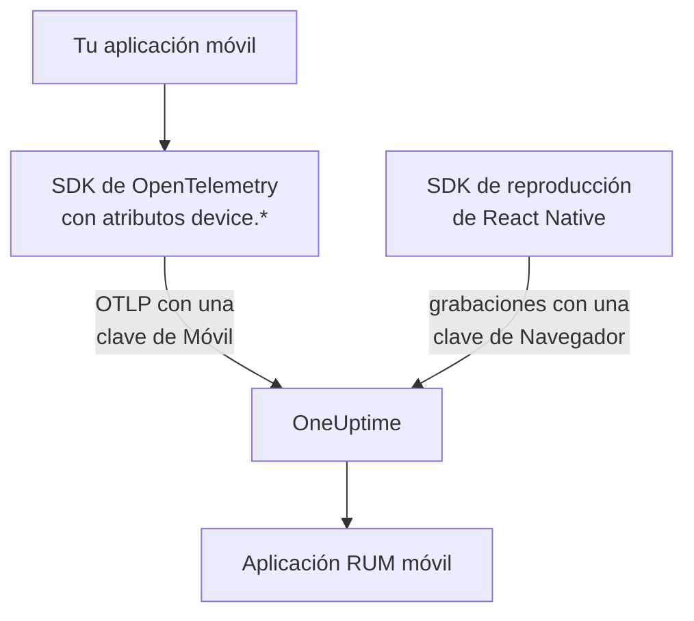

# Configuración para móviles

Instrumenta una aplicación Android, iOS o React Native con OpenTelemetry para que se informe a OneUptime como aplicación RUM móvil. Cualquier otra plataforma con un SDK de OpenTelemetry funciona igual.

:::cards
- [Qué necesita OneUptime](#qué-necesita-oneuptime): Dos atributos de recurso, enviados con una clave de Móvil.
- [Configurar tu plataforma](#configurar-tu-plataforma): Android, iOS, React Native y el resto.
- [Fallos y bloqueos en iOS](#fallos-y-bloqueos-en-ios): Los informes de MetricKit y de KSCrash en Excepciones, nombrados con tus dSYM.
- [Comprobar que llega](#comprobar-que-llega): Probar la clave y luego encontrar la aplicación.
- [Reproducción de sesiones en móviles](#reproducción-de-sesiones-en-móviles): Grabaciones para aplicaciones React Native.
:::

## Cómo funciona

Tu aplicación exporta OTLP directamente a OneUptime con una clave de ingesta de **Móvil**, fijada a la aplicación, así que todo lo que envía se archiva como esa aplicación RUM móvil. Con cualquier otra clave, los atributos `device.*` de su recurso son los que la clasifican como RUM móvil en lugar de como servicio backend.



## Qué necesita OneUptime

Dos atributos de recurso, en cada lote que exporta tu aplicación:

| Atributo | Qué es |
| --- | --- |
| `service.name` | La identidad de la aplicación, por ejemplo `storefront-android`. |
| `device.id` o `device.model.identifier` | Marca la telemetría como RUM móvil. `device.model.identifier` también llena la página **Clientes**. |

Enviada con cualquier otra clave, la telemetría sin un atributo de dispositivo llega igualmente y puedes consultarla, pero se archiva como servicio backend en lugar de como aplicación RUM.

`device.manufacturer` también marca un lote como móvil, pero solo en un recurso sin identidad de host, porque el inventario de un host informa con él el fabricante de una máquina. Define además `device.id` o `device.model.identifier`, como hace cada receta de abajo, y esto nunca importará.

Haz que `device.id` sea un identificador propio de cada instalación, nunca un ID de publicidad ni nada que identifique a una persona. OneUptime solo lo lee para reconocer la telemetría móvil.

## Antes de empezar

- Una aplicación con un SDK de OpenTelemetry: el SDK de OpenTelemetry para Java u OpenTelemetry Android, opentelemetry-swift o el SDK de OpenTelemetry para JavaScript en React Native.
- Una clave de ingesta de **Móvil**, creada en **Ajustes del proyecto → Telemetría y APM → Claves de ingesta** con **Crear clave de ingesta**, con el `service.name` de tu aplicación en **Nombre de servicio fijado**. Una clave de **Navegador** se rechaza desde una aplicación móvil: se comprueba contra el encabezado `Origin`, que los SDK móviles no envían. Nunca distribuyas una clave de **Servidor** en una aplicación.
- Estos ajustes de OTLP. Si alojas OneUptime tú mismo, sustituye `https://oneuptime.com` por tu propio host.

| Ajuste | Valor |
| --- | --- |
| Endpoint de OTLP | `https://oneuptime.com/otlp` |
| Encabezado | `x-oneuptime-token: YOUR_TELEMETRY_INGESTION_TOKEN` |
| Trazas | `POST https://oneuptime.com/otlp/v1/traces` |
| Métricas | `POST https://oneuptime.com/otlp/v1/metrics` |
| Registros | `POST https://oneuptime.com/otlp/v1/logs` |

> [!WARNING]
> La clave viaja dentro de tu aplicación, y una aplicación se puede desempaquetar, así que da por hecho que alguien la copiará. Una copia de una clave de Móvil solo puede enviar las trazas, los registros y las métricas de esta aplicación, archivados con su **Nombre de servicio fijado**, y nunca desde una página web. Aun así puede enviar datos inventados para esta aplicación, hasta el **Límite de solicitudes por minuto** de la clave, así que añade una fecha en **Caduca el** y rota la clave con cada versión.

## Configurar tu plataforma

Los fragmentos muestran la forma de la configuración. Los SDK móviles de OpenTelemetry cambian sus API entre versiones, así que comprueba los nombres de los métodos en la versión que fijes. Lo que necesita OneUptime nunca cambia: el endpoint, el encabezado, `service.name` y un atributo `device.*`.

:::tabs
@tab Android
Usa el SDK de OpenTelemetry para Java y su exportador OTLP, que funcionan en Android:

```kotlin title="app/build.gradle.kts"
dependencies {
    implementation(platform("io.opentelemetry:opentelemetry-bom:<latest>"))
    implementation("io.opentelemetry:opentelemetry-sdk")
    implementation("io.opentelemetry:opentelemetry-exporter-otlp")
}
```

```kotlin title="StorefrontApplication.kt"
import android.app.Application
import android.os.Build
import io.opentelemetry.exporter.otlp.http.trace.OtlpHttpSpanExporter
import io.opentelemetry.sdk.OpenTelemetrySdk
import io.opentelemetry.sdk.resources.Resource
import io.opentelemetry.sdk.trace.SdkTracerProvider
import io.opentelemetry.sdk.trace.export.BatchSpanProcessor

class StorefrontApplication : Application() {
    override fun onCreate() {
        super.onCreate()

        val resource = Resource.getDefault().toBuilder()
            .put("service.name", "storefront-android")
            .put("device.manufacturer", Build.MANUFACTURER)
            .put("device.model.identifier", Build.MODEL)
            .build()

        val exporter = OtlpHttpSpanExporter.builder()
            .setEndpoint("https://oneuptime.com/otlp/v1/traces")
            .addHeader("x-oneuptime-token", BuildConfig.ONEUPTIME_TOKEN)
            .build()

        OpenTelemetrySdk.builder()
            .setTracerProvider(
                SdkTracerProvider.builder()
                    .setResource(resource)
                    .addSpanProcessor(BatchSpanProcessor.builder(exporter).build())
                    .build()
            )
            .buildAndRegisterGlobal()
    }
}
```

El agente [OpenTelemetry Android](https://github.com/open-telemetry/opentelemetry-android) añade por encima fallos, ANR, fotogramas lentos y congelados e inicios de la aplicación, y define `device.model.identifier` y `device.manufacturer` en su propio recurso. [Configuración para Android](/docs/rum/android-setup) lo configura en lugar del código de arriba.
@tab iOS
Usa [opentelemetry-swift](https://github.com/open-telemetry/opentelemetry-swift) y define tú los atributos de dispositivo: el recurso que cada versión añade por su cuenta ha cambiado entre versiones.

```swift
let resource = Resource(attributes: [
    "service.name": .string("storefront-ios"),
    "device.model.identifier": .string(UIDevice.current.model),
    "device.manufacturer": .string("Apple"),
    "device.id": .string(UIDevice.current.identifierForVendor?.uuidString ?? ""),
    "telemetry.sdk.language": .string("swift"),
])

let exporter = OtlpHttpTraceExporter(
    endpoint: URL(string: "https://oneuptime.com/otlp/v1/traces")!,
    config: OtlpConfiguration(
        headers: [("x-oneuptime-token", oneUptimeToken)]
    )
)

OpenTelemetry.registerTracerProvider(
    tracerProvider: TracerProviderBuilder()
        .with(resource: resource)
        .add(spanProcessor: BatchSpanProcessor(spanExporter: exporter))
        .build()
)
```

`UIDevice.current.model` da un nombre corto como `iPhone`, lo que deja la página **Clientes** en una fila por tipo de dispositivo. `identifierForVendor` es la instalación por la que OneUptime cuenta las instalaciones sin fallos, como indica [Registrar las sesiones](#registrar-las-sesiones).
@tab React Native
React Native ejecuta el SDK de OpenTelemetry para JavaScript, así que construye el provider, el exportador OTLP y el procesador de lotes como en [Configuración para navegadores](/docs/rum/browser-setup), con tres cambios: envía con una clave de **Móvil**, quita `browserDetector` y `DocumentLoadInstrumentation`, y define tú los atributos de dispositivo.

```ts
import { Platform } from "react-native";
import * as Device from "expo-device"; // or react-native-device-info
import {
  defaultResource,
  resourceFromAttributes,
} from "@opentelemetry/resources";

const resource = defaultResource().merge(
  resourceFromAttributes({
    "service.name": "storefront-mobile",
    "device.manufacturer": Device.manufacturer ?? Platform.OS,
    "device.model.identifier":
      Device.modelId ?? Device.modelName ?? "unknown",
    "telemetry.sdk.language": "webjs",
  }),
);
```

`Device.modelId` solo se define en iOS, así que Android recurre a `Device.modelName`.
@tab Otras plataformas
Flutter, Unity, .NET MAUI, un cliente embebido o un escritor de OTLP propio funcionan, siempre que el recurso lleve `service.name` y un atributo `device.*`. Un SDK que lee las variables de entorno estándar de OpenTelemetry las toma tal cual:

```bash
OTEL_EXPORTER_OTLP_ENDPOINT="https://oneuptime.com/otlp"
OTEL_EXPORTER_OTLP_HEADERS="x-oneuptime-token=YOUR_TELEMETRY_INGESTION_TOKEN"
OTEL_RESOURCE_ATTRIBUTES="service.name=storefront-mobile,device.manufacturer=Acme,device.model.identifier=AC-100"
```

El SDK añade por su cuenta `/v1/traces`, `/v1/metrics` y `/v1/logs` al endpoint.
:::

## Fallos y bloqueos en iOS

opentelemetry-swift 2.3 y posteriores informan de los fallos y bloqueos de una aplicación iOS mediante su instrumentación de MetricKit, que entrega cada uno de los diagnósticos de Apple a OpenTelemetry como un registro. OneUptime los archiva igual que los fallos y los ANR de OpenTelemetry Android, así que aparecen en **Excepciones** y en la **Vista general** de la aplicación:

| Diagnóstico de Apple | Nombre del evento | En Excepciones |
| --- | --- | --- |
| Un fallo | `metrickit.diagnostic.crash` | Una excepción no controlada, cuyo tipo es lo que terminó la aplicación: la excepción de Objective-C en iOS 17 y posteriores; si no, la excepción de Mach (`EXC_BAD_ACCESS`); si no, la señal (`SIGSEGV`) |
| Un bloqueo | `metrickit.diagnostic.hang` | Una excepción no controlada de tipo **Hang**, el equivalente en iOS de un ANR, que conserva cuánto duró el bloqueo |

El mosaico **Fallos** de la vista general cuenta los fallos, y su mosaico **ANR** cuenta los bloqueos junto con los ANR de Android. Cada stack trace se dibuja como los hilos de un informe de fallo, empezando por el hilo que falló o se bloqueó. Un frame del código de tu aplicación se nombra por su función, como `CartViewController.checkout()`, una vez subido el dSYM de su compilación, como en [Subir tus dSYM](#subir-tus-dsym). Cualquier otro frame nombra su binario y en qué punto de él estaba el código, y **Binary Images** lista el UUID de cada binario, que indica el dSYM de qué compilación lo nombra.

Los fallos y los bloqueos se agrupan por los frames de tu aplicación en el hilo que falló o se bloqueó: por sus funciones donde un dSYM los nombró, así que un fallo sigue siendo una sola excepción de una versión a la siguiente, y por sus desplazamientos dentro del binario donde ninguno lo hizo, que cambian con cada compilación. Un informe se nombra al llegar, así que sube los dSYM de una compilación antes de publicarla: un fallo que llegó antes que su dSYM conserva sus desplazamientos.

:::steps
### Exportar registros además de spans

MetricKit informa de los diagnósticos como registros, así que registra un proveedor de loggers junto al proveedor de trazadores, con el mismo recurso, el mismo endpoint y el mismo encabezado:

```swift
let logExporter = OtlpHttpLogExporter(
    endpoint: URL(string: "https://oneuptime.com/otlp/v1/logs")!,
    config: OtlpConfiguration(
        headers: [("x-oneuptime-token", oneUptimeToken)]
    )
)

OpenTelemetry.registerLoggerProvider(
    loggerProvider: LoggerProviderBuilder()
        .with(resource: resource)
        .with(processors: [
            BatchLogRecordProcessor(logRecordExporter: logExporter),
        ])
        .build()
)
```

### Registrar la instrumentación de MetricKit

Añade el producto `MetricKitInstrumentation` de opentelemetry-swift y regístralo en MetricKit una vez registrado el proveedor de loggers:

```swift
import MetricKit
import MetricKitInstrumentation

// MXMetricManager keeps only a weak reference: hold this for the app's lifetime.
let metricKitInstrumentation = MetricKitInstrumentation()
MXMetricManager.shared.add(metricKitInstrumentation)
```

### Registrar las sesiones

Los mosaicos **Sesiones** y **Sesiones sin fallos** cuentan el `session.id` de tus spans. El producto `Sessions` de opentelemetry-swift lo define: añade `SessionSpanProcessor` al proveedor de trazadores y envuelve el procesador de registros en `SessionLogRecordProcessor`, para que los diagnósticos también lleven una sesión.

La línea bajo **Sesiones sin fallos** indica la proporción de instalaciones que no tuvieron fallos, y **Daily Crash Rate** y **Daily ANR Rate** alertan sobre la proporción que sí los tuvo. Una instalación es el `device.id` del recurso anterior, el identificador de la aplicación para el proveedor: uno por dispositivo para todas tus aplicaciones, que se conserva mientras alguna de ellas siga instalada, así que reinstalar tu única aplicación crea una instalación nueva y reinstalar una de dos no. Una versión de opentelemetry-swift que defina `app.installation.id` se cuenta por este en su lugar.

### Subir tus dSYM

Xcode escribe un dSYM para cada uno de los binarios de tu aplicación cuando la archiva, y App Store Connect te los devuelve en **Download dSYMs**. Súbelos después de cada archivado, desde la CI o una fase de compilación de Xcode, con la [CLI de OneUptime](/docs/cli/index) y una clave de Servidor propia de tu compilación: una clave con un **Nombre de servicio fijado**, como la que lleva tu aplicación, se rechaza, porque un dSYM nombra los frames de todas las aplicaciones del proyecto que incluyen su binario.

```bash
oneuptime dsym upload "$ARCHIVE_PATH/dSYMs" --app storefront-ios --url https://oneuptime.com --ingestion-key YOUR_TELEMETRY_INGESTION_TOKEN
```

La CLI lee paquetes `.dSYM`, carpetas y archivos zip que los contienen, y archivos DWARF allí donde estén, y envía solo el UUID, la arquitectura y los nombres de funciones de cada binario: los dSYM de una aplicación grande ocupan cientos de megabytes, y sus nombres, unos pocos. Sin la CLI, envía el archivo DWARF de un dSYM, o un zip de paquetes `.dSYM`, tal cual, hasta 50 MB por archivo:

```bash
curl --fail -X POST "https://oneuptime.com/dsyms/v1/upload" \
  -H "x-oneuptime-token: YOUR_TELEMETRY_INGESTION_TOKEN" \
  -F "appName=storefront-ios" \
  -F "dsym=@MyApp.app.dSYM/Contents/Resources/DWARF/MyApp"
```

Cada binario se conserva por su UUID durante 400 días, así que una versión que sigue en los teléfonos de la gente meses después se sigue nombrando, y volver a subir una compilación reemplaza lo que se conservaba de ella. Un dSYM pertenece al proyecto, no a una aplicación: un framework que incrustan dos de tus aplicaciones se nombra en ambas.
:::

> [!NOTE]
> Apple entrega los diagnósticos de MetricKit a la aplicación en un inicio posterior, de inmediato en iOS 15 y posteriores y una vez al día en versiones anteriores, así que un fallo o un bloqueo puede llegar minutos o un día después de ocurrir, y se cuenta cuando llega. «0 fallos en la última hora» en la vista general de una aplicación iOS todavía no es una buena noticia. Un diagnóstico lleva la sesión que lo informó, no la que terminó.

opentelemetry-swift no registra ningún span cuando se inicia la aplicación, así que los mosaicos **Inicios de la aplicación** e **Inicio en frío (p95)** siguen vacíos hasta que tu aplicación registre uno: un span llamado `AppStart`, con `start.type` definido como `cold`, `warm` o `hot`, desde que arranca el proceso hasta que la primera pantalla está lista.

### Cuando KSCrash también informa de un fallo

opentelemetry-swift también puede informar de los fallos mediante KSCrash, que envía su informe como un registro `device.crash` la próxima vez que se abre la aplicación, con la hora en que la aplicación falló. Una aplicación que registra ambos informa de cada fallo dos veces: KSCrash en el siguiente inicio, MetricKit en el siguiente inicio o hasta un día después. OneUptime cuenta un fallo así una sola vez: el primer informe en llegar es la ocurrencia, y el segundo se conserva a su lado, en la misma excepción, como prueba del mismo fallo, sin contarse en ningún mosaico, gráfico ni monitor. En las **Ocurrencias** de la excepción, la ocurrencia indica **Informado dos veces**.

Dos informes se toman por un mismo fallo solo cuando se cumple todo esto:

- Vienen de los dos informadores, KSCrash y MetricKit. Ninguno informa dos veces de un mismo fallo, así que dos informes del mismo informador son dos fallos.
- Vienen de la misma instalación: el mismo `app.installation.id`, o `device.id`.
- Los separan como mucho 26 horas: MetricKit marca un fallo con el final del día sobre el que informa, y KSCrash, con el momento del fallo.
- Coinciden en la señal, la excepción Mach y la excepción de Objective-C, siempre que ambos nombren una.
- Los hilos que fallaron coinciden frame a frame desde donde empezó el hilo hacia dentro, por binario y desplazamiento, en cada frame del código de tu aplicación que nombre cualquiera de los dos. Un fallo que ocurre por completo en el código de Apple debe coincidir en al menos tres frames, y en todos ellos.

Cada informe se empareja una sola vez, con el más cercano en el tiempo, así que dos fallos del mismo error en una instalación, con minutos de diferencia, son dos ocurrencias, cada una con su segundo informe. Cuando OneUptime no puede comparar un informe con los demás de su instalación, lo cuenta, así que en el peor de los casos un fallo se cuenta dos veces, pero nunca se pierde.

## Comprobar que llega

:::steps
### Probar la clave

Antes de revisar los ajustes del SDK, pregunta a OneUptime si acepta la clave:

```bash
curl -i https://oneuptime.com/otlp/v1/validate \
  -H "x-oneuptime-token: YOUR_TELEMETRY_INGESTION_TOKEN"
```

`200` con `"valid": true` significa que la clave se acepta. Una clave de Navegador también responde `200`, pero su mensaje dice que solo funciona desde un navegador: una aplicación móvil necesita una clave de Móvil. `401` significa que la clave es desconocida, se revocó, se desactivó o caducó, y ningún ajuste del SDK lo arreglará.

### Iniciar la aplicación

Ejecuta la aplicación y úsala un momento. Aparece en **Productos → Recursos → Monitoreo de usuarios reales** con su primer lote de telemetría, con el nombre de su `service.name`.

### Abrir la página Clientes

Abre la página **Clientes** de la aplicación: cada modelo de dispositivo de `device.model.identifier` tiene una fila. Si la página sigue vacía mientras **Trazas** se llena, los atributos de dispositivo no llegan al recurso.
:::

## Reproducción de sesiones en móviles

Las aplicaciones React Native pueden grabar sesiones con `@oneuptime/react-native-replay`. Graba el árbol de vistas nativo como una estructura alámbrica, nunca capturas de pantalla ni el texto en pantalla, y sus grabaciones se abren en el mismo reproductor que las web. Envía con una clave de **Navegador** cuyos **Orígenes permitidos** incluyen tu aplicación como `app://` seguido de su ID de aplicación de Android o su ID de paquete de iOS: una clave distinta de la clave de Móvil que usa tu SDK de OpenTelemetry. [Instalar en React Native](/docs/telemetry/session-replay#instalación-en-react-native) te guía paso a paso.

Las aplicaciones nativas de Android e iOS, y las demás plataformas, no tienen grabador de sesiones: su página **Reproducción de sesiones** sigue vacía, mientras que las trazas, los registros, las métricas, las excepciones y la página **Clientes** funcionan con normalidad.

## Solución de problemas

:::details La comprobación de la clave devuelve 401, o la clave se rechaza
Un `401` significa que la clave es desconocida, se revocó, se desactivó o caducó: crea una clave de Móvil y vuelve a compilar la aplicación con ella.

Una clave de Navegador supera la comprobación, pero cada exportación desde una aplicación móvil se rechaza con un `422` que dice `This request did not send an Origin header, so it cannot be checked against the allowed origins of this browser ingestion key. Use a mobile ingestion key in a mobile app, and a server ingestion key on a server.` Usa una clave de **Móvil**. Una clave de Móvil también se rechaza con un `422` por gRPC y desde una página web: exporta por OTLP/HTTP.
:::

:::details La aplicación aparece en Servicios en lugar de en Monitoreo de usuarios reales
La telemetría se envió con una clave que no es de Móvil, y su recurso no tiene `device.id` ni `device.model.identifier`, así que se archivó como servicio backend. Envía con una clave de Móvil, o defínelos como en [Configurar tu plataforma](#configurar-tu-plataforma).

El servicio ya creado no se convierte en una aplicación RUM, así que elimínalo en **Productos → Servicios** cuando llegue la telemetría RUM.
:::

:::details La página Clientes está vacía
Las filas de clientes salen solo de `device.model.identifier`. Un SDK que solo define `device.id` o `device.manufacturer` archiva la aplicación como RUM móvil, pero no lista clientes: define también `device.model.identifier`.
:::

:::details El estado dice Sin tráfico reciente aunque la gente usa la aplicación
El estado pasa a **Sin tráfico reciente** tras 15 minutos sin telemetría. Si la gente está usando la aplicación:

- Puede que un muestreador lo descarte todo: busca un muestreador always-off o una proporción muy baja.
- Puede que la aplicación solo envíe telemetría por acciones que nadie hizo en ese tiempo.
- Puede que la clave se haya revocado o haya caducado desde la versión: pruébala como en [Comprobar que llega](#comprobar-que-llega).
:::

## Próximos pasos

:::cards
- [Reproducción de sesiones](/docs/telemetry/session-replay): Grabar sesiones de React Native, junto a sus trazas.
- [Gestionar aplicaciones](/docs/rum/applications): Nombres, etiquetas, propietarios y retención.
- [OpenTelemetry](/docs/telemetry/open-telemetry): Los endpoints, límites y errores de OTLP en detalle.
- [Solución de problemas de RUM](/docs/rum/troubleshooting): Cada comprobación, en el orden en que suelen aparecer los problemas.
:::
