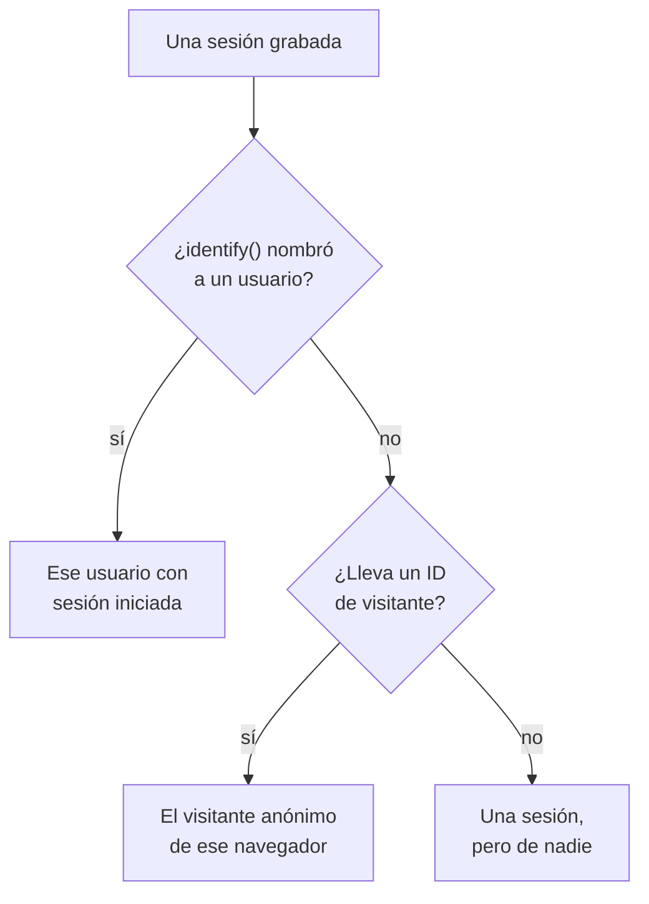

# Analítica de producto

La analítica de producto cuenta a las personas que usan una aplicación RUM, cómo van sus sesiones y qué hacen: usuarios activos, nuevos, recurrentes, con sesión iniciada e inactivos, sesiones por dispositivo, navegador, país y página, y los eventos que envía tu app, como tendencias, embudos y retención. Cuenta las sesiones que graba la [Reproducción de sesiones](/docs/telemetry/session-replay) y los eventos que envía su grabador, así que no necesita un fragmento propio, y guarda sus cifras durante 13 meses, mucho después de que caduquen las grabaciones.

:::cards
- [Usuarios](#usuarios): Usuarios activos, nuevos, recurrentes, con sesión iniciada, totales e inactivos.
- [Sesiones](#sesiones): Cuántas, cuánto duran, y por dispositivo, navegador, país y página.
- [Enviar eventos y métricas](#enviar-eventos-y-métricas): Lo que hace la gente, y los números que mide tu página.
- [Eventos](#eventos): Con qué frecuencia pasó algo, quién lo hizo y dónde.
- [Embudos](#embudos): Quién siguió, paso a paso, y cuánto tardó.
- [Retención de usuarios](#retención-de-usuarios): Quién volvió, cohorte a cohorte.
:::

## Cómo se cuenta a las personas

El menú lateral de una aplicación tiene una sección **Analítica de producto**: **Usuarios**, **Sesiones**, **Eventos**, **Embudos**, **Retención de usuarios**, **Flujos de usuarios** y **Ajustes de analítica**. **Usuarios** y **Sesiones** cuentan las sesiones que graba la Reproducción de sesiones, así que empiezan cuando empieza el grabador de la aplicación, y una sesión que la política de reproducción deja sin grabar no se cuenta. Cada sesión cuenta para una persona, o para nadie:



- **Un usuario con sesión iniciada cuenta una vez**, en cada navegador y dispositivo que use: se le reconoce por el hash unidireccional de la referencia que tu página dio a `identify()` (consulta [Identificar a tus usuarios](/docs/telemetry/session-replay#identificar-a-tus-usuarios)).
- **Un navegador anónimo cuenta una vez**, por su [ID de visitante anónimo](/docs/telemetry/session-replay#visitantes-anónimos). Dos navegadores son dos visitantes, y las sesiones que tuvo un navegador antes de que alguien iniciara sesión en él siguen siendo de su visitante.
- **Una sesión de un grabador antiguo**, que no enviaba ID de visitante, cuenta como sesión pero no como persona.

**Eventos**, **Embudos** y **Retención de usuarios** cuentan a las personas de la misma forma, a partir de los eventos que el grabador envía desde cada sesión, grabada o no (consulta [Enviar eventos y métricas](#enviar-eventos-y-métricas)).

Los días se cuentan en tu propia zona horaria.

## Usuarios

**Usuarios** cuenta a las personas del intervalo que elijas:

| Indicador | Qué cuenta |
| --- | --- |
| **Usuarios activos** | Todos los que vinieron en el intervalo: cada usuario con sesión iniciada una vez y cada navegador anónimo una vez. |
| **Usuarios nuevos** | Usuarios activos cuya primera visita fue en el intervalo. |
| **Usuarios recurrentes** | Usuarios activos que ya habían venido antes de que empezara el intervalo. |
| **Usuarios con sesión iniciada** | Usuarios activos a los que tu aplicación identificó con `identify()`, y su parte de todos los usuarios activos. |
| **Usuarios totales** | Todos los que la aplicación ha visto en los últimos 13 meses. |
| **Usuarios inactivos** | Personas que vinieron antes pero no en los últimos 30 días, o en los 7, 14, 60 o 90 días que elijas. |

Los tres primeros también dicen cómo cambiaron respecto al periodo anterior. Bajo los indicadores, **Usuarios activos** traza, para cada día, las personas que vinieron ese día, las que vinieron en los 7 días hasta ese día y las que vinieron en los 30 días hasta ese día, y **Usuarios nuevos y recurrentes** divide en dos a las personas de cada día.

**Personas** lista a todos los que cuentan los indicadores, una fila por persona, primero los vistos más recientemente, y su filtro muestra a las personas de un indicador, a los visitantes anónimos o a todos. Abre una persona para ver su primera y su última visita y cada una de sus sesiones de los últimos 13 meses, con **Ver** en cada una cuya grabación aún se conserva.

## Sesiones

**Sesiones** cuenta las sesiones que empezaron en el intervalo: **Sesiones**, **Sesiones con inicio de sesión**, **Duración mediana de las sesiones**, **Páginas por sesión**, **Sesiones con errores** y **Sesiones frustradas**. Bajo los indicadores:

- **Sesiones por dispositivo** traza las sesiones de cada día desde ordenadores, teléfonos y tabletas. La sesión de una aplicación móvil en una pantalla cuyo lado corto mide 600 puntos o más cuenta como de tableta.
- **Duración de las sesiones** ordena las sesiones terminadas según cuánto duraron, desde menos de 10 segundos hasta más de 30 minutos. Una sesión que todavía se está grabando aún no tiene duración.
- **Desglose** clasifica usuarios y sesiones por tipo de dispositivo, navegador, sistema operativo, país, versión de la aplicación, página de entrada o página, primero los de más usuarios.

## Enviar eventos y métricas

Los eventos se envían mientras **Enviar eventos de analítica de producto** está activado, en la página **Ajustes de analítica** de la aplicación. Empieza activado en una aplicación nueva y desactivado en una aplicación creada antes de que existiera, así que actívalo allí. La Reproducción de sesiones también debe estar activada para la aplicación, porque su grabador envía los eventos; el grabador de React Native todavía no envía ninguno.

Cada sesión en la que se ejecuta el grabador del navegador envía por sí sola su inicio y cada página que ve, incluidos los cambios de ruta de una aplicación de una sola página, tanto si la muestra y la política de reproducción graban esa sesión como si no. Tus propios eventos y números salen del código de tu página:

```js
OneUptimeReplay.track("Signed up", { plan: "pro" });
OneUptimeReplay.metric("cart.value", 42.5, { currency: "EUR" });
```

| Llamada | Qué envía |
| --- | --- |
| `track(name, properties?)` | Un evento que cuentan **Eventos**, **Embudos** y **Retención de usuarios**, y una marca en la línea de tiempo de la reproducción cuando la sesión se graba. `name` ≤ 64 caracteres; ≤ 20 propiedades con valores de cadena, número o booleano, clave ≤ 40 caracteres, valor ≤ 200 caracteres. |
| `metric(name, value, attributes?)` | Un número que midió tu página, como punto de una métrica de la aplicación (consulta [Paneles y alertas](#paneles-y-alertas)). `name` ≤ 100 caracteres entre letras, dígitos, `_`, `.`, `-` y `/`, que empieza por una letra y no por `oneuptime.`; `value` un número finito; `attributes` como las propiedades de `track()`. |

Antes de que se cargue el grabador, añade las mismas llamadas a `window.OneUptimeReplayQueue` como `["track", name, properties]` y `["metric", name, value, attributes]` (consulta [API de JavaScript](/docs/telemetry/session-replay#api-de-javascript)).

- **Cada sesión, grabada o no.** La muestra y la política de subida de la reproducción deciden qué sesiones se graban, no cuáles se cuentan. No se envía nada con Do Not Track o Global Privacy Control, y no se guarda nada de un origen que la aplicación no permite. Cuando la política exige consentimiento, los eventos esperan a `grantConsent()`, 500 como máximo, y `revokeConsent()` los descarta.
- **Enmascarados como la grabación.** Con _Mask all text_, los valores de las propiedades y los atributos se enmascaran antes de salir de la página, así que un desglose por uno de ellos muestra marcadores de posición, no tus valores; los nombres de los eventos, las claves de las propiedades y los valores de las métricas se envían tal como se escribieron. Un valor que necesites leer en ese modo va en una etiqueta de sesión (`setTags()`), que nunca se enmascara, así que no pongas datos personales en ella. Las etiquetas se muestran en la sesión y en una búsqueda `tag:key=value` de la lista de sesiones, no en los desgloses de estas páginas. Una página se envía como su ruta, sin su consulta ni su fragmento.
- **En lotes pequeños**, cada 5 segundos y cuando la pestaña se oculta. Un evento que llega a OneUptime más de 3 días después de ocurrir se descarta, y un proyecto puede enviar 60.000 eventos y puntos de métrica por minuto, sumando todas sus aplicaciones; por encima de eso, el grabador espera y los vuelve a enviar.

`metric()` no envía nada mientras los eventos están desactivados, y `getDiagnostics().productAnalytics` dice si están activados (consulta [`getDiagnostics()`](/docs/telemetry/session-replay#getdiagnostics)).

### Propiedades de usuario

Para desglosar y segmentar los eventos según quién los hizo, enumera claves de rasgos de `identify()` en **Propiedades de usuario para analítica**, en **Ajustes de analítica**, como `["plan", "role"]`, 20 como máximo, comparadas tal como se escriben. Cada evento lleva entonces esos rasgos del usuario con sesión iniciada, tal como tu página se los pasó a `identify()`. Los demás rasgos nunca salen de la página, y ninguno sale mientras **Capturar la identidad del usuario final** está desactivado. No enumeres rasgos que contengan datos personales, como una dirección de correo electrónico.

## Eventos

**Eventos** muestra un evento cada vez: el evento más frecuente de tu app hasta que elijas otro, o la página más vista mientras no envíe ninguno. El selector también enumera **Sesión iniciada** y cada página vista, y **Todos los eventos**, debajo, enumera cada evento del intervalo con cuántas veces ocurrió y cuántas personas lo hicieron; elige uno para verlo arriba.

- Los mosaicos cuentan los **Eventos** del evento, con cuántos hizo cada persona de media, sus **Usuarios** y sus **Sesiones**.
- **Eventos y usuarios** traza para cada día cuántas veces ocurrió el evento, y cuántas personas lo hicieron ese día.
- **Desglose** ordena el evento por tipo de dispositivo, navegador, sistema operativo, país, versión de la app, página, propiedad del evento o propiedad de usuario, con los eventos, los usuarios y la proporción de cada valor. Elige un valor para mostrar solo ese.

**Segmento** limita la página a los eventos cuyos campos tienen los valores que eliges: **Añadir filtro**, luego un campo y un valor, comparados exactamente. Un segmento tiene 5 filtros como máximo, y un evento debe cumplirlos todos. La dirección de la página conserva el evento, el intervalo, el segmento y el desglose, así que un enlace abre la misma vista.

## Embudos

**Embudos** sigue a las personas por 2 a 6 pasos en orden, cada uno un evento como los enumera **Eventos**. De las personas que hicieron el primer paso en el intervalo, cuenta cuántas hicieron después el segundo, luego el tercero, todos dentro del tiempo que eliges desde su primer paso: **En un plazo de 1 hora**, **En un plazo de 1 día**, **En un plazo de 7 días**, **En un plazo de 14 días** o **En un plazo de 30 días**. **Añadir paso** añade uno.

En **Conversión** aparecen la proporción de personas que hicieron todos los pasos y, para cada paso, cuántas personas lo alcanzaron, qué proporción de las personas del primer paso es eso, cuántas abandonaron desde el paso anterior y el tiempo mediano que tardaron desde él. Quien lo intentó más de una vez cuenta una vez, por el intento que llegó más lejos.

El segmento de un embudo, y el de una tabla de retención, toma los campos que lleva cada evento y las propiedades de usuario, no las propiedades propias de un evento, porque sus pasos son eventos distintos.

## Retención de usuarios

**Retención de usuarios** agrupa a las personas por el día, la semana o el mes del intervalo en que hicieron por primera vez un evento, **Personas que hicieron**, y muestra qué proporción de cada grupo hizo otro, **Y volvieron a hacer**, en ese periodo y en cada uno de los siguientes. Ambos son **Sesión iniciada** hasta que elijas otros.

**Cohortes** fija el periodo: **Por día**, **Por semana** o **Por mes**. Cuando el intervalo tiene más periodos de los que muestra una tabla, 32 días, 26 semanas o 13 meses, la página alarga las cohortes y lo indica.

Cada fila es una cohorte y cuántas personas tiene, y cada celda la proporción de ellas que volvió en ese periodo, más oscura cuantas más volvieron. Un periodo que aún no ha empezado se deja vacío.

**Todas las cohortes**, encima de ellas, cuenta las cohortes como una sola: en cada periodo, las personas que volvieron sobre las personas de las cohortes que lo han alcanzado, de modo que una cohorte de 200 personas pesa cuatro veces más que una de 50. Aparece en cuanto dos cohortes tienen a alguien.

## Embudos y tablas de retención guardados

**Embudos guardados**, en la página **Embudos**, y **Tablas de retención guardadas**, en **Retención de usuarios**, listan lo que tu equipo guardó para la aplicación, para abrirlo de nuevo o mostrarlo en un panel. Un embudo guardado conserva sus pasos, su tiempo para completarlos y su segmento, y una tabla de retención guardada sus dos eventos, su periodo y su segmento. Ninguno conserva el intervalo de tiempo: la página conserva el suyo, y un panel lee el suyo.

- **+ Guardar embudo** o **+ Guardar tabla de retención** guarda lo que muestra la página, con un nombre. Una aplicación conserva como máximo 100 de cada uno.
- Elige uno para abrirlo. La dirección de la página lo nombra, así que un enlace lo abre para todos los que pueden verlo. Cuando cambias lo que muestra, su nombre lo indica, y **Actualizar** guarda el cambio.
- **Editar** cambia el nombre de uno, y **Eliminar** lo elimina para todos. **Quitar vista** cierra el que está abierto y conserva lo que muestra la página.
- Un enlace a uno que se eliminó, o que no puedes ver, lo indica, y la página se abre sin él.

## Paneles y alertas

Cada evento también se cuenta, minuto a minuto, como una métrica de la aplicación, y cada llamada a `metric()` es un punto de una métrica propia, con el nombre que indica. Dibújalas en la página **Métricas** de la aplicación, añádelas a un panel o alerta sobre ellas con un monitor de métricas; **Abrir Métricas**, en **Todos los eventos**, abre la página.

| Métrica | Qué cuenta | Por |
| --- | --- | --- |
| `oneuptime.rum.product.events` | Tus eventos de `track()`, por minuto | `event.name` |
| `oneuptime.rum.product.sessions` | Sesiones que empezaron, por minuto | `device.type` |
| `oneuptime.rum.product.page.views` | Páginas vistas, por minuto | `device.type` |

Estas tres no se facturan, y `metric()` rechaza un nombre que empiece por `oneuptime.`, así que nada de lo que envía tu página pasa por ellas. Tus puntos de `metric()` se guardan y se facturan como las demás métricas de la aplicación.

Un embudo o una tabla de retención guardados también van a un panel: los widgets **Embudo** y **Retención de usuarios**, en el grupo **Analítica de producto** del catálogo de widgets, muestran uno en el intervalo de tiempo del panel, y **Abrir en Embudos** o **Abrir en Retención de usuarios** lo abre en su página (consulta [Widgets del panel](/docs/dashboards/widgets#analítica-de-producto)).

## Privacidad y retención

- **13 meses.** Las cifras de un mes se eliminan el primer día del 13.º mes posterior, así que los últimos 12 meses completos siempre están, sea cual sea la retención propia de las grabaciones (7 días por defecto). Los eventos se guardan de la misma forma.
- **Ningún nombre guardado.** Las cifras guardan la clave unidireccional de un usuario con sesión iniciada y el ID de visitante de un navegador, nunca la referencia ni una dirección IP, y de los rasgos solo las propiedades de usuario que enumeres. Una fila nombra a un usuario con sesión iniciada solo mientras se conserve alguna de sus grabaciones, y solo para un rol que pueda leer la identidad; si no, muestra **Usuario con sesión iniciada** o **Visitante anónimo** y el principio del ID.
- **Borrado a petición.** Una solicitud de borrado también elimina aquí las cifras y los eventos correspondientes (consulta [Borrar sesiones](/docs/telemetry/session-replay#borrar-sesiones)).

## Quién puede verla

Leer estas páginas requiere lo mismo que leer la lista de sesiones: `ReadRumSessionReplay` (_List Session Replays_) o `ReadRumSessionReplayPayload` (_Watch Session Replays_), que tienen los propietarios y administradores del proyecto. Ver quién es un usuario con sesión iniciada, y buscar personas por nombre, requiere `ReadRumSessionReplayPayload` (_Watch Session Replays_), como se describe en [Quién puede ver una grabación](/docs/telemetry/session-replay#quién-puede-ver-una-grabación).

Guardar, renombrar y eliminar embudos y tablas de retención guardados requiere los mismos permisos que leer estas páginas, y un widget de panel solo muestra uno a quien los tenga.

Activar o desactivar los eventos requiere `EditRumApplication` (_Edit RUM Application_) o el rol de propietario, administrador o miembro del proyecto. Enumerar propiedades de usuario requiere `EditRumApplication` o el rol de propietario o administrador, porque decide qué se guarda sobre las personas con sesión iniciada.

## Próximos pasos

:::cards
- [Reproducción de sesiones](/docs/telemetry/session-replay): Graba las sesiones que cuentan estas páginas, y míralas.
- [Gestionar aplicaciones](/docs/rum/applications): Nombres, etiquetas, propietarios y retención.
- [Visión general de RUM](/docs/rum/index): Qué más muestra una aplicación RUM.
:::
