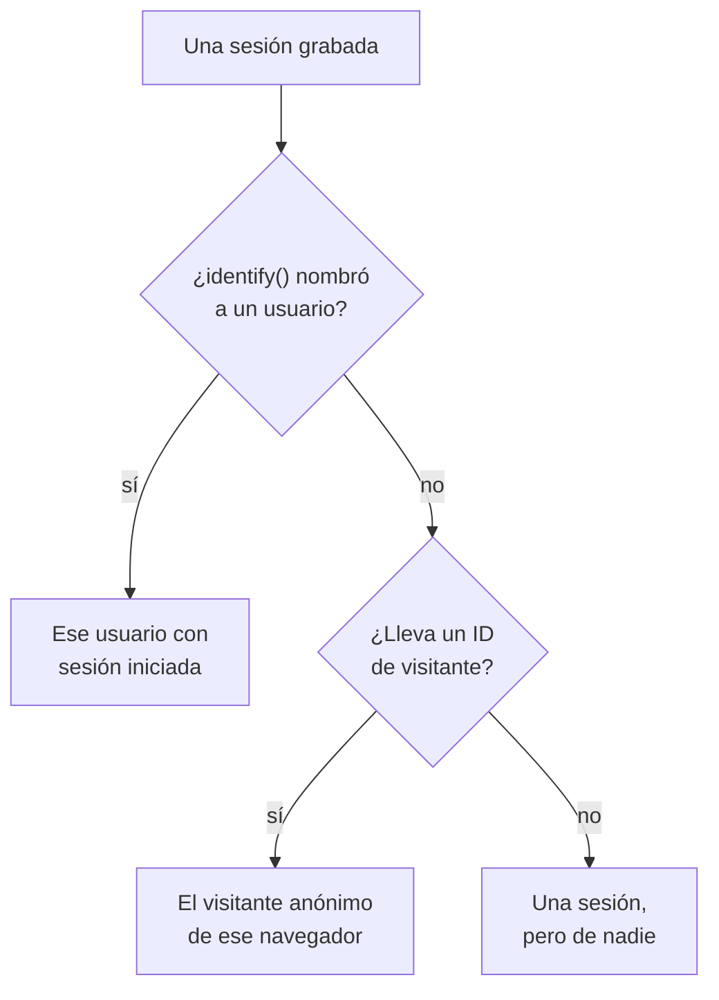

# Analítica de producto

La analítica de producto cuenta a las personas que usan una aplicación RUM y cómo van sus sesiones: usuarios activos, nuevos, recurrentes, con sesión iniciada e inactivos, y sesiones por dispositivo, navegador, país y página. Cuenta las sesiones que graba la [Reproducción de sesiones](/docs/telemetry/session-replay), así que no necesita un fragmento propio, y guarda sus cifras durante 13 meses, mucho después de que caduquen las grabaciones.

:::cards
- [Cómo se cuenta a las personas](#cómo-se-cuenta-a-las-personas): Un usuario con sesión iniciada una vez, un navegador anónimo una vez.
- [Usuarios](#usuarios): Usuarios activos, nuevos, recurrentes, con sesión iniciada, totales e inactivos.
- [Sesiones](#sesiones): Cuántas, cuánto duran, y por dispositivo, navegador, país y página.
- [Privacidad y retención](#privacidad-y-retención): 13 meses, ningún nombre guardado, borrado a petición.
:::

## Cómo se cuenta a las personas

El menú lateral de una aplicación tiene una sección **Analítica de producto** con dos páginas, **Usuarios** y **Sesiones**. Ambas cuentan las sesiones que graba la Reproducción de sesiones, así que empiezan cuando empieza el grabador de la aplicación, y una sesión que la política de reproducción deja sin grabar no se cuenta. Cada sesión cuenta para una persona, o para nadie:

- **Un usuario con sesión iniciada cuenta una vez**, en cada navegador y dispositivo que use: se le reconoce por el hash unidireccional de la referencia que tu página dio a `identify()` (consulta [Identificar a tus usuarios](/docs/telemetry/session-replay#identificar-a-tus-usuarios)).
- **Un navegador anónimo cuenta una vez**, por su [ID de visitante anónimo](/docs/telemetry/session-replay#visitantes-anónimos). Dos navegadores son dos visitantes, y las sesiones que tuvo un navegador antes de que alguien iniciara sesión en él siguen siendo de su visitante.
- **Una sesión de un grabador antiguo**, que no enviaba ID de visitante, cuenta como sesión pero no como persona.

Los días se cuentan en tu propia zona horaria.

## Usuarios

**Usuarios** cuenta a las personas del intervalo que elijas:

| Indicador | Qué cuenta |
| --- | --- |
| **Usuarios activos** | Todos los que vinieron en el intervalo: cada usuario con sesión iniciada una vez y cada navegador anónimo una vez. |
| **Usuarios nuevos** | Usuarios activos cuya primera visita fue en el intervalo. |
| **Usuarios recurrentes** | Usuarios activos que ya habían venido antes de que empezara el intervalo. |
| **Usuarios con sesión iniciada** | Usuarios activos a los que tu aplicación identificó con `identify()`, y su parte de todos los usuarios activos. |
| **Usuarios totales** | Todos los que la aplicación ha visto en los últimos 13 meses. |
| **Usuarios inactivos** | Personas que vinieron antes pero no en los últimos 30 días, o en los 7, 14, 60 o 90 días que elijas. |

Los tres primeros también dicen cómo cambiaron respecto al periodo anterior. Bajo los indicadores, **Usuarios activos** traza, para cada día, las personas que vinieron ese día, las que vinieron en los 7 días hasta ese día y las que vinieron en los 30 días hasta ese día, y **Usuarios nuevos y recurrentes** divide en dos a las personas de cada día.

**Personas** lista a todos los que cuentan los indicadores, una fila por persona, primero los vistos más recientemente, y su filtro muestra a las personas de un indicador, a los visitantes anónimos o a todos. Abre una persona para ver su primera y su última visita y cada una de sus sesiones de los últimos 13 meses, con **Ver** en cada una cuya grabación aún se conserva.

## Sesiones

**Sesiones** cuenta las sesiones que empezaron en el intervalo: **Sesiones**, **Sesiones con inicio de sesión**, **Duración mediana de las sesiones**, **Páginas por sesión**, **Sesiones con errores** y **Sesiones frustradas**. Bajo los indicadores:

- **Sesiones por dispositivo** traza las sesiones de cada día desde ordenadores, teléfonos y tabletas. La sesión de una aplicación móvil en una pantalla cuyo lado corto mide 600 puntos o más cuenta como de tableta.
- **Duración de las sesiones** ordena las sesiones terminadas según cuánto duraron, desde menos de 10 segundos hasta más de 30 minutos. Una sesión que todavía se está grabando aún no tiene duración.
- **Desglose** clasifica usuarios y sesiones por tipo de dispositivo, navegador, sistema operativo, país, versión de la aplicación, página de entrada o página, primero los de más usuarios.

## Privacidad y retención

- **13 meses.** Las cifras de un mes se eliminan el primer día del 13.º mes posterior, así que los últimos 12 meses completos siempre están, sea cual sea la retención propia de las grabaciones (7 días por defecto).
- **Ningún nombre guardado.** Las cifras guardan la clave unidireccional de un usuario con sesión iniciada y el ID de visitante de un navegador, nunca la referencia, los rasgos ni una dirección IP. Una fila nombra a un usuario con sesión iniciada solo mientras se conserve alguna de sus grabaciones, y solo para un rol que pueda leer la identidad; si no, muestra **Usuario con sesión iniciada** o **Visitante anónimo** y el principio del ID.
- **Borrado a petición.** Una solicitud de borrado también elimina aquí las cifras correspondientes (consulta [Borrar sesiones](/docs/telemetry/session-replay#borrar-sesiones)).

## Quién puede verla

Leer las dos páginas requiere lo mismo que leer la lista de sesiones: `ReadRumSessionReplay` (_List Session Replays_) o `ReadRumSessionReplayPayload` (_Watch Session Replays_), que tienen los propietarios y administradores del proyecto. Ver quién es un usuario con sesión iniciada, y buscar personas por nombre, requiere el permiso de identidad que se describe en [Quién puede ver una grabación](/docs/telemetry/session-replay#quién-puede-ver-una-grabación).

## Próximos pasos

:::cards
- [Reproducción de sesiones](/docs/telemetry/session-replay): Graba las sesiones que cuentan estas páginas, y míralas.
- [Gestionar aplicaciones](/docs/rum/applications): Nombres, etiquetas, propietarios y retención.
- [Visión general de RUM](/docs/rum/index): Qué más muestra una aplicación RUM.
:::
