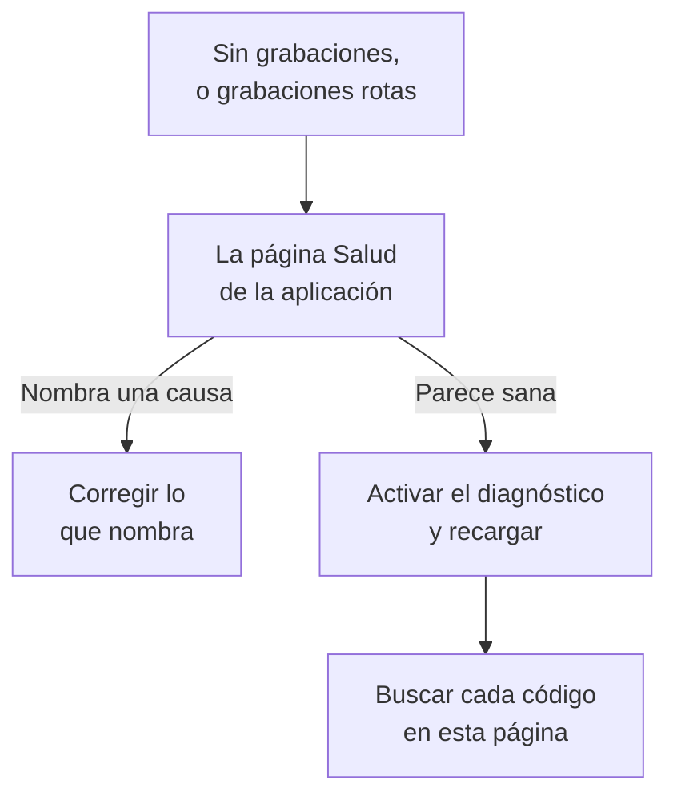

# Solución de problemas de reproducción de sesiones

Cuando no llega ninguna grabación, o llegan rotas, esta página encuentra el motivo. La reproducción de sesiones graba cada sesión por defecto y la sube sobre la marcha, así que una página sana envía un fragmento aproximadamente cada 15 segundos mientras el usuario hace algo. Una pestaña inactiva no produce eventos ni envía nada, y tras cinco minutos sin entrada el grabador se pone directamente en pausa (`recording-paused-idle`), así que mueve el ratón o haz clic antes de juzgar una instalación desde la pestaña Red. Si ni aun así ves ninguna solicitud a OneUptime, alguna de las causas de abajo es el motivo.

:::cards
- [Activar el diagnóstico](#activar-el-diagnóstico): Haz que el grabador explique cada decisión en la consola.
- [Códigos](#códigos): Cada línea que imprime el grabador, y qué hacer.
- [Un firewall delante de OneUptime rechaza los fragmentos](#un-firewall-delante-de-oneuptime-rechaza-los-fragmentos): Reglas que revisar y exclusiones que añadir.
- [Faltan imágenes, iconos o estilos en la reproducción](#faltan-imágenes-iconos-o-estilos-en-la-reproducción): Grabaciones que se reproducen, pero no como las vio tu usuario.
:::



El único ajuste en el que el silencio es normal es subir _On error or frustration_ (`OnErrorOrFrustration`): el grabador mantiene entonces un búfer circular en memoria y solo sube cuando algo falla, lo que parece exactamente una instalación rota hasta que se dispara un disparador. Comprueba cuál usas antes de buscar cualquier otra cosa: la línea `config-accepted` de más abajo lo imprime.

Empieza por el lado del servidor si puedes. La página **Salud** de la aplicación, en la sección **Reproducción de sesiones** de su menú lateral, nombra la causa cuando no llega nada: el grabador nunca se cargó, se cargó pero no se subió nada y por qué, las subidas se están rechazando y por qué motivo, o el presupuesto está agotado. Consulta [Estado de la grabación](/docs/telemetry/session-replay#estado-de-la-grabación). Lo que sigue es el lado del navegador: activa el diagnóstico, recarga una vez y lee la consola.

¿Las grabaciones llegan, pero se reproducen con imágenes rotas, iconos que faltan o zonas sin estilo? Es una cuestión de reproducción, que se responde en [Faltan imágenes, iconos o estilos en la reproducción](#faltan-imágenes-iconos-o-estilos-en-la-reproducción).

## Activar el diagnóstico

Elige el interruptor que tengas a mano. Todos hacen lo mismo.

:::tabs
@tab En el navegador
En el navegador que falla. No necesita volver a desplegar, funciona en producción y sobrevive a las recargas:

```js
localStorage.setItem("oneuptime.sessionReplay.debug", "true");
// then reload the page
```

Desactívalo de nuevo con:

```js
localStorage.removeItem("oneuptime.sessionReplay.debug");
```
@tab Con un enlace
Para alguien que no es técnico, o una página en la que no puedes abrir una consola, añade `oneuptime_debug=1` a la URL. También funciona en el fragmento, que sobrevive a un servidor que elimina los parámetros de consulta que no conoce:

```text
https://your-app.example.com/checkout?oneuptime_debug=1
https://your-app.example.com/checkout#oneuptime_debug=1
```
@tab En la etiqueta script
Para un entorno de staging, donde lo quieres activado para todos:

```html
<script
  src="https://oneuptime.com/telemetry/session-replay/v1/recorder.js"
  data-oneuptime-token="YOUR_TELEMETRY_INGESTION_KEY"
  data-oneuptime-app-identifier="YOUR_RUM_APP_IDENTIFIER"
  data-oneuptime-debug="true"
  crossorigin="anonymous"
  async
></script>
```
@tab En el global de inicialización
Si configuras el grabador con el global de inicialización:

```js
window.__ONEUPTIME_SESSION_REPLAY__ = {
  host: "https://oneuptime.com",
  token: "YOUR_TELEMETRY_INGESTION_KEY",
  appIdentifier: "YOUR_RUM_APP_IDENTIFIER",
  debug: true,
};
```
@tab En el despliegue
En el despliegue de OneUptime, el único interruptor que no necesita a nadie delante del navegador que falla. Define `SESSION_REPLAY_DEBUG=true` y reinicia. Cada grabador que sirve esta instancia registra entonces, en cada página donde se ejecuta, así que actívalo, recoge una recarga y desactívalo. No cambia ninguna política: ni el muestreo, ni el enmascaramiento, ni el consentimiento. Consulta [Notas para instalaciones autoalojadas](/docs/telemetry/session-replay#notas-para-instalaciones-autoalojadas) para los demás ajustes del despliegue.
@tab En tiempo de ejecución
Una vez cargado el grabador:

```js
OneUptimeReplay.setDebug(true);
```
:::

La salida tiene este aspecto:

```text
[OneUptime Session Replay] loader-start: Loader running.
[OneUptime Session Replay] init-options-read: Init options read. {host: "https://oneuptime.com", appIdentifier: "checkout-web", …}
[OneUptime Session Replay] config-fetch-start: Requesting the policy. {url: "https://oneuptime.com/telemetry/session-replay/v1/config", …}
[OneUptime Session Replay] config-accepted: Policy accepted. {captureTrigger: "Always", samplePercentage: 100, …}
[OneUptime Session Replay] recording: Recording and uploading …
```

## Obtener la cronología sin activar nada antes

El grabador conserva sus últimas 250 decisiones, esté o no activado el diagnóstico. Si el problema ya ocurrió, no necesitas reproducirlo con el registro activado — pide esto en su lugar:

```js
copy(JSON.stringify(OneUptimeReplay.getDiagnostics(), null, 2));
```

Eso devuelve la versión del grabador, el id de sesión, su `state` (`recording`, `uploading`, `not-sampled`, `stopped`…), por qué se detuvo si lo hizo, el `bootstrapDecision`, la respuesta de cada barrera en `decisions` (muestreada o no, estado del consentimiento, si las subidas están permitidas y qué las bloquea, la última directiva del servidor), las `capabilities` del grabador y la lista completa de registros — incluidos los del cargador, que se ejecuta antes de que exista el artefacto del grabador y es donde se deciden la mayoría de las retiradas. Por construcción no contiene contenido de la página; consulta [Lo que el diagnóstico nunca contiene](#lo-que-el-diagnóstico-nunca-contiene). Los campos se describen en [`getDiagnostics()`](/docs/telemetry/session-replay#getdiagnostics).

**Si aparece `OneUptimeReplay is not defined`**, el artefacto del grabador nunca se cargó — lo que ya es en sí la respuesta a buena parte de los códigos de abajo, y justo cuando más quieres la cronología. Los registros siguen ahí, en un global en el que el cargador escribe antes de que exista el artefacto:

```js
copy(JSON.stringify(window.__ONEUPTIME_SESSION_REPLAY_DEBUG__.records, null, 2));
```

Pega cualquiera de los dos en tu ticket de soporte — o en **Preguntar al navegador** en la página **Salud** de la aplicación, que explica cada código que contiene. Suele bastar por sí solo.

## Cuando el silencio es normal: la política activada por errores

Esta sección solo se aplica si `config-accepted` imprimió `captureTrigger: "OnErrorOrFrustration"`. Con la política `Always` predeterminada, el grabador envía a medida que graba, y el silencio en una página con la que el usuario interactúa significa que algo va mal de verdad — sigue leyendo más allá de esta sección.

Si la consola dice esto:

```text
[OneUptime Session Replay] recording: Recording into memory. Nothing uploads until a trigger fires - call OneUptimeReplay.captureSession() to force one.
```

…entonces el grabador funciona. Con una política activada por errores, una página sana hace exactamente una solicitud a OneUptime por carga de página (la obtención de la configuración) y no envía nada más hasta que ocurre un error, un 5xx, una señal de frustración o la superación de un presupuesto de rendimiento.

Para probar todo el camino de extremo a extremo, fuerza una subida:

```js
OneUptimeReplay.captureSession("installation test");
```

Deberías ver de inmediato un `POST /telemetry/session-replay/v1/chunk` en la pestaña Red y una línea `chunk-accepted` en la consola. Si es así, la instalación es correcta y la reproducción aparecerá en el panel en más o menos un minuto, con tu motivo marcado en su cronología.

Un `202` con `chunk-accepted` es el que hay que buscar. Un `204` registra en su lugar `chunk-not-recorded`: la solicitud era correcta y el servidor decidió no almacenarla — presupuesto superado, no muestreada o aplicación desactivada. Es una respuesta de la política, no un fallo de instalación, y la línea `server-directive` de al lado dice cuál.

Para volver a grabar cada sesión, pon **Cuándo subir una grabación** en _Always_ y **Porcentaje de muestreo** por encima de 0 en la página **Política de reproducción** de la aplicación. Es el valor predeterminado de fábrica.

## Códigos

Cada línea lleva un `code` estable. Busca el tuyo aquí.

### Arranque

| code | qué significa |
| --- | --- |
| `loader-start` | El script del grabador se ejecutó. Si no ves esto con el diagnóstico activado, el script en sí nunca se ejecutó — revisa la solicitud `<script>` en la pestaña Red y el `script-src` de tu CSP. |
| `init-options-read` | Se encontraron opciones. Revisa `host` y `appIdentifier` en el detalle: `appIdentifier` debe coincidir exactamente con la aplicación RUM, y `host` debe ser tu origen de OneUptime, no el de tu propia aplicación. |
| `init-options-incomplete` | Falta una opción obligatoria. El detalle dice cuál de `hasHost` / `hasToken` / `hasAppIdentifier` es false. Si `hasHost` es false, la etiqueta script no tiene un `src` del que deducir el host — añade `data-oneuptime-host`. |
| `privacy-signal` | El navegador envía Do Not Track o Global Privacy Control y se está respetando — por la página (nada en la etiqueta script dice lo contrario) o por la política del servidor. No se graba nada; con `stage: "before-config-fetch"` tampoco se hace ninguna solicitud de configuración. No es un fallo. Define `data-oneuptime-respect-do-not-track="false"` solo si tu base legal de verdad no depende de la señal. |
| `init-options-missing` | No hay nada que leer en la página: ni etiqueta `script[data-oneuptime-token]` ni `window.__ONEUPTIME_SESSION_REPLAY__`. El atributo marcador está mal escrito, el fragmento de código acabó en otro documento o un gestor de etiquetas lo eliminó. |
| `loader-threw` | Un error del propio grabador, no de tu configuración. Infórmalo con la salida del diagnóstico. |

### Política

| code | qué significa |
| --- | --- |
| `config-fetch-start` | A punto de solicitar la política. La `url` del detalle es la URL exacta — comprueba que responde desde un navegador. |
| `config-fetch-rejected` | El endpoint respondió algo distinto de 2xx. Consulta [Estados de la obtención de la configuración](#estados-de-la-obtención-de-la-configuración) más abajo. |
| `config-fetch-failed` | La solicitud nunca llegó a completarse: `connect-src` de la CSP, un bloqueador de anuncios, DNS, TLS, falta de conexión o un tiempo de espera de 5 segundos. El navegador suele registrar su propia línea junto a esta. |
| `config-body-unparseable` | El endpoint respondió 2xx con un cuerpo que no es JSON en absoluto. Distinto de `config-fetch-failed`: la solicitud *sí* se completó, así que algo en el camino — un proxy, un portal cautivo, una página intermedia de SSO — respondió en lugar de OneUptime. |
| `config-unparseable` | El cuerpo *era* JSON válido, pero no un objeto — `null`, una cadena, un array. Un proxy que reescribe, o un servidor que responde a otra ruta. |
| `config-disabled` | El servidor dice que la reproducción está desactivada aquí. El `disabledReason` del detalle es la respuesta: consulta [disabledReason](#disabledreason) más abajo. |
| `config-recorder-version-invalid` | La política no nombraba exactamente `latest` en minúsculas, así que no se pudo construir ninguna URL de artefacto. Un proxy que reescribe o una respuesta manipulada — un despliegue sin compilación informa en su lugar de `config-disabled` con `recorder-not-built`. |
| `config-accepted` | La política se aceptó. El detalle es la política entera — `captureTrigger`, `samplePercentage`, `consentMode`, `maskingMode`. |
| `config-field-defaulted` | El servidor no envió ningún valor para un campo de la política (nombrado en el detalle), así que este grabador usó el valor predeterminado del producto. Informativo: normalmente un servidor más antiguo que el grabador. Si el panel muestra otro valor para ese campo, actualiza OneUptime. |
| `config-value-unrecognised` | El servidor envió un valor que esta compilación del grabador no conoce, así que recurrió al más seguro — que puede no ser el que muestra tu panel. Normalmente una página sigue ejecutando un grabador de un despliegue anterior. |
| `directive-stop` | El servidor le dijo a este grabador que se retirara. Revisa el estado de la grabación de la aplicación en busca de un presupuesto, un límite de frecuencia o un interruptor de corte. |

#### Estados de la obtención de la configuración

| estado | solución |
| --- | --- |
| `401` | El token de ingesta es incorrecto, está revocado, ha caducado o es de otro proyecto. Crea uno en **Ajustes del proyecto → Telemetría y APM → Claves de ingesta** y confírmalo con `GET /session-replay/v1/validate` — envía la clave como lo hace el grabador y añade la cabecera `x-oneuptime-app-identifier`, y la respuesta lleva además `isSessionReplayEnabled` para esa aplicación, `sessionReplayDisabledDetail` que nombra el interruptor desactivado cuando no lo está, `isIngestEnabledOnThisInstance` y el `keyType`. |
| `400` | Falta `data-oneuptime-app-identifier`. |
| `403` | El origen de la página no está en los **Orígenes permitidos** de la clave de ingesta. Añádelo, o usa una clave cuya lista de permitidos cubra esta página. |
| `404` | La ruta no se resolvió en el origen de OneUptime. Casi siempre es un `data-oneuptime-host` incorrecto — o un proxy inverso delante de OneUptime que no reenvía `/telemetry/*`. |
| `5xx` | Un fallo del lado del servidor; revisa los registros de la aplicación OneUptime. |

#### disabledReason

| valor | qué hacer |
| --- | --- |
| `not-enabled-for-application` | La reproducción de sesiones está desactivada para esta aplicación RUM, el identificador no coincide con ninguna, o el proyecto no tiene permitida la reproducción. `disabledDetail` dice cuál: `application-not-enabled` (el interruptor de esta aplicación), `project-not-allowed` (el interruptor de todo el proyecto, en **Monitoreo de usuarios reales → Ajustes → Reproducción de sesiones**), `application-unknown` (ninguna aplicación tiene este `appIdentifier` — comprueba la ortografía en la página **Política de reproducción** de la aplicación) o `project-killed` (un interruptor de corte del operador en este despliegue). |
| `budget-exhausted` | El presupuesto diario de bytes del proyecto o el presupuesto mensual de la aplicación ya está agotado, así que se ordena a los grabadores que no graben en lugar de subir fragmentos que serían rechazados. `disabledDetail` es `project-daily-budget-exhausted` o `app-monthly-budget-exhausted`, y `budgetResetsAt` indica cuándo se libera. Sube el presupuesto en la página **Política de reproducción**, o espera al reinicio. |
| `recorder-not-built` | **El despliegue no tiene artefacto del grabador.** Nada en la página del cliente puede arreglarlo. La compilación que produce `packages/App/FeatureSet/BrowserRecorder/public/dist/manifest.json` no se ejecutó, o su resultado no llegó a la imagen en ejecución. Recompila y vuelve a desplegar la aplicación OneUptime. Es la respuesta habitual en una instalación propia donde la reproducción nunca ha funcionado. |
| `disabled-by-default` | `SESSION_REPLAY_ENABLED_BY_DEFAULT=false` en este despliegue. Ponlo en `true` — y define antes `SESSION_REPLAY_MAX_BYTES_PER_PROJECT_PER_DAY` si lo alojas tú, porque la reproducción es la tabla más pesada que tienes. |
| `ingest-disabled` | `SESSION_REPLAY_INGEST_ENABLED=false` en este despliegue. |
| `policy-unavailable` | El servidor no pudo resolver la política — normalmente Redis o Postgres. Falla en modo cerrado a propósito. Revisa los registros de la aplicación OneUptime. |
| `not-reported` | El servidor es más antiguo que este campo. Usa en su lugar el panel **Prueba tu instalación** del panel de control, en la página **Política de reproducción**. |

### El artefacto

| code | qué significa |
| --- | --- |
| `artifact-requested` | Se está inyectando el último paquete del grabador. La `url` es la exacta. |
| `artifact-load-failed` | No se cargó. Por orden de probabilidad: un `script-src` de la CSP que no permite tu origen de OneUptime, un desajuste de SRI (un proxy que reescribe el paquete) o un 404 porque este despliegue no compiló el grabador. |
| `artifact-url-invalid` | La política no nombraba exactamente `latest` en minúsculas, así que no se construyó ninguna URL. Una respuesta de configuración manipulada o pasada por un proxy. |
| `artifact-api-missing` | El paquete se cargó pero no publicó `window.OneUptimeReplay` — otro script de la página lo sobrescribió. |
| `bootstrap` | El artefacto del grabador está arrancando. |
| `bootstrap-already-started` | Dos copias del fragmento de código en una misma página. Quita una. |
| `bootstrap-already-running` | Se volvió a llamar a `bootstrap()` mientras ya había un grabador en marcha. Inofensivo; normalmente una integración duplicada. |
| `bootstrap-cancelled` | Un `revokeConsent()` o `stop()` en cola en `window.OneUptimeReplayQueue` se ejecutó antes de que arrancara el grabador, así que esta sesión no se graba. Correcto si tu banner ya había sido rechazado. |
| `prerender-wait` | El navegador prerrenderizó esta página, como hace Chrome con una página que espera que se abra a continuación, y nadie la ha abierto todavía. El grabador arranca cuando el visitante abre la página, así que una página que nunca se abre no graba nada; las llamadas que tu página haga mientras tanto se aplican entonces. |
| `start-stopped` | `start()` no recibió ninguna política utilizable en la ruta del paquete propio. El motivo concreto está en la línea `config-*` justo encima. |
| `rrweb-did-not-start` | El grabador del DOM se negó a arrancar. Infórmalo. |
| `rrweb-error` | El grabador del DOM sufrió un error interno en esta página (el nombre del error está en el detalle; se registra una vez). La grabación puede saltar o congelarse alrededor de ese punto, y tras tres errores así la sesión lleva un aviso de fidelidad que lo dice. Infórmalo con el framework de la página y el nombre del error. |

### Grabación y subida

| code | qué significa |
| --- | --- |
| `not-sampled` | Esta sesión perdió el sorteo de muestreo, así que no se graba nada en absoluto. El muestreo es determinista según el id de sesión, así que recargar no ayudará a esta sesión. Sube el porcentaje de muestreo. |
| `recording` | Grabando. Lee el detalle: `uploading: true` es el estado normal con el disparador predeterminado `Always`. `uploading: false` con `captureTrigger: "OnErrorOrFrustration"` es el otro estado sano, sin solicitudes. |
| `same-origin-propagation` | Se registra una vez al arrancar el grabador: si añade contexto de traza (`traceparent`, y un `tracestate` que lleva el id de sesión) a las solicitudes al origen propio de la página. `enabled: true` con `reason: "on"` es lo predeterminado. `reason: "policy-off"` significa que **Propagación de trazas del mismo origen** está desactivada en la página **Política de reproducción** de la aplicación; `reason: "opaque-origin"` significa que la página no tiene un origen propio (un iframe con sandbox, `about:blank`, `srcdoc` o `file:`), así que nada cuenta como mismo origen. Incluso activadas, las cabeceras solo van en las solicitudes hechas mientras la sesión sube, y nunca en un `POST` a una ruta que termina en `/v1/traces`, `/v1/logs` o `/v1/metrics` (las exportaciones de OpenTelemetry de la propia página). Se registra una vez más, con `reason: "agent-stand-down"` y un campo `agent` (`DD_RUM`, `NREUM` o `elasticApm`), la primera vez en una carga de página que el grabador deja el `traceparent` de una solicitud del mismo origen a ese agente porque está configurado para trazar la solicitud (Datadog RUM solo en una sesión que sigue); la solicitud sigue recibiendo el miembro de `tracestate`, y solo se vincula si el agente envía de verdad un `traceparent`, cosa que Datadog solo hace en una sesión de Datadog seguida y muestreada para trazas. New Relic (`NREUM`) envía su propio `tracestate` en lugar del miembro, así que sus solicitudes solo se vinculan por id de traza (consulta [las pestañas Logs y Traces están vacías](#las-pestañas-logs-y-traces-del-reproductor-están-vacías)). Consulta [Correlacionar con el resto de tu telemetría](/docs/telemetry/session-replay#correlacionar-con-el-resto-de-tu-telemetría). |
| `same-origin-propagation-tripped` | Una solicitud a la que el grabador había añadido contexto de traza falló a nivel de red, normalmente una solicitud del mismo origen redirigida a otro origen que no permite `traceparent` y `tracestate`. El grabador dejó de añadirlas durante el resto de esta carga de página. `retried: true` significa que era un `fetch` `GET` o `HEAD` sin cuerpo y se envió una vez más exactamente como lo hizo tu página; `false` significa que no se podía reintentar y falló: nada salvo un `fetch` `GET` o `HEAD` sin cuerpo (ningún XHR, ningún otro método, ninguna solicitud con cuerpo) se reintenta. Las cancelaciones y tiempos de espera de tu propia página no lo activan, ni tampoco un fallo mientras el navegador se declara sin conexión; la siguiente carga de página empieza de cero. Consulta [Las descargas o redirecciones fallan tras activar la reproducción de sesiones](#las-descargas-o-redirecciones-fallan-tras-activar-la-reproducción-de-sesiones). |
| `trigger` | Ocurrió algo que merece la pena conservar. La `reason` es una de `error`, `frustration`, `performance`, `sampled` o `manual`. |
| `upload-started` | Se está vaciando el pre-roll del búfer. Los POST de fragmentos empiezan aquí. |
| `upload-blocked-consent` | Se disparó un disparador y no se subió nada porque nunca se dio el consentimiento. Con el modo de consentimiento `RequireExplicit`, tu página debe llamar a `OneUptimeReplay.grantConsent()` cuando se acepte tu banner. |
| `chunk-discarded-consent` | La misma causa, una capa más abajo: se descartó un fragmento completo. |
| `chunk-accepted` | Un fragmento llegó y se almacenó. La instalación funciona. |
| `chunk-not-recorded` | El servidor aceptó la solicitud y decidió deliberadamente no grabarla — presupuesto superado, no muestreada, aplicación desactivada o el tope de fragmentos por sesión. La línea `server-directive` de al lado lleva el motivo. La instalación es correcta; la política o el presupuesto no son los que esperas. |
| `chunk-post-failed` | El POST nunca llegó al servidor, antes de que esta página hubiera subido nada con éxito. `connect-src` de la CSP, un bloqueador de anuncios o CORS en el origen de ingesta — o una página que perdió la conexión antes de su primera subida. Cuenta para el disyuntor. |
| `chunk-held-offline` | Modo sin conexión: el dispositivo no tiene conexión (el navegador se declara sin conexión, o una solicitud nunca llegó a un servidor que ya había respondido antes). La grabación continúa y el fragmento espera; `queueDepth` es cuántos esperan y `retryInMs` cuándo será el siguiente intento. No cuenta como fallo y no se pierde nada. |
| `back-online` | La primera solicitud tras un corte llegó al servidor. Se están subiendo los fragmentos en cola, del más antiguo al más nuevo. |
| `browser-offline` | El navegador emitió su evento `offline`. La grabación continúa; el grabador abre su almacén sin conexión para que se conserven los fragmentos de una pestaña que se cierre ahora. |
| `browser-online` | El navegador emitió su evento `online`, y los `queuedChunks` se están subiendo ahora en lugar de con el temporizador de reintento. |
| `offline-queue-full` | El corte duró más que la cola de subida (240 fragmentos o 4 MB): se descartaron los `dropped` fragmentos más antiguos para conservar los más nuevos. La sesión muestra un hueco donde estaban. |
| `offline-flush-stored` | La página se ocultó o se cerró sin conexión, así que sus últimos fragmentos se escribieron en el IndexedDB del navegador en lugar de enviarse. `storeOpen: false` significa que el almacén no había terminado de abrirse y que una pestaña que se cierra aún puede perderlos. La siguiente página de la aplicación los sube. |
| `final-flush-deferred` | La solicitud de cierre no podía llevar todos los fragmentos, y el resto (`kept`) se escribió en IndexedDB para la siguiente página en lugar de descartarse. |
| `offline-chunks-restored` | Esta página encontró `chunks` que una página anterior grabó sin conexión y no pudo enviar, y los está subiendo antes que los suyos. |
| `offline-chunk-claimed-elsewhere` | Otra pestaña de la misma aplicación ya subió un fragmento que esta pestaña había almacenado, así que esta pestaña lo omitió. No falta nada. |
| `chunk-post-server-error` | El servidor respondió 5xx. El grabador reintenta; `consecutiveFailures` frente a `maxFlushFailures` en el detalle indica lo cerca que está de rendirse. |
| `chunk-retry-scheduled` | Un fallo reintentable (red, 5xx o una limitación del servidor) puso el fragmento en la cola de reintentos; `inMs` en el detalle es la pausa antes del siguiente intento, y `queueDepth` cuántos fragmentos esperan. Todavía no se ha perdido nada. |
| `chunk-retry` | La pausa terminó y los fragmentos en cola se están enviando de nuevo. |
| `chunk-abandoned` | Un fragmento falló demasiadas veces y se descartó; la subida continúa con el siguiente. La sesión mostrará un hueco donde estaba. Mira la línea `chunk-post-*` anterior para conocer la causa. |
| `final-chunk-carried-queue` | La página se ocultó o se cerró mientras aún había fragmentos en cola para reintentar, y salieron como tramas adicionales de la única solicitud de ocultación de la página: `frames` es cuántas llevó la solicitud, `bytes` su tamaño total. No se perdió nada — lo que no cupo lo informa `final-flush-partial`. |
| `final-flush-truncated` | Al irse la página había más en el búfer de lo que puede llevar una solicitud keepalive, así que se descartaron los eventos más antiguos del fragmento de cierre para que cupiera; `droppedEvents` dice cuántos. El final de la sesión — la parte que normalmente buscas — es lo que sobrevive. |
| `final-flush-partial` | La solicitud de cierre no pudo llevar todos los fragmentos que se le dieron: salieron `sent` tramas y `dropped` no. El fragmento de sellado se elige primero, así que lo que se pierde son fragmentos más antiguos en cola, y la sesión muestra un hueco donde estaban. |
| `chunk-too-large` | Un fragmento seguía superando el tope por solicitud tras la compresión — una instantánea de página completa indivisible de un DOM muy grande. Solo se envía su tamaño declarado, el servidor responde 422, y la sesión lleva un aviso de fidelidad en lugar de esa instantánea en vez de fallar. |
| `envelope-trimmed` | El JSON de cabecera del fragmento superaba el límite de sobre de 8 KB del servidor, así que se descartaron campos opcionales en este orden hasta que cupo: ids de traza, rutas, atributos, etiquetas, avisos de fidelidad (`shed` lista lo que se fue). Las imágenes no se ven afectadas; a la sesión pueden faltarle algunos datos de correlación o de etiquetas. Normalmente 20 etiquetas y 20 atributos con su longitud máxima en una misma sesión. |
| `final-chunk-too-large` | Un fragmento enviado al irse la página superaba los 56 KB que el grabador se permite para un vaciado al ocultarse la página — deliberadamente por debajo de la cuota keepalive combinada de 64 KB del navegador. Con `sealed: true` era el fragmento final: sus eventos se descartaron, así que la grabación termina unos segundos antes, y en su lugar sale un fragmento final vacío, de modo que la sesión sigue terminando con la pestaña y la secuencia de fragmentos no tiene huecos. Con `sealed: false` no era un fragmento final: se descartó entero, no se selló nada, y la sesión sigue abierta con un hueco donde estaba ese fragmento. En ambos casos lo que se pierde son los eventos de ese fragmento; un fragmento en cola que no pudo viajar en la misma solicitud se informa por separado, mediante `final-flush-partial`. |
| `upload-blocked-transport` | Se disparó un disparador cuando la subida ya estaba desactivada para esta página. La línea `transport-disabled` de encima dice por qué. |
| `chunk-rejected-terminal` | La subida se ha detenido definitivamente. `status: 401` es un token incorrecto; `status: 403` es un origen que no está en la lista de permitidos de la aplicación o de la clave; `status: 404` es un host incorrecto. Corrige y recarga — el grabador no reintenta por sí solo. Lee primero `answeredBy`: `"not-oneuptime"` significa que el rechazo no vino de OneUptime en absoluto — respondió un firewall de aplicaciones web, una CDN o un proxy delante de él, o el host no es OneUptime. Consulta [Un firewall delante de OneUptime rechaza los fragmentos](#un-firewall-delante-de-oneuptime-rechaza-los-fragmentos). |
| `chunk-refused` | Se rechazó un fragmento (demasiado grande, o ilegible) y la grabación continuó sin él. |
| `chunk-refused-terminal` | La subida se detuvo porque el servidor rechazará todos los fragmentos de este grabador: o bien el `error` del detalle es uno al que el servidor responde siempre igual (`unsupported-wire-version` — un grabador que el servidor ya no acepta; `app-identifier-mismatch` o `missing-app-identifier` — el fragmento nombra otra aplicación distinta de aquella para la que se obtuvo la política; `malformed-body` / `malformed-envelope` / `missing-envelope` — un proxy que reescribe la solicitud), o bien todos los fragmentos recientes se rechazaron por estar mal formados. Actualiza OneUptime para que el grabador publicado coincida con el servidor, e infórmalo con el diagnóstico si persiste. |
| `chunk-throttled` | Frecuencia limitada. Las subidas se pausan y se reanudan por sí solas. |
| `transport-disabled` | El disyuntor saltó tras fallos repetidos. La `reason` dice cuál. |
| `server-directive` | El servidor cambió lo que el grabador debe hacer a mitad de sesión. La `reason` es un vocabulario cerrado — consulta [Estados del POST de fragmentos](#estados-del-post-de-fragmentos) más abajo. |
| `recorder-stopped-by-server` | El servidor le dijo al grabador que se detuviera. Normalmente el presupuesto diario de bytes. |
| `recorder-throttled-by-server` | El servidor pidió al grabador que fuera más despacio. Las subidas se reanudan por sí solas; no hay nada que hacer. |
| `recorder-stopped-transport` | La subida falló de forma permanente, así que la grabación se detuvo y se liberó el búfer. La `reason` es la misma que informó `transport-disabled`. |
| `recorder-stopped` | La grabación terminó, con los totales de la sesión: `droppedEvents`, `droppedChunks`, `flushFailures`. Los tres deberían ser 0 en una sesión sana. |
| `session-ended-idle` | No pasó nada en la página durante 30 minutos, así que la sesión terminó — con la fecha de la última actividad, no del momento en que el grabador lo notó (`idleForMs` dice cuánto hace de eso). No se sube nada más, y las solicitudes a tu propio origen no llevan id de sesión, hasta que el usuario vuelve; una pestaña abierta sin nadie delante no inicia una sesión nueva cada media hora. |
| `recording-paused-idle` | Nadie pulsó una tecla, hizo clic, movió el ratón, desplazó con la rueda ni tocó la página durante 5 minutos, así que la grabación se pausó (`idleForMs` dice cuánto tiempo había pasado). No se captura ni se sube nada, y las solicitudes a tu propio origen no llevan id de sesión, hasta que la siguiente entrada reanuda la misma sesión — consulta [Tiempo de inactividad](/docs/telemetry/session-replay#tiempo-de-inactividad). Normal en cualquier pestaña que se deja sola. |
| `recording-resumed` | El usuario volvió mientras la grabación estaba en pausa, así que se reanudó en la misma sesión sobre una instantánea nueva (`pausedForMs` dice cuánto tiempo estuvo en pausa). El reproductor se salta el tramo intermedio. |
| `session-rotated` | Empezó una sesión nueva (el usuario volvió tras 30 minutos de inactividad, la sesión llegó a 4 horas, `identify()` nombró a un usuario distinto del que tenía la sesión — `rotationReason: "identity-change"` — u otra pestaña del mismo visitante inició una antes — `rotationReason: "adopted"`). La grabación continúa con un id nuevo, se avisa a los oyentes de `onSessionChange`, y desde entonces las solicitudes a tu propio origen llevan el id nuevo. |
| `command-queue-not-an-array` | `window.OneUptimeReplayQueue` no es un array, así que se ignoraron todos los comandos en cola. Debe ser un array de entradas `[command, ...arguments]`. |
| `command-queue-unknown-command` | No se reconoció el nombre de un comando en cola — comprueba la ortografía con la [API de JavaScript](/docs/telemetry/session-replay#api-de-javascript). |
| `command-queue-command-failed` | Un comando en cola lanzó una excepción al aplicarse — el `command` y el `name` del error están en el detalle. El resto de la cola se ejecutó igualmente. Normalmente un argumento con la forma equivocada (una cadena donde se espera un objeto de atributos). |

#### Estados del POST de fragmentos

Lo que el endpoint de ingesta responde al `POST` de un fragmento, tal como lo verías en la pestaña Red. Solo los 4xx que no son 429 significan que la instalación está mal.

| estado | qué significa |
| --- | --- |
| `202` | Aceptado y en cola para almacenarse. Si además lleva `directive: "stop"` con el motivo `session-chunk-cap`, los fragmentos de esta solicitud que estaban por debajo del tope por sesión llegaron y nada posterior llegará nunca — una pestaña abierta mucho tiempo que alcanza el final de lo que puede contener una sesión, no un fallo. |
| `204` | Recibido y deliberadamente no almacenado. Un 204 no tiene cuerpo, así que la directiva viaja en cabeceras: `x-oneuptime-replay-directive` es `stop` cuando el grabador debe retirarse (reproducción desactivada, no muestreada, presupuesto superado, en el tope) o `continue` cuando solo se rechazó esta solicitud, y `x-oneuptime-replay-reason` lleva el motivo. `consent-required` es el que vuelve con `continue`: el modo de consentimiento es _Require explicit_ y la página aún no ha llamado a `grantConsent()`, así que el grabador sigue grabando y lo vuelve a intentar. El vocabulario de motivos es `ingest-disabled`, `instance-not-offering-replay`, `policy-unavailable`, `not-enabled`, `origin-not-allowed`, `session-chunk-cap`, `not-sampled`, `rate-limited`, `rate-counter-unavailable`, `budget-exhausted`, `budget-counter-unavailable`, `app-monthly-budget-exhausted` y `consent-required`, y la página **Salud** los cuenta por su nombre. |
| `400` | No se pudo servir la trama, y la siguiente de la misma compilación tampoco podría, así que el cuerpo lleva `directive: "stop"` y un código `error` estable: `empty-body`, `missing-envelope`, `envelope-too-large`, `malformed-envelope`, `malformed-body`, `unsupported-wire-version`, `truncated-payload`, `too-many-frames`, `app-identifier-mismatch`, `missing-app-identifier` o `chunk-index-malformed` (un `chunkIndex` que falta, es negativo, fraccionario o absurdo). Seis de ellos — `unsupported-wire-version`, `app-identifier-mismatch`, `missing-app-identifier`, `malformed-body`, `malformed-envelope`, `missing-envelope` — detienen la subida de inmediato (`chunk-refused-terminal`); cualquier otro 400 se perdona una vez y detiene la subida tras tres seguidos. Casi siempre un proxy que reescribe la solicitud, o un grabador y un servidor de versiones distintas. |
| `401` | La clave de ingesta es incorrecta, está revocada, ha caducado o es de otro proyecto. |
| `403` | El origen de la página no está en la lista de permitidos de la clave de ingesta ni de la aplicación. Terminal — el grabador no reintenta. Un 403 cuyo cuerpo es una página HTML, o está vacío, no vino de OneUptime: un firewall de aplicaciones web rechazó la solicitud — consulta [Un firewall delante de OneUptime rechaza los fragmentos](#un-firewall-delante-de-oneuptime-rechaza-los-fragmentos). |
| `413` | El cuerpo superaba el tope por solicitud. El grabador divide los fragmentos muy por debajo de él, así que es un proxy que volvió a inflar un cuerpo comprimido. Ese fragmento se descarta; la sesión continúa. |
| `422` | `snapshot-too-large`: una trama declaró una carga por encima del tope — una instantánea de página completa indivisible que no cabe. Por fragmento, no terminal: la sesión sobrevive con un aviso de fidelidad que dice que falta esa instantánea, y la reproducción se reanuda en la siguiente. Aligera el DOM, o espera un hueco en esa carga de página. |
| `429` | Frecuencia limitada. `Retry-After` dice durante cuánto tiempo; las subidas se pausan y se reanudan por sí solas. |
| `503` | No se pudo acceder al almacén de fragmentos. El grabador reintenta. |

### Llamadas que hizo tu página

Estos registran lo que tu propio código pidió al grabador. Sirven para confirmar que un banner de consentimiento o una captura manual llegaron de verdad al grabador, y cuándo.

| code | qué significa |
| --- | --- |
| `api-capture-session` | Se llamó a `captureSession()`. `hasReason` dice si llevaba un motivo para la cronología. |
| `api-grant-consent` | Se llamó a `grantConsent()`. |
| `api-revoke-consent` | Se llamó a `revokeConsent()`. Se descartó todo lo que había en el búfer y se detuvo la subida; el grabador sigue funcionando solo en memoria, así que un `grantConsent()` posterior continúa con una sesión nueva. |
| `api-stop` | Se llamó a `stop()`. Se subió el último fragmento y se selló la sesión; no se graba nada durante el resto de la vida de la página. |
| `api-no-recorder` | Una de las llamadas anteriores se ejecutó sin ningún grabador activo — normalmente porque se ejecutó antes de que se cargara el artefacto del grabador. Mete en su lugar entradas `[command, ...arguments]` en `window.OneUptimeReplayQueue`, y se aplican en cuanto llega. |

## Ninguna solicitud en la pestaña Red

Recorre esta lista; está ordenada según la frecuencia con la que cada causa es la respuesta.

1. **Filtra por `session-replay`, no por el identificador de la aplicación.** La solicitud de configuración es un `GET`, y es la única solicitud que hace una sesión sana sin disparar.
2. **¿Hay un `GET .../session-replay/v1/config`?**
   - **No, y tampoco hay `loader-start` en la consola** → el script nunca se ejecutó. Comprueba que el elemento `<script>` está en el DOM, que su solicitud tuvo éxito y el `script-src` de tu CSP.
   - **No, pero `privacy-signal` está en la consola** → Do Not Track o GPC. Funciona según lo previsto.
   - **Sí, distinto de 2xx** → consulta [Estados de la obtención de la configuración](#estados-de-la-obtención-de-la-configuración).
3. **¿No hay ningún `POST` de fragmento?** Interactúa primero con la página — una pestaña inactiva no tiene nada que enviar. Después lee la línea `recording`. Con el disparador predeterminado `Always`, `uploading` debería ser `true` y los fragmentos deberían enviarse aproximadamente cada 15 segundos de actividad; `uploading: false` con `OnErrorOrFrustration` es normal — llama a `OneUptimeReplay.captureSession()` para forzar uno y confirmar que el camino funciona.
4. **¿Sigue sin haber nada tras `captureSession()`?** Busca `upload-blocked-consent` (llama a `grantConsent()`), `not-sampled` o `transport-disabled`.

## Un firewall delante de OneUptime rechaza los fragmentos

Si el grabador llega a OneUptime a través de tu propio borde — un firewall de aplicaciones web como Azure Front Door o Application Gateway, Cloudflare, o un proxy ModSecurity o Coraza — ese firewall inspecciona cada fragmento antes de que OneUptime lo vea. Cuando rechaza uno verás:

- `POST` de fragmentos que responden `403` (a veces `400` o `406`) con una página HTML o un cuerpo vacío, en lugar del JSON de OneUptime;
- `chunk-rejected-terminal` en la consola con `answeredBy: "not-oneuptime"`, y la subida detenida durante el resto de la página;
- en el registro del firewall, un id de regla como `920420` (_Request content type is not allowed by policy_), `921110` (_HTTP Request Smuggling Attack_) y después `949110` (_Inbound Anomaly Score Exceeded_).

La comprobación más rápida es adónde van las solicitudes. Si el host del grabador es tu propio dominio (por ejemplo `https://app.example.com/telemetry/...`, reenviado a OneUptime), tu firewall está en el camino. Cargar el grabador directamente desde tu host de OneUptime saca tu firewall del camino por completo.

### Lo que envía el grabador

Escribe cualquier exclusión exactamente para esto, y nada más amplio:

| Qué | Qué aspecto tiene |
| --- | --- |
| Solicitudes | `GET /telemetry/session-replay/v1/config`, `POST /telemetry/session-replay/v1/chunk` y la solicitud previa CORS `OPTIONS` del navegador para cada una. Las mismas rutas sin el prefijo `/telemetry` también están activas. |
| `Content-Type` | `application/octet-stream`. Los grabadores compilados antes de este cambio enviaban `application/vnd.oneuptime.session-replay.v1`, que la regla 920420 rechaza. |
| Cabeceras | `x-oneuptime-token` y `x-oneuptime-app-identifier` en ambas solicitudes; `x-oneuptime-user-ref` en la solicitud de configuración cuando tu página identificó a un usuario. Sin `Content-Encoding`. |
| Cuerpo | Ni JSON, ni formulario, ni XML: una o más tramas de `<envelope JSON>` seguidas de la grabación, normalmente comprimida con gzip. Un firewall lo lee como bytes opacos. |

Aparte de esto, el grabador añade las cabeceras `traceparent` y `tracestate` a las solicitudes de tu página a su propio origen (consulta [Correlacionar con el resto de tu telemetría](/docs/telemetry/session-replay#correlacionar-con-el-resto-de-tu-telemetría)). Esas van a tu backend, no a OneUptime, así que aquí solo importan si el firewall delante de tu propio sitio rechaza o elimina cabeceras desconocidas.

### OWASP Core Rule Set 3.3 y DRS 2.x de Azure

No hay nada que configurar. `application/octet-stream` está en la lista de tipos de contenido permitidos por defecto del conjunto de reglas, así que 920420 lo deja pasar, y un cuerpo de ese tipo nunca se descompone en argumentos, así que las reglas de inyección nunca ven las URL de página ni los valores de atributos que contiene. La única regla que lee ese cuerpo en bruto, 921110, busca texto con forma de línea de solicitud HTTP: un nombre de método como `get`, un espacio en blanco y luego un salto de línea o `HTTP/1.1`. El grabador escribe cada fragmento de modo que ese patrón no pueda aparecer — `%`, `&` y `http/` salen como escapes JSON, lo que no deja nada que la decodificación de URL y de entidades del firewall pueda convertir en un salto de línea, y el salto de línea propio de cada trama lleva un espacio delante. OneUptime lee el fragmento exactamente como antes.

Los DRS 2.1 y 2.2 de Azure Front Door se basan en CRS 3.3.2 y 3.3.4, así que esto también los cubre.

Si una página sigue ejecutando un grabador anterior a este cambio — una pestaña abierta durante mucho tiempo, o una compilación de una aplicación móvil que no se ha actualizado — sus fragmentos llevan el tipo de contenido antiguo y se rechazan hasta que se recargue o se actualice. Para cubrir ese periodo en Azure Front Door, añade una regla personalizada que coincida con `RequestUri` que contenga `/session-replay/v1/chunk` y la cabecera de solicitud `Content-Type` igual a `application/vnd.oneuptime.session-replay.v1`, con la acción _Allow_. Quítala cuando esos clientes hayan desaparecido.

### OWASP Core Rule Set 4

CRS 4 quitó `application/octet-stream` de su lista de permitidos por defecto, así que 920420 rechaza los fragmentos hasta que permitas ese tipo — solo para la ruta de los fragmentos, no para todo el sitio:

```apache
# REQUEST-900-EXCLUSION-RULES-BEFORE-CRS.conf
SecRule REQUEST_FILENAME "@endsWith /session-replay/v1/chunk" \
    "id:1000100,phase:1,pass,nolog,ctl:ruleRemoveById=920420"
```

El cuerpo del fragmento no necesita nada más: la misma codificación mantiene callada a 921110 con CRS 4.

### Tus solicitudes de OpenTelemetry también se bloquean

El exportador OTLP/HTTP del SDK de OpenTelemetry para navegador envía `application/json`, que un firewall sí analiza — y entonces cada atributo de span es un argumento para las reglas de inyección. Un `http.url` de un span con una cadena de consulta basta para activar una; una línea del registro del firewall que nombra `JsonValue:resourceSpans.scopeSpans.spans.attributes.value.stringValue` es este caso. OneUptime no puede cambiar lo que envía ese SDK, así que la solución está en el firewall: excluye de la inspección los valores de la carga OTLP solo en las rutas OTLP (`/otlp/v1/traces`, `/otlp/v1/logs`, `/otlp/v1/metrics`). En Azure Front Door, asocia una política WAF aparte a la ruta que sirve esas rutas, y añade en ella exclusiones de reglas administradas con la variable de coincidencia _Request body JSON arg names_, el operador _Starts with_ y los selectores `resourceSpans`, `resourceLogs` y `resourceMetrics`, limitadas a las reglas o grupos de reglas que tu registro muestra que se activan.

## La lista de sesiones dice «N chunks missing», o el reproductor dibuja huecos

Una grabación se sube como una secuencia numerada de fragmentos por pestaña. El finalizador informa de cada índice que nunca llegó como un fragmento que falta, la lista muestra la sesión como **Parcial** con los segundos que faltan, y el reproductor dibuja un hueco etiquetado allí donde la secuencia salta, y lo pasa por encima — a propósito, porque la alternativa sería reproducir mutaciones sobre un agujero y mostrar un DOM que el usuario nunca vio.

Así que el número siempre dice la verdad. Lo que significa depende de dónde esté el agujero:

- **Un agujero justo al final** es el caso habitual e inofensivo: el navegador se cerró o se fue a otra página en mitad de un vaciado. Busca `final-flush-partial` o `final-chunk-carried-queue` en la consola. Un `final-chunk-too-large` con `sealed: true` pierde los últimos segundos sin dejar un hueco en la secuencia de fragmentos.
- **Un agujero en medio** es un fragmento que el servidor rechazó o nunca recibió. `chunk-refused`, `chunk-abandoned`, `chunk-post-failed`, `chunk-not-recorded` y `final-chunk-too-large` con `sealed: false` en la consola nombran cada uno una causa distinta, y la línea `server-directive` de al lado lleva el motivo del servidor.
- **El mismo hueco en el mismo sitio en cada sesión, en una página con un DOM grande**, era un defecto de los grabadores antiguos, corregido en el grabador que publica esta versión de OneUptime. Esas compilaciones partían una instantánea de página completa de rrweb mayor que el umbral de vaciado de 256 KB en trozos etiquetados como `snapshotPart`, que nada en el lado receptor volvía a unir nunca, así que la instantánea — y cada índice de fragmento que ocupaba — se descartaba en cada carga de página, y nada en la página del cliente podía evitarlo. El grabador actual nunca parte una instantánea. El servidor cuenta lo que rechaza, así que un grabador antiguo aparece en la página **Salud** como descartes con el motivo `snapshot-fragment-unsupported`. Recarga la página afectada para obtener `latest` sin caché del navegador; las grabaciones ya hechas se quedan como están.

Los huecos no son lo mismo que los tramos inactivos: un tramo inactivo es grabación en la que no pasó nada, dibujada en gris en la cronología y que se puede saltar; un hueco es grabación que nunca llegó, dibujada en ámbar.

## El reproductor dice Buffering, o un fragmento no se pudo cargar

El reproductor obtiene la grabación en fragmentos de 15 segundos a medida que el cabezal se acerca a ellos. _Buffering_ significa que el siguiente fragmento aún no ha llegado; tras ocho segundos ofrece **Reintentar**. Un fragmento que falla definitivamente muestra un error con **Reintentar** y **Copiar diagnóstico** — este último lleva el id de sesión, la pestaña, el fragmento y la generación, que es lo que necesita el soporte. Una sesión cuya grabación ha caducado muestra una explicación en lugar del escenario, mientras las pestañas Logs, Traces y Errors siguen funcionando con tu telemetría.

## Faltan imágenes, iconos o estilos en la reproducción

Una grabación conserva la dirección de cada imagen, y de cada hoja de estilos que el grabador no pudo leer, en lugar del archivo, y el reproductor las carga desde esas direcciones en tu navegador mientras miras; consulta [Imágenes, estilos y fuentes durante la reproducción](/docs/telemetry/session-replay#imágenes-estilos-y-fuentes-durante-la-reproducción). Cuando una no se carga, la reproducción se ve distinta de lo que vio tu usuario:

- iconos de imagen rota, a veces con el texto alternativo de la imagen al lado, como «web» o «close»;
- un logotipo o una foto de producto que falta;
- zonas que perdieron sus estilos: texto plano, diseños apilados, controles con el aspecto predeterminado del navegador;
- un banner o un cuadro de diálogo que tu sitio normalmente oculta y que aparece, porque la regla que lo oculta está en una hoja de estilos que no se cargó. La barra _You're offline. This is a read only version of the page._ de un portal de Power Pages es uno de ellos: está en cada página del portal, oculta por una hoja de estilos de `content.powerapps.com`. Es un elemento del propio portal, no el [modo sin conexión](/docs/telemetry/session-replay#modo-sin-conexión) de OneUptime, y no dice nada de la conexión de tu usuario;
- texto con otra fuente, lo que puede mover los saltos de línea;
- fuentes de iconos dibujadas como cuadrados vacíos, o como las palabras que representan.

### Comprueba esto primero

1. **Lee las notas de captura bajo el reproductor.** Cuando no se pudieron cargar imágenes u hojas de estilos en tu navegador, la primera nota lo dice — por ejemplo _2 images didn't load in this replay_ — y nombra los sitios de los que venían. Abarca cada pestaña que el reproductor ha reproducido desde que abriste la sesión. **Detalles de la sesión** (`I`) → **Fidelidad** → **Recursos que faltan** lista cada dirección, hasta las 200 primeras. Las fuentes web, las imágenes de fondo CSS y las imágenes que tu página creó en el navegador (direcciones `blob:`) no están en esa lista; búscalas en las DevTools (abajo).
2. **Comprueba el modo de enmascaramiento.** Una sesión grabada con _Mask all text_ no carga ni sus imágenes ni sus fuentes web, por diseño (una imagen que la página tenía como URL `data:` forma parte de la grabación, y se sigue mostrando), y sus notas de captura dicen _Images and web fonts are not loaded_. Lo mismo ocurre con una sesión cuyo modo de enmascaramiento no se informó, o no es uno que el panel reconozca. Las hojas de estilos se cargan igualmente en ambos casos. **Detalles de la sesión** → **Privacidad** muestra el modo que informa la sesión, que es el modo de su carga de página más reciente.
3. **Comprueba si también falló para tu usuario.** Abre la pestaña **Errores** del carril en ese momento: una fila _Resource failed to load_ para el mismo archivo significa que también estaba roto en la pantalla de tu usuario, y que la reproducción lo muestra fielmente.

### Encontrar la causa en DevTools

Abre las herramientas de desarrollo de tu navegador en la pestaña del panel (F12, o Cmd+Option+I en un Mac), selecciona **Network**, recarga la página y reproduce hasta donde falta algo. Filtra por el host que nombra la nota de captura, o por tipo (**Img**, **CSS**, **Font**), y lee el estado del archivo que falló; la **Console** dice con palabras por qué el navegador lo rechazó. Las cadenas de abajo son las que muestran Chrome y Edge; Firefox y Safari las redactan de otra forma.

| Lo que ves | Por qué no se cargó el archivo | Qué cambiar |
| --- | --- | --- |
| `401` o `403` | El archivo necesita el inicio de sesión de tu usuario, o su servidor lo rechaza: una lista de IP permitidas, una regla de firewall o una protección contra hotlinking que exige un `Referer` de tu propio sitio. Un enlace firmado caducado también suele responder `403`. | Sirve los archivos estáticos como logotipos, iconos y hojas de estilos sin inicio de sesión, y haz que la protección contra hotlinking acepte solicitudes sin `Referer` y solicitudes cuyo `Referer` sea tu origen de OneUptime: las solicitudes que hace el CSS, como imágenes de fondo y fuentes, lo envían en Chrome y Edge. Un archivo que solo puede obtener un usuario con sesión iniciada no se puede mostrar en una reproducción. |
| `404` o `410` | El archivo ya no existe: un despliegue cambió su nombre con hash, o se eliminó. La reproducción pide el archivo tal como está ahora, no como estaba cuando lo vio tu usuario. | Mantén en línea los archivos de tus despliegues anteriores durante tanto tiempo como conserves las grabaciones. Un archivo que ya no existe no se puede recuperar. |
| _CORS error_, y en la consola _No 'Access-Control-Allow-Origin' header is present on the requested resource_ | Una fuente web, o una imagen que tu página carga con `crossorigin`. El navegador solo las usa en otro sitio con el permiso del servidor, y la reproducción se ejecuta en el origen de OneUptime. | Envía `Access-Control-Allow-Origin: *`, o tu origen de OneUptime, con esos archivos. |
| `ERR_BLOCKED_BY_RESPONSE.NotSameOrigin` o `ERR_BLOCKED_BY_RESPONSE.NotSameSite` en la consola, y `(blocked:CORP not "same-origin")` o `(blocked:CORP not "same-site")` en el panel Network | El servidor envía `Cross-Origin-Resource-Policy: same-origin` o `same-site`, que niega el archivo a cualquier otro sitio. | Envía `Cross-Origin-Resource-Policy: cross-origin` en los archivos estáticos, o no envíes esa cabecera. |
| `(blocked:mixed-content)`, y un error de consola que termina en _This request has been blocked; the content must be served over HTTPS_ | Una hoja de estilos, una fuente, un candidato de `srcset` o una imagen dentro de `<picture>` en `http://` sobre un panel en `https`. Las demás imágenes `http://` (un simple ``, un póster de vídeo, un fondo CSS) se actualizan en su lugar a `https://`, con un aviso _Mixed Content_, y fallan donde el host no tiene `https`. | Sirve los archivos por `https`. |
| `(blocked:csp)`, y una línea de consola que dice que el archivo _violates the following Content Security Policy directive_ | La línea nombra la directiva que lo rechazó. `img-src data: blob:` o `font-src data:` es la política propia de la reproducción para una sesión que se reproduce sin sus imágenes ni sus fuentes web (_Mask all text_, o un modo de enmascaramiento que no se informó o no se reconoce), y `object-src 'none'` o `media-src 'none'` es su política para incrustaciones, vídeo y audio en cada grabación: ambas son intencionadas. Cualquier otra directiva viene de una `Content-Security-Policy` en el propio panel de OneUptime, que también se aplica dentro de la reproducción; en una instalación propia suele añadirla un proxy inverso. | Nada, para la política propia de la reproducción. Para la del panel, permite `https:`, o los hosts que usan tus páginas, en sus `img-src`, `style-src` y `font-src`. |
| Un error de red como `ERR_NAME_NOT_RESOLVED` o `ERR_CONNECTION_TIMED_OUT` | Tu navegador no puede llegar al host: un nombre de intranet, un host solo accesible por VPN, una lista de IP permitidas que no te incluye. | Mira la reproducción desde una red que pueda llegar a él. |
| `ERR_BLOCKED_BY_CLIENT` en la consola, y `(blocked:other)` en el panel Network | Una extensión de tu navegador, como un bloqueador de anuncios o de rastreadores, rechazó el archivo. Puede que tu usuario sí lo viera; la nota de captura también nombra esta causa. | Permite el sitio en esa extensión, o mira la reproducción en un perfil del navegador sin ella. No hay que cambiar nada en tu sitio. |
| `(blocked:origin)` en el archivo de sprite, que es de tipo **Other**, así que el filtro **Img** lo oculta, y en la consola _Unsafe attempt to load URL … Domains, protocols and ports must match._ | El icono se dibuja desde un archivo de sprite SVG (`<use href="/icons.svg#close">`). Los navegadores solo dejan que `<use>` apunte a un archivo del origen propio de la página, y la reproducción se ejecuta en el de OneUptime, así que estos nunca se muestran, ni siquiera desde tu propio dominio. | Incrusta el sprite en la página (`<use href="#close">`), o dibuja el icono con `` o un `<svg>` en línea. |
| `(blocked:other)` en una dirección `blob:`, y en la consola _Not allowed to load local resource: blob:…_ | Una imagen que tu página creó en el navegador con `URL.createObjectURL`: una vista previa de una subida, o una imagen que obtuvo con un token. Una dirección `blob:` solo significa algo dentro de la pestaña que la creó, así que estas nunca se cargan en una reproducción, y las notas de captura no las listan. | Nada: una reproducción no puede mostrarlas. |

### Portales de Power Pages

- La hoja de estilos de la barra sin conexión y sus iconos `web.png` y `close.png` vienen de `content.powerapps.com`, que los sirve a cualquier sitio, así que el reproductor los carga y la barra sigue oculta, como lo estaba para tu usuario. Si aun así aparece, las notas de captura nombran la hoja de estilos de `content.powerapps.com` que no se cargó en tu navegador. Comprueba que tu red, o una política en un panel propio, te deja llegar a ese host; un `404` significa que esa versión del archivo ya no se sirve.
- Las fuentes de iconos que el portal sirve desde su propio dominio, como Glyphicons (`/fonts/glyphicons-halflings-regular.woff2`), solo se cargan cuando el portal permite tu origen de OneUptime mediante CORS. Añádelo (por ejemplo `https://oneuptime.com`) al ajuste de sitio `HTTP/Access-Control-Allow-Origin` en la aplicación Portal Management, o en **Security** → **Advanced settings** → **CORS** en el estudio de diseño de Power Pages.
- Las páginas, archivos web e imágenes que necesitan iniciar sesión en el portal — detrás de permisos de página o de tabla, o en un sitio privado — siguen rotos en la reproducción, porque tu navegador no tiene la sesión del portal de tu usuario.

Las grabaciones de un portal hechas antes de que OneUptime cargara estos archivos durante la reproducción, las que mostraban la barra sin conexión en cada reproducción, ahora también se reproducen con ella oculta, siempre que la hoja de estilos que nombran se siga sirviendo: no hay que cambiar nada en una grabación.

## La aplicación RUM dice «Desconectado»

La etiqueta de estado y **Visto por última vez** en la página de la aplicación informan de cuándo llegó por última vez telemetría para esa aplicación. La reproducción de sesiones cuenta: tanto un grabador que obtiene su política como un fragmento aceptado los actualizan, así que una aplicación instrumentada solo con el fragmento de código de reproducción se mantiene Conectado. En versiones anteriores solo lo hacía la telemetría RUM de OpenTelemetry, así que una aplicación solo con reproducción mostraba «Desconectado» con un Visto por última vez de hacía días mientras sus grabadores funcionaban perfectamente.

Por tanto, «Conectado» significa que *algo* está informando — no que todo lo esté. Las páginas vistas, la tasa de errores, la duración p95 y los clientes vienen del SDK de OpenTelemetry para navegador, que se instala aparte; cuando marcan cero mientras llegan grabaciones, la página Vista general de la aplicación lo dice directamente.

## La telemetría RUM va aparte

La reproducción de sesiones y las trazas RUM son dos pipelines independientes con dos modos de fallo independientes. Que el grabador funcione no implica que llegue telemetría RUM, y una aplicación RUM que funciona no es un requisito para que se cargue el grabador.

Si faltan tus solicitudes OTLP en la pestaña Red, eso es el SDK de OpenTelemetry para navegador de tu página, no este grabador — consulta [Solución de problemas de RUM](/docs/rum/troubleshooting), que cubre en orden las causas del lado del SDK.

## Las pestañas Logs y Traces del reproductor están vacías

Esas pestañas muestran la telemetría de tu backend vinculada a la grabación, sin código por tu parte: los spans marcados con el id de sesión en la ingesta, a partir del `tracestate` que el grabador añade a las solicitudes de tu página a su propio origen, y los registros y excepciones de esas mismas trazas, unidos por id de traza. Consulta [Correlacionar con el resto de tu telemetría](/docs/telemetry/session-replay#correlacionar-con-el-resto-de-tu-telemetría). Cuando siguen vacías, recorre esta lista:

1. **¿Añadió el grabador las cabeceras?** Con el diagnóstico activado, `same-origin-propagation` debería decir `enabled: true`. `reason: "policy-off"` significa que **Propagación de trazas del mismo origen** está desactivada para la aplicación; `"opaque-origin"` significa que la página no tiene un origen propio. Una línea `same-origin-propagation-tripped` significa que una solicitud falló y el grabador dejó de añadirlas durante el resto de la carga de página (consulta [más abajo](#las-descargas-o-redirecciones-fallan-tras-activar-la-reproducción-de-sesiones)). En DevTools, un `fetch` del mismo origen hecho mientras la sesión sube lleva `tracestate: oneuptime=sid:…`. No se añade nada antes del consentimiento con _Require explicit_, ni antes de un disparador con _On error or frustration_.
2. **¿Hay `tracestate` pero no `traceparent`?** Una solicitud del mismo origen que muestra `tracestate: oneuptime=…` en DevTools pero ningún `traceparent` significa que otro agente de trazas de la página hizo que el grabador se retirara, y luego no añadió él mismo un `traceparent`. Tu backend descarta un `tracestate` que llega sin él, así que no se vincula nada. Con el diagnóstico activado, busca `same-origin-propagation` con `reason: "agent-stand-down"`: su `agent` nombra Datadog RUM (`DD_RUM`) o Elastic APM (`elasticApm`). Con Datadog, normalmente es una sesión que Datadog no muestrea para trazas: con un `traceSampleRate` por debajo de 100 y el `traceContextInjection: "sampled"` predeterminado, no envía ningún `traceparent` en sus otras sesiones. Pon `traceSampleRate: 100` para vincular cada sesión que sigue; `traceContextInjection: "all"` envía un `traceparent` también en esas sesiones, pero marcado como no muestreado, así que el muestreador `ParentBased` predeterminado de tu backend descarta igualmente sus trazas. Con Elastic APM, comprueba que su `disableInstrumentations` no incluya `fetch` ni `xmlhttprequest`. Si no, configura ese agente para que propague un `traceparent` W3C a tu propio origen. Con el SDK de OpenTelemetry para navegador, comprueba que la URL no esté en el `ignoreUrls` de su instrumentación. New Relic (`NREUM`) muestra otro síntoma, tratado en el paso 5.
3. **¿Tu API está en otro origen?** Sus solicitudes no reciben nada salvo que el origen esté en **Orígenes de propagación de trazas**, y entonces solo un `traceparent`, que se asocia por id de traza. Si la fila de la solicitud en la pestaña Red tampoco tiene enlace a una traza, el origen no está en la lista y tu página no define `traceparent` por sí misma.
4. **¿Tu backend continúa el contexto de traza W3C?** Sus propagadores de OpenTelemetry deben incluir `tracecontext` (el SDK de Go no propaga nada hasta `otel.SetTextMapPropagator(propagation.TraceContext{})`), y ningún proxy ni CDN delante de él puede eliminar `traceparent` y `tracestate`. Una traza de backend cuyo id coincide con el id de traza de la fila de Red, pero cuyos spans faltan en la pestaña, apunta aquí.
5. **¿La solicitud ya llevaba un `tracestate`?** Datadog RUM, Elastic RUM y algunas configuraciones de OpenTelemetry envían el suyo. El grabador no escribe en la cabecera de otro proveedor, así que esos spans no se marcan y solo se vinculan por id de traza. New Relic con el trazado distribuido activado (`agent-stand-down` nombra `NREUM`) envía su propio `tracestate` con cada `traceparent` que añade, en lugar del miembro: DevTools muestra un `traceparent` y un `tracestate` sin ninguna entrada `oneuptime=`. Sus llamadas `XMLHttpRequest` y sus llamadas `fetch` hechas con un objeto `Request` se vinculan por id de traza; un `fetch` llamado con una URL no se vincula en absoluto cuando New Relic se carga primero, porque New Relic envía una copia de las opciones de la solicitud que el grabador nunca ve. Ningún ajuste de New Relic devuelve el miembro; solo desactivar su trazado distribuido lo hace, y entonces el grabador crea el `traceparent` por sí mismo.
6. **¿Hay trazas pero los registros están vacíos?** Los registros se unen por id de traza, así que tu backend tiene que escribirlos dentro del span de la solicitud, con un registro de OpenTelemetry que guarde el id de la traza activa.
7. **¿Lo descartó el muestreo?** Una traza que tu backend descarta nunca llega a OneUptime; consulta [Muestreo de las trazas iniciadas en el navegador](/docs/telemetry/session-replay#muestreo-de-las-trazas-iniciadas-en-el-navegador).

Una pestaña bloqueada que nombra un permiso significa que tu rol no puede leer Logs ni Traces. Las grabaciones de React Native no vinculan nada por sí solas: el SDK no instrumenta la red, así que adjunta tú mismo `session.id` desde `onSessionChange()`.

## Las descargas o redirecciones fallan tras activar la reproducción de sesiones

Una solicitud a tu propio origen que el servidor redirige a otro origen (una descarga enviada a una URL prefirmada de S3, GCS o Azure Blob, un avatar servido desde una CDN) se lleva consigo las cabeceras `traceparent` y `tracestate` que añadió el grabador. El navegador tiene entonces que pedir permiso al otro origen con una solicitud previa CORS, y si ese origen no permite esas cabeceras, la solicitud falla con un error de CORS en la consola.

El grabador hace saltar un disyuntor con el primer fallo de este tipo. Registra `same-origin-propagation-tripped`, deja de añadir cabeceras durante el resto de la carga de página y reintenta una vez un `fetch` `GET` o `HEAD` sin cuerpo, exactamente como lo hizo tu página (`retried: true` en el detalle), así que tu página recibe el resultado del reintento. Nada salvo un `fetch` `GET` o `HEAD` sin cuerpo (ningún `XMLHttpRequest`, ningún otro método, ninguna solicitud con cuerpo) se reintenta, así que esa solicitud sigue fallando, y la siguiente carga de página vuelve a añadir las cabeceras. Para arreglarlo definitivamente, o bien:

- permite `traceparent` y `tracestate` en la configuración CORS del otro origen (en S3, los `AllowedHeaders` de CORS del bucket), o
- desactiva **Propagación de trazas del mismo origen** en la página **Política de reproducción** de la aplicación, y quita tu propio origen de **Orígenes de propagación de trazas** si lo pusiste allí, o sus solicitudes seguirán recibiendo un `traceparent`. La telemetría del backend solo se vincula entonces para los orígenes de **Orígenes de propagación de trazas** y para las solicitudes que tu página traza por sí misma.

Consulta [Redirecciones a otro origen](/docs/telemetry/session-replay#redirecciones-a-otro-origen).

## Cada sesión de la lista dice Anonymous o Visitor

El grabador no sabe quién es tu usuario a menos que tu página se lo diga. Llama a `OneUptimeReplay.identify(userRef, traits)` en cuanto lo sepas, o ponlo en cola en `window.OneUptimeReplayQueue` antes de que se cargue el script — consulta [Identificar a tus usuarios](/docs/telemetry/session-replay#identificar-a-tus-usuarios). Hasta entonces, la lista agrupa las sesiones de un navegador bajo _Visitor a1b2c3_, el [id de visitante](/docs/telemetry/session-replay#visitantes-anónimos) aleatorio que el grabador crea para cada navegador, que sigue a un navegador y nunca a una persona entre dispositivos; la página **Usuarios de la reproducción** y el menú de otras sesiones del reproductor funcionan con él, la búsqueda `user:` no.

Cinco cosas que te dicen las filas:

- **_Visitor_ en cada fila** — el grabador está actualizado y tu página no llama a `identify()`, o lo llama después de que termine la sesión. `hasTraits` en `getDiagnostics()` es `true` en cuanto un `identify()` con atributos ha llegado al grabador.
- **_Anonymous_ en lugar de _Visitor_** — esas sesiones vinieron de un grabador compilado antes de que existieran los ids de visitante. Comprueba si `visitor-id` aparece en `getDiagnostics().capabilities`; si no, recarga la página para obtener el grabador `latest` actual.
- **Un id _Visitor_ distinto en cada carga de página desde un mismo navegador** — el grabador no pudo escribir en `localStorage` (navegación privada, datos de sitio bloqueados), así que creó un id nuevo en cada carga. La grabación sigue funcionando; solo se pierde la agrupación entre visitas.
- **_Visitor_ aunque tu página sí llame a `identify()`** — comprueba que **Capturar la identidad del usuario final** esté activado para la aplicación. Si está desactivado, la referencia nunca sale del navegador, por diseño, y la sesión sigue siendo de un visitante. Una fila que dice _Hidden_ es otra cosa: la página identificó a alguien y tu rol no puede leer quién.
- **Algunas sesiones de un usuario con sesión iniciada dicen _Visitor_ y otras lo nombran** — una sesión toma el nombre del usuario en cuanto cualquiera de sus páginas llama a `identify()`, y desde entonces cada página y pestaña de esa sesión lleva al usuario, incluidas las páginas que nunca lo llaman por sí mismas (consulta [Identificar a tus usuarios](/docs/telemetry/session-replay#identificar-a-tus-usuarios)). Una fila _Visitor_ es una sesión en la que ninguna página identificó a nadie: normalmente una página de inicio de sesión que quedó abierta, una visita que terminó antes de que el usuario iniciara sesión, o una sesión nueva — tras 30 minutos de inactividad o el tope de 4 horas — en una página que no había llamado a `identify()` por sí misma. Llamar a `identify()` en cada carga de página en la que tu aplicación conoce al usuario, no solo justo después de iniciar sesión, cubre el último caso. Un usuario que cierra sesión y otro que la inicia en el mismo navegador obtienen cada uno su sesión: `identify()` con una referencia distinta termina la sesión actual e inicia una nueva.

## Lo que el diagnóstico nunca contiene

El diagnóstico no lleva contenido de la página, y eso se impone en lugar de prometerse:

- El detalle de cada registro está limitado, a nivel de tipos, a cadenas, números, booleanos y null. Un nodo del DOM, una Response o cualquier otro objeto pasado desde JavaScript sin tipos se sustituye por `<object omitted>` antes de crear el registro, no solo antes de imprimirlo.
- Los valores de cadena se truncan.
- Las URL que aparecen en los registros son o bien los propios endpoints de OneUptime o bien URL ya limpiadas de cadenas de consulta y fragmentos por el mismo limpiador que usa la propia grabación.

Así que la salida de `getDiagnostics()` se puede pegar sin riesgo en un ticket de soporte. Lo que no es buena idea es dejar el diagnóstico activado para cada visitante de un sitio en producción — no por motivos de privacidad, sino porque es ruido en las consolas de tus usuarios finales.

## ¿Sigues atascado?

Reúne esto antes de pedir ayuda:

- La salida de `OneUptimeReplay.getDiagnostics()`.
- El estado de la solicitud `session-replay/v1/config`.
- Lo que dicen la página **Salud** de la aplicación y el panel **Prueba tu instalación** de **Política de reproducción**. Responden desde el lado del servidor, que es la mitad que un navegador no puede ver.
- Para imágenes, iconos o estilos que faltan: la dirección de un archivo que no se cargó (**Recursos que faltan** los lista) y la línea que imprimió para él la consola del navegador.

Después escribe a support@oneuptime.com o abre un issue en [GitHub](https://github.com/OneUptime/oneuptime).

## Próximos pasos

:::cards
- [Reproducción de sesiones](/docs/telemetry/session-replay): La instalación, la política y cada ajuste que nombra esta página.
- [Solución de problemas de RUM](/docs/rum/troubleshooting): Cuando lo que falta es la telemetría de OpenTelemetry y no las grabaciones.
- [Configuración para navegadores](/docs/rum/browser-setup): Claves de ingesta, orígenes permitidos y la Content Security Policy.
:::
