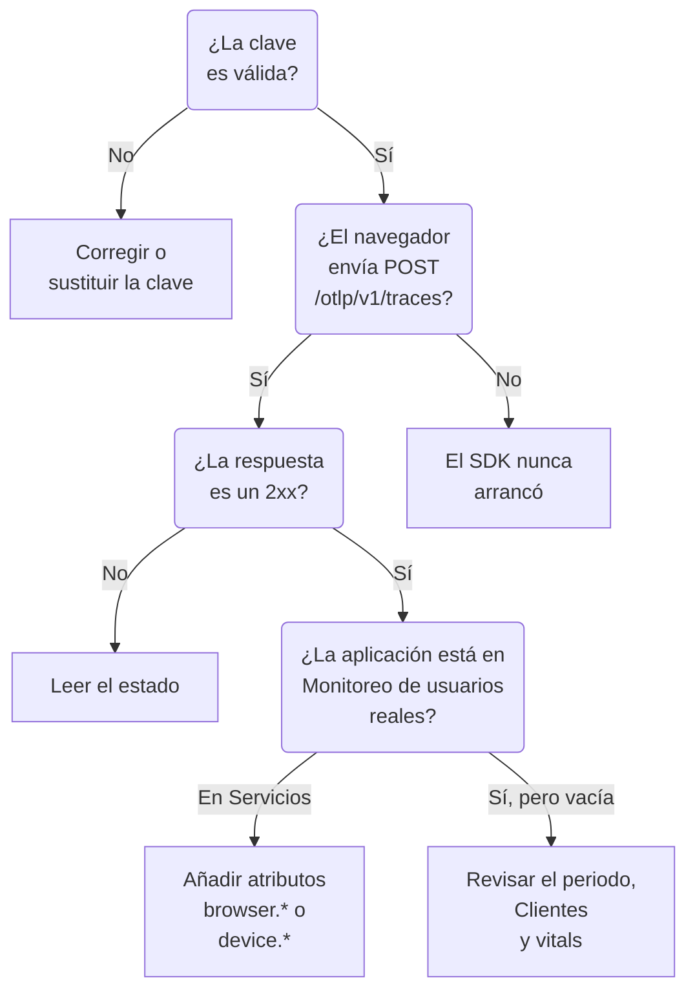

# Solución de problemas de RUM

Cuando una aplicación RUM falta, está vacía o muestra **Desconectado**, recorre esta página en orden. Cada comprobación descarta una parte del camino entre tu aplicación y OneUptime, en el orden en que suelen ocurrir estos problemas.

:::cards
- [Comprobar la clave](#comprobar-la-clave): La comprobación más rápida, y todo lo que sigue depende de ella.
- [Comprobar lo que sale del navegador](#comprobar-lo-que-sale-del-navegador): La solicitud de exportación en las herramientas de desarrollo de tu navegador.
- [Comprobar dónde llega la telemetría](#comprobar-dónde-llega-la-telemetría): Una aplicación RUM o un servicio de backend.
- [Problemas de reproducción de sesiones](#problemas-de-reproducción-de-sesiones): Un pipeline aparte, con su propia página.
:::

## Dónde se detiene la telemetría RUM

La telemetría pasa tres comprobaciones en su camino hacia una aplicación RUM. Encuentra la primera que falla:



## Comprobar la clave

Comprueba primero la clave. Es la comprobación más rápida, y nada de lo que sigue funciona sin una clave que OneUptime acepte:

```bash
curl -i https://oneuptime.com/otlp/v1/validate \
  -H "x-oneuptime-token: YOUR_TELEMETRY_INGESTION_TOKEN"
```

| Respuesta | Qué significa |
| --- | --- |
| `200` con `"valid": true` | OneUptime acepta la clave. La respuesta también da su `keyType` y su `projectId`. Pasa a la siguiente comprobación. |
| `401` con `"valid": false` | La clave falta, es desconocida, está revocada, desactivada o caducada, y el `message` dice cuál. Crea una clave activa en **Ajustes del proyecto → Telemetría y APM → Claves de ingesta**. |

Una aplicación web necesita una clave **Navegador**, y una aplicación móvil una clave **Servidor**: consulta [Configuración para navegadores](/docs/rum/browser-setup) y [Configuración para móviles](/docs/rum/mobile-setup). Los endpoints de exportación también rechazan una clave incorrecta con `401`, como pide la especificación OTLP, así que un SDK bien hecho registra el rechazo en lugar de reintentar. Esa línea pasa fácilmente desapercibida en la consola del navegador, y esta comprobación responde directamente.

## Comprobar lo que sale del navegador

Abre las herramientas de desarrollo de tu navegador en la página de la aplicación, selecciona la pestaña Red y filtra por `otlp`. Buscas `POST /otlp/v1/traces` respondida con un estado `2xx`.

### Ninguna solicitud

El SDK nunca arrancó. Casi siempre es una de estas causas:

- `telemetry.ts` no es la primera importación de tu aplicación, o tu bundler lo eliminó. Las instrumentaciones modifican `fetch` y `XMLHttpRequest`, así que una solicitud hecha antes de esa modificación no se traza, y un archivo que el bundler quitó no ejecuta nada.
- El procesador por lotes todavía no ha exportado. `BatchSpanProcessor` espera unos segundos para llenar un lote, así que espera, o pasa a otra página, antes de concluir que no se envía nada.
- Una variable de entorno de compilación quedó como `undefined`, y la URL del exportador está rota. Registra la URL una vez al arrancar.

### El navegador bloquea la solicitud

- **Un error de Content Security Policy en la consola.** La política de tu página todavía no permite OneUptime. Añádelo a tu directiva `connect-src` existente, o usa tu propio host si alojas OneUptime tú mismo:

  ```text
  connect-src 'self' https://oneuptime.com;
  ```

- **Un error de CORS.** Los endpoints OTLP aceptan solicitudes de cualquier origen y permiten la cabecera `x-oneuptime-token`, así que un fallo de CORS real casi siempre significa que la solicitud nunca llegó a OneUptime: busca un proxy corporativo, un bloqueador de anuncios o una errata en el host. Revisa la URL de la solicitud en la pestaña Red.

### La solicitud recibe un estado de error

**`401`.** La clave es desconocida, está revocada o ha caducado. Ejecuta la [comprobación de la clave](#comprobar-la-clave) y usa después una clave activa.

**`404`.** La URL es incorrecta. El exportador de trazas necesita la ruta completa, `/otlp/v1/traces`. Un error habitual es dar la dirección base (`https://oneuptime.com/otlp`) a un exportador que espera la URL completa, o la URL completa a uno que añade la ruta por su cuenta y acaba en `/otlp/v1/traces/v1/traces`.

**`413`.** El lote superaba lo que admite un proxy. El ingress propio de OneUptime acepta hasta 4 MB en `/otlp`, pero un proxy que pongas delante de OneUptime puede ser más estricto — ingress-nginx, por ejemplo, fija `proxy-body-size` en 1 MB por defecto — así que, si tienes uno, sube también su límite para `/otlp`. En cualquier caso, un `maxExportBatchSize` más pequeño en el `BatchSpanProcessor` reduce cada exportación:

```ts
new BatchSpanProcessor(exporter, { maxExportBatchSize: 100 });
```

Un navegador rara vez envía lotes tan grandes, salvo que los spans lleven atributos grandes, como una pila de llamadas entera o un cuerpo de respuesta. Recortarlos es la mejor solución.

**`422`.** OneUptime rechazó aquí la clave, y el mensaje dice por qué. `Origin https://app.example.com is not allowed for this browser ingestion key.` significa que el origen exacto de la página, con su esquema y su puerto si lo tiene, falta en los **Orígenes permitidos** de la clave. `This telemetry ingestion key has been disabled.` significa que alguien desactivó la clave.

**`429`.** Se agotó el **Límite de solicitudes por minuto** de la clave: `Too many telemetry requests for this ingestion key. Please retry later.` Una clave Navegador permite 6000 solicitudes por minuto para todos tus visitantes juntos, salvo que definas tu propio límite en la clave.

**`403` con una página HTML, o un cuerpo vacío.** OneUptime responde a cada rechazo en JSON, así que este vino de algo que está delante, normalmente un firewall de aplicaciones web en tu propio dominio, si haces pasar OneUptime por él. El firewall analiza OTLP/JSON y compara cada atributo de span con sus reglas de inyección, así que una URL con una cadena de consulta en un span basta para que lo bloquee, y el registro del firewall nombra la regla. Excluye la carga OTLP de la inspección solo en las rutas OTLP: [Tus solicitudes de OpenTelemetry también se bloquean](/docs/rum/session-replay-troubleshooting#tus-solicitudes-de-opentelemetry-también-se-bloquean) muestra cómo, y cubre el grabador de reproducciones detrás del mismo firewall.

## Comprobar dónde llega la telemetría

La solicitud funciona, pero la aplicación aparece en **Productos → Servicios** en lugar de en **Productos → Recursos → Monitoreo de usuarios reales**. Es el informe más común, y la causa casi siempre es un recurso sin atributos de cliente. OneUptime solo archiva un lote como RUM cuando su recurso lleva uno de estos:

| Tipo | Atributos |
| --- | --- |
| Navegador | `browser.platform`, `browser.language` o un `browser.brands` no vacío |
| Móvil | `device.id` o `device.model.identifier`, o `device.manufacturer` en un recurso sin identidad de host (`host.name`, `host.id` o `k8s.node.name`) |

Un `service.name` por sí solo crea un servicio de backend. El SDK de OpenTelemetry para navegador no añade ningún atributo `browser.*` salvo que añadas el detector de recursos del navegador o los definas tú mismo: consulta [Configuración para navegadores](/docs/rum/browser-setup).

Para ver lo que envías de verdad, abre la solicitud OTLP en la pestaña Red y mira su carga: `resourceSpans[0].resource.attributes` es la lista que lo decide. Si no hay ningún atributo `browser.*`, el SDK no lo está añadiendo, diga lo que diga su documentación.

Añade los atributos, y el siguiente lote crea la aplicación RUM. El servicio que se creó primero no se convierte en una aplicación RUM, porque son registros separados, así que elimínalo en **Productos → Servicios** cuando llegue la telemetría RUM.

> [!NOTE]
> Un recurso cuyo único atributo de cliente es `device.manufacturer`, y que además tiene identidad de host, se interpreta como una máquina y no como un teléfono, porque el inventario de un host informa de su fabricante con el mismo atributo. Añade `device.id` o `device.model.identifier`, y el lote se archiva como RUM móvil lleve lo que lleve además.

## La aplicación está vacía

La aplicación existe, pero sus páginas no muestran nada.

- **Revisa el periodo.** La vista general muestra la última hora por defecto, así que un lote de prueba de esta mañana queda fuera.
- **Espera unos minutos.** La ingesta pasa por una cola, y **Visto por última vez** se actualiza cada pocos minutos en lugar de con cada lote.
- **Revisa el proyecto.** Una clave escribe en su propio proyecto, así que la telemetría enviada con la clave de otro proyecto está allí, no aquí.

## La página Clientes está vacía

La página **Clientes** lista `browser.platform` en la web y `device.model.identifier` en móvil. Dos motivos por los que se queda vacía aunque todo lo demás funcione:

- **Safari y Firefox.** `browserDetector` lee la API UA Client Hints, que solo tienen los navegadores Chromium. En los demás define `browser.language`, que basta para archivar la telemetría como RUM, pero no `browser.platform`. Define `browser.platform` tú mismo para que esos clientes aparezcan.
- **Un SDK móvil que solo define `device.manufacturer`.** Eso archiva la telemetría como RUM móvil, pero la página **Clientes** necesita `device.model.identifier`.

## Core Web Vitals muestra «No web vitals reported yet»

La tarjeta solo se llena con las métricas que envía tu aplicación, así que las trazas por sí solas nunca la llenan. Comprueba que exportas métricas, que sus nombres son de los que OneUptime lee y que aparecen en la página **Métricas** de la aplicación. [La tarjeta dice «No web vitals reported yet»](/docs/rum/web-vitals#solución-de-problemas) repasa cada comprobación, incluidos los valores que se pierden cuando un visitante cierra la pestaña antes de la siguiente exportación.

## El estado dice Desconectado mientras la gente usa la aplicación

Una aplicación pasa a **Desconectado** tras 15 minutos sin telemetría. Si hay gente usando la aplicación:

- **Puede que un muestreador lo descarte todo.** Comprueba que no definiste un muestreador siempre apagado, ni una proporción muy baja.
- **Puede que la aplicación solo envíe telemetría en algunas interacciones**, y nadie las usó en ese tiempo.
- **Puede que la clave se revocara o desactivara** después del despliegue: vuelve a ejecutar la [comprobación de la clave](#comprobar-la-clave).

Una aplicación interna o de poco tráfico sin visitantes por la noche está realmente desconectada. No es un fallo.

## Problemas de reproducción de sesiones

La reproducción de sesiones es un pipeline aparte con sus propios problemas: el script del grabador, las listas de orígenes permitidos, el consentimiento, la Content Security Policy y el enmascaramiento. [Solución de problemas de reproducción de sesiones](/docs/rum/session-replay-troubleshooting) los cubre. Empieza por ahí, y empieza activando el diagnóstico del grabador, porque la mayoría de sus fallos son silenciosos a propósito:

```js
localStorage.setItem("oneuptime.sessionReplay.debug", "true");
// then reload the page
```

La página **Salud** de la aplicación, en su sección **Reproducción de sesiones**, y el panel **Prueba tu instalación** de **Política de reproducción** comprueban la clave, las listas de permitidos y la política desde el lado del servidor, y dicen por qué no llega nada. La consola del navegador te da la mitad que el servidor no puede ver.

Con la política predeterminada, un grabador envía un fragmento aproximadamente cada 15 segundos mientras el usuario interactúa con la página. Una pestaña inactiva no tiene nada que enviar, así que haz clic o mueve el ratón primero; después, si no hay ninguna solicitud de fragmento, algo va mal. Si la aplicación solo sube _On error or frustration_, el silencio es lo esperado hasta que algo falle. Llama a `OneUptimeReplay.captureSession()` para forzar una subida y probar el camino en cualquier caso.

Los dos pipelines son independientes. No hace falta una aplicación RUM que funcione para que el grabador se cargue, y que el grabador funcione no significa que llegue telemetría RUM: cada uno puede fallar por separado.

## ¿Sigues atascado?

Reúne esto antes de pedir ayuda. Te ahorra un ir y venir:

- La lista `resource.attributes` de la carga de una solicitud OTLP real.
- El estado HTTP de esa solicitud.
- El `service.name` exacto que envías, y si el proyecto tiene una aplicación o un servicio con ese nombre.
- Si `/otlp/v1/validate` responde `200` para la clave en la compilación desplegada.

Después escribe a support@oneuptime.com o abre un issue en [GitHub](https://github.com/OneUptime/oneuptime).

## Próximos pasos

:::cards
- [Configuración para navegadores](/docs/rum/browser-setup): La configuración que dan por hecha estas comprobaciones, paso a paso.
- [Configuración para móviles](/docs/rum/mobile-setup): La clave y los atributos que necesita una aplicación móvil.
- [Gestionar aplicaciones](/docs/rum/applications): Nombres, etiquetas, retención y estado.
- [Solución de problemas de reproducción de sesiones](/docs/rum/session-replay-troubleshooting): Cada código del grabador, y qué hacer.
:::
