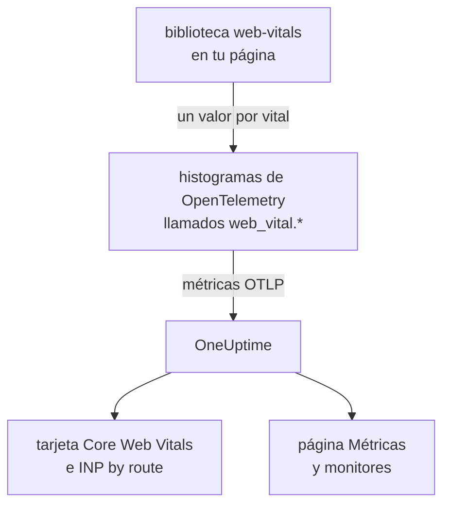
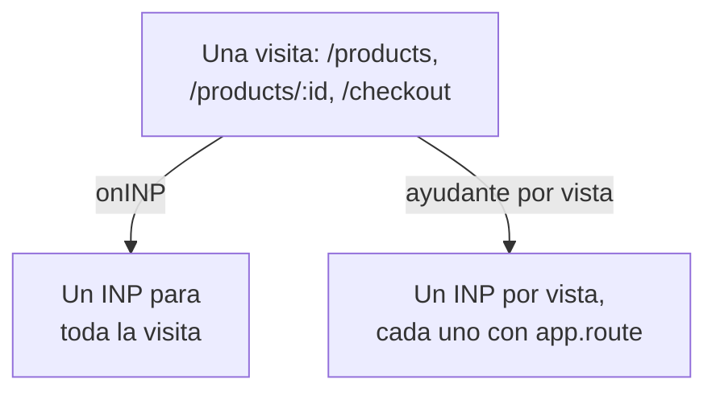

# Core Web Vitals

La tarjeta **Core Web Vitals** de la vista general de una aplicación RUM muestra LCP, INP, CLS, FCP y TTFB, cada uno calificado según los límites de Google. OneUptime no mide ninguno por sí mismo: la tarjeta solo se llena con las métricas que informa tu instrumentación del navegador, y esta página muestra cómo enviarlas.

:::cards
- [Enviarlos](#enviarlos-desde-tu-aplicación): Reenviar los valores de la biblioteca web-vitals como métricas de OpenTelemetry.
- [Nombres que lee OneUptime](#nombres-de-métrica-que-reconoce-oneuptime): Los nombres de métrica con los que puede llegar cada vital.
- [Aplicaciones de una sola página](#aplicaciones-de-una-sola-página): El INP de cada vista, no un valor por carga de página.
- [Alertar sobre un vital](#alertar-sobre-un-vital): Monitores listos para usar para vitals deficientes.
:::

## Cómo funciona

La biblioteca [`web-vitals`](https://github.com/GoogleChrome/web-vitals) mide cada vital en la página; es la misma biblioteca que usan las herramientas de Chrome. Tu código registra cada valor en un histograma de OpenTelemetry, y el pipeline de métricas del navegador lo exporta a OneUptime.



OpenTelemetry aún no tiene una convención de nombres definitiva para los web vitals, así que OneUptime busca cada vital con varios nombres y usa el primero que tiene datos. Usa los nombres `web_vital.*` para la instrumentación nueva.

## Antes de empezar

- Una aplicación web configurada como en [Configuración para navegadores](/docs/rum/browser-setup), con su pipeline de métricas: el `MeterProvider` de [Añadir registros y métricas](/docs/rum/browser-setup#añadir-registros-y-métricas) es el que exporta estos valores.

## Enviarlos desde tu aplicación

:::steps
### Instalar la biblioteca

```bash
npm install web-vitals
```

### Registrar cada vital en un histograma

Crea `src/web-vitals.ts`. Cada vital es un histograma, para que la página **Métricas** pueda calcular percentiles más tarde, con los límites de los buckets en los umbrales de bueno y deficiente de Google.

```ts title="src/web-vitals.ts"
// Import after ./telemetry
import { metrics } from "@opentelemetry/api";
import { onCLS, onFCP, onINP, onLCP, onTTFB, type Metric } from "web-vitals";

const meter = metrics.getMeter("web-vitals");

// Histograms, so the Metrics tab can compute percentiles later. The bucket
// edges sit on each vital's good / poor limits: a percentile is read from
// the buckets, and the defaults are far too coarse for these ranges.
const buckets = (...edges: number[]) => ({ advice: { explicitBucketBoundaries: edges } });

const lcp = meter.createHistogram("web_vital.lcp", { unit: "ms", ...buckets(0, 1000, 1500, 2000, 2500, 3000, 3500, 4000, 5000, 7500, 10000) });
const inp = meter.createHistogram("web_vital.inp", { unit: "ms", ...buckets(0, 50, 100, 150, 200, 250, 300, 400, 500, 750, 1000, 2000) });
const fcp = meter.createHistogram("web_vital.fcp", { unit: "ms", ...buckets(0, 600, 1200, 1800, 2400, 3000, 4000, 6000, 10000) });
const ttfb = meter.createHistogram("web_vital.ttfb", { unit: "ms", ...buckets(0, 200, 400, 600, 800, 1200, 1800, 2500, 4000) });
const cls = meter.createHistogram("web_vital.cls", { unit: "1", ...buckets(0, 0.025, 0.05, 0.1, 0.15, 0.2, 0.25, 0.4, 0.6, 1) });

function record(
  histogram: { record: (v: number, a?: Record<string, string>) => void },
) {
  return (metric: Metric): void => {
    histogram.record(metric.value, {
      // Keep attributes low-cardinality. Never put a full URL or a user id here.
      "web_vital.rating": metric.rating,
    });
  };
}

onLCP(record(lcp));
onINP(record(inp));
onCLS(record(cls));
onFCP(record(fcp));
onTTFB(record(ttfb));
```

### Importarlo después de tu configuración de telemetría

```ts
import "./telemetry";
import "./web-vitals";
```

### Revisar la página Métricas

Carga unas cuantas páginas y busca `web_vital.lcp` en la página **Métricas** de la aplicación. Cuando las métricas estén allí, la tarjeta **Core Web Vitals** se llenará para el intervalo que elijas.
:::

## Enviar los últimos valores antes de que se cierre la página

`onINP` y `onCLS` informan cuando la página se oculta, no durante la visita. Con el intervalo de exportación de 30 segundos de [Configuración para navegadores](/docs/rum/browser-setup), un visitante que cierra la pestaña justo después del último valor puede irse antes de que se exporte. Si la integridad importa, acorta `exportIntervalMillis`, o conserva el `MeterProvider` que creaste en `telemetry.ts` y vacíalo cuando la página se oculte:

```ts
// In telemetry.ts, export the provider you created:
export const meterProvider = new MeterProvider({ /* ... */ });

// Anywhere after setup:
import { meterProvider } from "./telemetry";

document.addEventListener("visibilitychange", () => {
  if (document.visibilityState === "hidden") {
    void meterProvider.forceFlush();
  }
});
```

## Nombres de métrica que reconoce OneUptime

OneUptime prueba los nombres en este orden, y gana el primero que tiene datos en el intervalo seleccionado.

| Vital | Nombres de métrica, cualquiera de ellos | Unidad |
| --- | --- | --- |
| LCP: Largest Contentful Paint | `web_vital.lcp`, `browser.largest_contentful_paint`, `largest_contentful_paint`, `web.vitals.lcp` | ms |
| INP: Interaction to Next Paint | `web_vital.inp`, `browser.interaction_to_next_paint`, `interaction_to_next_paint`, `web.vitals.inp` | ms |
| CLS: Cumulative Layout Shift | `web_vital.cls`, `browser.cumulative_layout_shift`, `cumulative_layout_shift`, `web.vitals.cls` | puntuación |
| FCP: First Contentful Paint | `web_vital.fcp`, `browser.first_contentful_paint`, `first_contentful_paint`, `web.vitals.fcp` | ms |
| TTFB: Time to First Byte | `web_vital.ttfb`, `browser.time_to_first_byte`, `time_to_first_byte`, `web.vitals.ttfb` | ms |

Los demás nombres existen para que una aplicación que ya envía según una convención de la comunidad aparezca sin cambios.

## Umbrales de calificación

La tarjeta califica cada valor con los límites de Core Web Vitals que publica Google:

| Vital | **Good** | **Needs work** | **Poor** |
| --- | --- | --- | --- |
| LCP | menos de 2500 ms | de 2500 a 4000 ms | 4000 ms o más |
| INP | menos de 200 ms | de 200 a 500 ms | 500 ms o más |
| CLS | menos de 0,1 | de 0,1 a 0,25 | 0,25 o más |
| FCP | menos de 1800 ms | de 1800 a 3000 ms | 3000 ms o más |
| TTFB | menos de 800 ms | de 800 a 1800 ms | 1800 ms o más |

La tarjeta muestra la **media** del intervalo seleccionado, no el percentil 75 que informan las herramientas de campo de Google. Es a propósito: OneUptime lee los percentiles de un histograma a partir de sus buckets, así que un percentil solo es tan preciso como sus buckets, mientras que la media sale de la suma y el recuento exactos del histograma. Con los buckets predeterminados de OpenTelemetry (`0, 5, 10, 25, 50, …`), cada valor de CLS cae en el primer bucket, y un percentil 75 marcaría 2,5 para una página que apenas se mueve.

> [!TIP]
> Lee la tarjeta como una tendencia. Para el percentil 75, registra con los límites de buckets de arriba y luego representa la métrica en la página **Métricas** con la agregación **P75**. Un monitor de métricas ofrece la misma opción.

## Aplicaciones de una sola página

`onINP` mide el INP tal como lo define el navegador: **un valor por carga de página**. Una aplicación de una sola página se carga una vez y luego cambia de ruta con `history.pushState`, así que una visita a `/products`, `/products/42` y `/checkout` produce un único INP para toda la visita. Las interacciones de todas las vistas compiten por ese único número, y un atributo de ruta en él nombra la página que se mostraba cuando se informó, no la página que fue lenta.



Para ver el INP por vista, mídelo por vista: cada cambio de ruta termina la vista actual y empieza una nueva, y cada vista informa su propio INP. El ayudante de abajo lo hace con la API Event Timing del navegador, los mismos datos que usa `onINP`, y resuelve la parte fácil de hacer mal: el clic que **provocó** una navegación se entrega después de que la ruta ya cambió, pero pertenece a la página en la que se hizo.

```ts title="src/inp-per-route.ts"
// INP for each view of a single-page app.
type Report = (inpMs: number, route: string) => void;

interface View {
  route: string;
  path: string; // the URL path it was opened for
  start: number; // performance.now() when the view began
  latencies: Map<number, number>; // interactionId -> its slowest entry
}

// Long enough for the click that navigated to be delivered: its entry
// arrives after the next paint, i.e. after the route has changed.
const SETTLE_MS = 1000;

let views: Array<View> = [];
let report: Report = () => {};

// The path, plus the hash when a hash router keeps the route there.
const currentPath = (): string =>
  location.pathname + (location.hash.startsWith("#/") ? location.hash : "");

function close(view: View): void {
  if (!views.includes(view)) return; // already reported
  views = views.filter((v) => v !== view);

  const sorted = [...view.latencies.values()].sort((a, b) => b - a);
  if (sorted.length === 0) return; // nobody interacted: no INP, not 0

  // web-vitals' p98: skip one outlier for every 50 interactions.
  report(sorted[Math.min(sorted.length - 1, Math.floor(sorted.length / 50))]!, view.route);
}

function record(entries: PerformanceEntryList): void {
  for (const entry of entries as Array<PerformanceEventTiming & { interactionId?: number }>) {
    if (!entry.interactionId) continue; // hovers, scrolls: not interactions

    // The view the interaction STARTED in, so the click that navigated
    // counts towards the page it was clicked on.
    const view = [...views].reverse().find((v) => entry.startTime >= v.start);
    if (!view) continue;

    const slowest = view.latencies.get(entry.interactionId) ?? 0;
    view.latencies.set(entry.interactionId, Math.max(slowest, entry.duration));
  }
}

export function observeInpPerRoute(route: string, onReport: Report): void {
  if (typeof PerformanceObserver === "undefined" || !PerformanceObserver.supportedEntryTypes?.includes("event")) return;

  report = onReport;
  views = [{ route, path: currentPath(), start: 0, latencies: new Map() }];

  const observer = new PerformanceObserver((list) => record(list.getEntries()));
  observer.observe({ type: "event", durationThreshold: 40, buffered: true } as PerformanceObserverInit);

  // The tab may never come back: report every view now, then keep
  // measuring the current route as a fresh view.
  document.addEventListener("visibilitychange", () => {
    if (document.visibilityState !== "hidden") return;
    record(observer.takeRecords());
    const current = views[views.length - 1]?.route ?? route;
    [...views].forEach(close);
    views = [{ route: current, path: currentPath(), start: performance.now(), latencies: new Map() }];
  });
}

// Call after every navigation, with the route PATTERN ("/products/:id").
// Safe to call when nothing changed (a router's initial navigation, a
// query-string update): the view only ends when the path does.
export function startView(route: string): void {
  const closing = views[views.length - 1];
  if (!closing || closing.path === currentPath()) return;

  views.push({ route, path: currentPath(), start: performance.now(), latencies: new Map() });
  setTimeout(() => close(closing), SETTLE_MS);
}
```

Ambas funciones reciben el **patrón** de la ruta, nunca la URL: `/products/42` y `/products/7` deben ser una sola ruta, o cada producto se convierte en una serie propia. Usa el patrón de tu router si tiene uno; si no, agrupa tú los ID:

```ts
// "/products/42" -> "/products/:id", also for UUIDs.
export const toRoutePattern = (path: string): string =>
  path.replace(/\/(\d+|[0-9a-f]{8}-[0-9a-f-]{27})(?=\/|$)/gi, "/:id");
```

Registra lo que informa el ayudante en el mismo histograma `web_vital.inp`, con la ruta en `app.route`, y **quita `onINP`** del fragmento de arriba: mantener ambos contaría cada interacción dos veces.

```ts
// src/web-vitals.ts, in place of onINP(record(inp))
import { observeInpPerRoute } from "./inp-per-route";

observeInpPerRoute(toRoutePattern(location.pathname), (inpMs, route) => {
  inp.record(inpMs, {
    "app.route": route,
    "web_vital.rating": inpMs <= 200 ? "good" : inpMs <= 500 ? "needs-improvement" : "poor",
  });
});
```

Después llama a `startView` allí donde tu router anuncie una navegación terminada. Ignora la llamada cuando la ruta de la URL no ha cambiado, así que un router que también informa la primera carga, o un cambio en la query string, no divide la vista:

:::tabs
@tab Vue Router
```ts
router.afterEach((to) => startView(to.matched[to.matched.length - 1]?.path ?? toRoutePattern(to.path)));
```
@tab React Router
```tsx
// In a component that stays mounted inside the router
const { pathname } = useLocation();
useEffect(() => startView(toRoutePattern(pathname)), [pathname]);
```
:::

Lo que obtienes:

- **INP by route** en la vista general, de más lento a más rápido, a partir de `app.route`; OneUptime también lee el atributo `url.template` de OpenTelemetry.
- Un filtro de ruta para las alertas: filtra un monitor de métricas sobre `web_vital.inp` por `app.route` para vigilar un solo flujo, como `/checkout`, por separado.
- El INP global de la aplicación en la tarjeta **Core Web Vitals** sigue funcionando: es la misma métrica, ahora con un valor por vista en lugar de uno por carga de página.

Los navegadores Chromium informan los ID de interacción que esto necesita. Safari no informa ninguno, y por eso `onINP` tampoco informa nada allí. La API experimental Soft Navigations de Chrome pretende hacer esto de forma nativa, pero no está disponible de forma general; este ayudante funciona hoy.

> [!NOTE]
> El grabador de la [Reproducción de sesiones](/docs/telemetry/session-replay) ya mide el INP por vista, sin código: cada grabación muestra una fila de INP por cada ruta en la que interactuó el usuario, con el elemento lento y cómo se repartió su tiempo entre retraso de entrada, procesamiento y presentación.

## Mantener la cardinalidad bajo control

Los atributos de métrica se multiplican. `web_vital.rating` tiene tres valores posibles, lo cual está bien, y un atributo de ruta o de tipo de página suele valer la pena:

```ts
histogram.record(metric.value, {
  "web_vital.rating": metric.rating,
  "app.route": routePattern, // "/product/:id" — the PATTERN, not "/product/8842"
});
```

Registrar la URL concreta en lugar del patrón de la ruta crea una serie temporal por página de producto, lo que vuelve lenta la página **Métricas** y abulta la factura de almacenamiento. Lo mismo ocurre con los ID de usuario, los ID de sesión y los tamaños de pantalla.

## Alertar sobre un vital

La página **Recomendaciones** de la aplicación ofrece un monitor listo para usar para cada vital. Cada uno lee la media de cinco minutos de su métrica y se dispara cuando alcanza el límite de deficiente de Google:

| Recomendación | Métrica | Se dispara en | Gravedad |
| --- | --- | --- | --- |
| **Poor Largest Contentful Paint** | `web_vital.lcp` | 4000 ms | **Crítico** |
| **Poor Interaction to Next Paint** | `web_vital.inp` | 500 ms | **Crítico** |
| **Poor Cumulative Layout Shift** | `web_vital.cls` | 0,25 | **Crítico** |
| **Slow First Contentful Paint** | `web_vital.fcp` | 3000 ms | **Advertencia** |
| **Slow Time to First Byte** | `web_vital.ttfb` | 1800 ms | **Advertencia** |

Estos monitores solo leen los nombres `web_vital.*`. Si tu aplicación envía un vital con otro nombre, edita la métrica del monitor creado. Para alertar sobre una sola ruta, añade un filtro `app.route` al monitor. También puedes crear tu propio monitor sobre cualquiera de estas métricas: consulta [Monitor de métricas](/docs/monitor/metrics-monitor).

## Solución de problemas

:::details La tarjeta dice «Aún no se han informado web vitals»
La tarjeta solo se llena con las métricas que envía tu aplicación. Comprueba, en orden:

1. Que tienes un pipeline de métricas: las trazas por sí solas nunca llenan esta tarjeta.
2. Que los nombres de métrica son de los que lee OneUptime: consulta [Nombres de métrica que reconoce OneUptime](#nombres-de-métrica-que-reconoce-oneuptime).
3. Que las métricas están en la página **Métricas** de la aplicación. Si están, la exportación funciona y el problema es el nombre o el intervalo de tiempo.
4. Que el INP y el CLS se informan cuando la página se oculta, así que una visita corta puede terminar antes de la siguiente exportación: consulta [Enviar los últimos valores antes de que se cierre la página](#enviar-los-últimos-valores-antes-de-que-se-cierre-la-página).

Si nada de esto ayuda, [Solución de problemas de RUM](/docs/rum/troubleshooting) revisa todo el pipeline.
:::

:::details El INP se informa, pero no por ruta
La tarjeta **INP by route** necesita el atributo `app.route`, o `url.template`, en `web_vital.inp`. Registra el patrón de la ruta con cada valor como en [Aplicaciones de una sola página](#aplicaciones-de-una-sola-página).
:::

:::details Los valores no coinciden con el informe de Google
La tarjeta muestra la media del intervalo que elegiste, y Google informa el percentil 75 de sus propios visitantes. Representa el **P75** en la página **Métricas** para comparar lo mismo con lo mismo.
:::

## Próximos pasos

:::cards
- [Configuración para navegadores](/docs/rum/browser-setup): El pipeline de trazas, registros y métricas sobre el que viajan estos vitals.
- [Monitor de métricas](/docs/monitor/metrics-monitor): Alertar sobre cualquier vital, para toda la aplicación o una sola ruta.
- [Reproducción de sesiones](/docs/telemetry/session-replay): Ver el INP por vista en las grabaciones, sin código.
- [Solución de problemas de RUM](/docs/rum/troubleshooting): Cada comprobación, en el orden en que suelen aparecer los problemas.
:::
