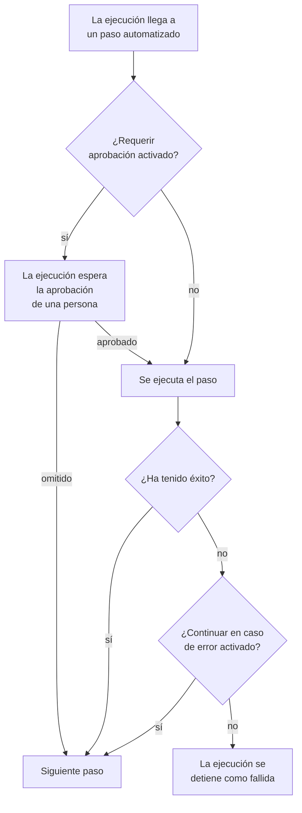

# Crear un runbook

Un runbook se escribe como una lista ordenada de pasos en su página **Pasos**. Esta página muestra cómo crear un runbook, cómo configurar cada uno de los siete tipos de paso y cómo los fallos y las aprobaciones cambian el curso de una ejecución.

:::cards
- [Crear un runbook nuevo](#crear-un-runbook-nuevo): De un runbook vacío a pasos guardados.
- [Tipos de paso](#tipos-de-paso): Manual, JavaScript, HTTP request, Bash, SSH, kubectl y AI.
- [Gestión de fallos y aprobaciones](#gestión-de-fallos-y-aprobaciones): Qué pasa cuando un paso falla o espera una aprobación.
- [Un ejemplo completo](#un-ejemplo-completo): Un failover de base de datos en cinco pasos.
:::

## Antes de empezar

- **Un rol que escriba runbooks.** Project Owner, Project Admin y Runbook Admin crean runbooks y guardan sus pasos. Con permisos granulares necesitas **Create Runbook** y **Edit Runbook**. Consulta [Permisos](/docs/runbooks/configuration#permisos).
- **Un Runner, para los pasos Bash, SSH y kubectl.** Estos pasos se ejecutan en un [Runner](/docs/runbooks/agents) dentro de tu propia infraestructura, nunca en el Worker de OneUptime. Instala uno primero. Un paso que no elige ningún Runner se ejecuta en el [Runner predeterminado del proyecto](/docs/runbooks/agents#el-runner-predeterminado-del-proyecto), si has definido uno; si no, un paso JavaScript se ejecuta en un [Runner global](/docs/runbooks/agents#runners-globales).
- **Una variable secreta, para los pasos SSH y kubectl.** La clave, la contraseña o el kubeconfig con que inicia sesión un paso es una [variable de runbook](/docs/runbooks/variables) secreta. Project Owner y Project Admin crean las variables, y Runbook Admin las elige en los pasos que escribe. Un paso kubectl puede usar en su lugar el acceso propio del Runner.
- **Un proveedor de LLM, para los pasos de IA.** Consulta [Proveedores de LLM](/docs/ai/llm-provider).

## Crear un runbook nuevo

:::steps
### Abrir Runbooks

Abre **Productos → Runbooks**. Runbooks está en el grupo **Paneles y automatización**.

### Crear el runbook

Haz clic en **Crear Runbook**, escribe un **Nombre** y, si quieres, una **Descripción** de para qué sirve el runbook. En **Más campos** están el interruptor **Habilitado**, activado por defecto, y las **Etiquetas**. El nuevo runbook se abre en su página **Pasos**.

### Añadir pasos

En **Inicia tu runbook**, elige el tipo del primer paso; debajo del último paso, **Añadir otro paso** ofrece los mismos siete tipos. Cada paso se abre con su **Título** y lo que necesita su tipo; el resto, como su **Descripción** y los tiempos de espera, queda plegado en **Más campos**. En cuanto el runbook tiene un paso, **Añadir paso**, en la parte superior de la tarjeta, añade un paso Manual.

### Ordenar los pasos

Los pasos se ejecutan **en orden**. Para cambiar el orden, arrastra un paso por el asa situada a la izquierda de su cabecera; con el teclado, pon el foco en el asa, pulsa Espacio, mueve el paso con las flechas y vuelve a pulsar Espacio.

### Guardar los pasos

Haz clic en **Guardar pasos**. Hasta entonces, el editor muestra **Cambios sin guardar**. Una vez guardado, ves **Guardado** y el runbook está listo para [ejecutarse](/docs/runbooks/running).
:::

## Anatomía de un paso

Cada paso tiene estos campos. Un paso automatizado muestra su **Título** y los ajustes de su tipo, y pliega el resto en **Más campos**, que indica qué hay definido:

| Campo | Para qué sirve |
| --- | --- |
| **Título** | Una etiqueta corta, visible en la lista de pasos y en cada ejecución. |
| **Descripción** | Contexto opcional para quien responde, en Markdown, en **Más campos**. En un paso Manual son las **Instrucciones** que esa persona lee y sigue, y se muestran bajo el título. |
| **Continuar en caso de error** | Solo pasos automatizados. Si está activado, un paso que falla no detiene la ejecución: el siguiente paso se ejecuta igualmente. |
| **Requerir aprobación** | Solo pasos automatizados. Si está activado, la ejecución se detiene antes de este paso hasta que alguien lo aprueba, y solo entonces lo ejecuta. El interruptor dice **Requerir aprobación antes de ejecutar este paso**, y la cabecera del paso muestra **Requiere aprobación**. |
| Ajustes propios del tipo | El script, la URL, el Runner, una variable secreta o la indicación. Consulta [Tipos de paso](#tipos-de-paso). |

## Tipos de paso

| Tipo | Se ejecuta en | Necesita |
| --- | --- | --- |
| [Manual](#manual) | Una persona | Nada |
| [JavaScript](#javascript) | Un Runner | Un Runner |
| [HTTP request](#http-request) | El Worker de OneUptime | Nada |
| [Bash](#bash) | Un Runner | Un Runner |
| [SSH](#ssh) | Un Runner | Un Runner y una variable secreta para iniciar sesión |
| [kubectl](#kubectl) | Un Runner | Un Runner, y una variable de kubeconfig o el acceso propio del Runner |
| [AI](#ai) | El Worker de OneUptime | Un proveedor de LLM |

En cada paso automatizado de abajo, **Más campos** del paso contiene primero su **Runner**, en un paso que se ejecuta en uno, luego **Requerir aprobación** y **Continuar en caso de error**, luego los ajustes propios del paso - los encabezados de una llamada HTTP, el puerto y la frase de contraseña de la clave de un paso SSH, el proveedor y los interruptores de contexto de un paso de IA - y por último la **Descripción** y los tiempos de espera. Plegado, nombra el Runner del paso, para que veas dónde se ejecuta un paso sin abrirlo.

### Manual

Un elemento de lista de comprobación para una persona: sus **Instrucciones** dicen qué hacer o comprobar. La ejecución se pausa al llegar a un paso Manual y se queda en `WaitingForManualStep` (**Esperándote**) hasta que alguien hace clic en **Marcar como completado** u **Omitir**. Una ejecución que espera a una persona nunca caduca. Un paso Manual no tiene interruptor de aprobación: ya detiene la ejecución para una persona.

Úsalo para lo que solo una persona puede comprobar o hacer: «Confirmar en el panel del balanceador de carga que el tráfico se ha movido a la región secundaria».

### JavaScript

Un fragmento de JavaScript que se ejecuta en un sandbox `isolated-vm` en un [agente de runbook](/docs/runbooks/agents), no en el Worker de OneUptime: en uno de los tuyos, o en un [Runner global](/docs/runbooks/agents#runners-globales) cuando el paso no elige ninguno.

| Campo | Qué hace | Predeterminado |
| --- | --- | --- |
| **Runner** | En **Más campos**. El Runner que ejecuta el paso: **Runner global**, o uno de los tuyos. Solo el Runner que eliges puede reclamar el trabajo; cualquier Runner global puede reclamar un paso en **Runner global**. | El [Runner predeterminado del proyecto](/docs/runbooks/agents#el-runner-predeterminado-del-proyecto), si has definido uno; si no, **Runner global**, cuando hay uno |
| **Script** | El JavaScript que se ejecuta. Devuelve un valor con `return` para capturarlo; cada línea de `console.log` también se captura. Lanzar un error hace fallar el paso. | — |
| **Tiempo de espera de ejecución** | Cuánto tiempo deja el Runner que se ejecute el fragmento antes de destruir el sandbox. Un Runner global lo deja ejecutarse 5 minutos como mucho. | 30 segundos |
| **Tiempo de espera de reclamación** | Cuánto tiempo espera el Worker a que el Runner reclame el trabajo. | 2 minutos |

```javascript
const start = Date.now();
// ... your logic ...
console.log("replica lag checked");
return { durationMs: Date.now() - start };
```

El sandbox tiene 128 MB de memoria y no tiene acceso al sistema de archivos ni a los procesos. Puede hacer solicitudes HTTP con `axios`, pero solo a direcciones públicas: se rechaza una solicitud a una red privada, al propio host del Runner o a un endpoint de metadatos de la nube. Para llegar a un servicio de tu red, usa un paso [Bash](#bash) con `curl`.

### HTTP request

Una llamada HTTP saliente, hecha por el Worker de OneUptime. No hace falta ningún Runner.

| Campo | Qué hace | Predeterminado |
| --- | --- | --- |
| **Método** | `GET`, `POST`, `PUT`, `PATCH`, `DELETE` o `HEAD`. | `GET` |
| **URL** | El endpoint al que se llama. | Vacío |
| **Encabezados (JSON)** | En **Más campos**. Un objeto JSON, como `{ "Authorization": "Bearer ..." }`. Unos encabezados que no son JSON válido hacen fallar el paso. | Ninguno |
| **Cuerpo** | Se muestra para `POST`, `PUT`, `PATCH` y `DELETE`. Se envía como JSON si se puede interpretar como JSON, y como texto en caso contrario. | Ninguno |
| **Tiempo de espera de la solicitud** | Cuánto se espera la respuesta del endpoint antes de hacer fallar el paso. | 30 segundos |

El paso tiene éxito con una respuesta `2xx` o `3xx` y falla con cualquier otra, con `HTTP <status>` como error. Las redirecciones no se siguen. Se capturan el estado, los encabezados y el cuerpo de la respuesta, hasta 50 KB.

> [!NOTE]
> El Worker nunca llama a direcciones de loopback ni de enlace local, como un endpoint de metadatos de la nube. En OneUptime Cloud solo llama a direcciones públicas. Un OneUptime autoalojado también llega a redes privadas, salvo que `DATA_SOURCE_BLOCK_PRIVATE_ADDRESSES` sea `true`. Para llamar a un servicio de tu red desde OneUptime Cloud, usa un paso [Bash](#bash) con `curl`.

Útil para: abrir un incidente en PagerDuty, publicar en un webhook de Slack, llamar a la API pública de tu proveedor de nube o a la tuya.

> [!TIP]
> Mantén los tokens fuera del paso. Guárdalos como [variables de runbook](/docs/runbooks/variables) secretas y escribe `{{global.variables.NAME}}` donde va el valor, en la URL, los encabezados o el cuerpo. OneUptime envía la solicitud él mismo, así que inserta también los secretos, y la respuesta que registra el paso muestra `[REDACTED]` en su lugar. En encabezados o un cuerpo JSON, un valor va dentro de su cadena, así que unas comillas o un salto de línea en él no rompen el JSON.

### Bash

Un script de bash que se ejecuta con `bash -c <script>` en un [agente de runbook](/docs/runbooks/agents) de tu propia infraestructura. Bash nunca se ejecuta en el Worker de OneUptime.

| Campo | Qué hace | Predeterminado |
| --- | --- | --- |
| **Runner** | En **Más campos**. El Runner que ejecuta el paso. Solo ese Runner puede reclamar el trabajo. Los Runners globales solo ejecutan pasos JavaScript. | El Runner predeterminado del proyecto, si has definido uno |
| **Script de Bash** | El script. La salida (stdout y stderr) se captura hasta 50 KB, y un código de salida distinto de cero hace fallar el paso. | — |
| **Tiempo de espera de ejecución** | Cuánto tiempo deja el Runner que se ejecute el script antes de matarlo con `SIGKILL`. Auméntalo para los pasos que tardan minutos con razón. | 30 segundos |
| **Tiempo de espera de reclamación** | Cuánto tiempo espera el Worker a que el Runner reclame el trabajo. | 2 minutos |

El script se ejecuta dentro del contenedor del Runner, con las herramientas que trae su imagen, como `curl`, `wget` y el cliente `ssh`, y con el acceso de red del host en el que se ejecuta. Por ejemplo, para comprobar un servicio al que solo llega tu red:

```bash
set -euo pipefail
HTTP_CODE=$(curl -s -o /tmp/resp.txt -w "%{http_code}" "http://payments.internal:8080/health")
echo "HTTP $HTTP_CODE"
cat /tmp/resp.txt
if [[ "$HTTP_CODE" != "200" ]]; then
  echo "Health check failed"
  exit 1
fi
```

Si el Runner elegido está desconectado cuando la ejecución llega a este paso, el paso espera hasta el **tiempo de espera de reclamación** (2 minutos por defecto) y luego falla por tiempo agotado. Añade un agente en **Runbooks → Agentes de runbook** antes de confiar en un paso Bash.

> [!TIP]
> Mantén las contraseñas y los tokens fuera del script. Guárdalos como [variables de runbook](/docs/runbooks/variables) secretas y escribe `{{global.variables.NAME}}` donde va el valor: el Runner recibe el script con el valor insertado, y la salida del paso muestra `[REDACTED]` en su lugar.

### SSH

Iniciar sesión en una máquina por SSH y ejecutar allí un script de bash. El Runner abre la conexión, así que la máquina solo tiene que ser accesible desde el Runner, y la clave o la contraseña con que inicia sesión el paso es una [variable de runbook](/docs/runbooks/variables) secreta, nunca escrita en el paso.

| Campo | Qué hace |
| --- | --- |
| **Runner** | En **Más campos**. El Runner que abre la conexión. Debe poder llegar a la máquina por la red. Un paso que no elige ninguno se ejecuta en el Runner predeterminado del proyecto. |
| **SSH a** | El usuario y la máquina, tal como los escribirías después de `ssh`: `deploy@10.0.4.21`. |
| **Iniciar sesión con** | La variable secreta que contiene la clave privada o la contraseña; el valor indica cuál es. Solo se ofrecen variables secretas, y el paso avisa cuando su Runner no puede usar la elegida. |
| **Script de Bash** | Se ejecuta con `bash` en la máquina, como el usuario con que inicia sesión. La salida se captura hasta 50 KB, y un código de salida distinto de cero hace fallar el paso. |
| **Puerto** | En **Más campos**. 22 si se deja vacío. |
| **Frase de contraseña de la clave** | En **Más campos**. La variable secreta que contiene la frase de contraseña de una clave que la tiene. |
| **Tiempo de espera de ejecución** | Cubre a la vez la conexión, el inicio de sesión y la ejecución del script, para que un script colgado no pueda mantener abierto el paso. 30 segundos por defecto. |
| **Tiempo de espera de reclamación** | Cuánto tiempo espera el Worker a que el Runner reclame el trabajo. 2 minutos por defecto. |

Por ejemplo, para reiniciar un servicio y mostrar que volvió a funcionar:

```bash
sudo systemctl restart nginx
systemctl status nginx --no-pager
```

### kubectl

Ejecutar comandos kubectl contra un clúster. El script se ejecuta con bash en el Runner, que incluye `kubectl`, con `KUBECONFIG` apuntando al clúster: funciona cualquier comando kubectl, y también cualquier bash alrededor.

| Campo | Qué hace |
| --- | --- |
| **Runner** | En **Más campos**. El Runner que ejecuta kubectl. Debe poder llegar al servidor de API del clúster. Un paso que no elige ninguno se ejecuta en el Runner predeterminado del proyecto. |
| **Kubeconfig** | La variable secreta que contiene el kubeconfig del clúster, o **El acceso propio del Runner**: el kubeconfig propio del Runner, o su cuenta de servicio cuando se ejecuta en el clúster. El Runner escribe un kubeconfig en un archivo que solo él puede leer, y lo elimina cuando termina el script. |
| **Script** | Los comandos kubectl. La salida se captura hasta 50 KB, y un código de salida distinto de cero hace fallar el paso. |
| **Tiempo de espera de ejecución** | Cuánto tiempo deja el Runner que se ejecute el script antes de detenerlo con `SIGKILL`. 30 segundos por defecto. |
| **Tiempo de espera de reclamación** | Cuánto tiempo espera el Worker a que el Runner reclame el trabajo. 2 minutos por defecto. |

Por ejemplo, para reiniciar un deployment y esperar a que sus pods nuevos estén listos:

```bash
kubectl rollout restart deployment/checkout-api --namespace checkout
kubectl rollout status deployment/checkout-api --namespace checkout --timeout=120s
```

**Ejemplos: haz clic para insertar**, bajo cada script, inserta scripts habituales como estos. Dale al usuario del kubeconfig solo lo que hacen tus scripts: un Role en los namespaces donde actúan, con los verbos que usan. Si el servidor de API rechaza un comando, el propio mensaje de kubectl aparece en la salida del paso, así que un fallo de permisos te dice qué role binding ampliar.

### AI

Pide a la IA que analice, resuma o decida algo a mitad de la ejecución. La respuesta se convierte en la salida del paso en la ejecución. Los pasos de IA se ejecutan en el Worker de OneUptime; no hace falta ningún Runner.

| Campo | Qué hace |
| --- | --- |
| **Indicación** | Lo que debe hacer la IA. Por ejemplo: «Revisa la salida de los pasos anteriores y di si es seguro continuar con la remediación». |
| **Proveedor de LLM** | Opcional. **Predeterminado del proyecto** usa el proveedor predeterminado del proyecto. Fija un proveedor cuando el paso necesite un modelo concreto, como uno autoalojado para datos que no deben salir de tu red. Consulta [Proveedores de LLM](/docs/ai/llm-provider). |
| **Incluir el contexto del paso anterior** | Si está activado, la IA ve todo sobre los pasos que se ejecutaron antes que este: título, tipo, estado, salida y mensajes de error. Recibe hasta 4.000 caracteres de la salida de cada paso. |
| **Incluir el contexto del desencadenante** | Si está activado, la IA ve qué inició la ejecución: el incidente, la alerta o el evento de mantenimiento programado vinculado (su descripción, gravedad, estado actual, monitores afectados, causa raíz, historial de estados y notas públicas), o quién ejecutó el runbook a mano. |

Para mantener a una persona en el circuito, activa **Requerir aprobación** en el paso que sigue a un paso de IA: la IA analiza, alguien lee su respuesta y el paso de remediación solo se ejecuta cuando esa persona lo aprueba.

**Lo que la IA nunca ve.** La respuesta de un paso de IA se guarda como salida del paso en la ejecución, y las ejecuciones las puede leer cualquiera con permiso de lectura de runbooks, un público más amplio que el del incidente. Por eso el contexto del desencadenante deja fuera las **notas internas privadas** y los **mensajes de canales de Slack y Microsoft Teams**. La salida de los pasos anteriores se analiza en busca de secretos (tokens, claves, credenciales), que se ocultan antes de enviarla al modelo. Las imágenes incrustadas y los datos codificados largos, como una captura de pantalla pegada en la descripción de un incidente, también se dejan fuera, con una nota breve en su lugar.

Los pasos de IA se miden y se facturan como cualquier otra función de IA. El paso falla, con un mensaje que explica por qué, cuando no tiene indicación, cuando las funciones de IA están desactivadas en el proyecto, cuando no hay ningún proveedor de LLM disponible o cuando el proveedor fijado ya no está disponible para el proyecto. Activa **Continuar en caso de error** si el resto del runbook debe ejecutarse igualmente.

## Gestión de fallos y aprobaciones



Por defecto, un paso que falla detiene la ejecución y la marca como `Failed`, con el error del paso como motivo. Con **Continuar en caso de error** activado, el fallo se registra y se ejecuta el siguiente paso, lo que encaja con runbooks del tipo «prueba estas tres cosas y luego avisa».

**Requerir aprobación** se aplica antes de que un paso se ejecute, pase lo que pase antes: la ejecución espera hasta que alguien hace clic en **Aprobar y ejecutar**, y el paso se ejecuta, o en **Omitir**, y nunca se ejecuta. Actívalo en el paso que cambia algo - el reinicio, la conmutación por error, la reducción de escala - para que una persona revise primero lo que encontraron los pasos anteriores. La aprobación pertenece al paso, así que mover el paso también la mueve.

:::note
En la API y Terraform, el interruptor es el campo `requireApprovalBeforeRunning` de un paso. El campo `requireApproval` de un paso, que los runbooks escribían antes de que las aprobaciones pasaran al paso que protegen, sigue funcionando y significa lo que significaba: una aprobación después de ese paso. OneUptime lo lee como una aprobación antes del siguiente paso o, después del último paso, como un paso Manual al final, titulado **Approve the result**.
:::

## Guardar y editar

Los cambios en los pasos se aplican cuando haces clic en **Guardar pasos**. Cada ejecución trabaja con la instantánea tomada al empezar, así que las ejecuciones en curso conservan los pasos con los que empezaron, y editar nunca reescribe el historial de ejecuciones anteriores.

## Un ejemplo completo

Un runbook para «DB primary unreachable»:

| # | Tipo | Qué hace |
| --- | --- | --- |
| 1 | JavaScript | Obtener el host primario actual de tu servicio de configuración y registrarlo. |
| 2 | Manual | «Confirmar que el retraso de replicación en el secundario está por debajo de 5 segundos». |
| 3 | HTTP request | `POST` a la API de tu orquestador de failover. |
| 4 | Manual | «Verificar que las escrituras van ahora al nuevo primario». |
| 5 | HTTP request | `POST` de un mensaje de normalidad a un webhook de Slack. |

Quien responde ve ejecutarse el paso 1, marca el paso 2, ve ejecutarse el paso 3, marca el paso 4 y la ejecución termina con el paso 5. La salida de cada paso queda capturada para el postmortem.

## Siguientes pasos

:::cards
- [Ejecutar un runbook](/docs/runbooks/running): Iniciar una ejecución y completar, aprobar u omitir sus pasos.
- [Reglas de runbook](/docs/runbooks/rules): Iniciar este runbook automáticamente en los incidentes que coincidan.
- [Agentes de runbook](/docs/runbooks/agents): Instalar el Runner que necesitan tus pasos de script.
- [Variables de runbook](/docs/runbooks/variables): Mantener los hosts, claves, contraseñas y kubeconfigs fuera de tus pasos.
:::
