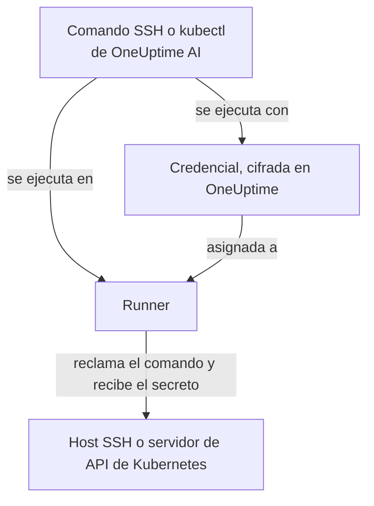

# Acceso de la IA

El acceso de la IA es cómo los propios comandos de OneUptime AI llegan a algo que **no** es el host propio de un Runner: un servidor por SSH, o el servidor de API de un clúster de Kubernetes que no ejecuta el chart del agente de Kubernetes. Cada acceso es una credencial: ese acceso como objeto gestionado, cifrado en reposo, asignado a Runners concretos y elegido por OneUptime AI en lugar de escrito en un comando. Los pasos de runbook no las usan: un paso SSH o kubectl inicia sesión con una [variable de runbook](/docs/runbooks/variables) secreta. Un Runner anterior a esta versión es la excepción: ejecuta un paso de Kubernetes que pasó a script desde una acción con la credencial que nombraba el paso, hasta que se cambian su script o su kubeconfig.

Gestiónalas en **Runbooks → Agentes de runbook → Acceso de la IA**.

:::cards
- [Crear una credencial](#crear-una-credencial): Su acceso y los Runners que pueden usarla.
- [Mínimo privilegio en el otro extremo](#mínimo-privilegio-en-el-otro-extremo): Limitar lo que puede hacer la clave o el token.
- [Runners que ejecutan los comandos de OneUptime AI](#runners-que-ejecutan-los-comandos-de-oneuptime-ai): Quién puede dar una credencial SSH a un Runner así.
:::

## Cómo se usa una credencial

OneUptime AI ejecuta un comando SSH con una de las credenciales SSH asignadas al Runner en el que se ejecuta, y un comando kubectl para un clúster que no ejecuta el chart del agente de Kubernetes con la credencial de Kubernetes vinculada a ese clúster, como muestra [SRE con IA](/docs/ai/ai-sre). Cuando el Runner reclama el comando, OneUptime comprueba que la credencial está asignada a él, descifra el secreto y lo entrega solo en la respuesta a esa reclamación. El secreto nunca se guarda en el trabajo y nunca se puede leer por la API.

## Antes de empezar

- **Un rol que gestione credenciales.** Project Owner y Project Admin, o cualquiera con el permiso **Create Runbook Credential**. El rol Runbook Admin no lo incluye. Asignar una credencial SSH a un Runner que ejecuta los comandos de OneUptime AI también requiere **Read Runbook Credential**; consulta [Runners que ejecutan los comandos de OneUptime AI](#runners-que-ejecutan-los-comandos-de-oneuptime-ai).
- **Un plan que las incluya.** En OneUptime Cloud, las credenciales de runbook necesitan el plan **Growth** o superior.
- **Un [Runner](/docs/runbooks/agents)** que llegue por la red al host o al servidor de API del clúster.

## Crear una credencial

:::steps
### Abrir el acceso de la IA

Abre **Runbooks → Agentes de runbook → Acceso de la IA** y haz clic en **Crear Credencial**.

### Ponerle nombre y elegir su tipo

En el paso **Credencial**, escribe un **Nombre**, como `prod-cluster`, una **Descripción** opcional y el **Tipo**: **SSH** o **Kubernetes**. El tipo no se puede cambiar después; crea una credencial nueva en su lugar.

### Introducir el acceso

:::tabs
@tab SSH
En **Host SSH**, escribe el **Nombre de host**, el **Puerto** (22 si se deja vacío) y el **Nombre de usuario**. En **Autenticación SSH**, elige cómo **Iniciar sesión con**: una **Clave privada**, la mejor opción cuando puedes elegir, y pega la **Clave privada (PEM)**, con su **Frase de contraseña de la clave privada** si la tiene; o una **Contraseña**, para un host sin acceso por clave, y escribe la **Contraseña**.
@tab Kubernetes
En **Kubernetes**, escribe la **URL del servidor de API**, como `https://10.0.0.1:6443`, el **Token de cuenta de servicio** y el **Certificado de CA (PEM)** para que el Runner pueda verificar el servidor de API. Deja la CA vacía solo si el servidor de API presenta un certificado en el que el Runner ya confía.
:::

### Asignarla a Runners

En el paso **Agentes de runbook**, elige los Runners que pueden usar la credencial y haz clic en **Crear Credencial**. Una credencial que no está asignada a ningún Runner no la puede usar ningún comando.

### Dejar que OneUptime AI la use

OneUptime AI ejecuta sus comandos SSH en un Runner con **Ejecuta comandos de remediación con IA** activado, con una de las credenciales SSH asignadas a él. Una credencial de Kubernetes se usa en cuanto se vincula, junto con uno de sus Runners, a un clúster: consulta [SRE con IA](/docs/ai/ai-sre).
:::

## Qué se guarda

| Tipo | Campos |
| --- | --- |
| SSH | Nombre de host, puerto (22 por defecto), nombre de usuario y, o bien una clave privada PEM (con una frase de contraseña opcional), o bien una contraseña. |
| Kubernetes | URL del servidor de API, un token de cuenta de servicio y el certificado de la CA del clúster. |

## Los valores secretos son de solo escritura

Las claves privadas, frases de contraseña, contraseñas y tokens de cuenta de servicio están cifrados en reposo y la API **nunca los devuelve**: ni al panel, ni a un flujo de trabajo, ni a una exportación. La tabla puede mostrarte lo que *es* una credencial sin mostrar nunca lo que contiene.

Por eso no hay un «ver» para un valor secreto, solo «reemplazar»: volver a introducir un valor es la forma de rotarlo. Si pierdes el original, emite una clave nueva en el sistema de destino y actualiza la credencial.

## Asignar una credencial a Runners

Una credencial solo la pueden usar los Runners a los que la asignas. Un comando que nombra una credencial no asignada a su Runner **falla en lugar de ejecutarse**: un Runner que en silencio no hace nada se ve exactamente igual que uno que funcionó.

La asignación es el límite de acceso, así que mantenla estrecha: un Runner que solo reinicia un clúster no necesita la clave SSH de tus hosts de base de datos.

### Runners que ejecutan los comandos de OneUptime AI

En un Runner con **Ejecuta comandos de remediación con IA** activado, OneUptime AI elige entre las credenciales SSH asignadas al Runner para los comandos que ejecuta allí. Por eso una credencial SSH solo llega a un Runner así a través de alguien que puede leer las credenciales de runbook (**Read Runbook Credential**, o un Project Owner o un Project Admin), sea lo que sea lo que se guarde primero:

- **Asignar la credencial.** Crear una credencial SSH con un Runner así, o añadir un Runner así a una credencial, requiere ese permiso. Sin él, el guardado se rechaza y nombra el Runner: asigna la credencial a Runners que no ejecuten comandos de remediación con IA, o pide a alguien con el permiso que la asigne.
- **Activar el interruptor.** Activar **Ejecuta comandos de remediación con IA** en un Runner que tiene credenciales SSH requiere el mismo permiso.

Quitar Runners de una credencial, guardar una credencial con los Runners que ya tiene y las credenciales de Kubernetes no piden nada más: los comandos kubectl de OneUptime AI se ejecutan con la credencial vinculada a su clúster. Las asignaciones de credenciales y la activación del interruptor por alguien sin ese permiso se guardan de una en una en un proyecto, para que las dos no puedan superar sus comprobaciones a la vez; un guardado que llega mientras se guarda otro lo espera, y si tarda demasiado se rechaza con *Try again in a moment*. Vuelve a guardarlo.

Los pasos de un flujo de trabajo actúan como un Project Admin, pero no se les presta la lectura de credenciales de runbook de un Project Admin: un paso la tiene solo si la tiene la persona que guardó por última vez los pasos del flujo de trabajo. Consulta [Qué pueden hacer los pasos de un flujo de trabajo](/docs/workflows/configuration#qué-pueden-hacer-los-pasos-de-un-flujo-de-trabajo).

## Mínimo privilegio en el otro extremo

OneUptime no puede limitar lo que tu credencial puede hacer en el sistema de destino: eso le toca al sistema de destino, y merece la pena hacerlo:

- **SSH**: prefiere una clave a una contraseña, da al usuario solo los comandos que necesita (un comando forzado o una shell restringida cuando sea práctico) y no reutilices la clave personal de un administrador.
- **Kubernetes**: vincula la cuenta de servicio a un Role que permita solo lo que dejas hacer a OneUptime AI, en los namespaces donde puede actuar. Una cuenta de servicio que solo puede leer deja que OneUptime AI investigue y rechaza cualquier corrección.

## Quién puede verlas

Crear, editar y eliminar credenciales requiere los permisos de credenciales de runbook (o Project Owner/Admin). Leer una credencial muestra solo sus campos no secretos.

Ten en cuenta que la **clave de agente** de un Runner equivale a las credenciales que tiene asignadas: cualquier cosa que tenga la clave puede reclamar trabajo como ese Runner y recibir material de credenciales. Por eso las claves de agente solo las pueden leer los Project Owners, los Project Admins y los Runbook Admins: trátalas igual que tratarías las propias credenciales.

## Siguientes pasos

:::cards
- [Variables de runbook](/docs/runbooks/variables): Los secretos con que inician sesión los pasos SSH y kubectl.
- [Agentes de runbook](/docs/runbooks/agents): Instalar el Runner al que se asigna una credencial.
- [Configuración y seguridad de runbooks](/docs/runbooks/configuration): Permisos y endurecimiento de toda la pila de runbooks.
:::
