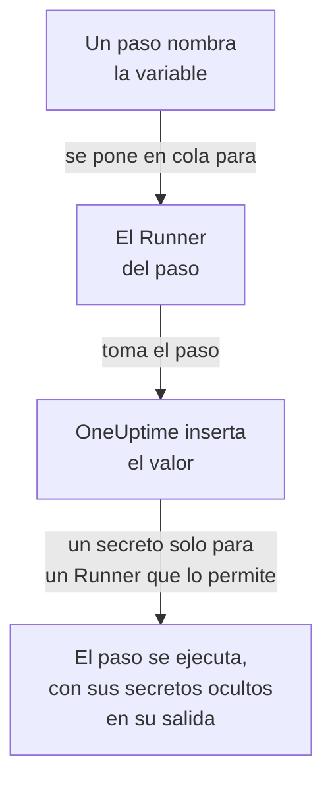

# Variables de runbook

Una variable de runbook es un valor que tus pasos usan por su nombre en lugar de contenerlo ellos mismos: un host, un namespace o una URL, o un secreto como una clave SSH, una contraseña, un kubeconfig o un token de API. Cambia el valor una vez, y cada paso que lo nombra usa el nuevo la próxima vez que se ejecuta. Un secreto está cifrado, nunca se vuelve a mostrar y se oculta en lo que imprimen los pasos.

:::cards
- [Crear una variable](#crear-una-variable): Un valor simple, o un secreto y los Runners que pueden usarlo.
- [Usar una variable en un paso](#usar-una-variable-en-un-paso): En un script o una solicitud HTTP, o como inicio de sesión de un paso SSH y kubeconfig de un paso kubectl.
- [Quién recibe un secreto](#quién-recibe-un-secreto): Tus Runners, los Runners globales cuando se lo permites, y OneUptime para un paso de solicitud HTTP.
:::

## Cómo llega una variable a un paso



Un paso contiene el nombre de la variable, nunca su valor. Cuando el Runner del paso lo toma, OneUptime inserta el valor - en el script, en la máquina y el inicio de sesión de un paso SSH, o en el kubeconfig de un paso kubectl - y se lo entrega solo a ese Runner. Un paso que nombra una variable que no puede tener falla con el motivo, en lugar de ejecutarse con el nombre donde debería ir el valor.

Los pasos Bash, JavaScript, SSH, kubectl y de solicitud HTTP usan variables. Los pasos de IA no las insertan. OneUptime envía él mismo un paso de solicitud HTTP, sin Runner, así que el paso recibe cada variable que nombra, también los secretos, y los oculta en la respuesta que registra.

## Variables globales y variables de runbook

| | Variables globales | Las variables propias de un runbook |
| --- | --- | --- |
| Se gestionan en | **Runbooks → Ajustes → Variables globales** | **Ajustes → Variables** del runbook |
| Las usa | Cada runbook del proyecto | Solo los pasos de ese runbook |
| Se escriben en un paso como | `{{global.variables.NAME}}` | `{{local.variables.NAME}}` |

Un nombre se usa una sola vez, sin importar mayúsculas y minúsculas, entre las variables globales del proyecto, y una vez entre las propias de un runbook. Una variable de un runbook puede compartir nombre con una global: cada una se escribe a su manera.

## Antes de empezar

- **Un rol que gestione variables.** Project Owner y Project Admin, o el permiso **Create Runbook Variable**. Runbook Admin lee las variables, para elegirlas en los pasos que escribe, pero no las cambia.
- **Un plan que las incluya.** En OneUptime Cloud, las variables de runbook necesitan el plan **Growth** o superior.

## Crear una variable

:::steps
### Abrir las variables

Abre **Runbooks → Ajustes → Variables globales**, o **Ajustes → Variables** de un runbook, y haz clic en **Crear Variable**.

### Ponerle nombre e introducir su valor

En el paso **Variable**, introduce un **Nombre**: letras, números, guiones y guiones bajos, hasta 100 caracteres, como `PROD_DB_SSH_KEY`. **Secreto** empieza activado: pega la clave, la contraseña, el token o el kubeconfig en **Valor del secreto** y haz clic en **Siguiente**. Para un valor que cualquiera puede leer, como un host, desactiva **Secreto**, introdúcelo en **Valor** y haz clic en **Crear Variable**. Una **Descripción** opcional espera en **Más campos**.

### Elegir quién puede usar un secreto

En el paso **Quién puede usarlo**, elige tus Runners en **Tus Runners que pueden usarlo**. En un servidor con [Runners globales](/docs/runbooks/agents#runners-globales), **Los Runners globales pueden usarlo** también permite usar el secreto a los pasos de este proyecto que se ejecutan en un Runner global: empieza activado mientras el proyecto usa Runners globales. Un secreto necesita lo uno o lo otro. Haz clic en **Crear Variable**.
:::

Si una variable es un secreto no se puede cambiar después. En su lugar, elimínala y vuelve a crearla con el mismo nombre: los pasos nombran las variables por su nombre, así que siguen funcionando. El Runner dentro del clúster, el que instala el chart del agente de Kubernetes, nunca recibe un secreto.

## Los valores secretos son de solo escritura

El valor de un secreto se cifra en reposo y la API **nunca lo devuelve**: ni al panel, ni a un flujo de trabajo, ni a una exportación. La lista muestra **Secreto** donde una variable simple muestra su valor, y su columna **Agentes de runbook** dice qué Runners reciben cada secreto. Para cambiarlo, haz clic en **Reemplazar valor** en su fila: el valor nuevo se cifra, el anterior desaparece para siempre y los pasos reciben el nuevo la próxima vez que se ejecutan.

Cuando un paso imprime un secreto que recibió, el Runner lo reemplaza por `[REDACTED]` antes de que la salida salga de su host, y OneUptime lo vuelve a hacer antes de guardar la salida. Una línea de una clave privada, o el token de un kubeconfig, también se oculta. Un secreto de menos de 4 caracteres no se busca.

## Usar una variable en un paso

:::tabs
@tab En un script
Escribe la referencia donde va el valor, en un script de Bash, JavaScript, SSH o kubectl:

```bash
curl -s -X POST \
  -H "Authorization: Bearer {{global.variables.CDN_API_TOKEN}}" \
  "https://api.cdn.example.com/v1/purge"
```
@tab En una solicitud HTTP
Escribe la referencia en la URL, los encabezados o el cuerpo de un [paso de solicitud HTTP](/docs/runbooks/authoring#http-request):

```json
{ "Authorization": "Bearer {{global.variables.API_TOKEN}}" }
```
@tab Inicio de sesión SSH
Un [paso SSH](/docs/runbooks/authoring#ssh) elige en **Iniciar sesión con** la variable secreta que contiene su clave privada o su contraseña, y en **Más campos → Frase de contraseña de la clave** la frase de contraseña de su clave. El valor indica si es una clave o una contraseña.
@tab Kubeconfig
Un [paso kubectl](/docs/runbooks/authoring#kubectl) elige en **Kubeconfig** la variable secreta que contiene el kubeconfig del clúster, o **El acceso propio del Runner** para usar el del Runner.
:::

En la página **Pasos** de un runbook, cada script y cada solicitud HTTP listan en **Variables: haz clic para copiar** las variables que su paso puede usar, y el editor avisa cuando un paso nombra una variable que no existe, o un secreto que su Runner no puede usar.

## Quién recibe un secreto

| Quién ejecuta el paso | Una variable simple | Un secreto |
| --- | --- | --- |
| Uno de tus Runners | Siempre | Cuando el secreto lo incluye en **Tus Runners que pueden usarlo** |
| Un Runner global | Siempre | Cuando **Los Runners globales pueden usarlo** está activado, para un paso del propio proyecto del secreto |
| El propio OneUptime, para un paso de solicitud HTTP | Siempre | Siempre |

Un paso que nombra un secreto que su Runner no puede usar falla, nombrando el secreto y lo que hay que cambiar, y no se entrega nada.

## Los secretos y las credenciales de runbook pasaron a ser variables

Las variables de runbook ocuparon el lugar de los secretos de runbook y de las credenciales que nombraban los pasos SSH y Kubernetes. Al actualizar OneUptime, lo que tenía cada proyecto se movió una vez, así que cada runbook se ejecuta como antes:

- cada secreto de runbook pasó a ser una variable global secreta con el mismo nombre, el mismo valor, los mismos Runners y el mismo interruptor para Runners globales;
- `{{runbookSecrets.NAME}}` en un script se reescribió como `{{global.variables.NAME}}`, y la forma antigua sigue leyendo la variable global `NAME`;
- cada credencial que nombraba un paso pasó a ser variables globales secretas con los mismos Runners, con nombres derivados de ella: `<name>-ssh-key` (y `<name>-ssh-key-passphrase`, para una clave que la tenía), `<name>-ssh-password` o `<name>-kubeconfig`;
- cada paso SSH que nombraba una credencial inicia sesión en su máquina con ellas y ejecuta su comando como su script, y cada paso de Kubernetes pasó a ser un paso kubectl que ejecuta el `kubectl patch` que hacía su acción, sin necesitar más acceso del que tenía el paso.

Un Runner anterior a esta versión (14.0.79) no puede ejecutar un script de kubectl: hace fallar un paso kubectl e indica que hay que actualizar el Runner. Cada paso de Kubernetes que pasó a esta forma conservó primero su credencial y su acción junto a su script, para un Runner así; desaparecieron con las credenciales de runbook, así que cada paso kubectl necesita un Runner de la 14.0.79 o posterior.

Las credenciales de runbook se eliminaron después, y un paso que todavía nombraba una se pasó antes de la misma forma. Un paso que nombra una credencial ya no se ejecuta, y su página de pasos ofrece **Convertir en paso de script**; un guardado mediante la API o Terraform que le da una a un paso se rechaza. Consulta [Las credenciales de runbook se eliminan](/docs/installation/upgrading#las-credenciales-de-runbook-se-eliminan).

## Próximos pasos

:::cards
- [Crear un runbook](/docs/runbooks/authoring): Escribe los pasos SSH y kubectl que usan una variable.
- [Agentes de runbook](/docs/runbooks/agents): Instala el Runner al que se entrega un secreto.
- [Configuración y seguridad de runbooks](/docs/runbooks/configuration): Permisos y refuerzo de toda la pila de runbooks.
:::
