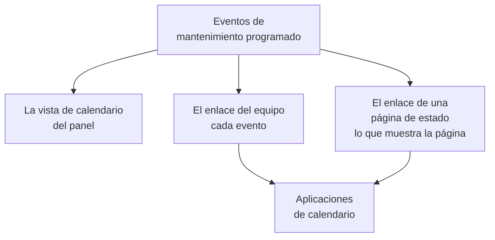

# Calendario de mantenimiento

El calendario de mantenimiento muestra tu mantenimiento programado por fecha: en una página propia del panel, en las aplicaciones de calendario de tu equipo mediante un enlace secreto y en los calendarios de las personas que siguen tus páginas de estado. En su página, junto a tus eventos, pueden mostrarse calendarios de fuera del proyecto, como los festivos o una congelación de cambios. Esta página explica la página del calendario, los calendarios externos, el enlace de calendario del equipo, el calendario de una página de estado y lo que contiene cada evento del calendario.

:::cards
- [La página del calendario](#la-página-del-calendario): Cada evento en un mes, una semana o un día, en el color de su estado.
- [Calendarios externos](#calendarios-externos): Festivos, congelaciones de cambios o el mantenimiento de otro equipo, junto a tus eventos.
- [El enlace de calendario del equipo](#el-enlace-de-calendario-del-equipo): Cada evento del proyecto en Google Calendar, Outlook o el Calendario de Apple.
- [El calendario de una página de estado](#el-calendario-de-una-página-de-estado): Lo que muestra una página de estado, en los calendarios de sus visitantes.
- [Lo que contiene un evento del calendario](#lo-que-contiene-un-evento-del-calendario): El título, la ventana, el estado y un enlace de vuelta.
:::



## La página del calendario

Abre **Mantenimiento programado → Calendario de mantenimiento**, en la sección **Calendario** del menú lateral. **Todos los eventos** muestra los mismos eventos como una lista.

- El calendario se abre en este mes, con el día de hoy marcado. **Mes**, **Semana** y **Día** cambian cuánto muestra; muévete con las flechas y vuelve con **Hoy**. Las horas están en tu propia zona horaria.
- Cada evento es un bloque del color de su estado, y los colores de los estados se nombran debajo del calendario. Haz clic en un evento para abrirlo.
- Los filtros sobre el calendario funcionan como en la lista: elige un estado, una etiqueta o un propietario para ver solo esos eventos.
- Un día que aún está por llegar muestra un **+** cuando señalas su semana. Abre **Crear evento de mantenimiento programado** con **Comienza en** ese día, a la hora que el formulario elegiría hoy. Solo lo ves si puedes crear eventos.
- Una vista muestra hasta 500 eventos. Un mes más cargado lo indica: acótalo con los filtros o mira una semana.

**Todos los eventos** antes cambiaba entre una lista y un calendario. Si tu navegador lo dejó por última vez en el calendario, **Todos los eventos** abre una vez el **Calendario de mantenimiento** y desde entonces es la lista.

## Calendarios externos

La página del calendario también puede mostrar los eventos de calendarios de fuera del proyecto: los festivos, una congelación de cambios que tu empresa lleva en otro calendario o el mantenimiento de otro equipo. OneUptime lee cada uno desde su enlace iCalendar (`.ics`) y dibuja sus eventos junto a los tuyos, más claros y en el color propio del calendario. Son de solo lectura: nunca se convierten en eventos de mantenimiento, no se avisa a nadie sobre ellos y nunca aparecen en los enlaces de calendario del propio proyecto.

:::steps
### Añadir el calendario

Elige **Añadir calendario externo** en el menú **⋯** del calendario, o abre **Mantenimiento programado → Ajustes del calendario**, en la sección **Ajustes** del menú lateral, y haz clic en **Añadir calendario externo**. Rellena **Nombre** y pega su enlace en **Enlace del calendario**. **Más campos** contiene su **Color** y **Actualizar**, con qué frecuencia se lee: **Cada hora** salvo que elijas otra.

### Comprobar que se ha leído

OneUptime lee un calendario nuevo al instante. Su **Estado** dice **Funciona** en cuanto se lee, y **Última lectura** dice cuándo y cuántos eventos guardó. Una lectura que falló dice **No funciona**, con el motivo y qué hacer.

### Mostrarlo u ocultarlo

Cada calendario externo tiene un interruptor con su nombre debajo del calendario. Ocultar uno lo oculta solo para ti; tu navegador recuerda la elección para el proyecto.
:::

Copia el enlace desde los ajustes para compartir del propio calendario: en Google Calendar, su dirección secreta en formato iCal; en Outlook, el enlace ICS de un calendario publicado; en cualquier otra aplicación, su enlace `.ics` o `webcal://`. El enlace puede ser privado: OneUptime lo guarda cifrado, no vuelve a mostrarlo y **Cambiar enlace** lo sustituye.

| Acción | Qué ocurre |
| --- | --- |
| **Leer ahora** | Lee el calendario ahora en lugar de en su próxima lectura. |
| **Cambiar enlace** | Sustituye su enlace. Los eventos del enlace anterior se olvidan y el nuevo se lee al instante. |
| **Desactivar** | Deja de leerlo y oculta sus eventos a todos, hasta **Activar**. |

Cada calendario guarda sus eventos desde 90 días atrás hasta un año adelante, hasta 2000, los más cercanos a hoy primero. Un calendario de más de 5 MB no se lee. Los eventos repetidos, sus excepciones y sus zonas horarias se leen tal como los escribió la aplicación de calendario, y un evento de todo el día se queda en su fecha en cualquier zona horaria. Un proyecto puede tener hasta 20 calendarios externos, y una vista del calendario dibuja hasta 500 de sus eventos.

Los roles que crean, editan y eliminan eventos de mantenimiento programado añaden, cambian y quitan calendarios externos, y cualquiera que pueda leer los eventos los ve en el calendario. OneUptime nunca lee una dirección de su propio servidor ni una dirección de metadatos de la nube, y OneUptime Cloud rechaza las direcciones de una red privada. Un servidor autoalojado puede leer un calendario de tu propia red, salvo que `DATA_SOURCE_BLOCK_PRIVATE_ADDRESSES` sea `true`.

## El enlace de calendario del equipo

**Suscribirse al calendario**, debajo del calendario, abre el enlace de calendario del proyecto: un enlace iCalendar (`.ics`) secreto que lleva cada evento de mantenimiento programado del proyecto a Google Calendar, Outlook, el Calendario de Apple o cualquier aplicación que se suscriba a un calendario por URL.

:::steps
### Publicar el enlace

Haz clic en **Publicar enlace**. Un proyecto tiene un solo enlace, para todo el equipo, así que esto solo hace falta una vez.

### Añadirlo a tu aplicación de calendario

**Google Calendar** abre Google Calendar, que pregunta si quieres añadir el calendario. **Calendario de Apple / Outlook** abre el enlace en la aplicación de calendario de tu ordenador o teléfono. **Copiar enlace** lo copia para cualquier otra aplicación.

### Comprobar que funciona

El panel **Estado** indica cuándo una aplicación de calendario leyó el enlace por última vez, y cuál. Un enlace nuevo indica **Esperando la primera sincronización** hasta que una aplicación lo lee.
:::

El enlace tiene este aspecto:

```text
https://<your host>/api/scheduled-maintenance-calendar/project/<token>/maintenance.ics
```

> [!WARNING]
> Cualquiera que tenga el enlace ve cada evento de mantenimiento programado del proyecto, sin iniciar sesión. Trátalo como una contraseña y regenéralo si se comparte por error.

### Quién puede ver el enlace

El enlace muestra cada evento del proyecto, así que el diálogo solo lo muestra a quienes pueden leer cada evento. A quien su rol limita a algunos eventos, por etiqueta o a los eventos que posee, se le explica el motivo.

| Acción | Quién puede hacerla |
| --- | --- |
| Copiar el enlace | Cualquiera que pueda leer cada evento de mantenimiento programado del proyecto |
| **Publicar enlace** | Cualquiera que además pueda crear eventos de mantenimiento programado |
| **Regenerar enlace**, **Desactivar enlace** | Cualquiera que además pueda editar eventos de mantenimiento programado |

### Gestionar el enlace

**Regenerar enlace** y **Desactivar enlace** están en el menú **⋯** de la parte superior del diálogo.

| Acción | Qué ocurre |
| --- | --- |
| **Regenerar enlace** | Crea un enlace nuevo. Durante 30 días el antiguo sirve un calendario vacío, para que las aplicaciones que lo tienen vacíen su copia; después ya no se encuentra. Suscríbete de nuevo con el enlace nuevo. |
| **Desactivar enlace** | Conserva el enlace, pero sirve un calendario vacío hasta **Activar enlace**. |

El calendario contiene cada evento desde 90 días atrás hasta un año adelante, hasta 1000 eventos.

## El calendario de una página de estado

Las personas que siguen una página de estado pueden llevar su mantenimiento programado a su propio calendario. En la página de eventos programados de la página de estado, **Suscribirse al calendario** ofrece Google Calendar, la aplicación de calendario de su dispositivo o el enlace para copiar. El enlace es la dirección de la página seguida de `/maintenance.ics`, como `https://status.example.com/maintenance.ics`.

- **Lo que contiene.** Exactamente lo que muestra la página: los eventos del periodo de historial de la página, cada evento que está por llegar y cada uno en curso, mientras **Visible en la página de estado** esté activado, y desde su **Publicar el** si elegiste uno. Lo que afecta cada evento se nombra como la página nombra sus recursos, nunca con los nombres propios de tus monitores.
- **Una página privada.** Una aplicación de calendario no puede iniciar sesión, así que una página privada no ofrece **Suscribirse al calendario**, y su enlace sirve un calendario vacío que dice que la página es privada.
- **Un evento.** **Añadir al calendario** en la página de un evento añade solo ese evento: Google Calendar se abre con él ya rellenado, o se descarga como un archivo que abre la aplicación de calendario del dispositivo. También funciona en una página privada, para un visitante que ha iniciado sesión, y deja de ofrecerse cuando el evento ha terminado.

## Lo que contiene un evento del calendario

Cada calendario, el del equipo y el de una página de estado, escribe un evento de la misma manera.

| Parte | Lo que contiene |
| --- | --- |
| Título | El título del evento |
| Inicio y fin | Su ventana planificada, en UTC; la aplicación de calendario la muestra en tu propia zona horaria |
| Descripción | Su descripción como texto sin formato, su estado, lo que afecta y un enlace al evento; el enlace del equipo nombra también sus páginas de estado |
| Estado | Cancelado cuando el evento se anuló: completado sin haber estado nunca en curso |
| Libre u ocupado | Libre, para que una ventana de mantenimiento nunca bloquee tu disponibilidad |
| Categorías | Sus etiquetas; el calendario de una página de estado solo las muestra cuando la página muestra etiquetas |

Un evento editado en OneUptime se actualiza en su sitio en cada calendario que lo contiene, y uno que se elimina, o que se quita de una página de estado, sale del calendario en su siguiente actualización.

## Con qué frecuencia se actualizan los calendarios

Las aplicaciones de calendario leen un enlace suscrito según su propio calendario. Google Calendar lo hace cada pocas horas, a veces solo una vez al día; el Calendario de Apple y Outlook normalmente cada hora. OneUptime guarda un calendario como máximo cinco minutos, así que la espera que ves es la de la aplicación de calendario. Los pasos para cada aplicación están en [Feeds de calendario](/docs/on-call/calendar-feeds#suscríbete-en-tu-aplicación-de-calendario), que funcionan igual para los turnos de guardia.

## Solución de problemas

:::details La aplicación de calendario dejó de mostrar eventos nuevos
El enlace se regeneró o se desactivó: abre **Suscribirse al calendario** para ver su estado. Un enlace regenerado necesita una nueva suscripción con el enlace nuevo; un enlace desactivado vuelve con **Activar enlace**.
:::

:::details Google Calendar no puede añadir el enlace
Google Calendar lee el enlace desde los servidores de Google, así que el servidor de OneUptime tiene que ser accesible desde internet. Para un servidor autoalojado, consulta [Feeds de calendario](/docs/on-call/calendar-feeds#solución-de-problemas).
:::

:::details Falta un evento en el calendario de una página de estado
El calendario de la página contiene lo que muestra la página. Comprueba que el evento nombra la página, que **Visible en la página de estado** está activado en sus **Ajustes**, que ya llegó su **Publicar el**, si tiene uno, y que empezó dentro del periodo de historial de la página.
:::

:::details Un calendario externo dice No funciona
El motivo aparece bajo **No funciona** en su **Estado**: no hay calendario en el enlace, el enlace necesita iniciar sesión o ya no está compartido, su servidor dio un error, el calendario ocupa más de 5 MB o repite eventos con demasiada frecuencia para procesarlo. Corrige el enlace con **Cambiar enlace**, o usa **Leer ahora** cuando el calendario vuelva a estar disponible. Mientras tanto, el calendario muestra los eventos de su última lectura correcta.
:::

## Próximos pasos

:::cards
- [Crear eventos de mantenimiento](/docs/scheduled-maintenance/creating-events): El formulario, campo por campo, y lo que pasa después.
- [Suscriptores y anuncios](/docs/status-pages/subscribers#eventos-de-mantenimiento-programado): Lo que se comunica a los suscriptores de una página de estado sobre el mantenimiento.
- [Feeds de calendario](/docs/on-call/calendar-feeds): El mismo tipo de enlace, para los turnos de guardia.
:::
