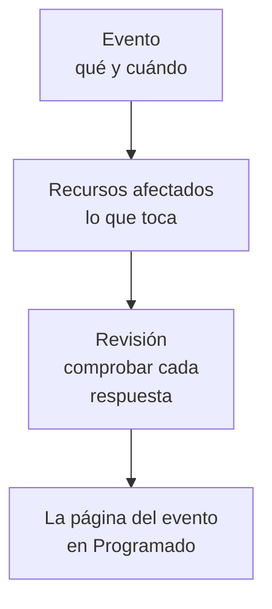

# Crear eventos de mantenimiento

Programa un mantenimiento en dos pasos cortos: di qué ocurre y cuándo, y después qué afecta y quién debe enterarse. Solo hay que escribir el título; todo lo demás empieza con un valor predeterminado razonable. Esta página recorre el formulario, lo que pasa en el momento en que creas un evento, cómo cambiarlo después y cómo crear eventos desde código.

:::cards
- [Crear un evento](#crear-un-evento): Dos pasos y una revisión.
- [Qué pasa al crearlo](#qué-pasa-al-crearlo): Su número, reglas, propietarios y los primeros mensajes.
- [Publicarlo más tarde](#publicarlo-más-tarde): Mantenlo fuera de tus páginas de estado hasta una fecha y hora.
- [Cambiar un evento después](#cambiar-un-evento-después): Su ventana, recursos, páginas de estado y notas.
- [Crear eventos desde código](#crear-eventos-desde-código): La API, Terraform, los flujos de trabajo y el chat.
:::

## Cómo funciona

El formulario hace dos preguntas, una por paso, y luego lo muestra todo en una revisión antes de crear el evento. El evento empieza en tu estado programado, y se abre su página.



## Antes de empezar

- **Tu rol.** Crear un evento requiere **Propietario del proyecto**, **Administrador del proyecto**, **Miembro del proyecto**, **Administrador de mantenimiento programado** o **Miembro de mantenimiento programado**, o un rol personalizado con **Create Scheduled Maintenance**.
- **Tus páginas de estado.** Para avisar a los clientes, necesitas una página de estado que muestre eventos de mantenimiento programado. Consulta [Visión general de las páginas de estado](/docs/status-pages/index).

## Crear un evento

:::steps
### Abrir el formulario

Ve a **Mantenimiento programado → Todos los eventos** y haz clic en **Crear evento de mantenimiento programado**. El formulario se abre en su primer paso, **Evento**.

### Decir qué ocurre y cuándo

Escribe un **Título** y añade una **Descripción** si ayuda: está en Markdown y se muestra en tus páginas de estado. **Comienza en** ya está en la próxima hora en punto de tu reloj, y **Termina en** una hora después; cámbialos solo si no son correctos. Al mover **Comienza en**, **Termina en** se mueve con él, así la ventana conserva su duración. **Propietarios** y **Etiquetas** esperan plegados en **Más campos**.

### Elegir qué afecta

Haz clic en **Siguiente** para llegar a **Recursos afectados**. Elige los **Monitores** que toca el trabajo. En cuanto eliges uno, aparece debajo **Cambiar el estado del monitor a**: el estado al que pasan los monitores cuando empieza el evento. Después elige los **Otros recursos afectados** que haya, como hosts, clústeres, bases de datos, sitios de red o servicios.

### Elegir quién se entera

Elige las páginas de estado en **Mostrar evento en estas páginas de estado**. **Notificaciones a suscriptores**, plegado, dice en una línea cuándo se muestra el evento en ellas y a quién se avisa y cuándo; ábrelo para elegir **En una fecha y hora** en **Publicar en las páginas de estado**, o para cambiar **Cuando se programa el evento**, **Cuando empieza el evento**, **Cuando termina el evento** o **Recordatorios antes del evento**.

### Crearlo

Haz clic en **Siguiente** para ver la revisión, compruébala y luego haz clic en **Crear evento de mantenimiento programado**. Se abre la página del evento.
:::

No se envía nada hasta que eliges una página de estado: un evento que no aparece en ninguna página de estado no avisa a ningún suscriptor.

## Los campos del formulario

| Campo                                | Paso               | Empieza como                    | Qué hace                                                                         |
| ------------------------------------ | ------------------ | ------------------------------- | -------------------------------------------------------------------------------- |
| **Título**                           | **Evento**         | Vacío, y obligatorio            | Nombra el evento en todas partes, también en tus páginas de estado.              |
| **Descripción**                      | **Evento**         | Vacía                           | Explica el trabajo a tus clientes, en Markdown.                                  |
| **Comienza en**                      | **Evento**         | La próxima hora en punto        | Cuándo empieza el evento, por sí solo.                                           |
| **Termina en**                       | **Evento**         | Una hora después de **Comienza en** | Cuándo termina el evento, por sí solo. Debe ser posterior a **Comienza en**. |
| **Propietarios**                     | **Evento**         | Nadie                           | Personas y equipos a los que pertenece el evento y que reciben avisos sobre él.  |
| **Etiquetas**                        | **Evento**         | Ninguna                         | Etiquetas que las reglas y los filtros pueden usar.                              |
| **Monitores**                        | **Recursos afectados** | Ninguno                     | Los monitores que no se comprueban mientras el evento está en curso.             |
| **Cambiar el estado del monitor a**  | **Recursos afectados** | Sin cambio                  | El estado que muestran esos monitores durante el evento. Se pide en cuanto se elige un monitor. |
| **Otros recursos afectados**         | **Recursos afectados** | Ninguno                     | Hosts, clústeres, bases de datos, sitios de red, servicios y más.                |
| **Mostrar evento en estas páginas de estado** | **Recursos afectados** | Ninguna            | Las páginas de estado que muestran el evento y avisan a sus suscriptores.        |
| **Notificaciones a suscriptores**    | **Recursos afectados** | Publicado de inmediato, los tres momentos activados, sin recordatorios | Cuándo se muestra el evento en esas páginas y cuándo se avisa a sus suscriptores. |

Hay dos cosas que rellenan el formulario por ti sobre la marcha:

- **Recursos vinculados.** Cuando eliges un monitor, los hosts, clústeres, servicios y otros recursos a los que está vinculado se añaden en **Otros recursos afectados**, y una línea bajo el campo los nombra. Quita los que no quieras. Los recursos en la nube no se añaden: un evento de mantenimiento no los contiene.
- **Páginas de estado sugeridas.** En **Mostrar evento en estas páginas de estado** se sugieren las páginas que muestran tus monitores: haz clic en el nombre de una página para añadirla, o en **Añadir todas**. No se elige nada por ti. Consulta [Eventos de mantenimiento programado](/docs/status-pages/subscribers#eventos-de-mantenimiento-programado).

## Empezar desde un recurso o una plantilla

En la pestaña **Mantenimiento programado** de un host, un clúster de Kubernetes, Proxmox, Ceph o Docker Swarm, un host de Docker o Podman, un vCenter, una cabina de almacenamiento, una flota IoT, una base de datos, un servicio o un sitio de red, **Crear evento de mantenimiento programado** abre el mismo formulario con ese recurso ya elegido en **Otros recursos afectados**, y la pestaña lista los eventos que lo afectan. La pestaña de un elemento de inventario elige el host, el servicio o el clúster de Kubernetes al que apunta el elemento.

**Crear desde plantilla**, junto al botón de crear, te pide **Seleccionar plantilla de mantenimiento programado** y luego abre el formulario relleno a partir de la plantilla. Consulta [Plantillas y eventos recurrentes](/docs/scheduled-maintenance/templates).

## Qué pasa al crearlo

En el momento en que haces clic en **Crear evento de mantenimiento programado**, OneUptime recorre estos pasos, en este orden:

1. **Recibe un número y un estado.** El número sale de un contador por proyecto y se muestra con tu prefijo (`SM-42`). El evento empieza en tu estado programado, sea cual sea el estado que indique una solicitud.
2. **Tus herramientas de chat se enteran.** Las reglas de Slack y Microsoft Teams de **Espacio de trabajo** lo publican en sus canales, y una regla puede crear un canal para el evento. Su feed registra que se creó.
3. **Empieza su cronología de estados.** La primera fila de su **Cronología de estados** es tu estado programado.
4. **Se añaden propietarios y etiquetas**: los que elegiste y después los de las reglas de propietario y de etiquetas que coinciden.
5. **Las reglas de runbook inician** los runbooks que coinciden con el evento.
6. **Se programan recordatorios**, cuando coincide una regla de recordatorio, para sus propietarios.

En menos de un minuto desde su publicación, que es inmediata salvo que hayas elegido un **Publicar el**, se avisa a los suscriptores de sus páginas de estado de que está programado, salvo que hayas desactivado **Cuando se programa el evento**. El disparador de flujo de trabajo **On Create Scheduled Maintenance Event** inicia cualquier flujo de trabajo construido sobre él, y sus propietarios se enteran si activaron esa notificación: consulta [Ajustes de notificaciones](/docs/notifications/notification-settings).

## Publicarlo más tarde

Planifica el trabajo con tanta antelación como quieras y mantenlo dentro de tu equipo hasta que tus clientes deban enterarse. Elige **En una fecha y hora** en **Publicar en las páginas de estado**, en el formulario o en el paso **Páginas de estado** de **Editar** del evento, y un **Publicar el** anterior a **Comienza en**. Hasta entonces el evento no está en ninguna de sus páginas de estado: ni en sus listas, ni en su historial de tiempo de actividad, ni en sus feeds RSS y Atom, ni en su calendario de mantenimiento, ni en su API, ni en su propio enlace. En ese momento aparece como próximo, y se avisa a sus suscriptores, una sola vez, de que está programado.

| Cuándo                   | Qué pasa                                                              | En tus páginas de estado |
| ------------------------ | --------------------------------------------------------------------- | ------------------------ |
| Al crearlo               | Eliges un **Publicar el** anterior a su **Comienza en**               | No se muestra            |
| Su **Publicar el**       | Se publica, y se avisa a sus suscriptores de que está programado      | Próximo                  |
| Su **Comienza en**       | Empieza, como cualquier evento                                        | En curso                 |
| Su **Termina en**        | Termina                                                               | Pasado                   |

- **Hasta entonces, los suscriptores no saben nada.** Mientras el evento espera, no se les envían los recordatorios antes del evento, los cambios de estado ni las notas públicas.
- **Su página lo dice.** Su encabezado muestra **Aún no está en las páginas de estado**, con la hora desde la que se muestra, y **Publicar ahora** lo publica de inmediato, tras pedir confirmación. Sus **Ajustes** dicen lo mismo, y la lista de eventos muestra la hora bajo sus páginas de estado.
- **Cámbialo, o publícalo ya.** Mueve el **Publicar el** en el paso **Páginas de estado** de **Editar**, o elige **De inmediato**. Desactiva **Visible en la página de estado** en sus **Ajustes** para mantenerlo fuera de sus páginas de estado sea cual sea la hora.

## Cambiar un evento después

Todo lo del formulario se puede cambiar en las páginas del evento, excepto los tres momentos de los suscriptores, que se fijan una sola vez, al crear el evento.

| Para cambiar                                | Ve a                                                                           |
| ------------------------------------------- | ------------------------------------------------------------------------------ |
| El título, la ventana o las etiquetas       | **Editar** en la tarjeta **Detalles del mantenimiento** de su **Vista general**, paso **Evento** |
| Las páginas de estado, cuándo se publica o los recordatorios | El mismo **Editar**, paso **Páginas de estado**                  |
| Los monitores, su estado u otros recursos   | **Editar** en la tarjeta **Recursos afectados**                                 |
| La descripción                              | **Descripción** en su menú lateral                                             |
| Los propietarios                            | **Propietarios** en su menú lateral                                            |

**Cambiar el estado del monitor a** se puede cambiar hasta que empieza el evento. Después, la tarjeta lo muestra como de solo lectura, porque los monitores ya están en ese estado. Una edición añade al **Feed del mantenimiento programado** una entrada que nombra lo que cambió; guardar sin cambios no añade ninguna.

## Publicar notas mientras avanza el trabajo

- Las **Notas públicas** son actualizaciones para tus clientes: se muestran en las páginas de estado del evento, y cada una puede avisar a sus suscriptores con **Notificar a los suscriptores de la página de estado**.
- Las **Notas privadas** son solo para tu equipo.

Escribe una en la página **Notas públicas** o **Notas privadas** del evento, o desde el menú **Acciones** del **Feed del mantenimiento programado** con **Añadir nota pública** o **Añadir nota privada**. El mismo menú ejecuta un runbook con **Ejecutar runbook**. Una plantilla de nota rellena el texto que tu equipo escribe a menudo: consulta [Reglas y ajustes del mantenimiento](/docs/scheduled-maintenance/settings#plantillas-de-notas).

## Crear eventos desde código

El modelo de evento tiene una API estándar, así que `POST /api/scheduled-maintenance` crea un evento. Autentícate con una clave de API de **Ajustes del proyecto → Avanzado → Claves de API**, enviada en la cabecera `apikey`; la clave identifica el proyecto.

```bash
curl -X POST https://oneuptime.com/api/scheduled-maintenance \
  -H "apikey: $ONEUPTIME_API_KEY" \
  -H "Content-Type: application/json" \
  -d '{
    "data": {
      "title": "Database upgrade",
      "description": "Writes pause for a few minutes while the primary restarts.",
      "startsAt": "2030-06-01T02:00:00Z",
      "endsAt": "2030-06-01T04:00:00Z"
    }
  }'
```

| Campo                                                 | Notas                                                                                     |
| ----------------------------------------------------- | ----------------------------------------------------------------------------------------- |
| `title`, `startsAt`, `endsAt`                          | Obligatorios, como en el formulario.                                                      |
| `monitors`, `statusPages`, `labels`                   | Los monitores, páginas de estado y etiquetas del evento, todos del proyecto de la clave de API. |
| `changeMonitorStatusToId`                             | El estado de monitor al que pasan sus monitores cuando empieza.                           |
| `currentScheduledMaintenanceStateId`                  | Se ignora: cada evento empieza en tu estado programado.                                   |
| `shouldStatusPageSubscribersBeNotifiedOnEventCreated` | El interruptor **Cuando se programa el evento**. Los otros dos momentos tienen sus propios campos. |
| `publishOnStatusPageAt`                               | Cuándo se publica el evento en sus páginas de estado y se avisa a sus suscriptores de que está programado. Si se omite, de inmediato. |

El mismo evento como código es el recurso de Terraform `oneuptime_scheduled_maintenance_event`: consulta [Ejemplos](/docs/terraform/examples#mantenimiento-programado). Un flujo de trabajo crea uno con su paso **Create One Scheduled Maintenance Event**, y `/oneuptime maintenance` abre el formulario en Slack: consulta [Slack](/docs/workspace-connections/slack#crear-incidentes-y-mantenimientos-desde-slack).

## Solución de problemas

:::details Termina en dice que debe ser posterior a Comienza en
La ventana debe estar en orden: el evento termina después de empezar. Mueve primero **Comienza en**, ya que **Termina en** lo sigue, y luego ajusta **Termina en**.
:::

:::details Falta Cambiar el estado del monitor a en el formulario
Solo se pide cuando el evento tiene un monitor. Elige uno en **Monitores** y aparece justo debajo.
:::

:::details Cambiar el estado del monitor a ya no se puede cambiar
El evento ya empezó, y sus monitores ya están en ese estado. El estado se aplica desde que empieza el evento hasta que termina.
:::

:::details Publicar el dice que debe ser anterior a Comienza en
Un evento se publica para que tus clientes se enteren del trabajo antes de que empiece. Elige un **Publicar el** anterior a **Comienza en**, o **De inmediato**.
:::

## Próximos pasos

:::cards
- [Estados del mantenimiento](/docs/scheduled-maintenance/states): Qué inicia y termina un evento, y cómo moverlo a mano.
- [Plantillas y eventos recurrentes](/docs/scheduled-maintenance/templates): Guarda las respuestas del formulario para la próxima vez.
- [Suscriptores y anuncios](/docs/status-pages/subscribers#eventos-de-mantenimiento-programado): Exactamente a quién se avisa y cuándo.
- [Reglas y ajustes del mantenimiento](/docs/scheduled-maintenance/settings): Añade propietarios, etiquetas y recordatorios automáticamente.
:::
