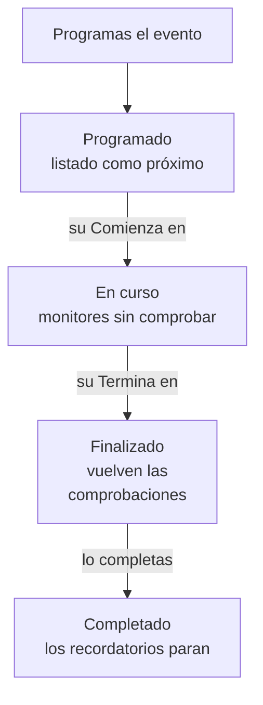

# Visión general del mantenimiento programado

Un evento de mantenimiento programado avisa a todos de un trabajo planificado antes de que ocurra: una actualización de la base de datos, un cambio de red, un traslado a servidores nuevos. OneUptime inicia y termina el evento a tiempo, deja de comprobar los monitores afectados mientras dura el trabajo y lo muestra en tus páginas de estado, para que una parada planificada nunca parezca una caída. Esta página explica cómo transcurre un evento, dónde está todo en el panel y qué cambia un evento en el resto de OneUptime.

:::cards
- [Cómo transcurre un evento](#cómo-transcurre-un-evento): De programado a completado, casi siempre por sí solo.
- [De dónde vienen los eventos](#de-dónde-vienen-los-eventos): El formulario, las plantillas, una programación, los formularios, el chat y el código.
- [Qué afecta un evento](#qué-afecta-un-evento): Monitores, páginas de estado, suscriptores y alertas.
- [Las páginas de un evento](#las-páginas-de-un-evento): Su vista general, cronología, notas y ajustes.
:::

## Cómo transcurre un evento

Cada evento tiene una ventana planificada, su **Comienza en** y su **Termina en**, y recorre hacia abajo tu lista de estados de mantenimiento. Una tarea que se ejecuta cada minuto lo hace avanzar en ambos extremos de la ventana, así que programas el trabajo una vez y OneUptime hace el resto.

Un evento nuevo empieza en **Programado**. En su **Comienza en** pasa a **En curso**: OneUptime deja de comprobar sus monitores y, si elegiste un estado para ellos, los muestra en ese estado. En su **Termina en** pasa a **Finalizado**: las comprobaciones se reanudan y cada monitor vuelve a «operativo». **Completado** es el último paso, y nada lo da por sí solo: una persona, un botón de chat o la API marca el trabajo como aprobado, lo que además detiene los recordatorios a los propietarios.

Puedes iniciar o terminar un evento antes de tiempo, o añadir estados propios entre estos cuatro. Consulta [Estados del mantenimiento](/docs/scheduled-maintenance/states).

## Mantenimiento y anuncios

Ambos informan a los visitantes de tus páginas de estado. Usa un evento de mantenimiento para un trabajo con inicio y fin, y un anuncio para cualquier otra cosa que deban leer.

|                              | Mantenimiento programado                                                | Anuncio                                        |
| ---------------------------- | ----------------------------------------------------------------------- | ---------------------------------------------- |
| **Qué es**                   | Un trabajo planificado, con una ventana                                 | Un mensaje para los visitantes de tus páginas de estado |
| **Sus monitores**            | No se comprueban mientras dura, y muestran el estado que elijas        | Sin cambios                                    |
| **Cómo avanza**              | Por tus estados de mantenimiento, a tiempo                              | Se muestra desde su hora de inicio hasta su hora de fin, si la tiene |
| **Cuándo se avisa a los suscriptores** | Cuando se programa, empieza y termina, y antes de empezar si lo pides | Una vez, cuando empieza a mostrarse   |
| **Números en un proyecto nuevo** | `SM-42`                                                             | Ninguno                                        |

Los anuncios se tratan en [Suscriptores y anuncios](/docs/status-pages/subscribers#anuncios).

## De dónde vienen los eventos

- **El formulario.** Haz clic en **Crear evento de mantenimiento programado** en la lista de eventos, o en la pestaña **Mantenimiento programado** de un host, un clúster, un servicio, un sitio de red u otro recurso, que selecciona ese recurso por ti. Consulta [Crear eventos de mantenimiento](/docs/scheduled-maintenance/creating-events).
- **Una plantilla.** **Crear desde plantilla** rellena el formulario a partir de una plantilla que guardaste para trabajos frecuentes. Consulta [Plantillas y eventos recurrentes](/docs/scheduled-maintenance/templates).
- **Una programación.** Una plantilla recurrente crea un evento nuevo según una programación, por ejemplo cada semana o cada mes, sin que nadie abra el formulario.
- **Un formulario.** Un formulario cuyos envíos crean eventos de mantenimiento convierte una solicitud de cambio en un evento. Consulta [Lo que crea un envío](/docs/forms/on-submit#cómo-un-envío-se-convierte-en-un-evento-de-mantenimiento-programado).
- **El chat.** `/oneuptime maintenance` en Slack, o `maintenance` escrito al bot de OneUptime en Microsoft Teams, abre el formulario en tu herramienta de chat. Consulta [Slack](/docs/workspace-connections/slack#crear-incidentes-y-mantenimientos-desde-slack).
- **El código.** La API en `/api/scheduled-maintenance`, el recurso de Terraform `oneuptime_scheduled_maintenance_event` y el paso **Create One Scheduled Maintenance Event** de un flujo de trabajo.

## Dónde está el mantenimiento en el panel

Abre **Mantenimiento programado** desde el menú **Productos** de la barra superior. La lista de eventos está en `/dashboard/{projectId}/scheduled-maintenance-events`, y su menú lateral contiene todo lo relativo al mantenimiento:

| Sección       | Qué haces ahí                                                                                                              |
| ------------- | -------------------------------------------------------------------------------------------------------------------------- |
| **Vista general** | **Todos los eventos** y **Eventos en curso**, cuya insignia cuenta los eventos en curso en este momento.               |
| **Calendario** | **Calendario de mantenimiento**: cada evento en un mes, una semana o un día, junto a los calendarios de fuera del proyecto que añadas. |
| **Espacio de trabajo** | **Slack** y **Microsoft Teams**, según lo que el proyecto haya conectado, o **Conectar Slack o Teams** si no tiene ninguno. |
| **Reglas**    | **Reglas del propietario**, **Reglas de runbook**, **Reglas de etiquetas**, **Reglas de recordatorio**.                     |
| **Ajustes**   | **Estado del evento**, **Plantillas de eventos**, **Plantillas de notas**, **Campos personalizados**, **Mediciones**, **Ajustes del calendario**, **Numeración**. |

**Vista general** y **Calendario** están abiertas; **Espacio de trabajo**, **Reglas**, **Ajustes** y **Desarrolladores** empiezan plegadas, y una sección se abre sola cuando estás en una de sus páginas. **Desarrolladores** contiene **Terraform**, **API** y **Asistentes de IA**, para gestionar el mantenimiento desde código. Todo lo relativo al mantenimiento está aquí, no en **Ajustes del proyecto**.

La lista muestra **Número del mantenimiento programado**, **Título**, **Estado actual**, **Recursos afectados**, **Mostrado en la página de estado**, **Comienza en**, **Duración**, **Termina en**, **Etiquetas** y **Propietarios**. Selecciona eventos para actuar sobre varios a la vez: **Marcar como {{state}}**, **Cambiar estado**, **Asignarme**, **Añadir propietario**, **Quitar propietario**, **Añadir etiquetas**, **Quitar etiquetas** o **Eliminar**. El menú **⋯** al final de la fila de cada evento hace lo mismo solo para ese evento: los pasos **Marcar como {{state}}** mientras el evento pueda darlos, **Cambiar estado**, **Asignarme** hasta que seas su propietario y **Añadir propietario**.

**Calendario de mantenimiento**, en la sección **Calendario**, muestra los mismos eventos en un mes, una semana o un día, y puede mostrar a su lado calendarios de fuera del proyecto. Consulta [Calendario de mantenimiento](/docs/scheduled-maintenance/calendar).

## Qué afecta un evento

Mientras un evento está en curso, OneUptime trata la caída que planifica como esperada:

- **Sus monitores no se comprueban.** Cada monitor de **Monitores** deja de comprobarse, y sus páginas dicen **Este monitor está deshabilitado**. Si elegiste un **Cambiar el estado del monitor a**, los monitores muestran ese estado, también en tus páginas de estado. Cuando el evento termina, o se elimina, las comprobaciones se reanudan y cada monitor vuelve a «operativo», salvo que otro evento en curso todavía lo retenga.
- **Sus otros recursos guardan silencio.** Un monitor de telemetría que vigila muchos hosts, clústeres, bases de datos o servicios, una serie cada uno, no crea ningún incidente ni alerta para una serie cuyo recurso cubre el evento, mientras las demás series siguen alertando.
- **Los sitios de red y los SLO se contienen.** Un sitio de red que cubre el evento deja de contar su caída planificada en contra de los sitios que están por encima, y las reglas de tasa de consumo de un SLO no disparan nada mientras alguno de sus monitores esté en mantenimiento. Consulta [Sitios de red](/docs/monitor/network-sites#mantenimiento-programado-para-sitios-de-red) y [Alertas e incidentes de tasa de consumo](/docs/slo/burn-rate-alerts#mantenimiento-programado).
- **Tus páginas de estado lo muestran.** El evento aparece en las páginas de estado que elegiste, primero como próximo, luego en curso y después como pasado, mientras **Visible en la página de estado** esté activado en sus **Ajustes**. Una vez iniciado, en esas páginas el historial de tiempo de actividad de cada recurso de sus monitores lo muestra en cada día que toca su ventana, y esos recursos muestran «En mantenimiento» mientras dura; el historial de tiempo de actividad del monitor en el panel lo muestra igual. Consulta [Porcentajes de tiempo de actividad y gráficos de historial](/docs/status-pages/resources-and-groups#porcentajes-de-tiempo-de-actividad-y-gráficos-de-historial).
- **Los suscriptores se enteran.** De forma predeterminada, se avisa a los suscriptores de esas páginas cuando se programa, cuando empieza y cuando termina, y se les recuerda antes de que empiece si configuras recordatorios. Consulta [Eventos de mantenimiento programado](/docs/status-pages/subscribers#eventos-de-mantenimiento-programado).
- **Tu equipo se entera.** Sus propietarios reciben avisos según sus [ajustes de notificaciones](/docs/notifications/notification-settings), y las reglas de Slack y Microsoft Teams de **Espacio de trabajo** lo publican en tus canales.

## Las páginas de un evento

Abre un evento desde la lista para ver sus páginas. Su menú lateral contiene:

| Sección del menú lateral | Páginas                                                                                |
| ----------------- | --------------------------------------------------------------------------------------------- |
| **Vista general** | **Vista general**, **Cronología de estados**, **Descripción**, **Runbooks** |
| **Equipo** | **Propietarios** |
| **Notificaciones**     | **Registros de notificación** y **Registros de IA**: cada mensaje enviado sobre el evento y lo que la IA hizo por él |
| **Notas**         | **Notas privadas** y **Notas públicas**                                                        |
| **Desarrolladores** | **Terraform**, **API** y **Asistentes de IA**: el evento gestionado desde código            |
| **Avanzado**      | **Campos personalizados**, **Ajustes**, **Registros de auditoría**, **Eliminar evento**        |

**Vista general**, **Equipo** y **Notas** están abiertas; las demás secciones empiezan plegadas hasta que haces clic en ellas.

- **Vista general** — la cabecera muestra el número, el título y el estado del evento, cuánto falta para que empiece o cuánto lleva en marcha, quién es su propietario, las páginas de estado en las que aparece y quién lo creó, y los botones que lo hacen avanzar. Debajo, **Empieza**, **Finaliza** y **Duración** muestran la ventana planificada en tu zona horaria. El **Feed del mantenimiento programado** registra todo lo que le ha pasado al evento, junto a las tarjetas **Detalles del mantenimiento** y **Recursos afectados**, y las tarjetas **Mediciones** y **Campos personalizados** cuando tu proyecto tiene alguno.
- **Cronología de estados** — cada estado en el que ha estado el evento, cuándo y durante cuánto tiempo. Consulta [Estados del mantenimiento](/docs/scheduled-maintenance/states#la-cronología-de-estados).
- **Notas públicas** — actualizaciones para tus páginas de estado y sus suscriptores. Las **Notas privadas** son solo para tu equipo.
- **Ajustes** — **Visible en la página de estado**, que muestra u oculta el evento en sus páginas de estado, y **Enviar recordatorios**, que recuerda el evento a sus propietarios hasta que se completa. Cada interruptor se guarda en cuanto lo cambias.

## Solución de problemas

:::details Un evento no empezó en su Comienza en
La tarea que inicia los eventos se ejecuta cada minuto, así que espera un minuto. Si la cabecera dice **Inicio atrasado**, el evento se ha saltado su inicio por más de dos minutos: inícialo con el botón de la cabecera, que hace todo lo que hace la tarea, y abre su **Cronología de estados** para ver dónde estaba.
:::

:::details Un monitor se siguió comprobando durante el mantenimiento
Solo los monitores que el evento nombra en **Monitores** dejan de comprobarse, y solo mientras el evento está en curso. Un monitor de un host o servicio que el evento nombra en **Otros recursos afectados** se sigue comprobando. Edita la tarjeta **Recursos afectados** del evento para añadir el monitor.
:::

:::details El evento no aparece en mi página de estado
Comprueba que el evento nombra la página en **Mostrar evento en estas páginas de estado** y que **Visible en la página de estado** está activado en los **Ajustes** del evento. Después revisa la propia página de estado: debe mostrar eventos de mantenimiento programado, y un evento que empezó hace más tiempo que la ventana de historial de la página, 14 días salvo que la hayas cambiado, ya no aparece.
:::

## Próximos pasos

:::cards
- [Crear eventos de mantenimiento](/docs/scheduled-maintenance/creating-events): El formulario, campo a campo, y lo que pasa después.
- [Estados del mantenimiento](/docs/scheduled-maintenance/states): Qué inicia y termina un evento, y los estados propios.
- [Plantillas y eventos recurrentes](/docs/scheduled-maintenance/templates): Reutiliza un evento o prográmalo cada semana.
- [Reglas y ajustes del mantenimiento](/docs/scheduled-maintenance/settings): Propietarios, etiquetas, runbooks y recordatorios, automáticamente.
:::
