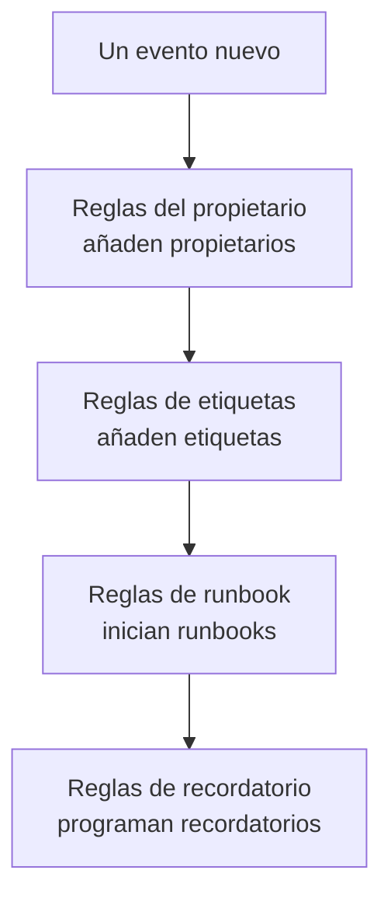

# Reglas y ajustes del mantenimiento

La configuración del mantenimiento está dentro de **Mantenimiento programado**, no en **Ajustes del proyecto**: las reglas que actúan sobre cada evento nuevo y los ajustes que dan forma a cada evento del proyecto. Esta página es la referencia de cada uno de ellos, y de quién puede cambiarlos.

:::cards
- [Las reglas por las que pasa un evento nuevo](#las-reglas-por-las-que-pasa-un-evento-nuevo): En orden, y qué hace cada una.
- [Reglas de recordatorio](#reglas-de-recordatorio): Recordar a los propietarios hasta que un evento se completa.
- [Ajustes](#ajustes): Plantillas de notas, campos personalizados, mediciones y numeración.
- [Quién puede cambiarlos](#quién-puede-cambiarlos): Los roles de mantenimiento, y los planes.
:::

## Dónde están los ajustes del mantenimiento

Abre **Mantenimiento programado** desde el menú **Productos** de la barra superior. Las secciones **Reglas** y **Ajustes** de su menú lateral empiezan plegadas, así que despliégalas primero. Cada página de aquí vale para todo el proyecto, en una dirección que empieza por `/dashboard/{projectId}/scheduled-maintenance-events/settings/`.

| Página de reglas   | Qué hace                                                            |
| ------------------ | ------------------------------------------------------------------- |
| **Reglas del propietario** | Añade propietarios a los eventos que coinciden.             |
| **Reglas de runbook** | Inicia runbooks para los eventos que coinciden.                  |
| **Reglas de etiquetas** | Añade etiquetas a los eventos que coinciden.                   |
| **Reglas de recordatorio** | Recuerda a los propietarios a intervalos hasta que un evento se completa. |

La sección **Ajustes** contiene **Estado del evento**, tratado en [Estados del mantenimiento](/docs/scheduled-maintenance/states), **Plantillas de eventos**, tratado en [Plantillas y eventos recurrentes](/docs/scheduled-maintenance/templates), y después **Plantillas de notas**, **Campos personalizados**, **Mediciones**, **Ajustes del calendario** y **Numeración**. **Ajustes del calendario** se trata en [Calendario de mantenimiento](/docs/scheduled-maintenance/calendar#calendarios-externos), y el resto más abajo.

La sección **Espacio de trabajo** contiene las reglas de Slack y Microsoft Teams que publican eventos en canales. Consulta [Slack](/docs/workspace-connections/slack#reglas-de-notificación) y [Microsoft Teams](/docs/workspace-connections/microsoft-teams#reglas-de-notificación).

## Las reglas por las que pasa un evento nuevo

Las reglas se diferencian en cómo resuelven varias coincidencias:

- **Reglas del propietario**, **Reglas de etiquetas** y **Reglas de runbook** actúan todas cuando coinciden. Los propietarios y las etiquetas que añaden varias reglas se añaden una sola vez.
- **Reglas de recordatorio** se comprueban de arriba abajo en su lista, y gana la primera que coincide. Arrastra una regla para cambiar su lugar; una regla nueva va al final.

Una regla nueva empieza habilitada; desactiva **Habilitado** en su formulario de edición para pausarla, y la lista muestra para cada regla un **Habilitado** verde o un **Deshabilitado** rojo. Las reglas del propietario, de etiquetas y de runbook actúan sobre los eventos creados después de guardarlas. Para aplicar una regla del propietario o de etiquetas a los eventos que ya tienes, usa **Ejecutar ahora**: consulta [Ejecutar reglas sobre recursos existentes](/docs/configuration/run-rules-now).

## Reglas del propietario y de etiquetas

Las **Reglas del propietario** añaden usuarios y equipos propietarios a los eventos nuevos que coinciden, y las **Reglas de etiquetas** añaden etiquetas. Crear una lleva dos pasos: **Coincidencia**, las condiciones, y luego **Propietarios** o **Etiquetas**, lo que añade la regla.

| Condición                                                       | Coincide con                                                               |
| --------------------------------------------------------------- | -------------------------------------------------------------------------- |
| **Monitores**, **Etiquetas del evento**, **Etiquetas del monitor** | Eventos con cualquiera de los monitores o etiquetas que elijas.         |
| **Título del evento**, **Descripción del evento**, **Nombre del monitor**, **Descripción del monitor** | Un patrón, como expresión regular, sin distinguir mayúsculas y minúsculas. |

Una regla solo coincide cuando se cumple cada condición que rellenas; una condición vacía se omite.

- **Una regla puede heredar.** Plegados en **Heredar propietarios** o **Heredar etiquetas**, seis interruptores transmiten los propietarios o las etiquetas de los monitores, hosts, clústeres de Kubernetes, hosts de Docker, hosts de Podman y servicios del evento.
- **Una regla nueva tiene que añadir algo**: elige al menos un propietario o una etiqueta, o activa un interruptor.
- **Notificar a los propietarios**, en **Más campos** de una regla del propietario, decide si se avisa a las personas añadidas.

[Reglas de etiquetas y propietarios](/docs/configuration/label-and-owner-rules) explica el formulario paso a paso, para cada tipo de recurso.

## Reglas de runbook

Las **Reglas de runbook** inician un runbook cuando coincide un evento nuevo, como una lista de comprobación previa para cada actualización de base de datos. Coinciden con lo mismo que las reglas del propietario y de etiquetas; los eventos no tienen severidad, así que las reglas de runbook de mantenimiento no la ofrecen. La ejecución queda adjunta al evento, en su página **Runbooks**. Consulta [Reglas de runbook](/docs/runbooks/rules).

## Reglas de recordatorio

**Mantenimiento programado → Reglas → Reglas de recordatorio** recuerda el evento a sus propietarios hasta que el trabajo se aprueba. Cada evento recibe la primera regla que coincide con él, de arriba abajo en la lista.

:::steps
### Elegir sobre qué eventos recordar

Haz clic en **Crear Regla de recordatorio de mantenimiento programado**. En **Coincidencia**, deja marcado **Todos los eventos de mantenimiento programado** para recordar todos los eventos, o elige **Solo los eventos de mantenimiento programado que cumplen las condiciones** y luego las **Etiquetas** a las que se aplica.

### Fijar el intervalo

En **Recordatorios**, fija el **Intervalo de recordatorio (minutos)**, cada cuánto se recuerda a los propietarios, y elige cuándo recordarles en **Recordar a los propietarios**. Su **Nombre** sigue a ambos, por ejemplo «Recordar cada 30 minutos mientras esté en curso», hasta que escribas uno propio, y una **Descripción** espera en **Más campos**. Después crea la regla.
:::

| Respuesta | Cuándo se recuerda a los propietarios |
| --- | --- |
| **Mientras esté en curso** | Desde que empieza el evento hasta que termina. Una regla nueva empieza con esta respuesta. |
| **Antes de que empiece** | Desde que se programa el evento hasta que empieza. |
| **Antes de que empiece y mientras esté en curso** | Desde que se programa el evento hasta que termina. |

Una regla guardada mediante la API o Terraform que espera a que empiece el evento y se detiene cuando empieza nunca envía un recordatorio: la lista la marca con **Nunca envía recordatorios** y su formulario te pide que elijas una respuesta.

Los propietarios reciben cada recordatorio como **Recordatorio de mantenimiento**, activado por correo electrónico para cada miembro nuevo. Guardar, cambiar o eliminar una regla de recordatorio vuelve a asignar regla a cada evento que no está completado. Para detener los recordatorios de un evento, desactiva **Enviar recordatorios** en su página **Ajustes**; se guarda en cuanto lo cambias.

Estos recordatorios son para tu equipo. Los recordatorios que reciben los suscriptores de tus páginas de estado antes de que empiece un evento se configuran en el propio evento, en **Recordatorios antes del evento**.

## Ajustes

### Plantillas de notas

**Mantenimiento programado → Ajustes → Plantillas de notas** guarda textos listos para las actualizaciones de mantenimiento. La tarjeta **Plantillas de notas públicas o privadas para eventos de mantenimiento programado** los lista; **Crear Plantilla de nota de mantenimiento programado** pide un **Nombre de la plantilla**, una **Descripción de la plantilla** y la **Nota**. Se ofrece una plantilla cuando alguien escribe una nota pública o privada en un evento y cuando cambia su estado, y su texto se puede editar antes de publicarlo. A diferencia de las plantillas de notas de incidentes, las plantillas de notas de mantenimiento no rellenan variables.

### Campos personalizados

**Mantenimiento programado → Ajustes → Campos personalizados** añade campos propios a cada evento, como una solicitud de cambio o un nivel de cliente. Rellénalos en la página **Campos personalizados** de un evento, o mediante la API como `customFields`. Un campo puede copiar su valor de un campo personalizado de un monitor en lugar de escribirse: consulta [Campos copiados de un monitor](/docs/incidents/settings#campos-copiados-de-un-monitor), que funciona igual para los eventos.

### Mediciones

**Mantenimiento programado → Ajustes → Mediciones** mide cuánto tardan las cosas en cada evento. Elige **Retraso del inicio**, desde el inicio planificado hasta que empieza, **Exceso de tiempo**, desde el fin planificado hasta que termina, o **Duración del mantenimiento**, desde que empieza hasta que termina; o dos momentos propios con **Otra cosa**. Cada medición se muestra en la página del evento y se representa como `oneuptime.scheduled-maintenance.measurement.<key>`. Consulta [Mediciones](/docs/incidents/settings#mediciones), que funciona igual para los eventos.

### Numeración

**Mantenimiento programado → Ajustes → Numeración** define el texto delante de los números de evento: `SM-` en un proyecto nuevo, o `#` sin ninguno. **Actualizar** pide el **Prefijo del número del mantenimiento programado** y muestra una vista previa del número mientras escribes. Solo los eventos creados después reciben el prefijo nuevo; los existentes conservan sus números. Las reglas de un prefijo están en [Prefijos de número](/docs/incidents/settings#prefijos-de-número).

La tarjeta **Próximo número** de debajo fija el número que recibe el próximo evento, para continuar los números de otra herramienta: **Actualizar** abre **Próximo número de mantenimiento programado**, que debe ser mayor que el más alto usado hasta ahora. Consulta [Próximos números](/docs/incidents/settings#próximos-números).

> [!NOTE]
> En OneUptime Cloud, los campos personalizados requieren el plan **Growth** o superior, igual que añadir y cambiar estados de mantenimiento y plantillas.

## Flujos de trabajo

Cada modelo de mantenimiento tiene disparadores y acciones de flujo de trabajo con su nombre: **On Create Scheduled Maintenance Event**, **On Update Scheduled Maintenance Event**, **On Create or Update Scheduled Maintenance Event** y **On Delete Scheduled Maintenance Event**, lo mismo para **Scheduled Maintenance State Timeline** y los demás, y acciones como **Create One Scheduled Maintenance Event** y **Update One Scheduled Maintenance Event**. Las definiciones de campos personalizados y los valores de las mediciones son las excepciones: no tienen pasos de flujo de trabajo. Consulta [Visión general de los flujos de trabajo](/docs/workflows/index).

## Quién puede cambiarlos

| Rol                               | Qué puede hacer                                                                                      |
| --------------------------------- | ---------------------------------------------------------------------------------------------------- |
| **Visor de mantenimiento programado**  | Lee eventos y no cambia nada.                                                                        |
| **Miembro de mantenimiento programado**  | Crea, cambia y elimina eventos con sus notas, cronologías de estados y propietarios, y ambos tipos de plantillas. |
| **Administrador de mantenimiento programado**   | Todo lo que hace un miembro, y además crea, cambia y elimina estados de mantenimiento.               |

Las reglas, los campos personalizados y las mediciones requieren **Propietario del proyecto** o **Administrador del proyecto**, o un rol personalizado con el permiso propio de esa página, como **Create Scheduled Maintenance Owner Rule**. Las reglas de runbook también aceptan **Administrador de runbooks**. **Miembro del proyecto** trabaja con eventos y plantillas, como **Miembro de mantenimiento programado**. Consulta [Usuarios, equipos y permisos](/docs/permissions/index).

## Solución de problemas

:::details Una regla del propietario no añadió a nadie a un evento nuevo
Abre la regla y revisa sus condiciones: cada condición que rellenaste debe cumplirse. Un patrón de título es una expresión regular, así que `db upgrade` no coincide con «DB-Upgrade»; escribe `db.upgrade`. Además, una regla solo actúa sobre los eventos creados después de guardarla: usa **Ejecutar ahora** para los que ya tienes.
:::

:::details Los propietarios no recibieron ningún recordatorio
Comprueba que una regla de recordatorio coincide con las etiquetas del evento, que **Enviar recordatorios** está activado en el evento y que **Recordatorio de mantenimiento** está activado en los ajustes de notificaciones de los propietarios. Una regla con **Mientras esté en curso** no envía nada antes de que empiece el evento.
:::

## Próximos pasos

:::cards
- [Estados del mantenimiento](/docs/scheduled-maintenance/states): La página Estado del evento, y qué hace cada estado.
- [Plantillas y eventos recurrentes](/docs/scheduled-maintenance/templates): La página Plantillas de eventos, en detalle.
- [Reglas de etiquetas y propietarios](/docs/configuration/label-and-owner-rules): El formulario de regla, paso a paso.
- [Ajustes de notificaciones](/docs/notifications/notification-settings): Cómo elige cada propietario lo que le llega.
:::
