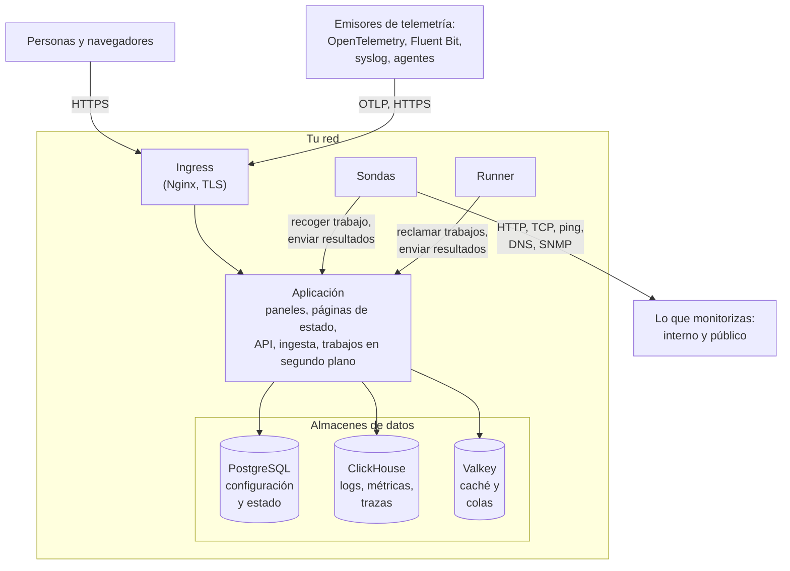

# Arquitectura

Una instalación autoalojada de OneUptime es un puñado de contenedores: un ingress por el que entra cada petición, una imagen de aplicación que hace el trabajo, sondas que ejecutan las comprobaciones de tus monitores y tres almacenes de datos. Esta página muestra cómo encajan, qué hace cada uno y qué conexiones atraviesan tu red.

## Qué muestra

- Las personas llegan a OneUptime a través del **ingress**, que termina TLS y dirige cada petición a la aplicación: el Dashboard, las páginas de estado, la API y cada endpoint de ingesta al que se envía telemetría.
- La **aplicación** lee y escribe su estado en PostgreSQL, guarda la telemetría en ClickHouse y usa Valkey (el fork con licencia BSD de Redis 7.2) como caché y para las colas que procesan sus trabajos en segundo plano.
- Las **sondas** pueden ejecutarse dentro de tu clúster (recomendado) y/o en otro punto de tu red. Pueden monitorizar:
  - Servicios internos/privados detrás de tu cortafuegos.
  - Recursos externos/públicos en internet.
- Los resultados de las sondas se envían a la aplicación, se encolan en Valkey y los trabajos en segundo plano los procesan hacia tus almacenes de datos. Una sonda situada en otro punto de tu red llega a la aplicación a través del ingress, en tu URL de OneUptime.
- La telemetría (métricas, trazas, logs y más) la ingiere la misma aplicación y se guarda en ClickHouse.

> [!NOTE]
> Si usas PostgreSQL, Valkey (o Redis) o ClickHouse externos en lugar de los incluidos, la aplicación se conecta a tus endpoints externos. El flujo lógico sigue siendo el mismo.

## Los componentes

| Componente | Servicio de Docker Compose | Chart de Helm | Qué hace |
| --- | --- | --- | --- |
| Ingress | `ingress` | `nginx` | Termina TLS, sirve tu nombre de host y los dominios de tus páginas de estado, y dirige cada petición a la aplicación. |
| Aplicación | `app` | `app` | El Dashboard, las páginas de estado, los endpoints de API e ingesta y, salvo que los separes, los trabajos en segundo plano. |
| Worker | Parte de `app` | `worker` (desactivado por defecto) | Los trabajos en segundo plano, en sus propios pods, para que el procesamiento intenso de colas nunca compita con las peticiones a la API. |
| Telemetry writer | Parte de `app` | `telemetryWriter` (desactivado por defecto) | Un nivel de tamaño fijo que hace cada inserción en ClickHouse, para que las inserciones se mantengan acotadas por mucho que escalen los workers. |
| Sonda | `probe-1` | `probes` | Ejecuta las comprobaciones de los monitores y devuelve los resultados. Cada sonda incluida es una sonda global que pueden usar todos los proyectos. |
| Runner | `runner` | `runner` | El Runner propio de la instancia, que puede ejecutar correcciones de código con IA para cada proyecto. Los pasos de los runbooks se ejecutan en [Runners](/docs/runbooks/agents) que instalas donde deban ejecutarse. |
| PostgreSQL | `postgres` | `postgresql`, o `postgresOperator.cnpg` | Proyectos, monitores, incidentes, usuarios y todos los demás ajustes y estados. |
| ClickHouse | `clickhouse` | `clickhouse`, o `clickhouseOperator.altinity` | Logs, métricas, trazas, excepciones, perfiles y logs de monitores. |
| Valkey | `valkey` | `valkey` | La caché, las colas de trabajos y el estado de corta duración, como los acuses de push pendientes. |

Todos los roles de la aplicación son la misma imagen: Docker Compose los ejecuta en un solo contenedor `app`, y el chart de Helm puede ejecutar el worker y el telemetry writer como despliegues propios. Para dimensionar cada nivel, consulta [Dimensionamiento y planificación de capacidad](/docs/installation/sizing).

## Conexiones que salen de tu red

La aplicación solo se conecta hacia fuera para lo que actives. Cada una de estas conexiones es opcional, y cada una tiene una página que indica las direcciones exactas que hay que permitir:

| Conexión saliente | Se usa para | Dónde leer más |
| --- | --- | --- |
| Correo (SMTP, o la API de SendGrid) | Notificaciones e invitaciones | [SMTP](/docs/emails/smtp) |
| Twilio | SMS y llamadas telefónicas | [Integración con Twilio](/docs/self-hosted/twilio-integration) |
| El relé de push de OneUptime, o Expo | Notificaciones push móviles | [Notificaciones push](/docs/self-hosted/push-notifications) |
| Slack y Microsoft Teams | Notificaciones y acciones en el espacio de trabajo | [Integración con Slack](/docs/self-hosted/slack-integration) |
| Un proveedor de LLM, como OpenAI, Anthropic, Microsoft Foundry o un modelo que ejecutas tú mismo | OneUptime AI | [Proveedores de LLM](/docs/ai/llm-provider) |
| `oneuptime.com` | Activar una licencia Enterprise en línea | [Edición Enterprise](/docs/self-hosted/enterprise) |

Las conexiones en sentido contrario – SendGrid entregando correo entrante, Slack y Microsoft Teams devolviendo llamadas – necesitan que el ingress sea accesible desde internet. Qué direcciones privadas pueden alcanzar la aplicación y las sondas lo decides tú: consulta [Acceso a red privada](/docs/self-hosted/private-network-access).

## Próximos pasos

:::cards
- [Docker Compose](/docs/installation/docker-compose): Instala todos los componentes en una sola máquina.
- [Dimensionamiento y planificación de capacidad](/docs/installation/sizing): Cuánta CPU, memoria y disco necesita cada nivel.
- [Sondas personalizadas](/docs/probe/custom-probe): Ejecuta una sonda dentro de otra red.
- [Edición Enterprise](/docs/self-hosted/enterprise): Qué añaden las imágenes Enterprise y cómo funcionan las licencias.
:::
