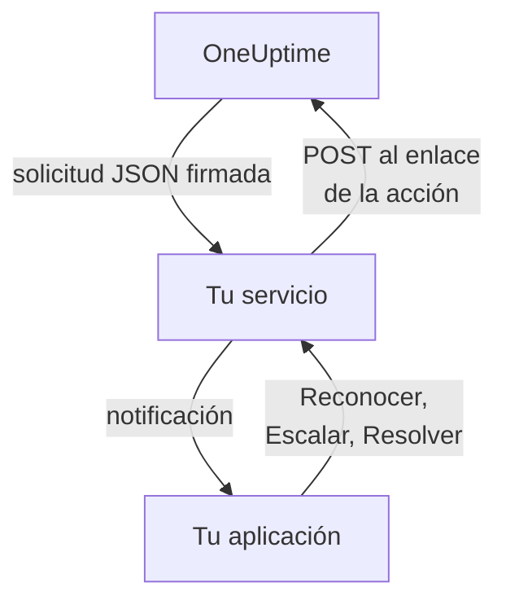

# Canales de notificación personalizados

Un canal personalizado envía los avisos de guardia a un servicio que gestionas tú: la aplicación de tu empresa, un sistema de buscapersonas o una pasarela que controla lo que sale de tu red. Lo añades una sola vez, para todo el servidor, y todo el mundo puede recibir avisos por él sin configurar nada. En el Admin Dashboard se llaman **Custom Channels**.

> [!NOTE]
> Los canales personalizados forman parte de la [Enterprise Edition de OneUptime](/docs/self-hosted/enterprise) y necesitan una licencia Enterprise que los incluya. La Community Edition no tiene la página **Custom Channels** y no envía nada a ningún canal. Consulta [Sin licencia](#sin-licencia).

:::cards
- [Añadir un canal](#añadir-un-canal): Un nombre, una URL y un secreto de firma.
- [Qué recibe tu servicio](#qué-recibe-tu-servicio): Una solicitud JSON firmada por persona y por aviso.
- [Actuar sobre un aviso](#actuar-sobre-un-aviso): Reconocerlo, escalarlo o resolverlo desde tu propia aplicación.
- [Entrega y reintentos](#entrega-y-reintentos): Qué pasa cuando tu servicio no está disponible.
- [Otras notificaciones](#otras-notificaciones): Notificaciones a propietarios, notas y turnos, para quien las quiera.
- [Sin licencia](#sin-licencia): Qué se detiene y qué se conserva.
:::

## Cómo funciona



Cuando una política de guardia avisa a alguien y su regla de guardia usa el canal, OneUptime envía una solicitud a la URL del canal. Indica para quién es el aviso (su nombre y su correo) y de qué trata, y lleva los enlaces que tu servicio llama cuando la persona lo reconoce, lo escala o lo resuelve en tu aplicación.

## Añadir un canal

1. En el Admin Dashboard, abre **Ajustes**, luego **Notificaciones > Custom Channels** en el menú lateral (**Notificaciones** empieza plegado), y selecciona **Add**.
2. En el paso **Channel**, rellena:
   - **Nombre**: lo que las personas ven en sus métodos de notificación y sus reglas de guardia, por ejemplo `CorpoApp`.
   - **Webhook URL**: adonde OneUptime envía cada aviso. Puede estar en tu red privada.
   - **Signing Secret**: OneUptime crea uno por ti. Cópialo en tu servicio, que comprueba cada solicitud con él. Puedes volver a verlo editando el canal.
3. En el paso **Delivery**, guarda y luego selecciona **Send test** para enviar a tu servicio una [solicitud de prueba](#solicitudes-de-prueba).

En el paso **Delivery**, **Page everyone through this channel** está activado. OneUptime añade entonces el canal a las reglas de guardia de todo el mundo en cada proyecto, y a las de quien se una a un proyecto más adelante, y lo usa para llegar a quien está de guardia y no tiene ninguna regla para lo que se ha disparado. Desactívalo para que cada persona añada el canal a sus reglas por su cuenta.

Las personas ven el canal en **Ajustes de usuario**, luego **Métodos de notificación**, luego **Custom Channels**, con un botón **Send test**, y lo eligen en sus reglas de guardia como `Custom Channel: CorpoApp`. No configuran nada: tu servicio sabe para quién es cada aviso.

Para dejar de enviar sin cambiar las reglas de nadie, edita el canal y desactiva **Activado**. Los avisos que habrían ido a él quedan anotados en el registro de guardia como no enviados. Eliminar un canal elimina todas las reglas de guardia que lo usan.

## Qué recibe tu servicio

Cada aviso es una solicitud `POST` con un cuerpo JSON:

| Cabecera | Qué contiene |
| --- | --- |
| `Content-Type` | `application/json` |
| `X-OneUptime-Event` | El evento, como `on-call.incident.created` |
| `X-OneUptime-Signature` | `sha256=` y el HMAC-SHA256 en hexadecimal del cuerpo sin procesar, calculado con el secreto de firma del canal |

```json title="An incident page"
{
  "version": 1,
  "event": "on-call.incident.created",
  "notificationId": "5f2c8a1e-6b1d-4c3a-9e7f-2a4b6c8d0e1f",
  "sentAt": "2026-10-27T03:14:15.000Z",
  "channel": { "id": "0b7e…", "name": "CorpoApp" },
  "title": "New Incident INC-42: API latency high",
  "message": "A new incident has been created: INC-42 (API latency high) in Agency A. Click to view details.",
  "project": { "id": "8d1f…", "name": "Agency A" },
  "team": { "id": "2c9a…", "name": "SRE" },
  "user": { "id": "4e6b…", "name": "Jane Tan", "email": "jane@example.com" },
  "recordType": "incident",
  "record": {
    "id": "9a3c…",
    "number": "INC-42",
    "title": "API latency high",
    "description": "p95 latency above 2 seconds for 5 minutes.",
    "severity": "Critical",
    "state": "Created",
    "url": "https://oneuptime.example.com/dashboard/8d1f…/incidents/9a3c…"
  },
  "onCallPolicy": { "id": "1d4e…", "name": "Primary" },
  "escalationRule": { "id": "7b2f…", "name": "Level 1" },
  "isPageAgain": false,
  "actions": {
    "acknowledge": "https://oneuptime.example.com/api/custom-notification-channel/page/5f2c…/acknowledge?token=…",
    "escalate": "https://oneuptime.example.com/api/custom-notification-channel/page/5f2c…/escalate?token=…",
    "resolve": "https://oneuptime.example.com/api/custom-notification-channel/page/5f2c…/resolve?token=…"
  }
}
```

| Campo | Qué es |
| --- | --- |
| `version` | `1`. A esta versión solo se le añaden campos. |
| `event` | `on-call.incident.created`, `on-call.alert.created`, `on-call.incidentEpisode.created`, `on-call.alertEpisode.created`, `notification` para [otras notificaciones](#otras-notificaciones), o `test` |
| `notificationId` | Uno por persona y por aviso. Úsalo para descartar una solicitud que ya procesaste. |
| `title`, `message` | Listos para mostrar, tal como los mostraría una notificación push |
| `user` | Para quién es el aviso. Encuentra su cuenta en tu aplicación por `email` o `id`. |
| `team` | El equipo a través del que se le avisó, o `null` si se le avisó directamente |
| `recordType`, `record` | De qué trata el aviso: un `incident`, `alert`, `incidentEpisode` o `alertEpisode` |
| `onCallPolicy`, `escalationRule` | La política y el nivel que le avisaron |
| `isPageAgain` | `true` cuando el registro se reconoció hace un tiempo y sigue sin resolverse |
| `actions` | Los enlaces que tu servicio llama para [actuar sobre el aviso](#actuar-sobre-un-aviso) |

Un aviso a varias personas es una solicitud por persona, cada una con los enlaces propios de esa persona, para que OneUptime sepa quién respondió. El título, el mensaje y la descripción juntos se limitan a 16.384 caracteres; una descripción más larga se corta y termina con «… (truncated — see OneUptime for the full text)».

### Comprobar la firma

Calcula el HMAC del cuerpo sin procesar de la solicitud, antes de analizarlo, y compáralo con la cabecera:

```javascript title="Node.js"
const crypto = require("crypto");

function isFromOneUptime(rawBody, signatureHeader, secret) {
  const expected =
    "sha256=" + crypto.createHmac("sha256", secret).update(rawBody).digest("hex");
  const received = String(signatureHeader || "");

  return (
    received.length === expected.length &&
    crypto.timingSafeEqual(Buffer.from(received), Buffer.from(expected))
  );
}
```

## Actuar sobre un aviso

Cuando la persona pulsa un botón en tu aplicación, tu servicio envía una solicitud `POST` al enlace correspondiente de `actions`. No hace falta ninguna clave de API: cada enlace lleva un token para ese único aviso, válido durante 7 días, y la acción queda registrada como hecha por la persona avisada.

| Acción | Qué hace |
| --- | --- |
| `acknowledge` | Reconoce su aviso y, con él, el incidente, la alerta o el episodio |
| `escalate` | No puede atenderlo: avisa ya al siguiente nivel de la política de guardia y deja de avisarle |
| `resolve` | Resuelve el incidente, la alerta o el episodio, si sus propios permisos lo permiten |

```bash title="Acknowledge a page"
curl -X POST "https://oneuptime.example.com/api/custom-notification-channel/page/5f2c…/acknowledge?token=…"
```

La respuesta dice qué ha pasado, con palabras que tu aplicación puede mostrar tal cual:

```json title="The answer"
{
  "action": "acknowledge",
  "result": "acknowledged",
  "message": "Acknowledged."
}
```

`result` es uno de `acknowledged`, `alreadyAcknowledged`, `escalated`, `notEscalated`, `resolved` y `alreadyResolved`. Un enlace caducado o incorrecto se rechaza con un estado 4xx y un mensaje.

## Otras notificaciones

Los avisos no son las únicas notificaciones que reciben las personas: OneUptime también les informa cuando un incidente del que son propietarias cambia de estado, cuando se publica una nota, cuando empieza su turno de guardia, y más. Cada persona elige adónde va cada una en **Ajustes de usuario > Ajustes de notificaciones**, que tiene una columna **Custom Channels** mientras haya un canal activado. Está desactivada para todos hasta que cada uno la activa.

Una notificación va a cada canal activado, como una solicitud por canal, con `event` igual a `notification`:

```json title="A notification"
{
  "version": 1,
  "event": "notification",
  "notificationId": null,
  "sentAt": "2026-10-27T03:20:00.000Z",
  "channel": { "id": "0b7e…", "name": "CorpoApp" },
  "title": "Incident INC-42 acknowledged",
  "message": "Incident INC-42 (API latency high) was acknowledged in Agency A.",
  "project": { "id": "8d1f…", "name": "Agency A" },
  "team": null,
  "user": { "id": "4e6b…", "name": "Jane Tan", "email": "jane@example.com" },
  "recordType": null,
  "record": null,
  "onCallPolicy": null,
  "escalationRule": null,
  "isPageAgain": false,
  "actions": null,
  "notificationType": "Send incident state changed notification when I am the owner of the incident",
  "url": "https://oneuptime.example.com/dashboard/8d1f…/incidents/9a3c…"
}
```

`title` y `message` son lo que diría la notificación push de la persona. `notificationType` nombra el ajuste por el que se envió, y `url` enlaza a aquello de lo que trata, o es `null`. No hay nada sobre lo que actuar, así que `actions` es `null`.

## Entrega y reintentos

Una solicitud cuenta como entregada cuando tu servicio responde con un estado 2xx en 10 segundos. Una solicitud que no respondió, o que respondió con 408, 429 o un estado 5xx, se vuelve a enviar al cabo de 1 segundo y de 4 segundos más: tres intentos en total. Con cualquier otro estado 4xx no se vuelve a enviar.

El resultado de cada intento queda en el registro de guardia de la persona, con el nombre del canal y el estado con el que respondió tu servicio, nunca la URL. Un aviso que no se entrega no detiene la política de guardia: si nadie lo reconoce, se escala como siempre. Mantén una regla de correo o SMS más adelante en tus reglas si tu servicio es la única forma de llegar a las personas.

## Solicitudes de prueba

**Send test**, en la página del Admin Dashboard o en los métodos de notificación de una persona, envía una solicitud con `event` igual a `test`, la persona que lo pulsó como `user`, y `notificationId`, `record` y `actions` en `null`. Úsalo para probar tu servicio antes de que llegue un aviso real.

## Sin licencia

Los canales personalizados funcionan durante la prueba de 14 días de la Enterprise Edition y el periodo de gracia de 30 días tras caducar una licencia. Después, o con una licencia que no los incluya:

- **No se envía nada a ningún canal personalizado.** Un aviso que habría ido a uno queda anotado en el registro de guardia de la persona como no enviado, y lo mismo una prueba.
- **Los canales dejan de ofrecerse.** Salen de los métodos de notificación, las reglas de guardia y los ajustes de notificaciones de las personas, y la preparación y la alternativa dejan de contarlos.
- **La página es de solo lectura.** Puedes ver y eliminar canales, pero no añadirlos ni cambiarlos, y nadie puede apuntar una regla o un ajuste de notificaciones a uno de ellos.
- **No se elimina nada.** Los canales, y las reglas de guardia y los ajustes que los usan, se conservan.

Todo se reanuda en cuanto se activa una licencia, sin reiniciar. Quienes se unieron a un proyecto mientras los canales personalizados estaban detenidos no reciben en sus reglas un canal que avisa a todo el mundo: pueden añadirlo ellos mismos.
