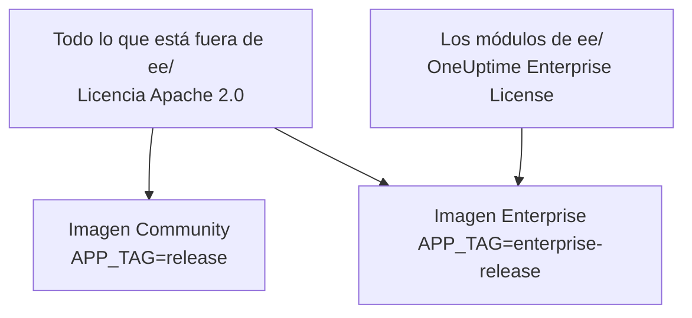
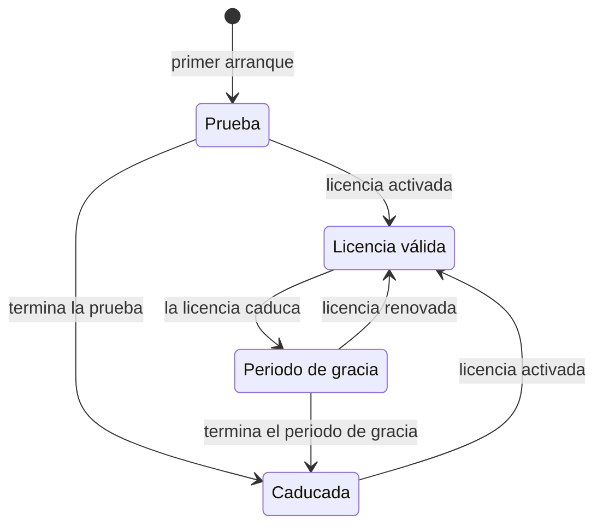

# Edición Enterprise

OneUptime se construye a partir de un único repositorio y se distribuye en dos ediciones:

- **Community Edition**: toda la plataforma de monitorización, incidentes y observabilidad, incluido el inicio de sesión único SAML y OpenID Connect, de código abierto bajo la licencia Apache 2.0 y gratuita para autoalojar a cualquier escala.
- **Enterprise Edition**: la Community Edition más los módulos Enterprise del directorio [`ee/`](https://github.com/OneUptime/oneuptime/tree/master/ee) del repositorio. Esos módulos añaden el aprovisionamiento SCIM y funciones de gobernanza y de administración de la instancia. Se publican bajo la [OneUptime Enterprise License](https://github.com/OneUptime/oneuptime/blob/master/ee/LICENSE), y el uso en producción requiere una licencia Enterprise para su número de usuarios.

Las dos ediciones son imágenes de contenedor distintas. La imagen Community no contiene código de `ee/`. OneUptime Cloud ejecuta la Enterprise Edition, y en la nube es su plan el que decide qué funciones de estas obtiene.



> [!NOTE]
> **El inicio de sesión único está en todas las ediciones.** El inicio de sesión SAML y OIDC en proyectos y páginas de estado, el SSO global y «Require SSO for login» forman parte de la Community Edition, y ningún estado de la licencia los desactiva.

Esta página explica qué incluye cada edición, cómo ejecutar la Enterprise Edition, cómo funcionan las licencias y qué ocurre cuando cambia de edición.

:::cards
- [Comparar las ediciones](#qué-incluye-cada-edición): Lo que añade la Enterprise Edition.
- [Ejecutar la imagen Enterprise](#ejecutar-la-enterprise-edition): Un solo ajuste, en Kubernetes o Docker Compose.
- [Activar una licencia](#licencias): En línea con una clave, o sin conexión con un token firmado.
- [Cuando una licencia caduca](#cuando-una-licencia-caduca-o-falta): Qué se detiene, qué no se detiene nunca y cómo vuelve todo.
:::

## Qué incluye cada edición

| Función | Community | Enterprise | OneUptime Cloud |
| --- | --- | --- | --- |
| Monitorización, alertas, incidentes, guardias, páginas de estado, logs, métricas, trazas, excepciones, paneles, flujos de trabajo, funciones de IA, API y Terraform | Sí | Sí | Todos los planes |
| Inicio de sesión con contraseña, autenticación de dos factores, equipos, roles y claves de API | Sí | Sí | Todos los planes |
| [SSO SAML y OpenID Connect](/docs/identity/sso) para iniciar sesión en proyectos | Sí | Sí | Plan Scale y superiores |
| SSO SAML y OpenID Connect para iniciar sesión en páginas de estado privadas | Sí | Sí | Plan Scale y superiores |
| [SSO y OIDC globales (para toda la instancia)](/docs/identity/global-sso) | Sí | Sí | No aplica |
| [Aprovisionamiento SCIM](/docs/identity/scim) para proyectos y páginas de estado | No | Sí | Plan Scale y superiores |
| Ajustes de cumplimiento de equipos | No | Sí | Plan Scale y superiores |
| Registros de auditoría | No | Sí | Plan Enterprise |
| Anulaciones de retención: retención por tipo de telemetría (logs, trazas, métricas, perfiles, con reglas por gravedad del log y estado de la traza) y retención por servicio y por recurso | No | Sí | Plan Scale y superiores |
| Paneles **Health** de la administración: resumen de la instancia, colas en segundo plano, logs de la instancia, PostgreSQL, Valkey, clúster de ClickHouse, logs de diagnóstico e ingesta de telemetría | No | Sí | No aplica |
| **Query Console** de la administración | No | Sí | No disponible |
| Alertas de salud de PostgreSQL y Valkey (Redis) | No | Sí | No aplica |
| Vista de capacidad de ClickHouse, alertas de capacidad y depuración automática del disco | Sí | Sí | No aplica |
| Estado de las migraciones, paquete de soporte y sondas globales en el panel de administración | Sí | Sí | No aplica |
| Gestión de la licencia Enterprise, de los puestos y de las instancias | No | Sí | No aplica |

El inicio de sesión único incluye «Require SSO for login» para proyectos, páginas de estado privadas y toda la instancia, en ambas ediciones.

Todas las ediciones tienen la retención de telemetría predeterminada del proyecto, en **Ajustes del proyecto > Telemetría y APM > Retención de datos**. Las anulaciones de retención son lo que la Enterprise Edition añade por encima.

En OneUptime Cloud, una función de pago siempre se puede desactivar, en cualquier plan. Una anulación de retención que una prueba (o un cambio a un plan inferior) dejó configurada sigue aplicándose a la telemetría nueva, así que por debajo del plan Scale las páginas de retención la muestran bajo la tarjeta de mejora con un botón **Quitar anulación**. Quitarla funciona en todos los planes; volver a configurar una requiere el plan Scale. La telemetría ya almacenada conserva la retención con la que se almacenó. Del mismo modo, **Ajustes del proyecto > Seguridad > SSO** muestra el interruptor **Requerir SSO para iniciar sesión** bajo su tarjeta de mejora mientras el proyecto siga exigiendo SSO, para que se pueda desactivar.

Las filas «No aplica» son funciones de administración de la instancia. En OneUptime Cloud, OneUptime opera la instancia por usted.

## Ejecutar la Enterprise Edition

Ambas ediciones usan la misma configuración, las mismas bases de datos y los mismos datos. Cambiar de edición cambia la imagen que ejecuta y nada más. No hace falta ninguna migración en ninguna de las dos direcciones.

:::tabs
@tab Kubernetes
Defina el tipo de imagen en su `values.yaml`:

```yaml title="values.yaml"
image:
  type: enterprise-edition
```

Después actualice como de costumbre:

```bash
helm upgrade my-oneuptime oneuptime/oneuptime -f values.yaml
```

El chart descarga entonces la variante `enterprise-` de cada etiqueta de imagen, por ejemplo `oneuptime/app:enterprise-release`, o `enterprise-<version>` cuando fija `image.tag`. Defina `image.type: community-edition` (el valor predeterminado) para ejecutar la Community Edition.
@tab Docker Compose
Defina `APP_TAG` en su `config.env`:

```bash title="config.env"
APP_TAG=enterprise-release
```

Use `enterprise-<version>` para fijar una versión. Después descargue las imágenes y reinicie:

```bash
npm run update
```

Para volver a la Community Edition, defina `APP_TAG=release` **y** `IS_ENTERPRISE_EDITION=false`. Mientras `IS_ENTERPRISE_EDITION=true` esté definido, `npm run update` vuelve a poner `APP_TAG` en `enterprise-release`, y la imagen Community se niega a arrancar.
:::

### `IS_ENTERPRISE_EDITION` está obsoleta

La imagen que ejecuta decide la edición. `IS_ENTERPRISE_EDITION` ya no activa las funciones Enterprise y se eliminará en una versión futura. Puede dejarla sin definir.

Definir `IS_ENTERPRISE_EDITION=true` en la imagen Community **no** activa las funciones Enterprise. En su lugar, la aplicación **se niega a arrancar**, para que una actualización que acabe en la imagen Community nunca pueda detener en silencio el aprovisionamiento SCIM (incluido el desaprovisionamiento) y el registro de auditoría. El error le indica qué definir: `APP_TAG=enterprise-<version>` para conservar la Enterprise Edition, o `IS_ENTERPRISE_EDITION=false` para ejecutar la Community Edition. Con Helm esto no puede ocurrir: el chart deriva la variable de `image.type`.

`ONEUPTIME_EDITION=community` hace que la imagen Enterprise funcione como la Community Edition. Es útil para probar un cambio a la edición inferior antes de hacerlo. La imagen Enterprise define ella misma `ONEUPTIME_EDITION=enterprise`; no la sustituya por nada que no sea `community`.

## Licencias

El archivo [`LICENSE`](https://github.com/OneUptime/oneuptime/blob/master/LICENSE) de la raíz del repositorio establece qué licencia cubre qué: todo lo que está en el directorio `ee/` se rige por la [OneUptime Enterprise License](https://github.com/OneUptime/oneuptime/blob/master/ee/LICENSE), los componentes de terceros conservan las licencias con las que sus propietarios los proporcionan, y todo lo demás se rige por la licencia Apache 2.0.

Una instalación nueva de la Enterprise Edition funciona como una **prueba de 14 días**, contada desde la primera vez que la instalación arranca la Enterprise Edition. La prueba es para evaluación: el uso en producción de la Enterprise Edition requiere una suscripción bajo la OneUptime Enterprise License. Active una licencia antes de que termine la prueba: después, SCIM, el registro de auditoría y las anulaciones de retención se detienen y la configuración Enterprise pasa a ser de solo lectura (consulte [Cuando una licencia caduca o falta](#cuando-una-licencia-caduca-o-falta)). Para obtener una licencia, escriba a [sales@oneuptime.com](mailto:sales@oneuptime.com).

La licencia se gestiona desde la **etiqueta de edición**, que los administradores maestros ven en la cabecera del panel de administración y en el pie del Dashboard. Muestra el estado de la licencia, el uso de puestos y, para los administradores maestros, el ID de instancia.

### Activación en línea (clave de licencia)

:::steps
1. Inicie sesión como administrador maestro y abra la etiqueta de edición.
2. Introduzca su clave de licencia y valídela.
:::

La instalación comprueba la clave con OneUptime y almacena la licencia que recibe. A partir de entonces mantiene la licencia al día con una sincronización diaria. Use **Refresh license** en la etiqueta de edición para obtener de inmediato los cambios, como puestos adicionales o una renovación.

La activación en línea necesita HTTPS saliente desde el servidor de OneUptime hacia `https://oneuptime.com`. Si el servidor solo llega a Internet a través de un relé, defina `ENTERPRISE_LICENSE_SERVER_URL` con la dirección `https://` del relé. El relé debe reenviar `/api/enterprise-license/` a oneuptime.com.

### Activación sin conexión (instalaciones aisladas de la red)

Una instalación sin ruta hacia Internet puede usar un **token de licencia firmado** en lugar de una clave:

:::steps
1. Inicie sesión como administrador maestro, abra la etiqueta de edición y anote el **ID de instancia**.
2. Pida a OneUptime ([sales@oneuptime.com](mailto:sales@oneuptime.com)) un token de licencia sin conexión para ese ID de instancia.
3. Pegue el token en el campo de token de la etiqueta de edición y actívelo.
:::

La instalación verifica el token por sí misma, con las claves de firma de OneUptime incluidas en su versión. Nunca contacta con OneUptime. Un token emitido para un ID de instancia es rechazado por cualquier otra instalación, y un token emitido sin ID de instancia (como el que recibe una instalación activada en línea) también se rechaza. Para renovar o añadir puestos, active un token nuevo antes de que caduque el actual.

> [!IMPORTANT]
> **La activación sin conexión necesita una versión que confíe en la clave de firma de licencias de OneUptime.** Si su versión aún no incluye esa clave, la activación falla con «this build does not trust the key that signed this token». En ese caso, active en línea o actualice a una versión que incluya la clave.

### Qué envía la sincronización diaria de la licencia

Una instalación activada en línea envía un informe a OneUptime una vez al día. Contiene:

- la clave de licencia;
- el ID de instancia (un identificador aleatorio que genera la instalación) y el nombre de host con el que está configurada la instalación (`HOST`);
- la versión de OneUptime que ejecuta la instalación;
- el número de usuarios de la instalación;
- un **hash SHA-256** de la dirección de correo de cada usuario, en minúsculas. OneUptime usa los hashes para contar como un solo puesto a una persona que tiene cuentas en varias de sus instalaciones. Nunca se envían en claro las direcciones de correo de los usuarios normales;
- las direcciones de correo de los **administradores maestros** de la instalación, para que OneUptime pueda contactarle sobre renovaciones y límites de puestos.

La respuesta trae la licencia tal como OneUptime la conoce ese día: nombre de la empresa, caducidad, límite de puestos, número combinado de usuarios en todas sus instalaciones y las instalaciones registradas con la licencia. Las demás réplicas de la instalación recogen un cambio en aproximadamente un minuto.

Cuando activa o actualiza la licencia, la instalación solo envía la clave de licencia, el ID de instancia, el nombre de host y la versión.

No se envía nada más. Ningún dato de monitorización, telemetría, logs o configuración sale de la instalación. La Community Edition no envía nada de esto, y tampoco una instalación activada sin conexión.

### Cuando una licencia caduca o falta

Todas las funciones Enterprise funcionan durante la prueba de 14 días y durante 30 días después de que caduque una licencia (el periodo de gracia). La etiqueta de edición avisa antes de que termine cualquiera de los dos. Después, **SCIM, el registro de auditoría y las anulaciones de retención se detienen** hasta que se active una licencia, igual que en la Community Edition, y la configuración Enterprise pasa a ser de solo lectura. El inicio de sesión único no es una función Enterprise: el inicio de sesión SAML y OIDC, el SSO global y «Require SSO for login» funcionan igual en cualquier estado de la licencia.



| Estado | Qué ocurre |
| --- | --- |
| **Licencia válida** | Todas las funciones Enterprise funcionan. No se pueden añadir usuarios nuevos más allá del número de puestos con licencia. Los usuarios existentes nunca se eliminan. |
| **Prueba o periodo de gracia** (los primeros 14 días de una instalación sin licencia, o 30 días después de que caduque una licencia), o una instalación con una licencia cuya caducidad nunca se registró | Todas las funciones Enterprise funcionan y la etiqueta de edición muestra un aviso. Durante el periodo de gracia posterior a una caducidad, el límite de puestos sigue aplicándose. Una instalación con una licencia sin caducidad registrada pasa por la misma prueba de 14 días que una instalación sin licencia, y el límite de puestos no se aplica, porque el registro de licencia que tiene ya está incompleto. |
| **Después de la prueba o del periodo de gracia** (licencia caducada, ausente o no válida, o una licencia que no incluye la función) | El aprovisionamiento SCIM, el registro de auditoría y las anulaciones de retención **se detienen** (vea más abajo). La configuración Enterprise pasa a ser de **solo lectura**: puede verla y eliminarla, pero no crearla ni cambiarla. Un cambio funciona siempre, para que pueda responder a un incidente: sustituir un token bearer de SCIM. Las páginas de ajustes de SCIM lo ofrecen mientras todo lo demás es de solo lectura: **Restablecer token Bearer** en una configuración SCIM, que muestra el token nuevo una sola vez. Por la API, envíe `bearerToken` solo (como mínimo 32 caracteres). El registro de auditoría no se puede activar ni ampliar. Los paneles Health Enterprise y la Query Console quedan bloqueados. El límite de puestos deja de aplicarse. |

Qué se detiene cuando una licencia caduca:

- **El aprovisionamiento SCIM se detiene.** Las solicitudes SCIM de su proveedor de identidad se rechazan, incluido el desaprovisionamiento, y los bloqueos de equipo de SCIM se levantan, así que los equipos gestionados por grupos push de SCIM se pueden editar a mano.
- **El registro de auditoría deja de grabar.** Los registros de auditoría grabados hasta entonces se conservan.
- **Las anulaciones de retención dejan de aplicarse.** La telemetría nueva se conserva durante la retención predeterminada del proyecto. La telemetría ya almacenada conserva la retención con la que se escribió. Todavía puede borrar una anulación por la API, pero no configurar una.

Qué **no** se detiene:

- **El inicio de sesión único.** El inicio de sesión SAML y OIDC en proyectos, páginas de estado privadas, toda la instancia (SSO global) y las aplicaciones móviles, así como «Require SSO for login», forman parte de todas las ediciones. Una licencia caducada no cambia nada de esto, y la configuración del inicio de sesión único sigue siendo editable.
- **La monitorización básica nunca se ve afectada**: monitores, alertas, incidentes, guardias, páginas de estado y telemetría siguen funcionando.
- **Los administradores maestros siempre pueden iniciar sesión con su contraseña.**
- **No se elimina nada.** La configuración de SCIM, los registros de auditoría y las anulaciones de retención se quedan como están.

**Todo se reanuda en cuanto se activa una licencia**, sin reiniciar: el aprovisionamiento SCIM, el registro de auditoría y las anulaciones de retención vuelven con la configuración que tiene. OneUptime solo los desactiva cuando sabe que la licencia ha caducado. Mientras no puede leer el estado de la licencia, por ejemplo un momento mientras arranca el servidor, SCIM, el registro de auditoría y las anulaciones de retención siguen activos.

> [!WARNING]
> **Si su proveedor de identidad desaprovisiona usuarios mediante SCIM, active una licencia antes de que termine la prueba o el periodo de gracia.** Después, SCIM ya no desaprovisiona a las personas que quita en su proveedor de identidad: sus cuentas de OneUptime permanecen y, salvo que «Require SSO for login» se les aplique, cualquiera que todavía pueda acceder al buzón de correo de una de esas cuentas puede establecer una contraseña e iniciar sesión. Si deja caducar la licencia, elimine usted mismo a esos usuarios en OneUptime.

## Cambiar de Enterprise a Community

Su configuración se queda en la base de datos. Volver a la imagen Enterprise lo restaura todo como estaba, siempre que la instalación tenga una licencia válida o siga en su prueba o periodo de gracia. El inicio de sesión único no cambia: el inicio de sesión SAML y OIDC, el SSO global y «Require SSO for login» funcionan igual en ambas imágenes. En la imagen Community:

- **SCIM se detiene.** Sus endpoints de aprovisionamiento dejan de existir, así que las llamadas SCIM que lanza el IdP fallan. Eso incluye el desaprovisionamiento SCIM.
- **Los bloqueos de equipo de SCIM se levantan**, así que los equipos que estaban gestionados por grupos push de SCIM se pueden editar a mano. Al arrancar, el servidor registra en qué proyectos se levantaron los bloqueos de equipo de SCIM.
- **El registro de auditoría se detiene.** Los registros de auditoría grabados hasta entonces se conservan, pero las páginas de registros de auditoría muestran un aviso para mejorar el plan.
- **Las anulaciones de retención dejan de aplicarse.** La telemetría nueva se conserva durante la retención predeterminada del proyecto, y las tarjetas de retención de **Ajustes del proyecto > Telemetría y APM > Retención de datos** y de la página de ajustes de cada servicio y de cada recurso muestran un aviso para mejorar el plan. Las anulaciones se quedan en la base de datos y vuelven a aplicarse cuando regresa.
- **Las páginas de ajustes Enterprise muestran un aviso para mejorar el plan.** Por la API todavía puede leer y eliminar la configuración Enterprise y restablecer un token bearer de SCIM, pero no crear ni cambiar nada más. El registro de auditoría no se puede activar.
- **Los paneles Health Enterprise, la Query Console y las alertas de salud de PostgreSQL y Valkey se detienen.** La supervisión de capacidad y la depuración de ClickHouse, el estado de las migraciones y el paquete de soporte siguen funcionando.

> [!CAUTION]
> **Antes de pasar a la imagen Community una instalación cuyo proveedor de identidad desaprovisiona usuarios mediante SCIM, revise quién tiene acceso.** Sin SCIM, las personas que quita en su proveedor de identidad conservan sus cuentas de OneUptime y, salvo que «Require SSO for login» se les aplique, cualquiera que todavía pueda acceder al buzón de correo de una de esas cuentas puede establecer una contraseña e iniciar sesión. Elimine primero a esos usuarios.

## Solución de problemas

:::details La aplicación se niega a arrancar después de una actualización
`IS_ENTERPRISE_EDITION=true` está definido en la imagen Community. Defina `APP_TAG=enterprise-<version>` para conservar la Enterprise Edition, o `IS_ENTERPRISE_EDITION=false` para ejecutar la Community Edition, y después vuelva a ejecutar `npm run update`.
:::

:::details La activación sin conexión falla con «this build does not trust the key that signed this token»
Su versión se compiló antes de confiar en la clave de firma de licencias de OneUptime. Active en línea o actualice a una versión que incluya la clave.
:::

:::details Las solicitudes SCIM de su proveedor de identidad se rechazan
En la imagen Enterprise, la licencia ha caducado: active una y el aprovisionamiento se reanuda sin reiniciar. En la imagen Community, los endpoints SCIM no existen en absoluto.
:::

## Próximos pasos

:::cards
- [Actualización](/docs/installation/upgrading): Pasar a una versión nueva, y entre las imágenes de las ediciones.
- [SSO](/docs/identity/sso): Inicio de sesión único, en todas las ediciones.
- [SSO global](/docs/identity/global-sso): Un solo proveedor de identidad para toda la instancia.
- [SCIM](/docs/identity/scim): Aprovisione usuarios y equipos desde su proveedor de identidad.
:::
