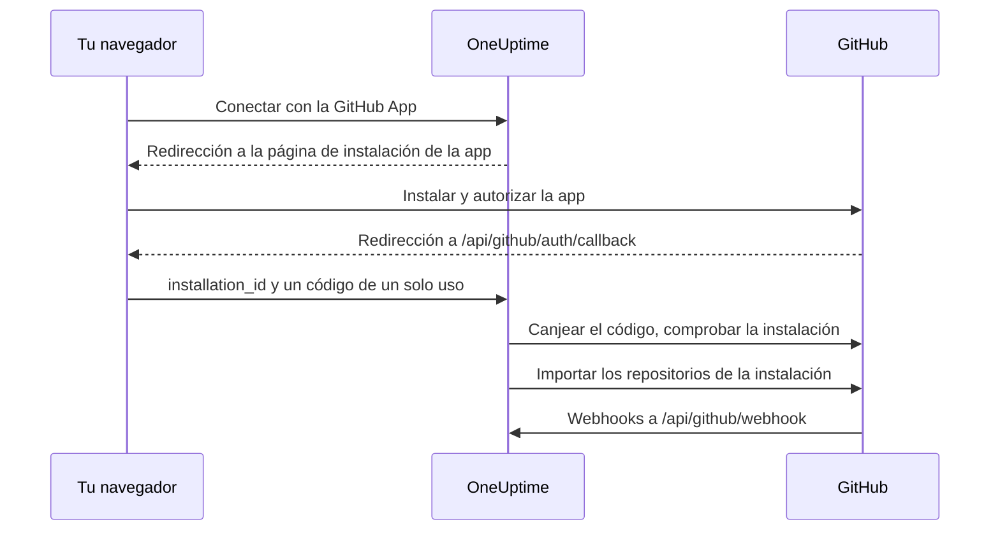

# Integración con GitHub

Conecta tu OneUptime autoalojado a GitHub con una GitHub App propia. Una vez instalada la app desde OneUptime, los repositorios de la instalación se importan a tu proyecto y se mantienen sincronizados, las tareas de corrección con IA abren pull requests, y tu equipo puede pasarle trabajo a la app desde GitHub mencionándola.

Esta página es para quien administra el servidor de OneUptime: creas la app una vez, y después cada proyecto la conecta desde **Repositorios de código**.

:::cards
- [Crear la GitHub App](#crear-la-github-app): Registra la app con las URL, los permisos y los eventos correctos.
- [Configurar OneUptime](#configurar-oneuptime): Dale al servidor los seis valores de la app.
- [Conectar repositorios](#conectar-repositorios): Instala la app desde OneUptime.
- [Solución de problemas](#solución-de-problemas): Qué significan los mensajes de Repositorios de código.
:::

## Cómo funciona

La instalación empieza en OneUptime, no en GitHub: el enlace con el que OneUptime te envía a GitHub es lo que vincula la instalación a tu proyecto.



- La redirección del navegador lleva la instalación y un código OAuth de un solo uso. OneUptime canjea el código para confirmar que la cuenta de GitHub que instaló la app administra esa instalación, y luego importa sus repositorios.
- Los webhooks mantienen sincronizada la lista de repositorios y le pasan trabajo a la app: menciones, asignaciones, etiquetas de activación y solicitudes de revisión. GitHub firma cada uno con el webhook secret, y OneUptime rechaza los que no puede verificar.

## Antes de empezar

- Una cuenta de GitHub que pueda crear GitHub Apps para la organización o el usuario donde se instalará la app. Para instalarla en una organización, necesitas ser propietario de ella o que un propietario apruebe la solicitud.
- Un nombre de host HTTPS público para OneUptime al que GitHub pueda llegar para los webhooks. Consulta [Acceso de red](#acceso-de-red-para-despliegues-autoalojados).
- Acceso a la configuración del servidor: `config.env` en Docker Compose, o tus values de Helm en Kubernetes.

## Crear la GitHub App

:::steps
### Abre los ajustes de GitHub Apps

- **Para una organización:** `https://github.com/organizations/YOUR_ORG/settings/apps`
- **Para una cuenta personal:** `https://github.com/settings/apps`

Selecciona **New GitHub App**.

### Rellena el formulario de registro

| Campo | Valor |
| --- | --- |
| **GitHub App name** | Cualquier nombre único, por ejemplo `OneUptime`. Anótalo exactamente: es `GITHUB_APP_NAME`. |
| **Homepage URL** | `https://your-oneuptime-domain.com` |
| **Callback URL** | `https://your-oneuptime-domain.com/api/github/auth/callback` |
| **Request user authorization (OAuth) during installation** | Activado. **Es obligatorio**: consulta la nota de abajo. |
| **Setup URL** | `https://your-oneuptime-domain.com/api/github/auth/callback`, si GitHub te deja introducir una (consulta abajo). |
| **Redirect on update** | Opcional. Después de que alguien cambia una instalación en GitHub, OneUptime lo lleva a **Repositorios de código**. |
| **Webhook URL** | `https://your-oneuptime-domain.com/api/github/webhook`, con el webhook **Active**. |
| **Webhook secret** | Una cadena aleatoria larga. Anótala: es `GITHUB_APP_WEBHOOK_SECRET`. **Obligatorio**: OneUptime rechaza los webhooks sin firmar, así que dejar `GITHUB_APP_WEBHOOK_SECRET` sin definir detiene la sincronización de repositorios en lugar de aceptar cargas sin verificar. |

Según la documentación de GitHub, con **Request user authorization (OAuth) during installation** activado [no puedes introducir una Setup URL](https://docs.github.com/en/apps/creating-github-apps/registering-a-github-app/about-the-setup-url): los usuarios van a la Callback URL después de instalar la app. Ambas apuntan a la misma dirección de OneUptime, así que la redirección llega al lugar correcto en cualquier caso.

> [!IMPORTANT]
> **Por qué "Request user authorization (OAuth) during installation" es obligatorio.** Tras una instalación, GitHub redirige con un `installation_id` en la URL. Ese número por sí solo no prueba nada sobre quién es el dueño de la instalación: cualquiera puede escribir otro. Con esta opción activada, GitHub devuelve además un `code` OAuth de un solo uso ligado a la cuenta de GitHub que hizo la instalación, que OneUptime canjea para confirmar que esa cuenta administra de verdad la instalación antes de conectarla a tu proyecto.
>
> Sin ella, OneUptime se niega a conectar la instalación y el panel muestra un error que te pide activar este ajuste. Es intencionado: aceptar el ID de instalación sin verificar permitiría que un proyecto de OneUptime reclamara los repositorios de otra organización.

### Define los permisos

En **Permissions & events**, define estos **Repository permissions**:

| Permiso | Acceso | Para qué lo usa OneUptime |
| --- | --- | --- |
| Contents | Read and write | Leer archivos del repositorio y subir las ramas de las pull requests de corrección con IA |
| Pull requests | Read and write | Abrir y actualizar pull requests, y publicar revisiones |
| Issues | Read and write | Publicar los comentarios de la app, **también en pull requests**, cuya conversación GitHub enruta por la API de issues |
| Checks | Read-only | Opcional. Leer el resultado de CI de las pull requests de corrección. Sin él, su estado de CI queda sin verificar |
| Metadata | Read-only | Metadatos básicos del repositorio (GitHub lo exige) |

**Issues: Read and write es lo que hace interactiva a la app.** Sin él, las menciones se reciben y luego fallan en silencio cuando la app intenta responder: GitHub sirve los comentarios de las conversaciones de pull requests desde la API de issues, así que este único permiso controla cada respuesta que escribe la app. Consulta [Trabajar con OneUptime desde GitHub](/docs/ai/github-app).

OneUptime no necesita permisos de organización ni de cuenta.

### Suscríbete a los eventos de webhook

OneUptime usa dos grupos de eventos, y cumplen funciones distintas.

**Sincronización de repositorios**: `installation` e `installation_repositories`. Las GitHub Apps los reciben automáticamente; mantienen el conjunto de repositorios conectados al día con dónde está instalada la app.

**La app interactiva**: a estos hay que suscribirse explícitamente, y cada uno habilita una forma concreta de pasarle trabajo a la app:

| Evento | Qué habilita |
| --- | --- |
| **Issue comment** | comandos `@mention` en issues **y** en pull requests |
| **Issues** | asignar una issue a la app, y la etiqueta de activación del repositorio |
| **Pull request** | pedir una revisión a la app |
| **Pull request review** | una mención escrita en el cuerpo de una revisión enviada |
| **Pull request review comment** | una mención en un comentario en línea del diff |

Si no hay suscripción a ninguno de estos, la GitHub App sigue conectando repositorios y abriendo pull requests de corrección desde OneUptime, pero nunca responde a nada de lo que se escribe en GitHub. Es la causa más común de "el bot me ignora". Consulta [Trabajar con OneUptime desde GitHub](/docs/ai/github-app) para ver cuáles son los comandos y quién puede darlos.

Los demás eventos (**Push**, **Workflow run**) se confirman y se ignoran; suscribirse a ellos no habilita notificaciones ni automatización de CI/CD.

### Elige dónde se puede instalar la app

En **Where can this GitHub App be installed?**, elige:

- **Only on this account** - Para uso privado/interno
- **Any account** - Si quieres que otros instalen tu app

### Crea la app y anota sus identificadores

Selecciona **Create GitHub App**. GitHub abre la página de ajustes de la app. Anota el **App ID**, en la parte superior de la página, y el **Client ID**, en la sección **About**.

### Genera un client secret

En **Client secrets**, selecciona **Generate a new client secret**. Cópialo enseguida: GitHub solo lo muestra una vez.

### Genera una clave privada

En **Private keys**, selecciona **Generate a private key**. GitHub descarga un archivo `.pem`. Guárdalo en un lugar seguro: permite a OneUptime autenticarse como la app.
:::

## Configurar OneUptime

:::tabs
@tab Docker Compose
`config.env` tiene un valor por línea, así que pon la clave privada codificada en base64, en una sola línea. OneUptime la decodifica:

```bash
base64 < private-key.pem | tr -d '\n'
```

```bash title="config.env"
GITHUB_APP_ID=YOUR_APP_ID
GITHUB_APP_NAME=YOUR_APP_NAME
GITHUB_APP_CLIENT_ID=YOUR_CLIENT_ID
GITHUB_APP_CLIENT_SECRET=YOUR_CLIENT_SECRET
GITHUB_APP_PRIVATE_KEY=YOUR_BASE64_ENCODED_PRIVATE_KEY
GITHUB_APP_WEBHOOK_SECRET=YOUR_WEBHOOK_SECRET
```

Aplica el cambio con `npm run start`, que vuelve a crear los contenedores. `docker compose restart` no vuelve a leer `config.env`.
@tab Kubernetes
```yaml title="values.yaml"
gitHubApp:
  id: "YOUR_APP_ID"
  name: "YOUR_APP_NAME" # The exact name of your GitHub App
  clientId: "YOUR_CLIENT_ID"
  clientSecret: "YOUR_CLIENT_SECRET"
  privateKey: "<BASE64_ENCODED_PRIVATE_KEY_CONTENT>"
  webhookSecret: "YOUR_WEBHOOK_SECRET"
```

`privateKey` también acepta el PEM tal cual, como bloque de varias líneas (`privateKey: |`). Aplica el cambio con `helm upgrade`.
:::

Cuando OneUptime vuelva a estar en marcha, **Repositorios de código** muestra **Conectar con la GitHub App** en lugar de **La GitHub App no está configurada en este servidor**.

### Referencia de variables de entorno

| Docker Compose (`config.env`) | Helm (`values.yaml`) | Valor |
| --- | --- | --- |
| `GITHUB_APP_ID` | `gitHubApp.id` | El **App ID**. Se usa para autenticarse como la app. |
| `GITHUB_APP_NAME` | `gitHubApp.name` | El nombre exacto de la app. El enlace de instalación y el identificador `@mention` de la app (en minúsculas, con guiones en lugar de espacios) se construyen a partir de él. Sin él, **Repositorios de código** no puede conectar. |
| `GITHUB_APP_CLIENT_ID` | `gitHubApp.clientId` | El **Client ID**. Necesario para verificar quién instaló la app. |
| `GITHUB_APP_CLIENT_SECRET` | `gitHubApp.clientSecret` | El client secret que generaste. Necesario junto con el client ID. |
| `GITHUB_APP_PRIVATE_KEY` | `gitHubApp.privateKey` | La clave privada: el PEM, o el PEM codificado en base64. |
| `GITHUB_APP_WEBHOOK_SECRET` | `gitHubApp.webhookSecret` | El webhook secret. Cada webhook se verifica con él, y no se acepta ninguno sin él. |

Las seis son obligatorias.

## Conectar repositorios

Inicia la conexión desde OneUptime, no desde la página de la app en GitHub: el enlace con el que OneUptime te envía a GitHub es lo que vincula la instalación a tu proyecto.

:::steps
1. Inicia sesión en tu panel de OneUptime
2. Ve a **Productos** > **Tareas** > **Repositorios de código**
3. Haz clic en **Conectar con la GitHub App**. OneUptime te lleva a GitHub
4. Selecciona la organización o la cuenta donde instalar la app, y elige a qué repositorios puede acceder: **All repositories** (todos los repositorios actuales y futuros) u **Only select repositories**
5. Haz clic en **Install** (o en **Save**, si la app ya está instalada allí)
6. GitHub te devuelve a **Repositorios de código**, y se importan todos los repositorios de la instalación. Los repositorios que se añaden o se quitan después de la instalación se sincronizan automáticamente.
:::

**Quién puede conectar.** Conectar importa los repositorios de la instalación al proyecto, así que requiere permiso para añadir repositorios de código: **Project Owner**, **Project Admin**, **Project Member**, **Settings Admin**, **Settings Member**, o un equipo con **Create Code Repository**. Un equipo que bloquea el permiso lo retira. En OneUptime Cloud, los repositorios de código requieren el plan Growth o superior. Para cualquier otra persona, la tarjeta aparece bloqueada y dice qué hace falta.

**Termina en menos de 15 minutos, en el mismo navegador.** El enlace funciona una vez, durante 15 minutos, en el navegador que lo inició. Cuando GitHub te devuelve, OneUptime vuelve a comprobar el permiso antes de importar nada.

## Acceso de red para despliegues autoalojados

### Sentido del tráfico y endpoints

| Tráfico | Acceso necesario |
| --- | --- |
| De OneUptime a GitHub | DNS y HTTPS saliente por TCP 443 a `api.github.com` para los tokens de la GitHub App y las llamadas a la API de repositorios, y a `github.com` para el canje del token de OAuth y las operaciones de Git por HTTPS |
| De GitHub a OneUptime | HTTPS público por TCP 443 a `POST /api/github/webhook` para sincronizar instalaciones y accesos a repositorios, y para la app interactiva |
| Del navegador del usuario a OneUptime | Acceso al panel y `GET /api/github/auth/callback` para las redirecciones de instalación y autorización; pueden seguir siendo accesibles a través de la VPN del usuario |

El callback es una [redirección del navegador](https://docs.github.com/en/apps/creating-github-apps/registering-a-github-app/about-the-user-authorization-callback-url), mientras que el webhook es una solicitud de los servidores de GitHub. La conexión VPN de un usuario no le da a GitHub acceso al webhook. Los dominios de arriba cubren las solicitudes básicas de la integración; otras herramientas de repositorios, descargas, LFS o paquetes pueden requerir otros destinos. Estos ajustes describen GitHub.com; cambiar el firewall no configura la compatibilidad con un nombre de host de GitHub Enterprise Server.

### Despliegues privados y seguridad de los callbacks

Expón `/api/github/webhook` mediante una pasarela pública con DNS público, un certificado HTTPS de confianza pública con su cadena completa y una ruta privada al ingress de OneUptime. Permite TCP 443 entrante hacia la pasarela y limita el reenvío público a esta ruta POST. Mantén el panel y el callback del navegador en el ingress privado si los usuarios acceden por VPN; con DNS dividido, el mismo nombre de host puede servirse dentro y fuera.

Define `HOST=oneuptime.example.com` y `HTTP_PROTOCOL=https` en `config.env`, o `host: oneuptime.example.com` y `httpProtocol: https` en Helm. Aplica la configuración y espera a que OneUptime se reinicie. Estos valores generan URL; no aprovisionan DNS, TLS ni acceso de red. Si cambia el nombre de host, actualiza las URL de webhook, callback, configuración y página de inicio de la GitHub App.

Conserva el método, la ruta original, la cadena de consulta, el cuerpo, `Content-Type`, `X-Hub-Signature-256`, `X-GitHub-Event` y `X-GitHub-Delivery`. Conserva el host público y el esquema HTTPS mediante cabeceras de proxy de confianza. Excluye el webhook del SSO del navegador, de los CAPTCHA y de las páginas de inicio de sesión del proxy. Mantén activada la verificación SSL de GitHub y configura el mismo `GITHUB_APP_WEBHOOK_SECRET` en ambos sistemas: OneUptime rechaza las solicitudes sin firmar y no puede validar los webhooks sin este secret. Consulta las [indicaciones de GitHub para validar webhooks](https://docs.github.com/en/webhooks/using-webhooks/validating-webhook-deliveries).

Si además restringes las IP de origen de los webhooks, usa los rangos `hooks` actuales de la Meta API de GitHub y actualízalos con regularidad; no los sustituyas por los rangos de los runners de GitHub Actions ni omitas la verificación de la firma. GitHub advierte que [sus direcciones cambian y la lista publicada no es exhaustiva](https://docs.github.com/en/authentication/keeping-your-account-and-data-secure/about-githubs-ip-addresses).

### Verificar el acceso y entender las limitaciones

:::steps
1. Conecta una instalación desde **Repositorios de código**.
2. En los ajustes de la GitHub App, abre **Advanced** y mira **Recent Deliveries**. Vuelve a entregar una entrega y confirma que la pasarela la reenvía y que OneUptime la acepta.
3. Añade o quita un repositorio de prueba de la instalación, y comprueba que la lista de repositorios de OneUptime lo refleja.
:::

GitHub documenta el [diagnóstico de entregas](https://docs.github.com/en/webhooks/testing-and-troubleshooting-webhooks/viewing-webhook-deliveries) y exige [una confirmación 2xx en menos de diez segundos](https://docs.github.com/en/webhooks/using-webhooks/best-practices-for-using-webhooks). Un GET del navegador al webhook no prueba un POST firmado.

> [!WARNING]
> Sin acceso entrante, la autorización en el navegador y las operaciones salientes de API y Git pueden funcionar, pero los webhooks no pueden llegar a OneUptime: las instalaciones eliminadas y los cambios de acceso a repositorios no se sincronizan, y la app nunca responde a menciones, asignaciones ni solicitudes de revisión.

El [ajuste de acceso a red privada](/docs/self-hosted/private-network-access) controla las solicitudes salientes a destinos privados y no hace que GitHub pueda llegar al webhook.

## Solución de problemas

### La conexión no terminó

Cuando GitHub te devuelve y la instalación no se conectó, **Repositorios de código** muestra **GitHub no se conectó**, con una frase en tu idioma que dice por qué. El resto de la página carga como siempre, así que puedes volver a conectar ahí mismo. Nunca muestra lo que respondió GitHub: eso está en el log del servidor de OneUptime, con el motivo.

| La página dice | Qué hacer |
| --- | --- |
| **"Este enlace de conexión no es válido, ha caducado o ya se ha usado. Vuelve a empezar."** | El enlace funciona una vez, durante 15 minutos, en el navegador que lo inició. Empieza de nuevo desde **Repositorios de código** y termina en GitHub en menos de 15 minutos, en el mismo navegador. Instalar la app desde su página en GitHub no la conecta a ningún proyecto. |
| **"No tienes permiso para añadir repositorios de código a este proyecto."** | Conectar requiere permiso para añadir repositorios de código (consulta [Conectar repositorios](#conectar-repositorios)). Pide a un administrador del proyecto que te lo conceda. Se vuelve a comprobar cuando GitHub te devuelve, así que un permiso retirado mientras tanto también termina aquí la conexión. |
| **"Para conectar GitHub necesitas el plan ...."** | En OneUptime Cloud, los repositorios de código requieren el plan que nombra la frase. Cambia el proyecto a ese plan y vuelve a conectar. |
| **"GitHub no confirmó quién instaló la aplicación, así que no se pudo comprobar la instalación."** | Activa **Request user authorization (OAuth) during installation** en los ajustes de la GitHub App (consulta [Crear la GitHub App](#crear-la-github-app)) y vuelve a conectar. |
| **"OneUptime no pudo confirmar que tu cuenta de GitHub pueda administrar esta instalación."** | La cuenta de GitHub que terminó la instalación no la administra. Instala la app con una cuenta propietaria de la organización o del usuario donde se instala, o pídeselo a un propietario. |
| **"GitHub no devolvió ninguna instalación."** | Cuando un miembro de la organización solicita la app en lugar de instalarla, un propietario de la organización tiene que aprobar primero la solicitud. Vuelve a conectar cuando lo haya hecho. |
| **"La GitHub App no está configurada en este servidor de OneUptime."** | Define tanto `GITHUB_APP_CLIENT_ID` como `GITHUB_APP_CLIENT_SECRET` (consulta [Configurar OneUptime](#configurar-oneuptime)) y reinicia OneUptime. |
| **"OneUptime no pudo terminar la conexión. Inténtalo de nuevo."** | GitHub respondió con un error, o falló una solicitud o una escritura al terminar. El log del servidor de OneUptime dice cuál. Vuelve a intentarlo; si sigue pasando, revisa el log y los ajustes de la GitHub App. |

### Otros problemas

:::details Repositorios de código dice "La GitHub App no está configurada en este servidor"
`GITHUB_APP_NAME` no está definido. Defínelo con el nombre exacto de la app, junto con los otros cinco valores, y reinicia OneUptime.
:::

:::details No vuelvo a OneUptime después de instalar la app
Comprueba que la **Callback URL** de la app sea `https://your-oneuptime-domain.com/api/github/auth/callback`, y también la **Setup URL** si hay una definida. Ambas deben apuntar al mismo endpoint `/api/github/auth/callback`, en el nombre de host de `HOST`.
:::

:::details Las Recent Deliveries de GitHub muestran "Invalid webhook signature"
El webhook secret de la GitHub App y `GITHUB_APP_WEBHOOK_SECRET` no coinciden, `GITHUB_APP_WEBHOOK_SECRET` no está definido, o un proxy cambió el cuerpo de la solicitud. Define el mismo secret en ambos, reinicia OneUptime y asegúrate de que la pasarela reenvía el cuerpo sin cambios.
:::

:::details No llegan los eventos de webhook
Comprueba que se puede llegar a la URL del webhook públicamente por HTTPS, y luego mira **Advanced > Recent Deliveries** en los ajustes de la GitHub App para ver cada intento y su respuesta. Los webhooks se rechazan mientras `GITHUB_APP_WEBHOOK_SECRET` no esté definido.
:::

:::details Los repositorios o las tareas de corrección fallan con un error de autenticación
OneUptime se autentica como la app con `GITHUB_APP_ID` y `GITHUB_APP_PRIVATE_KEY`. Comprueba que el App ID es correcto y que la clave es el PEM completo, incluidas sus líneas `BEGIN` y `END`, o ese PEM codificado en base64. Si la app se desinstaló de GitHub, vuelve a conectarla desde **Repositorios de código**.
:::

:::details Faltan repositorios después de la instalación
Comprueba a qué repositorios puede acceder la instalación, en sus ajustes en GitHub. Los repositorios que añadas allí se importan automáticamente, siempre que los webhooks lleguen a OneUptime.
:::

:::details La app ignora las menciones en GitHub
Dale a la app **Issues: Read and write** y suscríbela a los eventos interactivos de [Suscríbete a los eventos de webhook](#suscríbete-a-los-eventos-de-webhook). Además, las menciones solo coinciden con el identificador construido a partir de `GITHUB_APP_NAME`, así que defínelo con el nombre real de la app.
:::

## Buenas prácticas de seguridad

- **Rota los secrets con regularidad.** Genera periódicamente nuevos client secrets y claves privadas.
- **Mantén definido el webhook secret.** OneUptime rechaza los webhooks que no puede verificar.
- **Limita el acceso a repositorios.** Concede a la instalación solo los repositorios que haya que conectar.
- **Vigila las entregas de webhooks.** Revisa con regularidad si hay entregas fallidas o actividad sospechosa.
- **Mantén las claves privadas fuera del control de versiones.**

## Próximos pasos

:::cards
- [Trabajar con OneUptime desde GitHub](/docs/ai/github-app): Los comandos que se le pueden dar a la app, y quién puede darlos.
- [Tareas de corrección](/docs/ai/ai-agent): Cómo abre el agente de IA pull requests de corrección.
- [Acceso a red privada](/docs/self-hosted/private-network-access): Deja que los flujos de trabajo y los webhooks lleguen a herramientas internas.
:::
