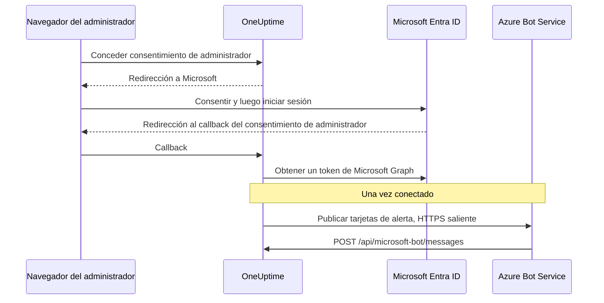

# Integración con Microsoft Teams

Conecta tu OneUptime autoalojado a Microsoft Teams. Registras una aplicación en Microsoft Entra ID, creas un Azure Bot para ella, le das a OneUptime las credenciales de la aplicación e instalas el paquete de aplicación de Teams que genera tu servidor. Después, OneUptime publica alertas e incidentes en tus canales y chats, y tu equipo actúa sobre ellos desde Teams.

Esta página es para quien administra el servidor de OneUptime. Una vez conectado Teams, las reglas de notificación se configuran por proyecto: consulta [Microsoft Teams](/docs/workspace-connections/microsoft-teams).

:::cards
- [Configurar la integración](#configurar-la-integración): Nueve pasos, del portal de Azure a tu primer equipo.
- [Variables de entorno](#variables-de-entorno): Los tres valores que OneUptime necesita del registro de la aplicación.
- [Acceso de red](#acceso-de-red): El endpoint del bot al que Microsoft debe poder llegar.
- [Solución de problemas](#solución-de-problemas): Endpoints inalcanzables, instalaciones que faltan y conexiones fallidas.
:::

## Cómo funciona

OneUptime usa un Azure Bot para su integración con Teams. El tráfico va en los dos sentidos, y los dos sentidos son independientes: OneUptime llama a Microsoft para publicar mensajes, y Azure Bot Service llama a tu servidor cuando alguien pulsa un botón, escribe al bot o lo añade a un chat.



Un Incoming Webhook o una URL de flujo de trabajo de Teams no sustituyen el endpoint de mensajería de este bot.

Las videollamadas (una reunión de Teams para un incidente) no usan este bot: necesitan su propio registro de aplicación, descrito en [Videollamadas](/docs/workspace-connections/video-calls#one-click-connect-on-a-self-hosted-server).

## Antes de empezar

- Una suscripción de Azure, para el recurso Azure Bot.
- Una cuenta que pueda crear registros de aplicaciones en Microsoft Entra ID, y un administrador de Microsoft 365 que conceda el consentimiento de administrador.
- Un nombre de host HTTPS público para OneUptime al que Azure Bot Service pueda llegar. Consulta [Acceso de red](#acceso-de-red).
- Acceso a la configuración del servidor: `config.env` en Docker Compose, o tus values de Helm en Kubernetes.
- Para conectar un proyecto, el rol **Project Owner**, **Project Admin** o **Project Member** en él.

## Configurar la integración

:::steps
### Paso 1: Crea el registro de aplicación de Azure

En el [portal de Azure](https://portal.azure.com), abre **App registrations** y selecciona **New registration**. Rellena el formulario:

- **Name:** oneuptime
- **Supported account types:** Accounts in this organizational directory only (Single tenant)
- **Redirect URI:** Web - `https://your-oneuptime-domain.com/api/microsoft-teams/auth`

Selecciona **Register** y después añade un segundo URI de redirección Web, `https://your-oneuptime-domain.com/api/microsoft-teams/admin-consent/callback`. Anota el **Application (client) ID** y el **Directory (tenant) ID**: necesitarás ambos más adelante.

> [!NOTE]
> **Por qué un solo inquilino:** una instancia autoalojada de OneUptime sirve a una organización, y su bot está registrado para el único inquilino que defines en `MICROSOFT_TEAMS_APP_TENANT_ID` (paso 6). Registrar la aplicación como multiinquilino no amplía eso e introduce un modo de fallo: los usuarios invitados / B2B cuyo inquilino de Microsoft de origen es distinto del tuyo llegan al bot con su propio ID de inquilino, que OneUptime no puede asociar con tu proyecto. Si ya registraste una aplicación multiinquilino, seguirá funcionando; solo asegúrate de que `MICROSOFT_TEAMS_APP_TENANT_ID` sea tu propio inquilino, y cuenta con que las cuentas invitadas necesitarán una cuenta en tu inquilino para usar el bot.

### Paso 2: Configura los permisos de la aplicación

En tu registro de aplicación, abre **API permissions**, selecciona **Add a permission** y elige **Microsoft Graph**.

**Añadir permisos delegados** (al actuar en nombre de un usuario que ha iniciado sesión):

- **User.Read** - Necesario para obtener la información de perfil del usuario autenticado (nombre para mostrar, correo) durante el flujo de OAuth
- **Team.ReadBasic.All** - Necesario para enumerar los equipos de los que el usuario es miembro al elegir qué equipo conectar
- **Channel.ReadBasic.All** - Necesario para leer la información de los canales y enumerar los canales de los equipos para entregar notificaciones
- **ChannelMessage.Send** - Necesario para enviar notificaciones de alertas e incidentes a los canales de Teams

**Añadir permisos de aplicación** (al actuar como la propia aplicación, sin un usuario que haya iniciado sesión):

- **Team.ReadBasic.All** - Necesario para enumerar todos los equipos de la organización una vez concedido el consentimiento de administrador
- **Channel.ReadBasic.All** - Necesario para comprobar que los canales existen y obtener sus detalles
- **TeamsAppInstallation.ReadForTeam.All** - Necesario para el diagnóstico. Permite que OneUptime lea qué paquete de aplicación está instalado realmente en un equipo y lo compare con el ID de cliente de esta instancia, para que un envío fallido pueda decirte *cuál* de las posibles causas es. Sin él, OneUptime no puede distinguir «no instalada» de «instalada, pero es el paquete de otra persona», y se limita a informar de lo que dijo Microsoft, que es la principal razón por la que depurar esta integración lleva días en lugar de minutos. Concédelo.
- **Chat.ReadBasic.WhereInstalled** - Opcional. Permite que OneUptime lea el nombre de cada chat en el que está la aplicación de OneUptime. Sin él, cada chat lo concede mediante el permiso **ChatSettings.Read.Chat** del manifiesto (abajo), que un chat añadido con un manifiesto anterior solo tiene cuando se actualiza la aplicación en él.

`ChannelMessage.Send` es solo un permiso delegado; no tiene variante como permiso de aplicación en la [referencia de permisos de Microsoft Graph](https://learn.microsoft.com/en-us/graph/permissions-reference#channelmessagesend). Mantenlo en la lista de delegados de arriba.

Después selecciona **Grant admin consent** para tu organización.

El propio bot usa permisos de consentimiento específico del recurso (RSC) definidos en el manifiesto de la aplicación de Teams. Se conceden cuando la aplicación se instala o se actualiza en un equipo o un chat, no en Entra ID:

- **ChannelMessage.Send.Group** - Permite al bot enviar mensajes a los canales de los equipos
- **ChannelMessage.Read.Group** - Permite al bot leer los mensajes de los canales para los comandos interactivos
- **Channel.Create.Group** - Permite al bot crear canales cuando haga falta
- **ChatMessage.Read.Chat** - Permite al bot leer los mensajes de los chats a los que se le ha añadido (para los comandos interactivos)
- **ChatMember.Read.Chat** - Permite al bot leer los miembros de los chats a los que se le ha añadido (para dar nombre a los chats en OneUptime)
- **ChatSettings.Read.Chat** - Permite a OneUptime leer el nombre de los chats de grupo a los que se ha añadido la aplicación. Teams no envía de forma fiable el nombre de un chat de grupo al bot, así que sin él un chat de grupo con nombre aparece con los nombres de sus miembros
- **TeamsAppInstallation.Read.Group** - Permite a OneUptime confirmar que la aplicación está instalada en un equipo en el que va a publicar

Si subiste el manifiesto de la aplicación antes de que existieran estos permisos, descárgalo de nuevo desde **Ajustes del proyecto > Espacio de trabajo > Microsoft Teams** y súbelo a Teams como actualización de la aplicación OneUptime. Teams concede los permisos de equipo y de chat cuando la aplicación se instala o se actualiza en ese equipo o chat, así que acepta la actualización en cada equipo y chat que ya tenga la aplicación. Para los chats, consulta [Un chat de grupo aparece con los nombres de sus miembros](#un-chat-de-grupo-aparece-con-los-nombres-de-sus-miembros).

### Paso 3: Crea un secreto de cliente

En tu registro de aplicación, abre **Certificates & secrets** y selecciona **New client secret**. Añade una descripción, elige una caducidad (24 meses es una opción sensata) y selecciona **Add**. Copia enseguida el valor del secreto: Azure solo lo muestra una vez.

> [!IMPORTANT]
> Copia el **Value** del secreto, no su **Secret ID**. El valor es la cadena más larga.

### Paso 4: Crea un Bot Service

En el portal de Azure, crea un recurso **Azure Bot**:

- **Bot handle:** oneuptime-bot
- **Subscription** y **Resource group:** los tuyos
- **Pricing tier:** F0 (Free) basta para pruebas
- **Type of App:** Single Tenant, con el registro de aplicación existente: su **Application (client) ID** y su **Directory (tenant) ID** del paso 1

Selecciona **Review + create** y después **Create**. Cuando el bot esté desplegado, abre su página **Configuration**, define **Messaging endpoint** como `https://your-oneuptime-domain.com/api/microsoft-bot/messages` y guarda.

**Verifica el endpoint antes de seguir.** Azure Bot Service llama a esta URL desde la Internet pública, así que compruébala desde algún lugar fuera de tu red: no desde dentro del clúster, ni desde una VPN que vea el host cuando Azure no puede:

```bash
curl -sS -i https://your-oneuptime-domain.com/api/microsoft-bot/messages
```

Usa `-i` en lugar de quedarte solo con el código de estado: en un 404, **el cuerpo es lo único que te dice quién lo generó**, y esa distinción es todo el diagnóstico.

- **405** es correcto y significa que has terminado. El endpoint solo acepta POST, así que un GET recibe `405 Method Not Allowed`, con `Allow: POST` y una descripción del endpoint. Llegar a él es justo lo que se está probando.
- **Un 404 con el cuerpo JSON `{"message":"Page not found - /api/microsoft-bot/messages"}`** viene de OneUptime, así que la solicitud *sí* llegó. O bien esta instancia es anterior a la respuesta 405 de arriba (las versiones antiguas servían esta ruta solo para POST, así que un GET caía en el manejador genérico de «not found»), o algo delante de OneUptime reescribe la ruta y quita el prefijo `/api` antes de que la aplicación la vea (un ingress de Kubernetes con `rewrite-target: /` es el culpable habitual).
- **Un 404 con una página de error HTML** de nginx, de tu ingress o de un balanceador de carga significa lo contrario: la solicitud nunca llegó a OneUptime, y lo que hay delante no dirige `/api` a la aplicación.
- **Un error de TLS, un tiempo de espera agotado o una conexión rechazada** significa que Azure tampoco llegará. Consulta [la sección de solución de problemas del endpoint de mensajería](#los-botones-de-las-tarjetas-dicen-unable-to-reach-app-y-los-chats-nunca-aparecen) más abajo.

### Paso 5: Añade el canal de Microsoft Teams al bot

En tu recurso Azure Bot, abre **Channels** y añade **Microsoft Teams**. Mantén las opciones de mensajería predeterminadas salvo que tengas necesidades concretas, y guarda. Sin este canal, el bot nunca se aprovisiona en las conversaciones de Teams.

### Paso 6: Configura las variables de entorno de OneUptime

Dale a OneUptime las credenciales de la aplicación:

:::tabs
@tab Docker Compose
```bash title="config.env"
MICROSOFT_TEAMS_APP_CLIENT_ID=YOUR_TEAMS_APP_CLIENT_ID
MICROSOFT_TEAMS_APP_CLIENT_SECRET=YOUR_TEAMS_APP_CLIENT_SECRET
MICROSOFT_TEAMS_APP_TENANT_ID=YOUR_MICROSOFT_TENANT_ID
```

Aplica el cambio con `npm run start`, que vuelve a crear los contenedores. `docker compose restart` no vuelve a leer `config.env`.
@tab Kubernetes
```yaml title="values.yaml"
microsoftTeamsApp:
  clientId: YOUR_TEAMS_APP_CLIENT_ID
  clientSecret: YOUR_TEAMS_APP_CLIENT_SECRET
  tenantId: YOUR_MICROSOFT_TENANT_ID
```

Para guardar los valores en un Secret de Kubernetes que gestiones tú, define en su lugar `microsoftTeamsApp.existingSecret`: su `name` y las claves `clientIdKey`, `clientSecretKey` y `tenantIdKey`. Aplica el cambio con `helm upgrade`.
:::

Cuando OneUptime vuelva a estar en marcha, **Ajustes del proyecto > Espacio de trabajo > Microsoft Teams** muestra la tarjeta **Conceder consentimiento de administrador** en lugar de la guía de configuración.

### Paso 7: Concede el consentimiento de administrador en OneUptime

Abre **Ajustes del proyecto > Espacio de trabajo > Microsoft Teams** y selecciona **Conceder consentimiento de administrador**. Inicia sesión en Microsoft como administrador de Microsoft 365 y acepta los permisos. Microsoft te devuelve a la misma página, y la tarjeta muestra **Consentimiento del administrador completado**: el proyecto ya está conectado a tu inquilino.

Después selecciona **Connect my account with Microsoft Teams** para vincular tu propia cuenta. Los demás miembros del proyecto hacen lo mismo desde **Ajustes de usuario > Espacio de trabajo > Microsoft Teams**.

### Paso 8: Sube el manifiesto de la aplicación de Teams

Después del consentimiento de administrador, **Ajustes del proyecto > Espacio de trabajo > Microsoft Teams** muestra la tarjeta **Acción requerida: instala en Microsoft Teams la aplicación de esta instancia**. Selecciona **Descargar zip del manifiesto de la aplicación**: el paquete lleva el ID de bot de esta instancia.

En Microsoft Teams, abre **Apps > Manage your apps**, selecciona **Upload an app**, después **Upload a custom app**, y elige el zip que descargaste.

> [!WARNING]
> No instales «OneUptime» desde la tienda de Microsoft Teams para una instancia autoalojada. La aplicación de la tienda apunta al bot de OneUptime Cloud, así que Teams la acepta y luego rechaza cada mensaje que envía esta instancia.

### Paso 9: Añade OneUptime a cada equipo (obligatorio)

Subir el manifiesto instala la aplicación para **ti**. **No** le da al bot acceso a los canales de ningún equipo. Microsoft solo acepta mensajes en un equipo al que se haya añadido la aplicación, así que tienes que hacerlo en cada equipo en el que quieras notificaciones:

1. En Microsoft Teams, haz clic en «...» junto al **nombre del equipo** (no al del canal)
2. Elige **Manage team** > **Apps** > **More apps**
3. Busca **OneUptime** y haz clic en **Add**

Notas:

- Instalar OneUptime para ti, o añadirlo a un chat, es una instalación **distinta**. Ninguna de las dos le permite publicar en los canales de un equipo.
- **Los canales privados** necesitan la aplicación instalada en el propio canal: abre el canal > «...» > **Manage channel** > **Apps** > **Add an app**. Una instalación a nivel de equipo no cubre los canales privados.
- **Los canales compartidos** no pueden recibir notificaciones en absoluto: Microsoft Teams no admite bots en los canales compartidos. OneUptime los oculta en el selector de canales.
- Si **Manage team > Apps > More apps** está vacío o atenuado, tu directiva de configuración de aplicaciones de Teams bloquea las aplicaciones personalizadas. Corrígelo en el centro de administración de Teams, en **Teams apps > Manage apps** y **Setup policies**.
:::

## Variables de entorno

| Docker Compose (`config.env`) | Helm (`values.yaml`) | Valor |
| --- | --- | --- |
| `MICROSOFT_TEAMS_APP_CLIENT_ID` | `microsoftTeamsApp.clientId` | El **Application (client) ID**. También es el ID del bot en el paquete de aplicación de Teams, así que debe ser un GUID. |
| `MICROSOFT_TEAMS_APP_CLIENT_SECRET` | `microsoftTeamsApp.clientSecret` | El **Value** del secreto de cliente, no su ID. |
| `MICROSOFT_TEAMS_APP_TENANT_ID` | `microsoftTeamsApp.tenantId` | El **Directory (tenant) ID**. El bot se autentica como aplicación de un solo inquilino en este inquilino. |
| `HOST` | `host` | Tu nombre de host público. Los URI de redirección, el endpoint de mensajería y el paquete de aplicación de Teams se construyen a partir de él. |
| `HTTP_PROTOCOL` | `httpProtocol` | `https`. Azure Bot Service solo llama a endpoints HTTPS. |

Los tres valores `MICROSOFT_TEAMS_APP_*` son obligatorios:

- Sin el ID de cliente, la página de Microsoft Teams muestra la guía de configuración en lugar de **Conceder consentimiento de administrador**.
- Sin el ID de cliente o el secreto, la conexión termina con **"Microsoft Teams no está configurado en este servidor de OneUptime."**
- Sin el ID de inquilino, el bot no puede autenticarse, así que fallan la publicación y el endpoint del bot.

## Acceso de red

Microsoft exige un [endpoint HTTPS accesible públicamente para un bot autoalojado](https://learn.microsoft.com/en-us/azure/bot-service/bot-service-resources-faq-security?view=azure-bot-service-4.0). Una dirección IP privada, un nombre DNS interno o la conexión VPN de un empleado no dan a Azure Bot Service acceso a OneUptime.

| Sentido | Destino | Propósito |
| --- | --- | --- |
| De OneUptime a Microsoft | HTTPS por TCP 443 a Microsoft Graph, la identidad de Microsoft y los servicios de Bot Framework | Canje de tokens, consulta de equipos y canales, y entrega de notificaciones |
| De Microsoft a OneUptime | `POST /api/microsoft-bot/messages` | Mensajes del bot, eventos de instalación en conversaciones y acciones de tarjetas |
| Del navegador del usuario a OneUptime | `/api/microsoft-teams/auth` y `/api/microsoft-teams/admin-consent/callback` | Redirecciones de inicio de sesión y de consentimiento de administrador |

Las redirecciones del registro de aplicación a `/api/microsoft-teams/auth` y `/api/microsoft-teams/admin-consent/callback` vuelven a través del navegador del usuario. Ese navegador debe llegar a OneUptime, por ejemplo a través de tu red corporativa o tu VPN. Los mensajes del bot y las acciones de las tarjetas llegan desde los servidores de Microsoft y necesitan su propio ingress accesible. La entrega saliente de alertas por sí sola no verifica la conectividad entrante.

### Publicar el endpoint del bot desde un despliegue privado

```mermaid title="Publicar el endpoint del bot desde un despliegue privado"
flowchart LR
    Azure["Azure Bot Service"] -->|HTTPS 443| GW["Pasarela pública"]
    GW -->|"POST /api/microsoft-bot/messages"| ING["Ingress de OneUptime"]
    Users["Empleados en la VPN"] --> ING
    ING --> App["App de OneUptime"]
```

:::steps
1. Apunta el DNS público de tu nombre de host de OneUptime a un proxy inverso o balanceador de carga expuesto a Internet. Permite TCP 443 entrante y sirve un certificado TLS de confianza pública con su cadena completa.
2. Conecta la pasarela al ingress privado de OneUptime, directamente o a través de tu propia VPN de sitio a sitio / enlace privado, y permite su puerto de servicio de origen. Un servicio `ClusterIP` de Kubernetes necesita un ingress accesible u otra ruta desde la pasarela. Mantén privadas las bases de datos y los demás servicios internos.
3. Publica `/api/microsoft-bot/messages` a través de esa pasarela y define el **Messaging endpoint** del Azure Bot del paso 4 con la URL HTTPS pública completa. Conserva el método, el prefijo `/api`, la cadena de consulta, el cuerpo y la cabecera `Authorization`. Conserva el `Host` público y define cabeceras de reenvío de confianza para el host público y el esquema HTTPS. No añadas a esta ruta redirecciones, SSO del navegador, CAPTCHA ni inicio de sesión del proxy; el adaptador de Bot Framework de OneUptime tiene que recibir y autenticar la solicitud.
4. Mantén privadas las demás rutas si hace falta. Con DNS dividido, los empleados pueden resolver el mismo nombre de host hacia el ingress privado a través de la red corporativa o la VPN. Ese ingress también debe servir HTTPS con un certificado válido para el nombre de host y permitir las redirecciones del navegador de la tabla de arriba. Limita el acceso al origen a la pasarela y a los clientes internos autorizados.
5. Define `HOST=oneuptime.example.com` y `HTTP_PROTOCOL=https` en el `config.env` de Docker Compose, o `host: oneuptime.example.com` y `httpProtocol: https` en los values de Helm. Sustituye el ejemplo por tu dominio, aplica la actualización del despliegue y espera a que la aplicación se reinicie. Estos valores generan URL; no aprovisionan DNS, TLS ni acceso de red. Si cambia el nombre de host, actualiza el endpoint del Azure Bot y las redirecciones del registro de aplicación, y vuelve a descargar y subir el manifiesto de Teams.
:::

Los [ajustes de acceso a red privada](/docs/self-hosted/private-network-access) de OneUptime rigen las solicitudes salientes a servicios internos. Activar `ALLOW_PRIVATE_NETWORK_WEBHOOKS` no hace que Microsoft pueda llegar al endpoint del bot.

### Acceso saliente y restricciones de IP

Permite la resolución DNS y el HTTPS saliente desde la aplicación de OneUptime. Usa `graph.microsoft.com`, `login.microsoftonline.com`, los endpoints de autenticación y de canal de Bot Framework, y la URL del servicio conector que se proporciona para una conversación. El conector de reserva de la nube comercial es `https://smba.trafficmanager.net/teams/`; las URL de servicio de las conversaciones pueden ser distintas. Aplica las [indicaciones de firewall de Microsoft](https://learn.microsoft.com/en-us/azure/bot-service/bot-service-resources-faq-security?view=azure-bot-service-4.0) e inspecciona el tráfico bloqueado durante las pruebas; esta no es una lista exhaustiva de nombres de host.

Microsoft no admite listas fijas de IP permitidas para el tráfico entrante de Bot Framework, porque sus direcciones de origen cambian. Los rangos de IP de medios de los clientes de Teams no describen los orígenes de los webhooks de los bots. Mantén activada la autenticación de Bot Framework en lugar de tratar una IP de origen como prueba de identidad.

### Pruebas y despliegues sin acceso entrante

Usa el paso 4 para verificar el DNS público, el TLS y el enrutamiento desde fuera de tu red y de tu VPN. Después conecta Teams, envía una notificación de prueba, escribe al bot y pulsa un botón de una tarjeta. Confirma la acción en OneUptime y relaciona los diagnósticos de entrega de Microsoft con los logs de la pasarela y de la aplicación. Una ruta GET accesible o una notificación entregada no verifican por sí solas un POST entrante autenticado del bot.

Para desarrollo, la [guía de Microsoft para probar bots de Teams en local](https://learn.microsoft.com/en-us/microsoftteams/platform/bots/how-to/authentication/add-authentication#testing-the-bot-locally-in-teams) describe cómo exponer un servicio local con un túnel. Reenvía a un proxy que permita el endpoint del bot y usa `/api/microsoft-bot/messages`, en lugar de la ruta de ejemplo `/api/messages` de Microsoft. Actualiza el nombre de host configurado y el endpoint del Azure Bot cada vez que cambie la URL pública del túnel, detén el túnel después de las pruebas y usa un ingress estable en producción. Un túnel también abre acceso entrante.

> [!WARNING]
> Si una directiva prohíbe la conectividad entrante, la integración completa del bot de Teams no puede funcionar: los comandos, las acciones de las tarjetas y el descubrimiento de conversaciones dependen de que Microsoft llegue a OneUptime. Azure Bot Private Endpoint no resuelve este requisito. Las [instrucciones de aislamiento de red](https://learn.microsoft.com/en-us/azure/bot-service/dl-network-isolation-how-to?view=azure-bot-service-4.0) de Microsoft describen el aislamiento de Direct Line e indican que desactivar el acceso a la red pública desconfigura los canales de Teams. Una instalación totalmente desconectada no puede usar Teams.

## Solución de problemas

Empieza con estas comprobaciones:

- El registro de aplicación tiene los permisos de arriba y el consentimiento de administrador está concedido.
- Los URI de redirección coinciden exactamente (sustituye `your-oneuptime-domain.com` por tu dominio real).
- Las variables de entorno están definidas y OneUptime se reinició después de definirlas.
- El endpoint de mensajería del bot es accesible desde Internet y el bot tiene el canal de Microsoft Teams.
- El paquete de aplicación de Teams que subiste es el que se descargó de esta instancia.

### Los botones de las tarjetas dicen "Unable to reach app" y los chats nunca aparecen

Estos síntomas suelen significar que **Azure Bot Service no puede entregar actividades autenticadas a tu endpoint de mensajería**. Comprueba el enrutamiento, la autenticación del bot y la configuración del proyecto.

Lo confuso es que las tarjetas de alerta siguen llegando a Teams, y eso hace que la integración parezca casi sana. No lo está: los dos sentidos son independientes y solo uno de ellos funciona:

| Sentido | Cómo viaja | ¿Azure necesita llegar a ti? |
| --- | --- | --- |
| OneUptime publica una tarjeta de alerta en un canal | OneUptime llama a Microsoft y se autentica con tu secreto de cliente | **No** |
| Pulsas un botón de esa tarjeta | Azure Bot Service envía un POST a `/api/microsoft-bot/messages` | **Sí** |
| Escribes `help` al bot | Azure Bot Service envía un POST a `/api/microsoft-bot/messages` | **Sí** |
| Un chat se registra en **Chats de Microsoft Teams** | Azure Bot Service envía por POST una actividad del bot a `/api/microsoft-bot/messages` | **Sí** |

Así que una alerta que funciona verifica ese envío saliente concreto; no verifica cada permiso de Graph ni el endpoint entrante del bot. Las funciones interactivas requieren que se procesen correctamente las actividades entrantes del bot.

OneUptime registra los chats a partir de actividades del bot, como la instalación de la aplicación, la adición del bot a la conversación o un mensaje enviado al bot en ese chat. Todas llegan por el mismo endpoint entrante. Una lista **Chats de Microsoft Teams** vacía después de añadir la aplicación y escribirle significa que no se ha registrado ningún chat para ese proyecto; revisa las solicitudes entrantes, los errores de autenticación y la asociación entre inquilino y proyecto. Hacer clic en **Actualizar chats** vuelve a leer los chats que OneUptime tiene guardados, y vuelve a leer de Microsoft el nombre de cada chat de grupo guardado.

**Diagnostícalo en este orden:**

1. **Busca el POST, no los 404.** Aquí es donde se tuercen la mayoría de las investigaciones:

   ```bash
   grep 'POST /api/microsoft-bot/messages' <your access log>
   ```

   Si no hay líneas POST, confirma que el log de acceso correcto está registrando solicitudes y después revisa el endpoint configurado en Azure y la ruta de red. Si llegan POST, examina sus respuestas y los errores de autenticación o de asociación de proyecto de OneUptime. Las líneas `GET` que devuelven 404 son una comprobación aparte; consulta la nota de abajo.

2. **Llama al endpoint desde fuera de tu red,** como en el paso 4, con `curl -i` para ver el cuerpo. Un `405` demuestra que la ruta está activa y es accesible desde donde ejecutaste el comando. Un error de TLS, un tiempo de espera agotado o una conexión rechazada es tu respuesta.

3. **Comprueba la cadena de certificados.** Azure exige HTTPS con un certificado de confianza pública servido con su cadena completa. Un certificado autofirmado, una CA interna o un intermedio que falta hacen fallar el protocolo de enlace TLS antes de que OneUptime vea la solicitud, así que tu log de acceso se queda vacío y parece que Azure nunca lo intentó:

   ```bash
   openssl s_client -connect your-oneuptime-domain.com:443 -servername your-oneuptime-domain.com -verify_return_error </dev/null
   ```

4. **Comprueba que el host se pueda resolver públicamente.** Un nombre DNS privado, un registro split-horizon o un ingress solo interno llegan a ti y a tu VPN, pero siguen siendo invisibles para Azure. Resuélvelo desde una red sin acceso a la tuya.

5. **Confirma el endpoint en el recurso Azure Bot**: debe coincidir exactamente con esta instancia, incluidos el esquema y la ruta: `https://your-oneuptime-domain.com/api/microsoft-bot/messages`.

**Un 404 en `GET /api/microsoft-bot/messages` no es el fallo, ni prueba que Azure no pudiera llegar a ti.** El endpoint siempre ha aceptado solo POST, así que en las versiones anteriores a esta un GET del navegador caía en el manejador genérico de «not found» de OneUptime y volvía como `{"message":"Page not found - /api/microsoft-bot/messages"}`. Parece una ruta que falta y ha hecho que más de un administrador buscara una regresión que no existía; pero fíjate en lo que demuestra en realidad: OneUptime generó esa respuesta, así que la solicitud llegó a la aplicación. Ocupa 58 bytes, por eso aparece en un log de acceso como `"GET /api/microsoft-bot/messages HTTP/1.1" 404 58`.

Esta versión responde a un GET con `405 Method Not Allowed` y una descripción de sí misma, así que la distinción ya no necesita explicación. Si sigues en una versión anterior, juzga un 404 por su cuerpo: el JSON de OneUptime significa que la solicitud llegó; una página de error HTML de tu proxy significa que no llegó.

### Un chat de grupo aparece con los nombres de sus miembros

Teams no envía de forma fiable el nombre de un chat de grupo al bot, así que OneUptime lo lee de Microsoft Graph. Para eso hace falta el permiso **ChatSettings.Read.Chat** del manifiesto, que cada chat concede cuando se instala o se actualiza en él la aplicación de OneUptime. Los chats a los que se añadió la aplicación con un manifiesto anterior no lo tienen, y **Actualizar chats** los marca. Corrígelo de una de estas dos formas:

1. Descarga de nuevo el manifiesto desde **Ajustes del proyecto > Espacio de trabajo > Microsoft Teams**, súbelo a Teams como actualización de la aplicación OneUptime, acepta la actualización en cada uno de esos chats y después haz clic en **Actualizar chats**.
   - Teams solo acepta la subida como actualización cuando su versión es mayor que la instalada. Las imágenes de las versiones la definen a partir de `APP_VERSION`. Una compilación sin `APP_VERSION` usa un valor de reserva fijo que solo cambia cuando OneUptime cambia el manifiesto; si Teams dice que el paquete no es más reciente, sube la `version` del manifiesto antes de subirlo.
   - Si tu inquilino solo permite los permisos de chat a las aplicaciones preaprobadas, añade primero **ChatSettings.Read.Chat** a la directiva de preaprobación de OneUptime (por ejemplo `Update-MgBetaTeamAppPreapproval -TeamsAppId <app id> -ResourceSpecificApplicationPermissionsAllowedForChats @('ChatMember.Read.Chat','ChatMessage.Read.Chat','ChatSettings.Read.Chat')`), o la aplicación actualizada no podrá añadirse a los chats.
2. O concede al registro de aplicación el permiso de aplicación **Chat.ReadBasic.WhereInstalled** (paso 2) con consentimiento de administrador y después haz clic en **Actualizar chats**. Eso cubre de una vez cada chat en el que está la aplicación, sin actualizar chat por chat. OneUptime sigue usando su token actual de Microsoft Graph hasta que caduca, así que un permiso recién concedido puede tardar hasta una hora en surtir efecto.

Un chat de grupo que no tiene nombre en Teams aparece con los nombres de sus miembros, por diseño. Un chat al que se cambia el nombre en Teams toma su nuevo nombre la próxima vez que alguien hace clic en **Actualizar chats**.

### Comprobar la configuración del bot de esta instancia

```bash
curl -sS https://your-oneuptime-domain.com/api/microsoft-bot/test | jq
```

Esto informa de lo que OneUptime puede ver localmente: si `MICROSOFT_TEAMS_APP_CLIENT_ID` y `MICROSOFT_TEAMS_APP_CLIENT_SECRET` están definidos, el endpoint de mensajería que espera esta instancia y, lo más útil, el **ID de bot** que debe llevar tu paquete de aplicación de Teams.

Lee variables de entorno y nada más. No llama a Azure, así que no puede decirte si existe el recurso Azure Bot, si su endpoint de mensajería apunta aquí, si el canal de Teams está activado, si el secreto sigue siendo válido o si Azure puede llegar a ti. La respuesta lo dice ella misma, enumerando lo que comprobó y lo que no, para que nunca se tome por luz verde.

La única comprobación decisiva que permite: compara el `botId` que devuelve con el ID de bot de la aplicación OneUptime instalada en Teams. Si no coinciden, ese paquete no puede recibir mensajes de esta instancia; consulta el paso 8.

### "The OneUptime app is not installed in the Microsoft Teams team ..."

OneUptime lo comprobó con Microsoft Graph y la aplicación de verdad falta en ese equipo (o, en un canal privado, en ese canal). Completa el **paso 9** de arriba. OneUptime puede enumerar cada canal de tu inquilino con los permisos de aplicación de Graph, pero solo puede *publicar* en los equipos de los que la aplicación es miembro.

### "Microsoft Teams refused the message ... because the OneUptime bot is not a member of that conversation"

Microsoft rechazó la publicación (con sus propias palabras, `BotNotInConversationRoster`) y OneUptime **no** pudo confirmar que falte la aplicación, así que no lo des por hecho. Repasa las causas en el orden de abajo; las dos primeras son idénticas, vistas desde Teams, a una configuración correcta.

1. **La aplicación del equipo es otro paquete.** Ver un icono llamado «OneUptime» en **Manage team > Apps** no basta: lo que importa es si el ID de bot de ese paquete es el `MICROSOFT_TEAMS_APP_CLIENT_ID` de *esta* instancia. La aplicación pública de OneUptime de la tienda de Teams apunta al bot de OneUptime Cloud y nunca aceptará publicaciones de tu instancia autoalojada. Solo el manifiesto descargado desde **Ajustes del proyecto > Espacio de trabajo > Microsoft Teams** (paso 8) está hecho para tu instancia. Si tienes dudas, quita la aplicación del equipo, vuelve a subir tu propio manifiesto y añade ese.
2. **El Azure Bot no tiene canal de Microsoft Teams.** Completa el **paso 5**. Sin él, el bot nunca se aprovisiona en las conversaciones de Teams, así que no está en la lista de miembros de ningún canal, aunque la aplicación se instale sin problemas y la lista de aplicaciones parezca correcta.
3. **La aplicación está instalada para ti, o en un chat, pero no en el equipo.** Completa el **paso 9**.
4. **El canal es privado.** Una instalación a nivel de equipo no cubre los canales privados; consulta las notas del paso 9.

Concede **TeamsAppInstallation.ReadForTeam.All** (paso 2) para que OneUptime te diga cuál de estas es en lugar de enumerarlas.

### Las notificaciones funcionan en un equipo pero no en otro

La instalación es por equipo. Añadir OneUptime a un equipo no hace nada por ningún otro, y tampoco lo hace conectar la integración: eso concede acceso de *lectura* a Graph en todo el inquilino, por eso el selector de canales puede mostrarte canales de equipos en los que el bot no puede publicar. Completa el **paso 9** en cada equipo en el que quieras notificaciones.

### "Probar regla" funciona pero las notificaciones reales nunca llegan

Comprueba qué destinos tiene realmente activados la regla. Una regla solo ejercita aquello para lo que está configurada: con **Create Microsoft Teams Channel** activado, la prueba crea un canal y publica en él, lo que demuestra que el bot puede publicar *en el equipo en el que se creó ese canal*, y nada sobre ningún otro equipo. **Ajustes del proyecto > Notificaciones > Registros de notificación** registra cada envío de prueba, incluido el error tal cual de Microsoft cuando falla.

### "Sorry, I couldn't find your project configuration"

El inquilino de Microsoft del que vino la actividad del bot no es el inquilino conectado a ningún proyecto de OneUptime. Comprueba el ID de inquilino en los logs de tu servidor:

```bash
grep "Project auth not found for tenant ID" <your app logs>
```

Compáralo con el inquilino guardado para el proyecto:

```sql
SELECT "projectId", "workspaceProjectId"
FROM "WorkspaceProjectAuthToken"
WHERE "workspaceType" = 'MicrosoftTeams';
```

Si no coinciden, el usuario que escribe al bot ha iniciado sesión en otro inquilino de Microsoft (a menudo una cuenta invitada / B2B cuyo inquilino de origen no es el tuyo). Pídele que use una cuenta del inquilino conectado, o que mencione al bot con @ en un canal del equipo conectado en lugar de en un chat 1:1.

### "This Microsoft 365 organization is connected to more than one OneUptime project"

Dos o más proyectos de OneUptime han conectado el mismo inquilino de Microsoft. Un mensaje del bot solo lleva un ID de inquilino, así que OneUptime no puede saber a qué proyecto te refieres y se niega en lugar de adivinar. Desconecta Microsoft Teams de todos los proyectos menos uno.

### "Microsoft Teams App Client ID must be a valid GUID"

**Descargar zip del manifiesto de la aplicación** se niega a generar un paquete cuando `MICROSOFT_TEAMS_APP_CLIENT_ID` no es un GUID, porque Teams exige uno para el ID de la aplicación y del bot. Copia de nuevo el **Application (client) ID** de la página de información general del registro de aplicación, defínelo y aplica la configuración.

### La conexión no terminó

Cuando Microsoft te devuelve y la conexión no se hizo (al conceder el consentimiento de administrador o al iniciar sesión con Microsoft), la página de Microsoft Teams desde la que empezaste (**Ajustes del proyecto > Espacio de trabajo > Microsoft Teams**, o tus propios **Ajustes de usuario > Espacio de trabajo > Microsoft Teams** si estabas conectando tu cuenta) muestra **Microsoft Teams no se conectó**, con una frase en tu idioma que dice por qué. El resto de la página carga como siempre, así que puedes volver a intentarlo ahí mismo. Nunca muestra lo que respondió Microsoft (un código `AADSTS`, por ejemplo): eso está en el log del servidor de OneUptime, con el motivo.

| La página dice | Qué hacer |
| --- | --- |
| **"Este enlace de conexión no es válido, ha caducado o ya se ha usado. Vuelve a empezar."** | El enlace funciona una vez, durante 15 minutos, en el navegador que lo inició. Empieza de nuevo desde la página de Microsoft Teams y termina en menos de 15 minutos, en el mismo navegador. |
| **"No tienes permiso para conectar este proyecto a Microsoft Teams."** | Conceder el consentimiento de administrador para el proyecto requiere **Project Owner**, **Project Admin** o **Project Member**. Se vuelve a comprobar cuando Microsoft te devuelve. |
| **"Ya no eres miembro de este proyecto."** | Para conectar tu propia cuenta de Microsoft tienes que ser miembro del proyecto cuando Microsoft te devuelve. |
| **"Iniciaste sesión en una organización de Microsoft 365 distinta de la que corresponde a esta conexión."** | Inicia sesión con una cuenta de la organización de Microsoft 365 que concedió el consentimiento de administrador, o a la que está conectado el proyecto. |
| **"Tu organización de Microsoft 365 todavía no tiene equipos."** | Crea un equipo en Microsoft Teams y después vuelve a conceder el consentimiento de administrador. |
| **"Se canceló la conexión, así que no se cambió nada."** | No se concedió el consentimiento en Microsoft. Empieza de nuevo y acéptalo. |
| **"Microsoft Teams no está configurado en este servidor de OneUptime."** | Define el ID de cliente y el secreto de la aplicación de Microsoft Teams (consulta el [paso 6](#paso-6-configura-las-variables-de-entorno-de-oneuptime)) y reinicia OneUptime. |
| **"OneUptime no pudo terminar la conexión. Inténtalo de nuevo."** | Microsoft respondió con un error, o falló una solicitud o una escritura al terminar. El log del servidor de OneUptime dice cuál. Vuelve a intentarlo; si sigue pasando, revisa el log y los ajustes del registro de aplicación. |

Queremos mejorar esta integración, así que agradecemos tus comentarios en [hello@oneuptime.com](mailto:hello@oneuptime.com).

## Próximos pasos

:::cards
- [Microsoft Teams](/docs/workspace-connections/microsoft-teams): Crea reglas de notificación y resúmenes para el proyecto.
- [Integración con Slack](/docs/self-hosted/slack-integration): Configura también la app de Slack en tu servidor.
- [Acceso a red privada](/docs/self-hosted/private-network-access): Deja que los flujos de trabajo y los webhooks lleguen a herramientas internas.
:::
