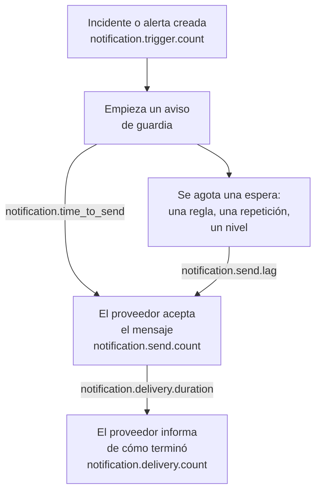

# Métricas de entrega de notificaciones

OneUptime registra cómo les va a las notificaciones que envía: cuántos incidentes y alertas las piden, si cada mensaje llegó a su proveedor, cuánto tardó en salir un aviso de guardia y si llegó al teléfono. Envía la telemetría propia de OneUptime a un proyecto de OneUptime, o a cualquier backend de OpenTelemetry, para fijar objetivos de entrega ante las personas a las que sirve tu instalación y comprobar que los cumples.

:::cards
- [Activarlas](#activarlas): Dos ajustes, y sin ellos no se registra nada.
- [Las métricas](#las-métricas): Siete métricas, del disparador al teléfono.
- [Cómo se mide un aviso](#cómo-se-mide-un-aviso): Desde dónde cuentan el tiempo de envío y el retraso de envío.
- [SLO para empezar](#slo-para-empezar): Cuatro objetivos, consulta a consulta.
:::

## Cómo funciona



Cada mensaje cuenta en `notification.send.count`, en todos los canales, no solo los avisos de guardia. Los dos tiempos, `notification.time_to_send` y `notification.send.lag`, cubren solo los avisos de guardia.

## Activarlas

No se registra nada hasta que OneUptime tiene un exportador de OpenTelemetry: sin él, las métricas no cuestan nada y no se guardan en ningún sitio. Apúntalo a un proyecto de OneUptime, con una [clave de ingesta](/docs/telemetry/ingestion-keys) de tipo Server de ese proyecto, o a cualquier backend que acepte OTLP sobre HTTP.

:::tabs
@tab Kubernetes
```yaml
openTelemetryExporter:
  endpoint: https://oneuptime.example.com/otlp
  headers: x-oneuptime-token=YOUR_INGESTION_KEY
```
Los despliegues `app` y `worker` las envían: deja `app.disableTelemetryCollection` y `worker.disableTelemetryCollection` en `false`, su valor predeterminado.
@tab Docker Compose
```bash
OPENTELEMETRY_EXPORTER_OTLP_ENDPOINT=https://oneuptime.example.com/otlp
OPENTELEMETRY_EXPORTER_OTLP_HEADERS=x-oneuptime-token=YOUR_INGESTION_KEY
DISABLE_TELEMETRY_FOR_APP=false
```
Defínelos en `config.env` y luego ejecuta `npm start`. `DISABLE_TELEMETRY_FOR_APP` es `true` de forma predeterminada, y entonces no se envía nada.
:::

OneUptime necesita tanto el endpoint como las cabeceras: sin una cabecera no envía nada. Escribe cada cabecera como `name=value` y separa varias con `;`. Un valor puede contener `=`. OneUptime añade `/v1/metrics` al endpoint por sí mismo, y los mismos ajustes envían también sus propias trazas y registros. Cada métrica aparece en cuanto OneUptime la registra por primera vez: `notification.send.count` con el primer mensaje enviado.

### Enviar deltas a un proyecto de OneUptime

OneUptime envía los contadores y los histogramas como lo hace OpenTelemetry de forma predeterminada: cada punto contiene el total acumulado desde que se inició ese proceso del servidor. El explorador de métricas suma los puntos de cada paso de un gráfico, así que solo lee con exactitud los recuentos y los percentiles de un intervalo de tiempo a partir de deltas, puntos que contienen lo ocurrido desde el anterior. Cuando las métricas van a un proyecto de OneUptime, envía deltas:

:::tabs
@tab Kubernetes
```yaml
extraEnv:
  - name: OTEL_EXPORTER_OTLP_METRICS_TEMPORALITY_PREFERENCE
    value: delta
```
La lista propia de un servicio sustituye a la de todo el chart: si defines `app.extraEnv` o `worker.extraEnv`, añádela también ahí.
@tab Docker Compose
```yaml title="docker-compose.override.yml"
services:
  app:
    environment:
      OTEL_EXPORTER_OTLP_METRICS_TEMPORALITY_PREFERENCE: delta
```
Créalo junto a `docker-compose.yml`, o añade esto al que ya tengas, y luego ejecuta `npm start`.
:::

Esto se aplica a todas las métricas que OneUptime envía sobre sí mismo. Un backend que interpreta él mismo los totales acumulados, como Prometheus, no necesita ningún cambio.

## Las métricas

| Métrica | Tipo | Unidad | Qué responde |
| --- | --- | --- | --- |
| `notification.trigger.count` | Contador | `1` | Cuántos registros pidieron notificaciones |
| `notification.send.count` | Contador | `1` | Cómo le fue a cada mensaje entregado a un proveedor |
| `notification.send.duration` | Histograma | `ms` | Cuánto tardó el proveedor en aceptarlo |
| `notification.time_to_send` | Histograma | `ms` | Cuánto después de su disparador llegó un aviso a su proveedor |
| `notification.send.lag` | Histograma | `ms` | Cuánto después de su vencimiento llegó a su proveedor una notificación enviada más tarde |
| `notification.delivery.count` | Contador | `1` | Cómo terminaron los mensajes que aceptaron los proveedores |
| `notification.delivery.duration` | Histograma | `ms` | Cuánto después de que su proveedor lo aceptara terminó un mensaje |

Cada atributo toma uno de unos pocos valores fijos, nunca un proyecto, una persona, un número de teléfono ni un registro. La única excepción son el ID y el nombre de un canal personalizado: una instalación tiene unos pocos, y distinguirlos es justo lo que se busca.

### Registros que notifican a personas

`notification.trigger.count` cuenta cada incidente, alerta, episodio de incidente y episodio de alerta en el momento en que se crea.

| Atributo | Valores |
| --- | --- |
| `notification.trigger.type` | `incident`, `alert`, `incident_episode`, `alert_episode` |
| `notification.trigger.source` | `automatic` cuando lo creó OneUptime, desde un monitor o una regla; `manual` cuando lo hizo una persona o la API |
| `monitor.type` | El tipo del monitor que creó un incidente o una alerta, como `Incoming Request`, `Logs` o `Metrics`; se omite cuando no lo creó ningún monitor |

### Mensajes entregados a un proveedor

`notification.send.count` cuenta cada mensaje entregado a un proveedor, y `notification.send.duration` mide la llamada al proveedor. Ambas llevan estos atributos:

| Atributo | Valores |
| --- | --- |
| `notification.channel` | `email`, `sms`, `call`, `whatsapp`, `telegram`, `push`, `webhook`, `slack`, `microsoft_teams`, `mattermost`, `custom_channel` |
| `notification.provider` | `twilio`, `sms_and_call_gateway`, `smtp`, `sendgrid`, `amazon_ses`, `mailgun`, `postmark`, `resend`, `microsoft_graph`, `expo`, `push_relay`, `web_push`, `meta_whatsapp`, `telegram_bot_api`, `slack`, `microsoft_teams`, `mattermost`, `webhook`, `custom_channel`, o `none` cuando no se entregó nada a ninguno |
| `notification.provider.config` | `global` para la cuenta y los ajustes propios de la instalación; `project` para la cuenta de Twilio, el servidor SMTP, el webhook o la conexión al espacio de trabajo propios de un proyecto, cuyos fallos le toca resolver al proyecto |
| `notification.on_call_page` | `true` para una notificación de un aviso de guardia, si no `false` |
| `outcome` | `success`, `failure` o `not_sent`, como se explica abajo |
| `notification.destination` | Slack, Microsoft Teams y Mattermost: `direct_message` a una persona, `channel` para una publicación en un canal o en un chat de grupo de Teams, `incoming_webhook` para un webhook entrante, como el de un suscriptor de una página de estado. Webhooks: `status_page_subscriber` para el webhook propio de un suscriptor de una página de estado. Se omite en el webhook de una persona y en todos los demás canales |
| `notification.custom_channel.id`, `notification.custom_channel.name` | Solo canales personalizados: el ID del canal y su nombre, recortado a 100 caracteres |

- `success`: el proveedor aceptó el mensaje.
- `failure`: el proveedor lo rechazó o no se pudo contactar con él, o falló el envío. Un canal de chat que no se encontró es un fallo sin duración.
- `not_sent`: no se envió a propósito. El proyecto desactivó el canal, tiene saldo insuficiente o está bloqueado, el push está desactivado en este servidor, o un canal personalizado está desactivado, eliminado o no cubierto por la licencia. Una tasa de éxito los deja fuera: son ajustes en acción, no la plataforma fallando.

Un mensaje al webhook propio de un suscriptor de una página de estado cuenta una vez, sin importar cuántas veces se intentó: `success` cuando el endpoint respondió con un estado 2xx, y `failure` cuando respondió con otro estado, no se pudo alcanzar o su dirección no está permitida.

### Lo que llegó al teléfono

`notification.delivery.count` cuenta cómo terminó cada mensaje que aceptó un proveedor, según lo informa el proveedor más tarde, una vez por mensaje. `notification.delivery.duration` mide cuánto después de que el proveedor lo aceptara. Ambas llevan `notification.channel`, `notification.provider`, `notification.provider.config`, `notification.on_call_page` y `outcome`, el estado final:

| Canal | Proveedor | `outcome` | Duración |
| --- | --- | --- | --- |
| `sms` | `twilio` | `delivered`, `undelivered`, `failed` | Hasta que Twilio informa del estado |
| `call` | `twilio` | `answered`, `not_answered`, `failed` | Hasta que se contestó la llamada, o si no hasta que terminó |
| `push` | `expo`, `push_relay` | `delivered`, `undelivered`, `failed` | No se mide: un recibo dice si Apple o Google aceptó el push, no cuándo |
| `whatsapp` | `meta_whatsapp` | `delivered`, `failed` | Hasta que Meta informa del estado |

Una llamada que sonó sin respuesta, comunicaba o fue rechazada es `not_answered`. Un push a una app que ya no existe es `undelivered`, y un mensaje de WhatsApp leído cuenta como entregado. `notification.provider.config` es `project` solo para los SMS y las llamadas de la cuenta de Twilio propia de un proyecto.

Los estados solo llegan donde el proveedor puede informarlos:

- SMS y llamadas: a través de Twilio, cuando Twilio puede llegar a tu servidor en su `HOST` (consulta [Integración de Twilio](/docs/self-hosted/twilio-integration#3-configura-el-acceso-a-la-red)). La pasarela de SMS y llamadas no informa de ninguno.
- WhatsApp: cuando el webhook de Meta está configurado para tu instalación.
- Push: a partir de los recibos de Expo, que OneUptime lee unos 15 minutos después del push, también a través del relé de push. Lo cuenta la instalación que envió el push.
- El correo electrónico, Telegram, los webhooks, el chat y los canales personalizados no informan de ningún estado final.

## Cómo se mide un aviso

### Tiempo de envío

`notification.time_to_send` va desde el disparador de un aviso hasta que su proveedor acepta la notificación. Solo mide las notificaciones que vencen al empezar el aviso: las personas de la primera regla de escalado, según sus reglas de guardia que no esperan nada, y cualquier nivel al que el aviso pasa de inmediato porque no llegó a nadie. Las esperas que pide la configuración de guardia no son un retraso de la plataforma, así que quedan fuera: están en el [retraso de envío](#retraso-de-envío). Solo se miden las notificaciones que aceptó su proveedor; un fallo aparece en `notification.send.count`.

| Atributo | Valores |
| --- | --- |
| `notification.channel` | Como en `notification.send.count` |
| `notification.page.start` | Desde dónde cuenta el tiempo, como se explica abajo |
| `notification.trigger.type` | El registro al que corresponde el aviso: `incident`, `alert`, `incident_episode`, `alert_episode` |
| `notification.custom_channel.id`, `notification.custom_channel.name` | Solo canales personalizados |

| `notification.page.start` | El tiempo cuenta desde |
| --- | --- |
| `monitor_data_received` | Cuando OneUptime recibió los datos que dispararon el monitor: una solicitud entrante, el informe de un agente de servidor, un correo entrante, la comprobación de una sonda, un trap SNMP o el sondeo de un dispositivo de red. Incluye el tiempo que los datos esperaron en la cola para ser evaluados. |
| `record_created` | Cuando se creó el incidente, la alerta o el episodio: por un monitor de telemetría, una regla o una persona, y en una comprobación de ausencia, como un heartbeat que se detuvo. |
| `page_started` | Cuando un aviso empezó más tarde: lo inició una persona, un flujo de trabajo o una regla que ahora coincide, o es un aviso directo. Para un aviso que retuvo su regla de guardia o OneUptime AI, cuando terminó su retención, o cuando empezó si fue antes. Para un nuevo aviso, cuando venció el tiempo límite tras el reconocimiento. Así, un worker que llegó tarde a cualquiera de ellos se refleja en el tiempo. |

En una solicitud entrante, el tiempo cuenta desde la última solicitud que recibió el endpoint, así que puede salir algo corto.

### Retraso de envío

`notification.send.lag` va desde el momento en que vencía una notificación enviada más tarde hasta que su proveedor la acepta. Dos workers las envían, una vez por minuto cada uno, así que un worker al día muestra hasta un minuto aproximadamente, y uno que se quedó atrás muestra cuánto.

| `notification.schedule` | Vence cuando |
| --- | --- |
| `rule_wait` | La regla de guardia de una persona que espera, como «llámame a los 10 minutos»: ese tiempo después de avisar a la persona. Nunca antes de la última vez que el worker repasó sus reglas, así que una regla añadida o cambiada más tarde vence desde entonces. |
| `repeat` | Un push repetido hasta que alguien confirme: cada vez que se agota su intervalo. |
| `escalation` | Un nivel de escalado posterior: cuando el nivel anterior terminó su espera, o de inmediato cuando una persona pasa el aviso. |
| `policy_repeat` | La política que vuelve a empezar por su primer nivel: cuando se agotó la espera de su último nivel. |

También lleva `notification.channel`, `notification.trigger.type` y, en los canales personalizados, `notification.custom_channel.id` y `notification.custom_channel.name`. Una notificación que vence al empezar su aviso nunca está en él, ni siquiera cuando un worker empezó el aviso tarde, tras una retención o como nuevo aviso: está en el tiempo de envío.

### Cubetas de los histogramas

Cada histograma tiene sus propios límites de cubeta, en milisegundos, fijados para que un objetivo pueda leerse en un límite:

| Histograma | Límites de cubeta, en milisegundos |
| --- | --- |
| `notification.send.duration` | `5, 10, 25, 50, 100, 250, 500, 1000, 2500, 5000, 10000, 30000, 60000, 120000` |
| `notification.time_to_send` | `250, 500, 1000, 2000, 5000, 10000, 15000, 30000, 60000, 120000, 300000, 600000, 1800000, 3600000` |
| `notification.send.lag` | `1000, 5000, 10000, 15000, 30000, 45000, 60000, 75000, 90000, 120000, 180000, 300000, 600000, 1800000, 3600000` |
| `notification.delivery.duration` | `500, 1000, 2000, 5000, 10000, 15000, 30000, 60000, 120000, 300000, 600000, 1800000, 3600000, 14400000, 86400000` |

Un percentil se calcula a partir de las cubetas, y se dibuja como el centro de la cubeta en la que cae. Así que compáralo con el límite de una cubeta: un P95 de `notification.time_to_send` igual o inferior a 30000 significa que el 95 % de los avisos tardó 30 segundos o menos.

## SLO para empezar

Cuatro objetivos que la mayoría de las instalaciones pueden prometer, cada uno construido con una o dos consultas en el explorador de métricas del proyecto que recibe las métricas. Leen un intervalo de tiempo con exactitud una vez que las métricas llegan como deltas: consulta [Enviar deltas a un proyecto de OneUptime](#enviar-deltas-a-un-proyecto-de-oneuptime).

### Crear uno en el explorador de métricas

:::steps
1. Abre el [Explorador de métricas](/docs/telemetry/metrics-explorer) del proyecto y haz clic en la primera métrica del objetivo. Su consulta es `a`.
2. Elige su agregación en **Agregar por**. Después abre **Filtros y agrupación** y añade cada una de sus condiciones en **Filtrar por atributos**.
3. Para una segunda consulta, haz clic en **Añadir métrica** y configura `b` del mismo modo.
4. Para una fórmula, haz clic en **Añadir fórmula** y escríbela en **Fórmula**.
5. Para que te avisen cuando no se cumpla el objetivo, haz clic en **Acciones → Crear monitor a partir de esta vista** y alerta cuando el valor supere el objetivo: consulta [Monitor de métricas](/docs/monitor/metrics-monitor).
:::

Para seguir un objetivo durante 30 días con un presupuesto de errores, asocia ese monitor a un [SLO](/docs/slo/introduction): cuenta el tiempo en que no se cumplió el objetivo.

### Los SMS de guardia llegan a Twilio

Como mucho falla el 1 % de los SMS de guardia enviados a través de la cuenta de Twilio propia de la instalación, así que se acepta el 99 %.

| Consulta | Métrica | Agregación | Condiciones |
| --- | --- | --- | --- |
| `a` | `notification.send.count` | **Suma** | `notification.channel = sms`, `notification.on_call_page = true`, `notification.provider.config = global`, `outcome != not_sent` |
| `b` | `notification.send.count` | **Suma** | Las mismas, con `outcome = failure` |

La fórmula `$b / $a * 100` es la proporción que falló, y el objetivo se cumple mientras se mantenga igual o por debajo de 1. Un paso sin fallos no dibuja ningún punto, ya que `b` no tiene ninguno. `outcome != not_sent` deja fuera lo que retuvieron los ajustes propios de los proyectos, y `global` las cuentas de Twilio propias de los proyectos. En una instalación que envía los SMS por su pasarela de SMS y llamadas, las mismas consultas miden la pasarela. Para otro canal, cambia `sms`: `call`, `push` o `email`.

### Los avisos salen en menos de 30 segundos

El 95 % de los avisos de guardia llega a su proveedor en los 30 segundos siguientes a su disparador.

| Consulta | Métrica | Agregación | Condiciones |
| --- | --- | --- | --- |
| `a` | `notification.time_to_send` | **P95** | `notification.page.start != page_started` |

El objetivo se cumple mientras `a` se mantenga igual o por debajo de 30000. Los avisos iniciados más tarde se miden desde que empezaron o vencieron, no desde un disparador, así que quedan fuera. Agrupa por `notification.page.start` para ver la cola de los monitores (`monitor_data_received`) aparte del resto, o por `notification.channel` para encontrar un canal lento.

### Las notificaciones enviadas más tarde salen en menos de 90 segundos

El 99 % de las notificaciones enviadas tras una espera llega a su proveedor en los 90 segundos siguientes a su vencimiento.

| Consulta | Métrica | Agregación | Condiciones |
| --- | --- | --- | --- |
| `a` | `notification.send.lag` | **P99** | — |

El objetivo se cumple mientras `a` se mantenga igual o por debajo de 90000. Agrupa por `notification.schedule` para ver qué worker se quedó atrás: `rule_wait` y `repeat` son de un worker, `escalation` y `policy_repeat` del otro.

### Los SMS de guardia llegan al teléfono

Como mucho el 5 % de los SMS de guardia que Twilio aceptó para la cuenta propia de la instalación queda sin entregar.

| Consulta | Métrica | Agregación | Condiciones |
| --- | --- | --- | --- |
| `a` | `notification.delivery.count` | **Suma** | `notification.channel = sms`, `notification.on_call_page = true`, `notification.provider.config = global` |
| `b` | `notification.delivery.count` | **Suma** | Las mismas, con `outcome != delivered` |

La fórmula `$b / $a * 100` es la proporción no entregada. Los operadores y los teléfonos apagados deciden una parte, así que fija el objetivo según lo que veas durante unas semanas. Para las llamadas, usa `call` y `outcome != answered`. Twilio debe poder llegar a tu servidor: consulta [Lo que llegó al teléfono](#lo-que-llegó-al-teléfono).

## Solución de problemas

:::details No llega ninguna métrica de notificaciones
Comprueba que `OPENTELEMETRY_EXPORTER_OTLP_ENDPOINT` y `OPENTELEMETRY_EXPORTER_OTLP_HEADERS` estén definidas, y en Docker Compose que `DISABLE_TELEMETRY_FOR_APP` sea `false`, y luego reinicia OneUptime. Al arrancar, OneUptime registra una advertencia cuando no puede leer una cabecera o cuando no envía nada. Una métrica solo aparece cuando se registra algo, así que envía primero una notificación.
:::

:::details Un recuento solo crece, o un percentil apenas se mueve
Las métricas llegan como totales acumulados. Envía deltas: consulta [Enviar deltas a un proyecto de OneUptime](#enviar-deltas-a-un-proyecto-de-oneuptime).
:::

:::details No llega ningún estado final
Los estados finales vienen de los proveedores, más tarde, y solo donde pueden informarlos: consulta [Lo que llegó al teléfono](#lo-que-llegó-al-teléfono). En una instalación a la que Twilio no puede llegar, los SMS y las llamadas se cuentan como enviados, pero nunca como entregados.
:::

## Próximos pasos

:::cards
- [Explorador de métricas](/docs/telemetry/metrics-explorer): Representar, combinar y comparar cualquier métrica.
- [Monitor de métricas](/docs/monitor/metrics-monitor): Alertar cuando no se cumpla un objetivo.
- [Integración de Twilio](/docs/self-hosted/twilio-integration): Dejar que Twilio informe de lo que llegó al teléfono.
- [Reglas de escalado](/docs/on-call/escalation-rules): Las esperas desde las que cuenta el retraso de envío.
:::
