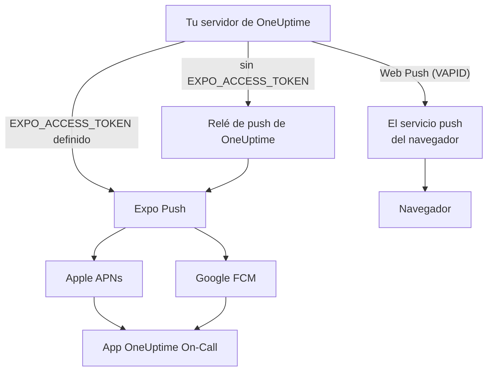
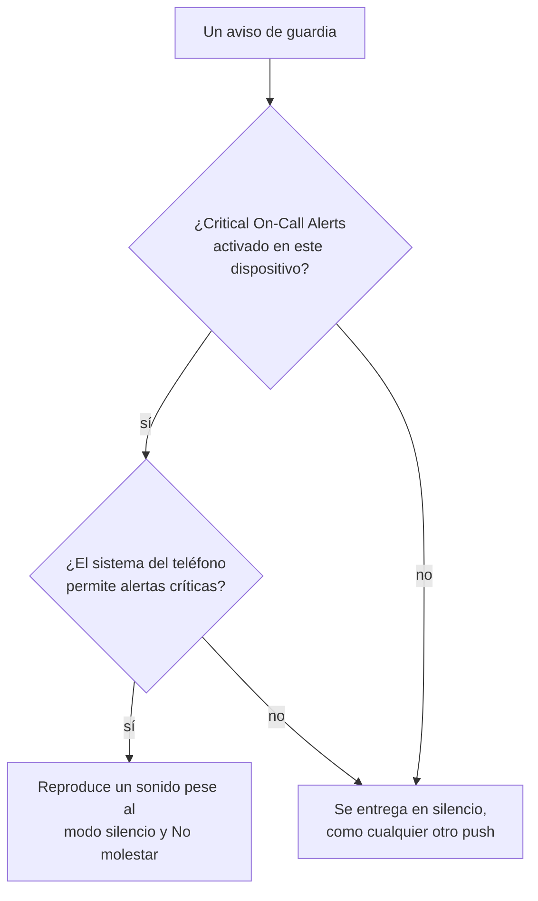

# Notificaciones push

OneUptime avisa a las personas en el móvil a través de la aplicación **OneUptime On-Call**, y en el navegador mediante Web Push. Los push móviles funcionan con **Expo Push**: una instancia autoalojada los envía por defecto a través del relé de push de OneUptime, así que necesita acceso de red saliente al relé y ninguna credencial propia de Expo, Apple o Google.

:::cards
- [Elige cómo se envían los push](#configuración-autoalojada): El relé de push o tu propio token de acceso de Expo.
- [Abre el cortafuegos](#acceso-de-red): Las direcciones a las que llegan tu servidor y los dispositivos de tu equipo.
- [Suena aunque esté en silencio](#alertas-críticas-de-guardia-anular-el-modo-silencio): Haz que los avisos de guardia suenen en un móvil silenciado.
- [Arregla los push que nunca llegan](#solución-de-problemas): Qué significa cada error de Expo.
:::

## Cómo funciona



La aplicación móvil de OneUptime registra un token de Expo Push en el backend. El backend envía las notificaciones a través del relé de push de OneUptime, o directamente a Expo cuando `EXPO_ACCESS_TOKEN` está configurado. Expo reenvía los mensajes a Apple APNs o a Google FCM para que lleguen al dispositivo.

Las notificaciones Web Push siguen usando claves VAPID y el protocolo Web Push.

## Configuración autoalojada

Con la aplicación móvil oficial y el relé predeterminado, el servidor no necesita credenciales de Expo. Para la entrega directa por Expo, configura `EXPO_ACCESS_TOKEN` con credenciales adecuadas para el proyecto de Expo de tu aplicación. Web Push requiere `VAPID_PUBLIC_KEY`, `VAPID_PRIVATE_KEY` y `VAPID_SUBJECT`.

| Variable | Valor de Helm | Predeterminado | Qué hace |
| --- | --- | --- | --- |
| `PUSH_NOTIFICATION_RELAY_URL` | `pushNotification.relayUrl` | `https://oneuptime.com/api/notification/push-relay/send` | A dónde van los push móviles mientras `EXPO_ACCESS_TOKEN` no está definido. |
| `EXPO_ACCESS_TOKEN` | `expo.accessToken` | Vacío | Envía los push móviles directamente a Expo, con el token de tu proyecto de Expo. |
| `VAPID_PUBLIC_KEY` | `vapid.publicKey` | Vacío | La mitad pública del par de claves con el que se suscriben los navegadores. |
| `VAPID_PRIVATE_KEY` | `vapid.privateKey` | Vacío | La mitad privada, que firma cada Web Push. |
| `VAPID_SUBJECT` | `vapid.subject` | `mailto:support@oneuptime.com` | Una dirección de contacto en la que los servicios push de los navegadores pueden localizarte. |

Genera un par de claves VAPID una sola vez con `npx web-push generate-vapid-keys` y consérvalo: los navegadores que se suscribieron con un par de claves dejan de recibir push cuando cambia.

:::tabs
@tab Docker Compose
```bash title="config.env"
VAPID_PUBLIC_KEY=your-public-key
VAPID_PRIVATE_KEY=your-private-key
VAPID_SUBJECT=mailto:oncall@example.com
# Leave unset to send mobile pushes through the push relay.
EXPO_ACCESS_TOKEN=
```
@tab Kubernetes
```yaml title="values.yaml"
vapid:
  publicKey: your-public-key
  privateKey: your-private-key
  subject: mailto:oncall@example.com
# Leave empty to send mobile pushes through the push relay.
expo:
  accessToken:
```
:::

## Acceso de red

| Dirección | Destino | Protocolo / puerto | Cuándo se necesita |
| --- | --- | --- | --- |
| OneUptime → relé de push predeterminado | `https://oneuptime.com/api/notification/push-relay/send`, `https://oneuptime.com/api/notification/push-relay/receipts` | HTTPS / TCP 443 | Push móvil cuando `EXPO_ACCESS_TOKEN` no está definido. |
| OneUptime → Expo | `https://exp.host/--/api/v2/push/send`, `https://exp.host/--/api/v2/push/getReceipts` | HTTPS / TCP 443 | Push móvil directo cuando `EXPO_ACCESS_TOKEN` está definido. |
| OneUptime → servicio push del navegador | El endpoint HTTPS guardado en la suscripción push del navegador | HTTPS / normalmente TCP 443 | Web Push. |
| App móvil o navegador → OneUptime | Tu nombre de host de OneUptime | HTTPS / TCP 443 | Iniciar sesión, registrar el dispositivo y abrir los enlaces de las notificaciones. |

Si cambias `PUSH_NOTIFICATION_RELAY_URL`, permite su nombre de host de destino y el puerto configurado. Un relé personalizado debe implementar la API de relé de OneUptime. Estos valores predeterminados y el cambio entre relé y entrega directa se definen en [la configuración de OneUptime](https://github.com/OneUptime/oneuptime/blob/master/config.example.env) y en [el servicio de push](https://github.com/OneUptime/oneuptime/blob/master/packages/Common/Server/Services/PushNotificationService.ts). Las peticiones directas a Expo usan el endpoint documentado en [la guía de envío de Expo](https://docs.expo.dev/push-notifications/sending-notifications/). OneUptime lee los acuses de entrega del relé en la misma dirección, con `/receipts` en lugar de `/send`. Un relé sin esa ruta sigue entregando los push; un dispositivo cuya app se eliminó solo se detecta entonces cuando se rechaza un push posterior a él.

Para Web Push, permite los hosts reales de los endpoints de suscripción de los navegadores que usa tu equipo. OneUptime acepta `fcm.googleapis.com`, `android.googleapis.com`, `push.services.mozilla.com`, `notify.windows.com` y `push.apple.com`, incluidos sus subdominios. Ejemplos típicos son `updates.push.services.mozilla.com` y `web.push.apple.com`. La [suscripción push del navegador](https://developer.mozilla.org/en-US/docs/Web/API/PushSubscription) aporta el destino; permitir solo Expo o el relé de OneUptime no habilita Web Push.

Permite la resolución DNS y el TLS saliente desde el proceso de OneUptime que envía las notificaciones. Su almacén de confianza debe validar el certificado del destino, y los proxies deben dejar pasar las peticiones a la API sin autenticación interactiva. Los proveedores de push no llaman a ningún webhook de tu servidor de OneUptime, así que el servidor puede seguir siendo privado si los dispositivos de los usuarios acceden a él por VPN u otra conexión privada. Un servidor sin acceso a su relé ni a los servicios push externos no puede entregar estas notificaciones.

La conectividad de los dispositivos es un requisito aparte. Los dispositivos iOS necesitan acceso a APNs, normalmente TCP 5223 con TCP 443 como alternativa; consulta [los requisitos de red actuales de Apple](https://support.apple.com/en-us/102266) para ver los rangos de destino. Los dispositivos Android necesitan acceso a FCM en TCP 5228–5230 y 443; usa [las indicaciones actuales de Google sobre hosts y cortafuegos](https://firebase.google.com/docs/cloud-messaging/network-configuration). No hace falta abrir estos puertos de los dispositivos como entrantes en OneUptime, y el flujo del servidor móvil usa el relé o Expo en lugar de conectarse directamente a APNs/FCM.

:::steps
1. Comprueba el DNS y el HTTPS desde el contenedor o pod que envía las notificaciones hasta el destino de tu modo de entrega: el relé, Expo o el servicio push de un navegador.
2. Envía una prueba desde **Ajustes de usuario > Métodos de notificación > Push Notifications** con **Notificación de prueba**, y confirma que llega a un dispositivo registrado. Para Web Push, prueba cada navegador por separado.
3. Revisa los errores del relé, de Expo o de Web Push en los logs de OneUptime; que la API acepte el envío no confirma por sí solo la entrega en el dispositivo.
:::

Para los push móviles, OneUptime también lee el acuse de entrega de Expo unos 15 minutos después de cada push: un push que nunca llegó al dispositivo aparece entonces como no entregado en el registro de push y, en un aviso de guardia, en la cronología de guardia.

## Alertas críticas de guardia (anular el modo silencio)

Por defecto, una notificación push obedece al teléfono: un móvil en silencio sigue en silencio, y No molestar retiene la notificación. Para quien está de guardia ese es el comportamiento equivocado a las 3 de la mañana, así que la aplicación móvil ofrece un ajuste por dispositivo – **Settings > Notifications > Critical On-Call Alerts** – que permite que *solo los avisos de guardia* reproduzcan un sonido a pesar de ambos.

El alcance es deliberadamente estrecho. Solo pueden hacerlo los avisos que produce una regla de notificación de guardia. Las suscripciones de propietarios, los avisos de notas publicadas, las actualizaciones de cambio de estado y las notificaciones de monitores nunca se escalan, diga lo que diga este ajuste.



Para que un aviso anule el modo silencio deben cumplirse tres cosas. Si falta cualquiera de ellas, el aviso se entrega igualmente – solo que en silencio.

1. **La persona lo activó en ese dispositivo.** Se guarda por dispositivo, desactivado por defecto, en `UserPush.isCriticalAlertEnabled`. El móvil y la tableta de una misma persona son decisiones separadas.
2. **El servidor marca el aviso como crítico.** Envía la carga de sonido crítico de APNs más `interruptionLevel: critical` para iOS, y apunta al canal de notificación `oncall_critical` para Android.
3. **El sistema operativo lo permite**, y ahí es donde difieren las dos plataformas.

:::tabs
@tab iOS
Las alertas críticas en iOS requieren el entitlement `com.apple.developer.usernotifications.critical-alerts`, que Apple concede por cuenta de desarrollador, bajo solicitud, a las apps que avisan a las personas de eventos urgentes. Solicítalo en [el formulario de solicitud de Critical Alerts de Apple](https://developer.apple.com/contact/request/notifications-critical-alerts-entitlement/).

La app oficial **OneUptime On-Call** de la App Store incluye el entitlement desde la **versión 1.5.0**. Las versiones anteriores no lo tienen, e iOS nunca les ofrece alertas críticas, así que actualiza la app antes de activar el ajuste.

Si compilas la app tú mismo, el entitlement es opcional. Un perfil de aprovisionamiento no puede llevar un entitlement que no se le ha concedido al equipo, y una compilación que declara uno que no puede llevar **no se puede firmar**. Solo el perfil `production` de `packages/MobileApp/eas.json` lo activa, porque Apple se lo ha concedido al equipo que publica la app oficial. Un fork que firma con su propio equipo de Apple debe quitar esa entrada `env` hasta que Apple conceda el entitlement también a ese equipo. Una vez concedido, actívalo al compilar:

```bash
EXPO_IOS_CRITICAL_ALERTS_ENTITLEMENT=true npx expo prebuild
```

o añade `EXPO_IOS_CRITICAL_ALERTS_ENTITLEMENT: "true"` al bloque `env` del perfil de compilación en `packages/MobileApp/eas.json`.

En el dispositivo, activa **Settings > Notifications > Critical On-Call Alerts** en la app y permite las alertas críticas cuando iOS lo pregunte. iOS solo añade un interruptor **Critical Alerts** para la app, en **Settings > Notifications > OneUptime On-Call** de los ajustes de iOS, después de que la app haya pedido el permiso, así que ese interruptor no está antes de que actives el ajuste en la app. Si rechazas la solicitud, puedes permitir las alertas críticas más tarde con ese interruptor en los ajustes de iOS.

En una compilación sin el entitlement, iOS no muestra ni la solicitud ni el interruptor, y la pantalla de ajustes de la app indica que esta versión de la app no puede recibir alertas críticas. No manda a la persona a buscar un interruptor que iOS no está mostrando.
@tab Android
Android no tiene un paso de aprobación del fabricante, pero la omisión de No molestar la concede el usuario en una pantalla del sistema y no mediante una solicitud dentro de la app. Cuando alguien activa el ajuste, la app le abre **Settings > Notifications > Do Not Disturb access** y lo vuelve a comprobar cuando regresa.

Intervienen dos mecanismos, y cubren casos distintos:

- El canal de notificación `oncall_critical` solicita `bypassDnd`, que cubre No molestar y necesita el acceso descrito arriba.
- El mismo canal usa el flujo de audio de **alarma**, que se oye en un teléfono con el timbre simplemente silenciado. Esa mitad no necesita ningún permiso.

Android congela los ajustes de un canal cuando se crea por primera vez, así que no se pueden cambiar con una actualización de la app – solo publicando un nuevo id de canal.
:::

Para comprobar que funciona, envía una notificación de prueba al dispositivo desde **Ajustes de usuario > Métodos de notificación > Push Notifications**. Si el dispositivo tiene las alertas críticas activadas, la prueba también se envía como alerta crítica – así que silencia antes el teléfono y oirás si un aviso real te llegaría.

## Solución de problemas

### Las notificaciones push no llegan

- Asegúrate de que la app móvil se compiló con EAS Build (Expo Go no admite notificaciones push)
- Comprueba que el dispositivo está registrado en la tabla `UserPush` de tu base de datos
- Busca errores de la API de Expo Push en los logs del servidor de OneUptime
- Confirma que el dispositivo tiene conexión a internet activa y los permisos de notificación activados
- Revisa **Ajustes de usuario > Métodos de notificación > Push Notifications**: un dispositivo marcado como **No recibe notificaciones** dejó de recibirlas y hay que volver a registrarlo (ver más abajo)

### No hay interruptor de Critical Alerts en los ajustes de iOS

- Actualiza OneUptime On-Call desde la App Store. Las versiones anteriores a 1.5.0 se compilaron sin el entitlement de alertas críticas de Apple, e iOS no muestra ningún interruptor Critical Alerts para ellas
- Activa **Settings > Notifications > Critical On-Call Alerts** en la app. iOS solo añade el interruptor a sus propios ajustes después de que la app haya pedido el permiso, y la app lo pide cuando se activa este ajuste
- Quitar y volver a añadir reglas de notificación de guardia o dispositivos push no cambia esto. El ajuste pertenece a la app del dispositivo, no a una regla

### Las alertas críticas no anulan el modo silencio

- Comprueba que el interruptor está activado en **ese** dispositivo – el ajuste es por dispositivo, y una reinstalación o un móvil nuevo configurado desde cero crea un nuevo registro de dispositivo (un móvil configurado a partir de una copia de seguridad del anterior se queda con el registro del móvil anterior en cuanto este deja de recibir notificaciones, con el ajuste que tenía la app)
- **iOS**: confirma que la compilación lleva el entitlement de alertas críticas de Apple (ver arriba) y que Critical Alerts está permitido en iOS Settings > Notifications > OneUptime On-Call
- **Android**: confirma que la app tiene acceso a No molestar en Settings > Notifications > Do Not Disturb access
- La pantalla de ajustes indica cuál de estos falta; lee el estado actual del sistema operativo en lugar de fiarse de lo que la app pidió por última vez

### Push marcados como «no entregados»

Que Expo acepte un push no significa que haya llegado al dispositivo: Apple o Google aún pueden rechazarlo. OneUptime lee el acuse de entrega de cada push móvil unos 15 minutos después de enviarlo, a través del relé de push cuando `EXPO_ACCESS_TOKEN` no está definido. Cuando el acuse informa de un error, el registro de push y la cronología de guardia del aviso pasan de enviado a **Push notification not delivered**, con el código de error de Expo:

- `DeviceNotRegistered`: la app móvil se eliminó del dispositivo, o su token de push ya no es válido. Consulta la siguiente sección.
- `MessageRateExceeded`: se enviaron demasiadas notificaciones al dispositivo en poco tiempo. Los push posteriores a él se envían con normalidad.
- `MessageTooBig`: la notificación era más grande de lo que aceptan los servicios push. OneUptime acorta las notificaciones para que quepan, así que no debería pasar; avísanos si pasa.
- `InvalidCredentials` o `MismatchSenderId`: las credenciales de push del proyecto de Expo que envió el push no son válidas. Con `EXPO_ACCESS_TOKEN`, revisa las credenciales de push de tu proyecto de Expo; con el relé predeterminado, contacta con el soporte de OneUptime.

Cuando Expo rechaza un push de entrada, el registro de push da el motivo al momento. A través del relé de push también funciona: el relé transmite el código de error de Expo en lugar de responder con un error del servidor.

### Errores «DeviceNotRegistered» en los logs

Expo informa de `DeviceNotRegistered` cuando la app móvil se eliminó del dispositivo o el token de push del dispositivo ya no es válido. Normalmente lo indica en el acuse de entrega de un push, que OneUptime lee unos 15 minutos después del push, y a veces rechaza el push de entrada. En ambos casos, OneUptime deja de enviar a ese dispositivo. Se marca como que no recibe notificaciones en lugar de eliminarse, así que sus reglas de notificación se conservan, y el registro de push y la cronología de guardia del aviso que no llegó dicen por qué. **Ajustes de usuario > Métodos de notificación > Push Notifications** lo muestra como **No recibe notificaciones**. Los demás dispositivos y métodos de notificación de su propietario siguen recibiendo avisos.

Para recuperar el dispositivo, abre en él la app móvil con la sesión iniciada. La app se vuelve a registrar, lo que renueva su token de push en Expo, y el dispositivo vuelve a recibir notificaciones con sus reglas. Si la app se eliminó, vuelve a instalarla e inicia sesión. Un acuse de un push enviado antes de que la app se volviera a registrar no marca el dispositivo. Cuando una app móvil actualizada se configura en un móvil nuevo a partir de una copia de seguridad del anterior, le comunica a OneUptime el token de push que tenía antes; si el dispositivo del móvil anterior ya no recibe notificaciones, el móvil nuevo se queda con él y con sus reglas.

A través del relé de push (sin `EXPO_ACCESS_TOKEN`) funciona igual: el relé informa de `DeviceNotRegistered` cuando envía un push, y lee los acuses de entrega por los que pregunta tu instancia.

Si nada de esto ayuda, escríbenos a [hello@oneuptime.com](mailto:hello@oneuptime.com) con los errores de tus logs de OneUptime.

## Próximos pasos

:::cards
- [Apps móviles](/docs/mobile-desktop-apps/index): Instala la app OneUptime On-Call e inicia sesión.
- [Solución de problemas de la app móvil](/docs/mobile-desktop-apps/faq-troubleshooting): Resuelve problemas de inicio de sesión y de notificaciones en el móvil.
- [Reglas de escalado](/docs/on-call/escalation-rules): Decide a quién se avisa y cuándo.
- [Acceso a red privada](/docs/self-hosted/private-network-access): Qué puede alcanzar tu servidor en tu propia red.
:::
