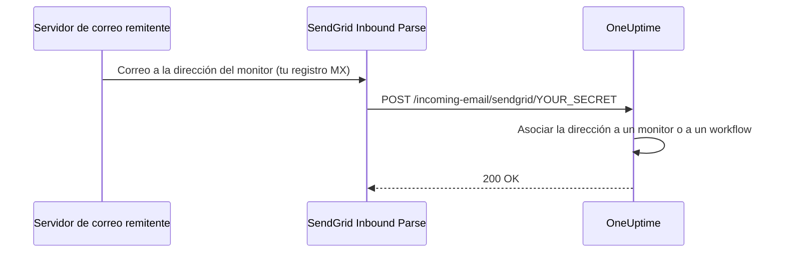

# Correo entrante de SendGrid

El **Incoming Email Monitor** de OneUptime te permite crear y resolver alertas a partir de correos enviados a direcciones únicas, específicas de cada monitor. Es útil para integrar sistemas heredados, herramientas de alertas o cualquier servicio capaz de enviar correos.

La misma configuración permite que los workflows reciban correo: un workflow con el disparador **Incoming Email** obtiene su propia dirección en el mismo dominio, y cada correo enviado a ella inicia el workflow. Consulta [Disparadores](/docs/workflows/triggers#incoming-email).

Esta guía explica cómo configurar SendGrid Inbound Parse para reenviar los correos entrantes a tu instancia autoalojada de OneUptime. OneUptime Cloud no necesita nada de esto: sus direcciones funcionan desde el primer momento.

:::cards
- [Antes de empezar](#requisitos-previos): Una cuenta de SendGrid, un dominio y una dirección HTTPS pública.
- [Configúralo](#instrucciones-de-configuración): Siete pasos, del registro MX a un correo de prueba.
- [Variables de entorno](#referencia-de-variables-de-entorno): Los tres ajustes y sus valores predeterminados.
- [Solución de problemas](#solución-de-problemas): Correos que nunca llegan y webhooks que fallan.
:::

## Cómo funciona



1. Creas un **Incoming Email Monitor** en OneUptime
2. OneUptime genera una dirección de correo única para ese monitor (p. ej., `monitor-abc123@inbound.yourdomain.com`)
3. Cuando se envía un correo a esa dirección, SendGrid lo recibe y lo reenvía a OneUptime mediante un webhook
4. OneUptime evalúa el correo según los criterios que configuraste para crear o resolver alertas

## Requisitos previos

- Una cuenta de SendGrid con acceso a Inbound Parse
- Un dominio que controles, con acceso a su configuración DNS
- Un endpoint HTTPS público que reenvíe los webhooks de SendGrid a tu instancia de OneUptime

## Acceso de red

Con Inbound Parse es SendGrid quien inicia la conexión hacia OneUptime. No basta con permitir solo el acceso saliente a internet desde OneUptime.

| Dirección | Destino | Protocolo / puerto | Propósito |
| --- | --- | --- | --- |
| SendGrid → OneUptime | `https://your-oneuptime-domain.com/incoming-email/sendgrid/YOUR_SECRET` | HTTPS / TCP 443 | Entregar el correo analizado como un POST multipart. |
| Servidores de correo remitentes → SendGrid | `mx.sendgrid.net`, elegido por el registro MX público de tu dominio de entrada | SMTP / TCP 25 | Recibir el correo en SendGrid; esta conexión no va a tu servidor de OneUptime. |
| OneUptime → SendGrid, solo si se configura aparte el envío de correo con el proveedor SendGrid | `api.sendgrid.com` | HTTPS / TCP 443 | Enviar correos de notificación mediante la API Mail Send. |

Publica el DNS del nombre de host del webhook y sirve un certificado en el que confíen los clientes públicos. Un despliegue privado de OneUptime puede exponer solo la ruta del webhook a través de un proxy inverso o una pasarela públicos que alcancen OneUptime internamente. Conserva la ruta, el secreto, el tipo de contenido y el cuerpo multipart de la petición, y deja pasar el POST sin inicio de sesión interactivo ni desafío del navegador. El servidor de OneUptime no necesita un listener SMTP entrante. Consulta [la configuración de Inbound Parse de SendGrid](https://www.twilio.com/docs/sendgrid/for-developers/parsing-email/setting-up-the-inbound-parse-webhook).

Asigna a `INBOUND_EMAIL_WEBHOOK_SECRET` un valor aleatorio robusto y sustituye `YOUR_SECRET` en la URL por ese valor. La ruta exige el último segmento de la ruta. OneUptime comprueba su valor cuando el secreto está configurado; dejar la variable vacía desactiva esa comprobación. Mantén en privado la URL completa y las direcciones de correo de los monitores, también en los logs de los proxies. Actualmente OneUptime no valida las cabeceras firmadas de Inbound Parse de SendGrid ni tokens OAuth. Si necesitas esos mecanismos, configura una pasarela que los valide antes de reenviar a OneUptime, siguiendo [la documentación de seguridad de webhooks de SendGrid](https://www.twilio.com/docs/sendgrid/for-developers/parsing-email/securing-your-parse-webhooks).

SendGrid no ofrece una lista fiable de IP de origen estáticas para Inbound Parse. Sus IP de envío de correo y las direcciones resueltas para `mx.sendgrid.net` no sirven como lista de permitidos para el webhook. Sigue [las indicaciones de SendGrid sobre cortafuegos](https://support.sendgrid.com/hc/en-us/articles/44375457225371-How-to-Configure-Firewall-Settings-for-SendGrid-Webhook-and-Inbound-Parse-IPs) en lugar de fijar un resultado DNS actual.

Inbound Parse es independiente del envío de correo saliente. Recibir los correos de los monitores no requiere que OneUptime llame a la API de SendGrid. Si también eliges SendGrid para enviar notificaciones, permite la resolución DNS y el HTTPS saliente a `api.sendgrid.com`; [Mail Send](https://www.twilio.com/docs/sendgrid/api-reference/mail-send/mail-send) no necesita ninguna devolución de llamada entrante para el envío. Si usas SMTP en su lugar, permite el servidor y el puerto SMTP configurados en OneUptime.

## Instrucciones de configuración

:::steps
### Elige tu dominio de correo entrante

Elige un subdominio dedicado a recibir correo para OneUptime, como `inbound.yourdomain.com`, `email.yourdomain.com` o `monitor.yourdomain.com`. Solo se usa para el correo dirigido a los monitores y workflows de OneUptime, así que ningún buzón tuyo vive en él.

### Apunta su registro MX a SendGrid

Añade un registro MX que dirija el correo del subdominio a SendGrid:

| Tipo | Host/Nombre | Prioridad | Valor |
| --- | --- | --- | --- |
| MX | inbound | 10 | mx.sendgrid.net |

Si tu dominio es `example.com` y usas `inbound.example.com`, el registro queda así:

```text
inbound.example.com.  IN  MX  10  mx.sendgrid.net.
```

Los cambios de DNS pueden tardar hasta 48 horas en propagarse, aunque normalmente terminan en unas pocas horas.

### Autentica el dominio en SendGrid

El dominio receptor debe pertenecer a uno de tus [dominios autenticados en SendGrid](https://www.twilio.com/docs/sendgrid/ui/account-and-settings/inbound-parse). En el [panel de SendGrid](https://app.sendgrid.com), ve a **Settings** > **Sender Authentication**, haz clic en **Authenticate Your Domain** y añade los registros DNS que te pida (registros CNAME para DKIM).

### Añade el webhook de Inbound Parse

En el panel de SendGrid, ve a **Settings** > **Inbound Parse** y haz clic en **Add Host & URL**. Rellénalo como se indica abajo y luego haz clic en **Add**:

| Campo | Valor |
| --- | --- |
| **Receiving Domain** | Tu subdominio de entrada (p. ej., `inbound.yourdomain.com`) |
| **Destination URL** | `https://your-oneuptime-domain.com/incoming-email/sendgrid/YOUR_SECRET` |
| **Check incoming emails for spam** | Opcional: actívalo si quieres |
| **Send raw, full MIME message** | Déjalo sin marcar (no es necesario) |
| **POST the raw, full MIME message** | Déjalo sin marcar (no es necesario) |

### Configura OneUptime

Define las variables de correo entrante, con el mismo secreto que en la Destination URL:

:::tabs
@tab Docker Compose
```bash title="config.env"
INBOUND_EMAIL_PROVIDER=SendGrid
INBOUND_EMAIL_DOMAIN=inbound.yourdomain.com
INBOUND_EMAIL_WEBHOOK_SECRET=replace-with-a-strong-random-secret
```
@tab Kubernetes
```yaml title="values.yaml"
inboundEmail:
  provider: "SendGrid"
  domain: "inbound.yourdomain.com"
  webhookSecret: "replace-with-a-strong-random-secret"
```
:::

Después aplícalas: ejecuta `npm run start` en Docker Compose, que vuelve a crear los contenedores con los nuevos valores, o actualiza la release de Helm en Kubernetes.

### Crea un monitor Incoming Email

[Crea un monitor Incoming Email](/docs/monitor/incoming-email-monitor#crear-un-monitor-de-correos-entrantes). Su página **Vista general** muestra su dirección, como `monitor-abc123def456@inbound.yourdomain.com`, y sus criterios deciden qué correos crean una alerta y cuáles la resuelven.

Los workflows usan el mismo dominio. Añade el disparador **Incoming Email** a un workflow y haz clic en él: su dirección (`workflow-…@inbound.yourdomain.com`) aparece arriba en sus ajustes. Hasta que se definan las variables de correo entrante de arriba, el disparador indica que el servidor no está preparado para recibir correo.

### Envía un correo de prueba

Envía un correo a la dirección del monitor, con un asunto que coincida con sus criterios. El resumen del monitor muestra el correo, y se crea una alerta cuando los criterios coinciden.
:::

## Referencia de variables de entorno

| Variable | Valor de Helm | Descripción | Obligatoria | Predeterminado |
| --- | --- | --- | --- | --- |
| `INBOUND_EMAIL_PROVIDER` | `inboundEmail.provider` | El proveedor de correo entrante. SendGrid es el único. | No | `SendGrid` |
| `INBOUND_EMAIL_DOMAIN` | `inboundEmail.domain` | El subdominio configurado para el correo entrante. El correo entrante está desactivado hasta que se define. | Sí | Vacío |
| `INBOUND_EMAIL_WEBHOOK_SECRET` | `inboundEmail.webhookSecret` | Secreto que se compara con el último segmento de la URL del webhook: `/incoming-email/sendgrid/YOUR_SECRET`. Configúralo para endpoints públicos; un valor vacío desactiva la validación. | Recomendada | Vacío |

En qué puede fijarse un monitor Incoming Email – el asunto, el remitente, el cuerpo, el destinatario y si un correo llegó a tiempo – se explica en [Tipos de filtro disponibles](/docs/monitor/incoming-email-monitor#tipos-de-filtro-disponibles).

## Solución de problemas

:::details No se reciben los correos
1. **Comprueba la propagación DNS:** `dig MX inbound.yourdomain.com` debería devolver `mx.sendgrid.net`.
2. **Revisa la configuración de Inbound Parse en SendGrid:** en el panel de SendGrid, en **Settings** > **Inbound Parse**, comprueba tu dominio y la URL del webhook.
3. **Revisa los logs de OneUptime:** busca las peticiones del webhook de correo entrante, y cualquier error, en los logs del servicio `app` de OneUptime. SendGrid no guarda logs detallados de Inbound Parse, así que estos logs son el registro de lo que llegó.
:::

:::details Los webhooks fallan
1. **Comprueba la ruta pública del webhook:** la URL completa, con su secreto, debe llegar a OneUptime desde internet. La URL sin su último segmento secreto no coincide con la ruta.
2. **Revisa las reglas del cortafuegos:** permite las peticiones HTTPS POST a la ruta del webhook sin redirecciones de inicio de sesión ni desafíos del navegador, y no uses las IP de envío de correo de SendGrid como lista de orígenes permitidos para el webhook.
3. **Verifica el certificado SSL:** usa para el nombre de host del webhook un certificado válido y de confianza pública, e incluye su cadena de certificados.
:::

:::details El monitor no crea alertas
1. **Verifica los criterios:** comprueba que tus criterios de creación de alertas coinciden con el contenido del correo, y prueba primero con cadenas exactas antes de usar patrones.
2. **Revisa el monitor:** asegúrate de que no está desactivado y de que su tipo es Incoming Email.
3. **Revisa el resumen del monitor:** comprueba si el correo se recibió y se procesó, y lee los logs de evaluación para ver cómo coincidieron los criterios.
:::

:::details El disparador indica que el servidor no está preparado para recibir correo
`INBOUND_EMAIL_DOMAIN` está vacía en el servidor. Defínela, aplica el cambio y vuelve a abrir el disparador del workflow.
:::

## Buenas prácticas de seguridad

1. **Usa HTTPS:** usa siempre HTTPS para el endpoint de tu webhook
2. **Secreto del webhook:** configura `INBOUND_EMAIL_WEBHOOK_SECRET` e inclúyelo en la URL de tu webhook (p. ej., `/incoming-email/sendgrid/your-secret`) como validación adicional
3. **Verificación del dominio:** verifica tu dominio en SendGrid para mejorar la seguridad del correo
4. **Restringe el acceso:** crea monitores solo para orígenes de correo de confianza
5. **Supervisa los logs:** revisa con regularidad los logs del correo entrante en busca de actividad sospechosa

## Próximos pasos

:::cards
- [Incoming Email Monitor](/docs/monitor/incoming-email-monitor): Criterios, formatos de dirección y ejemplos.
- [Disparadores de workflows](/docs/workflows/triggers): Inicia un workflow a partir de un correo.
- [Acceso a red privada](/docs/self-hosted/private-network-access): Qué puede alcanzar tu servidor en tu propia red.
- [Arquitectura](/docs/self-hosted/architecture): Dónde llega el webhook en una instalación autoalojada.
:::
