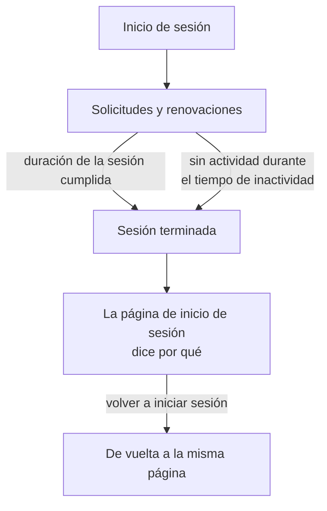

# Duración de la sesión

Elija cuánto tiempo permanecen las personas con la sesión iniciada en OneUptime antes de volver a iniciarla: un tiempo fijo después de iniciar sesión, un tiempo sin uso, o ambos. Se aplica a cada inicio de sesión en el panel, el Admin Dashboard y la aplicación móvil, con contraseña, clave de acceso, inicio de sesión con Microsoft o inicio de sesión único. Los inicios de sesión con SSO pueden tener duraciones propias.

> [!NOTE]
> La duración de la sesión forma parte de [OneUptime Enterprise Edition](/docs/self-hosted/enterprise). La Community Edition no tiene la página **Duración de la sesión**, y cada inicio de sesión dura como describe [Sin límite](#sin-límite).

:::cards
- [Establecer una duración de la sesión](#establecer-una-duración-de-la-sesión): Dos ajustes en el Admin Dashboard.
- [Cómo termina una sesión](#cómo-termina-una-sesión): Qué cuenta el servidor, y cuándo.
- [Inicios de sesión con SSO](#inicios-de-sesión-con-sso): Duraciones propias para el inicio de sesión único.
- [Lo que no es un inicio de sesión](#lo-que-no-es-un-inicio-de-sesión): Claves de API, conexiones MCP y lectores de páginas de estado.
:::

## Sin límite

Mientras no establezca una duración, un inicio de sesión no tiene ninguna. Su token de acceso dura 15 minutos y se renueva en segundo plano con un token de actualización, que dura 30 días y vuelve a empezar cada vez que se usa. Quien abre OneUptime al menos una vez cada 30 días mantiene la sesión iniciada; quien no lo hace vuelve a iniciar sesión.

## Establecer una duración de la sesión

:::steps
### Abrir Duración de la sesión
En el Admin Dashboard, abra **Ajustes** y luego **Duración de la sesión** en el menú lateral.

### Elegir las duraciones
- **Cerrar la sesión de las personas tras**: cuánto dura un inicio de sesión desde el momento en que alguien inicia sesión, por muy activo que esté.
- **Cerrar la sesión de las personas tras una inactividad de**: cuánto tiempo puede pasar alguien sin hacer clic, escribir ni desplazarse en OneUptime.

Cada elección se guarda en cuanto la hace.

### Confirmar a quién se cierra la sesión
Una duración más corta se aplica a todos los que tienen la sesión iniciada ahora. Cuando cierra la sesión de algunas personas de inmediato, OneUptime indica primero cuántas, y si usted es una de ellas. Seleccione **Guardar y cerrar su sesión** para continuar.
:::

| Ajuste | Opciones | Predeterminado |
| --- | --- | --- |
| **Cerrar la sesión de las personas tras** | De 1 hora a 90 días | **Sin límite** |
| **Cerrar la sesión de las personas tras una inactividad de** | De 15 minutos a 14 días | 30 días, lo máximo posible |

A través de la API, `sessionLengthInMinutes` acepta cualquier número entero de minutos de 15 a 525600 (un año) y `sessionIdleTimeoutInMinutes` de 15 a 43200 (30 días), en la configuración global del servidor. Vacío es el valor predeterminado.

## Cómo termina una sesión

- El servidor cuenta ambas duraciones a partir de la propia sesión: cuándo se inició y cuándo estuvo activa su persona por última vez. Las comprueba en cada solicitud, cada renovación y cada actualización en directo, y nunca deja el cierre de sesión en manos del navegador.
- El tiempo de inactividad cuenta desde el último clic, pulsación de tecla o desplazamiento en cualquier pestaña del panel o del Admin Dashboard. Una pestaña abierta no mantiene viva una sesión.
- La aplicación móvil cuenta como activa cada vez que se usa.
- Cuando termina una sesión, el navegador va a la página de inicio de sesión, que dice por qué. Tras volver a iniciar sesión, la persona regresa a la página en la que estaba.

| Cambio | Qué pasa con las personas que tienen la sesión iniciada ahora |
| --- | --- |
| Una duración de la sesión o un tiempo de inactividad más corto | Se cierra de inmediato la sesión de todos los que lo han superado, y la de los demás cuando lo alcancen |
| Uno más largo, o ninguno | No se cierra la sesión de nadie, y las sesiones duran más desde su próxima renovación |

## Inicios de sesión con SSO

Los inicios de sesión con inicio de sesión único siguen los mismos dos ajustes. Para darles duraciones propias, abra **Más ajustes** en la página **Duración de la sesión** y active **Duraciones distintas para los inicios de sesión con SSO**. Los dos ajustes que hay debajo se aplican entonces a los inicios de sesión a través del proveedor SAML u OpenID Connect de un proyecto, o del [SSO global](/docs/identity/global-sso) del propio servidor, y los dos de la parte superior de la página a todos los demás inicios de sesión.

Un proyecto que exige SSO, además, solo deja entrar a una sesión mientras dura su inicio de sesión con SSO, que nunca es más largo que la duración que siguen los inicios de sesión con SSO.

A través de la API, el interruptor es `useSeparateSsoSessionLengths`, y las duraciones de los inicios de sesión con SSO son `ssoSessionLengthInMinutes` y `ssoSessionIdleTimeoutInMinutes`, con los mismos rangos.

## Lo que no es un inicio de sesión

- **Las claves de API** conservan la caducidad que usted les da.
- **Las conexiones MCP**, asistentes de IA conectados con OAuth, conservan su propia vigencia. En un proyecto que exige SSO, una conexión nunca dura más que el inicio de sesión con SSO con el que se aprobó.
- **Las páginas de estado privadas** tienen una duración propia para sus lectores: consulte [Usuarios privados](/docs/status-pages/index#usuarios-privados).

## Sin licencia

Tras la prueba o el período de gracia, sin una licencia válida o con una que no incluya las duraciones de la sesión, las duraciones no se pueden establecer ni cambiar. Las que ya están establecidas siguen cerrando la sesión de las personas, y todavía puede quitarlas. Con la imagen de la Community Edition no se aplica ninguna duración: los valores se quedan en la base de datos y vuelven a aplicarse cuando vuelva a cambiar.

## Próximos pasos

:::cards
- [SSO](/docs/identity/sso): Inicie la sesión de las personas con su proveedor de identidad.
- [SSO global](/docs/identity/global-sso): Un proveedor de identidad para todo el servidor.
- [Enterprise Edition](/docs/self-hosted/enterprise): Lo que añade la Enterprise Edition, y su licencia.
:::
