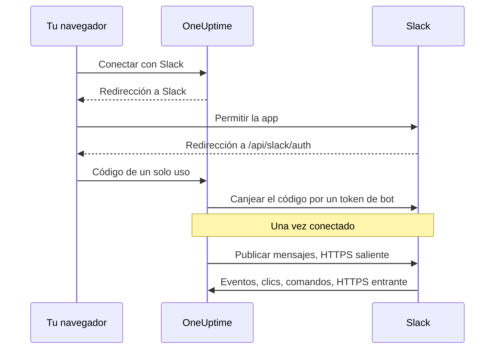

# Integración con Slack

Conecta tu OneUptime autoalojado a Slack. Creas una app de Slack a partir del manifiesto que genera tu servidor, le das a OneUptime las credenciales de la app y conectas cada proyecto a un espacio de trabajo. Después, OneUptime publica incidentes, alertas y mantenimientos programados en tus canales, y tu equipo actúa sobre ellos desde Slack.

Esta página es para quien administra el servidor de OneUptime. Una vez conectado Slack, las reglas de notificación se configuran por proyecto: consulta [Slack](/docs/workspace-connections/slack).

:::cards
- [Configurar la app de Slack](#configurar-la-app-de-slack): Crea la app a partir de tu manifiesto y conecta un proyecto.
- [Variables de entorno](#variables-de-entorno): Los tres valores que OneUptime necesita de la app.
- [Acceso de red](#acceso-de-red-para-despliegues-autoalojados): Los callbacks a los que Slack debe poder llegar.
- [Solución de problemas](#solución-de-problemas): Qué significan los mensajes de la página de Slack y qué hacer.
:::

## Cómo funciona

La app de Slack es tuya: está instalada en tu espacio de trabajo y solo habla con tu servidor. El tráfico va en los dos sentidos, y cada sentido necesita su propio acceso de red.



- **Saliente**: OneUptime llama a la Web API de Slack para publicar mensajes, crear canales y subir imágenes.
- **Entrante**: Slack llama a cuatro rutas de tu servidor para eventos, clics en botones, menús y comandos de barra. Cada solicitud va firmada con el signing secret de la app. OneUptime rechaza una solicitud cuya firma no coincide o cuya marca de tiempo tiene más de cinco minutos.

## Antes de empezar

- Un espacio de trabajo de Slack donde puedas crear e instalar apps.
- Un nombre de host HTTPS público para OneUptime al que Slack pueda llegar. Consulta [Acceso de red](#acceso-de-red-para-despliegues-autoalojados).
- Acceso a la configuración del servidor: `config.env` en Docker Compose, o tus values de Helm en Kubernetes.
- Para conectar un proyecto, el rol **Project Owner**, **Project Admin** o **Project Member** en él.

## Configurar la app de Slack

:::steps
### Define la URL pública

OneUptime construye el manifiesto de la app y cada URL de callback a partir de `HOST` y `HTTP_PROTOCOL`. Ajústalos al nombre de host al que llamará Slack, por HTTPS:

:::tabs
@tab Docker Compose
```bash title="config.env"
HOST=oneuptime.example.com
HTTP_PROTOCOL=https
```
@tab Kubernetes
```yaml title="values.yaml"
host: oneuptime.example.com
httpProtocol: https
```
:::

Estos valores solo generan URL. No crean registros DNS, certificados ni reglas de firewall.

### Copia el manifiesto de la app

Abre **Ajustes del proyecto > Espacio de trabajo > Slack**. Mientras Slack no esté configurado en el servidor, la página muestra **Integración de Slack con tu proyecto de OneUptime** con el manifiesto generado para tu nombre de host. También se sirve en `https://oneuptime.example.com/api/slack/app-manifest`.

Comprueba que cada URL del manifiesto empiece por tu nombre de host público. Si no es así, corrige primero `HOST` y `HTTP_PROTOCOL` y aplica el cambio.

### Crea la app de Slack

En [api.slack.com/apps](https://api.slack.com/apps), crea una app nueva a partir de un manifiesto, elige tu espacio de trabajo y pega el manifiesto. Usa siempre el manifiesto que genera tu propio servidor, para que sus URL coincidan con tu nombre de host.

### Copia las credenciales de la app

En la página **Basic Information** de la app, en **App Credentials**, copia el **Client ID**, el **Client Secret** y el **Signing Secret**.

### Añade las credenciales a OneUptime

:::tabs
@tab Docker Compose
```bash title="config.env"
SLACK_APP_CLIENT_ID=YOUR_SLACK_APP_CLIENT_ID
SLACK_APP_CLIENT_SECRET=YOUR_SLACK_APP_CLIENT_SECRET
SLACK_APP_SIGNING_SECRET=YOUR_SLACK_APP_SIGNING_SECRET
```
@tab Kubernetes
```yaml title="values.yaml"
slackApp:
  clientId: "YOUR_SLACK_APP_CLIENT_ID"
  clientSecret: "YOUR_SLACK_APP_CLIENT_SECRET"
  signingSecret: "YOUR_SLACK_APP_SIGNING_SECRET"
```

Para guardar los valores en un Secret de Kubernetes que gestiones tú, define en su lugar `slackApp.existingSecret`: su `name` y las claves `clientIdKey`, `clientSecretKey` y `signingSecretKey`.
:::

### Aplica la configuración

:::tabs
@tab Docker Compose
```bash
npm run start
```

Esto vuelve a crear los contenedores con el nuevo `config.env`. `docker compose restart` no lo vuelve a leer.
@tab Kubernetes
```bash
helm upgrade my-oneuptime oneuptime/oneuptime -f values.yaml
```
:::

Cuando OneUptime vuelva a estar en marcha, **Ajustes del proyecto > Espacio de trabajo > Slack** muestra un botón **Conectar con Slack** en lugar del manifiesto.

### Verifica la URL de solicitud de eventos

En las **Event Subscriptions** de la app de Slack, verifica la URL de solicitud. OneUptime solo responde al challenge de Slack cuando el signing secret está definido, así que vuelve a intentarlo si falló mientras creabas la app.

### Conecta el proyecto

En **Ajustes del proyecto > Espacio de trabajo > Slack**, selecciona **Conectar con Slack** y permite la app en Slack. Slack te devuelve a la misma página, que ahora muestra el nombre de tu espacio de trabajo.

### Conecta tu propia cuenta de Slack

Los botones, formularios y comandos actúan como el usuario de OneUptime vinculado a la cuenta de Slack que los usa. Cada persona abre **Ajustes de usuario > Espacio de trabajo > Slack** y selecciona **Connect my account with Slack**. Quien no haya conectado una cuenta recibe un mensaje directo de la app que se lo pide.
:::

## Variables de entorno

| Docker Compose (`config.env`) | Helm (`values.yaml`) | Obligatoria | Valor |
| --- | --- | --- | --- |
| `SLACK_APP_CLIENT_ID` | `slackApp.clientId` | Sí | El **Client ID** de la app. Sin él, la página de Slack muestra la guía de configuración en lugar de **Conectar con Slack**. |
| `SLACK_APP_CLIENT_SECRET` | `slackApp.clientSecret` | Sí | El **Client Secret** de la app, con el que se canjea por un token el código que devuelve Slack. |
| `SLACK_APP_SIGNING_SECRET` | `slackApp.signingSecret` | Sí | El **Signing Secret** de la app. Cada solicitud de Slack se comprueba con él. |
| `HOST` | `host` | Sí | Tu nombre de host público, sin el esquema. |
| `HTTP_PROTOCOL` | `httpProtocol` | Sí | `https`. Slack solo llama a URL HTTPS. |

## Lo que puede hacer la app

El manifiesto configura estas funciones. Cada una llega a tu servidor por la ruta indicada, así que solo funciona cuando Slack puede llegar a esa ruta.

| Función | Qué hace | Ruta |
| --- | --- | --- |
| `/incident` y el atajo **Create New Incident** | Declarar un incidente desde Slack | `POST /api/slack/interactive` |
| `/maintenance` y el atajo **Create Scheduled Event** | Programar un mantenimiento desde Slack | `POST /api/slack/interactive` |
| `/oneuptime` | Preguntar a OneUptime AI por tus logs, trazas, métricas, incidentes y monitores | `POST /api/slack/command` |
| Botones y formularios de los mensajes de OneUptime | Reconocer, resolver, añadir una nota, cambiar el estado, ejecutar una política de guardia | `POST /api/slack/interactive` y `POST /api/slack/options-load` |
| Eventos | Menciones, mensajes, reacciones y fijados, por ejemplo para guardar un mensaje como nota | `POST /api/slack/events` |

### Imágenes en los mensajes

Las descripciones de incidentes y alertas pueden llevar capturas de pantalla, por ejemplo la de un monitor sintético (consulta [Mostrar una captura de pantalla](/docs/monitor/incident-alert-templating#mostrar-una-captura-de-pantalla)). OneUptime las muestra en los mensajes de Slack subiendo cada una a tu espacio de trabajo como archivo privado, lo que requiere el scope de bot `files:write`. El manifiesto generado lo incluye.

Si creaste tu app de Slack a partir de un manifiesto anterior, añade `files:write` en **OAuth & Permissions > Bot Token Scopes** (o actualiza la app a partir del manifiesto actual). Después, selecciona de nuevo **Conectar con Slack** en **Ajustes del proyecto > Espacio de trabajo > Slack**, para que se conceda el nuevo scope. Hasta entonces, cada captura se muestra como su texto alternativo.

## Acceso de red para despliegues autoalojados

### Sentido del tráfico y endpoints

| Tráfico | Acceso necesario |
| --- | --- |
| De OneUptime a Slack | DNS y HTTPS saliente por TCP 443 a `slack.com` para las llamadas a la Web API y el canje del token de OAuth; `hooks.slack.com` para las URL de respuesta de los comandos y las notificaciones por webhook entrante, cuando se usan |
| De Slack a OneUptime | HTTPS público por TCP 443 a las cuatro rutas POST de abajo, para la integración completa |
| Del navegador del usuario a OneUptime | Acceso al panel y redirecciones de OAuth a `/api/slack/auth/:projectId/:userId` y `/api/slack/auth/:projectId/:userId/user`; pueden seguir siendo accesibles a través de la VPN del usuario |

Los dominios salientes describen la integración de Slack de OneUptime, no una lista de permitidos exhaustiva para los clientes de Slack ni para cada función de Slack. Un *webhook entrante* de Slack lo aloja Slack: OneUptime le envía mensajes, así que no es un endpoint entrante en tu servidor. Consulta la [guía de webhooks entrantes](https://docs.slack.dev/messaging/sending-messages-using-incoming-webhooks/) de Slack.

Reenvía estos callbacks a OneUptime a través de su ingress:

| Método y ruta | Propósito |
| --- | --- |
| `POST /api/slack/events` | Verificación de la Events API, reacciones, fijados, menciones y mensajes |
| `POST /api/slack/interactive` | Botones, atajos, envíos de modales, `/incident` y `/maintenance` |
| `POST /api/slack/options-load` | Solicitudes de opciones de menús interactivos |
| `POST /api/slack/command` | Comando `/oneuptime` |

OAuth es una [redirección del navegador seguida de un canje del token en el servidor](https://docs.slack.dev/authentication/installing-with-oauth/). El manifiesto registra `/api/slack/auth` como prefijo de la URL de redirección, y OneUptime añade las rutas del proyecto y del usuario cuando inicia la autorización. El acceso desde el navegador por sí solo no permite que Slack entregue eventos ni clics en botones.

### Despliegues privados y seguridad de los callbacks

```mermaid title="Publicar los callbacks de Slack desde un despliegue privado"
flowchart LR
    Slack["Slack"] -->|HTTPS 443| GW["Pasarela pública"]
    GW -->|"/api/slack/* solo POST"| ING["Ingress de OneUptime"]
    Users["Empleados en la VPN"] --> ING
    ING --> App["App de OneUptime"]
```

Usa un DNS público y una pasarela con un certificado HTTPS de confianza pública, una cadena de certificados completa y una ruta privada a tu ingress de OneUptime. Permite TCP 443 entrante hacia la pasarela y reenvía solo las cuatro rutas de callback de arriba. Slack no puede llegar a una `ClusterIP` privada, a un nombre DNS interno ni a la conexión VPN de un empleado. Con DNS dividido, el panel y las rutas de OAuth pueden seguir siendo privados con el mismo nombre de host.

Vuelve a generar el manifiesto y actualiza la app de Slack después de cambiar el nombre de host.

A través de la pasarela, conserva:

- el método, la ruta, la cadena de consulta y el cuerpo original;
- `Content-Type`, `X-Slack-Signature` y `X-Slack-Request-Timestamp`;
- el host público y el esquema HTTPS, mediante cabeceras de proxy de confianza.

Excluye las rutas de callback del SSO del navegador, de los CAPTCHA y de las páginas de inicio de sesión del proxy, y mantén las comprobaciones del signing secret y de la marca de tiempo de OneUptime. Mantén sincronizado el reloj del servidor: se rechaza una solicitud desfasada más de cinco minutos. Slack documenta la [verificación de la firma de las solicitudes](https://docs.slack.dev/authentication/verifying-requests-from-slack/); una comprobación de la IP de origen no la sustituye.

### Verificar el acceso y entender las limitaciones

:::steps
1. En las **Event Subscriptions** de la app de Slack, verifica la URL de solicitud. Slack envía un [challenge por POST y comprueba el TLS](https://docs.slack.dev/apis/events-api/using-http-request-urls/).
2. Envía una notificación de prueba, ejecuta un comando de barra, pulsa un botón de un mensaje de incidente y provoca un evento suscrito.
3. Revisa los logs de la pasarela y de OneUptime en busca de entregas fallidas, sin registrar secretos.
:::

Slack espera confirmaciones rápidas, entre ellas [una respuesta en menos de tres segundos para las interacciones](https://docs.slack.dev/interactivity/handling-user-interaction/). Un GET del navegador o un mensaje saliente enviado con éxito no verifica estos callbacks POST.

> [!WARNING]
> Si se prohíbe toda conectividad entrante, una app ya autorizada todavía puede enviar mensajes por HTTPS saliente, pero los eventos, botones, atajos y comandos no pueden funcionar. El manifiesto de OneUptime usa callbacks HTTP y desactiva el Socket Mode; activar el Socket Mode de Slack no es un sustituto admitido de estas rutas.

Los [ajustes de acceso a red privada](/docs/self-hosted/private-network-access) controlan las solicitudes salientes a destinos privados. No exponen los callbacks a Slack.

## Solución de problemas

### La conexión no terminó

Cuando Slack te devuelve y la conexión no se hizo, la página de Slack desde la que empezaste (**Ajustes del proyecto > Espacio de trabajo > Slack**, o tus propios **Ajustes de usuario > Espacio de trabajo > Slack** si estabas conectando tu cuenta) muestra **Slack no se conectó**, con una frase en tu idioma que dice por qué. El resto de la página carga como siempre, así que puedes volver a conectar ahí mismo. Nunca muestra lo que respondió Slack: eso está en el log del servidor de OneUptime, con el motivo.

| La página dice | Qué hacer |
| --- | --- |
| **"Este enlace de conexión no es válido, ha caducado o ya se ha usado. Vuelve a empezar."** | El enlace funciona una vez, durante 15 minutos, en el navegador que lo inició. Empieza de nuevo desde la página de Slack y termina en Slack en menos de 15 minutos, en el mismo navegador. |
| **"No tienes permiso para conectar este proyecto a Slack."** | Instalar OneUptime en Slack requiere **Project Owner**, **Project Admin** o **Project Member**. Se vuelve a comprobar cuando Slack te devuelve, así que un rol retirado mientras tanto también termina aquí la conexión. |
| **"Ya no eres miembro de este proyecto."** | Para conectar tu propia cuenta de Slack tienes que ser miembro del proyecto cuando Slack te devuelve. |
| **"Este proyecto todavía no está conectado a ningún espacio de trabajo de Slack."** | Instala primero OneUptime en Slack desde **Ajustes del proyecto > Espacio de trabajo > Slack** y después conecta tu propia cuenta. |
| **"Iniciaste sesión en un espacio de trabajo de Slack distinto del que está conectado a este proyecto."** | Conecta tu cuenta con la sesión iniciada en el espacio de trabajo de Slack en el que está instalado el proyecto. |
| **"Se canceló la conexión, así que no se cambió nada."** | La solicitud no se permitió en Slack. Empieza de nuevo y permítela. |
| **"Slack no está configurado en este servidor de OneUptime."** | Define `SLACK_APP_CLIENT_ID` y `SLACK_APP_CLIENT_SECRET` (consulta [Variables de entorno](#variables-de-entorno)) y reinicia OneUptime. |
| **"OneUptime no pudo terminar la conexión. Inténtalo de nuevo."** | Slack respondió con un error, o falló una solicitud o una escritura al terminar. El log del servidor de OneUptime dice cuál. Vuelve a intentarlo; si sigue pasando, revisa el log y los ajustes de la app de Slack. |

### Otros problemas

:::details Slack no puede verificar la URL de solicitud de eventos
OneUptime solo responde al challenge de Slack cuando `SLACK_APP_SIGNING_SECRET` está definido y la solicitud le llega. Define el signing secret, aplica la configuración y vuelve a intentar la verificación. Si sigue fallando, comprueba que se puede llegar a `POST /api/slack/events` desde Internet con un certificado de confianza pública.
:::

:::details Los botones y los comandos de barra no hacen nada, pero las notificaciones llegan
Las notificaciones son salientes, así que funcionan sin acceso entrante. Los botones, atajos y comandos son entrantes: comprueba que Slack puede llegar a `POST /api/slack/interactive` y `POST /api/slack/command`, y que la pasarela conserva el cuerpo y las cabeceras `X-Slack-Signature` y `X-Slack-Request-Timestamp`.
:::

:::details La app dice que mi cuenta de Slack no está conectada a OneUptime
Los botones, formularios y comandos necesitan tu cuenta de Slack vinculada a tu usuario de OneUptime. Abre **Ajustes de usuario > Espacio de trabajo > Slack** y selecciona **Connect my account with Slack**. Si te quitaron del proyecto, la app te lo dice en su lugar y se rechazan las acciones desde Slack.
:::

:::details Las capturas de pantalla aparecen como texto
A la app de Slack le falta el scope `files:write`. Consulta [Imágenes en los mensajes](#imágenes-en-los-mensajes).
:::

## Próximos pasos

:::cards
- [Slack](/docs/workspace-connections/slack): Crea reglas de notificación y resúmenes para el proyecto.
- [Integración con Microsoft Teams](/docs/self-hosted/microsoft-teams-integration): Configura también el bot de Teams en tu servidor.
- [Acceso a red privada](/docs/self-hosted/private-network-access): Deja que los flujos de trabajo y los webhooks lleguen a herramientas internas.
:::
