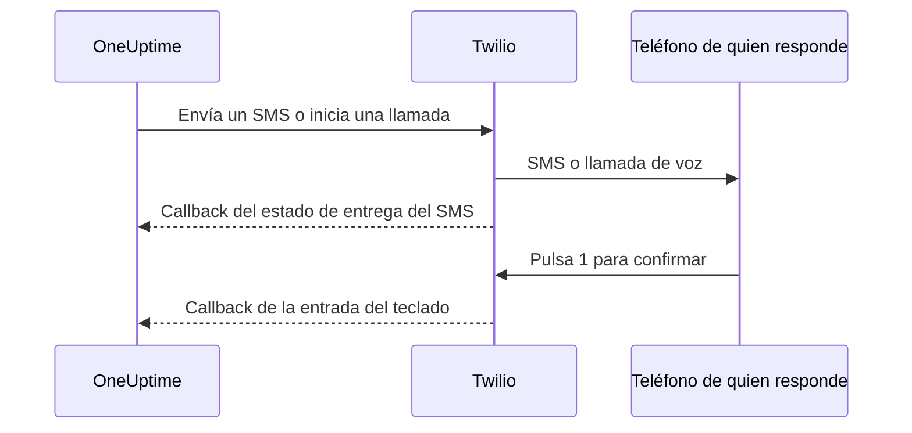

# Integración de Twilio

OneUptime autoalojado envía las alertas por SMS y por voz a través de tu propia cuenta de Twilio, y tú le pagas a Twilio directamente. Las credenciales de Twilio se guardan en el panel de OneUptime, no en variables de entorno: el envío de notificaciones lee la configuración guardada, y el chart de Helm no tiene valores para las credenciales de Twilio.

> [!NOTE]
> Una migración antigua importó `TWILIO_ACCOUNT_SID`, `TWILIO_AUTH_TOKEN` y `TWILIO_PHONE_NUMBER`; cambiar esas variables no es la forma de actualizar las credenciales de una instalación existente.

:::cards
- [Preparar tu cuenta de Twilio](#1-prepara-tu-cuenta-de-twilio): Las credenciales, un número de teléfono y los límites de la cuenta.
- [Guardar las credenciales](#2-guarda-las-credenciales-en-oneuptime): Para un proyecto, o para toda la instalación.
- [Configurar el acceso a la red](#3-configura-el-acceso-a-la-red): Qué debe alcanzar Twilio en tu servidor, y cuándo.
- [Verificar números de teléfono](#5-verifica-los-números-de-teléfono-de-los-miembros-del-equipo): Cómo se verifican los números de los miembros del equipo.
:::

## 1. Prepara tu cuenta de Twilio

:::steps
### Copia tus credenciales

Abre la [Twilio Console](https://console.twilio.com/) y copia tu **Account SID** y tu **Auth Token**.

### Consigue un número de teléfono

Consigue un número de teléfono de Twilio con las capacidades de SMS o de voz que necesites. Usa el formato E.164, con el código de país, para los números de remitente y de destinatario.

### Comprueba los límites de la cuenta

Comprueba el saldo de la cuenta, los permisos de los países de destino y los requisitos de registro de remitentes que se apliquen. Las cuentas de prueba tienen restricciones de destinatarios, geográficas y de otro tipo que pueden impedir que funcionen las alertas reales de OneUptime; revisa la [documentación de Twilio sobre cuentas y la prueba gratuita](https://www.twilio.com/docs/usage/tutorials/how-to-use-your-free-trial-account) antes de probar. En producción, usa una cuenta mejorada.
:::

## 2. Guarda las credenciales en OneUptime

Guarda las credenciales para un proyecto, o una sola vez para toda la instalación:

| | Configuración del proyecto | Configuración de toda la instalación |
| --- | --- | --- |
| Dónde | La tarjeta **Configuración de Twilio** en **Ajustes del proyecto > Notificaciones > Ajustes de notificaciones** | **Admin Dashboard > Ajustes > Llamadas y SMS** |
| Quién puede configurarla | **Project Owner**, **Project Admin**, o **Create Call and SMS** en un rol personalizado | Un administrador maestro |
| Se usa para | Los SMS y las llamadas a los miembros del proyecto mientras sea la predeterminada del proyecto, las páginas de estado a las que está asignada y las políticas de llamadas entrantes que la usan | Los SMS y las llamadas a los miembros de cualquier proyecto que no tenga configuración predeterminada |

Para añadir una configuración de proyecto:

:::steps
1. Ve a **Ajustes del proyecto > Notificaciones > Ajustes de notificaciones**.
2. En **Configuración de Twilio**, selecciona **Crear configuración de Twilio**.
3. Introduce un nombre, **SID de cuenta de Twilio**, **Token de autenticación de Twilio** y **Número de teléfono principal de Twilio**. Si quieres, introduce **Números de teléfono secundarios de Twilio** separados por comas para otros países.
4. **Establecer como predeterminado del proyecto** empieza activado en la primera configuración del proyecto, así que los SMS y las llamadas a los miembros del proyecto, incluidas las notificaciones de guardia, pasan por ella en cuanto guardas. Desactívalo si esta cuenta es solo para páginas de estado o llamadas entrantes. Una configuración posterior empieza con el interruptor desactivado: actívalo, o elige **Establecer como predeterminado del proyecto** en el menú de la fila de la configuración, para trasladar esos mensajes a ella. Una solicitud a la API que omite `isProjectDefault` se trata de la misma forma.
5. Guarda. Solo una configuración puede ser la predeterminada del proyecto. Las páginas de estado usan la configuración asignada explícitamente a cada una.

> [!IMPORTANT]
> **SMS** y **Llamadas telefónicas** empiezan desactivados en todos los proyectos, y mientras no estén activados nadie en el proyecto puede añadir un número de teléfono para ellos. Un propietario del proyecto, un **Billing Admin** o alguien con **Manage Billing** los activa en la tarjeta **Canales de notificación** de la misma página.
:::

Para una configuración predeterminada de toda la instalación, un administrador puede abrir en su lugar **Admin Dashboard > Ajustes > Llamadas y SMS**, editar las credenciales y los números de teléfono de Twilio y guardar. Las notificaciones de los miembros usan esta configuración global cuando su proyecto no tiene una predeterminada. Mantén el Auth Token en secreto.

## 3. Configura el acceso a la red

El envío funciona solo con acceso saliente. Las actualizaciones de entrega, la confirmación con el teclado y las llamadas entrantes necesitan que Twilio alcance tu servidor.

Un despliegue privado necesita resolución DNS y HTTPS saliente por TCP 443 hacia Twilio para enviar SMS y llamadas. Twilio recomienda permitir el HTTPS saliente hacia `*.twilio.com` porque las direcciones de su API son dinámicas; consulta [las direcciones IP de Twilio](https://help.twilio.com/articles/115015934048-All-About-Twilio-IP-Addresses). Aplícalo a la salida de la carga de trabajo de la aplicación OneUptime, incluidas las NetworkPolicies de Kubernetes y los cortafuegos externos.

El acceso entrante depende de la función:

| Función | ¿Necesita Twilio alcanzar OneUptime? |
| --- | --- |
| Envío de SMS | No. Las actualizaciones del estado de entrega sí necesitan un callback. |
| Una llamada de voz de prueba sencilla | No. OneUptime incluye las instrucciones habladas en la solicitud saliente a la API. |
| Pulsar 1 para confirmar una alerta de guardia | Sí. Twilio envía la entrada del teclado a OneUptime. |
| Políticas de llamadas entrantes | Sí. Twilio pide las instrucciones de la llamada e informa de los resultados de la marcación. |

Estas son las rutas externas, a través de la pasarela Nginx de OneUptime. Los marcadores varían en cada notificación:

| Método | Ruta | Propósito |
| --- | --- | --- |
| POST | `/notification/sms/status-callback/:smsLogId/:token` | Estado de entrega del SMS |
| POST | `/api/user-notification-log-timeline/call/gather-input/:itemId?token=...` | Confirmación con el teclado |
| POST | `/notification/incoming-call/voice` | Instrucciones opcionales de llamadas entrantes |
| POST | `/notification/incoming-call/dial-status/:callLogId/:callLogItemId` | Resultados opcionales del enrutamiento de llamadas entrantes |

OneUptime genera automáticamente las URL de los SMS y de la confirmación. No sustituyas sus tokens por una URL de webhook fija. Para las llamadas entrantes, sigue [las políticas de llamadas entrantes](/docs/on-call/incoming-call-policy), que configuran el webhook del número cuando lo asocias.

Twilio exige [URL de webhook accesibles públicamente](https://www.twilio.com/docs/usage/webhooks/webhooks-overview). Usa un certificado TLS de confianza pública y conserva a través de los proxies el host, el protocolo, la ruta, los parámetros de consulta, el cuerpo y el encabezado `X-Twilio-Signature` originales. Los manejadores de llamadas entrantes validan las firmas de Twilio; la entrega de SMS usa un token de URL por mensaje, y la confirmación con el teclado, un token de consulta firmado. No expongas los tokens en registros compartidos ni en capturas de pantalla. Consulta [la seguridad de los webhooks de Twilio](https://www.twilio.com/docs/usage/webhooks/webhooks-security).

### Publicar callbacks desde un despliegue privado

:::steps
1. Publica el DNS de tu nombre de host de OneUptime, por ejemplo `oneuptime.example.com`, apuntando a un proxy inverso o balanceador de carga expuesto a Internet. Permite TCP 443 entrante y configura un certificado de confianza pública con su cadena completa. Una IP privada, un DNS solo interno o la conexión VPN de un administrador no dan conectividad a Twilio.
2. Da a esa pasarela una ruta de red hacia el ingress privado de OneUptime, directamente o a través de tu propia VPN de sitio a sitio o enlace privado. Permite el puerto del servicio de origen. Un servicio `ClusterIP` de Kubernetes necesita un ingress accesible u otra ruta desde la pasarela. Mantén privadas las bases de datos y los demás servicios internos.
3. Publica solo las rutas de callback de la tabla anterior que uses. Reenvíalas a través de la pasarela Nginx de OneUptime, que asigna el prefijo externo `/notification` a la aplicación. Conserva `/api` en la ruta de la confirmación con el teclado. Conserva el método HTTP y los datos de la solicitud; no redirijas a otra URL. Conserva el `Host` público y configura en tu proxy encabezados de reenvío de confianza para el host público y el esquema HTTPS.
4. Excluye estas rutas del SSO del navegador, los CAPTCHA y las páginas de inicio de sesión del proxy. Mantén activada la autenticación de callbacks de OneUptime. Limita el acceso al origen privado a la pasarela y a los clientes internos autorizados.
5. Establece `HOST=oneuptime.example.com` y `HTTP_PROTOCOL=https` en el `config.env` de Docker Compose, o `host: oneuptime.example.com` y `httpProtocol: https` en los valores de Helm. Aplica el cambio del despliegue y espera a que la aplicación se reinicie. Estos ajustes generan URL; no crean DNS, certificados ni reglas de cortafuegos. OneUptime no tiene un ajuste aparte para el nombre de host de los callbacks de Twilio. Si el nombre de host cambia, actualiza también el webhook de los números de teléfono de Twilio existentes.
:::

El panel puede quedarse en un ingress privado: con DNS dividido, los empleados resuelven el mismo nombre de host hacia ese ingress por la red corporativa o la VPN, mientras que Twilio lo resuelve hacia la pasarela. Sirve en ambos caminos un certificado válido para ese nombre de host. Los [ajustes de acceso a redes privadas](/docs/self-hosted/private-network-access) de OneUptime rigen las solicitudes salientes hacia servicios internos; `ALLOW_PRIVATE_NETWORK_WEBHOOKS` no publica un endpoint entrante.

### Restricciones de IP y despliegues sin acceso entrante

Las direcciones de origen habituales de los webhooks de Twilio cambian, así que no uses los rangos de IP de SIP o de medios como lista de permitidos para los callbacks. Las ediciones de Twilio que cumplen los requisitos ofrecen [Static Proxy for Webhooks](https://www.twilio.com/docs/iam/twilio-editions/twilio-static-proxy). Confirma que tu edición cumple los requisitos y qué productos admite, y configura tu cortafuegos con los rangos que Twilio publica actualmente; sigue validando los callbacks aunque lo uses.

> [!WARNING]
> Si una política prohíbe las conexiones entrantes, el envío de SMS y la reproducción de voz sencilla integrada pueden funcionar con HTTPS saliente. Las actualizaciones de entrega de SMS, la confirmación con el teclado y el enrutamiento de llamadas entrantes no pueden funcionar sin callbacks accesibles. Una instalación totalmente desconectada no puede usar Twilio.

Para el desarrollo, la [guía de pruebas de webhooks](https://www.twilio.com/docs/usage/webhooks/webhook-testing) de Twilio describe el uso de un túnel público: reenvíalo a un proxy que permita solo las rutas necesarias, configura el nombre de host resultante como se indica arriba y detenlo después de las pruebas. Un túnel sigue abriendo un acceso entrante.

## 4. Prueba la entrega y los callbacks por separado

:::steps
1. Desde fuera de tu red corporativa y de la VPN, comprueba que el nombre de host de los callbacks se resuelve hacia la pasarela pública y sirve un certificado TLS válido. Un GET desde el navegador no prueba estos callbacks POST.
2. Usa **Enviar SMS de prueba** y **Enviar llamada de prueba** en la configuración de Twilio del proyecto. Confirma la recepción en el teléfono de destino. Ambas acciones requieren permiso para añadir configuraciones de Twilio: **Project Owner**, **Project Admin**, o **Create Call and SMS** y **Read Call and SMS** en un rol personalizado.
3. Configura el contacto de SMS o llamada verificado del usuario y sus reglas de notificación, y luego dispara una alerta de guardia controlada. Pulsa 1 y confirma la confirmación en OneUptime. Si usas políticas de llamadas entrantes, llama al número configurado y comprueba su enrutamiento y su registro de llamadas.
4. Confirma el estado de entrega de los SMS en OneUptime y en los registros de mensajes de Twilio. Un envío aceptado no prueba la entrega; [Twilio informa de los cambios de estado posteriores mediante callbacks](https://www.twilio.com/docs/messaging/guides/track-outbound-message-status).
:::

| Síntoma | Dónde mirar |
| --- | --- |
| No se envía nada | Las credenciales, las capacidades del número, las restricciones de la cuenta y la conectividad saliente. |
| El SMS o la llamada llega, pero su estado o la confirmación no se actualizan | La URL del callback y los registros del ingress público. La [guía de Twilio sobre fallos de recuperación HTTP](https://www.twilio.com/docs/api/errors/11200) ayuda a diagnosticar callbacks inaccesibles, problemas de TLS y errores HTTP. |

Una llamada de prueba correcta no demuestra por sí sola que los callbacks sean accesibles.

## 5. Verifica los números de teléfono de los miembros del equipo

Añadir un número de teléfono para SMS o llamadas envía su código de verificación al instante, y se abre el diálogo de verificación. Muestra cuándo se envió el código y hasta cuándo es válido, y envía un código nuevo cuando se pide, como mucho una vez por minuto. No hace falta reenviar nada antes de verificar.

Cuando no se puede enviar ningún código, el diálogo dice por qué en lugar de afirmar que se envió uno: por ejemplo, que no hay ninguna cuenta de Twilio configurada, mientras no exista una configuración predeterminada del proyecto ni la configuración de toda la instalación descrita arriba. Un número cuyo primer código no se puede enviar no se añade, y el formulario muestra el motivo, como que Twilio rechace un país de destino.

Un número verificado para SMS también queda verificado para llamadas, sin un segundo código. Verificar por llamada no verifica los SMS, porque un número que recibe llamadas, como un teléfono fijo, no siempre puede recibir mensajes de texto. Si Twilio acepta un código que nunca llega, el registro de SMS del proyecto muestra su estado de entrega.

## Próximos pasos

:::cards
- [Política de llamadas entrantes](/docs/on-call/incoming-call-policy): Que quien llama pueda contactar con tus ingenieros de guardia a través de un número de Twilio.
- [Reglas de escalado](/docs/on-call/escalation-rules): Decidir a quién se avisa en cada nivel, por SMS, llamada o cualquier otro método.
- [SMTP](/docs/emails/smtp): Enviar también el correo a través de tu propio servidor.
- [Acceso a redes privadas](/docs/self-hosted/private-network-access): Permitir que los workflows y webhooks lleguen a herramientas internas.
:::
