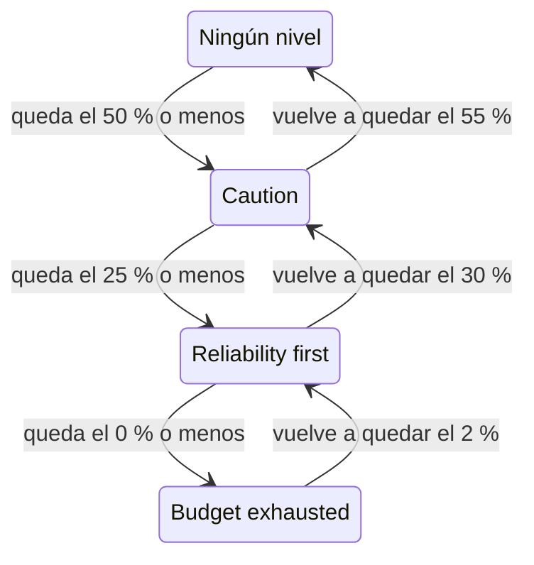

# Política de presupuesto de errores

Una política de presupuesto de errores deja escrito lo que tu equipo acordó hacer a medida que se agota el presupuesto de errores de un SLO, como revisar los cambios arriesgados cuando se ha gastado la mitad, o congelar las publicaciones cuando se ha gastado todo. OneUptime coloca el SLO en el nivel de la política al que ha llegado su presupuesto, muestra el acuerdo del equipo para ese nivel en las páginas del SLO, puede generar una alerta o declarar un incidente cuando el SLO entra en un nivel, publica cada cambio de nivel en los canales de Slack, Microsoft Teams o Mattermost que elijas, y les dice a tus pipelines de CI/CD si deben retener las publicaciones. Es la práctica de política de presupuesto de errores del [Google SRE Workbook](https://sre.google/workbook/error-budget-policy/).

:::cards
- [Cómo funcionan los niveles](#cómo-funcionan-los-niveles): Qué nivel se aplica y cuándo lo deja el SLO.
- [Configura una política](#configura-una-política): Parte de la política recomendada o escribe tus propios niveles.
- [Alertas e incidentes](#alertas-e-incidentes): Avisa a tu equipo cuando el SLO entra en un nivel.
- [Publica en Slack, Microsoft Teams y Mattermost](#publica-en-slack-microsoft-teams-y-mattermost): Informa a un canal cuando un SLO entra en un nivel, sin avisar a nadie.
- [Barrera de despliegue](#barrera-de-despliegue): Retén las publicaciones desde CI/CD mientras un nivel congela los despliegues.
- [Lee el nivel desde la API](#lee-el-nivel-desde-la-api): Comprueba el nivel desde CI y scripts.
:::

## Cómo funcionan los niveles

Una política es un conjunto de niveles. Cada nivel tiene tres campos:

| Campo | Qué contiene |
| --- | --- |
| **Nombre** | Cómo llama el equipo al nivel, por ejemplo "Reliability first". |
| **Umbral de presupuesto restante (%)** | La parte del presupuesto de errores restante a partir de la cual, o por debajo de la cual, se aplica el nivel. De 0 a 100, con decimales. Cada nivel de un SLO tiene su propio umbral. |
| **Lo que hacemos** | Lo que el equipo acordó hacer mientras el SLO está en el nivel, en Markdown. Obligatorio, hasta 10.000 caracteres. |

Un nivel se aplica mientras el presupuesto restante está en su umbral o por debajo, así que un nivel en el 0 % es el de un presupuesto agotado. Cuando se aplican varios niveles, el SLO está en el de umbral más bajo: el más grave. Cuando no se aplica ninguno, el SLO no está en ningún nivel. Con niveles en el 50 %, el 25 % y el 0 %, un SLO al que le queda el 30 % de su presupuesto está en el nivel del 50 %, y uno al que le queda el 10 % está en el nivel del 25 %.

Un nivel también puede congelar los despliegues mientras el SLO está en él: consulta [Barrera de despliegue](#barrera-de-despliegue).

### Entrar en un nivel y salir de él

El nivel sigue al presupuesto restante igual que lo hace el estado del SLO:

- Entrar en un nivel es inmediato: la evaluación que encuentra el presupuesto en el umbral de un nivel o por debajo pone el SLO en ese nivel. Un presupuesto que cae por debajo de varios umbrales a la vez pasa directamente al nivel más grave.
- Salir de un nivel hacia uno menos grave espera a que el presupuesto se haya recuperado con claridad. Un nivel en el 0 % se deja cuando vuelve a quedar el 2 % del presupuesto. Cualquier otro nivel se deja cuando el presupuesto está 5 puntos por encima de su umbral.

Así, un nivel en el 0 % se mueve con el estado **Presupuesto agotado**, y un nivel en el umbral de riesgo del SLO se mueve con **En riesgo**: consulta [Cambios de estado y el umbral de riesgo](/docs/slo/error-budget#cambios-de-estado-y-el-umbral-de-riesgo). Una ventana móvil que ronda un umbral no hace que el nivel vaya y venga.



## Configura una política

Necesitas permiso para crear niveles de política de presupuesto de errores de SLO.

:::steps
### Abre Política de presupuesto de errores

Abre el SLO y ve a **Política de presupuesto de errores**, en la sección **Reglas** de su menú lateral. La página lista los niveles del SLO, cada uno con su nombre, el presupuesto restante en el que se aplica y lo que hace el equipo.

### Parte de la política recomendada

Mientras el SLO no tiene niveles, la página ofrece **Usar la política recomendada**. Haz clic, revisa los tres niveles que lista y confirma. Después, adapta el texto de cada nivel al acuerdo propio de tu equipo.

### O añade un nivel tú mismo

Haz clic en **Crear Nivel de política de presupuesto de errores del SLO**. Escribe un **Nombre** y un **Umbral de presupuesto restante (%)**, y escribe el acuerdo del equipo en **Lo que hacemos**. Activa **Congelar despliegues** si los pipelines deben retener las publicaciones mientras el SLO está en el nivel.

### Elige lo que genera el nivel

Un nivel registra y muestra el acuerdo. Para avisar también a alguien cuando el SLO entra en él, abre los ajustes plegados de alerta e incidente y activa una alerta, un incidente o ambos. Los dos están desactivados de forma predeterminada. Consulta [Alertas e incidentes](#alertas-e-incidentes).
:::

Añadir, editar o eliminar un nivel tiene efecto enseguida: OneUptime vuelve a evaluar el SLO en aproximadamente un minuto. Si el presupuesto ya está en el umbral de un nivel o por debajo, el SLO entra entonces en ese nivel, y el nivel genera lo que está configurado para generar. Desactivar un nivel o eliminarlo resuelve lo que generó, y el SLO pasa al nivel en el que está su presupuesto. Desactivar la alerta o el incidente de un nivel resuelve esa alerta o ese incidente.

### La política recomendada

**Usar la política recomendada** añade tres niveles, en la mitad del presupuesto, en una cuarta parte y en cero, con este texto en inglés:

| Nivel | Se aplica con | Lo que hace el equipo | Despliegues |
| --- | --- | --- | --- |
| **Caution** | 50 % restante o menos | Half of the error budget is spent. Review risky changes before they ship, and find out what has been spending the budget. | Permitidos |
| **Reliability first** | 25 % restante o menos | Reliability comes first. Only reliability improvements and critical fixes ship until the budget recovers. | Permitidos |
| **Budget exhausted** | 0 % restante o menos | The error budget is spent. Freeze non-critical releases: only fixes for this SLO's reliability and security fixes ship until the budget is back. | Congelados |

Ninguno genera una alerta ni declara un incidente hasta que lo actives. **Budget exhausted** congela los despliegues, como dice su acuerdo, y la confirmación lo indica: consulta [Barrera de despliegue](#barrera-de-despliegue). Los niveles añadidos antes de que existiera la barrera no congelan nada hasta que actives la congelación. Solo se añaden los niveles que el SLO no tiene: un nivel con el mismo nombre, o con el mismo umbral, cuenta como presente, esté activado o no. Pedirlo dos veces, desde una segunda pestaña o por la API, no añade nada dos veces. Si uno de los niveles no se puede añadir, no se añade ninguno: el SLO queda como estaba y puedes volver a intentarlo. Cada nivel que se añade así queda registrado en los registros de auditoría del SLO como añadido por ti.

## Dónde aparece el nivel

- La **Vista general** del SLO muestra el nivel en el que está y lo que el equipo acordó hacer en él, para que todo el que abra el SLO vea el acuerdo que rige ahora. Mientras el nivel congela los despliegues, una insignia roja bajo su nombre indica desde cuándo.
- El gráfico **Consumo del presupuesto de errores** dibuja una línea con etiqueta en el umbral de cada nivel, junto a la del umbral de riesgo.
- El **Feed** del SLO publica cada cambio de nivel: el nivel que dejó el SLO y el nivel al que entró, el presupuesto restante, lo que el equipo acordó hacer en el nuevo nivel y si el cambio congeló los despliegues o volvió a permitirlos.
- Los canales de Slack, Microsoft Teams y Mattermost que nombran tus reglas reciben la misma publicación: consulta [Publica en Slack, Microsoft Teams y Mattermost](#publica-en-slack-microsoft-teams-y-mattermost).
- Los **Registros de auditoría** del SLO registran cada cambio de nivel, y cada vez que los despliegues se congelan o se vuelven a permitir, como un cambio que hizo el propio OneUptime, así que solo los muestran con **Almacenar eventos del sistema** activado: consulta [Activar los registros de auditoría](/docs/slo/feed-and-audit-logs#activar-los-registros-de-auditoría). Añadir, editar y quitar un nivel se registra a nombre de la persona que lo hizo.
- La API de lectura del SLO devuelve el nivel y si los despliegues están permitidos: consulta [Lee el nivel desde la API](#lee-el-nivel-desde-la-api) y [Barrera de despliegue](#barrera-de-despliegue).

## Alertas e incidentes

Cada nivel puede generar una alerta, declarar un incidente o ambas cosas cuando el SLO entra en él. Tienen las opciones de la alerta y del incidente de una regla de tasa de consumo: gravedad, políticas de guardia, plantillas de título, descripción y notas de corrección, privacidad, resolución automática, etiquetas, equipos y usuarios propietarios, y añadir a los propietarios del SLO como propietarios. Consulta [Qué declara una regla](/docs/slo/burn-rate-alerts#qué-declara-una-regla). Los dos están desactivados de forma predeterminada, así que un nivel no avisa a nadie hasta que actives uno.

- Entrar en un nivel más grave resuelve lo que generó el nivel anterior, diga lo que diga su ajuste de resolución automática, porque el nuevo nivel lo reemplaza. Así, como mucho la alerta y el incidente de un nivel están abiertos a la vez, y pertenecen al nivel en el que está el SLO.
- Recuperarse a un nivel menos grave, o salir de todos los niveles, los resuelve cuando la resolución automática del nivel está activada, como lo está de forma predeterminada. Con la resolución automática desactivada, siguen abiertos hasta que alguien los resuelva.
- No hay supresión de nuevas activaciones. Un nivel vuelve a generar solo después de que el SLO lo haya dejado con claridad y haya vuelto a entrar, así que no puede oscilar. Si alguien resuelve a mano lo que generó mientras el SLO sigue en el nivel, queda resuelto.
- Mientras algún monitor del SLO está en mantenimiento programado, los niveles no generan nada. El nivel en sí sigue cambiando, y lo que está abierto se sigue resolviendo. Si el SLO sigue en el nivel cuando termina el mantenimiento, el nivel genera entonces lo que está configurado para generar.

Igual que con una regla de tasa de consumo, una alerta o un incidente que genera un nivel lista el SLO en **Recursos afectados**, y un incidente nunca se muestra en las páginas de estado. El feed del SLO publica cada uno, y cuándo se resuelve.

### Qué dicen

El título, la descripción y las notas de corrección de un nivel admiten variables de plantilla, igual que los de una regla: consulta [Qué dice cada alerta e incidente](/docs/slo/burn-rate-alerts#qué-dice-cada-alerta-e-incidente). Los campos de un nivel ofrecen las variables del SLO y de su presupuesto, y tres propias del nivel: `{{sloName}}`, `{{sloId}}`, `{{sloLink}}`, `{{sloStatus}}`, `{{policyTier}}`, `{{policyTierThresholdPercentage}}`, `{{policyTierWhatWeDo}}`, `{{targetPercentage}}`, `{{currentSliPercentage}}`, `{{errorBudgetRemainingPercentage}}`, `{{errorBudgetRemaining}}`, `{{errorBudgetRemainingMinutes}}` y `{{windowDescription}}`. Las variables propias de una regla, como `{{ruleName}}` y las tasas de consumo, no se ofrecen y quedan vacías en las plantillas de un nivel.

Las tres variables del nivel también funcionan en las plantillas de las reglas de tasa de consumo:

| Variable | Qué contiene |
| --- | --- |
| `{{policyTier}}` | El nombre del nivel en el que está el SLO tras la evaluación, o `None` cuando no está en ningún nivel. |
| `{{policyTierThresholdPercentage}}` | El umbral de ese nivel, como `25`. Vacío cuando el SLO no está en ningún nivel. |
| `{{policyTierWhatWeDo}}` | Lo que el equipo acordó hacer en ese nivel. Vacío cuando el SLO no está en ningún nivel. |

Un nivel cuyo título queda vacío usa el título integrado:

```text
SLO error budget policy: {{sloName}} — {{policyTier}}
```

La descripción integrada nombra el nivel, compara el presupuesto restante con el umbral del nivel y dice lo que el equipo acordó hacer en él.

## Publica en Slack, Microsoft Teams y Mattermost

Una regla puede publicar cada cambio de la política de presupuesto de errores de un SLO en los canales de Slack, Microsoft Teams o Mattermost que lee tu equipo, sin avisar a nadie: cuando el SLO entra en un nivel, se recupera a uno menos grave o sale de todos los niveles, y cuando sus despliegues se congelan o se vuelven a permitir. Cada regla elige los SLO y los cambios que publica. Primero conecta el espacio de trabajo al proyecto: consulta [Slack](/docs/workspace-connections/slack), [Microsoft Teams](/docs/workspace-connections/microsoft-teams) o [Mattermost](/docs/workspace-connections/mattermost).

:::steps
### Abre la sección Espacio de trabajo de los SLO

Ve a **SLO** → **Espacio de trabajo** → **Slack**, **Microsoft Teams** o **Mattermost**. La sección **Espacio de trabajo** solo lista los espacios de chat que tu proyecto ha conectado.

### Crea una regla

Haz clic en **Crear Regla de notificación de SLO** y escribe un nombre en **Nombre de la regla**. En **Qué SLO**, deja **Todos los SLO**, o elige **Solo los SLO que cumplen las condiciones** y añade condiciones: consulta [A qué se aplica una regla](#a-qué-se-aplica-una-regla).

### Elige dónde publica

En **Luego, en Slack**, nombra los canales en los que publica la regla. En Microsoft Teams, elige un equipo y sus canales, o chats a los que se añadió la app de OneUptime. Un SLO no tiene canal propio, así que una regla solo publica en canales y chats que ya tienes.
:::

El mensaje cuenta el cambio con las palabras del **Feed** del SLO: el nivel que dejó el SLO y el nivel al que entró, cómo cambiaron los despliegues, el presupuesto de errores restante, el umbral del nuevo nivel y lo que el equipo acordó hacer en él, tal como lo escribió el equipo. Una mención en ese acuerdo, como `<!channel>`, se publica como texto y no notifica a nadie.

- Un cambio se publica una sola vez, después de que se guarde la evaluación que lo produjo. Una evaluación que no se guarda no publica nada, y la siguiente publica el cambio.
- No se publica nada mientras el SLO permanece en su nivel, por mucho tiempo que el presupuesto ronde un umbral: consulta [Entrar en un nivel y salir de él](#entrar-en-un-nivel-y-salir-de-él).
- Activar o desactivar **Congelar despliegues** en el nivel en el que está el SLO publica un mensaje propio.
- Un SLO pausado, mal configurado, deshabilitado o archivado mantiene su nivel y no publica nada.
- Un mensaje que no se puede enviar queda registrado, y la evaluación, el feed del SLO y lo que genera el nivel siguen adelante sin él.

### A qué se aplica una regla

| Condición | A qué se aplica |
| --- | --- |
| **SLO** | Los SLO que elijas, o todos los SLO excepto esos. |
| **Etiquetas del SLO** | Las etiquetas del SLO: cualquiera de las que elijas, todas o ninguna. |
| **Nombre del SLO** | El nombre del SLO: igual a tu texto o no, que lo contenga o no, que empiece o termine por él. |
| **Cambio en la política de presupuesto de errores** | Qué cambió: **Entró en un nivel más grave**, **Se recuperó a un nivel menos grave**, **Salió de todos los niveles**, **Despliegues congelados** o **Despliegues permitidos de nuevo**. |

Un cambio de nivel que congeló los despliegues, o volvió a permitirlos, es un único mensaje que reúne ambos cambios. Así, una regla para **Despliegues congelados** también publica el cambio por el que el SLO entra en un nivel que los congela: un canal de despliegues se entera de cada congelación.

## Cuando no se mide el presupuesto

- Un SLO **Pausado** o **Mal configurado** no mide ningún presupuesto, así que su nivel se queda donde estaba, y lo que generó el nivel sigue abierto hasta que se reanude la medición. Las reglas de tasa de consumo, en cambio, resuelven entonces lo que tienen abierto.
- Desactivar la evaluación del SLO, o archivar el SLO, resuelve lo que generaron sus niveles. El nivel en el que está el SLO se queda como estaba.
- Eliminar el SLO elimina sus niveles y resuelve lo que generaron.
- En cada uno de estos casos, el SLO mantiene la respuesta que daba sobre los despliegues, porque mantiene su nivel: consulta [Barrera de despliegue](#barrera-de-despliegue).

## Barrera de despliegue

Un nivel puede congelar los despliegues. Mientras el SLO está en un nivel con **Congelar despliegues** activado, el campo `deploymentsAllowed` del SLO es `false`, así que un pipeline de CI/CD que lo comprueba antes de publicar retiene la publicación. En cualquier otro caso es `true`: cuando el SLO no tiene política, mientras su presupuesto está por encima de todos los niveles y en un nivel que no congela los despliegues. El nivel **Budget exhausted** de la política recomendada congela los despliegues.

:::steps
### Activa Congelar despliegues

Abre la **Política de presupuesto de errores** del SLO, edita el nivel, activa **Congelar despliegues** y guarda. En la tabla, la columna **Despliegues** del nivel indica **Congelados**.

### Dale una clave al pipeline

Crea una [clave de API](/docs/api-reference/api-reference) del proyecto que pueda leer el SLO y guárdala como secreto del pipeline con el nombre `ONEUPTIME_API_KEY`.

### Comprueba el SLO antes de la publicación

Añade la comprobación de abajo como un paso anterior al que despliega, con el ID del SLO en lugar de `<slo-id>`.
:::

:::tabs
@tab Shell
```bash
ALLOWED=$(curl -sS -X POST 'https://oneuptime.com/api/service-level-objective/<slo-id>/get-item' \
  -H "ApiKey: $ONEUPTIME_API_KEY" \
  -H 'Content-Type: application/json' \
  -d '{ "select": { "deploymentsAllowed": true } }' | jq -r '.deploymentsAllowed')
[ "$ALLOWED" = "true" ]
```
@tab GitHub Actions
```yaml title=".github/workflows/deploy.yml"
name: Deploy
on:
  push:
    branches: [main]

jobs:
  deploy:
    runs-on: ubuntu-latest
    steps:
      - uses: actions/checkout@v4
      - name: Stop while the error budget policy freezes deployments
        env:
          ONEUPTIME_API_KEY: ${{ secrets.ONEUPTIME_API_KEY }}
          SLO_ID: <slo-id>
        run: |
          SLO=$(curl -sS -X POST "https://oneuptime.com/api/service-level-objective/$SLO_ID/get-item" \
            -H "ApiKey: $ONEUPTIME_API_KEY" \
            -H 'Content-Type: application/json' \
            -d '{ "select": { "deploymentsAllowed": true, "currentErrorBudgetPolicyTierName": true } }')
          if [ "$(echo "$SLO" | jq -r '.deploymentsAllowed')" != "true" ]; then
            echo "Not deploying: $SLO"
            exit 1
          fi
      - name: Deploy
        run: ./deploy.sh
```
@tab GitLab CI
```yaml title=".gitlab-ci.yml"
error-budget-gate:
  stage: test
  image: alpine:3.20
  variables:
    SLO_ID: <slo-id>
  before_script:
    - apk add --no-cache curl jq
  script:
    - >
      SLO=$(curl -sS -X POST "https://oneuptime.com/api/service-level-objective/$SLO_ID/get-item"
      -H "ApiKey: $ONEUPTIME_API_KEY"
      -H 'Content-Type: application/json'
      -d '{ "select": { "deploymentsAllowed": true, "currentErrorBudgetPolicyTierName": true } }')
    - echo "$SLO"
    - test "$(echo "$SLO" | jq -r '.deploymentsAllowed')" = "true"
```
:::

La comprobación solo pasa cuando la respuesta es `true`. Un SLO congelado, una respuesta sin el campo (la clave no puede leer el SLO, o el ID es incorrecto) y la falta total de respuesta detienen cada uno el paso, así que un pipeline nunca publica con una respuesta que no recibió. En GitLab CI, el job se ejecuta en la etapa test, así que un SLO congelado detiene la etapa deploy que va después; añade `ONEUPTIME_API_KEY` como variable de CI/CD enmascarada. En una instalación autoalojada, usa su propia dirección en lugar de oneuptime.com.

El SLO responde con dos campos, que se leen con el permiso de lectura del propio SLO:

| Campo | Qué contiene |
| --- | --- |
| `deploymentsAllowed` | `false` mientras el SLO está en un nivel que congela los despliegues, `true` en cualquier otro caso. |
| `deploymentsFrozenAt` | Cuándo se congelaron los despliegues. Vacío mientras están permitidos. |

Cómo cambia la respuesta:

- Los despliegues se congelan con la evaluación que pone el SLO en un nivel que los congela, y se vuelven a permitir con la que lo saca de él, con los márgenes de recuperación propios del nivel: consulta [Entrar en un nivel y salir de él](#entrar-en-un-nivel-y-salir-de-él). De un nivel que congela a otro siguen congelados, y `deploymentsFrozenAt` conserva su hora.
- Activar o desactivar **Congelar despliegues** en el nivel en el que está el SLO tiene efecto en aproximadamente un minuto. Para publicar antes de que se recupere el presupuesto, desactívalo: el cambio queda registrado a tu nombre en los registros de auditoría del SLO.
- Un SLO **Pausado** o **Mal configurado** mantiene la respuesta que tenía, igual que mantiene su nivel: una ventana de mantenimiento que pausa todos los monitores no levanta una congelación ni la inicia. Un SLO deshabilitado o archivado no se evalúa en absoluto, así que también mantiene su respuesta.
- Mientras los despliegues están congelados, la **Vista general** del SLO muestra desde cuándo, y su **Feed** indica cuándo se congelan y cuándo se vuelven a permitir.

## Lee el nivel desde la API

La API de lectura del propio SLO devuelve el nivel en el que está, para que un trabajo de CI o un script pueda comprobarlo antes de actuar, por ejemplo antes de una publicación. Los tres campos están vacíos mientras el SLO no está en ningún nivel:

| Campo | Qué contiene |
| --- | --- |
| `currentErrorBudgetPolicyTierId` | El ID del nivel. |
| `currentErrorBudgetPolicyTierName` | El nombre del nivel. |
| `currentErrorBudgetPolicyTierEnteredAt` | Cuándo entró el SLO en el nivel. |

Se leen con el permiso de lectura del propio SLO, el mismo que necesita su presupuesto. Por ejemplo, con una [clave de API](/docs/api-reference/api-reference) del proyecto:

```bash
curl -X POST 'https://oneuptime.com/api/service-level-objective/<slo-id>/get-item' \
  -H "ApiKey: $ONEUPTIME_API_KEY" \
  -H 'Content-Type: application/json' \
  -d '{ "select": { "name": true, "errorBudgetRemainingPercentage": true, "currentErrorBudgetPolicyTierName": true, "currentErrorBudgetPolicyTierEnteredAt": true } }'
```

Los niveles en sí son un recurso propio, `/api/service-level-objective-error-budget-policy-tier`, con las solicitudes de listar, leer, crear, cambiar y eliminar que tiene cada recurso. Otras dos solicitudes sirven a la política recomendada. Las dos reciben `{ "serviceLevelObjectiveId": "..." }` y responden con los niveles en `tiers`:

| Solicitud | Qué hace |
| --- | --- |
| `POST /api/service-level-objective-error-budget-policy-tier/recommended-policy` | Lista los niveles recomendados que le faltan al SLO. No escribe nada. |
| `POST /api/service-level-objective-error-budget-policy-tier/recommended-policy/add` | Los añade y lista lo que añadió. Volver a pedirlo no añade nada. |

## Permisos

| Permiso | Permite a un rol |
| --- | --- |
| **Read SLO Error Budget Policy Tier** | Ver los niveles de un SLO. |
| **Create SLO Error Budget Policy Tier** | Añadir niveles, a mano o con **Usar la política recomendada**. |
| **Edit SLO Error Budget Policy Tier** | Cambiar niveles, y activarlos o desactivarlos. |
| **Delete SLO Error Budget Policy Tier** | Quitar niveles. |

Estos permisos están en el grupo SLO de un rol. Los roles Project Owner y Project Admin los tienen todos, y los roles Project Member y Viewer pueden leer los niveles.

## Aún no disponible

Algunas partes de una política de presupuesto de errores aún no están disponibles: un disparador de flujo de trabajo propio para cada nivel, una política compartida por varios SLO, reconocer un nivel o concederle una excepción, y niveles basados en la autonomía del presupuesto en lugar del presupuesto restante. OneUptime no detiene una publicación por sí solo: lo hace un pipeline que comprueba `deploymentsAllowed`, como muestra [Barrera de despliegue](#barrera-de-despliegue).

## Próximos pasos

:::cards
- [Presupuestos de errores](/docs/slo/error-budget): Qué es el presupuesto y cómo lo sigue el estado.
- [Alertas e incidentes de tasa de consumo](/docs/slo/burn-rate-alerts): Avisa a tu equipo cuando el presupuesto se consume demasiado rápido.
- [Feed y registros de auditoría de SLO](/docs/slo/feed-and-audit-logs): Cada cambio de nivel y lo que generaron los niveles.
:::
