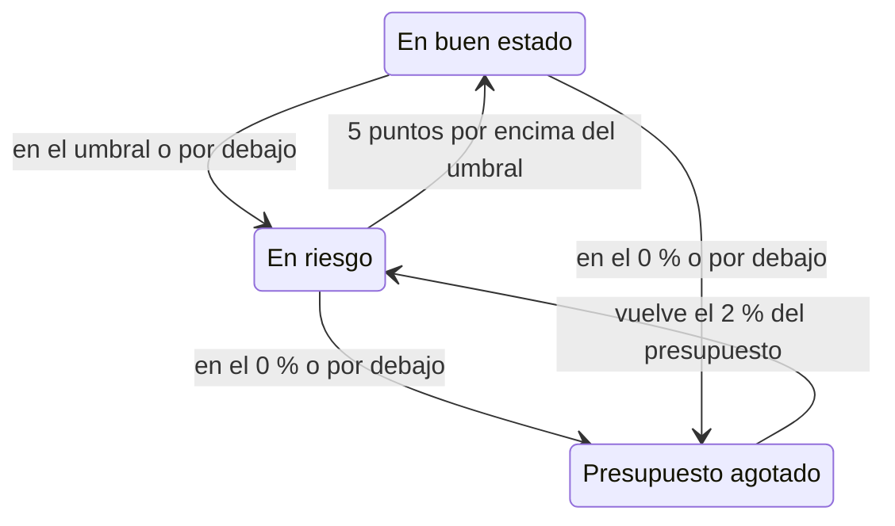

# Presupuestos de errores

El presupuesto de errores es el tiempo de inactividad que permite el objetivo de un SLO. Un objetivo del 99,9 % no significa «no caer nunca»: significa «puedes estar caído hasta 43 minutos en 30 días, así que gástalos con cabeza». Esta página explica cómo cuenta OneUptime el presupuesto, cuánto dura, cómo se recupera y quién se entera.

:::cards
- [Cómo se calcula el presupuesto](#cómo-se-calcula-el-presupuesto): La fórmula y el presupuesto de los objetivos habituales.
- [Autonomía del presupuesto](#autonomía-del-presupuesto): Cuánto dura el presupuesto al ritmo actual.
- [Cómo se recupera el presupuesto](#cómo-se-recupera-el-presupuesto): Ventanas móviles y meses naturales.
- [Notificaciones a los propietarios](#notificaciones-a-los-propietarios): Quién se entera cuando el presupuesto escasea.
:::

## Cómo se calcula el presupuesto

El presupuesto total es la parte de la ventana que tu objetivo no promete:

```text
total budget = (100% − target) × window length
```

| Objetivo | Ventana de 7 días | Ventana de 28 días | Ventana de 30 días | Ventana de 90 días |
| --- | --- | --- | --- | --- |
| 99% | 1h 40m 48s | 6h 43m 12s | 7h 12m | 21h 36m |
| 99.5% | 50m 24s | 3h 21m 36s | 3h 36m | 10h 48m |
| 99.9% | 10m 5s | 40m 19s | 43m 12s | 2h 9m 36s |
| 99.95% | 5m 2s | 20m 10s | 21m 36s | 1h 4m 48s |
| 99.99% | 1m 0s | 4m 2s | 4m 19s | 12m 58s |

La página **Ajustes** del SLO muestra el presupuesto que permite su objetivo junto al objetivo, por ejemplo «43m 12s de inactividad por ventana de 30 días».

### El presupuesto de un SLO con varios monitores

En modo **Cualquier monitor caído**, el presupuesto es `(100% − target) × window`, mida el SLO los monitores que mida: la ventana es una sola línea de tiempo.

En modo **Promedio de segundos del monitor**, el presupuesto se cuenta en segundos-monitor, sumados para todos los monitores, así que crece con el número de monitores: un SLO con tres monitores al 99,9 % en 30 días tiene unos 129 minutos de presupuesto en lugar de 43. Los porcentajes (SLI, presupuesto restante, tasa de consumo) significan lo mismo; solo cambian las duraciones.

### El presupuesto de un mes natural

Un SLO de mes natural tiene el presupuesto de todo el mes desde el primer día: un SLO al 99,9 % en un mes de 31 días tiene sus 44m 38s completos el día 1. El presupuesto no se prorratea según la parte del mes que ha pasado, así que una caída de un minuto la mañana del día 1 gasta un minuto del presupuesto del mes.

## Presupuesto restante

A medida que se acumula el tiempo de inactividad, la **Vista general** muestra el presupuesto restante en su mosaico **Presupuesto de errores restante**:

- como porcentaje del total, que también decide el estado del SLO y llena la barra. La barra tiene una marca en el umbral de riesgo del SLO;
- como duración, por ejemplo "31m 4s left of 43m 12s".

Cuando el presupuesto se agota, el mosaico muestra **No budget left**. Cuando el tiempo de inactividad lo supera, el mosaico muestra **Budget exceeded** y el exceso como tiempo, por ejemplo "4d 23m over budget · 5m 47s allowed": el SLO ha gastado los 5 minutos y 47 segundos de su presupuesto, y otros 4 días y 23 minutos más. La barra se queda vacía y en rojo.

El presupuesto restante se guarda como un número con signo para los cálculos y los gráficos de historial, así que un presupuesto superado aparece ahí como un porcentaje negativo. Un porcentaje muy negativo significa que el exceso es grande comparado con el presupuesto; no es la parte del tiempo en que el servicio estuvo caído.

Qué segundos cuentan como tiempo de inactividad lo deciden los estados de inactividad del SLO y, en un SLO con varios monitores, su modo de varios monitores, ambos en **Ajustes** → **Cálculo del tiempo de inactividad**. Consulta [Visión general de los SLO](/docs/slo/introduction).

## Autonomía del presupuesto

El mosaico **Autonomía del presupuesto** de la **Vista general** responde a «si esto sigue así, ¿cuándo nos quedamos sin presupuesto?». Divide el presupuesto restante entre la tasa de consumo de los últimos 60 minutos:

```text
runway = budget left ÷ (burn rate × (100% − target))
```

| El mosaico muestra | Qué significa |
| --- | --- |
| Una duración, como **~2d 5h** | El presupuesto se agota en más o menos ese tiempo al ritmo actual. En ámbar, y en rojo cuando queda un día o menos. **Under 1m** significa menos de un minuto. |
| **Not burning** | No se gastó presupuesto en los últimos 60 minutos. |
| **Sustainable** | Solo ventanas móviles: la autonomía es de al menos una ventana entera, así que el presupuesto no se gasta más rápido de lo que sale de la ventana el tiempo de inactividad antiguo. A este ritmo no se puede agotar. |
| **Lasts until reset** | Solo meses naturales: el presupuesto se reinicia al empezar el mes siguiente antes de agotarse. |
| **Overspent** | El presupuesto ya está gastado. El mosaico indica cuánto se ha superado. |

En los SLO de mes natural, el mosaico también indica cuándo se reinicia el presupuesto.

La autonomía es una línea recta. En una ventana móvil, el tiempo de inactividad antiguo que sale devuelve presupuesto, cosa que la línea ignora, así que tómala como el tiempo mínimo que te queda. No se muestra antes de la primera evaluación, ni en los SLO en modo **Promedio de segundos del monitor**, cuyo presupuesto se cuenta en segundos-monitor y no en tiempo de reloj.

## Consumo del presupuesto de errores

El gráfico **Consumo del presupuesto de errores** de la **Vista general** traza el presupuesto restante, en porcentaje, a lo largo de la ventana de cumplimiento actual:

- Una línea en el 0 % marca dónde se agota el presupuesto, y una línea discontinua marca el umbral de riesgo del SLO.
- En los SLO de mes natural, una línea tenue baja de forma uniforme desde un presupuesto lleno al principio del mes hasta uno vacío en el reinicio. Por debajo de ella, el mes gasta su presupuesto demasiado rápido.
- Se registra un punto en cada evaluación, cada 5 minutos, así que el gráfico de un SLO nuevo está vacío hasta su primera evaluación.
- Arrastra sobre el gráfico para ampliar una parte de la ventana. Haz doble clic, o clic en **Restablecer zoom**, para volver a ver toda la ventana.

**Abrir métricas** abre la página **Métricas** del SLO, cuya pestaña **Error Budget History** llega hasta 400 días atrás. Consulta [Métricas y paneles de SLO](/docs/slo/metrics).

## Cómo se recupera el presupuesto

Cómo vuelve el presupuesto depende del tipo de ventana del SLO:

:::tabs
@tab Móvil
Una ventana móvil siempre mira la misma distancia hacia atrás desde ahora, así que el tiempo de inactividad acaba saliendo: una caída deja de contar exactamente una ventana después de ocurrir. Una caída de 30 minutos el 1 de junio desaparece de las cuentas de un SLO de 30 días el 1 de julio, y el presupuesto vuelve poco a poco, a medida que cada segundo de inactividad sale de la ventana, no de golpe.

Así que la recuperación se gana, no se programa. Si siguen produciéndose pequeñas caídas, el tiempo de inactividad antiguo sale mientras entra el nuevo, y el presupuesto se estanca en lugar de recuperarse.
@tab Calendar Month
Un SLO de mes natural se reinicia a medianoche del primer día de cada mes, en su zona horaria. Todo el presupuesto vuelve de golpe y el mes anterior queda cerrado. Nada pasa de un mes a otro, en ningún sentido: un mal mes no resta al siguiente y un buen mes no le da margen.
:::

### Los SLO jóvenes

Un SLO con ventana móvil más joven que su ventana se mide sobre los datos que existen hasta ahora, y su presupuesto total crece con ellos: un SLO de 30 días creado hace una semana tiene por ahora un presupuesto de 7 días. Hasta que la ventana esté llena, la **Vista general** muestra cuánto lo está, con un indicador **Window 23% full** y la misma nota en el mosaico **Presupuesto de errores restante**. Cuenta con que las cifras se estabilicen a medida que la ventana se llena.

## Cambios de estado y el umbral de riesgo

El presupuesto restante decide el estado del SLO:

| Estado | Cuándo |
| --- | --- |
| **En buen estado** | Queda más presupuesto que el umbral de riesgo. |
| **En riesgo** | El presupuesto restante está en el umbral de riesgo o por debajo: el 20 % de forma predeterminada. |
| **Presupuesto agotado** | El presupuesto restante está en cero o por debajo. |

Ajusta el umbral de riesgo en **Ajustes** → **Objetivo**.

Las ventanas móviles se recuperan segundo a segundo, así que un SLO cerca de un límite podría saltar de un estado a otro. Para que cada cambio de estado signifique algo, un SLO solo deja un estado cuando ha superado claramente el límite:



Con el umbral predeterminado del 20 %, un SLO en riesgo vuelve a estar en buen estado con un 25 % de presupuesto restante, y un SLO con el presupuesto agotado vuelve a estar en riesgo con un 2 %. Cada cambio de estado se publica en el **Feed** del SLO, con el SLI, el presupuesto y la tasa de consumo que lo explican.

## Notificaciones a los propietarios

Cuando un SLO pasa a **En riesgo** o **Presupuesto agotado**, OneUptime avisa a sus propietarios:

- Los propietarios son los usuarios y los miembros de los equipos de la página **Propietarios** del SLO que siguen siendo miembros del proyecto. Un SLO sin propietarios avisa en su lugar a los propietarios del proyecto.
- Cada propietario recibe un correo electrónico de forma predeterminada, y la notificación por cualquier otro canal que active para **El estado del SLO cambió** en **Ajustes de usuario** → **Ajustes de notificaciones** → **Monitoreo**.
- El asunto del correo nombra el estado y el SLO, por ejemplo `[SLO At Risk] API Availability`.

Para que un SLO cerca de un límite no avise una y otra vez, sus propietarios reciben como mucho un aviso por hora. Un paso a **Presupuesto agotado** siempre se envía, incluso dentro de esa hora.

> [!TIP]
> Las notificaciones a los propietarios avisan a los responsables de un SLO de que su presupuesto está en apuros. Para avisar a tu equipo de guardia mediante políticas de escalado, usa [Alertas e incidentes de tasa de consumo](/docs/slo/burn-rate-alerts). Una regla de tasa de consumo también puede añadir a los propietarios del SLO a cada alerta e incidente que crea.

## Próximos pasos

:::cards
- [Alertas e incidentes de tasa de consumo](/docs/slo/burn-rate-alerts): Avisa a tu equipo cuando el presupuesto se consume demasiado rápido.
- [Métricas y paneles de SLO](/docs/slo/metrics): Representa el presupuesto a lo largo del tiempo.
- [Visión general de los SLO](/docs/slo/introduction): Objetivos, ventanas y estados de inactividad.
:::
