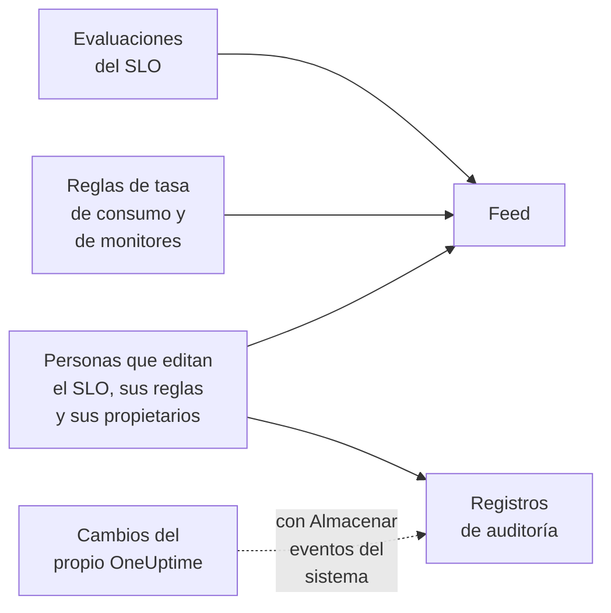

# Feed y registros de auditoría de SLO

Un SLO guarda dos registros de su historia, y responden a preguntas distintas. El **Feed** responde a «¿qué le ha pasado a este SLO?», escrito para las personas que lo cuidan. Los **Registros de auditoría** responden a «¿quién cambió qué, exactamente?», campo por campo, para revisiones y cumplimiento.

## ¿Feed o registros de auditoría?

| | **Feed** | **Registros de auditoría** |
| --- | --- | --- |
| Responde a | Qué le ha pasado al SLO | Quién cambió qué, y cuándo |
| Registra | Cambios de estado, alertas e incidentes de tasa de consumo, y cambios en el SLO, sus reglas, sus monitores y sus propietarios | Cada cambio que hicieron las personas en el SLO, sus reglas de tasa de consumo, sus reglas de monitores y sus propietarios, con el valor anterior y el nuevo |
| Incluye el trabajo del propio OneUptime | Sí: las evaluaciones y las reglas de monitores que asocian monitores | Solo con **Almacenar eventos del sistema** activado |
| Planes | Todos los planes | El plan Enterprise en OneUptime Cloud, o la Enterprise Edition en una instalación autoalojada |
| Se conserva | Tres años en OneUptime Cloud | 7 días de forma predeterminada, hasta 180 |

## El feed del SLO

El feed está en la página **Feed** del SLO, y sus últimos elementos en **Actividad reciente** de la **Vista general** del SLO. Los elementos enlazan al SLO, los monitores, las alertas y los incidentes que mencionan, y la mayoría tienen una sección **Más información** con las cifras o los valores anteriores y nuevos.

| Evento | Se publica cuando |
| --- | --- |
| SLO creado | Se crea el SLO. Indica su objetivo, su ventana de cumplimiento, su SLI, su umbral de riesgo, su descripción y las reglas de tasa de consumo predeterminadas con las que empezó. |
| SLO actualizado | Cambian el nombre, la descripción, las etiquetas, el objetivo, la ventana de cumplimiento, la zona horaria, el umbral de riesgo, el modo de varios monitores o los estados de inactividad. Muestra cada valor anterior y nuevo. |
| SLO habilitado o deshabilitado | Se activa o desactiva la evaluación. |
| SLO archivado o restaurado | El SLO se archiva o se desarchiva. |
| Estado cambiado | Una evaluación lleva el SLO a un estado nuevo. Muestra el SLI, el presupuesto de errores, la tasa de consumo y el umbral de riesgo que lo explican, y el motivo en el caso de **Pausado** o **Mal configurado**. |
| Alerta de tasa de consumo generada | Una regla de tasa de consumo crea una alerta. Enlaza a ella y muestra las tasas de consumo que la activaron. |
| Incidente de tasa de consumo declarado | Una regla de tasa de consumo declara un incidente. Enlaza a él y muestra las tasas de consumo que lo activaron. |
| Alerta o incidente de tasa de consumo resuelto | La alerta o el incidente de una regla se cierra: resuelto automáticamente, o a mano mientras la resolución automática estaba desactivada. |
| Regla de tasa de consumo añadida, cambiada o eliminada | Alguien crea, edita o elimina una regla de tasa de consumo. Las reglas predeterminadas de un SLO nuevo aparecen en su elemento «SLO creado». |
| Regla de monitores añadida, cambiada o eliminada | Alguien crea, edita o elimina una regla de monitores. Un guardado que no cambia nada relevante no se publica. |
| Monitores asociados o desasociados | Se añaden monitores al SLO o se quitan, a mano o mediante una regla de monitores. Las listas largas nombran los primeros monitores «y N más». |
| Propietario añadido o eliminado | Se añade o quita un usuario o un equipo de los propietarios del SLO. |
| Regla de etiquetas aplicada | Una regla de etiquetas asoció etiquetas al SLO, al crearlo o cuando alguien ejecutó la regla. Nombra las reglas que coincidieron. Consulta [Reglas de etiquetas y propietarios](/docs/slo/label-and-owner-rules). |
| Regla de propietarios aplicada | Una regla de propietarios añadió propietarios al SLO. Nombra las reglas que coincidieron; cada propietario que añadió recibe además su propio elemento «Propietario añadido». |

Algunos detalles:

- Los elementos indican quién hizo un cambio cuando fue una persona. Los cambios que hace el propio OneUptime, como una evaluación o una regla de monitores que asocia un monitor, y los cambios hechos mediante la API o una automatización no llevan usuario.
- Una alerta o un incidente que una regla vuelve a tomar porque seguía abierto no se publica dos veces.
- En una alerta o un incidente privado, el elemento omite su título, su número y su enlace, porque cualquiera que pueda leer el SLO puede leer su feed. Aun así indica que se creó un registro privado y muestra las tasas de consumo que lo activaron.
- Nadie puede editar ni eliminar los elementos del feed. En OneUptime Cloud se eliminan los elementos de más de tres años.

## Registros de auditoría

La página **Registros de auditoría** del SLO muestra los cambios hechos en:

- el propio SLO: sus detalles, ajustes, etiquetas, monitores y archivado;
- sus reglas de tasa de consumo;
- sus reglas de monitores;
- sus usuarios propietarios y sus equipos propietarios.

Los cambios en las reglas y los propietarios se registran en la regla o el propietario y se agrupan en el SLO, así que su página muestra toda su historia en un solo lugar, y cada entrada enlaza a la página a la que pertenece. Los elementos relacionados, como las etiquetas y los monitores, se registran con su nombre, no solo con su ID.

Quedan fuera dos cosas:

- **Los resultados de las evaluaciones.** El SLI, el presupuesto de errores, la tasa de consumo, el estado y las horas de evaluación cambian cada pocos minutos. Su historial está en la **Vista general**, la página **Métricas** y el **Feed**.
- **Los cambios que hace el propio OneUptime**, como una regla de monitores que asocia o desasocia un monitor, salvo que **Almacenar eventos del sistema** esté activado en el proyecto. El **Feed** registra igualmente las asociaciones y desasociaciones de monitores.

### Activar los registros de auditoría

Los registros de auditoría son una función Enterprise: necesitan el plan **Enterprise** en OneUptime Cloud, o la Enterprise Edition en una instalación autoalojada. En otros planes, la página **Registros de auditoría** del SLO explica cómo conseguirla. En una instalación autoalojada, el registro de auditoría deja de grabar sin una licencia válida (tras la prueba de 14 días, o 30 días después de que caduque una licencia), y se reanuda en cuanto se activa una licencia (consulta [When a license expires or is missing](/docs/self-hosted/enterprise#cuando-una-licencia-caduca-o-falta)). Las páginas **Registros de auditoría** indican cuándo no se está grabando.

Los registros de auditoría también están desactivados de forma predeterminada en cada proyecto. Para activarlos:

:::steps
### Abrir los ajustes de los registros de auditoría

Ve a **Ajustes del proyecto**, abre **Registros de auditoría** en el menú lateral y haz clic en **Ajustes**.

### Editar los ajustes

Haz clic en **Edit Audit Log Settings** y activa **Habilitar registros de auditoría**.

### Elegir qué conservar

Fija **Retención (días)**, de 7 (el valor predeterminado) a 180, y activa **Almacenar eventos del sistema** para registrar también los cambios que hace el propio OneUptime. Guarda. El cambio se aplica en un minuto aproximadamente.
:::

Mientras el registro de auditoría está desactivado, la página **Registros de auditoría** del SLO muestra **Audit logging is off**, con un enlace para activarlo. Las entradas registradas antes de desactivarlo siguen visibles. El registro de auditoría completo del proyecto, de todos los recursos, está en **Ajustes del proyecto** → **Registros de auditoría** → **Registros de auditoría**.

## Próximos pasos

:::cards
- [Visión general de los SLO](/docs/slo/introduction): Cada página que tiene un SLO.
- [Monitores y reglas de monitores](/docs/slo/monitor-rules): Qué asocia y desasocia monitores.
- [Alertas e incidentes de tasa de consumo](/docs/slo/burn-rate-alerts): Qué genera y resuelve las alertas e incidentes del feed.
- [Reglas de etiquetas y propietarios](/docs/slo/label-and-owner-rules): Qué añade etiquetas y propietarios automáticamente.
:::
