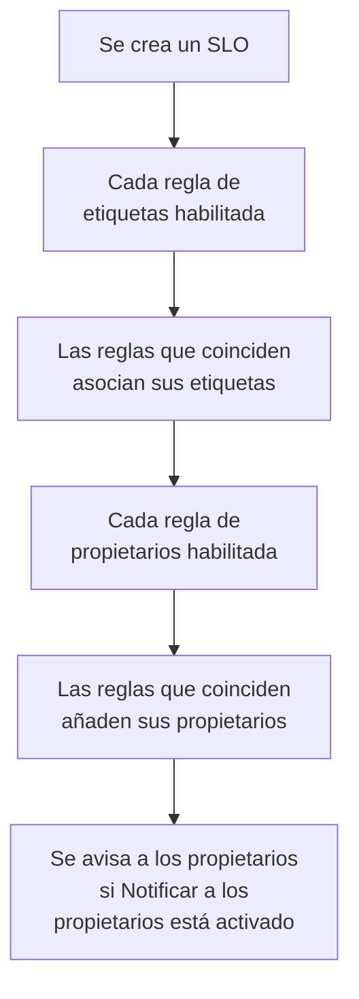

# Reglas de etiquetas y propietarios

Las reglas de etiquetas y las reglas de propietarios organizan tus SLO por ti. Una **regla de etiquetas** asocia etiquetas a cada SLO nuevo con el que coincide, y una **regla de propietarios** le añade usuarios y equipos propietarios, así que un SLO nuevo de checkout recibe la etiqueta _Checkout_ y pertenece al equipo de checkout sin que nadie tenga que acordarse. Ambas funcionan como las reglas de etiquetas y propietarios de cualquier otro producto: consulta [Reglas de etiquetas y propietarios](/docs/configuration/label-and-owner-rules) para lo que tienen en común.

## Cómo funciona

Las reglas se ejecutan cuando se crea un SLO, desde el panel o mediante la API. Las reglas de etiquetas se ejecutan primero, para que una regla de propietarios pueda coincidir con una etiqueta que una regla de etiquetas acaba de asociar.

Ambas valen para todo el proyecto. Las encontrarás en el menú lateral de la lista de SLO, en **Ajustes**: **Reglas de etiquetas** y **Reglas del propietario**. La sección **Ajustes** empieza plegada; haz clic en su título para abrirla.

## Crear una regla

:::steps
### Abrir la lista de reglas

Abre **SLO**, luego **Ajustes** → **Reglas de etiquetas** o **Ajustes** → **Reglas del propietario** en el menú lateral, y haz clic en **Crear Regla de etiquetas de SLO** o **Crear Regla de propietarios de SLO**.

### Elegir con qué coincide la regla

En el paso **Coincidencia**, haz clic en **Añadir condición** para cada condición que deba cumplir un SLO (consulta [Criterios de coincidencia](#criterios-de-coincidencia)). Con dos o más, elige **Coincidir con todas** o **Coincidir con cualquiera**. Una regla sin condiciones coincide con cada SLO nuevo.

### Elegir qué añade la regla

El segundo paso de una regla de etiquetas es **Etiquetas**, donde eliges las **Etiquetas a añadir**. El de una regla de propietarios es **Propietarios**, donde eliges los **Propietarios** que se añaden — personas y equipos, elegidos de una misma lista con **Añadir propietario**. Una regla tiene que añadir al menos una etiqueta o un propietario.

### Revisar el nombre y los campos plegados

El **Nombre** se rellena a partir de lo que eliges, como _Añadir Checkout, Production_ o _Añadir Checkout team como propietarios_, y sigue tus elecciones hasta que escribas un nombre propio. **Más campos** contiene la **Descripción** opcional y, en una regla de propietarios, **Notificar a los propietarios**.

### Guardar la regla

Vuelve a hacer clic en **Crear Regla de etiquetas de SLO** o **Crear Regla de propietarios de SLO** en el último paso. La regla empieza habilitada.
:::

**Notificar a los propietarios** (en **Más campos**) está activado de forma predeterminada: los propietarios que añade una regla de propietarios reciben el mismo aviso «se te ha añadido como propietario» que un propietario añadido a mano. Desactívalo para añadir propietarios sin avisar.

Para pausar una regla sin eliminarla, desactiva **Habilitado** en su formulario de edición. El formulario de edición nunca exige etiquetas ni propietarios: una regla antigua que no añade nada todavía se puede renombrar, desactivar o eliminar, y la lista la marca con **No añade nada**.

Cuando una regla coincide con un SLO:

- Una regla de etiquetas asocia cada etiqueta de **Etiquetas a añadir**. Las etiquetas que el SLO ya tiene no se añaden dos veces, y cuando coinciden varias reglas, el SLO recibe todas sus etiquetas.
- Una regla de propietarios añade cada usuario y equipo de la regla como propietario. Se omiten los propietarios que el SLO ya tiene, y cuando coinciden varias reglas, el SLO recibe todos sus propietarios. Un usuario que ya no es miembro del proyecto, o un equipo de otro proyecto, nunca se añade; los demás propietarios de la regla sí.

Los propietarios de un SLO son las personas que se enteran de sus cambios de estado: consulta [Presupuestos de errores](/docs/slo/error-budget).

## Criterios de coincidencia

Cada condición compara un campo del SLO:

| Campo | Se compara con | Operadores |
| --- | --- | --- |
| **Etiquetas del SLO** | Las etiquetas del SLO. | **Tiene alguno de**, **Tiene todos los**, **No tiene ninguno de** |
| **Nombre del SLO** | El nombre del SLO. | **Contiene**, **No contiene**, **Es igual a**, **No es igual a**, **Empieza por**, **Termina en**, **Coincide con el patrón**, **No coincide con el patrón** |
| **Descripción del SLO** | La descripción del SLO. | Los mismos que **Nombre del SLO** |

Una condición nueva sobre el nombre o la descripción empieza en **Contiene**. Un patrón es una expresión regular, como `^checkout-.*`, o un comodín `*`, como `*checkout*`, y no distingue mayúsculas de minúsculas. Un patrón que no es ninguna de las dos cosas, como `checkout-(01`, se rechaza al guardar en lugar de no coincidir con nada sin avisar.

| Quieres | Condiciones |
| --- | --- |
| Todos los SLO del servicio de checkout | **Nombre del SLO** contiene `checkout` |
| Todos los SLO de producción | **Etiquetas del SLO** tiene alguno de _Production_ |
| Los SLO de checkout, pero no los de staging | **Coincidir con todas**: **Nombre del SLO** contiene `checkout`, y **Etiquetas del SLO** no tiene ninguno de _Staging_ |

## Cuándo se ejecutan las reglas

- **Cuando se crea un SLO**, desde el panel o mediante la API: cada regla de etiquetas habilitada y luego cada regla de propietarios habilitada.
- **Cuando ejecutas una regla** con **Ejecutar ahora**: consulta más abajo.

Editar un SLO no vuelve a aplicar las reglas, y una regla nunca quita nada: ni etiquetas o propietarios que alguien añadió a mano, ni los que añadió ella misma. Una regla desactivada no hace nada.

## Aplicar una regla a los SLO existentes

Una regla que escribes hoy se aplica a los SLO que se creen después. Para aplicarla a los SLO que ya tienes, haz clic en **Ejecutar ahora** en la fila de la regla, o en **Ver** y después en **Ejecutar ahora** en la página de la regla. También puedes seleccionar varias reglas y ejecutarlas desde las acciones masivas de la tabla.

Una ejecución revisa cada SLO del proyecto, incluidos los archivados, e indica con cuántos coincidió y cuántos cambió. Los propietarios que añade una ejecución solo reciben aviso si así lo eliges en el diálogo de ejecución y la regla tiene **Notificar a los propietarios** activado. Consulta [Ejecutar reglas sobre recursos existentes](/docs/configuration/run-rules-now).

Las reglas de etiquetas también se pueden copiar entre proyectos: consulta [Importar y exportar reglas de etiquetas](/docs/configuration/label-rule-import-export).

## Historial

Siempre que una regla cambia un SLO, el **Feed** del SLO registra qué reglas lo hicieron. Cada propietario que añade una regla recibe además su propio elemento «añadido como propietario» en el feed, así que el feed dice a quién se añadió y por qué. Consulta [Feed y registros de auditoría de SLO](/docs/slo/feed-and-audit-logs).

## Permisos

| Para | Necesitas |
| --- | --- |
| Trabajar con reglas de etiquetas | **Create SLO Label Rule**, **Edit SLO Label Rule**, **Delete SLO Label Rule** o **Read SLO Label Rule** |
| Trabajar con reglas de propietarios | **Create SLO Owner Rule**, **Edit SLO Owner Rule**, **Delete SLO Owner Rule** o **Read SLO Owner Rule** |
| Ejecutar una regla de etiquetas | **Edit SLO Label Rule** y **Edit Service Level Objective** |
| Ejecutar una regla de propietarios | **Edit SLO Owner Rule**, **Edit Service Level Objective**, **Create SLO User Owner** y **Create SLO Team Owner** |

Estos permisos están en el grupo SLO de un rol, y los roles Project Owner y Project Admin los tienen todos. Una ejecución cambia cada SLO del proyecto, así que un permiso limitado a algunas etiquetas, o a los SLO de los que eres propietario, no basta para ejecutar una regla.

## Próximos pasos

:::cards
- [Reglas de etiquetas y propietarios](/docs/configuration/label-and-owner-rules): Cómo funcionan las reglas de etiquetas y propietarios de cada producto.
- [Ejecutar reglas sobre recursos existentes](/docs/configuration/run-rules-now): Cómo funciona Ejecutar ahora para cada tipo de regla.
- [Visión general de los SLO](/docs/slo/introduction): Cada página que tiene un SLO, y la lista de SLO.
:::
