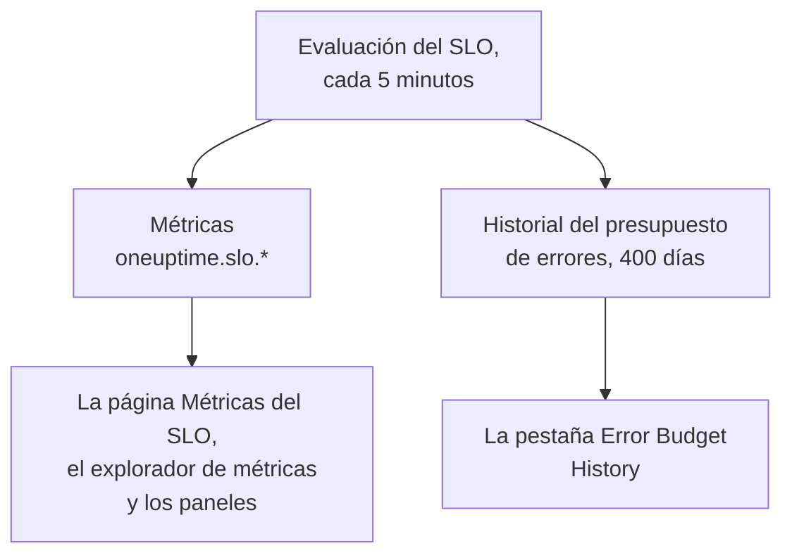

# Métricas y paneles de SLO

Cada vez que OneUptime evalúa un SLO, cada 5 minutos, escribe los resultados como métricas llamadas `oneuptime.slo.*`. Están en el mismo almacén de métricas que tus métricas de monitores, así que puedes representar un SLO en su página **Métricas**, abrirlo en el explorador de métricas y ponerlo en cualquier panel, filtrado y agrupado como cualquier otra serie.

:::cards
- [Las métricas](#las-métricas): Seis series, sus unidades y cómo agregarlas.
- [La página Métricas](#la-página-métricas): Los gráficos, el historial y las métricas de incidentes y alertas de un SLO.
- [Los SLO en los paneles](#los-slo-en-los-paneles): El widget de SLO y la plantilla SLO Dashboard.
:::

## Cómo funciona

## Las métricas

| Métrica | Unidad | Agregación | Qué contiene |
| --- | --- | --- | --- |
| `oneuptime.slo.sli.percent` | `%` | Avg | El SLI en la ventana de cumplimiento del SLO: la parte del tiempo medido que fue buena. |
| `oneuptime.slo.target.percent` | `%` | Avg | El objetivo del SLO, publicado en cada evaluación para que un gráfico pueda dibujarlo sobre el SLI. |
| `oneuptime.slo.error.budget.remaining.percent` | `%` | Avg | Parte del presupuesto de errores aún sin gastar en la ventana. Negativa cuando el presupuesto se ha superado. |
| `oneuptime.slo.error.budget.remaining.seconds` | `seconds` | Avg | Tiempo de inactividad que el SLO todavía puede absorber antes de incumplirse. Negativo cuando el presupuesto se ha superado. |
| `oneuptime.slo.burn.rate` | `x` | Max | A qué velocidad se gasta el presupuesto, en los últimos 60 minutos. 1x gasta el presupuesto justo a lo largo de la ventana. |
| `oneuptime.slo.status` | — | Max | El estado del SLO en cada evaluación: `0` es En buen estado, `1` es En riesgo, `2` es Presupuesto agotado. |

La agregación es cómo los gráficos del SLO y la plantilla SLO Dashboard combinan los puntos que caen en un mismo intervalo del gráfico. Los porcentajes y las duraciones se promedian. La tasa de consumo y el estado toman el máximo, para que un pico breve de consumo o un paso corto por Presupuesto agotado no se diluya en la media.

En un SLO en modo **Promedio de segundos del monitor**, `oneuptime.slo.error.budget.remaining.seconds` cuenta segundos-monitor sumados entre sus monitores, igual que su presupuesto de errores: consulta [Presupuestos de errores](/docs/slo/error-budget).

### Cuándo no se escribe ningún punto

- Un SLO desactivado o archivado no se evalúa, así que no publica nada.
- Un SLO **Pausado** o **Mal configurado** no mide nada, así que solo publica `oneuptime.slo.target.percent`, que es configuración y no una medición. Sus gráficos de SLI, presupuesto, tasa de consumo y estado muestran un hueco.
- Un valor que no es un número real, como una tasa de consumo en una ventana sin datos, se omite y nunca se escribe como 0.

### Atributos

Cada punto lleva estos atributos:

| Atributo | Valor |
| --- | --- |
| `sloId` | ID del SLO. Las páginas del SLO filtran por él, así que cambiar el nombre de un SLO nunca divide sus gráficos. |
| `sloName` | Nombre del SLO cuando se escribió el punto. |
| `projectId` | ID del proyecto. |
| `oneuptime.label.<key>` | Un atributo por cada etiqueta del SLO. Una etiqueta llamada `Tier 1` se convierte en `oneuptime.label.tier_1` = `true`, y una etiqueta llamada `product:checkout` se convierte en `oneuptime.label.product` = `checkout`. Las claves van en minúsculas, y los espacios y la puntuación se convierten en `_`. |

Las series pertenecen al SLO, no a ninguno de sus monitores, y no cuentan como uso de telemetría.

Las métricas de incidentes y alertas llevan dos atributos equivalentes, `serviceLevelObjectiveIds` y `serviceLevelObjectiveNames`: listas separadas por comas de los SLO a los que afecta el incidente o la alerta.

### Retención

Las métricas `oneuptime.slo.*` se conservan tanto tiempo como las métricas de monitores: **30 días** de forma predeterminada. En una instalación autoalojada, un administrador maestro puede cambiarlo con **Monitor Metric Retention (Days)** en los ajustes de **Retención de datos** del Admin Dashboard.

Esto no limita la pestaña **Error Budget History** de la página **Métricas** del SLO. Ese historial se guarda aparte y se conserva 400 días.

## La página Métricas

La página **Métricas** de un SLO tiene cuatro pestañas:

| Pestaña | Qué muestra |
| --- | --- |
| **SLO Metrics** | Las series `oneuptime.slo.*` en tres tarjetas que comparten un mismo intervalo de tiempo, el último día de forma predeterminada: **Objetivo** (el SLI con el objetivo encima, y el presupuesto restante), **Consumo** (tasa de consumo y tiempo de presupuesto restante) y **Estado**. |
| **Error Budget History** | El SLI, el presupuesto restante y la tasa de consumo a lo largo del historial a largo plazo, con líneas en el objetivo, en los límites de riesgo y de agotamiento, y en el umbral de cada regla de tasa de consumo habilitada. |
| **Métricas de incidentes** | El número, el tiempo hasta el reconocimiento, el tiempo hasta la resolución y la duración de los incidentes que afectan a este SLO, la última semana de forma predeterminada. Se incluyen los incidentes declarados por sus reglas de tasa de consumo. |
| **Métricas de alerta** | Lo mismo para las alertas. Se incluyen las alertas generadas por sus reglas de tasa de consumo. |

Las pestañas **SLO Metrics**, **Métricas de incidentes** y **Métricas de alerta** leen el almacén de métricas, lo que requiere permiso para leer telemetría. Un rol personalizado que puede leer SLO pero no telemetría ve esas pestañas vacías, mientras que **Error Budget History** sigue funcionando.

## Los SLO en los paneles

### Representar cualquier métrica de SLO

:::steps
#### Añadir un gráfico

En el modo de edición de un panel, añade un widget de gráfico o de valor y elige una de las métricas `oneuptime.slo.*`.

#### Agrupar o filtrar

Agrupa por `sloName` y `sloId` para tener una línea por SLO; `sloId` separa dos SLO que se llaman igual. O filtra por `sloName`, o por un atributo `oneuptime.label.*`.

#### Elegir la agregación

Usa la agregación de la tabla de arriba: Avg para los porcentajes y las duraciones, Max para la tasa de consumo y el estado.
:::

### El widget de SLO

El [widget de SLO](/docs/dashboards/widgets#slo) muestra el SLI, el presupuesto restante o la tasa de consumo de un SLO como mosaico o gráfico. Obtiene su SLO de una de dos formas:

| Ajuste | Cómo se comporta |
| --- | --- |
| **Objetivo de nivel de servicio** | Fija el widget a un SLO. El selector muestra los SLO que no están archivados. |
| **Follow SLO Variable** | Muestra el SLO elegido en una variable del panel: una variable **Telemetry Attribute** sobre la clave `sloName`. Se ignora mientras haya un SLO fijado. |

En un [panel público](/docs/dashboards/sharing), un widget que sigue una variable permite a los visitantes elegir por su nombre cualquier SLO no archivado del proyecto. Un widget fijado solo muestra su propio SLO, y sigue mostrando las últimas cifras de un SLO archivado después.

### La plantilla SLO Dashboard

Al crear un panel, elige la plantilla **SLO Dashboard** para tener un panel listo con todos los SLO del proyecto, en tres franjas:

1. **Service Level Objectives**: una lista de cada SLO no archivado, con su estado, su SLI frente al objetivo, su barra de presupuesto y su tasa de consumo, y un recuento de SLO por estado. Los SLO habilitados van primero, el de menos presupuesto antes; un SLO desactivado va al final como **Deshabilitado**, con sus últimas cifras en gris.
2. **Error Budget & Burn Rate**: los mosaicos **Lowest Error Budget Remaining**, **Least Error Budget Time Left** y **Peak Burn Rate**, y los gráficos **Error Budget Remaining by SLO** y **Burn Rate by SLO** con una línea por SLO, agrupados por `sloName` y `sloId`.
3. **Selected SLO**: los mosaicos **SLI**, **Error Budget Remaining** y **Burn Rate** y los gráficos **SLI History**, **Error Budget History** y **Burn Rate History** de un SLO.

Una variable SLO en la barra de herramientas delimita todo el panel. Es una variable Telemetry Attribute sobre `sloName`, así que sus opciones son los nombres de SLO que aparecen en las métricas. Elegir un SLO limita la lista a ese SLO, acota los gráficos y mosaicos de la franja y rellena los widgets de **Selected SLO**, que siguen la variable. Hasta que eliges uno, te piden que elijas un SLO en la barra de herramientas.

## Solución de problemas

:::details Falta un SLO en el selector de SLO de la barra de herramientas
El selector muestra los nombres de SLO publicados en el último día. Un SLO nuevo aparece tras su primera evaluación; un SLO **Pausado** o **Mal configurado** sigue disponible porque sigue publicando su objetivo; un SLO desactivado o archivado desaparece aproximadamente un día después de su último punto.
:::

:::details Elegir un nombre muestra dos SLO
Hay dos SLO con ese nombre. La lista y los gráficos muestran los dos, y los widgets de **Selected SLO** indican que el nombre es ambiguo. Da a los SLO nombres distintos.
:::

:::details La pestaña SLO Metrics está vacía
Tu rol no puede leer telemetría, o el SLO todavía no se ha evaluado. **Error Budget History** lee el propio SLO y sigue funcionando.
:::

## Próximos pasos

:::cards
- [Widgets del panel](/docs/dashboards/widgets): Cada widget, incluido el widget de SLO.
- [Variables del panel](/docs/dashboards/variables): Delimita todo un panel con un solo selector.
- [Presupuestos de errores](/docs/slo/error-budget): Qué significan las cifras del presupuesto.
:::
