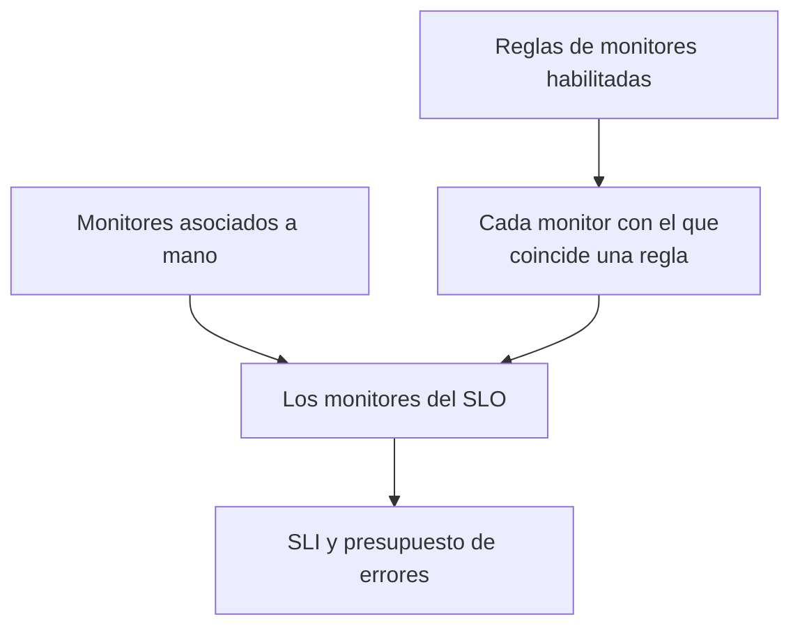

# Monitores y reglas de monitores

Un SLO mide la disponibilidad de los monitores asociados a él. Asócialos a mano, deja que las reglas de monitores asocien todos los monitores que coincidan, o haz ambas cosas. Esta página trata las páginas **Monitores** y **Reglas de monitores** de un SLO, ambas en **Configuración** de su menú lateral.

:::cards
- [Elegir monitores a mano](#asociar-monitores-a-mano): Lo mejor para un conjunto pequeño y fijo.
- [Asociar monitores con una regla](#asociar-monitores-con-una-regla): «Todos los monitores etiquetados Production», siempre al día.
- [Criterios de coincidencia](#criterios-de-coincidencia): Los campos y operadores con los que puede coincidir una regla.
:::

## Qué monitores mide un SLO

Un SLO mide la unión de los monitores que asociaste a mano y de cada monitor con el que coincide al menos una de sus reglas de monitores habilitadas.

Un SLO nuevo no tiene monitores, porque el formulario de creación no los pide. Hasta que tenga uno no se puede evaluar: sus páginas muestran **No hay monitores asociados**, y su **Vista general** ofrece las dos formas de asociar monitores.

## Asociar monitores a mano

Necesitas permiso para editar el SLO.

:::steps
### Abrir la página Monitores

Abre el SLO y ve a **Monitores**.

### Elegir los monitores

Haz clic en **Añadir monitores** y elige monitores del proyecto. Solo aparecen los monitores que aún no están asociados.

### Guardar la lista

Haz clic en **Añadir monitores**. Los monitores aparecen en la lista con el origen **Manual** y cuentan para el SLI desde la siguiente evaluación.
:::

Para quitar un monitor del SLO, haz clic en **Eliminar** en su fila. El monitor en sí no cambia; solo deja de contar para el SLI y el presupuesto de errores del SLO.

La página **Monitores** muestra, para cada monitor:

| Columna | Qué muestra |
| --- | --- |
| **Estado actual** | El estado actual del monitor, o **Archivado**, **Deshabilitado**, **Sondas no habilitadas**, **Sondas desconectadas** o **Desconocido** cuando no se está comprobando o aún no ha informado. |
| **Origen** | **Regla** si lo asoció una de las reglas de monitores del SLO, **Manual** si alguien lo asoció a mano. |
| **Etiquetas** | Las etiquetas del monitor. |

## Asociar monitores con una regla

Una regla de monitores describe los monitores que debe medir un SLO, como «todos los monitores etiquetados Production» o «todos los monitores cuyo nombre empieza por api-». Cada monitor que coincide se asocia, ahora y cada vez que se crean o cambian monitores, para que nadie tenga que acordarse del monitor que alguien añada el mes que viene.

:::steps
### Abrir Reglas de monitores

Abre el SLO, ve a **Reglas de monitores** y haz clic en **Crear Regla de monitores del SLO**.

### Ponerle nombre a la regla

En **Información básica**, escribe un **Nombre** y, si quieres, una **Descripción** de por qué estos monitores pertenecen a este SLO.

### Elegir con qué coincide

En **Criterios de coincidencia**, haz clic en **Añadir condición**, elige un campo y un operador, y escribe o elige el valor. Con dos o más condiciones, elige **Coincidir con todas** o **Coincidir con cualquiera**. Una regla de monitores necesita al menos una condición.

### Guardar la regla

Haz clic en **Crear Regla de monitores del SLO**. La regla empieza habilitada y los monitores del SLO se vuelven a evaluar de inmediato: cada monitor que coincide se asocia con el origen **Regla**.
:::

La tabla de reglas muestra el nombre de cada regla, sus criterios de coincidencia en palabras y si está habilitada. Para pausar una regla, desactiva **Habilitado** en su formulario de edición. **Ver monitores** abre la página **Monitores** del SLO.

### Criterios de coincidencia

Cada condición compara un campo de un monitor:

| Campo | Se compara con | Operadores |
| --- | --- | --- |
| **Etiquetas del monitor** | Las etiquetas del monitor. | **Tiene alguno de**, **Tiene todos los**, **No tiene ninguno de** |
| **Tipo de monitor** | El tipo del monitor, elegido de la lista de tipos. | **Es igual a**, **No es igual a** |
| **Nombre del monitor** | El nombre del monitor. | **Contiene**, **No contiene**, **Es igual a**, **No es igual a**, **Empieza por**, **Termina en**, **Coincide con el patrón**, **No coincide con el patrón** |
| **Descripción del monitor** | La descripción del monitor. | Los mismos que **Nombre del monitor** |

Un patrón es una expresión regular, como `^api-.*`, o un comodín `*`, como `*checkout*`, y no distingue mayúsculas de minúsculas. Un patrón que no es ninguna de las dos cosas, como `api-(01`, se rechaza al guardar en lugar de no coincidir con nada sin avisar. Para asociar todos los monitores del proyecto, añade una condición de **Nombre del monitor** que coincida con el patrón `.*`.

| Quieres | Condiciones |
| --- | --- |
| Todos los monitores de producción | **Etiquetas del monitor** tiene alguno de _Production_ |
| Todos los monitores de API | **Tipo de monitor** es igual a _API_ |
| Todos los monitores menos los manuales | **Tipo de monitor** no es igual a _Manual_ |
| Todos los monitores cuyo nombre empieza por api- | **Nombre del monitor** coincide con el patrón `^api-` |
| Los monitores de checkout, pero no los de staging | **Coincidir con todas**: **Nombre del monitor** coincide con el patrón `*checkout*`, y **Etiquetas del monitor** no tiene ninguno de _Staging_ |

### Cuándo se ejecutan las reglas

- Cuando creas, editas, activas, desactivas o eliminas una regla, los monitores del SLO se vuelven a evaluar de inmediato.
- Cuando se crea un monitor, o cambian sus etiquetas, su nombre o su descripción, todas las reglas de monitores del proyecto lo comprueban, incluidas las etiquetas que le dan tus reglas de etiquetas de monitores.
- Cuando se elimina una etiqueta, se vuelven a evaluar los SLO cuyas reglas la usaban.
- Las reglas mantienen al día la lista de monitores de un SLO incluso cuando el SLO está desactivado o archivado, así que se reanuda con los monitores correctos.

Las reglas se resincronizan cada vez que se guardan, así que **Ejecutar ahora** sirve para recuperar lo que se le haya escapado al SLO. Está en cada fila, en la página de la regla (**Ver**) y en las acciones masivas de la tabla. Ejecutar una regla vuelve a evaluar juntas todas las reglas de monitores habilitadas del SLO, y luego el diálogo indica cuántos monitores se asociaron y desasociaron. Ejecutar una regla requiere permiso para editar las reglas de monitores de SLO. Consulta [Ejecutar reglas sobre recursos existentes](/docs/configuration/run-rules-now).

### Qué monitores pertenecen a una regla

- Un monitor sigue asociado mientras alguna regla habilitada coincida con él, y se desasocia en cuanto ninguna lo hace.
- Desactivar o eliminar una regla solo desasocia los monitores con los que ya no coincide ninguna otra regla habilitada.
- Las reglas solo desasocian monitores que asoció una regla. Un monitor asociado a mano nunca lo toma una regla que coincida con él por casualidad, ni se desasocia cuando deja de coincidir. Su origen sigue siendo **Manual**.

## Elegir a mano mientras hay reglas activas

Mientras haya al menos una regla habilitada, las reglas gestionan los monitores del SLO:

- no se pueden añadir monitores a mano: **Añadir monitores** está desactivado, y un aviso dice **Los monitores de este SLO los gestionan sus reglas de monitores**, con un enlace **Gestionar reglas de monitores**;
- los monitores que asoció una regla no se pueden quitar a mano, porque la regla los volvería a asociar: su botón **Eliminar** está bloqueado y su información emergente explica por qué;
- los monitores asociados a mano antes de activar las reglas todavía se pueden quitar.

Esto también se aplica a la API. Desactiva todas las reglas para volver a elegir los monitores tú.

## Los SLO para los que cuenta un monitor

La página de un monitor muestra los SLO que lo miden: abre el monitor y ve a **SLO** en su menú lateral. Consúltala antes de pausar o cambiar un monitor, para ver qué objetivos dependen de él. Los SLO archivados no aparecen, porque no se evalúan.

## Si vienes de Auto-Add Monitors With Labels

Las versiones anteriores tenían un ajuste **Auto-Add Monitors With Labels** en el formulario del SLO. Al actualizar, cada SLO que lo usaba recibe una regla de monitores habilitada llamada **Auto-add monitors with labels** que coincide con las mismas etiquetas, así que sigue midiendo exactamente los mismos monitores. El campo `monitorLabels` de la API de SLO está obsoleto: usa en su lugar las reglas de monitores de SLO.

:::details ¿Y si algo sigue guardando el ajuste antiguo?
Una pestaña del panel abierta antes de la actualización, o un cliente de API o un flujo de trabajo escrito para la versión anterior, todavía puede guardar el ajuste antiguo. Para que un SLO no pierda monitores sin avisar de esa forma:

- **Un SLO sin reglas de monitores** convierte las etiquetas guardadas en una regla **Auto-add monitors with labels**, y sus monitores se vuelven a evaluar de inmediato. Guardar una lista vacía desasocia los monitores que había asociado el ajuste, como antes.
- **Un SLO que tiene reglas de monitores**, activadas o no, ignora las etiquetas guardadas mediante el ajuste antiguo, porque sus reglas deciden qué mide.
- **Crear la primera regla de monitores** de un SLO cuyos monitores asoció el ajuste antiguo convierte primero el ajuste en una regla, así que la nueva regla se añade junto a ella en lugar de sustituirla.

Una regla convertida que eliminas sigue eliminada, salvo que sus monitores sigan asociados después, por ejemplo porque un servidor que aún ejecuta la versión anterior los volvió a asociar durante la actualización: el siguiente cambio de monitor o la siguiente regla nueva vuelve a convertir las etiquetas. Elimina esa regla otra vez cuando termine la actualización.
:::

## Historial

Cada asociación y desasociación, y cada regla que se crea, cambia o elimina, se publica en el **Feed** del SLO. Los cambios de reglas también se registran en sus **Registros de auditoría**. Consulta [Feed y registros de auditoría de SLO](/docs/slo/feed-and-audit-logs).

## Solución de problemas

:::details Añadir monitores está desactivado
Al menos una de las reglas de monitores del SLO está habilitada, así que las reglas gestionan sus monitores. Cambia las reglas, o desactívalas todas para elegir los monitores a mano.
:::

:::details El botón Eliminar de un monitor está bloqueado
Una regla de monitores asoció ese monitor y lo volvería a asociar. Cambia o desactiva la regla que coincide con él.
:::

:::details Un monitor con el que debería coincidir una regla no está asociado
Comprueba que la regla está habilitada y que se cumple cada condición con **Coincidir con todas**. Las etiquetas que añade una regla de etiquetas de monitores también cuentan. Haz clic en **Ejecutar ahora** en la regla para resincronizar el SLO.
:::

:::details Al guardar una regla aparece un error de patrón
El valor no es ni una expresión regular ni un comodín `*`, por ejemplo por un paréntesis sin cerrar. Corrige el patrón o usa **Contiene** en su lugar.
:::

## Próximos pasos

:::cards
- [Visión general de los SLO](/docs/slo/introduction): Cómo se combina el tiempo de inactividad de varios monitores.
- [Presupuestos de errores](/docs/slo/error-budget): Qué consume el tiempo de inactividad de los monitores.
- [Ejecutar reglas sobre recursos existentes](/docs/configuration/run-rules-now): Cómo funciona Ejecutar ahora para cada tipo de regla.
:::
