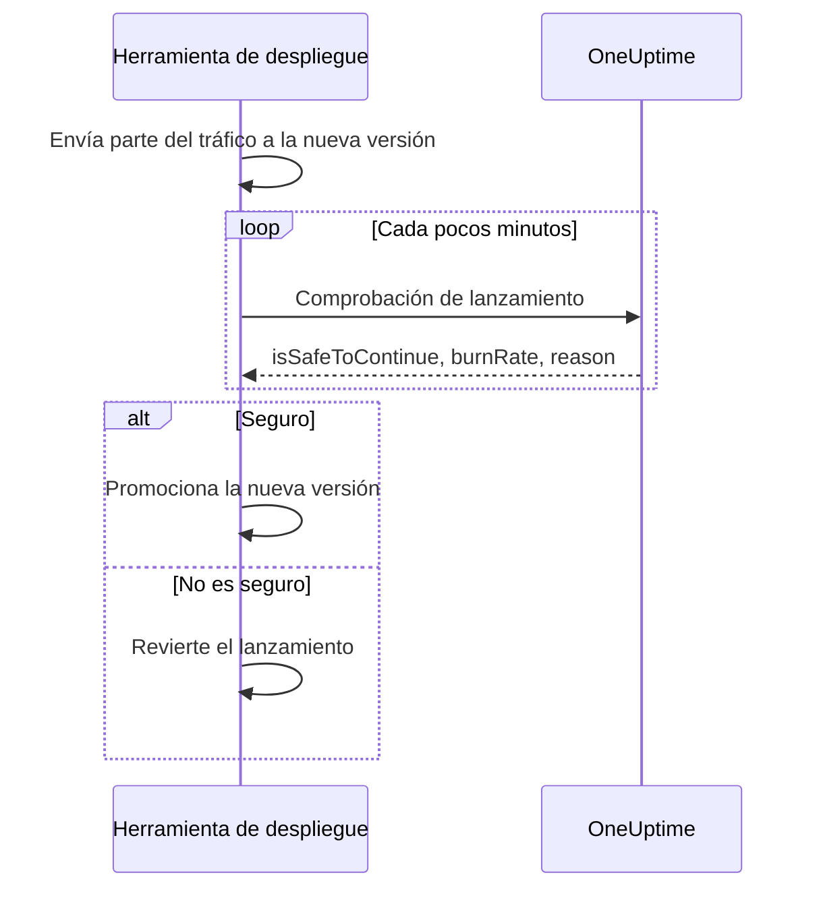

# Comprobaciones de lanzamiento

Una comprobación de lanzamiento le pregunta a un SLO «¿es seguro seguir desplegando este lanzamiento?» mientras el lanzamiento está en curso, y responde según la velocidad a la que el SLO ha consumido su presupuesto de errores en los últimos minutos. Argo Rollouts, Flagger o un pipeline de despliegue la consultan mientras un canary recibe tráfico, y revierten el lanzamiento si la respuesta es no. OneUptime no despliega nada por sí mismo: tu herramienta de despliegue sigue haciendo el despliegue, y OneUptime le dice cómo va el lanzamiento.

:::cards
- [Consultar la comprobación](#consultar-la-comprobación): Una solicitud con una clave de API, y lo que responde.
- [Argo Rollouts](#argo-rollouts): Un análisis que aborta el despliegue.
- [Flagger](#flagger): Un webhook que detiene el canary.
- [GitHub Actions](#github-actions): Un paso que revierte el lanzamiento después de desplegar.
- [Desactivar un feature flag](#desactivar-un-feature-flag): Un flujo de trabajo que desactiva un flag cuando el SLO consume su presupuesto de errores demasiado rápido.
:::

## Cómo funciona

La [barrera de despliegue](/docs/slo/error-budget-policy#barrera-de-despliegue) responde antes de un lanzamiento, a partir del presupuesto de errores de toda la ventana de cumplimiento. Un lanzamiento que rompe algo apenas ha gastado nada del presupuesto de un mes en sus primeros diez minutos, así que la comprobación de lanzamiento lee lo que cambia el lanzamiento: la tasa de consumo de los últimos minutos.



La comprobación responde con uno de tres veredictos:

| Veredicto | Cuándo | `isSafeToContinue` |
| --- | --- | --- |
| `Pass` | La ventana consumió el presupuesto de errores a `maxBurnRate` o más despacio. | `true` |
| `Fail` | Lo consumió más rápido, o la política de presupuesto de errores del SLO congela los despliegues. | `false` |
| `NotEnoughData` | La ventana tuvo menos solicitudes que `minimumRequestCount`, o los monitores del SLO no registraron ningún estado en ella. Es demasiado poco para dar el lanzamiento por seguro. | `false` |

Con una tasa de consumo de 1, la ventana cumplió exactamente el objetivo del SLO, así que el `maxBurnRate` predeterminado de `1` hace fallar un lanzamiento que lo hace peor que el objetivo.

Lo que lee la comprobación depende de lo que mide el SLO:

- Un [SLO de solicitudes](/docs/slo/request-slos) se juzga por las solicitudes de sus servicios en la ventana, leídas de sus spans a medida que llegan. Añade `serviceVersion` para juzgar solo las solicitudes de la nueva versión: OneUptime lo compara con el atributo de recurso `service.version` de los spans, que un SDK de OpenTelemetry fija a partir de `OTEL_RESOURCE_ATTRIBUTES=service.version=1.4.2`. Así el canary se juzga por sus propias solicitudes, sin que las de la versión anterior lo diluyan.
- Un [SLO de métrica](/docs/slo/request-slos#slo-a-partir-de-una-métrica) se juzga por los eventos de su métrica en la ventana, contados como los cuenta su SLI, así que `minimumRequestCount`, `goodRequestCount` y `totalRequestCount` son eventos. Con `serviceVersion`, solo cuentan los puntos de la métrica cuyo atributo de recurso `service.version` tenga ese valor: un SDK de OpenTelemetry lo fija en sus métricas igual que en sus spans.
- Un SLO de disponibilidad de monitores se juzga por las líneas de tiempo de estado de sus monitores en la ventana. `minimumRequestCount` no se le aplica, y una comprobación con `serviceVersion` se rechaza: los monitores no tienen versiones.

## Antes de empezar

Necesitas un SLO que mida lo que afecta el lanzamiento. Un SLO de solicitudes del servicio que lanzas es el que mejor juzga un canary, porque lee las propias solicitudes de ese servicio.

## Configurar una comprobación de lanzamiento

:::steps
### Dar una clave al despliegue

Crea una [clave de API](/docs/api-reference/api-reference) del proyecto cuyo rol pueda leer SLO, y guárdala como secreto de tu herramienta de despliegue o de tu pipeline.

### Copiar el ID del SLO

Abre el SLO y copia su ID de la dirección: `/slos/<slo-id>`.

### Consultar la comprobación una vez a mano

Ejecuta la solicitud de [Consultar la comprobación](#consultar-la-comprobación) con la clave y el ID. Responde con `isSafeToContinue` y un `reason`.

### Añadirla a tu despliegue

Consulta la comprobación desde [Argo Rollouts](#argo-rollouts), [Flagger](#flagger) o [GitHub Actions](#github-actions), y revierte el lanzamiento cuando `isSafeToContinue` sea `false`.
:::

## Consultar la comprobación

La comprobación es un `GET` o un `POST` a la dirección `release-check` del SLO. Envía las opciones en la cadena de consulta, o como cuerpo JSON con `POST`:

```bash
curl -sS "https://oneuptime.com/api/service-level-objective/<slo-id>/release-check?windowInMinutes=10&serviceVersion=1.4.2" \
  -H "ApiKey: $ONEUPTIME_API_KEY"
```

Responde primero con el veredicto y después con los datos de los que se ha leído:

```json
{
  "isSafeToContinue": false,
  "verdict": "Fail",
  "reason": "The last 10 minutes burned the error budget at 3.2x, faster than the 1x this check allows (SLI 99.68% against the 99.9% target).",
  "sloId": "<slo-id>",
  "sloName": "Checkout requests",
  "sliType": "Request Success",
  "targetPercentage": 99.9,
  "windowInMinutes": 10,
  "maxBurnRate": 1,
  "burnRate": 3.2,
  "sliPercentage": 99.68,
  "deploymentsAllowed": true,
  "errorBudgetPolicyTier": null,
  "sloStatus": "Healthy",
  "checkedAt": "2026-11-15T12:00:00.000Z",
  "goodRequestCount": 2492,
  "totalRequestCount": 2500,
  "minimumRequestCount": 1,
  "serviceVersion": "1.4.2"
}
```

Las opciones:

| Opción | Predeterminado | Qué hace |
| --- | --- | --- |
| `windowInMinutes` | `10` | Cuánto mira hacia atrás la comprobación, en minutos enteros de 1 a 360. |
| `maxBurnRate` | `1` | La tasa de consumo más rápida que pasa. Con `2`, la ventana puede consumir el presupuesto el doble de rápido de lo que permite el objetivo. |
| `minimumRequestCount` | `1` | SLO de solicitudes: el mínimo de solicitudes que juzga la comprobación. Con `0`, una ventana sin solicitudes pasa. |
| `serviceVersion` | Ninguno | SLO de solicitudes: juzga solo las solicitudes cuyos spans llevan este `service.version`. |
| `includeDeploymentGate` | `true` | Falla mientras la política de presupuesto de errores del SLO congela los despliegues. Con `false`, solo decide la tasa de consumo. |
| `failWithStatusCode` | `false` | Responde un no con el estado HTTP 412 en lugar de 200, para las herramientas que solo leen el código de estado. |

Los campos de la respuesta:

| Campo | Qué contiene |
| --- | --- |
| `isSafeToContinue` | `true` para seguir con el despliegue, `false` para revertirlo. |
| `verdict` | `Pass`, `Fail` o `NotEnoughData`. |
| `reason` | Una frase para el registro del despliegue, que dice qué se midió y por qué la comprobación respondió así. |
| `burnRate` y `sliPercentage` | A qué velocidad consumió la ventana el presupuesto de errores, y el SLI en la ventana. |
| `goodRequestCount` y `totalRequestCount` | SLO de solicitudes: las solicitudes que tuvo la ventana, y cuántas de ellas fueron buenas. |
| `deploymentsAllowed` y `errorBudgetPolicyTier` | Si la política de presupuesto de errores del SLO permite los despliegues, y el nivel en el que está. |
| `checkedAt` | Cuándo se midió la comprobación. |

Un SLO que no se puede medir (un SLO de solicitudes sin servicios, un SLO de latencia sin umbral, un SLO de métrica sin una métrica que se pueda contar, un SLO de disponibilidad de monitores sin monitores) recibe como respuesta un HTTP 400 y lo que hay que corregir, así que un despliegue se detiene con un error claro en lugar de con una suposición. En una instalación autoalojada, usa su propia dirección en lugar de oneuptime.com.

## Argo Rollouts

Un análisis con una métrica `web` consulta la comprobación en cada paso de un canary, y Argo Rollouts aborta el despliegue y reduce la escala del canary cuando falla. Guarda primero la clave de API como secreto:

```bash
kubectl create secret generic oneuptime --from-literal=api-key="$ONEUPTIME_API_KEY"
```

Después añade la plantilla y ejecútala tras el primer paso del canary:

:::tabs
@tab AnalysisTemplate
```yaml title="oneuptime-release-check.yaml"
apiVersion: argoproj.io/v1alpha1
kind: AnalysisTemplate
metadata:
  name: oneuptime-release-check
spec:
  args:
    - name: version
    - name: api-key
      valueFrom:
        secretKeyRef:
          name: oneuptime
          key: api-key
  metrics:
    - name: slo-burn-rate
      interval: 2m
      count: 5
      failureLimit: 0
      successCondition: result == true
      provider:
        web:
          url: "https://oneuptime.com/api/service-level-objective/<slo-id>/release-check?windowInMinutes=10&serviceVersion={{args.version}}"
          headers:
            - key: ApiKey
              value: "{{args.api-key}}"
          jsonPath: "{$.isSafeToContinue}"
```
@tab Rollout
```yaml title="rollout.yaml"
apiVersion: argoproj.io/v1alpha1
kind: Rollout
metadata:
  name: checkout
spec:
  strategy:
    canary:
      steps:
        - setWeight: 10
        - analysis:
            templates:
              - templateName: oneuptime-release-check
            args:
              - name: version
                value: "1.4.2"
        - setWeight: 50
        - pause: { duration: 10m }
```
:::

El análisis consulta cinco veces, con dos minutos entre una consulta y la siguiente, y el primer no aborta el despliegue. Pasa la misma versión que los pods del canary fijan en `OTEL_RESOURCE_ATTRIBUTES`. Si el canary puede no recibir tráfico con su primer peso, añade `&minimumRequestCount=0` a la dirección, o un canary sin tráfico hará fallar el análisis con `NotEnoughData`.

## Flagger

Flagger llama a un webhook `rollout` en cada paso de su análisis, y detiene y revierte el canary cuando el webhook sigue fallando. Los webhooks de Flagger no envían cabeceras, así que consulta la comprobación a través del load tester de Flagger, que ejecuta un comando para el webhook:

```yaml title="canary.yaml"
apiVersion: flagger.app/v1beta1
kind: Canary
metadata:
  name: checkout
spec:
  analysis:
    interval: 1m
    threshold: 2
    maxWeight: 50
    stepWeight: 10
    webhooks:
      - name: oneuptime-release-check
        type: rollout
        url: http://flagger-loadtester.test/
        timeout: 30s
        metadata:
          type: bash
          cmd: "curl -sSf -H \"ApiKey: $ONEUPTIME_API_KEY\" 'https://oneuptime.com/api/service-level-objective/<slo-id>/release-check?windowInMinutes=5&failWithStatusCode=true'"
```

Con `failWithStatusCode=true`, un no es un HTTP 412, así que `curl -f` termina con un error y el webhook falla. Dale la clave al load tester como `ONEUPTIME_API_KEY` en su entorno, desde un secreto de Kubernetes. En cuanto han fallado `threshold` comprobaciones, Flagger revierte el canary.

## GitHub Actions

Un pipeline que despliega de una sola vez también puede vigilar el lanzamiento: despliega, consulta la comprobación varias veces y revierte cuando dice que no.

```yaml title=".github/workflows/deploy.yml"
name: Deploy
on:
  push:
    branches: [main]

jobs:
  deploy:
    runs-on: ubuntu-latest
    steps:
      - uses: actions/checkout@v4
      - name: Deploy
        run: ./deploy.sh
      - name: Watch the release against the SLO
        env:
          ONEUPTIME_API_KEY: ${{ secrets.ONEUPTIME_API_KEY }}
          SLO_ID: <slo-id>
          VERSION: ${{ github.sha }}
        run: |
          for attempt in 1 2 3 4 5; do
            sleep 120
            CHECK=$(curl -sS "https://oneuptime.com/api/service-level-objective/$SLO_ID/release-check?windowInMinutes=10&serviceVersion=$VERSION" \
              -H "ApiKey: $ONEUPTIME_API_KEY")
            echo "$CHECK" | jq -r '.reason'
            if [ "$(echo "$CHECK" | jq -r '.isSafeToContinue')" != "true" ]; then
              exit 1
            fi
          done
      - name: Roll back
        if: failure()
        run: ./rollback.sh
```

El paso falla con un no, y con cualquier respuesta sin `isSafeToContinue: true` (un ID incorrecto, una clave que no puede leer el SLO, ninguna respuesta en absoluto), así que el pipeline nunca sigue adelante con una respuesta que no ha recibido. Fija `service.version` al commit (`${{ github.sha }}`) cuando arranca el servicio, para que la comprobación juzgue solo la nueva versión.

## Desactivar un feature flag

Para revertir un lanzamiento protegido por un feature flag, basta con desactivar el flag. Un flujo de trabajo puede hacerlo por ti: cuando una [regla de tasa de consumo](/docs/slo/burn-rate-alerts) del SLO genera su alerta o declara su incidente, el flujo de trabajo desactiva el flag en LaunchDarkly o Unleash. Así, un mal despliegue se deshace en minutos, sin esperar a que intervenga nadie.

:::steps
### Copiar el ID de la regla de tasa de consumo

Abre el SLO y ve a **Reglas de tasa de consumo**. Abre el menú de la regla que debe desactivar el flag y elige **Mostrar ID**. Lo más adecuado es una regla de consumo rápido, porque se activa a los pocos minutos de un mal despliegue.

### Crear el flujo de trabajo a partir de una plantilla

Abre **Flujos de trabajo** y haz clic en **Crear flujo de trabajo**. En **O empieza con una plantilla**, elige la categoría **SLO** y, después, la plantilla de tu servicio de feature flags:

| Plantilla | Qué pide |
| --- | --- |
| **Turn a LaunchDarkly flag off when an SLO burns too fast** | Un token de acceso a la API que pueda modificar el flag, y las claves del flag, de su proyecto y del entorno. |
| **Turn an Unleash flag off when an SLO burns too fast** | La dirección de tu Unleash, un token de cuenta de servicio o un token de acceso personal, y el proyecto del flag, su nombre y el entorno. |

Pega el ID de la regla en **Burn Rate Rule ID**, rellena el resto y crea el flujo de trabajo.

### Activarlo

Los flujos de trabajo se crean desactivados. Cuando estés listo, activa **Habilitado** en la parte superior del **Constructor** del flujo de trabajo.
:::

El flujo de trabajo se inicia cada vez que una regla de tasa de consumo del proyecto genera una alerta o declara un incidente. Su bloque **Si / Si no** solo deja seguir la ejecución para la regla cuyo ID pegaste, y el paso siguiente llama al servicio de feature flags: la instrucción `turnFlagOff` de LaunchDarkly, con un comentario que nombra la regla y el SLO, o el `off` de Unleash para el entorno. Ambas llamadas desactivan el flag para todo el mundo en ese entorno, sea cual sea su segmentación. Si el servicio de feature flags rechaza la llamada, la ejecución falla y su registro dice por qué. La alerta de la regla sigue avisando a la guardia como siempre.

En el **Constructor**, **Ejecutar flujo de trabajo** ejecuta el flujo de trabajo como si la regla que elijas acabara de activarse, así que el flag se desactiva de verdad. Pruébalo primero con un flag de un entorno de pruebas.

Para otro servicio de feature flags, o para una instancia de LaunchDarkly con una dirección propia, empieza con cualquiera de las dos plantillas y cambia su paso de API por la llamada que desactiva el flag para todo el mundo en el entorno. Elige una llamada que también se imponga a los segmentos y a las reglas de segmentación, como hacen estas dos, o un despliegue gradual seguirá sirviendo el flag.

## Próximos pasos

:::cards
- [SLO de solicitudes y latencia](/docs/slo/request-slos): Mide las solicitudes de un servicio, el SLI que mejor juzga un canary.
- [Política de presupuesto de errores](/docs/slo/error-budget-policy): Congela los despliegues mientras queda poco presupuesto.
- [Alertas e incidentes de tasa de consumo](/docs/slo/burn-rate-alerts): Avisa a tu equipo cuando el presupuesto se consume demasiado rápido.
:::
