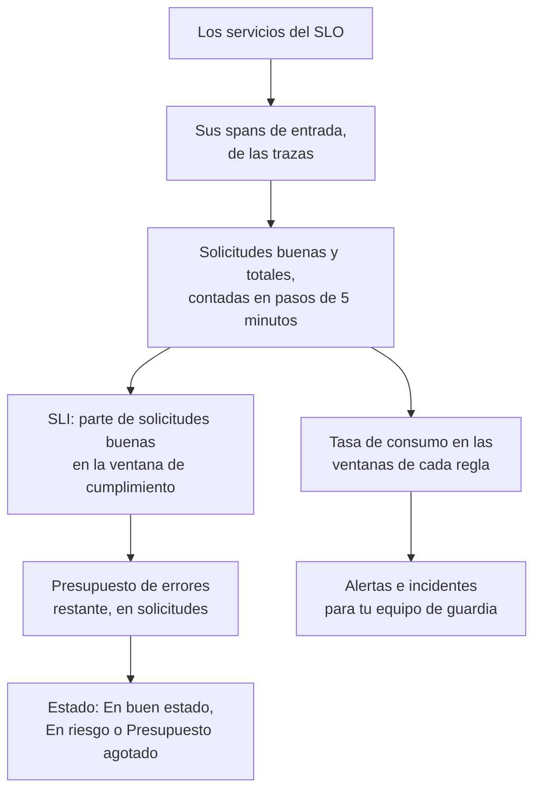

# SLO de solicitudes y latencia

Un SLO de solicitudes mide lo que tus usuarios obtienen de un servicio: la parte de sus solicitudes que tienen éxito, o que se sirven lo bastante rápido. OneUptime las cuenta a partir de las trazas que tus servicios ya envían, así que no hay ningún monitor que configurar: elige los servicios y un objetivo, y OneUptime los mide cada 5 minutos.

:::cards
- [Crear un SLO de solicitudes](#crear-un-slo-de-solicitudes): Los servicios, un umbral para la latencia y un objetivo.
- [Contar solo algunas solicitudes](#contar-solo-algunas-solicitudes): Un solo endpoint, o todas las solicitudes menos las comprobaciones de salud.
- [SLO a partir de una métrica](#slo-a-partir-de-una-métrica): Un contador o un histograma, para servicios que no envían trazas.
- [Cómo se cuentan las solicitudes](#cómo-se-cuentan-las-solicitudes): Qué spans cuentan, y cuándo.
- [Comprobaciones de lanzamiento](/docs/slo/release-checks): Revierte un lanzamiento que consume el presupuesto de errores.
:::

## Éxito y latencia de las solicitudes

| Qué mide | Una solicitud es mala cuando | Su presupuesto de errores cuenta |
| --- | --- | --- |
| **Éxito de solicitudes** | El estado de su span es `Error`. Un span sin estado cuenta como bueno, tal como lo entiende OpenTelemetry. | Solicitudes fallidas |
| **Latencia de solicitudes** | Tardó más que el **Umbral de latencia (ms)** del SLO, sea cual sea su estado. | Solicitudes lentas |

El SLI es la parte de solicitudes buenas en la ventana de cumplimiento, y el presupuesto de errores son las solicitudes malas que permite el objetivo: con un 99,9 %, una de cada 1.000. Un SLO de latencia cuenta como buena una solicitud que falló rápido, así que mide un servicio importante de las dos formas: un SLO de que funciona y otro de que es rápido.

## Cómo funciona

Una solicitud es un span de entrada de uno de los servicios del SLO: el span en el que una solicitud o un mensaje entra en el servicio, como los muestra de forma predeterminada la lista de [Trazas](/docs/telemetry/traces-explorer#trazas-y-spans). Una solicitud que pasa por dos de los servicios del SLO cuenta una vez en cada uno.

A partir de ahí, un SLO de solicitudes funciona como cualquier otro. Su estado, sus reglas de tasa de consumo, su política de presupuesto de errores, sus propietarios y sus notificaciones son los mismos, con el presupuesto de errores en solicitudes en lugar de en minutos.

## Antes de empezar

- Los servicios envían trazas a OneUptime: consulta [OpenTelemetry](/docs/telemetry/open-telemetry). Cada uno está en el [catálogo de servicios](/docs/telemetry/services) con su `service.name`.
- Un rol que pueda crear SLO: Propietario del proyecto, Administrador del proyecto o un rol personalizado con el permiso Create Service Level Objective.

## Crear un SLO de solicitudes

:::steps
### Abrir los SLO

Abre **SLO** desde el menú **Productos** de la barra superior y haz clic en **Crear Objetivo de nivel de servicio**.

### Elegir qué mide

En **Qué mide**, elige **Éxito de solicitudes** o **Latencia de solicitudes** y, después, los **Servicios** cuyas solicitudes cuenta. Para **Latencia de solicitudes**, fija también el **Umbral de latencia (ms)**: una solicitud servida dentro de ese tiempo cuenta como lo bastante rápida, por ejemplo `300`. Para contar solo algunas de sus solicitudes, escribe un **Filtro de solicitudes**: consulta [Contar solo algunas solicitudes](#contar-solo-algunas-solicitudes). Haz clic en **Siguiente**.

### Ponerle nombre y fijar un objetivo

Escribe un **Nombre**, por ejemplo «Checkout requests», y un **Objetivo (%)**: la parte de las solicitudes que deben ser buenas. Haz clic en **Crear Objetivo de nivel de servicio**.

### Ver llegar las primeras cifras

La primera evaluación, en menos de 5 minutos, cuenta las solicitudes de las últimas 6 horas, así que el SLO tiene cifras enseguida. Las evaluaciones siguientes cuentan también solicitudes más antiguas, hasta cubrir la ventana de cumplimiento.
:::

La página **SLO** de un servicio lista los SLO que lo miden, y su **Crear Objetivo de nivel de servicio** abre el mismo formulario con el servicio ya elegido. Para cambiar más adelante lo que mide un SLO, sus servicios, su umbral o su filtro, abre sus **Ajustes** y haz clic en **Editar qué mide**.

## Contar solo algunas solicitudes

Un SLO de solicitudes cuenta todas las solicitudes de sus servicios. Un **Filtro de solicitudes** cuenta solo las que importan, como las del endpoint de checkout, o deja fuera algunas, como las comprobaciones de salud, que harían que el SLI pareciera mejor que lo que obtienen los usuarios. Escríbelo como una búsqueda de trazas, con la misma [sintaxis de búsqueda](/docs/telemetry/search-syntax#coincidencia-de-valores) que el explorador de trazas:

| Filtro de solicitudes | Qué cuenta |
| --- | --- |
| `@http.route:/checkout*` | Las solicitudes cuya ruta empieza por `/checkout`. |
| `-@http.route:/health` | Todas las solicitudes menos las comprobaciones de salud. |
| `@http.request.method:[POST, PUT]` | Las solicitudes POST y PUT. |
| `name:"POST /checkout"` | Las solicitudes cuyo span se llama `POST /checkout`. |

Todos los términos deben coincidir, así que `@http.route:/checkout* -@http.route:/checkout/health` cuenta las solicitudes de checkout menos su comprobación de salud. Un término con `@` es un atributo del span de la solicitud, y `name:` es el nombre del span. El texto libre y los demás campos del explorador, como `status:` y `duration:`, no son filtros aquí: el SLO ya decide qué solicitudes son malas o lentas. Un filtro admite hasta 10 términos en 500 caracteres.

La **Vista general** muestra el filtro bajo los servicios del SLO, y los **Ajustes** lo muestran bajo **Qué mide**. Cambiarlo vuelve a contar las solicitudes del SLO desde el principio.

## SLO a partir de una métrica

Cuando tus servicios ya cuentan sus solicitudes como métricas, o no envían trazas, mide el SLO a partir de un contador o un histograma en su lugar. En **Qué mide**, elige **Métrica** y los **Servicios** que la envían y, después, en el paso **Métrica**:

| Campo | Qué escribir |
| --- | --- |
| **Métrica** | El nombre de la métrica, elegido entre las métricas de tu proyecto o escrito, como `http_requests_total` o `http.server.request.duration`. |
| **Eventos buenos** | **Un contador, por una condición** o **Un histograma, por un valor**. |
| **Bueno cuando** | Para un contador: los eventos que son buenos, en forma de búsqueda en sus atributos, por ejemplo `@http.response.status_code:<500`. |
| **Bueno hasta** | Para un histograma: el valor que una observación buena no supera, en la unidad propia de la métrica, por ejemplo `0.3` para 300 ms en un histograma en segundos. Usa uno de los límites de sus buckets. |
| **Filtro de métrica** | Opcional: las series que cuentan, como `-@http.route:/health`. |

Los eventos de un contador son lo que creció en cada paso de 5 minutos, como lo lee `increase()` de Prometheus: un contador que se reinicia vuelve a contar desde cero, y cuentan tanto los contadores acumulativos como los delta. Los eventos de un histograma son sus observaciones, y los buenos son los de los buckets iguales o inferiores al valor. Solo cuentan los puntos propios de la métrica, y solo los de los servicios del SLO: un gauge con el mismo nombre no cuenta nada. Un SLO sobre un gauge, como lo es toda métrica de nube, lo dice en su página, y también el selector de métricas: mide una métrica de nube con un monitor de métricas y un SLO de la disponibilidad de ese monitor.

A partir de ahí, un SLO de métrica funciona como un SLO de solicitudes, con su presupuesto de errores, sus reglas de tasa de consumo y sus comprobaciones de lanzamiento en eventos. Cambiar la métrica vuelve a contar sus eventos desde el principio.

## Cómo se cuentan las solicitudes

OneUptime cuenta las solicitudes buenas y totales de cada SLO en pasos de 5 minutos y guarda los recuentos, así que el SLO lee su ventana de sus propios recuentos en lugar de volver a leer todos los spans cada vez:

- Un paso se cuenta 2 minutos después de terminar, para que incluya los spans que llegan tarde, y la evaluación siguiente vuelve a contar los dos últimos pasos por los spans que llegan más tarde todavía.
- Un SLO nuevo empieza con las últimas 6 horas. Cada evaluación posterior cuenta hasta un día de solicitudes más antiguas, de las más recientes hacia atrás, hasta cubrir la ventana.
- Solo se pueden contar las solicitudes que siguen dentro de tu [retención de telemetría](/docs/telemetry/data-retention#cuánto-tiempo-se-conserva-la-telemetría). Los pasos contados se conservan 400 días, más que cualquier ventana de cumplimiento, así que una ventana más larga que la retención se va llenando a medida que el SLO envejece.
- Cambiar lo que mide el SLO, sus servicios, su umbral de latencia o su filtro de solicitudes vuelve a contar sus solicitudes desde el principio. Una ventana de cumplimiento más larga se llena contando más hacia atrás.

Mientras los recuentos cubren solo una parte de la ventana de cumplimiento, la **Vista general** lo indica con un indicador **Ventana llena al 23 %**, y el mosaico **Presupuesto de errores restante** lo repite bajo su cifra. Ambos desaparecen cuando los recuentos cubren toda la ventana.

## El presupuesto de errores en solicitudes

El presupuesto son las solicitudes malas que permite el objetivo entre las solicitudes contadas en la ventana, así que crece con el tráfico: con un 99,9 %, una ventana de 2.000.000 de solicitudes permite 2.000 fallidas. En la **Vista general**:

- **Presupuesto de errores restante** indica cuántas solicitudes malas quedan y de cuántas, o en cuántas se ha pasado el SLO del presupuesto.
- **Autonomía del presupuesto** indica cuánto dura el presupuesto a la tasa de consumo actual, siempre que el tráfico siga como hasta ahora.
- El resumen cuenta los servicios del SLO, y un SLO de latencia muestra su umbral bajo su objetivo.

Las alertas de tasa de consumo, las notificaciones y el feed también expresan el presupuesto en solicitudes. La métrica `oneuptime.slo.error.budget.remaining.seconds` no se publica para un SLO de solicitudes; representa en tus gráficos `oneuptime.slo.error.budget.remaining.percent` en su lugar.

Un SLO de solicitudes recibe las mismas reglas **Fast burn**, **Slow burn** y **Slow leak** que cualquier SLO nuevo. En una hora tranquila con un puñado de solicitudes, un solo fallo puede consumir el presupuesto muy rápido, así que una regla puede ignorar las ventanas con muy pocas solicitudes: fija el **Mínimo de solicitudes** de la regla, y la regla omite una ventana larga que tenga menos solicitudes que ese número.

## Solución de problemas

:::details El SLO muestra Esperando solicitudes
Ninguno de sus servicios ha servido todavía una solicitud en la ventana. Comprueba que los servicios envían trazas a OneUptime y que sus spans incluyen spans de entrada: un servicio cuyos spans son todos internos no tiene solicitudes que contar. Si el SLO tiene un **Filtro de solicitudes**, busca con él en el [Explorador de trazas](/docs/telemetry/traces-explorer): un filtro que allí no coincide con ninguna solicitud no le deja al SLO ninguna que contar.
:::

:::details El SLI cambió después de cambiar los servicios
Cambiar lo que mide el SLO, sus servicios, su umbral de latencia o su filtro de solicitudes vuelve a contar sus solicitudes, empezando por las últimas 6 horas, así que el SLI y el presupuesto vuelven a empezar desde ahí. El indicador **Ventana llena al 23 %** muestra qué parte de la ventana se ha contado hasta ahora.
:::

## Próximos pasos

:::cards
- [Comprobaciones de lanzamiento](/docs/slo/release-checks): Deja que Argo Rollouts, Flagger o un pipeline reviertan un lanzamiento que consume el presupuesto.
- [Alertas e incidentes de tasa de consumo](/docs/slo/burn-rate-alerts): Avisa a tu equipo cuando el presupuesto se consume demasiado rápido.
- [Política de presupuesto de errores](/docs/slo/error-budget-policy): Acuerda con el equipo qué hacer a medida que se agota el presupuesto.
:::
