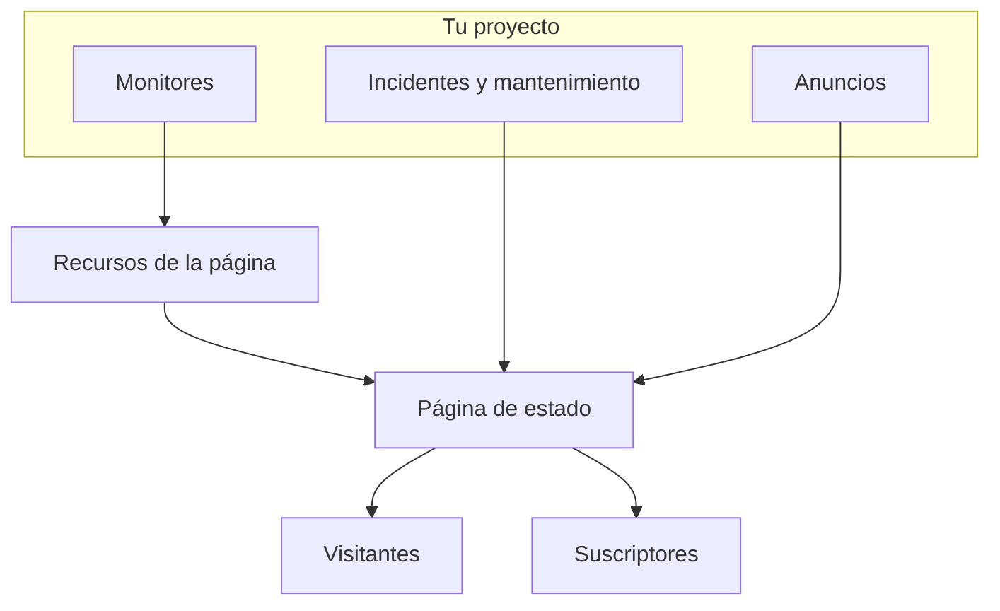

# Visión general de las páginas de estado

Una página de estado es la cara pública de todo lo que monitorizas: una única URL que tus clientes pueden abrir en lugar de escribirte para preguntar si el problema es solo suyo. Muestra el estado actual de los servicios que eliges exponer, los incidentes en los que estás trabajando, el mantenimiento que tienes planificado y cualquier anuncio que quieras fijar arriba.

Cuando algo se rompe a las 2 de la madrugada, la página de estado es lo primero que enlaza tu cola de soporte. También es desde donde se notifica a tus suscriptores, así que merece la pena configurarla antes de necesitarla, no en mitad de la caída.

:::cards
- [Crear una página de estado](#crear-una-página-de-estado): Dos campos para empezar, todo lo demás después.
- [Elegir qué muestra](#elegir-qué-se-muestra-en-la-página): Incidentes, episodios, anuncios, mantenimiento y tiempo de actividad, en una sola tarjeta.
- [Decidir quién puede verla](#restringir-quién-puede-ver-la-página): Cualquiera con el enlace, solo quienes inician sesión o cualquiera con la contraseña.
- [Archivar una página de estado](#archivar-una-página-de-estado): Desconectar una página sin eliminarla.
:::

## Cómo funciona

Las páginas de estado están en **Páginas de estado**, en el menú **Productos** de la barra superior, entre los esenciales. Todo lo que hay en esta página es por página de estado: un proyecto puede tener tantas como quiera — una pública para clientes, una privada para un público interno, una por región para un mercado concreto.

La página muestra como recursos los monitores que colocas en ella. Los incidentes y el mantenimiento programado llegan a ella a través de esos monitores, y los anuncios se publican directamente en ella. Los visitantes leen la página, y los suscriptores reciben aviso de cada cambio por los canales que eligieron.

## De un vistazo

- **Se crea con dos campos.** Una página de estado nueva solo pide **Nombre** y **Descripción**. Los recursos, la marca y los dominios se configuran después.
- **Los recursos son lo que ven los visitantes.** Cada fila de la página es un **Recurso de la página de estado**: un monitor (o grupo de monitores) con su propio nombre visible, su información emergente y sus opciones de tiempo de actividad. Los grupos dividen una página larga en secciones y se pueden anidar.
- **Una URL de vista previa desde el primer día.** Cada página de estado recibe un enlace de vista previa para que puedas verla antes de que exista un dominio personalizado.
- **Las rutas para visitantes dependen de ajustes.** Los incidentes, los episodios, los anuncios y los eventos programados solo aparecen mientras su interruptor en **Lo que muestra tu página de estado** (en **Ajustes avanzados**) está activado, y la página de suscripción solo mientras **Mostrar página de suscriptores** está activado.
- **Quién puede verla es una sola elección.** Cualquiera con el enlace, solo quienes inician sesión (usuarios privados, SSO SAML u OIDC) o cualquiera con la contraseña, en la pantalla **Acceso** de la página, con una lista de IP permitidas opcional en **Más ajustes**.
- **Los suscriptores reciben aviso automáticamente.** Suscriptores por correo electrónico, SMS, Slack, Microsoft Teams y webhook pueden seguir una página, cada canal tras su propio interruptor.

## Términos clave

| Término | Qué significa |
| --- | --- |
| **Página de estado** | Una página pública (o privada), con su propia marca, dominios, recursos y suscriptores. El modelo `StatusPage`. |
| **Recurso** | Una fila que ven los visitantes: un monitor o grupo de monitores mostrado en la página con un nombre visible y opciones de tiempo de actividad. |
| **Grupo** | Una sección con nombre que contiene recursos. Los grupos se anidan dentro de otros grupos, y cada nivel resume el estado de todo lo que hay debajo. |
| **Anuncio** | Un mensaje que publicas en una o varias páginas de estado, con una hora de inicio y una hora de fin opcional. |
| **Suscriptor** | Alguien (o algo) que sigue la página por correo electrónico, SMS, Slack, Microsoft Teams o un webhook. |
| **Dominio personalizado** | Un dominio tuyo, `status.example.com`, que apunta a la página con un registro CNAME. OneUptime emite su certificado SSL gratis y lo renueva. |
| **Usuario privado** | Una cuenta que puede iniciar sesión en una página de estado privada. Independiente de los usuarios de tu proyecto de OneUptime. |

## Crear una página de estado

:::steps
### Abrir el formulario

Abre **Páginas de estado → Todas las páginas de estado** y haz clic en **Crear página de estado**.

### Ponerle nombre a la página

En la ventana **Crear Página de estado**, rellena **Nombre** (obligatorio, al menos dos caracteres) y, si quieres, **Descripción**, y haz clic en **Crear página de estado**.

Ese es todo el formulario. La lista a la que vuelves muestra **Nombre**, **Descripción**, **Etiquetas** y **Propietarios**, y se puede filtrar por **ID de la página de estado**, **Nombre** y **Descripción**.

### Abrir la página nueva

Abre la página nueva y llegarás a su pantalla **Vista general**, que tiene dos tarjetas: **URL de vista previa de la página de estado**, con un enlace a la propia página, y **Detalles de la página de estado**, donde puedes editar el nombre, la descripción y las etiquetas que acabas de definir. Cuando el proyecto tiene campos personalizados de páginas de estado, les sigue una tarjeta **Campos personalizados**.
:::

Una página creada con la API o con Terraform está sujeta a los mismos planes que los ajustes que se describen abajo. En OneUptime Cloud, crear una página con un ajuste activado que tu plan no incluye (por ejemplo privada, una lista oculta, HTML, CSS o JavaScript personalizados, informes por correo electrónico, suscriptores por SMS, Slack, Microsoft Teams o webhook, una lista de IP permitidas) se rechaza con `402 Payment Required`, y el mensaje indica el plan. El plan de cada ajuste se indica junto a él más abajo. Los ajustes que se dejan con su valor predeterminado, como los deja este formulario, funcionan en todos los planes.

A continuación, más o menos por orden de utilidad:

- Añade recursos para que la página muestre algo: consulta [Recursos y grupos de la página de estado](/docs/status-pages/resources-and-groups).
- Define el título de la página, el favicon, el logotipo y la portada, y después asocia un dominio personalizado: consulta [Marca y dominios de la página de estado](/docs/status-pages/branding-and-domains).
- Decide por qué canales se puede suscribir la gente: consulta [Suscriptores y anuncios](/docs/status-pages/subscribers).
- Ajusta lo que aparece en la página en **Ajustes avanzados**.

## Dónde vive cada cosa

Una vez abierta una página de estado, su propio menú lateral izquierdo se agrupa en nueve secciones. Úsalo como mapa para el resto de esta parte de la documentación.

| Sección | Qué contiene |
| --- | --- |
| **Básico** | **Vista general**, **Anuncios**, **Propietarios**. |
| **Recursos** | Una sola pantalla **Recursos** (los grupos a la izquierda, los monitores del grupo seleccionado a la derecha) y **Reglas de monitores**. |
| **Suscriptores** | **Suscriptores por correo electrónico**, **Suscriptores por SMS**, **Suscriptores de Slack**, **Suscriptores de MS Teams**, **Suscriptores de webhook**, **Ajustes de suscriptores**. |
| **Registros de notificación** | **Registros de notificación**: lo que se envió a los suscriptores. |
| **Marca** | **Marca** (logotipo, título, favicon, enlaces, pie de página, colores e idiomas, en una sola página), **Dominios personalizados**, **HTML, CSS y JavaScript**. |
| **Seguridad** | **Acceso** (quién puede ver la página), **Usuarios privados**, **SSO**, **OIDC**, **SCIM**. |
| **IA** | **MCP**. |
| **Desarrolladores** | **Terraform**, **API**, **Asistentes de IA**: la página como código. |
| **Avanzado** | **Estado incrustado**, **Informes**, **Campos personalizados**, **Ajustes avanzados**, **Registros de auditoría**, **Eliminar página de estado**. |

Solo **Básico** y **Recursos**, lo que muestra la página, empiezan abiertas. Todas las demás secciones empiezan plegadas, como las secciones poco usadas de todos los menús de OneUptime: haz clic en el título de una sección para mostrar sus páginas. Una sección se abre sola cuando estás en una de sus páginas, como **Ajustes avanzados** o **Suscriptores por correo electrónico**.

Dos peculiaridades de nombres que conviene conocer antes de buscar:

- El elemento **Recursos** solo se llama **Recursos** cuando el proyecto tiene activados los grupos de monitores. Si no, se llama **Monitores**. Es la misma pantalla en ambos casos.
- No hay una página de grupos aparte. Los grupos y los recursos se fusionaron, y la antigua ruta `/groups` ahora redirige a la pantalla de recursos.

Fuera de una página concreta, la propia sección **Páginas de estado** lista **Todas las páginas de estado**, y una sección **Más** contiene **Anuncios**. Una sección **Ajustes** plegada contiene **Plantillas de anuncios**, **Plantillas de suscriptores**, **Campos personalizados**, **Reglas del propietario** y **Reglas de etiquetas**, que son de todo el proyecto y se comparten entre todas las páginas de estado. Una sección **Avanzado** plegada contiene **Archivado**: las páginas de estado que desconectaste (consulta [Archivar una página de estado](#archivar-una-página-de-estado)).

**Reglas de etiquetas** y **Reglas del propietario** etiquetan las páginas de estado nuevas y les asignan propietarios. Una regla tiene dos pasos (**Coincidencia**, las condiciones que debe cumplir una página de estado, y después **Etiquetas** u **Propietarios**, lo que añade la regla) y su **Nombre** se rellena a partir de lo que eliges. Una regla nueva tiene que añadir al menos una etiqueta o un propietario; al editarla nunca se insiste, y la lista marca con **No añade nada** una regla antigua que no añade nada. Consulta [Reglas de etiquetas y propietarios](/docs/configuration/label-and-owner-rules).

## Lo que ven los visitantes

La página pública es una aplicación propia, con un pequeño conjunto de rutas:

- `/`: el **Resumen**.
- `/incidents` y `/incidents/:id`: la lista de incidencias y una incidencia concreta.
- `/announcements` y `/announcements/:id`.
- `/scheduled-events` y `/scheduled-events/:id`.
- `/subscribe/email`, `/subscribe/sms`, `/subscribe/slack`, `/subscribe/microsoft-teams`, `/subscribe/webhooks`.
- `/confirm-subscription/:id`, `/update-subscription/:id` y `/unsubscribe/:token`: los enlaces de los mensajes que reciben los suscriptores.
- `/rss`: el feed.
- `/login`, `/sso` y `/master-password`: solo relevantes en una página privada.

La barra de navegación superior siempre muestra **Resumen**; el resto solo aparece cuando está activado. **Incidencias**, **Anuncios** y **Eventos programados** necesitan cada uno su interruptor; **Suscribirse** necesita tanto **Mostrar página de suscriptores** como al menos un canal de suscripción activado. Una página privada también tiene un elemento **Cerrar sesión**.

Un incidente, un episodio, un anuncio o un evento programado concreto solo se abre si la página lo listaría, sea cual sea su ventana de historial: un incidente o un episodio privado, uno oculto en las páginas de estado, un evento programado oculto en las páginas de estado o un anuncio programado para más adelante tampoco se encuentra por su enlace.

### La página de resumen

El resumen es la página que ve la mayoría de los visitantes. De arriba abajo muestra:

1. **Los anuncios en curso**: los anuncios cuya hora de inicio ha pasado y cuya hora de fin no.
2. **Un banner de estado general**: una sola línea que resume si están afectados todos los recursos o solo algunos.
3. **Un porcentaje de tiempo de actividad general**, si lo activaste: al final del banner de estado general, mientras todos los recursos estén operativos. Desactivado por defecto.
4. **Los grupos de recursos**, cada uno con sus recursos, su estado actual y sus barras de historial de tiempo de actividad.
5. **Incidencias activas**, con los episodios activos.
6. **Eventos de mantenimiento programado**.

Una página recién creada sin contenido muestra un estado vacío que te indica que añadas recursos desde el panel, la señal para ir a la pantalla **Recursos**.

El resumen que ve un visitante tiene como mucho 15 segundos de antigüedad, y todo lo que quitas de la página desaparece de él en menos de un segundo: un incidente, un episodio o un evento programado que ocultas de las páginas de estado, haces privado, limitas a otras páginas o eliminas, un anuncio que finalizas, aplazas o eliminas, una nota pública que eliminas, y un recurso, un grupo o un monitor que quitas de la página o eliminas. Otros cambios, como un título nuevo, aparecen en esos 15 segundos.

Para saber qué pone un incidente en esta página y qué lo quita, consulta [Estados y severidades de incidentes](/docs/incidents/states-and-severities).

## Elegir qué se muestra en la página

Lo que ven los visitantes se define en una sola tarjeta: **Lo que muestra tu página de estado**, en **Páginas de estado → tu página → Avanzado → Ajustes avanzados**. Tiene una fila por cada lista que puede mostrar la página, después **Historial de tiempo de actividad** (con el porcentaje de tiempo de actividad general y los estados que cuentan como inactividad) y la línea "Powered by OneUptime". No hay botón de edición: un interruptor se guarda en cuanto lo cambias, un número de días cuando sales de su casilla o pulsas Intro, y una elección de una lista en cuanto la haces.

- **Mostrar incidentes** (`showIncidentsOnStatusPage`): activado por defecto. Debajo, **Mostrar … días de historial** (`showIncidentHistoryInDays`, 14 por defecto) indica hasta dónde llega la lista de incidentes, y **Mostrar etiquetas de incidentes** (`showIncidentLabelsOnStatusPage`) está desactivado por defecto.
- **Mostrar solo incidentes limitados a esta página** (`onlyShowScopedIncidents`): también en la fila de incidentes, desactivado por defecto. Actívalo y la página muestra, y notifica a sus suscriptores, solo los incidentes limitados a ella con **Limitar a estas páginas de estado**. Los incidentes que no están limitados a ninguna página, incluidos los que abre por sí solo un monitor, Slack, Microsoft Teams, la API o la IA, nunca llegan a ella hasta que alguien les añade la página. También decide qué incidentes traen sus episodios a la página, por eso se mantiene cuando **Mostrar incidentes** está desactivado. Para páginas que comparten monitores pero sirven a públicos distintos, consulta [Una página de estado por audiencia](/docs/status-pages/one-status-page-per-audience).
- **Mostrar episodios** (`showEpisodesOnStatusPage`): activado por defecto, con **Mostrar … días de historial** (`showEpisodeHistoryInDays`, 14 por defecto) y **Mostrar etiquetas de episodios** (`showEpisodeLabelsOnStatusPage`, desactivado por defecto). Los episodios son un modelo propio con sus propios endpoints, no una vista de los incidentes.
- **Mostrar anuncios** (`showAnnouncementsOnStatusPage`): activado por defecto, con **Mostrar … días de historial** (`showAnnouncementHistoryInDays`, 14 por defecto).
- **Mostrar eventos de mantenimiento programado** (`showScheduledMaintenanceEventsOnStatusPage`): activado por defecto, con **Mostrar … días de historial** (`showScheduledEventHistoryInDays`, 14 por defecto) y **Mostrar etiquetas de eventos** (`showScheduledEventLabelsOnStatusPage`, desactivado por defecto).
- **Historial de tiempo de actividad**: todo lo relativo al tiempo de actividad de la página, en una fila:
  - **Mostrar … días de historial** (`showUptimeHistoryInDays`) es la longitud de la barra de tiempo de actividad junto a cada recurso. Es 90 por defecto y debe estar entre 1 y 90. Todas las opciones **Mostrar % de tiempo de actividad** y **Mostrar gráfico de historial de estado** de un recurso o grupo leen este número, igual que el porcentaje de tiempo de actividad general.
  - **Mostrar porcentaje de tiempo de actividad general** (`showOverallUptimePercentOnStatusPage`): desactivado por defecto. Actívalo y el banner de estado general termina con un porcentaje de tiempo de actividad para toda la página, la media de sus recursos y grupos, mientras todo esté operativo. Mientras está activado, **Precisión** (`overallUptimePercentPrecision`) elige cuántos decimales muestra: `99%`, `99.9%`, `99.99%` (el predeterminado) o `99.999%`. Cada recurso y cada grupo tiene su propia precisión.
  - **Cuenta como tiempo de inactividad** (`downtimeMonitorStatuses`): los estados de monitor cuyo tiempo cuenta en contra de cada porcentaje de tiempo de actividad de la página: el de cada recurso, el de cada grupo y el general. Cada estado es una etiqueta de su propio color. Añade uno de la lista o quita uno con su **×**, y el cambio se guarda al instante. Una página de estado nueva empieza con todos los estados del proyecto que no son operativos. Siempre queda al menos un estado: el último no se puede quitar, porque sin ninguno todos los tiempos de actividad de la página marcarían 100%.
- **Mostrar la marca Powered By OneUptime**: activado por defecto, así que el pie de página para visitantes dice "Powered by OneUptime". Desactívalo para ocultar la línea. La columna lo guarda al revés, como `hidePoweredByOneUptimeBranding`.

**Una lista desactivada** desaparece de la página, junto con su elemento en la barra de navegación si lo tiene; su endpoint público rechaza la solicitud, y los suscriptores de la página no reciben aviso de ese tipo de evento. Su fila muestra entonces solo su interruptor: hasta dónde llega una lista oculta, y si muestra etiquetas, no cambia nada.

**Planes.** En OneUptime Cloud, un ajuste que tu plan no puede cambiar muestra a su lado el plan que necesita. Los cuatro interruptores de listas, los tres de etiquetas y el historial de los episodios necesitan **Growth**; mostrar el porcentaje de tiempo de actividad general y ocultar la línea "Powered by OneUptime" necesitan **Scale**. Las demás ventanas de historial, **Historial de tiempo de actividad**, **Precisión**, **Cuenta como tiempo de inactividad** y **Mostrar solo incidentes limitados a esta página** se pueden cambiar en todos los planes, y cada uno se guarda por separado: una página cuyo porcentaje de tiempo de actividad general ya está activado puede cambiar su precisión en cualquier plan. Devolver un ajuste a como lo tiene una página nueva (volver a mostrar una lista, ocultar las etiquetas o el porcentaje de tiempo de actividad general, mostrar la línea "Powered by OneUptime", volver a dejar en 14 días el historial de los episodios) funciona en todos los planes, así que nada que cambiara una prueba se queda así por falta de plan: el interruptor indica que todavía puede volver atrás, y qué plan hace falta para volver a cambiarlo.

Si la página muestra un elemento **Suscribirse** (**Mostrar página de suscriptores**, `showSubscriberPageOnStatusPage`, activado por defecto) y por qué canales pueden suscribirse los visitantes no se define en esta pantalla: ambas cosas están en la tarjeta **Canales** de **Suscriptores → Ajustes de suscriptores** (consulta [Canales de suscripción](/docs/status-pages/subscribers#canales-de-suscripción)).

Debajo de la tarjeta están **Exportar como JSON: Página de estado**, que descarga los ajustes propios de la página de estado en un archivo que puedes volver a importar, y **Archive status page** (consulta [Archivar una página de estado](#archivar-una-página-de-estado)). El porcentaje de tiempo de actividad general y los estados de inactividad eran antes dos tarjetas propias aquí, cada una tras un botón **Editar**; ahora son filas de la tarjeta.

**Dónde están los colores.** Los colores de las barras de tiempo de actividad no están aquí: el **Color de barra predeterminado** y las reglas de color de las barras están en **Más ajustes** en **Páginas de estado → tu página → Marca → Marca**. No hay ningún ajuste de tema ni de color de marca en ninguna parte; todo lo que vaya más allá de esos controles se hace con **CSS personalizado**.

## Previsualizar antes de publicar

La pantalla **Vista general** de cada página de estado tiene una tarjeta **URL de vista previa de la página de estado** con un enlace directo a la página. Úsala mientras sigues añadiendo recursos y antes de que exista un dominio personalizado.

Por debajo, cada ruta pública tiene una gemela de vista previa en `/status-page/{statusPageId}/...`: un resumen de vista previa, una lista de incidencias de vista previa, una página de suscripción de vista previa, etc. Por eso, una URL o una captura de pantalla tomada de la vista previa del panel no coincidirá con lo que ve un cliente una vez asociado un dominio personalizado, así que comprueba cualquier enlace que pegues en un runbook o un correo electrónico.

## Restringir quién puede ver la página

No todas las páginas de estado son para el público. Quién puede ver una página es una sola elección, la primera tarjeta de **Páginas de estado → tu página → Seguridad → Acceso**, **Quién puede ver esta página de estado**:

- **Cualquiera con el enlace**: la página es pública. Toda página de estado nueva empieza aquí.
- **Solo quienes inician sesión**: los visitantes llegan a `/login` e inician sesión como usuario privado, o con tu proveedor de SSO u OIDC (ver más abajo). Debajo de la elección, la tarjeta lista el inicio de sesión configurado para la página (cuántos usuarios privados tiene y si SSO y OIDC están activados, cada uno con un enlace a su pantalla) y, mientras es la elección, avisa cuando todavía nadie puede iniciar sesión.
- **Cualquiera con la contraseña**: los visitantes llegan a `/master-password` y desbloquean la página con una contraseña que tú les compartes. Nadie necesita una cuenta. Al elegirla se pide la contraseña en el mismo cuadro de diálogo si la página no tiene ninguna; si ya tiene una, puedes conservarla o escribir otra. Después, **Cambiar contraseña** bajo la elección la sustituye. La contraseña se guarda como hash y no se puede volver a mostrar, y quienes introdujeron la antigua pueden seguir viendo la página hasta 7 días.

Elegir una opción pide confirmación, indicando qué cambia para los visitantes, y se guarda al instante. No hay botón de edición.

**Imágenes.** Una imagen en lo que muestra la página (una nota pública, un anuncio, una descripción) se abre con su propia dirección larga e imposible de adivinar, que funciona sin iniciar sesión, para que los correos electrónicos de tus suscriptores también puedan mostrarla. La propia página sigue pidiendo el inicio de sesión o la contraseña.

**Qué se guarda.** La elección son tres columnas, que la API y Terraform leen y escriben como antes: `isPublicStatusPage`, `enableMasterPassword` y `masterPassword`. A los visitantes solo se les pide la contraseña en una página que no es pública, con `enableMasterPassword` activado y una contraseña definida; una página privada con el interruptor activado pero sin contraseña es una página de inicio de sesión. Elegir **Cualquiera con el enlace** también desactiva `enableMasterPassword`, porque una página pública nunca la pide. La pantalla **Acceso** solo escribe las columnas que cambia una elección.

**Planes.** En OneUptime Cloud, hacer privada una página necesita el plan **Growth**: en un plan inferior, las dos opciones privadas muestran el plan que necesitan y no se pueden elegir. Volver a hacerla pública (**Cualquiera con el enlace**) funciona en todos los planes, así que una página que quedó privada al terminar una prueba, o tras pasar a un plan inferior, siempre se puede volver a abrir; el cuadro de diálogo indica que volver a hacerla privada necesita **Growth**. Pasar de **Solo quienes inician sesión** a **Cualquiera con la contraseña** funciona en todos los planes, igual que **Cambiar contraseña**.

### Usuarios privados

Añade a las personas que pueden iniciar sesión en **Páginas de estado → tu página → Seguridad → Usuarios privados**. Hay una acción **Añadir en masa**: pega una lista de direcciones de correo electrónico y cada una recibe un correo de invitación. Los usuarios privados tienen su propio flujo de contraseña olvidada y de restablecimiento, independiente de las cuentas de tu proyecto de OneUptime.

**Los usuarios privados y la contraseña no se suman.** Mientras **Cualquiera con la contraseña** es la elección, los usuarios privados no pueden iniciar sesión (también introducen la contraseña), y la pantalla **Usuarios privados** lo indica, con un enlace de vuelta a **Acceso**.

### SSO y OIDC

Para una página privada vinculada a tu proveedor de identidad, **Páginas de estado → tu página → Seguridad → SSO** configura SAML: introduces la URL de inicio de sesión, el emisor y el certificado x509, y los métodos de firma y de resumen se rellenan en **Más campos**. **Páginas de estado → tu página → Seguridad → OIDC** configura OpenID Connect: introduces el emisor, el ID de cliente y el secreto, y la URL de descubrimiento, los scopes y los nombres de los claims se rellenan en **Más campos**. **SCIM** aprovisiona automáticamente usuarios privados desde el IdP. En OneUptime Cloud, los tres necesitan el plan Scale o superior. En una instalación autoalojada, SSO y OIDC forman parte de todas las ediciones, y SCIM necesita la [Edición Enterprise](/docs/self-hosted/enterprise).

Desactivar o eliminar el proveedor de SSO u OIDC de una página de estado cierra la sesión de los usuarios privados que inició: sus sesiones terminan en su siguiente solicitud, y volver a activar el proveedor no las recupera; vuelven a iniciar sesión con él. Un certificado o un secreto de cliente nuevo, otras URL o un nombre nuevo mantienen a todos con la sesión iniciada. En una página que exige SSO, desactivar su último proveedor deja a todos sin poder iniciar sesión hasta que vuelvas a activar uno o desactives **Requerir SSO para iniciar sesión**; para pasar a otro proveedor, configura y prueba el nuevo antes de desactivar el antiguo.

Debajo de los proveedores, la tarjeta **Ajustes de SSO** contiene el interruptor **Requerir SSO para iniciar sesión** (`requireSsoForLogin`, desactivado por defecto), que se guarda en cuanto lo cambias. Activarlo pide confirmación primero, porque a partir de entonces los usuarios privados no pueden iniciar sesión con correo electrónico y contraseña: solo pueden ver la página las personas a las que deja entrar tu proveedor de SSO u OIDC. Prueba el SSO con el enlace de esa pantalla antes de activarlo. Solo importa mientras **Solo quienes inician sesión** es la elección, y la pantalla **Acceso** lo muestra como **SSO obligatorio** bajo esa elección. Mientras está activado, un usuario privado que inició sesión con correo electrónico y contraseña también pierde la sesión en su siguiente solicitud: solo cuentan las sesiones que inició un proveedor de SSO u OIDC. En OneUptime Cloud, activarlo necesita el plan **Scale**, y desactivarlo funciona en todos los planes. Una página que sigue exigiendo SSO tras terminar una prueba de Scale, o tras pasar a un plan inferior, lo sigue exigiendo hasta que alguien lo desactiva: sus páginas **SSO** y **OIDC** muestran el interruptor bajo la oferta del plan para ello.

### Lista de IP permitidas

En **Más ajustes** de **Acceso**, la sección **Lista de IP permitidas** (la columna `ipWhitelist`) limita una página a redes conocidas. Se aplica sea quien sea el público de la página: un visitante desde cualquier otra dirección es rechazado, incluso con la contraseña o una cuenta de usuario privado. Escribe una entrada por línea: una dirección IPv4 o IPv6, o un rango IPv4 como `10.0.0.0/8`; una línea que no sea ninguna de las dos se rechaza al guardar. Déjala vacía para permitir todas las direcciones. Mientras la lista está en vigor, el encabezado plegado **Más ajustes** muestra **Lista de IP permitidas** con el número de entradas que contiene. En OneUptime Cloud, cambiarla necesita el plan **Scale**; vaciarla funciona en todos los planes.

## La insignia incrustable y el feed RSS

Dos formas de mostrar el estado en otro sitio que no sea la propia página.

**Insignia de estado incrustada.** En **Páginas de estado → tu página → Avanzado → Estado incrustado**, activa **Habilitar insignia de estado incrustada** (`enableEmbeddedOverallStatus`, desactivado por defecto) y después haz clic en **Regenerar token** en la tarjeta **Token de seguridad** para dar a la insignia su token (`embeddedOverallStatusToken`). La insignia se sirve desde `/api/status-page/badge/<status-page-id>?token=<token>`, y la pantalla la muestra en **Vista previa del distintivo** con fragmentos para copiar, para que puedas poner el estado general actual en tu documentación, en el pie de página de tu aplicación o en una página de marketing.

**Feed RSS.** Cada página de estado sirve `/rss`: un feed titulado "{título de la página} Updates", con el **Título de la página** definido en **Marca**, o su nombre si no tiene, y cuyos elementos empiezan por `Incident: `, `Announcement: ` y `Scheduled Maintenance: `. Útil para quien prefiere llevar tus actualizaciones a un lector o a un chatbot en lugar de suscribirse por correo electrónico.

Si prefieres obtener los datos tú mismo, la página de estado se apoya en endpoints públicos de lectura para el resumen, los incidentes, los eventos de mantenimiento programado, los anuncios y los episodios: consulta [API pública](/docs/status-pages/public-api).

## Archivar una página de estado

Archiva una página de estado para desconectarla sin eliminarla. Una página de estado archivada:

- **Está desconectada.** Su URL, sus dominios personalizados, su insignia incrustada, su API pública y su servidor MCP responden como si la página no existiera ("Status Page not found"), así que un visitante no puede distinguir una página archivada de una que nunca existió. El enlace de vista previa del panel también deja de funcionar.
- **No envía nada a sus suscriptores.** Ninguna notificación de incidentes, episodios, mantenimiento o anuncios, ningún informe y ninguna confirmación de suscripción. Nadie puede suscribirse a ella.
- **Sale de la lista de páginas de estado.** La encontrarás en **Páginas de estado → Avanzado → Archivado**.
- **Lo conserva todo.** Sus recursos, grupos, marca, dominios, usuarios privados y suscriptores se conservan, así que desarchivarla vuelve a poner la página en línea exactamente como estaba.

Para archivar una página de estado, ábrela y ve a **Avanzado → Ajustes avanzados → Archive status page**. Para archivar varias, selecciónalas en la lista **Páginas de estado** y elige **Archivar**. Para recuperar una, abre **Páginas de estado → Avanzado → Archivado**, selecciónala y elige **Desarchivar**, o ábrela y haz clic en **Desarchivar** en el banner de la parte superior de sus páginas.

## Próximos pasos

:::cards
- [Recursos y grupos de la página de estado](/docs/status-pages/resources-and-groups): Colocar monitores en la página y organizarlos en secciones.
- [Marca y dominios de la página de estado](/docs/status-pages/branding-and-domains): Tu logotipo y tus colores, y la página en tu propio dominio.
- [Suscriptores y anuncios](/docs/status-pages/subscribers): Los cinco canales de suscripción y la publicación de anuncios.
- [Una página de estado por audiencia](/docs/status-pages/one-status-page-per-audience): Una página por cliente, sede o región, y cuáles reciben aviso de cada incidente.
:::
