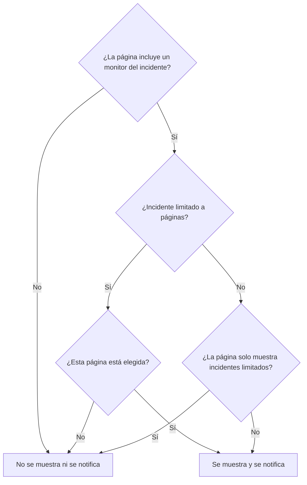

# Una página de estado por audiencia

Personas distintas necesitan noticias distintas. Un cliente no quiere enterarse de la caída de otro cliente, y el personal de una sede no quiere un correo cada vez que otra sede se queda sin red. En OneUptime, la unidad de audiencia es la página de estado: cada una tiene sus propios suscriptores, su propia marca y su propia privacidad. Así que da a cada audiencia una página propia, y decide incidente por incidente qué páginas reciben aviso.

Antes, la infraestructura compartida lo complicaba. Un incidente llega a una página de estado a través de sus monitores, así que un monitor compartido por diez páginas de sede avisaba a las diez sedes de una caída que afectaba a dos. La única solución era una página, o un monitor, por cada combinación de sedes. Esta página cubre los ajustes que lo resuelven:

- **Limitar a estas páginas de estado** en un incidente, para que se muestre y notifique solo en las páginas que elijas.
- **Mostrar solo incidentes limitados a esta página** en una página de estado, para que un incidente que nadie ha limitado todavía no llegue a ninguna de estas páginas hasta que alguien decida. Eso incluye los incidentes que abre por sí solo un monitor, Slack, Microsoft Teams, la API o la IA.
- Un registro de qué páginas recibieron aviso de la creación de un incidente, para que a una página que añades más tarde se le avise una vez y a las demás no se les vuelva a avisar.
- Un resumen **Se notificará a** que muestra quién recibirá aviso de un incidente antes de que lo declares o publiques una nota pública, y **Vista previa**, que muestra lo que recibirán los suscriptores de cada página.

:::cards
- [Configurarlo](#configurar-una-página-por-audiencia): Una página por audiencia, y el interruptor que mantiene fuera de ellas los incidentes sin limitar.
- [Limitar un incidente](#limitar-un-incidente-a-páginas-de-estado): Elige las páginas al declararlo, o más tarde.
- [Añadir o quitar páginas](#añadir-y-quitar-páginas-de-estado): A quién se avisa de una página que añades, y qué retira quitar una.
- [Lo que lleva cada mensaje](#lo-que-lleva-cada-mensaje): Los valores que recibe cada página, y lo que dicen a cada audiencia.
:::

## Cuándo usarlo

- **Un proveedor de servicios gestionados** con una página de estado por cliente, sobre monitores que los clientes comparten.
- **Una organización con sedes, plantas o regiones**, cada una con su propio personal al que avisar.
- **TI interno** con una página por departamento o edificio.

Si a tu audiencia le parece bien elegir por sí misma, puede bastar una sola página: deja que los suscriptores elijan los recursos que les interesan (consulta [Suscriptores y anuncios](/docs/status-pages/subscribers)). Usa una página por audiencia cuando eres tú quien elige por ellos, incidente por incidente, o cuando una audiencia no debe ver en absoluto los incidentes de otra.

## Cómo llega un incidente a una página de estado

Un incidente llega a una página de estado a través de sus monitores. Una página muestra un incidente, y avisa de él a sus suscriptores, cuando uno de los recursos de la página es uno de los monitores del incidente, directamente o a través de un grupo de monitores de la página. Dos ajustes lo reducen:

- **Limitar a estas páginas de estado** en el incidente (`statusPages`). Si se deja vacío, el incidente llega a todas las páginas que incluyen sus monitores, como siempre. Con páginas elegidas, llega solo a las páginas elegidas **entre** las que incluyen sus monitores.
- **Mostrar solo incidentes limitados a esta página** en la página de estado (`onlyShowScopedIncidents`, desactivado por defecto). Con él activado, la página nunca muestra un incidente que no está limitado a páginas de estado concretas, ni avisa nunca a nadie de él.



Para una página que incluye uno de los monitores del incidente:

| El incidente está | Página con **Mostrar solo incidentes limitados a esta página** desactivado | Página con él activado |
| --- | --- | --- |
| No limitado a ninguna página de estado | Se muestra y se notifica | No se muestra ni se notifica |
| Limitado a páginas de estado, y esta página está elegida | Se muestra y se notifica | Se muestra y se notifica |
| Limitado a páginas de estado, pero no a esta | No se muestra ni se notifica | No se muestra ni se notifica |

Una página que no incluye ninguno de los monitores del incidente nunca lo muestra, elijas lo que elijas, y un incidente sin monitores no avisa a ningún suscriptor de página de estado. Las reglas habituales se siguen aplicando encima: el incidente debe estar **Visible en la página de estado** y no ser privado, la página debe tener **Mostrar incidentes** activado, y un suscriptor que eligió solo algunos recursos o tipos de eventos recibe solo lo que eligió.

Las mismas reglas deciden todo lo que depende de a qué páginas llega un incidente:

- las listas de incidentes, el resumen y la propia página del incidente en la página de estado pública, y la [API pública](/docs/status-pages/public-api) de la página de estado;
- los mensajes de correo, SMS, Slack, Microsoft Teams y webhook que se envían cuando el incidente se crea, cambia de estado, recibe una nota pública o recibe un análisis post mortem;
- los recuentos de incidentes de los informes de páginas de estado enviados por correo, que solo cuentan los incidentes que muestra la página.

Un episodio de incidente llega a una página cuando llega al menos uno de sus incidentes. Sus notificaciones van a todas las páginas a las que llegan sus incidentes, y su página en una página de estado a la que no llega ninguno de ellos no se encuentra. Un incidente privado no llega a ninguna página, así que nunca lleva su episodio a una, y un episodio privado no se muestra en ninguna página.

## Configurar una página por audiencia

:::steps
### Crear una página de estado para cada audiencia

Crea una página por audiencia, por ejemplo de `Site 01` a `Site 10`. Hazlas privadas si la audiencia es interna (consulta [Restringir quién puede ver la página](/docs/status-pages/index#restringir-quién-puede-ver-la-página)). Los suscriptores de una página privada pueden cancelar la suscripción sin iniciar sesión, mediante el enlace de cada mensaje (consulta [Gestionar y cancelar una suscripción](/docs/status-pages/subscribers#gestionar-y-cancelar-una-suscripción)). Ponles etiquetas como `Region East`, para que el selector pueda añadir con un clic todas las páginas que llevan una etiqueta.

### Poner el monitor compartido en cada página

Añade el monitor compartido a cada página como recurso (consulta [Recursos y grupos de la página de estado](/docs/status-pages/resources-and-groups)). Una regla en **Recursos → Reglas de monitores** puede hacerlo por ti a partir de las etiquetas del monitor.

### Activar Mostrar solo incidentes limitados a esta página

Actívalo en cada una de esas páginas. Está en la tarjeta **Lo que muestra tu página de estado** de **Páginas de estado → tu página → Avanzado → Ajustes avanzados**, debajo de **Mostrar incidentes**, y se guarda en cuanto lo cambias. A partir de entonces, nada llega a la página de una sede salvo que alguien la elija.

### Añadir los suscriptores de cada audiencia

Para el personal, usa **Añadir en masa** en **Suscriptores por correo electrónico**, y prefiere la dirección propia de cada persona a una lista de correo como `site03-all@`: cualquiera de la lista puede darla de baja para todos los que están en ella. Si un suscriptor que añadiste cancela la suscripción, se avisa por correo a los propietarios de la página y a quien lo añadió (consulta [Direcciones compartidas y listas de correo](/docs/status-pages/subscribers#direcciones-compartidas-y-listas-de-correo)).

### Dejar que los responsables lean las páginas de estado

El selector solo lista las páginas de estado que la persona puede leer, y los roles de incidentes no pueden leer páginas de estado. Da a los responsables el rol **Status Page Viewer** junto a su rol de incidentes; se puede limitar a páginas con determinadas etiquetas. Sin él, el selector está vacío.

### Decidir qué dice cada mensaje

En **Incidentes → Ajustes → Campos personalizados**, define los campos personalizados de incidentes que tu equipo responde cada vez, por ejemplo `Impact` (una lista desplegable), `Expected Resolution` (una fecha y hora) y `Acknowledgement` (un interruptor de sí/no). Arrástralos al **Orden** en que quieres que se pregunten y se listen, y activa **Mostrar al crear** para que el formulario de declaración los pida, **Obligatorio al crear** donde una respuesta es imprescindible, e **Incluir en las notificaciones a suscriptores** para los que puede leer cualquier audiencia. Entonces están en el correo predeterminado de cada página. Consulta [Campos personalizados](/docs/incidents/settings#campos-personalizados).

### Dar marca al correo de cada página (opcional)

En el plan **Scale**, da a cada página una **Configuración de SMTP personalizado** y vincula plantillas personalizadas para los eventos de incidentes; pueden colocar cualquier campo con `{{incident.customFields.<key>}}`. Mientras escribes una plantilla, **Vista previa en vivo** debajo de ella la muestra rellenada con valores de ejemplo. Consulta [Lo que necesita una plantilla personalizada](/docs/status-pages/subscribers#lo-que-necesita-una-plantilla-personalizada), y [Lo que lleva cada mensaje](#lo-que-lleva-cada-mensaje) antes de usar `{{affectedStatusPages}}`.

### Guardar plantillas de incidente con páginas elegidas (opcional)

Una plantilla `Region East outage` puede llevar las páginas de las sedes del este, y respuestas predeterminadas para los campos personalizados.

### Comprobar el correo de cada página antes de la primera caída

Empieza **Declarar incidente** con el monitor compartido y dos de las páginas de sede elegidas, y en el resumen antes de enviar, abre **Vista previa**, junto a **Sí**: muestra el correo que recibirían los suscriptores de cada página, y qué plantilla usa y por qué. **Enviarme una prueba** envía uno a tu propia bandeja de entrada. No se envía nada a nadie más hasta que declaras el incidente, así que sal del formulario sin enviarlo cuando termines. Consulta [Quién recibirá aviso](#quién-recibirá-aviso).
:::

## Limitar un incidente a páginas de estado

### Al declararlo

En **Incidentes → Todos los incidentes → Declarar incidente**, el paso **Recursos afectados** tiene **Limitar a estas páginas de estado** en **Más campos**, después de los monitores y los demás recursos. Su texto de ejemplo, **Todas las páginas de estado que incluyen los monitores**, es lo que significa dejarlo vacío. Elige páginas por nombre, o abre la pestaña **Etiquetas** del selector y elige una etiqueta para añadir todas las páginas que la llevan.

El formulario te avisa:

- cuando una página elegida no incluye ninguno de los monitores del incidente, o no hay ningún monitor adjunto. El incidente no se mostrará en esa página ni avisará a sus suscriptores;
- cuando además defines **Cambiar el estado del monitor a**, justo debajo de los monitores en el mismo paso. Consulta [El estado del monitor es compartido](#el-estado-del-monitor-es-compartido);
- cuando además marcas **Incidente privado**, en **Más campos** del paso **Detalles del incidente**. Los incidentes privados están ocultos en todas las páginas de estado, incluidas las que elegiste.

El paso **Detalles**, justo después de **Recursos afectados**, pide los campos personalizados de incidentes marcados con **Mostrar al crear** (consulta [Declarar un incidente](/docs/incidents/declaring-incidents)). Sus respuestas van a todas las páginas a las que llega el incidente: los valores de los campos personalizados pertenecen al incidente, no a una página de estado.

**Crear desde plantilla** rellena el campo a partir de la plantilla. Las páginas de una plantilla se definen en su paso **Recursos afectados** al crearla, y después en su tarjeta **Alcance de páginas de estado** (**Incidentes → Ajustes → Plantillas de incidente**). Como con los demás campos de la plantilla, una lista que defines tú prevalece. Las páginas de una plantilla se rellenan incluso para un responsable que no puede leer páginas de estado: quien configuró la plantilla las eligió para todos los que declaran a partir de ella.

### Quién recibirá aviso

En **Notificar a suscriptores de la página de estado**, justo debajo del selector en **Más campos** del paso **Recursos afectados**, y de nuevo en el resumen antes de enviar, el formulario muestra a quién llegará el incidente:

> Se notificará a:
>
> - Site 03 (hasta 41 por correo)
> - Site 07 (hasta 18 por correo)

Debajo, en **No se notifica a:**, lista las páginas que incluyen los monitores pero no recibirán aviso, y por qué: no es una de las páginas a las que está limitado el incidente, es una página que solo muestra los incidentes limitados a ella, o es una página que no muestra incidentes.

Cuando no se va a avisar a nadie, el resumen no muestra nada: el incidente no tiene monitores, ninguna página de estado los incluye, las páginas todavía no tienen suscriptores, **Notificar a suscriptores de la página de estado** está desactivado, o el incidente es privado. Solo avisa cuando el motivo es el alcance de páginas de estado, y nombra las páginas que deja fuera: el incidente no está limitado y las páginas que incluyen sus monitores solo muestran los incidentes limitados a ellas, está limitado a otras páginas, o las páginas a las que está limitado no incluyen ninguno de sus monitores. En el resumen, **Notificar a suscriptores de la página de estado** dice **Sí** o **No** como cualquier otra casilla, con **Vista previa** junto a **Sí**; no se ofrece mientras la casilla está desactivada, el incidente es privado o no hay ningún monitor adjunto.

El mismo resumen aparece en **Notificar a suscriptores de la página de estado** cuando escribes una nota en la página **Notas públicas** del incidente, para el incidente tal como está. Allí también dice cuándo el incidente está oculto en las páginas de estado, ya que entonces no se enviará nada.

Los recuentos son «hasta». Cuentan por canal los suscriptores confirmados de cada página que no han cancelado la suscripción, y un suscriptor que eligió solo algunos recursos o tipos de eventos puede no recibir este mensaje. Las páginas que no puedes leer no se nombran. Se cuentan como «páginas de estado más a las que no tiene acceso».

**Vista previa**, junto a **Sí** en el resumen y junto a la casilla de la nota, muestra lo que recibirán: elige una página para ver su correo tal como lo recibirán sus suscriptores, con su asunto, y qué plantilla usa y por qué, por ejemplo que no se usa la plantilla personalizada de una página porque la página no tiene **Configuración de SMTP personalizado**. **Enviarme una prueba** envía el correo de la página al correo electrónico de tu cuenta, y a nadie más. Las páginas que no puedes leer se cuentan pero no se previsualizan. Consulta [Previsualizar el correo antes de enviarlo](/docs/status-pages/subscribers#previsualizar-el-correo-antes-de-enviarlo).

### Después de declararlo

Abre el incidente y ve a **Avanzado → Ajustes**. La tarjeta **Alcance de páginas de estado** lista las páginas a las que está limitado el incidente, y **Editar alcance de páginas de estado** las cambia. La **Vista general** del incidente muestra la misma lista como **Alcance de páginas de estado**, de solo lectura, con un enlace **Cambiar en Ajustes**.

En **Incidentes → Todos los incidentes**, el filtro **Página de estado** encuentra los incidentes limitados a las páginas que eliges, o los que no están limitados a ninguna página.

### A través de la API

`statusPages` es una lista de ids de páginas de estado, en `POST /api/incident` y en las actualizaciones de un incidente, y en las plantillas de incidente. Cada página debe pertenecer al proyecto del incidente; una página de otro proyecto se rechaza. Cada página que añades también debe ser una que puedas leer, como en el selector, o la solicitud se rechaza. Las páginas que el incidente o la plantilla ya tienen se conservan puedas leerlas o no, y una página de una plantilla de incidente que puedes leer se puede elegir al declarar un incidente. De ella se derivan dos columnas más, y no te corresponde definir ninguna de ellas:

- `isScopedToStatusPages` se calcula a partir de `statusPages`. Lo que envíes para ella se ignora.
- `statusPagesNotifiedOnCreation` es el registro de las páginas que recibieron aviso de la creación del incidente. Consulta [Añadir páginas de estado](#añadir-páginas-de-estado).

Para ver a quién llegaría un incidente sin enviar nada, llama al endpoint de audiencia:

```bash
curl -X POST https://oneuptime.com/api/incident/subscriber-audience \
  -H "apikey: $ONEUPTIME_API_KEY" \
  -H "Content-Type: application/json" \
  -d '{
    "monitorIds": ["<monitor-id>"],
    "statusPageIds": ["<status-page-id>"]
  }'
```

Envía en su lugar `{"incidentId": "<incident-id>"}` para un incidente que ya existe. La respuesta lista cada página que recibirá aviso con un recuento por canal (`email`, `sms`, `slack`, `microsoftTeams`, `webhook`), las páginas que quedan fuera y por qué, y `hiddenStatusPageCount` para las páginas que quien llama no puede leer. Nunca devuelve una dirección.

## Incidentes que nadie ha limitado todavía

Los criterios de monitor, Slack, Microsoft Teams, la API y la IA pueden abrir un incidente por sí solos, y ninguno de ellos sabe a qué sedes afecta un fallo en un monitor compartido. Un incidente así no está limitado a ninguna página, así que todas las páginas que incluyen el monitor lo mostrarían, y avisarían a sus suscriptores, en un minuto aproximadamente. Una vez enviado un correo a un suscriptor, no se puede retirar.

**Mostrar solo incidentes limitados a esta página** es lo que lo impide. Una página con él activado ignora todo incidente sin limitar. El incidente se sigue abriendo, las políticas de guardia siguen avisando a los responsables y se sigue avisando a sus propietarios, pero ninguna de estas páginas recibe aviso. Después, un responsable averigua a quién afecta y añade esas páginas en la pestaña **Ajustes** del incidente, con **Enviar la notificación de creación del incidente a las páginas recién añadidas** marcado. Sus suscriptores reciben aviso en un minuto aproximadamente.

## Añadir y quitar páginas de estado

### Añadir páginas de estado

Los suscriptores de una página reciben una sola vez el aviso de que se creó un incidente. Así que cuando añades páginas en la tarjeta **Alcance de páginas de estado**, el formulario de edición ofrece **Enviar la notificación de creación del incidente a las páginas recién añadidas**, marcado por defecto:

- Marcado, la notificación de «creado» del incidente se vuelve a poner en cola, y va solo a las páginas que todavía no recibieron aviso. El incidente guarda un registro de las páginas que recibieron aviso, para que las demás no lo reciban dos veces.
- Desmarcado, las páginas añadidas empiezan a mostrar el incidente, y reciben aviso de todo a partir de ahora, pero no se les avisa de que se creó.

La casilla solo aparece cuando marcarla enviaría algo: al menos una página que añades todavía no recibió aviso, y el incidente se declaró con **Notificar a suscriptores de la página de estado** activado, es visible en las páginas de estado y no es privado. Algunos casos se resuelven por ti:

- **La notificación todavía está en cola, o se está enviando ahora mismo.** Un envío en cola lee las páginas cuando sale, y un envío en curso las vuelve a leer al terminar y entonces avisa a las páginas añadidas mientras tanto. Así que no hay casilla: a las páginas que añades se les avisa de todos modos. (Si ese envío falla, las páginas añadidas mientras tanto están entre aquellas a las que envía su **Reintentar**.)
- **Todas las páginas que añades ya recibieron aviso**, por ejemplo una página que quitaste y vuelves a añadir, o un incidente que llegó a todas las sedes y ahora se reduce a dos de ellas. No se vuelve a avisar a nadie, así que no hay casilla.
- **El incidente nunca se anunció.** Cuando se publicó sin **Notificar a los suscriptores que se creó este incidente**, o se declaró sin monitores, no se avisó a nadie. Marcar la casilla solo avisa a las páginas que añades, no a las páginas a las que ya estaba limitado.
- **El incidente se declaró antes de que se publicara esta función.** Su notificación de «creado» salió a todas las páginas que incluían sus monitores, y no hay registro de esas páginas. Añadir páginas no la vuelve a enviar, así que no se ofrece la casilla.
- **El incidente está oculto.** No se envía nada mientras está oculto. Cuando vuelves a activar **Visible en la página de estado**, la tarjeta **Ajustes de incidentes** ofrece **Notificar a los suscriptores que se creó este incidente** para las páginas de su alcance que nunca recibieron aviso, como las añadidas mientras estaba oculto.

Una página añadida más tarde recibe aviso de lo que pasa después: las notas públicas posteriores, los cambios de estado y el análisis post mortem. No se le envían las notas ni los cambios de estado que salieron antes de añadirla. Si necesita ponerse al día, publica una nota pública.

El mismo registro hace que **Reintentar** en una notificación de «creado» fallida continúe donde se detuvo: se saltan las páginas que ya recibieron aviso. Una página solo cuenta como avisada cuando se envió el mensaje a todos sus suscriptores; una página en la que falló un mensaje, o en la que el envío se detuvo a mitad, lo recibe de nuevo completo. El registro se escribe a medida que termina cada página, así que esto se cumple incluso para un envío que se interrumpió. Se guarda por página, no por suscriptor: los suscriptores de una página en la que el envío se detuvo a mitad y a los que ya se envió el mensaje lo reciben por segunda vez.

Para empezar de cero, por ejemplo después de corregir una plantilla o un ajuste de SMTP, marca **Enviarla de nuevo a todas las páginas de estado, incluidas las ya alcanzadas** en la confirmación de **Reintentar**: el botón pasa a ser **Reenviar a todas las páginas**, el registro se vacía, y se vuelve a enviar a todas las páginas a las que llega ahora el incidente. Después de una notificación que salió completa, el **Estado de notificación del suscriptor** de la **Vista general** del incidente ofrece **Reenviar**, que hace lo mismo. Ambas confirmaciones listan las páginas a las que llegaría ahora, o dicen que no llegaría a nadie; la confirmación simple de **Reintentar** lista las páginas ya alcanzadas como no reenviadas, ya que se las salta. Ninguna se ofrece para una notificación que se omitió, o que todavía está en cola o enviándose, ni a quien no puede editar el incidente.

A través de la API, envía `"miscDataProps": {"notifyAddedStatusPagesOfIncidentCreated": true}` con la actualización que cambia `statusPages`. Volver a poner tú mismo `subscriberNotificationStatusOnIncidentCreated` en `Pending` sigue reenviando la notificación de «creado» a todas las páginas a las que llega el incidente, como siempre: el registro se vacía con ello. Después de un fallo, en cambio, continúa donde se detuvo el envío fallido. Para enviarla también a todas las páginas después de un fallo, añade `"miscDataProps": {"resendIncidentCreatedToAllStatusPages": true}` a esa actualización. Esa solicitud se rechaza para una notificación que se omitió, o que está en cola o enviándose.

Escribir `shouldStatusPageSubscribersBeNotifiedOnIncidentCreated` no es uno de estos casos. Se elige al declarar el incidente, y ningún rol de proyecto puede cambiarlo después a través de la API. Un flujo de trabajo, que escribe como el sistema, y el administrador principal de una instancia sí pueden, pero eso solo guarda el nuevo valor. Volver a escribirlo sin cambios, como hace un flujo de trabajo que copia el incidente completo, no vuelve a enviar nada, y activarlo más tarde no envía la notificación de «creado» sin la que se declaró el incidente. Si se desactiva antes de que esa notificación haya salido, se omite.

### Quitar páginas de estado

Quitar una página no retira nada. La página deja de mostrar el incidente, y sus suscriptores no reciben más avisos sobre él, ni siquiera de que se resolvió. Cuando quitas una página que ya recibió aviso del incidente, el formulario de edición te avisa y sugiere una nota pública de cierre. Publica primero esa nota, mientras la página sigue en la lista, y después quita la página.

Vaciar toda la lista es distinto de quitar páginas: el incidente deja entonces de estar limitado. Se vuelve a mostrar en todas las páginas que incluyen sus monitores, y a avisarlas, salvo las páginas que solo muestran los incidentes limitados a ellas. El formulario también te avisa de eso.

### Cuando se elimina una página de estado elegida

Eliminar una página de estado la quita de todos los incidentes que estaban limitados a ella. Un incidente cuyas páginas elegidas se han eliminado todas sigue limitado, a nada: está oculto en todas las páginas de estado en lugar de mostrarse en todas las páginas que incluyen sus monitores. La tarjeta **Alcance de páginas de estado** lo indica. Elige otras páginas, o vacía la lista, para volver a mostrarlo.

Las plantillas de incidente funcionan igual. Una plantilla cuyas páginas se han eliminado todas sigue limitada: un incidente que declara a partir de ella un [formulario](/docs/forms/on-submit#la-plantilla-de-incidente) o el paso **Create One Incident** de un flujo de trabajo queda oculto en todas las páginas de estado, la tarjeta **Alcance de páginas de estado** de la plantilla te avisa, y **Declarar incidente** empieza sin ninguna página elegida y te pide que elijas las páginas para las que es el incidente. Elige otras páginas en la plantilla, o guarda su lista vacía para dejar de limitar los incidentes declarados a partir de ella.

## Un correo por persona

Para un incidente limitado a páginas de estado concretas, una dirección de correo electrónico o un número de teléfono suscrito en más de una de esas páginas recibe un correo o un SMS por envío, no uno por página. Las páginas se recorren por orden de nombre, así que la plantilla, la marca y el enlace de baja de la primera página son los que recibe esa persona.

Los mensajes de webhook, Slack y Microsoft Teams nunca se combinan. Sus cargas útiles nombran la página de estado para la que son, y una integración que escucha por página tiene que ver todas las páginas.

Esto solo se aplica dentro de un envío. Alguien suscrito en `Site 03` y `Site 05` que recibió el correo de «creado» a través de `Site 03` lo vuelve a recibir cuando se añade más tarde `Site 05`. Un incidente que no está limitado a ninguna página envía un mensaje por suscripción, como siempre.

## Lo que lleva cada mensaje

Todas las páginas a las que llega el incidente reciben los mismos valores: pertenecen al incidente, no a una página de estado.

- **Campos personalizados en los mensajes predeterminados.** Los campos personalizados de incidentes con **Incluir en las notificaciones a suscriptores** activado se listan en los mensajes de creación, cambio de estado, nota pública y análisis post mortem de cada página, en su **Orden**: correo, Slack, Microsoft Teams y webhooks, pero no SMS. Esto no necesita ni el plan Scale ni SMTP personalizado. Consulta [Campos personalizados de incidentes en las notificaciones](/docs/status-pages/subscribers#campos-personalizados-de-incidentes-en-las-notificaciones).
- **Actualizaciones.** Cambiar un campo personalizado por sí solo no avisa a nadie. La siguiente nota pública o el siguiente cambio de estado lleva los valores actuales, así que para avisar a las sedes de que `Expected Resolution` cambió, cambia el campo y después publica una nota pública.
- **Plantillas de notas.** Elegir una plantilla de nota rellena marcadores como `{{incident.title}}` y `{{incident.customFields.<key>}}` con los valores actuales del incidente, y todavía puedes editar la nota antes de publicarla. Consulta [Plantillas de notas](/docs/incidents/settings#plantillas-de-notas).
- **Los nombres de las demás audiencias.** `{{affectedStatusPages}}` en una plantilla de suscriptor personalizada, e `{{incident.affectedStatusPages}}` en una plantilla de nota, listan las páginas a las que llega el incidente, y todos aquellos a los que va el mensaje leen la lista: los suscriptores de `Site 03` se enteran de que `Site 07` también está afectado. Entre sedes de una misma organización, eso puede ser lo que quieres. Entre clientes, le habla a un cliente de otro, así que deja ambos fuera de las plantillas y las notas que reciben esas páginas.

## En qué se diferencia del mantenimiento programado

Los eventos de mantenimiento programado también tienen una lista **Páginas de estado**, pero funciona de otra manera:

- **El mantenimiento programado sustituye.** El evento se muestra exactamente en las páginas de su lista, incluyan o no sus monitores.
- **Un incidente reduce.** Su lista solo elige entre las páginas que ya incluyen sus monitores. Elegir una página que no incluye ninguno de ellos no hace nada, y el formulario lo dice. Pon primero el monitor en esa página.

Así se evita que una elección equivocada ponga un incidente en una página sobre algo completamente distinto. También significa que un incidente sin monitores no llega a ninguna página de estado, por muchas que elijas.

## El estado del monitor es compartido

Un monitor tiene un solo estado, y todas las páginas de estado que incluyen el monitor lo muestran. Limitar un incidente no cambia eso. Si el incidente define **Cambiar el estado del monitor a**, o el monitor cae por sí solo, el monitor se pone en rojo en todas las páginas que lo incluyen, incluidas las páginas a las que el incidente no está limitado y las páginas que solo muestran los incidentes limitados a ellas. El formulario de declaración te avisa cuando combinas un cambio de estado con páginas elegidas.

**Cuando cada sede necesita un estado propio, da a cada sede un monitor manual.** Crea un [Monitor manual](/docs/monitor/manual-monitor) por sede, por ejemplo `Site 03 network`, e inclúyelo solo en la página de esa sede. Adjunta al incidente los monitores manuales de las sedes afectadas, con **Cambiar el estado del monitor a** si quieres que cambie su estado, y deja el monitor compartido para las páginas que deben verlo. Así el incidente llega exactamente a las sedes cuyos monitores lleva, y un cambio de estado solo se muestra en sus páginas.

## Qué se registra

- **La actividad del incidente.** La entrada de «creado» de un incidente limitado lista las páginas a las que está limitado. Cada cambio de la lista añade una entrada que lista las páginas añadidas y quitadas, y si se enviará a las páginas añadidas la notificación de «creado».
- **Cada notificación a suscriptores.** La entrada **Notificación a suscriptores enviada** de la actividad del incidente tiene un panel **Más información** que lista cada página a la que fue el envío: cuántos mensajes se enviaron y cuántos fallaron en cada canal, y el asunto con el que salió su correo. También lista las páginas que se saltó y por qué (ya avisadas, o sin mostrar incidentes), las páginas que dejó fuera el alcance, y si el correo y el SMS se enviaron una vez por dirección. Cuando el envío puso valores de campos personalizados en un mensaje, el panel termina con ellos, en **Custom fields sent**.
- **El estado de la notificación.** El mensaje de estado de cada notificación dice, para cada página, cuántos mensajes se enviaron y cuántos fallaron en cada canal, y después de un fallo lo que hará **Reintentar**. Un envío que se interrumpió a mitad, porque su servidor se reinició o dejó de responder, se marca como fallido con un mensaje que empieza por `Interrupted:`, en lugar de quedarse en curso. Consulta [Comprobar lo que se envió](/docs/status-pages/subscribers#comprobar-lo-que-se-envió).
- **Registros de notificación** en cada página de estado muestra cada mensaje que envió esa página.

Consulta [Notas, responsables y actividad de incidentes](/docs/incidents/notes-owners-and-feed) para la propia actividad.

## Permisos

- **Elegir una página de estado necesita acceso de lectura a ella.** Las páginas de estado se leen con los roles de páginas de estado, no con los roles de incidentes, y una página de estado se puede restringir por etiqueta. Da a los responsables **Status Page Viewer**, limitado a etiquetas si quieres. Sin él, el selector está vacío, y la API rechaza una página que quien llama no puede leer, tanto en los incidentes como en las plantillas de incidente.
- **Las páginas que el editor no puede ver se conservan.** Un editor que solo puede leer algunas de las páginas de un incidente solo ve esas en el selector, y al guardar se conservan las páginas que no puede ver.
- **Las páginas a las que está limitado un incidente forman parte del incidente.** Como sus monitores, cualquiera que pueda leer el incidente ve sus nombres, en la tarjeta **Alcance de páginas de estado**, en la vista general y en la actividad del incidente, pueda leer o no esas páginas de estado.
- **A qué llegó un envío también forma parte del incidente.** En cuanto una notificación ha salido, su mensaje de estado y su elemento de la actividad nombran todas las páginas de estado a las que fue, con lo que se envió y lo que falló en cada una, y cualquiera que pueda leer el incidente los ve, pueda leer o no esas páginas de estado. Solo el resumen y la vista previa de abajo, que miran hacia adelante, se limitan a las páginas que la persona puede leer.
- **El resumen de la audiencia** está abierto a los roles que pueden declarar o editar un incidente o publicar una nota pública en él. Solo nombra las páginas que la persona puede leer. Las demás páginas a las que avisará el incidente se cuentan como «páginas de estado más a las que no tiene acceso», y nunca muestra direcciones.
- **Vista previa** está abierta a los mismos roles, y solo previsualiza las páginas que la persona puede leer, como mucho sesenta veces cada diez minutos. Como el resumen, nunca muestra una dirección. **Enviarme una prueba** solo envía al correo electrónico de la cuenta de la persona, una vez verificado, como mucho diez veces cada 15 minutos.
- **Enviar de nuevo una notificación** necesita el permiso para editar el incidente, para su notificación de «creado», y tanto el permiso para editar notas públicas como el permiso para publicar notas públicas que avisan a los suscriptores, para una nota; y lo mismo hace falta para avisar a los suscriptores de una edición de una nota. Ninguno se acepta mientras esa notificación se está enviando.

## Actualizar un servidor autoalojado

Los workers que envían las notificaciones a suscriptores son los que mantienen un incidente en las páginas a las que está limitado. Mientras se despliega una actualización a una versión con esta función, un worker que sigue en la versión anterior envía las notificaciones que recoge como siempre: a todas las páginas de estado que incluyen los monitores del incidente, incluidas las páginas que solo muestran los incidentes limitados a ellas. Así que deja que termine de desplegarse el deployment de los workers, o escala los workers antiguos a cero, antes de que nadie limite un incidente a páginas de estado o active **Mostrar solo incidentes limitados a esta página**. Con Helm, `migrate.hook: true` también ejecuta las migraciones de la base de datos antes de que arranque ningún pod nuevo.

## Próximos pasos

:::cards
- [Suscriptores y anuncios](/docs/status-pages/subscribers): Los canales de suscriptores, y lo que envía cada evento.
- [Declarar un incidente](/docs/incidents/declaring-incidents): El formulario de declaración, paso a paso.
- [Estados y severidades de incidentes](/docs/incidents/states-and-severities): Qué más mantiene un incidente fuera de una página de estado.
- [Monitor manual](/docs/monitor/manual-monitor): Monitores cuyo estado defines tú.
:::
