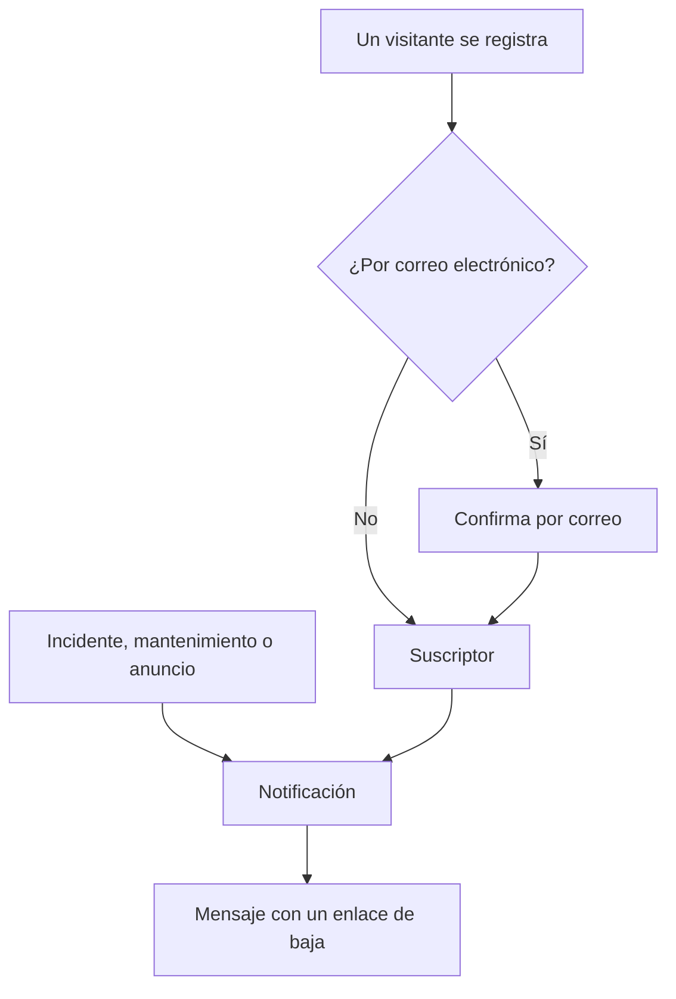

# Suscriptores y anuncios

Una página de estado es un lugar al que la gente va. Los suscriptores son quienes preferirían no tener que ir: te dan una vez una dirección de correo electrónico, un número de teléfono, un webhook de Slack o un endpoint HTTP, y a partir de entonces tus actualizaciones les llegan a ellos.

Los anuncios son la otra mitad del mismo trabajo. Un monitor puede decir a tus visitantes que el pago está devolviendo errores 500; ningún monitor puede decirles que vas a migrar bases de datos el sábado, que un proveedor externo está teniendo un mal día o que el incidente del que leyeron ayer está completamente cerrado. Los anuncios son el canal de texto libre para todo lo que tus comprobaciones no pueden ver, y llegan a la misma lista de suscriptores.

Esta página cubre ambas cosas: los cinco canales de suscripción y cómo se registran los visitantes, de qué pueden elegir recibir aviso los suscriptores, los flujos de doble confirmación y de baja, el informe por correo electrónico que los suscriptores pueden recibir cada mes, y cómo se escriben, se programan y se convierten en plantillas los anuncios.

:::cards
- [Canales de suscripción](#canales-de-suscripción): Los canales por los que pueden registrarse los visitantes, y la página en la que se registran.
- [Lo que se dice a los suscriptores](#de-qué-se-avisa-a-los-suscriptores): Anuncios, mantenimiento, incidentes y episodios, y sus ediciones.
- [Comprobar lo que se envió](#comprobar-lo-que-se-envió): El estado de cada notificación, y Reintentar y Reenviar.
- [Anuncios](#anuncios): Publicar un aviso en una o varias páginas de estado.
:::

## Cómo funciona



Cada página de estado tiene sus propios suscriptores. Un visitante se registra en la página **Suscribirse** de la página de estado, donde una dirección de correo electrónico se confirma con un enlace antes de recibir nada, o tu equipo lo añade en el panel. A partir de entonces, cada incidente, evento de mantenimiento programado y anuncio que llega a la página notifica a sus suscriptores, a cada uno por el canal con el que se registró, y cada mensaje lleva el enlace que cancela la suscripción.

## Canales de suscripción

Una página de estado admite cinco canales. Estos, y la página en la que se registran los visitantes, se activan en un solo lugar: la tarjeta **Canales** en **Páginas de estado → tu página → Suscriptores → Ajustes de suscriptores**. Cada interruptor se guarda en cuanto lo cambias:

- **Mostrar página de suscriptores** (`showSubscriberPageOnStatusPage`) — activado por defecto. Pone el elemento **Suscribirse** en la barra de navegación de la página de estado, donde los visitantes se registran por los canales de abajo.
- **Correo electrónico** (`enableEmailSubscribers`) — activado por defecto. Todo lo demás está desactivado hasta que lo activas.
- **SMS** (`enableSmsSubscribers`) — desactivado por defecto. En OneUptime Cloud cada SMS se paga con el saldo de SMS y llamadas del proyecto, salvo que la página tenga su propia **Configuración de Twilio** (consulta [más abajo](#pie-de-correo-smtp-personalizado-y-twilio)). Activarlo también necesita **SMS** activado para el proyecto, en la tarjeta **Canales de notificación** de **Ajustes del proyecto > Notificaciones > Ajustes de notificaciones**, algo que puede hacer un propietario del proyecto, un **Billing Admin** o alguien con **Manage Billing**.
- **Slack** (`enableSlackSubscribers`) — desactivado por defecto.
- **Microsoft Teams** (`enableMicrosoftTeamsSubscribers`) — desactivado por defecto.
- **Webhook** (`enableWebhookSubscribers`) — desactivado por defecto.

Los interruptores deciden cómo pueden registrarse los visitantes por sí mismos, y la página de estado rechaza un registro por un canal desactivado. No detienen las notificaciones: los suscriptores que tu equipo añade en el panel, con la API o mediante un flujo de trabajo reciben las actualizaciones estén activados los canales que estén.

En OneUptime Cloud, un interruptor que tu plan no incluye muestra a su lado el nombre del plan: **Growth** para **SMS** y **Mostrar página de suscriptores**, **Scale** para **Slack**, **Microsoft Teams** y **Webhook**. Desactivar un canal funciona en todos los planes, así que un canal que activó una prueba siempre se puede volver a desactivar; el interruptor lo indica debajo.

Cada canal tiene además su propia lista en el menú lateral de la página de estado, en **Suscriptores**: **Suscriptores por correo electrónico**, **Suscriptores por SMS**, **Suscriptores de Slack**, **Suscriptores de MS Teams** y **Suscriptores de webhook**. Ahí es donde miras quién está registrado, añades a alguien a mano o te dejas una entrada **Notas** (`internalNote`) sobre un suscriptor concreto. Mientras un canal está desactivado, la parte superior de su lista lo indica, con el interruptor del canal ahí mismo, para que puedas activarlo sin salir de la lista.

**Un interruptor no basta.** El elemento **Suscribirse** de la barra de navegación de la página de estado solo aparece cuando **Mostrar página de suscriptores** está activado *y* al menos un canal está activado. Si activas **Correo electrónico** pero dejas **Mostrar página de suscriptores** desactivado, los visitantes no tienen forma de llegar al formulario.

## Qué ve un visitante en la página Suscribirse

La página **Suscribirse** tiene un submenú con una pestaña por cada canal activado. Cada pestaña pide lo mínimo que necesita:

| Pestaña | Dirección | Encabezado | Qué pide |
| --- | --- | --- | --- |
| **Correo electrónico** | `/subscribe/email` | **Suscribirse por correo electrónico** | **Su correo electrónico**, con el ejemplo `subscriber@company.com`. |
| **SMS** | `/subscribe/sms` | **Suscribirse por SMS** | **Su número de teléfono**, con el ejemplo `+11234567890`. |
| **Slack** | `/subscribe/slack` | **Suscribirse vía Slack** | **Nombre del espacio de trabajo de Slack** (se usa para la validación) y **URL del webhook entrante de Slack**, con el ejemplo `https://hooks.slack.com/services/...`. |
| **MS Teams** | `/subscribe/microsoft-teams` | **Suscribirse vía Microsoft Teams** | **Nombre del espacio de trabajo de Microsoft Teams** y **URL del webhook entrante de Microsoft Teams**, con el ejemplo `https://outlook.office.com/webhook/...`. |
| **Webhooks** | `/subscribe/webhooks` | **Suscribirse por webhook** | **URL del webhook**, con el ejemplo `https://example.com/webhook`. Se le envía una solicitud JSON `POST` en cada evento de la página de estado. |

El botón de envío dice **Suscribirse**. Un registro por SMS, Slack, Microsoft Teams o webhook muestra *Se ha suscrito correctamente.* Un registro por correo electrónico indica que se ha enviado un enlace de confirmación y que se revise la carpeta de spam si no llega (consulta [Doble confirmación por correo electrónico](#doble-confirmación-por-correo-electrónico)). Las pestañas **Correo electrónico**, **SMS**, **Slack** y **MS Teams** también tienen la división **Nueva suscripción** / **Gestionar suscripción existente**, para que alguien que ya se suscribió pueda volver a sus preferencias sin buscar un mensaje antiguo.

## Dejar que los suscriptores elijan recursos y tipos de eventos

De forma predeterminada, un suscriptor recibe todo lo de la página. Dos interruptores de la tarjeta **Ajustes avanzados de suscriptor** cambian eso:

- **Permitir a los suscriptores elegir recursos** (`allowSubscribersToChooseResources`) — desactivado por defecto. Actívalo y el formulario de suscripción gana un interruptor **Suscribirse a todos los recursos**; desactívalo y aparece **Seleccionar recursos para suscribirse**, para que el visitante pueda elegir recursos concretos.
- **Permitir a los suscriptores elegir tipos de eventos** (`allowSubscribersToChooseEventTypes`) — desactivado por defecto. La misma forma: un interruptor **Suscribirse a todos los tipos de eventos**, y **Seleccionar tipos de eventos para suscribirse** debajo cuando se desactiva.

Con cualquiera de los dos activado, el formulario de suscripción sigue siendo una sola página. Debajo de adónde enviar las actualizaciones (la dirección de correo electrónico, el número de teléfono, el espacio de trabajo o el webhook) viene **Preferencias**, plegado en una línea que dice lo que recibirá el visitante. Todos los recursos y todos los tipos de eventos ya están elegidos, así que empieza diciendo «Recibirá todas las actualizaciones de esta página de estado.», y un visitante que lo quiere todo pulsa **Suscribirse** sin abrirlo. Cualquier otro abre **Preferencias** y reduce los recursos o los tipos de eventos; al volver a plegarse, la línea sigue lo que eligió («Solo recibirá actualizaciones de los recursos que eligió.»). Con ambos desactivados no hay **Preferencias**: el formulario es adónde enviar las actualizaciones, y después **Suscribirse**.

La página **Actualizar suscripción** (ver abajo) muestra las mismas opciones abiertas, ya que cambiarlas es a lo que va allí un suscriptor.

Los tipos de eventos son `Incident`, `Announcement` y `Scheduled Event`.

**Un grupo de monitores representa a todos los monitores que contiene.** Un recurso de la página es un monitor o un grupo de monitores, y un suscriptor que elige un grupo de monitores recibe aviso de los incidentes, los eventos de mantenimiento programado (incluidas sus notas) y los anuncios de cualquier monitor del grupo, exactamente como si hubiera elegido ese monitor, que es también como los muestra la página de estado. A quien eligió solo otros recursos no se le avisa, y quien eligió un monitor y el grupo que lo contiene recibe una notificación, no dos.

Las elecciones quedan en el registro del suscriptor como **Suscrito a todos los recursos** (`isSubscribedToAllResources`, verdadero por defecto), **Suscrito a todos los tipos de eventos** (`isSubscribedToAllEventTypes`, verdadero por defecto), **Suscrito a recursos** y **Suscrito a tipos de eventos**.

**Un suscriptor elige entre los recursos de su propia página.** **Suscrito a recursos** nombra recursos de la propia página de estado del suscriptor, lo escriba quien lo escriba: un visitante en la página, un compañero en el panel, una clave de API o un flujo de trabajo. Un visitante elige entre lo que la página le muestra, así que un recurso cuyo monitor está archivado, y que la página oculta, no es uno que pueda elegir. Un recurso de otra página de estado, o uno que la página oculta a un visitante, se rechaza con el `400` que nombra el campo y el ID, igual que un ID que no coincide con nada. Un cambio solo pregunta por los recursos que añade, así que una suscripción conserva un recurso que ya nombra, como uno cuyo monitor se archivó después de elegirlo. A un suscriptor solo se le avisa de un evento a través de recursos de su propia página.

Útil para: una página que cubre varios productos. Un cliente que solo usa tu API no quiere un aviso cada vez que el sitio de marketing falla; deja que reduzca la lista él mismo en lugar de ver cómo cancela la suscripción por completo.

La misma tarjeta también contiene **Zonas horarias del suscriptor**.

## Doble confirmación por correo electrónico

Los suscriptores por correo electrónico siempre confirman. Cuando se crea un suscriptor con una dirección de correo electrónico y no se creó ya confirmado, **Suscripción confirmada** (`isSubscriptionConfirmed`) se fuerza a `false` y se genera un **Token de confirmación de la suscripción** de seis dígitos. OneUptime envía entonces un enlace de confirmación con la forma `{statusPageUrl}/confirm-subscription/{statusPageSubscriberId}?verification-token={token}`. El visitante llega a una página **Confirmar suscripción** y, cuando se completa, ve *Suscripción confirmada con éxito*.

Los suscriptores por SMS, Slack, Microsoft Teams y webhook se saltan esto: se crean con `isSubscriptionConfirmed` ya en `true`. Lo mismo ocurre con los suscriptores por correo electrónico que tu equipo añade en **Suscriptores por correo electrónico**: allí **No enviar enlace de confirmación** está activado por defecto. Desactívalo para que la dirección se confirme como en un registro.

**Sin confirmar significa en silencio.** La consulta que obtiene los suscriptores para una notificación filtra por `isUnsubscribed: false` y `isSubscriptionConfirmed: true`. Una dirección de correo electrónico que nunca hizo clic en el enlace se quedará en tu lista **Suscriptores por correo electrónico** y no recibirá nada. Si alguien jura que está suscrito pero no recibe nada, comprueba primero esa columna.

No hay ningún interruptor para desactivar la confirmación por correo electrónico: es incondicional para cualquiera que se registre a través de la página de estado. Una columna aparte por suscriptor, **Enviar el mensaje "Te has suscrito"** (`sendYouHaveSubscribedMessage`, verdadero por defecto), controla el correo «te has suscrito» que se envía una vez confirmado un suscriptor.

## Gestionar y cancelar una suscripción

Cada mensaje que recibe un suscriptor lleva un enlace de baja con la forma `{statusPageUrl}/unsubscribe/{statusPageSubscriberId}-{token}`: al final de un correo electrónico, en el texto de un SMS o de un mensaje de Slack o Microsoft Teams, y como `unsubscribeUrl` en la carga útil de un webhook. El token es un secreto aleatorio que pertenece a esa única suscripción, así que el enlace funciona sin iniciar sesión. Eso incluye una página de estado privada, donde todo lo demás necesita un visitante con la sesión iniciada.

La única excepción es un SMS de una página de estado de acceso **público**, que lleva en su lugar el enlace **Actualizar suscripción** del suscriptor (ver abajo). Esa página funciona en una página de estado pública sin iniciar sesión, y su enlace es 57 caracteres más corto. Un SMS se factura por segmento de 160 caracteres, así que el enlace más largo haría que la mayoría de los textos predeterminados ocuparan otro segmento. El `{{unsubscribeUrl}}` de una plantilla de SMS personalizada sigue la misma regla. Un SMS de una página de estado privada lleva el enlace de baja.

El registro de SMS (la pestaña **SMS** de **Registros de notificación**, en la página de estado y en los ajustes del proyecto) guarda el texto de cada SMS, y pueden leerlo más miembros del proyecto de los que pueden gestionar suscriptores. Por eso el registro muestra un enlace de baja con su token sustituido por `[redacted]`, por ejemplo `{statusPageUrl}/unsubscribe/{statusPageSubscriberId}-[redacted]`. Solo el teléfono del propio suscriptor recibe el enlace que funciona. La API tampoco devuelve nunca el token de un suscriptor nuevo, ni siquiera en la respuesta a la solicitud que lo creó.

**Abrir el enlace no cambia nada.** La página muestra el nombre y el logotipo de la página de estado y la suscripción a la que pertenece el enlace: una dirección de correo electrónico completa, un número de teléfono enmascarado salvo sus cuatro últimos dígitos, el nombre de un espacio de trabajo de Slack o Microsoft Teams, o el host de un webhook. Pregunta *¿Quiere dejar de recibir notificaciones de esta página de estado?* y solo pulsar **Cancelar suscripción** cancela la suscripción, así que los escáneres de correo y los generadores de vistas previas de enlaces que abren todos los enlaces de un mensaje no pueden dar de baja a nadie. No se muestra nada más de la página, y no se ejecuta nada de su JavaScript personalizado. Confirmar dos veces, o abrir el enlace de una suscripción ya cancelada, solo dice que está cancelada. En una página de estado pública, la página de baja también enlaza con la página **Actualizar suscripción** del suscriptor, para elegir en su lugar qué notificaciones recibe.

La página **Actualizar suscripción**, `{statusPageUrl}/update-subscription/{statusPageSubscriberId}`, se titula **Actualizar suscripción** e indica al visitante que allí puede actualizar sus preferencias o cancelar la suscripción. Contiene:

- Los selectores de recursos y de tipos de eventos que permita la página.
- Un interruptor **Cancelar suscripción**, descrito como cancelar la suscripción a todos los recursos. Escribe **Está dado de baja** (`isUnsubscribed`, falso por defecto).
- Un botón de envío que dice **Actualizar suscripción**; al guardar se muestra *Sus cambios se han guardado.*

En una página de estado privada necesita un visitante con la sesión iniciada, como el resto de la página. Quien perdió el enlace usa **Gestionar suscripción existente** en la página **Suscribirse** y pulsa **Enviar enlace de gestión**. El enlace va a la propia suscripción (su dirección de correo electrónico, su número de teléfono o su canal de Slack o Microsoft Teams), nunca a una dirección de la solicitud, y la página responde lo mismo tanto si coincidió una suscripción como si no, así que no se puede usar para averiguar quién está suscrito. Ese mensaje enlaza con la página **Actualizar suscripción**, y da a una plantilla personalizada ambos enlaces: `manageSubscriptionUrl` y `unsubscribeUrl`.

Los endpoints que hay detrás de todo esto son `POST .../subscribe/:statusPageId`, `POST .../manage-subscription/:statusPageId`, `POST .../get-subscription/:statusPageId/:subscriberId`, `PUT .../update-subscription/:statusPageId/:subscriberId`, y `GET` y `POST .../unsubscribe/:statusPageId/:subscriberId/:token`. El `GET` de baja solo describe el enlace. El `POST` cancela la suscripción sea cual sea su cuerpo, incluido el cuerpo `List-Unsubscribe=One-Click` de una solicitud de baja con un clic. Ambos dan la misma respuesta para un token incorrecto, un suscriptor eliminado y un suscriptor de otra página de estado, así que no se pueden usar para averiguar quién está suscrito.

Cancelar la suscripción cambia un indicador en lugar de eliminar una fila, así que el registro se queda en la lista del canal con **Está dado de baja** marcado, algo útil cuando más adelante necesitas explicar por qué una dirección concreta dejó de recibir correo. También registra **Suscripción cancelada el** (`unsubscribedAt`), la cancele quien la cancele: el suscriptor a través del enlace o de la página **Actualizar suscripción**, o un compañero en el panel o a través de la API. Cada lista de suscriptores tiene una columna y un filtro **Suscripción cancelada el**. Volver a desactivar **Está dado de baja** lo borra. Las suscripciones canceladas antes de que OneUptime registrara esto no tienen fecha.

Los enlaces de los mensajes enviados antes de que existiera la página de baja siguen funcionando: un enlace **Actualizar suscripción** sigue abriendo esa página. Los mensajes muy antiguos llevaban `/api/status-page-subscriber/unsubscribe/{statusPageSubscriberId}`, que antes cancelaba la suscripción en cuanto se abría. Ya no cambia nada: lleva a la página de baja, que dice que el enlace está obsoleto y que se use el de un mensaje reciente.

### Direcciones compartidas y listas de correo

Cualquiera que pueda leer un buzón puede darlo de baja. Para una dirección que alguien registró por sí mismo, de eso se trata. Para una que añadió tu equipo, como la lista de correo de una sede, por ejemplo `site03-all@`, significa que un solo lector puede sacar de la página a todos los de la lista antes de la siguiente caída. Por eso:

- **Añade a las personas por sus propias direcciones siempre que puedas.** El formulario **Añadir en masa** y el formulario de suscriptor por correo electrónico lo dicen, en la descripción del campo de correo electrónico.
- **Se avisa al equipo.** Un suscriptor que añadió tu equipo es uno añadido desde el panel, con una clave de API (la API REST, Terraform, un script) o mediante un flujo de trabajo; la API lo lee como **Añadido por el equipo** (`isAddedByTeam`). Cuando uno cancela la suscripción, a través de su enlace o de la página **Actualizar suscripción**, los propietarios de la página de estado (sus usuarios propietarios y los miembros de sus equipos propietarios) reciben cada uno un correo electrónico que nombra al suscriptor, con un enlace a la lista de suscriptores de la página. También lo recibe el compañero que lo añadió, cuando lo añadió un compañero. Una página sin propietarios solo envía el correo a ese compañero, así que no se informa de un suscriptor que una clave de API o un flujo de trabajo añadió a una página sin propietarios. Nunca se informa de las personas que se registraron por sí mismas en la página de estado. Los suscriptores que una clave de API o un flujo de trabajo añadió antes de que OneUptime registrara esto no se pueden distinguir de los registros, y tampoco se informa de ellos.
- **Las listas de suscriptores lo muestran.** Encima de cada lista, un aviso nombra a los suscriptores que añadió tu equipo y que cancelaron la suscripción en los últimos 30 días.

La página de baja advierte al lector de una suscripción así antes de que confirme: si es una dirección compartida, cancelar la suscripción detiene las notificaciones para todos los que las reciben, y se avisará al equipo.

## De qué se avisa a los suscriptores

Los suscriptores reciben aviso de los tres tipos de eventos de arriba, pero cada origen tiene su propio interruptor, así que no se envía nada por accidente.

### Notificaciones de anuncios

El propio anuncio lleva **¿Se debe notificar a los suscriptores?** (`shouldStatusPageSubscribersBeNotified`), que el formulario de creación muestra como la casilla **Notificar a suscriptores de la página de estado** en **Programación y notificaciones**, activada por defecto. Se avisa a los suscriptores una vez, cuando el anuncio empieza a mostrarse, así que esto se decide al crear el anuncio; una edición no puede cambiarlo. Un flujo de trabajo que lo escribe después solo lo guarda: volver a escribirlo sin cambios nunca vuelve a enviar el anuncio, activarlo no lo envía, y desactivarlo antes de que salga la notificación omite la notificación. Si el anuncio nombra monitores en **Monitores afectados**, la notificación se limita a esos monitores: en una página donde los suscriptores eligen recursos, va a los suscriptores de esos monitores, de los grupos de monitores que los contienen y de todos los recursos. Déjalo vacío y se notifica a todos los suscriptores. En una página de estado que no incluye ninguno de esos monitores, ni directamente ni a través de un grupo, el anuncio es para todos los que leen esa página, así que se notifica a todos los suscriptores de allí que reciben anuncios.

### Eventos de mantenimiento programado

Un evento de mantenimiento programado tiene su propio conjunto de columnas para suscriptores: **¿Se debe notificar a los suscriptores cuando se cree el evento?**, **¿Se debe notificar a los suscriptores cuando el evento cambie a en curso?**, **¿Se debe notificar a los suscriptores cuando el evento cambie a finalizado?**, además de **Notificaciones a suscriptores antes del evento** y **¿Próxima notificación a suscriptores antes del evento el?** para los avisos anticipados. **Páginas de estado** en el evento decide en qué páginas aparece, y **¿Debe ser visible en la página de estado?** decide si aparece siquiera.

**Crear evento de mantenimiento programado** recorre dos pasos y después una revisión, como hace **Declarar incidente**:

1. **Evento** — **Título**, **Descripción**, **Comienza en** y **Termina en**. Un evento nuevo empieza a la siguiente hora en punto de tu reloj y dura una hora; cambia las horas solo cuando sean incorrectas. Mover **Comienza en** mueve **Termina en** con él, así que la ventana conserva su duración, y el evento tiene que terminar después de empezar. **Propietarios** y **Etiquetas** esperan en **Más campos**.
2. **Recursos afectados** — primero **Monitores**, y justo debajo **Cambiar el estado del monitor a** en cuanto se elige un monitor: los monitores cambian a ese estado cuando empieza el evento, y vuelven a operativo cuando termina. Después **Otros recursos afectados**: los hosts, clústeres, hosts de contenedores, bases de datos, flotas IoT, sitios de red y servicios a los que afecta el mantenimiento. Después **Mostrar evento en estas páginas de estado**, y después **Notificaciones a suscriptores**, plegado en una línea que dice lo que pasará. De forma predeterminada dice «Los suscriptores de las páginas de estado del evento reciben una notificación cuando se programa, cuando empieza y cuando termina.» Ábrelo para cambiar **Cuando se programa el evento**, **Cuando empieza el evento**, **Cuando termina el evento** y **Recordatorios antes del evento**; la línea sigue lo que marques, y el paso de revisión también la muestra.

Desde la pestaña **Mantenimiento programado** de un host, un clúster de Kubernetes, Proxmox, Ceph o Docker Swarm, un host de Docker o Podman, un vCenter, una cabina de almacenamiento, una flota IoT, una base de datos, un servicio o un sitio de red, **Crear evento de mantenimiento programado** (y **Crear desde plantilla**) abre el mismo formulario con ese recurso ya elegido en **Otros recursos afectados**, y las migas de pan vuelven a esa pestaña. La pestaña **Mantenimiento programado** de un elemento del inventario elige el host, el servicio o el clúster de Kubernetes al que apunta el elemento, y las migas de pan vuelven a través de la pestaña de ese recurso.

Solo hay que escribir el título: todo lo demás tiene un valor predeterminado, así que **Siguiente** recorre los otros pasos sin pedir nada, y **Crear evento de mantenimiento programado** está en la revisión del final. No se avisa a nadie hasta que eliges una página de estado. Los tres ajustes **Cuando…** se eligen al crear el evento, y un flujo de trabajo que escribe **Cuando se programa el evento** más tarde solo lo guarda: escrito de nuevo sin cambios o activado, no envía nada, y desactivado antes de que salga la notificación de «programado», esa notificación se omite. El botón **Editar** de la tarjeta **Detalles del mantenimiento** del evento cambia su título, su ventana y sus etiquetas (**Evento**) y sus páginas de estado y recordatorios (**Páginas de estado**). El botón **Editar** de su tarjeta **Recursos afectados** pregunta igual que el formulario: **Monitores**, después **Cambiar el estado del monitor a** cuando hay un monitor, y después **Otros recursos afectados**, y la tarjeta muestra el estado debajo de los monitores. Cualquiera que pueda editar el evento puede cambiar su estado de monitor hasta que empieza el evento. Cuando empieza (a su hora de inicio, o cuando alguien lo pasa a mano a un estado en curso, desde Slack o Microsoft Teams o a través de la API), sus monitores cambian al estado que tiene en ese momento, y también los monitores añadidos mientras transcurre. Pasarlo de **Scheduled** directamente a un estado propio situado entre **Ongoing** y **Ended**, como "Verifying", lo inicia de la misma manera: sus monitores cambian a su estado, como lo harían en **Ongoing**, y vuelven a operativo cuando termina. A partir de entonces el estado ya no se puede cambiar: el **Editar** de la tarjeta lo muestra de solo lectura, con «El evento ya ha empezado, así que esto ya no se puede cambiar.», y la API rechaza un cambio con "Change Monitor Status to can no longer be changed: this event has already started." Volver a escribir el estado que el evento ya tiene se sigue aceptando. Las plantillas de mantenimiento programado (**Ajustes → Plantillas de eventos**) usan los mismos pasos, con el nombre de la plantilla delante y su programación recurrente al final. Una plantilla pide **Cambiar el estado del monitor a** nombre o no monitores, porque su estado también se aplica a los monitores elegidos cuando se programa un evento a partir de ella. La tarjeta **Recursos afectados** de una plantilla existente pregunta de la misma manera y muestra el estado que elige la plantilla, o **Los monitores mantienen su estado.** cuando no elige ninguno; cualquiera que pueda editar la plantilla puede cambiarlo allí.

**¿Qué páginas de estado?** En cuanto el evento nombra monitores, las páginas de estado que los muestran se sugieren en **Mostrar evento en estas páginas de estado**: «Páginas de estado que muestran los monitores afectados:» seguido del nombre de cada página. Haz clic en un nombre para añadir esa página, o en **Añadir todas** para añadirlas todas. Una página cuenta cuando incluye uno de los monitores, directamente o a través de un grupo de monitores. Solo se sugieren las páginas de estado que puedes ver, y se dejan fuera las páginas archivadas y las que no muestran eventos de mantenimiento programado. No se elige nada por ti: una página de estado que eliges muestra el evento y, con las notificaciones predeterminadas, avisa a sus suscriptores, así que eso sigue siendo decisión tuya. El paso **Páginas de estado** del **Editar** del evento y los formularios de una plantilla de mantenimiento programado sugieren de la misma manera, a partir de los monitores del evento o de la plantilla.

**Estados propios.** Un evento está en curso en **Ongoing** y en cada estado propio situado entre **Ongoing** y **Ended**, por ejemplo un paso "Verifying". Un estado propio situado antes de **Ongoing** todavía no ha empezado, y uno situado después de **Ended** ("Reviewing") ya ha terminado. Todo lo que pregunta si un evento está en curso aplica esta única regla. Un evento así aparece como en curso en sus páginas de estado (en el resumen, en la propia página del evento y en el feed RSS) y en las listas **Ongoing** de **Mantenimiento programado** e **Inicio**, en sus insignias del menú y en el mosaico **Mantenimiento en curso** de **Inicio**, y la aplicación de Microsoft Teams lo muestra como mantenimiento en curso. Sus monitores siguen en mantenimiento, los sitios de red y las series de telemetría que cubre siguen silenciados, y las alertas de tasa de consumo de SLO de sus monitores se retienen. Al llegar su **Termina en** se finaliza igual que un evento en curso, y se avisa a sus suscriptores si **Cuando termina el evento** está activado. Pasarlo de **Ongoing** o "Verifying" directamente a un estado propio situado después de **Ended** lo finaliza como lo hace **Ended**: sus monitores vuelven a operativo, y el encabezado del evento muestra cuánto duró. Pasarlo de **Ongoing** a "Verifying", o de **Ended** a "Reviewing", no vuelve a iniciar ni a finalizar nada. El lugar de un estado es su lugar en la lista de la página **Estado del evento**, en **Mantenimiento programado → Ajustes**.

**Esperar a empezar, terminado y completado.** Ese mismo lugar dice el resto. Un evento espera su **Comienza en** en **Scheduled** y en cada estado propio situado entre **Scheduled** y **Ongoing**, por ejemplo un paso "Confirmed". A su hora de inicio empieza desde ahí igual que empieza desde **Scheduled**: pasa a **Ongoing**, sus monitores cambian a su **Cambiar el estado del monitor a**, se avisa a sus propietarios y también a sus suscriptores si **Cuando empieza el evento** está activado. Hasta entonces aparece entre los eventos próximos (en el resumen, la página de eventos programados y el feed RSS de sus páginas de estado, y cuando alguien pide a la aplicación de Microsoft Teams el mantenimiento programado), y los recordatorios antes del evento se siguen enviando a sus suscriptores. Su feed y la cronología de su página de estado muestran un estado así con el reloj que muestran para **Scheduled**. Un estado propio situado antes de **Scheduled** (un "Draft" o un paso de aprobación) tampoco ha empezado, pero espera a una persona: nada inicia allí un evento a su hora, y no aparece como próximo. Un evento ha terminado en **Ended**, en **Completed** y en cada estado propio situado después de **Ended**, y la **Vista general** del evento lo trata como terminado en todas partes: su encabezado, su tarjeta **Mediciones** y la cronología que muestra. Está completado en **Completed** y en cada estado propio situado después de él ("Archived"): eso es lo que detiene los recordatorios a sus propietarios (**Recordar hasta que el evento esté completado**), aquello por lo que Slack y Microsoft Teams rechazan **Mark as Complete**, y lo que su feed y la cronología de su página de estado marcan como hecho. En **Ended**, o en "Reviewing" entre **Ended** y **Completed**, ha terminado pero todavía no está completado.

**Los sitios de red siguen cada cambio de estado.** Los sitios de red que cubre un evento dejan de contar su corte planificado en contra de los sitios que están por encima de ellos mientras está en curso. Cada cambio de estado del evento vuelve a calcular su estado al momento, en ambos sentidos, también cuando retrocede, como ocurre cuando se elimina de su **Cronología de estados** la entrada del estado en el que está: devuelto de "Verifying" a **Scheduled**, deja de silenciarlos enseguida en lugar de en el siguiente barrido, que sigue ejecutándose cada cinco minutos como red de seguridad.

**Lo que registra el feed por una edición.** Una edición añade una entrada **Scheduled Maintenance was updated.** al **Feed del mantenimiento programado** del evento (publicada también en sus canales de Slack y Microsoft Teams) con una línea por cada cosa que cambió: el título, **Comienza en**, **Termina en**, la descripción, los recordatorios antes del evento, lo que afecta el evento, **Cambiar el estado del monitor a**, las páginas de estado en las que se muestra y sus etiquetas, cada una con su nuevo valor. Un valor guardado tal como estaba no tiene línea, así que guardar la tarjeta **Detalles del mantenimiento** sin cambiar nada (envía cada vez el título, la ventana, las etiquetas, las páginas de estado y los recordatorios), o que un cliente de la API, un flujo de trabajo o Terraform vuelva a escribir el evento tal como está, no añade ninguna entrada. Una hora es la misma cuando nombra el mismo instante, se escriba como se escriba (una escrita sin zona horaria es UTC, como se guarda), y los recordatorios, las páginas de estado, los recursos afectados y las etiquetas son el mismo conjunto en cualquier orden. Quitar todos los recordatorios, todas las páginas de estado o todas las etiquetas se registra como "No reminders before the event.", "Not shown on any status page." o "All labels removed.", y quitar el último recurso afectado aparte de los monitores (el último host, clúster o servicio, por ejemplo) como "No other affected resources.". La regla de recordatorio del evento se vuelve a comprobar, y la espera de su siguiente recordatorio vuelve a empezar, solo cuando cambian sus etiquetas o se cambia su interruptor **Enviar recordatorios**. Una regla de recordatorio (**Mantenimiento programado → Reglas → Reglas de recordatorio**) con **Recordar mientras el evento esté programado** desactivado cuenta el primer recordatorio desde el inicio del evento, así que mover **Comienza en** a otra hora mueve ese recordatorio con él mientras el inicio aún no ha llegado; los recordatorios de una regla que recuerda mientras el evento está programado se quedan donde están. El feed de un monitor registra de la misma manera una edición de su nombre, su descripción y sus etiquetas.

Si un evento se crea con **Cuando se programa el evento** desactivado (en **Notificaciones a suscriptores**, en el paso **Recursos afectados** del formulario de creación), las notas públicas nuevas que se le añaden empiezan con **Notificar a los suscriptores de la página de estado** desactivado, con una línea bajo la casilla que explica por qué. Eso se aplica en la página **Notas públicas** del evento y en **Añadir nota pública** del **Feed del mantenimiento programado**, que abre el mismo editor de notas. Las notas publicadas sin una elección explícita siguen el mismo ajuste **Cuando se programa el evento**: las notas de Slack y Microsoft Teams, los flujos de trabajo y las solicitudes a la API que omiten `shouldStatusPageSubscribersBeNotifiedOnNoteCreated`. Un `true` o `false` explícito siempre se respeta. **Cuando se programa el evento** solo desactiva el anuncio que se envía al crear el evento. Los recordatorios (**Notificaciones a suscriptores antes del evento**, definidos con **Recordatorios antes del evento** en el formulario de creación) y las notificaciones que definen **Cuando empieza el evento** y **Cuando termina el evento** son ajustes aparte y se siguen enviando. Si los suscriptores ya han tenido noticia del evento de esa manera, por ejemplo por un recordatorio o por la notificación de en curso, marca la casilla para avisarles de la nota.

La ventana **Marcar el mantenimiento programado como `<state name>`**, que se abre desde los botones de la parte superior de la página **Vista general** del evento, tiene una sola casilla **Notificar a suscriptores de la página de estado** que cubre tanto el cambio de estado como la **Nota pública** de la ventana (plegada en **Añadir una nota pública**). En un evento creado con **Cuando se programa el evento** activado, empieza activada, como antes. En un evento creado con ese ajuste desactivado, empieza desactivada, con la misma línea debajo, salvo en dos casos en los que empieza activada, coincidiendo con lo que anunciaría el cambio de estado automático:

- Pasas el evento a su estado en curso, o de un estado en el que no ha empezado a un estado propio situado entre **Ongoing** y **Ended** (empieza), y **Cuando empieza el evento** está activado.
- Pasas el evento a un estado finalizado o completado, o de un estado en el que está en curso a un estado propio situado después de **Ended** (termina), y **Cuando termina el evento** está activado.

**Una nota enviada con un cambio de estado es el único mensaje.** Escribe una **Nota pública** en esa ventana (o en la acción masiva **Cambiar estado**) con **Notificar a suscriptores de la página de estado** activado, y los suscriptores reciben la nota, por todos los canales, en lugar de un mensaje aparte del cambio de estado: un mensaje, no dos. El cambio de estado muestra **Notificaciones enviadas**, y su mensaje de estado dice que la nota lo llevó. La nota se publica una vez guardado el cambio de estado: sigue al cambio en el feed del evento y en Slack y Microsoft Teams, y un cambio de estado que no se guarda no publica ninguna nota ni avisa a nadie. Una nota que solo contiene espacios no se publica, y los suscriptores reciben el mensaje del cambio de estado. Con la casilla desactivada, ni el cambio de estado ni su nota avisan a nadie. A través de la API, la nota va con el cambio de estado en `"miscDataProps": {"publicNote": "..."}` en `POST /api/scheduled-maintenance-state-timeline`, y `shouldStatusPageSubscribersBeNotified` decide para ambos (si se omite, el cambio de estado notifica y su nota no). Los incidentes funcionan igual; consulta [Estados y severidades de incidentes](/docs/incidents/states-and-severities#avisar-a-los-suscriptores-de-la-página-de-estado-de-un-cambio-de-estado).

**La nota nombra el nuevo estado.** Como es el único mensaje, una nota enviada con un cambio de estado dice cómo está ahora el evento, por todos los canales, igual que hacía el mensaje del cambio de estado: el asunto del correo electrónico dice `[Ongoing Scheduled Maintenance] <title>` y sus detalles muestran una fila **Estado**, el SMS dice `Maintenance <title> on <status page> is Ongoing.`, los mensajes de Slack y Microsoft Teams llevan una línea `**Status:** Ongoing`, y la carga útil `ScheduledMaintenanceNoteCreated` del webhook lleva `scheduledMaintenanceState` en `data`. Una nota publicada por sí sola se lee como siempre. Publicar la nota necesita **Create Scheduled Maintenance Status Page Note** (los roles integrados de mantenimiento programado y de proyecto lo tienen): a quien no lo tiene no se le ofrece **Añadir una nota pública**, y un cambio de estado que envía con una nota se rechaza, así que el evento mantiene su estado en lugar de cambiar sin que se avise a nadie.

El formulario manual de la página **Cronología de estados** del evento y la acción masiva **Cambiar estado** de la lista de mantenimiento programado no miran estos ajustes: su casilla **Notificar a suscriptores de la página de estado** siempre empieza activada.

Los eventos creados a partir de una plantilla toman **Cuando se programa el evento** de la plantilla, junto con sus otros ajustes de suscriptores. **Crear desde plantilla** rellena el formulario de creación con los valores de la plantilla, y los eventos recurrentes que programa una plantilla en **Ajustes → Plantillas de eventos** los copian.

### Incidentes

`Incident` es el tercer tipo de evento. Lo que hace que un incidente llegue a una página de estado en primer lugar (qué recursos toca y qué estados lo mantienen visible) se explica en [Estados y severidades de incidentes](/docs/incidents/states-and-severities). Las notas públicas de un incidente declarado sin notificar a los suscriptores empiezan con **Notificar a suscriptores de la página de estado** desactivado; consulta [Notas, responsables y actividad de incidentes](/docs/incidents/notes-owners-and-feed#publicar-una-nota-pública).

Los mensajes de un incidente (creado, cambio de estado, nota pública y análisis post mortem) van a los suscriptores de cada página de estado que incluye uno de sus monitores. Dos ajustes lo reducen. **Limitar a estas páginas de estado** en el incidente lo mantiene en las páginas que eliges entre ellas, y **Mostrar solo incidentes limitados a esta página** en una página de estado aparta todo incidente que no esté limitado a ella. Para un incidente limitado a páginas concretas, una dirección de correo electrónico o un número de teléfono suscrito en varias de ellas recibe un correo o un SMS por envío, no uno por página; los mensajes de webhook, Slack y Microsoft Teams nunca se combinan. El formulario de declaración y la página **Notas públicas** muestran a quién se avisará antes de enviar nada. Consulta [Una página de estado por audiencia](/docs/status-pages/one-status-page-per-audience).

#### El análisis post mortem

Los suscriptores reciben aviso del análisis post mortem de un incidente una vez, cuando se publica: la primera vez que la página de estado lo muestra. La página de estado muestra un análisis post mortem cuando **Publicar en la página de estado** está activado y el análisis post mortem tiene una nota; sus adjuntos se muestran con la nota, nunca sin ella. Así que activar la publicación sobre una nota escrita lo publica, y también escribir la nota de un análisis post mortem que está activado. **Notificar a los suscriptores**, en el mismo formulario, decide si se les avisa siquiera. Después de eso:

- **Volver a guardarlo no avisa a nadie.** El formulario **Editar nota de análisis post mortem** envía el análisis post mortem completo en cada guardado, y un cliente de la API, Terraform o un flujo de trabajo puede volver a escribir el incidente completo; lo que ya estaba publicado no es noticia.
- **Editar un análisis post mortem publicado tampoco avisa a nadie.** La página de estado muestra la nueva nota al momento, y la actividad del incidente lo registra una vez, como **Postmortem Note updated**, pero ya se avisó a los suscriptores. Los espacios alrededor de la nota no cuentan como un cambio.
- **Quitarlo de la página de estado no avisa a nadie, y volver a publicarlo les vuelve a avisar**: vieron cómo desaparecía. Vaciar la nota de un análisis post mortem publicado también lo quita de la página de estado.
- **Un análisis post mortem activado sin nota no muestra nada**, así que no se avisa a nadie hasta que se escribe su nota.
- **Un análisis post mortem publicado mientras su incidente está oculto se envía cuando el incidente se hace visible.** La página de estado solo muestra un análisis post mortem en un incidente que muestra (**Visible en la página de estado** activado, y el incidente no privado), así que no se avisa a nadie mientras el incidente está oculto, y el estado de la notificación dice **Aún no enviado: incidente oculto en las páginas de estado**. Activar **Visible en la página de estado** lo envía, una vez (para un incidente privado, junto con desactivar **Incidente privado**), y el interruptor de la página **Ajustes** del incidente te lo indica antes de guardar. Ocultar el incidente y volver a mostrarlo no envía nada más, y mostrar un incidente cuyo análisis post mortem ya se envió, o no está publicado, no envía nada. Un análisis post mortem que una versión anterior omitió de esta manera se envía de la misma manera si su incidente seguía oculto cuando actualizaste; uno cuyo incidente se hizo visible desde entonces se queda sin enviar, porque la página de estado lo ha mostrado desde entonces.
- **Notificar a los suscriptores se lee cuando sale la notificación.** Un análisis post mortem publicado con él desactivado no se anuncia, y activarlo después no envía la notificación sin la que se publicó.

El estado de la notificación está en la página **Post mortem** del incidente; una que falló ofrece **Reintentar** (consulta [Reintentar y reenviar](#reintentar-y-reenviar)). A través de la API, escribir `showPostmortemOnStatusPage` como `true` sobre un `postmortemNote` escrito lo publica, incluso cuando la solicitud vuelve a escribir el incidente completo, incluido el estado de su notificación tal como está, y hacer visible un incidente oculto (escribir `isVisibleOnStatusPage` como `true`, e `isPrivate` como `false` para uno privado) envía un análisis post mortem que lo espera. Escribir `subscriberNotificationStatusOnPostmortemPublished` como `Pending` lo vuelve a enviar. Una notificación que ya espera o se está enviando no se pone en cola una segunda vez, y un análisis post mortem publicado mientras se preparaba una se sigue anunciando una vez. El borrador automático de análisis post mortem de la IA nunca se escribe en un análisis post mortem que está activado, así que un borrador sin revisar nunca llega a los suscriptores.

#### Previsualizar el correo antes de enviarlo

**Vista previa** es un pequeño enlace junto al valor que previsualiza: junto a **Sí** en **Notificar a suscriptores de la página de estado** en el último paso de **Declarar nuevo incidente**, y junto a la casilla **Notificar a suscriptores de la página de estado** mientras escribes una nota pública. Abre **Vista previa de la notificación**, que muestra el correo que recibirán los suscriptores de cada página de estado, generado y representado por el mismo código, la misma plantilla y los mismos ajustes con los que se envía la notificación, así que lo que ves es lo que reciben:

- elige una página de estado para ver su correo, con su asunto y sus recuentos «hasta» por canal;
- una línea dice qué plantilla se usa y por qué, por ejemplo que no se usa la plantilla personalizada de la página porque la página no tiene **Configuración de SMTP personalizado**;
- cuando no se va a enviar nada (sin monitores, un incidente privado u oculto, **Notificar a suscriptores de la página de estado** desactivado, o ninguna página de estado que muestre el incidente) lo dice en lugar de mostrar un correo.

Solo se previsualizan las páginas de estado que puedes ver; las demás se cuentan. El correo se muestra en un marco aislado que no ejecuta scripts. Su enlace de baja es de ejemplo, porque el correo de cada suscriptor lleva el suyo.

**Enviarme una prueba** envía el correo de la página mostrada al correo electrónico de tu cuenta, con `[Test]` al inicio del asunto, a través de la **Configuración de SMTP personalizado** de la página cuando tiene una. Nunca lo envía a ninguna otra dirección, necesita que el correo electrónico de tu cuenta esté verificado, y cada persona puede enviar diez correos de prueba cada 15 minutos.

#### Campos personalizados de incidentes en las notificaciones

Los campos personalizados de incidentes con **Incluir en las notificaciones a suscriptores** activado (en **Incidentes → Ajustes → Campos personalizados**) salen con los mensajes del incidente: creado, cambio de estado, nota pública publicada o actualizada, y análisis post mortem. Esto funciona en todos los planes que tienen campos personalizados; no necesita ni una plantilla personalizada ni SMTP personalizado.

- **Correo electrónico** los lista en el recuadro de detalles, debajo de las filas propias del incidente, en el **Orden** de los campos. Se omite un campo para el que el incidente no tiene valor. Un campo de sí/no dice **Sí** o **No**, una fecha es el día que se eligió (el mismo día para cada destinatario, esté donde esté, para una fecha elegida en cualquier zona horaria de UTC−10:59 a UTC+13), una fecha y hora se muestra en las zonas horarias de suscriptor de la página de estado, el texto largo conserva sus líneas, y el texto enriquecido se muestra con formato, con las mismas reglas de enlaces que las notas. Sus imágenes insertadas se hacen visibles para las personas a las que se envía, cuando se envía el primer mensaje que lo lleva.
- **Slack** y **Microsoft Teams** los listan de la misma manera, uno por línea.
- Las cargas útiles de **Webhook** los llevan en `data.customFields`, con la **Variable de plantilla** de cada campo como clave: `{ "name": ..., "type": ..., "value": ... }`, con el valor tal como está guardado (`null` cuando el incidente no tiene ninguno). Las claves no cambian cuando se renombra un campo.
- **SMS** los omite. Un mensaje de texto se factura por segmento y el predeterminado ya está cerca de ocupar uno; una plantilla de SMS personalizada puede colocar cualquier campo con `{{incident.customFields.<key>}}`.
- Las notificaciones de **Incident episode** no llevan campos personalizados: un episodio agrupa incidentes que tienen cada uno sus propios valores. Las propias notificaciones de cada incidente miembro llevan sus campos.

La entrada **Notificación a suscriptores enviada** de la actividad del incidente lista, en **Custom fields sent**, los valores que cada envío puso en un mensaje. Los suscriptores suelen estar fuera de tu equipo, así que activa el ajuste solo para campos que se puedan compartir con ellos sin problema.

La sección **Registros de notificación** del menú lateral de la página de estado (`{id}/notification-logs`) es adonde vas cuando necesitas ver lo que la página envió realmente.

### Episodios de incidentes

Un episodio de incidente registra en `shouldStatusPageSubscribersBeNotifiedOnEpisodeCreated` si se avisó a los suscriptores de su creación. Los episodios creados con el botón **Crear episodio** o por **Reglas de agrupación** lo tienen activado; una solicitud a la API puede crear uno con él en `false`.

En un episodio creado con él en `false`, las notas públicas nuevas empiezan con **Notificar a los suscriptores de la página de estado** desactivado, con una línea debajo que explica por qué, en la página **Notas públicas** del episodio y en **Añadir nota pública** del **Feed del episodio**, que abre el mismo editor de notas. Puedes marcarla de todos modos. Las notas publicadas sin una elección explícita siguen el mismo ajuste: las notas de Slack, los flujos de trabajo y las solicitudes a la API que omiten `shouldStatusPageSubscribersBeNotifiedOnNoteCreated`. Un `true` o `false` explícito siempre se respeta. Solo cuenta este ajuste: a diferencia de un incidente, hacer privado un episodio no cambia cómo empieza la casilla.

Esto solo cubre las notas públicas. Los cambios de estado del episodio (**Reconocer**, **Resolver** y la resolución automática) siguen notificando a los suscriptores, porque ni la ventana de cambio de estado del episodio ni el formulario de su página **Cronología de estados** tienen una casilla **Notificar a suscriptores de la página de estado**.

Un episodio creado en un estado posterior (con **Estado inicial** en el formulario **Crear episodio**, o con un estado enviado a través de la API) se anuncia una vez, con su notificación de creación: su primer estado nunca se envía por separado como cambio de estado, sea cual sea, y un episodio creado con `shouldStatusPageSubscribersBeNotifiedOnEpisodeCreated` en `false` no lo anuncia en absoluto. La primera fila de su cronología de estados registra esa notificación como omitida, con el motivo.

### Avisar a los suscriptores de una edición

Los suscriptores reciben aviso de un anuncio o de una nota pública una vez, cuando se publica. Editarlo después cambia lo que muestra la página de estado pero no avisa a nadie, salvo que lo pidas en esa edición.

El formulario de edición de un anuncio, y de una nota pública de un incidente, un evento de mantenimiento programado o un episodio de incidente, tiene una casilla **Notificar a los suscriptores sobre esta actualización**. Empieza desmarcada cada vez, así que corregir una errata no hace ruido; márcala cuando el cambio importa: una nueva ventana de mantenimiento, un impacto revisado, una actualización corregida para los clientes. No está en los formularios de creación, que tienen su propia elección **Notificar a suscriptores de la página de estado**. En un anuncio está en el paso **Anuncio**, justo debajo de la descripción.

Cuando guardas con la casilla marcada, los suscriptores reciben el contenido editado marcado como una actualización y no como una publicación nueva:

- **Correo electrónico** usa su propia plantilla: por ejemplo el asunto `[Announcement Updated] <title>` y el encabezado `Announcement Updated: <title>`, o **Updated Note** en el recuadro de detalles de un correo de nota.
- **SMS**, **Slack** y **Microsoft Teams** dicen que el anuncio o la nota se actualizó.
- Los suscriptores de **Webhook** reciben `AnnouncementUpdated`, `IncidentNoteUpdated`, `ScheduledMaintenanceNoteUpdated` o `EpisodeNoteUpdated` como `eventType`, con el contenido más reciente en `data`.

La actualización va a las mismas personas a las que llegaría hoy el original: los mismos interruptores de canal, las mismas preferencias de recursos y tipos de eventos, y las mismas comprobaciones de visibilidad (un incidente oculto o una página con **Mostrar anuncios** desactivado sigue sin enviar nada).

Dos casos no envían nada a propósito, y registran por qué:

- **La notificación original todavía no ha salido.** Si un anuncio o una nota todavía espera a anunciarse, esa notificación lee el elemento cuando se envía y ya lleva tu edición, así que un mensaje aparte de «actualizado» solo confundiría a la gente. Si el original se está enviando en ese momento, la actualización espera y sale cuando el original ha terminado: ese envío leyó el elemento antes de tu edición, así que puede que a los suscriptores se les enviara el texto de antes.
- **El anuncio está programado para más adelante.** Hasta que pasa **Comenzar a mostrar el anuncio en**, no está en ninguna página de estado, y quien reciba el aviso cuando se publique verá la versión editada.

El elemento editado muestra un **Estado de notificación de actualización** junto al original, con los mismos estados (**Se enviará pronto**, **Notificaciones enviadas**, **Fallido**, etc.). **Reintentar** en una notificación de actualización fallida vuelve a enviar la actualización, nunca el mensaje original de «publicado». Cada página de estado puede personalizar estos mensajes con los tipos de evento de plantilla **Subscriber Announcement Updated**, **Subscriber Incident Note Updated**, **Subscriber Scheduled Maintenance Note Updated** y **Subscriber Episode Note Updated**; sin una plantilla personalizada se usa el texto de actualización integrado.

A través de la API, envía la elección junto a los campos que cambias, en `miscDataProps`:

```json
{
  "data": {
    "description": "The maintenance now starts on Sunday at 02:00 UTC."
  },
  "miscDataProps": {
    "notifySubscribersOfUpdate": true
  }
}
```

como cuerpo de `PUT /api/status-page-announcement/<announcement-id>` (o de `incident-public-note`, `scheduled-maintenance-public-note`, `incident-episode-public-note`). Omite `miscDataProps` y la edición es silenciosa, como antes.

## Comprobar lo que se envió

Cada notificación a suscriptores tiene un estado propio, junto a aquello de lo que trata. Para un incidente, es su notificación de «creado» en la **Vista general** del incidente, cada fila de su **Cronología de estados**, cada nota pública y su **Post mortem**. Los eventos de mantenimiento programado y los anuncios muestran los suyos de la misma manera, y los episodios de incidentes en sus notas públicas. Haz clic en el estado para leer su mensaje, que dice lo que pasó. Las notas públicas muestran el estado como una insignia con un texto propio:

| Estado | En una nota pública | Qué significa |
| --- | --- | --- |
| **Se enviará pronto** | **Se notificará a los suscriptores en breve** | En cola. El trabajo que lo envía se ejecuta cada minuto. |
| **Notificaciones en curso de envío** | **Notificando a los suscriptores** | El trabajo está recorriendo los suscriptores. |
| **Notificaciones enviadas** | **Suscriptores notificados** | Salió. Consulta abajo lo que eso significa. |
| **Fallido** | **La notificación falló** | No se envió a todos los suscriptores, o el envío se detuvo. El mensaje dice lo que se envió y lo que hace **Reintentar**. |
| **Notificaciones omitidas.** | **Suscriptores no notificados** | No había nada que enviar, por ejemplo porque el incidente está oculto en las páginas de estado. El mensaje dice por qué. |

### Cómo se cuenta un envío

Las notificaciones de los incidentes y de los episodios de incidentes (creado, cambio de estado, nota pública publicada o actualizada, y análisis post mortem) se cuentan mensaje a mensaje:

- **Un mensaje cuenta como enviado** una vez que el servidor de correo o el proveedor de SMS lo ha aceptado, o una vez que el endpoint de Slack, Microsoft Teams o webhook ha respondido. «Enviado» es hasta donde puede ver OneUptime: un servidor de correo todavía puede rebotar un correo más tarde.
- **Un mensaje cuenta como fallido** cuando se rechaza, cuando enviarlo da un error o cuando no recibe respuesta en 4 minutos. Un solo fallo deja la notificación en **Fallido**; a los demás suscriptores se les sigue enviando.
- **Se llega a todos los suscriptores.** Los suscriptores de una página de estado se leen de 10.000 en 10.000 hasta el último, con 20 mensajes en curso a la vez. Una notificación deja de iniciar mensajes nuevos 20 minutos después de empezar: las páginas de estado y los suscriptores a los que no llegó para entonces se listan como no enviados, y se marca como **Fallido**.
- **Los recuentos se registran por página de estado.** El mensaje de estado lista, para cada página de estado, cuántos mensajes se enviaron y fallaron en cada canal, por ejemplo `Site 03: 41 email sent. Site 07: 16 email, 2 SMS sent; 2 email failed.` La entrada **Notificación a suscriptores enviada** de la actividad del incidente lista los mismos recuentos con el asunto con el que salió el correo de cada página. **Registros de notificación** en cada página de estado muestra cada mensaje.

Las notificaciones de mantenimiento programado y de anuncios todavía no se cuentan así. Sus mensajes se entregan a los remitentes sin esperar respuesta, así que **Notificaciones enviadas** significa que se entregaron, y un envío llega como mucho a 10.000 suscriptores de cada página de estado.

### Envíos interrumpidos

Un envío cuyo servidor se reinicia o deja de responder a mitad no puede terminar, y nada más lo resolvería. Por eso, una notificación que sigue en **Notificaciones en curso de envío** después de 40 minutos, más de lo que se permite durar a cualquier envío, se marca como **Fallido**, con un mensaje que empieza por `Interrupted:` y dice lo que hará **Reintentar**. Esto cubre todas las notificaciones de arriba, incluidos el mantenimiento programado y los anuncios. La comprobación se ejecuta cada 5 minutos.

### Reintentar y reenviar

**Reintentar** se ofrece en una notificación que quedó en **Fallido**. La vuelve a poner en la cola, y la siguiente ejecución del trabajo de envío, en menos de un minuto, la vuelve a enviar. En un incidente también se ofrece volver a enviar después de que una notificación saliera: **Reenviar notificación** en una nota pública, y **Reenviar** en la notificación de «creado» del incidente, en su **Vista general**. Ambos preguntan primero, listando las páginas de estado a las que llegaría ahora con un recuento «hasta» por canal. Ninguno se ofrece en una notificación que se omitió, ni mientras una sigue en cola o enviándose. Consulta [Notas, responsables y actividad de incidentes](/docs/incidents/notes-owners-and-feed#cuándo-llega-de-verdad-una-nota-pública-a-los-suscriptores).

Una notificación enviada de nuevo se envía según estén las cosas cuando sale: a las páginas de estado a las que llega entonces, y a sus suscriptores de entonces. Para un incidente, eso significa que cuentan las páginas añadidas a su alcance o quitadas de él desde entonces, y también las personas que se suscribieron o cancelaron la suscripción desde entonces.

**El progreso se guarda por página de estado, no por suscriptor.**

- **La notificación de «creado» del incidente** registra cada página de estado en cuanto se ha enviado a todos sus suscriptores, y **Reintentar** se salta esas páginas. Una página en la que falló un mensaje, o en la que el envío se detuvo a mitad, la recibe de nuevo completa, así que los suscriptores de esa página que ya la recibieron la reciben por segunda vez. Para enviarla de nuevo a todas las páginas, usa **Reenviar a todas las páginas** (consulta [Añadir páginas de estado](/docs/status-pages/one-status-page-per-audience#añadir-páginas-de-estado)).
- **Cualquier otra notificación** (un cambio de estado, una nota pública, un análisis post mortem, y las de episodios, eventos de mantenimiento programado y anuncios) no guarda ese registro. **Reintentar** la vuelve a enviar a todas las páginas de estado, incluidos los suscriptores que ya la recibieron.

Para un incidente limitado a páginas de estado concretas, la regla de un correo o un SMS por persona se aplica dentro de cada envío, así que un reintento, que es un envío propio, puede llegar a alguien que recibió el primero. Consulta [Un correo por persona](/docs/status-pages/one-status-page-per-audience#un-correo-por-persona).

## Informes por correo electrónico

Una página de estado puede enviar por correo a sus suscriptores un informe según una programación: para cada recurso de la página, su tiempo de actividad, su tiempo de inactividad y sus incidentes durante un periodo. Se configura en la tarjeta **Informes por correo electrónico** en **Páginas de estado → tu página → Avanzado → Informes**.

- **Enviar informes por correo electrónico** activa y desactiva los informes, y se guarda en cuanto lo cambias. No hay nada que rellenar en ningún caso.
- **La primera vez que se activan los informes**, la página recibe una programación: un informe el día 1 de cada mes a las 09:00, a partir del siguiente día 1 del mes, cada uno sobre todo el mes natural anterior, así que el informe enviado el 1 de noviembre cubre octubre. Las 09:00 están en la zona horaria del informe, que es UTC salvo que la cambies.
- **Mientras los informes están activados**, la tarjeta dice cuándo sale el siguiente informe y las fechas que cubre, con qué frecuencia salen los informes, qué cubre cada uno y la zona horaria. **Editar programación** los cambia en una sola página: **Con qué frecuencia**, y **Primer informe el**, al que sigue cada informe posterior según la frecuencia con que los envías, a la misma hora del día. En **Más campos** están la **Zona horaria del informe** y el **Periodo del informe**: el periodo natural completo anterior (un informe semanal cubre de lunes a domingo) o un número móvil de días que termina cuando se envía el informe. El siguiente informe y sus fechas se calculan mientras editas, antes de guardar. Si la tarjeta dice **Aún no está programado** mientras los informes están activados, guarda la programación con **Editar programación**: eso calcula cuándo sale el siguiente informe.
- **Desactivar los informes** conserva la programación. Al volver a activarlos, los informes vuelven a salir según ella desde su siguiente fecha, así que una página que estuvo desactivada un mes no envía el informe que se perdió.
- **Enviar informe de prueba**, debajo de la tarjeta, envía un informe por correo a una dirección que indiques, para que veas lo que reciben los suscriptores, estén los informes activados o no. Necesita lo mismo que activar los informes: permiso para editar la página y, en OneUptime Cloud, el plan **Growth**.

Los informes van a los suscriptores por correo electrónico de la página; los suscriptores por SMS, Slack, Microsoft Teams y webhook no los reciben. Una plantilla **Subscriber Report** vinculada a la página sustituye al correo integrado cuando la página tiene una **Configuración de SMTP personalizado** (consulta [Personalizar las plantillas de notificación](#personalizar-las-plantillas-de-notificación)). En OneUptime Cloud, activar los informes necesita el plan **Growth** o superior, y en un plan inferior el interruptor muestra a su lado el nombre del plan. Desactivarlos funciona en todos los planes, así que una página que una prueba dejó enviando informes siempre puede pararlos: el interruptor lo indica debajo, y volver a activar los informes necesita **Growth**.

**A través de la API o de Terraform**, activar `isReportEnabled` sin `reportStartDateTime` ni `reportRecurringInterval` da a la página la misma programación predeterminada, en lugar de dejar los informes activados sin nada programado. Una programación que envíes con él se conserva, igual que la que ya tenga la página. Envía `reportRecurringInterval` sin `reportStartDateTime` y el primer informe sale a las 09:00 al inicio del siguiente periodo de ese intervalo: el día siguiente para una programación diaria, el lunes siguiente para una semanal, el día 1 del mes siguiente para una mensual y el 1 de enero para una anual; una programación por horas empieza en la siguiente hora en punto. El servidor calcula `sendNextReportBy`, la hora a la que sale el siguiente informe, y rechaza un `reportStartDateTime` o un `reportRecurringInterval` que no puede leer.

## Personalizar las plantillas de notificación

La pestaña **Plantillas de notificación** de **Ajustes de suscriptores** lista las plantillas que usa esta página de estado, con las columnas **Nombre de la plantilla**, **Tipo de evento** y **Método de notificación**, para que puedas variar el texto por tipo de evento y por canal en lugar de aceptar un único mensaje de la casa para todo.

Las plantillas de todo el proyecto están un nivel más arriba, en **Páginas de estado → Ajustes → Plantillas de suscriptores**, junto a **Plantillas de anuncios**.

### Lo que necesita una plantilla personalizada

En OneUptime Cloud, las plantillas de notificación a suscriptores son una función del plan **Scale**; las instalaciones autoalojadas no tienen límites de plan. Una plantilla solo se usa una vez vinculada a una página de estado en la pestaña **Plantillas de notificación** de esa página, y dos canales necesitan además que la página envíe a través de tu propio proveedor:

| Canal | Una plantilla vinculada se usa cuando la página tiene |
| --- | --- |
| **Correo electrónico** | una **Configuración de SMTP personalizado** (consulta [más abajo](#pie-de-correo-smtp-personalizado-y-twilio)) |
| **SMS** | una **Configuración de Twilio** |
| **Slack** y **Microsoft Teams** | nada más |

Sin ellas, la página envía su correo o su SMS predeterminado. Cuando una plantilla de correo o de SMS vinculada no se puede usar por ese motivo, la pestaña **Plantillas de notificación** lo indica con **Las plantillas personalizadas requieren configuración**. Las configuraciones de SMTP personalizado y de Twilio necesitan el plan **Growth** o superior. Los suscriptores por webhook siempre reciben la carga útil JSON estándar.

Nada de esto hace falta para poner campos personalizados de incidentes en los mensajes. Los campos marcados con **Incluir en las notificaciones a suscriptores** están en los mensajes predeterminados de correo, Slack, Microsoft Teams y webhook en todos los planes que tienen campos personalizados (consulta [Campos personalizados de incidentes en las notificaciones](#campos-personalizados-de-incidentes-en-las-notificaciones)). Una plantilla personalizada sirve para colocarlos tú mismo, en cualquier parte de tu propio diseño.

### Variables de incidentes

Las plantillas de los cinco tipos de evento de incidentes (**Subscriber Incident Created**, **Subscriber Incident State Changed**, **Subscriber Incident Note Created**, **Subscriber Incident Note Updated** y **Subscriber Incident Postmortem Published**) pueden usar estas, además de sus propias variables:

| Variable | Se rellena con |
| --- | --- |
| `{{incidentLabels}}` | Las etiquetas del incidente, separadas por comas. |
| `{{affectedStatusPages}}` | Los nombres de todas las páginas de estado en las que se muestra el incidente, separados por comas. |
| `{{incident.customFields.<key>}}` | El valor de un campo personalizado del incidente, por la **Variable de plantilla** del campo, esté o no marcado el campo con **Incluir en las notificaciones a suscriptores**. |

La clave es la **Variable de plantilla** del campo, que no cambia cuando se renombra el campo; el formulario de plantillas lista los campos personalizados de incidentes del proyecto, cada uno con su variable, debajo del cuerpo de la plantilla (consulta [Insertar variables](#insertar-variables)). Las plantillas guardadas con el antiguo `{{customFields.<key>}}` se rellenan de la misma manera. Un campo para el que el incidente no tiene valor se deja vacío. En el cuerpo de un correo, un campo simple se escapa como cualquier otro valor, mientras que un campo de texto enriquecido, de texto largo o de fecha y hora entra como HTML: Markdown con formato, sus líneas, o una línea por zona horaria de suscriptor. Las imágenes insertadas de un campo de texto enriquecido se hacen visibles para las personas a las que se envía.

**Dos de ellas son datos internos.** `{{affectedStatusPages}}` nombra cada audiencia a la que llega el incidente: con [una página de estado por audiencia](/docs/status-pages/one-status-page-per-audience), los suscriptores de una sede se enteran de qué otras sedes están afectadas, y un cliente se entera de los nombres de otros. Un campo personalizado puede contener notas pensadas para tu equipo. Colócalas solo en plantillas cuyos suscriptores puedan verlas.

**Colocar etiquetas y campos personalizados necesita acceso a los incidentes.** `{{incidentLabels}}` y `{{incident.customFields.<key>}}` leen los registros de incidentes de tu equipo, que la página de estado no muestra. Por eso, una plantilla que los coloca solo la puede guardar alguien que pueda leer todos los incidentes y sus campos personalizados: **Project Owner**, **Project Admin**, **Project Member** o **Viewer**, o **Incident Admin**, **Incident Member** o **Incident Viewer**, sin un límite a algunas etiquetas o a los incidentes de los que es propietario. **Status Page Admin** y **Status Page Member** por sí solos pueden escribir plantillas, pero no añadir estos marcadores; sí pueden editar el resto de una plantilla que ya los tenga. `{{affectedStatusPages}}` no necesita más que la propia plantilla.

### El estado en las plantillas de notas

Las plantillas de **Subscriber Incident Note Created** y **Subscriber Scheduled Maintenance Note Created** pueden nombrar el estado del evento con `{{incidentState}}` y `{{scheduledMaintenanceState}}`. Para una nota publicada con un cambio de estado, es el estado al que pasó el cambio, aunque el evento haya avanzado cuando se envía el mensaje; para cualquier otra nota, es el estado del evento cuando se envía el mensaje. Las plantillas **Note Updated** reciben el estado del evento cuando se envía la actualización. Una plantilla de correo personalizada sin asunto propio recurre, para una nota publicada con un cambio de estado, al asunto del cambio de estado: `[Incident Resolved] <title>` o `[Scheduled Maintenance Ongoing] <title>`.

### Insertar variables

Nunca necesitas escribir el nombre de una variable. Debajo del cuerpo de la plantilla (y debajo del asunto de una plantilla de correo), **Variables de plantilla** lista todas las variables que puede usar el evento de la plantilla, con aquello con lo que se rellenan: las de la página de estado, las del propio evento y, para un evento de incidente, los campos personalizados de incidentes del proyecto por nombre. Permanece plegada hasta que la abres, y un clic en una variable la coloca donde está el cursor. El editor HTML de una plantilla de correo también tiene **Insertar variable** en su barra de herramientas, y en cualquiera de estos campos, escribir `{{` abre la lista bajo el cursor: sigue escribiendo para acotarla, elige con las teclas de flecha y pulsa Intro o Tab. Para una plantilla de informe, la lista termina con lo que alcanzan sus bucles, como `{{this.resourceName}}` dentro de `{{#each report.resources}}`. La propia página de una plantilla conserva la **Referencia de variables de plantilla** completa.

### Valores en las plantillas

El cuerpo de una plantilla de **Correo electrónico** se envía como HTML, así que los valores que OneUptime pone en él se escapan: un título, un nombre, una severidad o un estado y una URL se leen como los caracteres que contienen, y el marcado que haya en ellos (un incidente titulado `<a href="...">`, por ejemplo) se muestra como texto en lugar de convertirse en un enlace. Las descripciones, las notas, el análisis post mortem y `{{resourcesAffected}}` ya son HTML y entran tal cual. El HTML propio de la plantilla se envía tal como lo escribiste. Un asunto y un SMS muestran el texto tal como está escrito, así que reciben cada valor simple sin cambios, y las descripciones, las notas, el análisis post mortem y los campos de texto enriquecido como texto sin formato: su formato Markdown desaparece, y también las etiquetas y los comentarios HTML, como `<b>`, `</p>` o `<!-- draft -->`. Un `<` que no empieza ninguno, como en `p99 < 200 ms`, se queda. Para conservar los corchetes angulares, pon el texto en un fragmento de código en línea, como en `Map<String, Integer>` entre comillas invertidas simples: un bloque de código delimitado se omite, igual que todo lo que hay dentro de un comentario. Un mensaje de Slack o Microsoft Teams es Markdown, así que en cada mensaje a suscriptores (el de un incidente, el de un episodio de incidente, el de un evento de mantenimiento programado o el de un anuncio, y los mensajes de bienvenida y de prueba) cada valor simple (un título, el nombre de la página de estado, una severidad o un estado, los recursos afectados, el texto de un campo personalizado) se escapa para Markdown, tanto en los mensajes predeterminados como en tus propias plantillas: se lee como los caracteres que contiene, en una sola línea, y los corchetes, `<` o una mención como `<!channel>` que haya en él se muestran como texto en lugar de convertirse en un enlace, una imagen o un aviso. Las descripciones y las notas ya son Markdown y entran tal cual.

Los enlaces y las imágenes en Markdown que llegan a un correo (descripciones, notas, anuncios) solo se conservan para direcciones `http`, `https` y `mailto` (`http` y `https` para las imágenes); cualquier otro enlace se muestra como su texto.

### Vista previa en vivo

Mientras escribes una plantilla, **Vista previa en vivo** debajo del cuerpo de la plantilla la rellena con valores de ejemplo, igual que cada notificación se rellena con valores reales. Una plantilla de correo se muestra como se vería el correo, en un marco aislado, con los valores HTML como HTML y cualquier otro valor escapado; los demás canales muestran el texto que enviarían. Los marcadores que el evento de la plantilla no ofrece se listan debajo de la vista previa: se envían tal como están escritos. Las plantillas de informe no tienen vista previa, porque se rellenan con los propios datos del informe cuando se envía.

## Pie de correo, SMTP personalizado y Twilio

Tres tarjetas más de **Ajustes de suscriptores** controlan cómo salen de tu proyecto los mensajes a suscriptores:

- **Ajustes del pie de página del correo electrónico** — **Habilitar texto personalizado del pie de página del correo electrónico** y **Texto de pie de página de notificación por correo electrónico para suscriptores** ponen tu propio pie de página en los correos a suscriptores.
- **SMTP personalizado** — **Configuración de SMTP personalizado** envía el correo a suscriptores a través de tu propio servidor de correo en lugar del predeterminado.
- **Configuración de Twilio** — **Configuración de Twilio** es la cuenta de Twilio que se usa para los suscriptores por SMS.

Merece la pena configurar el SMTP personalizado pronto si tienes suscriptores por correo electrónico: el correo que sale de tu propio dominio tiene muchas menos probabilidades de acabar filtrado, y muchas más de que confíe en él el cliente que lo lee a las 2 de la madrugada.

## Anuncios

Un anuncio es un registro de nivel de proyecto (el modelo `StatusPageAnnouncement`) que repartes a una o varias páginas de estado, limitado opcionalmente a monitores concretos, con una ventana durante la cual se muestra.

Lo creas desde **Páginas de estado → Más → Anuncios**, o desde **Anuncios** en el menú lateral de una página de estado concreta. Si lo creas desde una página de estado, esa página ya está elegida, así que solo pide un título y una descripción: **Siguiente** recorre el resto, y **Crear anuncio**, en la revisión, te devuelve a la lista **Anuncios** de la página (o a la lista del proyecto, si desmarcaste esa página por el camino). El formulario de creación tiene dos pasos, y después una revisión:

1. **Anuncio** — **Título** (obligatorio, al menos dos caracteres) y **Descripción** (Markdown, obligatoria: es el texto que lee la gente en la página de estado). **Adjuntos**, para archivos que deben estar disponibles con el anuncio en la página de estado, esperan en **Más campos**.
2. **Páginas de estado** — **Mostrar anuncio en estas páginas de estado**, una selección múltiple obligatoria (un anuncio puede dirigirse a varias páginas a la vez), y **Monitores afectados**: si no eliges ninguno, se notifica a todos los suscriptores. Una vez elegidos los monitores, las páginas de estado que los muestran se sugieren debajo del selector de páginas de estado («Páginas de estado que muestran los monitores afectados:», y después el nombre de cada página). Haz clic en un nombre para añadir esa página, o en **Añadir todas**; no se elige nada por ti. Debajo, **Programación y notificaciones** está plegado en una línea que dice lo que pasará: «Se muestra ahora y sigue visible hasta que lo finalice. Se notifica a los suscriptores cuando empieza a mostrarse.» Ábrelo para cambiar **Comenzar a mostrar el anuncio en** (por defecto, ahora), **Dejar de mostrar el anuncio el** (vacío: el anuncio sigue publicado hasta que fijes un fin) o **Notificar a suscriptores de la página de estado** (activado por defecto). La línea sigue tus respuestas. El fin tiene que llegar después del inicio y, en un anuncio nuevo, todavía estar por llegar: uno que ya ha terminado nunca se mostraría.

La revisión muestra la misma línea. **Crear desde plantilla** rellena el formulario a partir de una plantilla; si lo creas desde una página de estado, las páginas de estado propias de la plantilla se conservan junto a esa página.

La propia página del anuncio lo edita en los mismos dos pasos. **Notificar a los suscriptores sobre esta actualización** está debajo de la descripción (consulta [Avisar a los suscriptores de una edición](#avisar-a-los-suscriptores-de-una-edición)), y **Programación** contiene el inicio y el fin. Fijar un fin que ya pasó es la forma de retirar un anuncio.

Los visitantes leen los anuncios en `/announcements`, divididos en **Anuncios activos** y **Anuncios pasados**, cada uno con la marca **Anunciado el**. Los anuncios publicados en este momento también se fijan en la parte superior de la página de resumen. Cuando no hay nada que mostrar, la página dice *Sin anuncios* con la nota de que todavía no se ha publicado ninguno.

Los adjuntos se sirven desde `GET {statusPageCrudPath}/status-page-announcement/attachment/:statusPageId/:announcementId/:fileId`, tras la misma comprobación de lectura que la propia página de estado, así que un adjunto de una página privada sigue siendo privado.

## Cómo funciona la programación de anuncios

**Mostrar el** (`showAnnouncementAt`) y **Finaliza el** (`endAnnouncementAt`) lo controlan todo, pero la página de resumen y la lista de anuncios hacen preguntas distintas, y la diferencia confunde a la gente.

- **La página de resumen** muestra un anuncio cuando `showAnnouncementAt` está en el pasado y `endAnnouncementAt` está en el futuro o vacío.
- **La lista `/announcements`** muestra los anuncios cuyo `showAnnouncementAt` cae dentro de la ventana de historial de los anuncios (`showAnnouncementHistoryInDays`, 14 por defecto), y después los divide en el cliente entre activos y pasados.

Dos consecuencias que conviene tener en cuenta:

- **Un anuncio sin fecha de fin nunca caduca.** Deja **Dejar de mostrar el anuncio el** vacío y se queda fijado en la página de resumen indefinidamente. Pon una fecha de fin a todo lo que tenga un límite de tiempo.
- **Un anuncio antiguo pero todavía activo puede desaparecer de la lista.** Si empezó hace más de `showAnnouncementHistoryInDays` días, desaparece de `/announcements` mientras sigue en el resumen. Amplía la ventana de historial si mantienes avisos de larga duración.

**Las imágenes siguen al anuncio.** Una imagen en la descripción de un anuncio se abre para todos a partir de **Comenzar a mostrar el anuncio en**, no antes. Mientras un anuncio está programado para más adelante, sus imágenes solo se abren para los miembros de tu proyecto, igual que el propio anuncio solo se muestra en el panel. En cuanto empieza a mostrarse, sus imágenes se abren para todos, en la página de estado y en los correos que reciben los suscriptores. Siguen así después de que termine, porque sus páginas de estado lo siguen listando en **Anuncios pasados** y su enlace sigue funcionando. Mueve un anuncio a una hora posterior y sus imágenes vuelven a ser privadas hasta entonces.

Si los anuncios aparecen o no se define en la tarjeta **Lo que muestra tu página de estado** de **Ajustes avanzados**: **Mostrar anuncios** (`showAnnouncementsOnStatusPage`, verdadero por defecto) y, debajo, **Mostrar … días de historial** (`showAnnouncementHistoryInDays`, 14 por defecto). Con **Mostrar anuncios** desactivado, el endpoint de anuncios rechaza directamente la solicitud.

## Plantillas de anuncios

Si publicas el mismo tipo de aviso repetidamente (un aviso mensual de mantenimiento, una degradación recurrente de un tercero), prepáralo de antemano. **Páginas de estado → Ajustes → Plantillas de anuncios** guarda el modelo `StatusPageAnnouncementTemplate`. Su formulario recorre **Información de la plantilla** (**Nombre de la plantilla**, **Descripción de la plantilla**), y después los propios pasos del anuncio: **Anuncio** (**Título**, **Descripción**) y **Páginas de estado** (**Mostrar anuncio en estas páginas de estado**, **Monitores afectados** y **Notificar a suscriptores de la página de estado**, activado por defecto), así que el reparto y la decisión de notificar se toman una vez en lugar de cada vez. Una plantilla no guarda ninguna programación: un anuncio creado a partir de ella empieza a mostrarse cuando se crea, salvo que lo cambies en **Programación y notificaciones**.

## Suscriptores por webhook y protección contra SSRF

Los suscriptores por webhook reciben una solicitud JSON `POST` en cada evento de la página de estado, lo que los convierte en la forma más fácil de llevar las actualizaciones de la página de estado a un sistema propio: un chatbot, un panel interno, una cola de tickets. Las cargas útiles de incidentes incluyen `data.customFields`, los campos personalizados del incidente marcados con **Incluir en las notificaciones a suscriptores** (consulta [Campos personalizados de incidentes en las notificaciones](#campos-personalizados-de-incidentes-en-las-notificaciones)).

Como suscribirse es una operación pública en una página pública, OneUptime protege el destino:

- Una **URL del webhook** genérica se valida antes de aceptarla, y se rechazan las direcciones privadas, de loopback, de enlace local y de metadatos de la nube. No puedes apuntar una suscripción a algo dentro de la propia red del despliegue de OneUptime.
- Una **URL del webhook entrante de Slack** debe empezar por `https://hooks.slack.com/services/`.
- Una **URL del webhook entrante de Microsoft Teams** debe ser una dirección `https` de `office.com`, `office365.com`, `logic.azure.com` o `environment.api.powerplatform.com`, o de un subdominio de uno de ellos.

Si una suscripción por webhook se rechaza al registrarse, lo primero que hay que comprobar es si la URL es interna o está mal formada.

## Próximos pasos

:::cards
- [Visión general de las páginas de estado](/docs/status-pages/index): Qué es una página de estado y cómo se compone.
- [Recursos y grupos de la página de estado](/docs/status-pages/resources-and-groups): Los monitores y los grupos entre los que eligen los suscriptores.
- [Una página de estado por audiencia](/docs/status-pages/one-status-page-per-audience): Limitar un incidente a las páginas cuyos suscriptores deben recibir aviso.
- [Marca y dominios de la página de estado](/docs/status-pages/branding-and-domains): El aspecto de la página a la que enlazan tus mensajes.
:::
