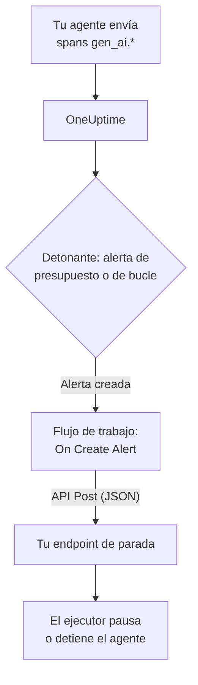

# Disyuntores para agentes de IA

Un agente de IA rara vez falla bloqueándose. Falla siguiendo adelante: reintenta una herramienta rota, vuelve a planificar el mismo paso o lanza más subagentes, mientras cada vuelta factura más tokens. Esta página monta un disyuntor para eso con piezas que OneUptime ya tiene: una alerta que detecta al agente desbocado y un flujo de trabajo que llama a un endpoint tuyo para detenerlo.

:::cards
- [Elige un detonante](#elige-un-detonante): Alerta por gasto, o por una herramienta llamada una y otra vez.
- [Crea el endpoint de parada](#crea-el-endpoint-de-parada): El pequeño servicio que pausa tu agente.
- [Crea el flujo de trabajo](#crea-el-flujo-de-trabajo): De una alerta nueva a una llamada a tu endpoint.
- [Prueba el disyuntor](#prueba-el-disyuntor): Dispáralo a mano y luego de verdad.
:::

## Cómo funciona



El disyuntor observa el OpenTelemetry que tu agente ya envía, directamente o [a través de un gateway](/docs/telemetry/ai-gateways), y actúa junto a la ruta de las peticiones, no dentro de ella. No se añade nada a cada llamada al modelo, y cambiar de proveedor, de SDK o de gateway no lo rompe.

El precio es la velocidad: detiene a un agente desbocado en minutos, no en milisegundos. Mantén los límites de pasos y los tiempos de espera en el propio agente, y deja que el disyuntor atrape lo que se les escape.

| Detonante | Detecta | Tiempo hasta la alerta |
| --- | --- | --- |
| Una alerta de presupuesto, de un monitor de métricas | Un gasto que no deja de subir, sea cual sea la causa | Hasta 15 minutos, más un minuto del monitor |
| Una alerta de bucle, de un monitor de trazas | La misma herramienta llamada una y otra vez | De 1 a 5 minutos |

## Antes de empezar

- Tu agente envía spans GenAI a OneUptime. Consulta [Observabilidad de IA / LLM](/docs/telemetry/ai-llm-observability).
- Un endpoint HTTPS que pueda pausar o detener el ejecutor de tu agente, accesible desde OneUptime. Lo creas en [Crea el endpoint de parada](#crea-el-endpoint-de-parada).
- Permiso para crear monitores y flujos de trabajo en el proyecto.

## Elige un detonante

Los dos detonantes terminan igual: un monitor crea una alerta y la alerta nueva inicia el flujo de trabajo. Puedes configurar ambos: al flujo de trabajo le da igual cuál se disparó.

### Una alerta de presupuesto

El gasto es la señal más segura de un agente desbocado. Un presupuesto suma el gasto de IA del día cada 15 minutos y lo publica como dos métricas, `oneuptime.llm.budget.spend.usd` y `oneuptime.llm.budget.percent.used`, cada una con el ID del presupuesto en `oneuptime.llm.budget.id`.

:::steps
1. Abre **Productos → IA / LLM → Presupuestos** y haz clic en **Crear Presupuesto de costo de LLM**. Fija un **Presupuesto diario (USD)** y elige el servicio del agente en **Servicio (opcional)** para que el presupuesto vigile solo a ese agente.
2. En el menú de la fila del presupuesto nuevo, elige **Mostrar ID** y copia el ID.
3. Crea un [monitor de métricas](/docs/monitor/metrics-monitor) sobre `oneuptime.llm.budget.percent.used`, filtrado por el atributo `oneuptime.llm.budget.id` con el ID que copiaste, y pon su **Intervalo de tiempo** en **Últimos 30 minutos**.
4. Añade un criterio **Greater Than Or Equal To** `100` que cree una alerta, y dale un **Título de la alerta** que nombre al agente, como `LLM budget exceeded: support-bot`. El flujo de trabajo y tu endpoint leen ese título.
:::

Filtra por el ID, no por el nombre: renombrar un presupuesto renombra su serie, y un monitor filtrado por el nombre antiguo dejaría de coincidir sin avisar. Deja el intervalo en 30 minutos: un presupuesto publica un punto cada 15 minutos, así que un intervalo más corto no encuentra nada entre dos puntos y la alerta se abre y se resuelve una y otra vez.

Un segundo criterio en `80` con una gravedad menor avisa antes a una persona, mediante la política de guardia de la alerta, antes de que el disyuntor salte en `100`.

### Una alerta de bucle

Un agente atascado deja un rastro que se reconoce: el mismo span de herramienta, una y otra vez. Una ejecución sana no llama a una herramienta decenas de veces en pocos minutos, así que un recuento detecta el bucle mucho antes que el presupuesto.

:::steps
1. Abre **Monitores**, haz clic en **Crear monitor** y elige **Trazas** en **Más tipos de monitor**.
2. En **Más campos**, pon **Filtrar por servicio de telemetría** en el servicio del agente y **Filtrar por atributos** en `gen_ai.tool.name` igual a la herramienta en la que esperas el bucle, como `search_web`. Si tu instrumentación nombra el span de cada herramienta, pon ese nombre en **Nombre del span** en su lugar.
3. Pon **Trazas del monitor durante (tiempo)** en **Últimos 5 minutos**.
4. Añade un criterio **Span Count** **Greater Than** un número que ninguna ejecución sana alcance en cinco minutos, como `50`, que cree una alerta con un título como `Agent loop: support-bot`.
:::

Un segundo monitor de trazas con **Filtrar por estado de span** en **Error** y un recuento menor detecta las tormentas de reintentos: una herramienta que no deja de fallar y un agente que no deja de reintentarla.

## Crea el endpoint de parada

El flujo de trabajo envía un `POST` con un cuerpo JSON a un endpoint que tú ejecutas. Qué significa «detener» lo decides tú. Del efecto más pequeño al más grande:

| Acción | Efecto |
| --- | --- |
| Detener el trabajo nuevo | El ejecutor no inicia nuevas ejecuciones de ese agente |
| Cancelar sus ejecuciones | Las ejecuciones en curso de ese agente se cancelan |
| Pausar el grupo | Todos los workers se vacían hasta que alguien rearma el disyuntor |

Un endpoint mínimo en Express que dispara un disyuntor por agente:

```typescript title="circuit-breaker.ts"
import express from "express";

const app = express();
app.use(express.json());

const tripped = new Set<string>(); // agents whose breaker is open

app.post("/circuit-breaker", (req, res) => {
  if (req.headers["authorization"] !== `Bearer ${process.env.KILL_TOKEN}`) {
    return res.status(401).end();
  }

  const alertTitle: string = req.body.alertTitle ?? "";

  // "LLM budget exceeded: support-bot" -> "support-bot"
  const agent: string = alertTitle.split(": ").pop() ?? "unknown";

  tripped.add(agent); // your run loop checks this set
  abortActiveRuns(agent); // cancel that agent's runs in flight

  // Answer fast; do the slow cleanup in the background.
  return res.status(200).json({ tripped: agent });
});
```

Constrúyelo con estas reglas:

- Haz que dispararlo sea idempotente. Un aviso y una superación, o una alerta de presupuesto y una de bucle a la vez, pueden dispararlo más de una vez, y un segundo disparo no debe cambiar nada.
- Responde en uno o dos segundos y limpia en segundo plano. El flujo de trabajo cuenta cualquier respuesta 2xx como éxito.
- Exige un secreto. Quien pueda llamar al endpoint puede detener tus agentes, así que comprueba un token bearer, que el flujo de trabajo envía desde una variable global secreta.
- Rearma a mano. Un disyuntor disparado sigue disparado hasta que alguien haya revisado la ejecución: abre la conversación del agente en **Productos → IA / LLM → Conversaciones** para leer o reproducir lo que hizo.

La petición sale de OneUptime. En OneUptime Cloud, tu endpoint debe ser accesible desde internet. Una instalación autoalojada rechaza las direcciones de red privadas salvo que un administrador las permita: consulta [Acceso de red saliente](/docs/workflows/configuration#acceso-de-red-saliente).

## Crea el flujo de trabajo

Primero guarda el token del endpoint donde el flujo de trabajo pueda usarlo sin mostrarlo: abre **Flujos de trabajo → Variables globales**, haz clic en **Crear Variable del flujo de trabajo**, llámala `AGENT_KILL_TOKEN`, pon el token en **Contenido** y activa **Secreto**. Un valor secreto se elimina de los registros de ejecución y de las trazas de los pasos.

:::steps
### Crea el flujo

Abre **Productos → Flujos de trabajo** y haz clic en **Crear flujo de trabajo**. Haz clic en **Empezar desde cero**, llámalo `AI agent circuit breaker` y haz clic en **Crear flujo de trabajo**. Se abre en el **Constructor**, desactivado.

### Añade el desencadenante

Haz clic en el bloque discontinuo **Elige qué inicia este flujo de trabajo** y elige **On Create Alert** en el panel **Añadir desencadenante**. Haz clic en el desencadenante, marca el título y la descripción en **Select Fields** y haz clic en **Guardar**. El ID del bloque, `alert-on-create-1`, es como los bloques posteriores se refieren a él.

### Comprueba el título

Haz clic en **Añadir componente**, elige **If / Else** y conecta el punto **Success** del desencadenante con él. Pon **Value to check** en el título de la alerta (haz clic en **{ }** y elígelo), **Comparison** en **contiene** y **Compare with** en el comienzo que comparten los títulos de tus detonantes, como `LLM budget exceeded`.

### Llama a tu endpoint

Añade **API Post (JSON)** y conecta el punto **Yes** del **If / Else** con él. Pon su **URL** en tu endpoint, como `https://agents.example.com/circuit-breaker`, y rellena las cabeceras y el cuerpo de abajo.

### Avisa de un fallo

Añade **Send Message to Slack**, o **Send Email**, y conecta el punto **Error** del bloque de API con él. Un disyuntor que no consigue dispararse es la única alerta que una persona tiene que ver.

### Actívalo

Activa **Habilitado** en la parte superior del **Constructor**.
:::

Las **Request Headers** del bloque de API:

```json title="Request Headers"
{
  "Authorization": "Bearer {{global.variables.AGENT_KILL_TOKEN}}",
  "Content-Type": "application/json"
}
```

Su **Request Body**:

```json title="Request Body"
{
  "source": "oneuptime-circuit-breaker",
  "alertId": "{{local.components.alert-on-create-1.returnValues.model._id}}",
  "alertTitle": "{{local.components.alert-on-create-1.returnValues.model.title}}",
  "alertDescription": "{{local.components.alert-on-create-1.returnValues.model.description}}"
}
```

Para reaccionar a varios detonantes, empieza todos sus títulos igual, o encadena más bloques **If / Else** desde el punto **No**. Consulta [Crear un flujo de trabajo](/docs/workflows/authoring) para el lienzo y [Variables](/docs/workflows/variables) para las referencias `{{…}}`.

## Prueba el disyuntor

:::steps
1. Dispáralo a mano. Abre **Alertas**, haz clic en **Crear alerta** y crea una con el título `LLM budget exceeded: test`. La ejecución aparece en **Flujos de trabajo → Registros → Ejecuciones**, y tu endpoint recibe la llamada.
2. Dispáralo de verdad. Crea un presupuesto con un límite mínimo, como `0.01` USD, sobre el servicio de un agente de prueba, apunta un monitor de presupuesto a él y deja que el agente se ejecute: el porcentaje supera 100, la alerta se abre, el flujo de trabajo se ejecuta y el disyuntor salta. Para la alerta de bucle, da a un agente de prueba una herramienta que siempre falle.
3. Dispáralo dos veces. Crea la misma alerta otra vez: tu endpoint debe aceptar el segundo disparo sin cambiar nada.
:::

## Cómo se comporta el disyuntor con el tiempo

- El flujo de trabajo se ejecuta cuando se crea una alerta, así que un detonante dispara el disyuntor una vez por alerta, no una vez por evaluación.
- Un presupuesto cuenta el día UTC, así que su porcentaje vuelve a 0 a medianoche UTC. Una alerta de presupuesto puede entonces resolverse, y el siguiente día malo abre una alerta nueva que vuelve a disparar el disyuntor.
- Un monitor mantiene su alerta abierta mientras se cumplen sus criterios. Con **Resolver alerta automáticamente** activado, la alerta se resuelve cuando dejan de cumplirse, y la siguiente superación abre una alerta nueva.
- Rearmar es una decisión de una persona en los dos lados: resuelve la alerta en OneUptime y rearma el disyuntor en tu ejecutor.
- Cada alerta nueva del proyecto inicia el flujo de trabajo. El **If / Else** es lo que mantiene las demás alertas lejos del disyuntor: no lo quites.

## Solución de problemas

:::details El flujo de trabajo no se ejecuta
Comprueba que **Habilitado** está activado en la parte superior del **Constructor**: los flujos de trabajo se crean desactivados. Después comprueba que la alerta se creó después de activar el flujo de trabajo: el desencadenante inicia una ejecución solo para una alerta nueva.
:::

:::details El flujo de trabajo se ejecuta, pero siempre toma la rama No
El título está vacío o no coincide. Un campo que no está marcado en **Select Fields** del desencadenante llega vacío, así que marca el título. Después compara el título de la alerta con **Compare with**: **contiene** debe encontrar ese texto exacto en él.
:::

:::details Tu endpoint responde 401
La cabecera `Authorization` no coincide con el token que espera tu endpoint. Comprueba el nombre en `{{global.variables.AGENT_KILL_TOKEN}}` y el valor guardado en la variable global. El valor de una variable secreta no se puede volver a leer, así que, ante la duda, vuelve a escribirlo con **Actualizar contenido**.
:::

:::details La alerta de presupuesto se abre y se resuelve una y otra vez
El **Intervalo de tiempo** del monitor es más corto que los 15 minutos entre puntos del presupuesto. Ponlo en **Últimos 30 minutos**.
:::

:::details La petición nunca llega a tu endpoint
Abre la ejecución en **Flujos de trabajo → Registros → Ejecuciones** y el paso **API Post (JSON)**: indica por qué falló la petición. En OneUptime Cloud, el endpoint debe ser accesible desde internet; una instalación autoalojada rechaza las direcciones de red privadas salvo que un administrador las permita.
:::

## Próximos pasos

:::cards
- [Observabilidad de IA / LLM](/docs/telemetry/ai-llm-observability): Presupuestos, costes y los spans que vigila el disyuntor.
- [Monitor de trazas](/docs/monitor/traces-monitor): Filtros de spans y criterios en detalle.
- [Flujos de trabajo](/docs/workflows/index): Desencadenantes, componentes, variables y ejecuciones.
- [Gateways de IA](/docs/telemetry/ai-gateways): Las llamadas al modelo de todos los agentes en una sola exportación.
:::
