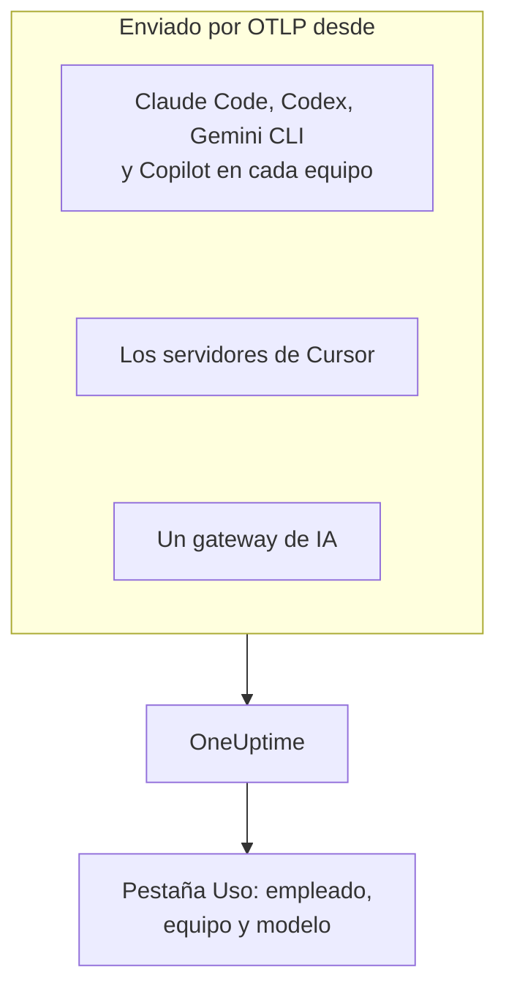

# Asistentes de programación con IA

Tus ingenieros usan Claude Code, Cursor, Codex, Gemini CLI y Copilot, y las facturas no paran de crecer. Esta página responde a las preguntas que se hace un responsable: **quién usa cada herramienta, con qué modelos, y cuánto gasta cada persona y cada equipo**.

La mayoría de los asistentes de programación exportan OpenTelemetry por sí mismos, así que no hay nada que instalar en los equipos de los desarrolladores: apunta la exportación a OneUptime, y los tokens, el coste y el uso de herramientas llegan junto a las llamadas de IA de tus propias aplicaciones. Todo lo de aquí llega por OpenTelemetry; OneUptime no consulta la API de administración ni de facturación de ningún proveedor.

:::cards
- [Matriz de compatibilidad](#matriz-de-compatibilidad): Qué envía cada herramienta, y si nombra a una persona.
- [Atribución a empleados y equipos](#atribución-a-empleados-y-equipos): Las claves que ponen un nombre y un equipo al gasto.
- [La pestaña Uso](#la-pestaña-uso): Lo que las tablas de gasto pueden y no pueden mostrar de un asistente de programación.
- [Por dónde empezar](#por-dónde-empezar): Un orden de despliegue que da resultados desde el primer día.
:::

## Cómo funciona

Cada herramienta envía su telemetría al endpoint OTLP de OneUptime con tu clave de ingesta: desde cada equipo de desarrollador, desde los servidores del proveedor (Cursor), o desde un gateway por el que pasa tu tráfico hacia los modelos.



## Antes de empezar

1. Crea una clave de ingesta de telemetría en **Ajustes del proyecto → Telemetría y APM → Claves de ingesta**.
2. Tu endpoint OTLP es `https://oneuptime.com/otlp`, o `https://YOUR-ONEUPTIME-HOST/otlp` si alojas OneUptime tú mismo.
3. Cada exportación envía la clave en la cabecera `x-oneuptime-token`.

Una sola clave de ingesta para toda la flota está bien. Acaba en cada equipo de desarrollador, así que trátala como una credencial compartida que solo puede enviar datos, y rótala como cualquier otra.

## Matriz de compatibilidad

Tres cosas deciden lo que obtienes de una herramienta: si envía OpenTelemetry, cómo llega su telemetría a OneUptime, y si algo en ella nombra a una persona.

| Herramienta | Qué envía | Cómo llega a OneUptime | A quién nombra | Guía |
| --- | --- | --- | --- | --- |
| Claude Code | Métricas y logs; trazas en beta | Desde cada equipo; variables de entorno o un archivo de ajustes gestionados | `user.email`, con la sesión iniciada con una cuenta de Claude | [Claude Code](/docs/telemetry/claude-code) |
| Cursor | Métricas y logs | Desde los servidores de Cursor, configurado una vez en el panel de Cursor; solo en el plan Enterprise | `cursor.user.id`, un entero | [Cursor](/docs/telemetry/cursor) |
| OpenAI Codex | Trazas, métricas y logs, cada uno activado en `~/.codex/config.toml` | Desde cada equipo, una URL completa por señal | A nadie en spans ni métricas: tú defines `user.id` y `user.email` en `[otel.span_attributes]` | [OpenAI Codex](/docs/telemetry/openai-codex) |
| Gemini CLI | Trazas, métricas y logs | Desde cada equipo, normalmente a través de un collector local | `user.email`, con la sesión iniciada | [Gemini CLI y GitHub Copilot](/docs/telemetry/gemini-cli-and-copilot) |
| GitHub Copilot | Trazas, métricas y logs, solo desde sus superficies de agente | Desde el editor o el host del agente | A nadie: tú defines `enduser.id` y `user.email` en cada equipo | [Gemini CLI y GitHub Copilot](/docs/telemetry/gemini-cli-and-copilot) |
| Cline | Métricas y logs | Configurado de forma central, en el panel de organización de Cline | Un `user_id` anonimizado | — |
| LiteLLM y Portkey | Trazas de cada llamada que pasa por el gateway | Desde el proceso del gateway | Con LiteLLM, el propietario de la clave virtual | [Gateways de IA](/docs/telemetry/ai-gateways) |
| Tus propias aplicaciones | Lo que envía tu instrumentación GenAI | Desde tu aplicación | Quien definas como `user.id` | [Observabilidad de IA / LLM](/docs/telemetry/ai-llm-observability) |
| Windsurf, JetBrains AI, Amazon Bedrock, Azure OpenAI | Ningún OpenTelemetry propio | Solo a través de un gateway que pongas delante | Quien nombre el gateway | [Gateways de IA](/docs/telemetry/ai-gateways) |

Un guion significa que OneUptime aún no tiene una guía para la herramienta. Su telemetría se ingiere igualmente como cualquier otro OpenTelemetry.

:::details Qué exporta exactamente GitHub Copilot
Copilot exporta OpenTelemetry solo desde sus superficies de agente: el chat y el modo agente de VS Code, el host del agente detrás de Copilot CLI, el Copilot SDK, y los flujos de agente en los IDE de JetBrains a través del plugin de Copilot. GitHub no documenta ninguna exportación para las sugerencias en línea, Copilot en github.com ni la revisión de código de Copilot. Copilot no envía ningún atributo de usuario, así que define `enduser.id` y `user.email` por equipo mediante `resourceAttributes` o `OTEL_RESOURCE_ATTRIBUTES`.
:::

:::details Amazon Bedrock, Azure OpenAI, Windsurf y JetBrains AI
- **Amazon Bedrock**: las API `InvokeModel` y `Converse` no envían OpenTelemetry. Bedrock AgentCore es distinto: AWS documenta para él métricas, spans y logs, enviados a CloudWatch por defecto. Definir `DISABLE_ADOT_OBSERVABILITY=true` desactiva la configuración ADOT predeterminada del runtime, para que puedas apuntar el SDK de ADOT a OneUptime.
- **Azure OpenAI**: el servicio no envía nada, y sus métricas de Azure Monitor no tienen dimensión de usuario. Instrumenta el cliente, o pon API Management u otro gateway delante.
- **Windsurf**: no documenta ninguna exportación de telemetría. Los datos por usuario están en la API Enterprise de Windsurf, que OneUptime no consulta.
- **JetBrains AI Assistant y Junie**: no exportan uso. El plugin de OpenTelemetry de JetBrains recibe la telemetría de tu propia aplicación dentro del IDE; no envía nada hacia fuera.
:::

## Atribución a empleados y equipos

OneUptime copia la persona que hizo una llamada, y su equipo, en columnas al llegar la telemetría, para que la pestaña **Uso** pueda ordenar personas y equipos sin filtros de atributos.

### Atributos que se leen como el empleado

En un span gana la primera clave presente, en este orden:

| Columna | Claves, de la preferida a la menos preferida |
| --- | --- |
| Id del empleado | `user.id`, `enduser.id`, `litellm.metadata.user_api_key_user_id`, `metadata.user_api_key_user_id`, `traceloop.association.properties.user_id`, `langfuse.user.id`, `user.account_uuid`, `user.account_id`, `cursor.user.id` |
| Correo del empleado | `user.email`, `litellm.metadata.user_api_key_user_email`, `metadata.user_api_key_user_email`, `traceloop.association.properties.user_email`, `enduser.email` |
| Equipo / centro de costes | `team.id`, `team`, `cost_center`, `department`, `litellm.metadata.user_api_key_team_id`, `litellm.team.id`, `metadata.user_api_key_team_id`, `cursor.team.id` |

En un punto de métrica la lista es más corta y empieza por el correo, porque los asistentes de programación que envían métricas envían `user.email` por sí mismos:

| Columna | Claves, de la preferida a la menos preferida |
| --- | --- |
| Empleado | `user.email`, `user.id`, `user.account_uuid`, `user.account_id`, `cursor.user.id` |
| Equipo / centro de costes | `team.id`, `team`, `cost_center`, `department`, `cursor.team.id` |
| Modelo | `gen_ai.request.model`, `model`, `cursor.model.name` |

Cómo se leen estas claves:

- **Cada clave se lee también con el prefijo `resource.`.** La ingesta OTLP guarda los atributos de recurso con ese prefijo, así que `OTEL_RESOURCE_ATTRIBUTES=team.id=platform` llega como `resource.team.id`. Las claves sin prefijo se prueban primero, así que un valor en el span gana a uno de todo el proceso.
- **La pestaña Uso muestra el correo de una persona cuando la llamada lo tiene, y el id en caso contrario.** Las filas que muestran el mismo correo se suman, así que un ingeniero en dos equipos es una sola fila.
- **La identidad solo se lee de las llamadas de IA.** `user.id`, `user.email` y `team.id` son claves genéricas que también llevan los spans del navegador y del backend; solo los spans ya reconocidos como llamadas de IA reciben las columnas.
- **Los registros de log no se leen para la identidad.** Esto importa en Codex, que solo pone `user.email` en sus logs.
- LiteLLM escribe estas claves de dos maneras: su callback `otel` predeterminado usa el prefijo `metadata.`, y su modo opcional OpenTelemetry v2 (`LITELLM_OTEL_V2=true`) el espacio de nombres `litellm.`. OneUptime lee ambas, así que un proxy estándar funciona sin más configuración.

### Equipos y centros de costes

Ninguna instrumentación envía `team.id`, `team`, `cost_center` ni `department`: los define tu organización, normalmente mediante `OTEL_RESOURCE_ATTRIBUTES` en el proceso de la herramienta.

```bash
export OTEL_RESOURCE_ATTRIBUTES="team.id=platform,team=Platform_Engineering,cost_center=eng-123,department=engineering"
```

Defínela donde ya preparas los equipos de los desarrolladores: un perfil MDM, un archivo de ajustes gestionados o un perfil de shell de tus dotfiles. Los valores no pueden contener espacios: usa guiones bajos, o codificación porcentual como `%20`. Codex no tiene atributos de recurso, así que define las mismas claves en su `[otel.span_attributes]`.

Para separar el gasto por aplicación, usa el nombre del servicio (`OTEL_SERVICE_NAME`, o el ajuste propio de la herramienta). El desglose **Aplicación / Servicio** solo cubre las herramientas que envían spans de GenAI.

### Lo que deliberadamente no se trata como el empleado

Una llamada puede llevar a dos personas distintas: el empleado que la hizo y el cliente para quien se hizo. Estas claves llevan al cliente, y OneUptime nunca las lee en una columna de identidad:

- `gen_ai.user` y `llm.user`: cómo las instrumentaciones reflejan el parámetro de solicitud `user` de OpenAI, que OpenAI describe como un identificador de tus usuarios finales.
- `litellm.metadata.user_api_key_end_user_id`, `metadata.user_api_key_end_user_id` y `litellm.end_user.id`: el usuario final de LiteLLM, a diferencia del propietario de la clave, que es el empleado.

Leer un id de cliente como empleado convertiría un bot de soporte que atiende a 40.000 clientes en 40.000 empleados fantasma, mientras que el ingeniero dueño del gasto parecería no gastar nada. Las claves se quedan en los atributos del span, y la pestaña **LLM** del visor de trazas las muestra como el usuario final.

### Privacidad

La columna del correo del empleado contiene datos personales. Las **Reglas de depuración** de las trazas la cubren igual que al atributo del que se leyó, así que una regla que enmascara correos enmascara también la columna. Las encuentras en **Trazas → Ajustes**.

## Métricas de los asistentes de programación que lee OneUptime

Los asistentes de programación nombran sus métricas con su propio prefijo en lugar de `gen_ai.*`, así que OneUptime conoce cada una por su nombre:

| Métrica | Herramienta | Unidad |
| --- | --- | --- |
| `claude_code.token.usage` | Claude Code | Tokens |
| `claude_code.cost.usage` | Claude Code | USD |
| `cursor.token.usage` | Cursor | Tokens |
| `cursor.cost.usage` | Cursor | USD, una estimación según la propia Cursor |
| `codex.turn.token_usage` | OpenAI Codex | Tokens |
| `codex.turn.cost_microusd` | OpenAI Codex | Millonésimas de USD: OneUptime la convierte, no lo hagas tú |

OneUptime también lee tokens de `gen_ai.client.token.usage`, `gen_ai.client.token.count`, `llm.token.usage` y `llm.usage.tokens`, y el coste de `gen_ai.client.cost`, `gen_ai.client.cost.usd`, `gen_ai.usage.cost`, `litellm_spend_metric` y `litellm.cost.total`.

Dos cosas que debes saber antes de leer las cifras:

- **`gemini_cli.token.usage` se deja fuera a propósito.** Gemini CLI envía sus tokens dos veces, como su propia métrica y como `gen_ai.client.token.usage`, y leer ambas los duplicaría. Sus tokens se cuentan una vez, a través de `gen_ai.client.token.usage`. Gemini CLI no envía ninguna métrica de coste: activa sus trazas para que cada llamada tenga precio.
- **Solo se cuentan los tokens de entrada y de salida.** El tipo de token se lee de `gen_ai.token.type`, `llm.token.type`, `type`, `cursor.token.type` o `token_type`, y solo cuentan `input` y `output` (o los antiguos `prompt` y `completion`). Las lecturas y escrituras de caché, el `total` de Codex (que repite los demás) y `reasoning_output` (parte de `output`) se dejan fuera, así que un total sacado de métricas es menor que la suma de todo lo que envía una herramienta.

## La pestaña Uso

Abre **Productos → IA / LLM** y ve a **Uso**. Ordena **Empleado**, **Equipo**, **Modelo**, **Proveedor** y **Aplicación / Servicio** por gasto, en los últimos 7 días si no eliges otro periodo. Las llamadas que no nombran a nadie se cuentan en **Sin atribuir**: una fila grande de **Sin atribuir** te dice qué herramienta aún necesita su identidad.

### Las métricas de los asistentes de programación suplen, no suman

Los spans de GenAI van primero: las métricas solo se leen para una cifra que los spans no aportaron, y las dos nunca se suman ([por qué](/docs/telemetry/ai-llm-observability#primero-los-spans-las-métricas-los-suplen)). Para los asistentes de programación eso tiene una consecuencia tajante: **si el mismo proyecto recibe spans de GenAI con coste, el gasto de los asistentes de programación no aparece.** Dales a los asistentes de programación un proyecto propio, con su propia clave de ingesta.

Cuando la sustitución sí se aplica, esto es lo que cada desglose puede mostrar de una herramienta que solo envía métricas:

| Desglose | Desde las métricas |
| --- | --- |
| **Empleado** | Sí, desde cada clave de identidad de arriba, con o sin el prefijo `resource.` |
| **Equipo** | Sí, desde las claves de equipo |
| **Modelo** | Sí: Claude Code y Codex envían un `model` sin prefijo, Cursor `cursor.model.name` |
| **Proveedor** | No: las métricas de los asistentes de programación no nombran ningún proveedor |
| **Aplicación / Servicio** | No: sus métricas no pertenecen a ningún servicio de OneUptime |

Una fila leída de las métricas solo lleva el coste: sus celdas de llamadas y tokens muestran `—`, porque un contador de gasto no tiene detalle por llamada, y un 0 ahí afirmaría que la persona no hizo ninguna llamada. La tabla lleva la marca **de las métricas de GenAI**.

## ¿Sin OpenTelemetry? Pon un gateway delante

Para Windsurf, JetBrains AI, las API de modelos de Bedrock, Azure OpenAI y cualquier otra herramienta sin exportación propia, pon un gateway de IA delante. Cada llamada pasa entonces por un único proceso que envía OpenTelemetry, y configuras la exportación una sola vez.

**Usa LiteLLM con una clave virtual por empleado.** LiteLLM marca cada span con el id y el correo del propietario de la clave, que OneUptime lee como el empleado, y con el equipo de la clave como el equipo. También pone precio a cada llamada él mismo, con las tarifas personalizadas que definas en el proxy, y su coste aportado gana a la estimación de OneUptime. No uses para esto su id de usuario final: ese es el cliente. La configuración está en [Gateways de IA](/docs/telemetry/ai-gateways).

Dos límites antes de planificar en torno a un gateway:

- **Un gateway solo ve el tráfico que pasa por él.** La anulación de URL base de Cursor es un ajuste por usuario que solo cubre los modelos de chat (el autocompletado con Tab sigue usando los modelos de Cursor), así que prefiere la exportación nativa de Cursor.
- **Un gateway ve la llamada al modelo, no al agente.** Registra prompts y respuestas, pero no las llamadas a herramientas, las ediciones de archivos ni las decisiones de aceptar o rechazar que informa la telemetría propia de una herramienta.

## Contenido de los prompts: los valores predeterminados varían según la herramienta

Los prompts y las respuestas son los datos más arriesgados de este flujo: suelen contener código fuente, datos de clientes y credenciales pegadas. Comprueba el valor predeterminado de cada herramienta:

| Herramienta | Contenido de los prompts por defecto |
| --- | --- |
| Claude Code | Desactivado: cada tipo de contenido tiene su propia variable para activarlo |
| Cursor | Desactivado: solo la familia opcional `conversation_content` envía el texto de los mensajes |
| OpenAI Codex | Desactivado: `log_user_prompt` es `false` por defecto |
| Gemini CLI | **Activado**: `logPrompts` es `true` por defecto, así que ponlo en `false` cuando actives la telemetría |
| GitHub Copilot | Desactivado: `captureContent`, que los ajustes gestionados pueden bloquear con `lockCaptureContent` |
| LiteLLM | Activado con el callback `otel` predeterminado (desactívalo con `turn_off_message_logging`); desactivado en el modo OpenTelemetry v2 |

Codex también envía sus métricas a OpenAI por defecto: consulta [OpenAI Codex](/docs/telemetry/openai-codex). Donde captures contenido a propósito, las **Reglas de depuración** y los **Filtros de descarte** de las trazas se aplican a él como a cualquier otra telemetría.

## Lo que OneUptime aún no hace

- **No hay conectores de administración ni de facturación de proveedores.** OneUptime no consulta la API de administración de Anthropic, la API de administración de Cursor, los endpoints de uso y costes de OpenAI, la facturación de Copilot de GitHub ni las API de Windsurf o JetBrains. Para cifras al nivel de la factura, obtenlas del proveedor.
- **El coste es una estimación salvo que una herramienta lo aporte.** Un coste aportado se usa tal cual; si no, OneUptime pone precio a los tokens con precios de lista. El `cursor.cost.usage` de Cursor es en sí una estimación.
- **No se lee la identidad de los registros de log.** El `user.email` de Codex, que solo envía en los logs, no se une al gasto.
- **El `cursor.user.email` de Cursor aún no se lee**, así que los usuarios de Cursor aparecen con su entero `cursor.user.id`.
- **Los spans de Codex no nombran ningún modelo**, así que OneUptime no puede ponerles precio: Codex muestra tokens por persona, y su coste solo en los totales.
- **Las herramientas cambian rápido.** Si esta página dice que una herramienta no tiene exportación, revisa su documentación actual antes de construir en torno a un gateway.

## Por dónde empezar

Despliégalo en este orden; cada paso es útil por sí solo. Usa un proyecto que no reciba ya spans de GenAI de tus propias aplicaciones, o [la regla de sustitución](#las-métricas-de-los-asistentes-de-programación-suplen-no-suman) mantiene el gasto de los asistentes de programación fuera de la página.

1. **Gemini CLI**, si alguien lo usa. Envía `user.email` sin configuración, así que muestra la atribución de principio a fin. Activa también sus trazas: no envía ninguna métrica de coste.
2. **Claude Code**: un archivo de ajustes gestionados para la flota, `user.email` sin esfuerzo, una métrica de coste real, y la tasa de aceptación, los commits, las pull requests y las líneas de código por desarrollador.
3. **Cursor**, en el plan Enterprise: una pantalla en el panel de Cursor, ningún equipo de desarrollador tocado, aunque las personas llegan como enteros.
4. **Copilot y Codex**, que necesitan ambos una identidad definida en cada equipo. Hazlo al preparar los equipos: las llamadas que llegaron sin ella no se pueden atribuir después.
5. **Un gateway de LiteLLM** para todo lo demás, con una clave virtual por empleado.

## Próximos pasos

:::cards
- [Claude Code](/docs/telemetry/claude-code): Activa la exportación de Claude Code para un equipo o toda la flota.
- [Cursor](/docs/telemetry/cursor): Envía la telemetría de equipo de Cursor desde el panel de Cursor.
- [OpenAI Codex](/docs/telemetry/openai-codex): Configura los tres exportadores de Codex y pon una identidad en sus spans.
- [Observabilidad de IA / LLM](/docs/telemetry/ai-llm-observability): Conversaciones, alertas, coste y presupuestos para cada llamada de IA.
:::
