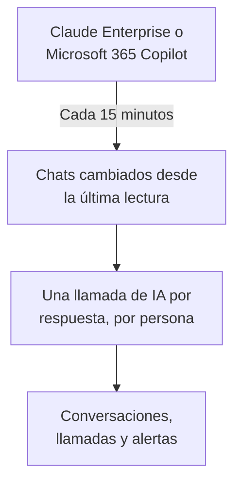

# Herramientas de IA de la empresa

Mira lo que tu gente pregunta a las herramientas de IA que paga tu empresa, como conversaciones por persona. Conecta Claude Enterprise o Microsoft 365 Copilot con una credencial que solo puede leer, y OneUptime trae cada chat nuevo a **Conversaciones** cada 15 minutos. Solo los propietarios y administradores del proyecto pueden leerlas, salvo que decidas otra cosa.

:::cards
- [Avisa primero a tu gente](#avisa-primero-a-tu-gente): Sus chats son sus propias palabras.
- [Conectar una herramienta](#conectar-una-herramienta): Pega la credencial, elige quién puede leer, pruébala y conecta.
- [Privacidad](#privacidad): Quién puede leer las conversaciones y si se guardan las palabras.
- [Otras herramientas de IA](#otras-herramientas-de-ia): ChatGPT Enterprise, Gemini, Open WebUI, LibreChat y asistentes de programación.
:::

## Avisa primero a tu gente

> [!IMPORTANT]
> Son las propias palabras de tu gente. Antes de conectar una herramienta, diles que sus chats con ella se guardan y quién puede leerlos, y consulta con tu equipo legal o de RR. HH. lo que piden vuestras políticas y la ley local.

## Cómo funciona

Cada 15 minutos, OneUptime pide a la herramienta los chats que cambiaron desde su última lectura. Cada respuesta se convierte en una llamada de IA de la persona que preguntó, con las preguntas hechas desde la respuesta anterior, y cada chat se convierte en una conversación.

Los chats llegan igual que las llamadas de IA de tus aplicaciones, así que las reglas de depuración, los filtros de descarte, la retención y las alertas de IA se les aplican. Las herramientas se pagan por puesto, así que estas llamadas no llevan tokens ni coste. Una pregunta sin respuesta durante una hora llega sola, así que también aparece un chat que la IA nunca respondió.

## Antes de empezar

- El rol Project Owner o Project Admin. Solo ellos pueden conectar, cambiar o quitar una herramienta.
- Alguien que administre la herramienta, para crear la credencial: la sección de cada herramienta, más abajo, dice quién.
- Tu gente avisada, y la respuesta de tu equipo legal o de RR. HH.

## Conectar una herramienta

:::steps
### Abre Conectar

Abre **Productos → IA / LLM → Conectar**. En **Las herramientas de IA de tu empresa**, haz clic en el mosaico de la herramienta.

### Pega la credencial

En **Credenciales**, rellena lo que pide la herramienta. Los secretos se guardan cifrados y no se vuelven a mostrar nunca.

### Elige quién puede leer

En **Privacidad**, ajusta **Quién puede leer las conversaciones** y **Guardar lo que se escribió**, como explica [Privacidad](#privacidad).

### Pruébala

En **Probar**, haz clic en **Probar conexión**. OneUptime cuenta los chats de los últimos 7 días: no se lee, muestra ni guarda nada de lo que alguien escribió.

### Conecta

Haz clic en **Conectar**. La primera lectura empieza en menos de un minuto y trae los últimos 7 días.
:::

## Claude Enterprise

OneUptime lee cada chat de claude.ai de tu organización a través de la Compliance API: quién preguntó, qué le preguntó a Claude, qué respondió y qué modelo usó. Un chat que recibe un mensaje nuevo se vuelve a leer, y las respuestas ya traídas se reconocen y se omiten.

:::steps
### Activa la Compliance API

El propietario principal de tu organización abre Organization settings, API en claude.ai y activa la Compliance API.

### Crea una clave de acceso de cumplimiento

Allí, crea una clave con el ámbito `read:compliance_user_data`. Empieza por `sk-ant-api01-`.

### Conecta Claude Enterprise

Pega la clave como **Clave de acceso de cumplimiento**.
:::

## Microsoft 365 Copilot

OneUptime lee el historial de interacciones con Copilot de cada persona desde Microsoft Graph: lo que preguntó a Copilot en Teams, Outlook, Word, Excel, PowerPoint, Loop o Copilot Chat, lo que respondió y en qué aplicación. Un prompt y sus respuestas se convierten en una llamada de IA, y una sesión de Copilot en una conversación. Un tenant grande se lee por partes, siguiendo donde se detuvo la última lectura.

:::steps
### Registra una aplicación

En Microsoft Entra ID, registra una aplicación y crea un secreto de cliente para ella.

### Concede los permisos

Dale a la aplicación los permisos de aplicación `AiEnterpriseInteraction.Read.All` y `User.Read.All` de Microsoft Graph, y concede el consentimiento de administrador.

### Conecta Copilot

Rellena **ID de directorio (tenant)**, **ID de aplicación (cliente)** y **Secreto del cliente**. Para leer solo a algunas personas, pon el ID de objeto de un grupo en **Solo las personas de este grupo**, en **Más campos**, y dale también a la aplicación `GroupMember.Read.All`. Para Azure Government, cambia allí **Nube**.
:::

## Privacidad

| Ajuste | Qué hace |
| --- | --- |
| **Quién puede leer las conversaciones** | **Propietarios y administradores del proyecto**, el valor predeterminado: nadie más en el proyecto ve estas conversaciones, ni las llamadas de IA de las que se componen, en ninguna parte de OneUptime. **Todos los que pueden leer llamadas de IA**: todos los que pueden leer las trazas del proyecto. |
| **Guardar lo que se escribió** | Activado, el valor predeterminado: se guardan las preguntas y las respuestas. Desactivado: OneUptime guarda quién preguntó, cuándo, con qué modelo y en qué aplicación, pero no las palabras. |

Un cambio de quién puede leer se aplica en menos de un minuto. Desactivar **Guardar lo que se escribió** se aplica a los chats leídos después; lo que se guardó antes se queda hasta que termina su retención.

Para guardar las palabras pero enmascarar partes de ellas, como direcciones de correo o números de tarjeta, usa **Reglas de depuración** en **Trazas → Ajustes**: se aplican antes de guardar nada. Las conversaciones se conservan mientras el servicio de la conexión conserve sus trazas: consulta [Retención de datos](/docs/telemetry/data-retention). Quitar una conexión detiene sus lecturas; lo que leyó se queda, legible para las mismas personas, hasta que termina su retención.

## Otras herramientas de IA

Estas herramientas no tienen una API con la que OneUptime pueda leer los chats de la gente, o necesitan otra vía.

### ChatGPT Enterprise

OpenAI abre su Compliance API a un workspace solo bajo petición y no publica qué contienen sus registros, así que OneUptime todavía no puede leer los chats de ChatGPT Enterprise. Conectar tu organización de OpenAI como [cuenta de proveedor](/docs/telemetry/ai-provider-accounts#openai) muestra su uso y coste de API, que no incluye ChatGPT.

### Gemini para Google Workspace

Google no ofrece ninguna API para leer los chats de Gemini de la gente. Google Vault los conserva para eDiscovery.

### Asistentes de programación

Claude Code, Codex, Gemini CLI, GitHub Copilot y Cursor envían su propio OpenTelemetry: consulta [Asistentes de programación con IA](/docs/telemetry/ai-coding-assistants).

### Open WebUI y LibreChat

Las aplicaciones de chat autoalojadas llaman a los modelos a través de una API que tú defines. Pon un proxy de LiteLLM delante de los modelos y envía sus trazas a OneUptime como muestra [Gateways de IA](/docs/telemetry/ai-gateways#litellm-proxy): los prompts y las respuestas de cada chat llegan como llamadas de IA. Una clave virtual por persona dice quién preguntó; una clave que todos comparten no nombra a nadie. La exportación OpenTelemetry propia de Open WebUI traza sus solicitudes web y sus consultas a la base de datos, no los chats.

## Solución de problemas

:::details La prueba no encuentra chats
Nadie usó la herramienta en los últimos 7 días, o la credencial pertenece a otra organización o a otro tenant. Para Copilot, comprueba que el grupo en **Solo las personas de este grupo** es el que quieres.
:::

:::details La credencial funciona, pero no puede leer lo que necesita la conexión
Para Copilot, concede el consentimiento de administrador para los permisos de Graph de la aplicación, y también `GroupMember.Read.All` cuando nombras un grupo. Para Claude Enterprise, crea la clave con el ámbito `read:compliance_user_data`.
:::

:::details Alguien no puede ver las conversaciones
**Quién puede leer las conversaciones** está en **Propietarios y administradores del proyecto**. Un propietario o administrador puede cambiarlo con **Editar** en la fila de la conexión.
:::

:::details Las conversaciones muestran quién preguntó, pero no las palabras
**Guardar lo que se escribió** estaba desactivado cuando se leyeron. Activarlo se aplica a los chats leídos después.
:::

## Próximos pasos

:::cards
- [Observabilidad de IA / LLM](/docs/telemetry/ai-llm-observability): Lee y reproduce conversaciones, y entérate cuando las respuestas fallan.
- [Cuentas de proveedores de IA](/docs/telemetry/ai-provider-accounts): Uso y coste de tus cuentas de OpenAI, Anthropic, Azure, Bedrock y Vertex AI.
- [Asistentes de programación con IA](/docs/telemetry/ai-coding-assistants): Gasto por ingeniero de las herramientas de programación.
- [Retención de datos](/docs/telemetry/data-retention): Cuánto tiempo se conservan las conversaciones.
:::
