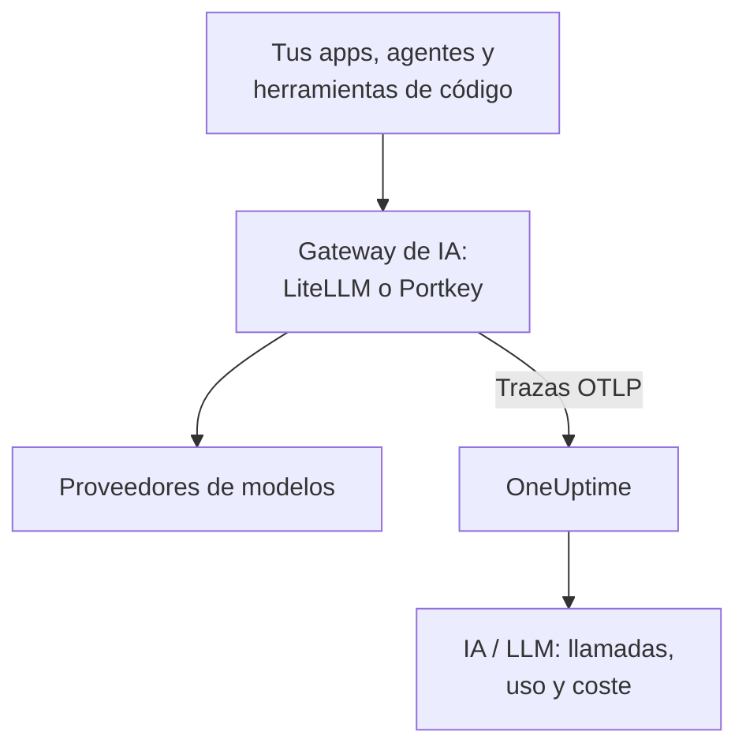

# Gateways de IA (LiteLLM, Portkey)

Un gateway de IA se sitúa entre tus apps y los proveedores de modelos, así que cada llamada al modelo pasa por él. Envía una vez el OpenTelemetry del gateway a OneUptime, y cada llamada que hay detrás llega a [IA / LLM](/docs/telemetry/ai-llm-observability) con su modelo, sus tokens, su coste y, salvo que lo desactives, el prompt y la respuesta, sin instrumentar cada app.

:::cards
- [LiteLLM Proxy](#litellm-proxy): Exportación integrada, configurada con tres variables.
- [Quién gastó qué](#una-clave-virtual-por-empleado): Una clave virtual de LiteLLM por empleado nombra a cada persona.
- [Portkey](#portkey): Exportación integrada en gateways autoalojados; en los demás, instrumenta la app.
- [Comprueba que llegan las llamadas](#comprueba-que-llegan-las-llamadas): Lo que deberías ver, y qué hacer si no lo ves.
:::

## Cómo funciona



| | LiteLLM Proxy | Portkey, autoalojado o Enterprise | Portkey, código abierto o alojado |
| --- | --- | --- | --- |
| Exportación a OneUptime | Integrada | Integrada, experimental | Ninguna: instrumenta la app en su lugar |
| Endpoint que configurar | `https://oneuptime.com/otlp/v1/traces` | `https://oneuptime.com/otlp` | El exportador propio de la app |
| Nombra a cada persona | Sí, con una clave virtual por empleado | No | Solo lo que envíe la app |
| Prompts y respuestas | Enviados salvo que los desactives | Siempre enviados | Depende de la instrumentación |

## Antes de empezar

- Una clave de ingesta: abre **Ajustes del proyecto → Telemetría y APM → Claves de ingesta** y haz clic en **Crear clave de ingesta**.
- Tu URL base de OTLP: `https://oneuptime.com/otlp`, o `https://YOUR-ONEUPTIME-HOST/otlp` si alojas OneUptime tú mismo. OneUptime acepta OTLP sobre HTTP, en protobuf y en JSON.
- La clave viaja en la cabecera `x-oneuptime-token` de cada petición de exportación.

## LiteLLM Proxy

El callback de OpenTelemetry de LiteLLM forma parte del proxy de código abierto, y la imagen oficial de Docker (`ghcr.io/berriai/litellm`) incluye los paquetes que necesita.

:::steps
### Activa el callback otel

Añade `otel` a los callbacks en el `config.yaml` del proxy:

```yaml title="config.yaml"
model_list:
  - model_name: gpt-4o
    litellm_params:
      model: openai/gpt-4o
      api_key: os.environ/OPENAI_API_KEY

litellm_settings:
  callbacks: ["otel"]
```

### Apunta el exportador a OneUptime

Define tres variables en el proxy:

```bash
export OTEL_EXPORTER="otlp_http"
export OTEL_ENDPOINT="https://oneuptime.com/otlp/v1/traces"
export OTEL_HEADERS="x-oneuptime-token=YOUR_INGESTION_TOKEN"
```

### Inicia el proxy

:::tabs
@tab Docker
```bash
docker run \
  -v $(pwd)/config.yaml:/app/config.yaml \
  -e OPENAI_API_KEY="sk-..." \
  -e OTEL_EXPORTER="otlp_http" \
  -e OTEL_ENDPOINT="https://oneuptime.com/otlp/v1/traces" \
  -e OTEL_HEADERS="x-oneuptime-token=YOUR_INGESTION_TOKEN" \
  -e OTEL_SERVICE_NAME="litellm-gateway" \
  -p 4000:4000 \
  ghcr.io/berriai/litellm:main-stable \
  --config /app/config.yaml
```
@tab pip
```bash
pip install 'litellm[proxy]' opentelemetry-api opentelemetry-sdk opentelemetry-exporter-otlp
litellm --config config.yaml
```
:::

`litellm[proxy]` por sí solo no incluye los paquetes de OpenTelemetry, así que instálalos con él.

### Envía una petición a través de él

Llama una vez al proxy y después revisa IA / LLM como se describe en [Comprueba que llegan las llamadas](#comprueba-que-llegan-las-llamadas).
:::

| Variable | Valor | Notas |
| --- | --- | --- |
| `OTEL_EXPORTER` | `otlp_http` | También se lee como `OTEL_EXPORTER_OTLP_PROTOCOL` |
| `OTEL_ENDPOINT` | `https://oneuptime.com/otlp/v1/traces` | La ruta completa `/v1/traces` funciona con todas las versiones de LiteLLM; también se lee como `OTEL_EXPORTER_OTLP_ENDPOINT` |
| `OTEL_HEADERS` | `x-oneuptime-token=YOUR_INGESTION_TOKEN` | Pares `key=value` separados por comas; también se lee como `OTEL_EXPORTER_OTLP_HEADERS` |
| `OTEL_SERVICE_NAME` | El nombre de tu gateway | El servicio bajo el que aparecen sus llamadas; `litellm` si no se define |

### Lo que envía LiteLLM

Cada llamada lleva `gen_ai.system`, `gen_ai.request.model`, `gen_ai.response.model`, `gen_ai.usage.input_tokens` y `gen_ai.usage.output_tokens`, sus parámetros, y el prompt y la respuesta: todo lo que OneUptime necesita para [leer la llamada](/docs/telemetry/ai-llm-observability).

Desde LiteLLM 1.81, estos atributos están en el span `Received Proxy Server Request` de la petición, y ya no hay un span `litellm_request` aparte. Cuando una petición hace varias llamadas al modelo, cada llamada sobrescribe ahí los atributos de la anterior, así que define `USE_OTEL_LITELLM_REQUEST_SPAN=true` para tener un span `litellm_request` por cada llamada.

LiteLLM pone precio a cada llamada él mismo, incluidas las tarifas personalizadas que hayas definido en el proxy, y lo informa como `gen_ai.cost.total_cost`. OneUptime prefiere un coste informado a su propia estimación, y [estima a partir de los tokens](/docs/telemetry/ai-llm-observability) solo cuando LiteLLM no pudo poner precio a la llamada, como con un modelo personalizado sin precio definido.

### Una clave virtual por empleado

Da a cada persona su propia clave virtual de LiteLLM, y cada llamada que haga llegará con quién es. LiteLLM escribe en el span el ID, el email y el equipo del propietario de la clave, y OneUptime los lee como el empleado y el equipo, así que la pestaña **Uso** clasifica el gasto por persona sin configurar nada en sus máquinas.

Las claves virtuales necesitan una base de datos y una clave maestra en el proxy (`DATABASE_URL` y `LITELLM_MASTER_KEY`). Crea un usuario con su email y después una clave para ese usuario:

```bash
curl -X POST "http://localhost:4000/user/new" \
  -H "Authorization: Bearer YOUR_MASTER_KEY" \
  -H "Content-Type: application/json" \
  -d '{"user_email": "alice@example.com"}'

curl -X POST "http://localhost:4000/key/generate" \
  -H "Authorization: Bearer YOUR_MASTER_KEY" \
  -H "Content-Type: application/json" \
  -d '{"user_id": "USER_ID_FROM_THE_FIRST_CALL", "team_id": "platform"}'
```

| Atributo de span de LiteLLM | OneUptime lo lee como |
| --- | --- |
| `metadata.user_api_key_user_id` | El ID del empleado |
| `metadata.user_api_key_user_email` | El email del empleado |
| `metadata.user_api_key_team_id` | El equipo |
| `metadata.user_api_key_end_user_id` | Nunca el empleado: es el `user` que tu app envía para su propio cliente |

En el modo OpenTelemetry v2 de LiteLLM, los mismos valores llegan con el prefijo `litellm.` (`litellm.metadata.user_api_key_user_email` y demás), que OneUptime también lee.

### Deja fuera los prompts

El callback `otel` envía por defecto los prompts y las respuestas completos. Para dejarlos fuera, usa una de estas opciones:

:::tabs
@tab Todos los callbacks
```yaml title="config.yaml"
litellm_settings:
  callbacks: ["otel"]
  turn_off_message_logging: true
```
@tab Solo el callback de OTel
```yaml title="config.yaml"
litellm_settings:
  callbacks: ["otel"]

callback_settings:
  otel:
    message_logging: False
```
@tab Variable de entorno
```bash
export OTEL_INSTRUMENTATION_GENAI_CAPTURE_MESSAGE_CONTENT="NO_CONTENT"
```
:::

`callback_settings` es una clave de primer nivel, no una clave dentro de `litellm_settings`. Para conservar los prompts pero enmascarar partes, usa en su lugar reglas de depuración en **Trazas → Ajustes**.

:::details El modo OpenTelemetry v2 de LiteLLM
Las versiones recientes de LiteLLM tienen un modo OpenTelemetry v2 opcional (`LITELLM_OTEL_V2=true`, sin cambios en `config.yaml`). Envía una traza por petición, con el manejo HTTP, la autenticación, los guardrails y la llamada al modelo como spans GenAI con nombres como `chat gpt-4o`. En el modo v2 los prompts están desactivados por defecto; actívalos con `OTEL_INSTRUMENTATION_GENAI_CAPTURE_MESSAGE_CONTENT`. Su coste llega como `litellm.cost.total`, que OneUptime también lee. Usa un modo u otro, no los dos.
:::

## Portkey

Lo que Portkey puede enviar depende de cómo lo ejecutes:

| Despliegue | Exportación a OneUptime |
| --- | --- |
| Gateway autoalojado o Enterprise | Integrada (experimental): define las variables de abajo |
| Gateway de código abierto (`portkey-ai/gateway`) | Ninguna: instrumenta la app que lo llama |
| Gateway alojado (portkey.ai) | Ninguna en el gateway: instrumenta la app que lo llama |

Portkey también tiene un endpoint de OpenTelemetry propio (`api.portkey.ai/v1/otel`). Recibe trazas dentro de Portkey, la dirección contraria a la de esta página.

### Gateways autoalojados y Enterprise

Define estas variables en el contenedor del gateway:

```yaml title="docker-compose.yml"
services:
  portkey-gateway:
    environment:
      EXPERIMENTAL_GEN_AI_OTEL_TRACES_ENABLED: "true"
      EXPERIMENTAL_GEN_AI_OTEL_EXPORTER_OTLP_ENDPOINT: "https://oneuptime.com/otlp"
      EXPERIMENTAL_GEN_AI_OTEL_EXPORTER_OTLP_HEADERS: "x-oneuptime-token=YOUR_INGESTION_TOKEN"
```

- Indica la URL base de OTLP: Portkey añade `/v1/traces` por su cuenta.
- Las cabeceras son pares `key=value` separados por comas. `EXPERIMENTAL_GEN_AI_OTEL_RESOURCE_ATTRIBUTES` añade atributos de recurso de la misma forma, como `deployment.environment=production`.
- Portkey envía OTLP sobre HTTP solo con JSON, que OneUptime acepta sin un collector de por medio.
- Cada llamada es un span llamado `{operation} {model}`, como `chat gpt-4o`, bajo el servicio `portkey`, con `gen_ai.provider.name`, el modelo pedido y el servido, los recuentos de tokens, `gen_ai.conversation.id` y los mensajes en `gen_ai.input.messages` y `gen_ai.output.messages`.
- Los prompts y las respuestas completos se incluyen siempre. Enmascara lo que haga falta con reglas de depuración en **Trazas → Ajustes**.
- Cada llamada se envía por separado tras la respuesta, sin agrupar y sin reintentos: una exportación fallida se pierde. Trátala como observabilidad, no como registro de auditoría.
- Cuando tu `x-portkey-trace-id` es un ID de traza válido (32 caracteres hexadecimales), Portkey lo reutiliza, así que los spans del gateway se unen a la traza de tu propia app.

Portkey marca esta exportación como experimental. Si las variables no tienen efecto, contrasta la documentación actual de Portkey con la versión de tu gateway.

### Gateways de código abierto y alojados

El gateway de código abierto no tiene exportador, y en el gateway alojado no puedes definir sus variables. Instrumenta en su lugar la app que llama a Portkey. Portkey habla la API de OpenAI, así que las instrumentaciones GenAI de [Observabilidad de IA / LLM](/docs/telemetry/ai-llm-observability) (OpenLLMetry, OpenInference, OpenLIT) trazan las llamadas de tu SDK aunque la URL base apunte a Portkey:

```python
from traceloop.sdk import Traceloop
from openai import OpenAI

Traceloop.init(
    app_name="my-ai-agent",
    api_endpoint="https://oneuptime.com/otlp",
    headers={"x-oneuptime-token": "YOUR_INGESTION_TOKEN"},
)

client = OpenAI(
    base_url="https://api.portkey.ai/v1",   # or your gateway's URL
    default_headers={"x-portkey-api-key": "PORTKEY_API_KEY"},
)
# Calls through Portkey are now traced to OneUptime.
```

Estos spans describen la llamada tal como la hizo tu app: el modelo que pidió, el tiempo que esperó, los tokens que recibió. Lo que el gateway decidió por el camino, como un fallback, un reintento o un acierto de caché, se queda en Portkey. Para verlo en OneUptime, usa la exportación del gateway autoalojado.

## Comprueba que llegan las llamadas

:::steps
1. Envía una petición a través del gateway y espera unos segundos.
2. Abre **Productos → IA / LLM → Llamadas**. La llamada aparece con su proveedor, su modelo y sus tokens.
3. Haz clic en la llamada para abrir su traza y abre la pestaña **LLM** del span: el modelo, los tokens, los parámetros y, salvo que los desactivaras, el prompt y la respuesta.
4. Abre **Uso**: la llamada cuenta en los totales, con el coste que informó el gateway o el que estimó OneUptime.
:::

## Solución de problemas

:::details No llega nada de LiteLLM
Define `OTEL_EXPORTER="console"` un momento. Si aparecen spans en la salida del proxy, LiteLLM está trazando y el problema es el endpoint o la clave. `DEBUG_OTEL="true"` muestra lo que hace el exportador.
:::

:::details La clave se rechaza
OneUptime responde `401` a una clave ausente, desconocida o caducada, y `422` a una clave desactivada o a una clave de navegador. Crea una clave de servidor en **Ajustes del proyecto → Telemetría y APM → Claves de ingesta** y envíala en `x-oneuptime-token`.
:::

:::details El endpoint es incorrecto
LiteLLM recibe la ruta completa, `https://oneuptime.com/otlp/v1/traces`. Portkey recibe la URL base, `https://oneuptime.com/otlp`, y añade `/v1/traces` por su cuenta.
:::

:::details Llegan spans, pero no a IA / LLM
Filtra **Trazas** por el servicio del gateway (`litellm`, `portkey` o tu `OTEL_SERVICE_NAME`) para ver sus spans en bruto. Un span cuenta como llamada a un modelo solo cuando lleva atributos `gen_ai.*`: comprueba que el callback es `otel` y que la llamada fue a un modelo.
:::

:::details El gasto aparece como sin atribuir
Las llamadas no nombran a ninguna persona. Da a cada empleado su propia clave virtual, como en [Una clave virtual por empleado](#una-clave-virtual-por-empleado). El campo `user` que envía tu app nombra a su cliente, no al empleado, y nunca se lee como el empleado.
:::

:::details Solo aparece la última de varias llamadas
Desde LiteLLM 1.81, las llamadas al modelo de una petición comparten un span. Define `USE_OTEL_LITELLM_REQUEST_SPAN=true` para tener un span por cada llamada.
:::

## Próximos pasos

:::cards
- [Observabilidad de IA / LLM](/docs/telemetry/ai-llm-observability): Conversaciones, alertas, uso y presupuestos diarios de coste para estas llamadas.
- [Asistentes de código con IA](/docs/telemetry/ai-coding-assistants): Pon un gateway delante de las herramientas que no envían telemetría propia.
- [Disyuntores para agentes de IA](/docs/telemetry/ai-agent-circuit-breaker): Detén a un agente desbocado cuando salte su alerta.
- [Monitor de trazas](/docs/monitor/traces-monitor): Alerta sobre patrones de spans, como una herramienta llamada en bucle.
:::
