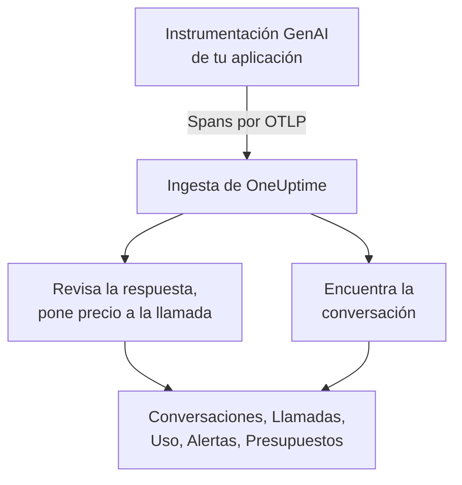
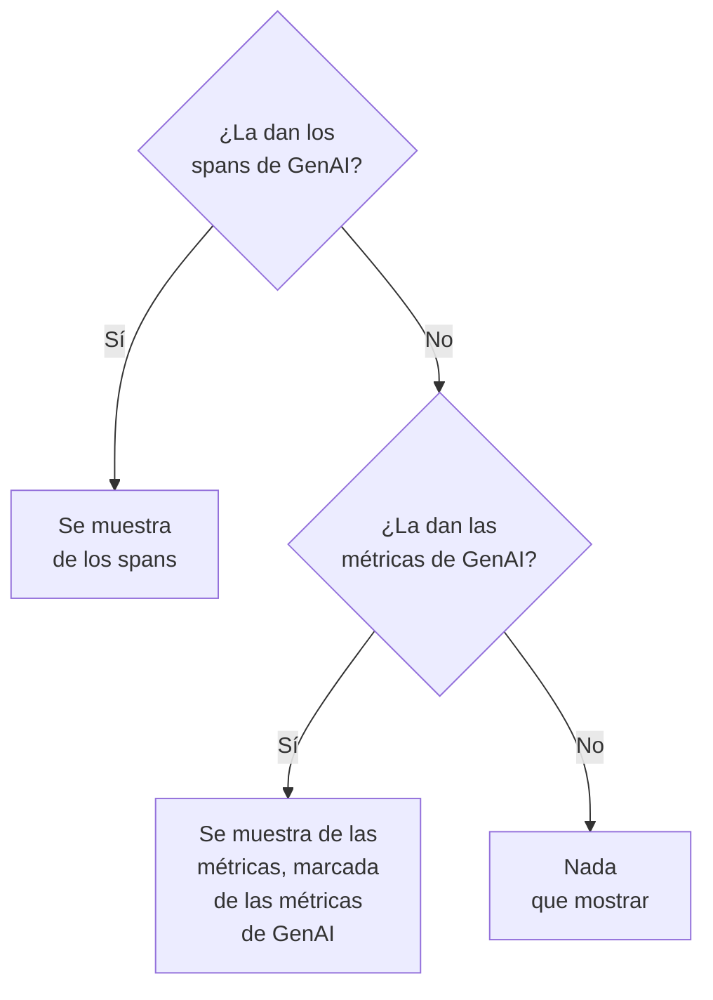

# Observabilidad de IA / LLM

Lee cada conversación que tuvo tu IA, vuelve a reproducirla tal como ocurrió y entérate cuando responde mal. OneUptime lo construye todo a partir de OpenTelemetry estándar: si tu aplicación envía spans con las **convenciones semánticas de GenAI** (`gen_ai.*`), obtienes conversaciones, alertas, uso y costes, sin un SDK propietario.

:::cards
- [Configúralo](#configúralo-en-cinco-pasos): Cinco pasos, del primer span a las respuestas marcadas.
- [Reproduce una conversación](#lee-y-reproduce-una-conversación): Lee un chat como lo vio la persona, al ritmo en que ocurrió.
- [Recibe alertas](#entérate-cuando-la-ia-responde-mal): Alertas listas para respuestas que fallan, se rechazan, se cortan, se marcan o van lentas.
- [Vigila el gasto](#mira-quién-gasta-qué): El coste por persona, equipo, modelo y aplicación, con presupuestos diarios.
:::

## Cómo funciona

La instrumentación GenAI de tu aplicación exporta cada llamada al modelo como un span de OpenTelemetry. Cuando llega el span, OneUptime lee sus atributos `gen_ai.*`, revisa la respuesta en busca de problemas, pone precio a la llamada y la archiva en su conversación.



Abre **Productos → IA / LLM**, bajo **Observabilidad**. El producto tiene siete pestañas:

| Pestaña | Qué muestra |
| --- | --- |
| **Conversaciones** | Cada conversación que tuvo tu IA, primero las que necesitan atención. Sobre la lista: conversaciones, respuestas de la IA, cuántas necesitan atención, coste y el tiempo de respuesta habitual. |
| **Llamadas** | Cada llamada a un modelo, de embeddings, de agente y de herramienta. Filtra por servicio, proveedor, modelo, operación, persona, equipo o conversación; haz clic en una llamada para abrirla en el visor de trazas. |
| **Uso** | Las llamadas, los tokens y el coste de un periodo, ordenados por empleado, equipo, modelo, proveedor o aplicación. |
| **Alertas** | Alertas listas para cuando la IA responde mal, y tus monitores de IA / LLM. |
| **Presupuestos** | Límites de coste diarios, publicados como métricas sobre las que alertar. |
| **Precios** | Tus propios precios para modelos que la lista de precios integrada no conoce. |
| **Configuración** | Los cinco pasos de abajo, con el endpoint de tu proyecto. |

En el visor de trazas, el span de cada llamada de IA tiene además una pestaña **LLM**: proveedor, modelo, tokens, coste, parámetros de la solicitud, y el prompt y la respuesta.

## Antes de empezar

- Un proyecto de OneUptime en el que puedas crear una clave de ingesta de telemetría.
- Una aplicación que llame a un modelo, y una instrumentación GenAI para su lenguaje: **OpenLLMetry** (Traceloop), **OpenInference** (Arize), el **Vercel AI SDK**, o las instrumentaciones de OpenTelemetry para OpenAI, Anthropic y Gemini.

> [!TIP]
> El tráfico hacia los modelos que pasa por un gateway como LiteLLM o Portkey se puede exportar desde el gateway en lugar de desde cada aplicación: consulta [Gateways de IA](/docs/telemetry/ai-gateways). Para los asistentes de programación de tus ingenieros, consulta [Asistentes de programación con IA](/docs/telemetry/ai-coding-assistants).

## Configúralo en cinco pasos

El primer paso es todo lo que necesitas para ver llamadas. Cada paso siguiente muestra más.

:::steps
### Envía tus llamadas de IA

Crea una clave de ingesta en **Ajustes del proyecto → Telemetría y APM → Claves de ingesta** (el [inicio rápido de OpenTelemetry](/docs/telemetry/open-telemetry#crear-una-clave-de-ingesta) explica cómo). Después apunta tu instrumentación a OneUptime:

:::tabs
@tab Python
```bash
pip install traceloop-sdk opentelemetry-exporter-otlp
```

```python
from traceloop.sdk import Traceloop

Traceloop.init(
    app_name="my-ai-agent",
    api_endpoint="https://oneuptime.com/otlp",
    headers={"x-oneuptime-token": "YOUR_INGESTION_TOKEN"},
)
# Your OpenAI, Anthropic and LangChain calls are now traced.
```
@tab Node.js
```bash
npm install @traceloop/node-server-sdk
```

```typescript
import * as traceloop from "@traceloop/node-server-sdk";

traceloop.initialize({
  appName: "my-ai-agent",
  baseUrl: "https://oneuptime.com/otlp",
  headers: { "x-oneuptime-token": "YOUR_INGESTION_TOKEN" },
});
```
@tab OpenTelemetry SDK
```bash
export OTEL_EXPORTER_OTLP_ENDPOINT="https://oneuptime.com/otlp"
export OTEL_EXPORTER_OTLP_HEADERS="x-oneuptime-token=YOUR_INGESTION_TOKEN"
export OTEL_EXPORTER_OTLP_PROTOCOL="http/protobuf"
export OTEL_SERVICE_NAME="my-ai-agent"
```
:::

¿Alojas OneUptime tú mismo? Usa `https://YOUR-ONEUPTIME-HOST/otlp` en lugar de `https://oneuptime.com/otlp`. Llama a tu modelo una vez y la llamada aparece en **Llamadas**.

### Registra lo que se dijo

Una conversación muestra lo que preguntó la gente y lo que respondió la IA solo cuando tu instrumentación lo registra. OpenLLMetry registra los prompts y las respuestas a menos que definas `TRACELOOP_TRACE_CONTENT=false`. Las instrumentaciones de OpenTelemetry solo los registran cuando lo pides:

```bash
export OTEL_INSTRUMENTATION_GENAI_CAPTURE_MESSAGE_CONTENT=true
```

Las instrumentaciones de OpenTelemetry más recientes aceptan `span_only`, `event_only` o `span_and_event` en lugar de `true`. Sin contenido registrado, una conversación sigue mostrando sus tiempos, su coste y sus problemas. Los prompts pueden llevar datos sensibles: [Privacidad y ocultación](#privacidad-y-ocultación) muestra cómo enmascararlos antes de guardarlos.

### Agrupa las llamadas en conversaciones

Una aplicación de chat hace una llamada al modelo por turno. Define `gen_ai.conversation.id` (o `session.id`) con el id de tu chat en cada llamada de IA, y cada chat aparece como una sola conversación, por muchas llamadas y trazas que haya necesitado. Con OpenLLMetry, defínelo una vez por solicitud:

```python
from traceloop.sdk import Traceloop

Traceloop.set_association_properties({
    "session_id": chat.id,
    "user_email": user.email,
})
```

Con el Vercel AI SDK, pasa el id del chat como `experimental_telemetry: { metadata: { sessionId } }`. Las llamadas sin id de conversación siguen apareciendo, una solicitud (una traza) cada vez.

### Indica quién preguntó

Define `user.id` o `user.email` en cada llamada de IA (la propiedad de asociación de arriba define el correo). Así cada conversación muestra con quién fue, puedes buscar en la lista por persona, y la pestaña **Uso** ordena el gasto por empleado. [Atribución a empleados y equipos](/docs/telemetry/ai-coding-assistants#atribución-a-empleados-y-equipos) enumera cada clave de identidad que lee OneUptime.

### Marca las malas respuestas

OneUptime revisa cada respuesta al llegar y marca lo que salió mal:

| Problema | Qué significa | Se detecta por |
| --- | --- | --- |
| Fallida | La llamada terminó en error, así que no llegó ninguna respuesta | El estado de span Error, `error.type`, o un motivo de finalización `error` |
| Rechazada | La IA se negó, o un filtro de seguridad bloqueó la respuesta | Un motivo de finalización de rechazo o de seguridad (`content_filter`, `refusal`, `SAFETY` y similares), un rechazo en la respuesta, o una respuesta que empieza con un rechazo estándar en inglés |
| Cortada | La respuesta se detuvo en el límite de tokens | Un motivo de finalización `length`, `max_tokens` o `MAX_TOKENS` |
| Vacía | Ni texto ni llamada a herramienta | Contenido registrado que no contiene nada, o 0 tokens de salida |
| Marcada | Una evaluación que envió tu aplicación dijo que la respuesta era mala | Un evento `gen_ai.evaluation.result` |

Las cuatro primeras no necesitan nada de ti. Para marcar una respuesta que rechaza tu guardarraíl, tu evaluación o un botón de pulgar abajo, añade un evento `gen_ai.evaluation.result` al span de la respuesta, mientras el span está abierto, con `gen_ai.evaluation.score.label` en `fail`:

```python
from opentelemetry import trace

trace.get_current_span().add_event(
    "gen_ai.evaluation.result",
    {
        "gen_ai.evaluation.name": "relevance",
        "gen_ai.evaluation.score.label": "fail",
        "gen_ai.evaluation.explanation": "The answer is about another product.",
    },
)
```

Etiquetas como `incorrect`, `wrong`, `unhelpful`, `toxic`, `unsafe` y `hallucination` también cuentan como fallo. OneUptime nunca envía tus conversaciones a otra IA para juzgarlas: cada comprobación lee solo lo que lleva la propia llamada.
:::

## Lee y reproduce una conversación

Una conversación se abre entera, como un chat muestra su historial: lo que dijo la persona a la derecha, las respuestas de la IA a la izquierda con su modelo, hora, tokens y coste, las llamadas a herramientas en medio, y lo que salió mal marcado donde ocurrió. **Detalles** bajo una respuesta muestra por qué se detuvo, sus evaluaciones y un enlace a la llamada en Trazas.

La barra de abajo reproduce la conversación tal como la vivió la persona:

| Control | Qué hace |
| --- | --- |
| **Volver a reproducir** | Reproduce la conversación desde el primer mensaje, al ritmo en que ocurrió. «La IA está respondiendo…» cuenta el tiempo mientras llega una respuesta. Haz clic en la hora de cualquier mensaje para reproducir desde ahí. |
| **Saltar esperas** | Activado por defecto: acorta cualquier silencio de más de 3 segundos. |
| `1x` | Cambia la velocidad: 1x, 2x, 4x u 8x. |
| **K**, **J** o **←**, **L** o **→** | Reproducir o pausar, retroceder un mensaje, avanzar un mensaje. |

La dirección de la página guarda el mensaje en el que se detuvo una reproducción (`?step=`), así que un enlace que compartas se abre en ese momento.

## Entérate cuando la IA responde mal

La pestaña **Alertas** enumera las alertas que quieren la mayoría de las aplicaciones de IA. Al elegir una se abre **Crear monitor** ya rellenado, y puedes cambiar cualquier cosa antes de guardar:

| Alerta | Cuándo te avisa | Gravedad |
| --- | --- | --- |
| Las respuestas salen mal | Más del 5 % de las respuestas en 15 minutos fallan, se rechazan, se cortan, están vacías o se marcan | Warning |
| Las llamadas de IA fallan | Más del 10 % de las llamadas al modelo en 5 minutos terminan en error | Critical |
| La IA se niega a responder | Más del 5 % de las respuestas en 30 minutos son rechazos | Warning |
| Las respuestas se cortan | 3 o más respuestas en 30 minutos se detienen en el límite de tokens | Warning |
| Las respuestas se marcan | Una evaluación marca una respuesta como mala | Warning |
| Las respuestas son lentas | Más del 10 % de las respuestas en 15 minutos tardan más de 30 segundos | Warning |
| La IA deja de responder | La IA no da ninguna respuesta durante 30 minutos | Critical |

Las alertas sobre una proporción de respuestas también esperan al menos 3 malas respuestas, así que una mala respuesta de dos no avisa a nadie. Una alerta Critical toma la gravedad de alerta más alta de tu proyecto y una alerta Warning la siguiente: High y Low en un proyecto nuevo.

Cada alerta es un monitor de **IA / LLM**. Sus ajustes dicen qué cuenta como mala respuesta (**Contar una respuesta como mala cuando**, **O tarda más de (segundos)**), hasta dónde mira cada comprobación (**Ventana de tiempo**, 15 minutos por defecto), qué **Aplicaciones** vigila y, en **Más campos**, qué **Modelo**. Una **Vista previa** muestra lo que contaría el monitor ahora mismo. Sus criterios comparan tres números: **Respuestas malas de la IA (en %)**, **Respuestas malas de la IA** y **Respuestas de la IA**.

Una alerta lista lanza una alerta que se resuelve sola, y muestra el monitor como **Degraded** mientras las respuestas son malas. Su incidente está rellenado pero desactivado: actívalo para avisar a alguien en su lugar.

## Mira quién gasta qué

La pestaña **Uso** muestra las llamadas, los tokens y el coste de un periodo (los últimos 7 días si no eliges otro), y una tabla de los 25 primeros según uno de cinco desgloses: **Empleado**, **Equipo**, **Modelo**, **Proveedor** y **Aplicación / Servicio**. Las llamadas que no nombran a nadie se cuentan en **Sin atribuir**, nunca se descartan.

Las personas y los equipos salen de los atributos de identidad de la llamada: consulta [Atribución a empleados y equipos](/docs/telemetry/ai-coding-assistants#atribución-a-empleados-y-equipos).

### Primero los spans, las métricas los suplen

Los spans de GenAI llevan el modelo, los tokens y el coste de una llamada, así que donde existen lo responden todo. Algunas herramientas publican métricas de tokens y de coste sin spans de GenAI, como la mayoría de los asistentes de programación. OneUptime lee esas métricas solo para una cifra que los spans no aportaron, y nunca suma ambas: muchas instrumentaciones envían las dos para la misma llamada, y sumarlas contaría cada dólar dos veces.



| Dónde | Qué pasa a las métricas | Cuándo |
| --- | --- | --- |
| Tokens de entrada y de salida | Ambos totales | Los totales de tokens de los spans son ambos 0 |
| Coste (USD) | El coste, con el coste en micro-USD de Codex convertido a USD | El total de coste de los spans es 0 |
| Llamadas de LLM | Nada: solo spans | — |
| Tablas **Empleado**, **Equipo**, **Modelo** | Solo el coste; las celdas de llamadas y tokens muestran `—` | Esa tabla no encontró filas de spans |
| Tablas **Proveedor**, **Aplicación / Servicio** | Nada: solo spans | — |
| Conversaciones | Nada: las conversaciones se construyen a partir de spans | — |

Una cifra tomada de las métricas lleva la marca **de las métricas de GenAI**, porque no tiene filas correspondientes en **Llamadas**. Así que, en cuanto tus spans de GenAI aportan una cifra, la parte de una herramienta que solo envía métricas no aparece. Para ver el gasto de esa herramienta por separado, envíala a un proyecto propio, donde no lleguen spans de GenAI.

## Lo que cuesta una llamada

Un coste que aporta tu instrumentación (`gen_ai.usage.cost`) se usa tal cual, incluso si es 0. Si no se aporta ninguno, OneUptime estima uno al llegar el span, a partir de sus recuentos de tokens y de una lista de precios integrada para modelos habituales de OpenAI, Anthropic, Google Gemini, Mistral, DeepSeek, xAI, Cohere, Amazon Nova y Meta Llama. Primero se pone precio al modelo servido y después al modelo solicitado.

Los modelos se emparejan por el prefijo de nombre más largo, así que ids con fecha o decorados por el proveedor como `gpt-4o-2024-08-06` y `us.anthropic.claude-sonnet-4-5-20250929-v1:0` encuentran el precio de su familia. Un modelo que la lista no conoce, incluida una versión nueva, nunca se adivina: su coste se queda en 0 hasta que le pongas precio. Las estimaciones usan precios de lista, sin descuentos de caché ni de lote.

Para poner precio a un modelo tú mismo (una tarifa negociada, un modelo ajustado o uno que alojas), añádelo en la pestaña **Precios**, en **Precios de LLM personalizados**: un **Prefijo del modelo**, un **Precio de entrada (USD por 1M de tokens)** y un **Precio de salida (USD por 1M de tokens)**. Gana el prefijo coincidente más largo entre tus precios y la lista integrada; en caso de empate, gana tu precio. Un precio se aplica a las llamadas que llegan alrededor de un minuto después de guardarlo; las llamadas ya guardadas conservan su coste.

## Presupuestos de coste diarios

Un presupuesto sigue el gasto de un día, en USD, a lo largo del día UTC. Cada 15 minutos, OneUptime suma el gasto de IA del día (de los spans, o de las métricas de coste de GenAI cuando ningún span aportó gasto), lo muestra en el presupuesto y publica dos métricas:

| Métrica | Qué es |
| --- | --- |
| `oneuptime.llm.budget.spend.usd` | El gasto del día hasta ahora, en USD |
| `oneuptime.llm.budget.percent.used` | El gasto como porcentaje del límite diario |

Ambas llevan `oneuptime.llm.budget.id` y `oneuptime.llm.budget.name`, y el alcance del presupuesto si tiene uno.

:::steps
### Crea el presupuesto

En la pestaña **Presupuestos**, haz clic en **Crear Presupuesto de costo de LLM**. Dale un nombre y un **Presupuesto diario (USD)**, y deja el alcance vacío para todo el proyecto, o elige un **Servicio (opcional)**, un **Proveedor de LLM (opcional)** o un **Modelo de LLM (opcional)**. Varios presupuestos pueden vigilar alcances distintos.

### Alerta sobre él

Crea un [monitor de métricas](/docs/monitor/metrics-monitor) sobre `oneuptime.llm.budget.percent.used`, filtrado por `oneuptime.llm.budget.id` (el nombre cambia si renombras el presupuesto). Añade un criterio `>= 80` que lance un aviso y otro `>= 100` que lance una alerta crítica.

### Amplía la ventana

Pon la ventana móvil del monitor en 30 minutos. Un presupuesto publica un punto cada 15 minutos, así que la ventana predeterminada de 1 minuto no encontraría nada entre dos puntos.
:::

Una alerta de presupuesto también puede lanzar un flujo de trabajo que detenga a un agente desbocado: consulta [Disyuntores para agentes de IA](/docs/telemetry/ai-agent-circuit-breaker).

## Paneles y alertas de métricas

Las métricas de GenAI como `gen_ai.client.token.usage` y `gen_ai.client.operation.duration` llegan como métricas normales de OpenTelemetry. Represéntalas en un [panel](/docs/dashboards/index), o alerta sobre ellas con un [monitor de métricas](/docs/monitor/metrics-monitor), por ejemplo cuando el p95 de `gen_ai.client.operation.duration` supera un umbral, agrupado por modelo.

## Privacidad y ocultación

Las llamadas de IA se guardan como spans de traza, así que las **Reglas de depuración** y los **Filtros de descarte** de las trazas se aplican a ellas: enmascara un atributo, o descarta un span, antes de que se guarde. Encuentras ambos en **Trazas → Ajustes**. La columna del correo del empleado se depura junto con el atributo del que se leyó, así que una regla que enmascara correos también la cubre.

Las conversaciones se leen con el mismo permiso que las trazas: quien puede leer las trazas del proyecto puede leer sus conversaciones, y nadie más.

## Atributos que lee OneUptime

OneUptime lee las convenciones de GenAI de OpenTelemetry, y las variantes que usan OpenLLMetry, OpenInference, el Vercel AI SDK y LiteLLM, así que las bibliotecas habituales funcionan tal cual. Para cada valor, gana la primera clave que lleve el span:

| Valor | Claves, en el orden en que se prueban |
| --- | --- |
| Proveedor | `gen_ai.system`, `gen_ai.provider.name`, `llm.system`, `llm.provider` |
| Operación | `gen_ai.operation.name`, `llm.request.type`, `openinference.span.kind` |
| Modelo solicitado | `gen_ai.request.model`, `llm.model_name`, `llm.request.model` |
| Modelo servido | `gen_ai.response.model`, `llm.response.model` |
| Tokens de entrada | `gen_ai.usage.input_tokens`, `gen_ai.usage.prompt_tokens`, `llm.token_count.prompt`, `llm.usage.prompt_tokens` |
| Tokens de salida | `gen_ai.usage.output_tokens`, `gen_ai.usage.completion_tokens`, `llm.token_count.completion`, `llm.usage.completion_tokens` |
| Tokens totales | `gen_ai.usage.total_tokens`, `llm.token_count.total`, `llm.usage.total_tokens` |
| Coste (USD) | `gen_ai.usage.cost`, `gen_ai.usage.cost_usd`, `gen_ai.usage.total_cost`, `llm.usage.total_cost`, `gen_ai.cost.total_cost`, `litellm.cost.total` |
| Conversación | `gen_ai.conversation.id`, `session.id`, `langfuse.session.id`, `traceloop.association.properties.session_id`, `ai.telemetry.metadata.sessionId` |
| Agente | `gen_ai.agent.name`, `agent.name` |
| Herramienta | `gen_ai.tool.name`, `tool.name`, `ai.toolCall.name` |
| Motivo de finalización | `gen_ai.response.finish_reasons`, `gen_ai.response.finish_reason`, `llm.response.finish_reason`, `ai.response.finishReason` |
| Error | `error.type` |

Un span cuenta como llamada de IA cuando lleva cualquiera de estos valores, o cualquier atributo que empiece por `gen_ai.`, `llm.` o `traceloop.`. Los tokens totales son la entrada más la salida cuando no se aporta un total. Las claves `gen_ai.usage.total_tokens` y `gen_ai.usage.cost` no forman parte de las convenciones, que no definen ninguna de las dos; OneUptime las lee porque las instrumentaciones habituales las envían.

Las claves de identidad (quién hizo la llamada, y su equipo) se enumeran en [Atribución a empleados y equipos](/docs/telemetry/ai-coding-assistants#atribución-a-empleados-y-equipos).

### De dónde se leen los prompts y las respuestas

La vista de conversación lee los mensajes de una llamada, en este orden, de:

- el evento `gen_ai.client.inference.operation.details`;
- los atributos `gen_ai.input.messages`, `gen_ai.output.messages` y `gen_ai.system_instructions`;
- los eventos antiguos por rol: `gen_ai.system.message`, `gen_ai.user.message`, `gen_ai.assistant.message`, `gen_ai.tool.message` y `gen_ai.choice`;
- los atributos indexados: `gen_ai.prompt.N.content` y `gen_ai.completion.N.content` de OpenLLMetry, `llm.input_messages.N.message.content` y `llm.output_messages.N.message.content` de OpenInference;
- los arrays de mensajes en `gen_ai.prompt`, `gen_ai.completion`, `ai.prompt.messages`, `ai.response.text`, `input.value` y `output.value`.

## Solución de problemas

:::details Llegan llamadas, pero ninguna conversación muestra texto
Tu instrumentación no registra el contenido. Actívalo como muestra [Registra lo que se dijo](#registra-lo-que-se-dijo); las llamadas anteriores se quedan sin texto.
:::

:::details Cada llamada de un chat aparece como su propia conversación
Las llamadas no llevan id de conversación. Define `gen_ai.conversation.id` o `session.id` en cada llamada del chat, como muestra [Agrupa las llamadas en conversaciones](#agrupa-las-llamadas-en-conversaciones).
:::

:::details Las llamadas muestran tokens pero cuestan 0 $
El modelo no está en la lista de precios integrada, o el span no nombra ningún modelo. Añade los precios del modelo en la pestaña **Precios**; las llamadas que lleguen después tendrán precio.
:::

:::details La pestaña Uso dice de las métricas de GenAI y muestra `—` en llamadas y tokens
Las cifras vienen de una herramienta que envía métricas y no spans de GenAI, como un asistente de programación. Una métrica lleva el coste pero ningún detalle por llamada, así que esas celdas se quedan vacías. Consulta [Primero los spans, las métricas los suplen](#primero-los-spans-las-métricas-los-suplen).
:::

:::details Un monitor de presupuesto oscila entre dos estados
La ventana móvil del monitor es más corta que 15 minutos, así que a veces no encuentra ningún punto. Ponla en 30 minutos.
:::

## Próximos pasos

:::cards
- [Asistentes de programación con IA](/docs/telemetry/ai-coding-assistants): El gasto por ingeniero de Claude Code, Cursor, Codex, Gemini CLI y Copilot.
- [Gateways de IA](/docs/telemetry/ai-gateways): Traza las llamadas a modelos de cada aplicación desde un gateway de LiteLLM o Portkey.
- [Disyuntores para agentes de IA](/docs/telemetry/ai-agent-circuit-breaker): Detén a un agente desbocado cuando salta una alerta de presupuesto.
- [OpenTelemetry](/docs/telemetry/open-telemetry): Endpoints, claves de ingesta y límites para cada señal.
:::
