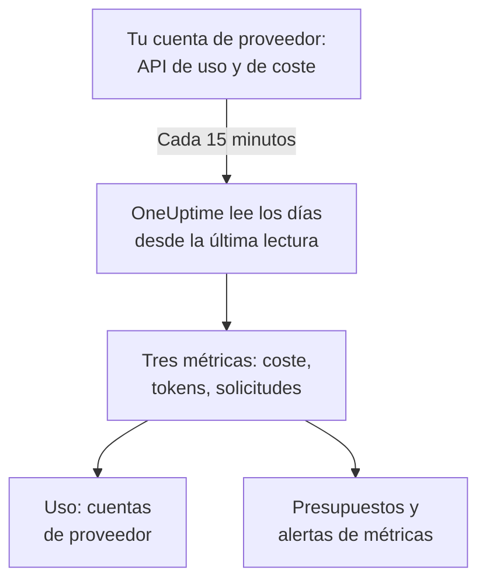

# Cuentas de proveedores de IA

Mira lo que han usado tus cuentas de proveedores de IA y lo que han costado, sin cambiar tus aplicaciones. Conecta una cuenta de OpenAI, Anthropic, Azure OpenAI y Microsoft Foundry, Amazon Bedrock o Google Vertex AI con una credencial que solo puede leer, y OneUptime lee su uso cada 15 minutos en **Uso**, **Presupuestos** y métricas sobre las que puedes alertar.

:::cards
- [Conectar una cuenta](#conectar-una-cuenta): Elige el proveedor, pega la credencial, pruébala y conecta.
- [Qué da cada proveedor](#qué-da-cada-proveedor): Coste, tokens y solicitudes, y cómo los agrupa cada proveedor.
- [Ver el uso](#ver-el-uso): Por modelo, persona, proyecto o recurso, clave de API y conexión.
- [Presupuestos y alertas](#presupuestos-y-alertas): Un presupuesto diario sobre la factura y alertas sobre las métricas.
:::

## Cómo funciona

Cada 15 minutos, OneUptime pide a cada cuenta conectada su uso por día UTC y lo guarda como tres métricas del servicio propio de la conexión. Cada lectura toma los días desde la última lectura, y de nuevo los últimos 3 días, hoy incluido, porque los proveedores siguen añadiendo a hoy y corrigen los días recién pasados.

El uso de una cuenta es lo que se le facturó, día a día. No contiene conversaciones, prompts ni respuestas: para eso, envía las llamadas de IA de tus aplicaciones como muestra [Observabilidad de IA / LLM](/docs/telemetry/ai-llm-observability). Ambas cosas se guardan por separado, así que nada se cuenta dos veces.

## Antes de empezar

- El rol Project Owner o Project Admin. Solo ellos pueden conectar, cambiar o quitar una cuenta; todos los que leen la telemetría del proyecto ven las conexiones y el uso.
- Una credencial de la cuenta, de alguien que la administre. La sección de cada proveedor, más abajo, dice cuál y dónde se crea.
- Nada que instalar: OneUptime llama a la API del proveedor desde sus propios servidores.

## Conectar una cuenta

:::steps
### Abre Conectar

Abre **Productos → IA / LLM → Conectar**. En **Tus cuentas de proveedores de IA**, haz clic en el mosaico del proveedor.

### Pega la credencial

En **Credenciales**, rellena lo que pide el proveedor. Los secretos se guardan cifrados y no se vuelven a mostrar nunca, ni en el Dashboard ni por la API. **Nombre** y los ajustes que casi nadie cambia están en **Más campos**.

### Pruébala

En **Probar**, haz clic en **Probar conexión**. OneUptime lee el uso de los últimos 7 días y muestra lo que encontró: coste, tokens, solicitudes, modelos, personas, claves y proyectos. No se guarda nada hasta que conectas.

### Conecta

Haz clic en **Conectar**. La primera lectura empieza en menos de un minuto y trae los últimos 30 días.
:::

Las cuentas conectadas aparecen bajo los mosaicos, con su **Estado** y su **Última lectura**. **Leer ahora** lee al momento, **Probar** vuelve a comprobar los ajustes guardados, **Desactivar** deja de leer y conserva lo leído, y **Editar** cambia los ajustes: un secreto dejado en blanco conserva el guardado. **Ver error** muestra por qué falló una lectura, sin ningún secreto.

## Qué da cada proveedor

| Proveedor | Coste | Agrupado por | Credencial |
| --- | --- | --- | --- |
| OpenAI | Lo que informa OpenAI | Proyecto, clave de API, persona y modelo | Una clave de administrador |
| Anthropic | Lo que informa Anthropic | Workspace, clave de API, persona y modelo | Una clave de administrador |
| Azure OpenAI y Microsoft Foundry | Estimado a partir de los tokens | Recurso y modelo | Una aplicación con Monitoring Reader |
| Amazon Bedrock | Estimado a partir de los tokens | Región y modelo | Una clave de acceso que lee CloudWatch |
| Google Vertex AI | Estimado a partir de los tokens | Región y modelo | Una cuenta de servicio con Monitoring Viewer |

Todos los proveedores menos Anthropic cuentan también las solicitudes: el informe de uso de Anthropic no tiene. Un coste estimado usa la lista de precios de [Lo que cuesta una llamada](/docs/telemetry/ai-llm-observability#lo-que-cuesta-una-llamada) y tus propios precios de **Precios**, y se marca como estimación. Un modelo que la lista de precios no conoce no tiene coste hasta que le pones precio allí.

Ninguna de estas credenciales puede llamar a un modelo: cada una lee uso, coste o métricas, y nada más.

## OpenAI

OneUptime lee tu organización de OpenAI con una clave de administrador: el uso de completions y embeddings por día, modelo, proyecto, clave de API y persona, y los costes de cada día por proyecto y partida. Una partida de coste se reparte entre las claves y las personas que usaron su modelo, así que la fila de una persona también tiene coste. Los nombres de proyectos y claves y los correos de las personas sustituyen a los ID de OpenAI.

:::steps
### Crea una clave de administrador de OpenAI

En el panel de OpenAI, abre Settings, Organization, Admin keys y crea una clave. Solo los propietarios de la organización pueden. Empieza por `sk-admin-`.

### Conecta OpenAI

Pega la clave como **Clave de administrador**.
:::

## Anthropic

OneUptime lee tu organización de la API de Claude con una clave de administrador: el informe de uso de mensajes por día, modelo, workspace, clave de API y persona, y el informe de costes por workspace y partida, repartido de la misma forma. Claude Code usado con las claves de la organización o con inicios de sesión de la Console también está en estos informes, bajo la persona o la clave que lo usó.

:::steps
### Crea una clave de administrador de Anthropic

En la Claude Console, abre Settings, Admin keys y crea una clave. Solo los administradores de la organización pueden. Empieza por `sk-ant-admin01-`.

### Conecta Anthropic

Pega la clave como **Clave de administrador**.
:::

## Azure OpenAI y Microsoft Foundry

OneUptime lee cada recurso de Azure OpenAI y de Foundry de una suscripción desde Azure Monitor: tokens y solicitudes por día, recurso y modelo. Azure Monitor cuenta tokens, no dinero, y no nombra ni persona ni clave, así que el coste es la estimación de OneUptime y la persona y la clave quedan vacías.

:::steps
### Registra una aplicación

En Microsoft Entra ID, registra una aplicación y crea un secreto de cliente para ella.

### Deja que lea las métricas

En la suscripción, dale a la aplicación el rol Monitoring Reader.

### Conecta Azure

Rellena **ID de directorio (tenant)**, **ID de aplicación (cliente)**, **ID de suscripción** y **Secreto del cliente**. Para Azure Government, cambia **Nube** en **Más campos**.
:::

## Amazon Bedrock

OneUptime lee las métricas de CloudWatch `AWS/Bedrock` de cada región que indiques: tokens de entrada, de salida y de caché, e invocaciones, por día y modelo. CloudWatch cuenta tokens, no dinero, y no nombra ni persona ni clave: el coste es la estimación de OneUptime, y cada región aparece como un proyecto.

:::steps
### Crea una clave de acceso

Crea un usuario o un rol de IAM cuya política permita `cloudwatch:GetMetricData` y `cloudwatch:ListMetrics`, y una clave de acceso para él.

### Conecta Bedrock

Rellena **ID de clave de acceso**, **Clave de acceso secreta** y **Regiones**, separadas por comas: `us-east-1` si no lo cambias.
:::

## Google Vertex AI

OneUptime lee las métricas de Cloud Monitoring que Vertex AI publica para sus modelos, Gemini y modelos de socios como Claude: tokens de entrada y de salida, e invocaciones, por día, región y modelo. Cloud Monitoring cuenta tokens, no dinero, y no nombra ni persona ni clave: el coste es la estimación de OneUptime.

:::steps
### Crea una cuenta de servicio

En el proyecto, crea una cuenta de servicio con el rol Monitoring Viewer y una clave JSON para ella.

### Conecta Vertex AI

Rellena **ID del proyecto** y pega el archivo de clave entero como **Clave de la cuenta de servicio (JSON)**.
:::

## Ver el uso

Abre **Uso** y elige **Cuentas de proveedor**. Muestra el coste, los tokens y las solicitudes que tus cuentas informaron para el periodo, ordenados por **Modelo**, **Persona**, **Proveedor**, **Proyecto o recurso**, **Clave de API** o **Conexión**. El periodo empieza a la medianoche UTC de su primer día, porque los proveedores informan de días completos.

**Cuentas de proveedor** y **Tus llamadas de IA** nunca se suman. Una llamada que tu aplicación hace con una clave de una cuenta conectada está en ambos, así que sumarlos la contaría dos veces.

## Presupuestos y alertas

Un presupuesto cuenta una cosa o la otra. En **Presupuestos**, crea un presupuesto y pon **Contar el gasto desde** en **Cuentas de proveedor**: cuenta lo que se facturó a las cuentas conectadas en el día UTC, acotado por **Proveedor de LLM (opcional)** y **Modelo de LLM (opcional)** cuando los defines. Los proveedores informan del uso de un día con minutos u horas de retraso, así que para alertas en minutos presupuesta **Tus llamadas de IA** en su lugar.

El uso de cada cuenta se guarda como tres métricas, que puedes representar en un [panel](/docs/dashboards/index) o vigilar con un [Monitor de métricas](/docs/monitor/metrics-monitor):

| Métrica | Qué es |
| --- | --- |
| `oneuptime.llm.provider.cost` | El coste de un día, en USD |
| `oneuptime.llm.provider.tokens` | Los tokens de un día, por `gen_ai.token.type`: `input` (tokens en caché incluidos), `output`, `cache_read` y `cache_write` |
| `oneuptime.llm.provider.requests` | Las solicitudes de un día |

Cada punto lleva la marca de tiempo del inicio de su día UTC. Lleva `oneuptime.llm.connection.id` y `oneuptime.llm.connection.name`, y lo que nombra el proveedor: `gen_ai.provider.name`, `gen_ai.request.model`, `user.email`, `oneuptime.llm.provider.project` y `oneuptime.llm.provider.api_key`. Un coste estimado lleva `oneuptime.llm.cost.estimated`.

## Cuándo se lee

| Lectura | Cuándo |
| --- | --- |
| La primera | En menos de un minuto tras conectar, 30 días atrás |
| Las siguientes | Cada 15 minutos |
| Tras rechazar una clave o un permiso | 60 minutos después |
| Tras cualquier otro fallo | 15 minutos después |
| Apagada | Ninguna hasta que se enciende |

Un plan sin funciones de telemetría no lee nada. Quitar una conexión detiene sus lecturas y conserva lo que leyó hasta que la retención del servicio lo elimina.

## Por qué OneUptime no tiene un gateway propio

OneUptime lee tus cuentas; nunca se sitúa entre tus aplicaciones y los proveedores. Un proxy guardaría tus claves de proveedor y añadiría un salto a cada llamada a un modelo que hacen tus aplicaciones. Si tu tráfico de modelos ya pasa por LiteLLM, Portkey u OpenRouter, envía las trazas del gateway a OneUptime como muestra [Gateways de IA](/docs/telemetry/ai-gateways), y conecta la cuenta para su factura.

## Solución de problemas

:::details La prueba dice que la clave o el secreto no se aceptó
Comprueba que la copiaste entera, que no se ha revocado y que es del tipo que pide este proveedor: una clave de administrador de OpenAI o de Anthropic, no una clave de proyecto ni de API.
:::

:::details La credencial funciona, pero no puede leer lo que necesita la conexión
Dale el rol que esta página nombra para el proveedor: Monitoring Reader en la suscripción de Azure, las dos acciones de CloudWatch en AWS, Monitoring Viewer en el proyecto de Google Cloud.
:::

:::details La prueba pasa, pero no aparece nada de hoy
Los proveedores informan del uso de un día minutos u horas después y lo corrigen durante un día o dos. Las siguientes lecturas lo traen.
:::

:::details El coste no coincide con la factura
Un coste informado es la cifra del proveedor antes de impuestos, créditos y descuentos. Un coste estimado son tokens a precio de lista, o a tus propios precios de **Precios**.
:::

## Próximos pasos

:::cards
- [Observabilidad de IA / LLM](/docs/telemetry/ai-llm-observability): Conversaciones, alertas y coste de las llamadas de IA de tus aplicaciones.
- [Herramientas de IA de la empresa](/docs/telemetry/ai-company-tools): Lo que tu gente pregunta a Claude Enterprise y Microsoft 365 Copilot.
- [Gateways de IA](/docs/telemetry/ai-gateways): Traza cada llamada a un modelo a través de LiteLLM, Portkey u OpenRouter.
- [Monitor de métricas](/docs/monitor/metrics-monitor): Alerta sobre las métricas de los proveedores.
:::
