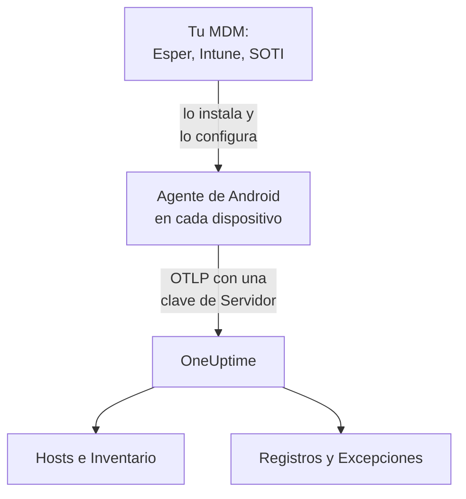

# Agente de Android

El agente de Android de OneUptime informa a OneUptime sobre un dispositivo Android que pertenece a tu organización, como un quiosco de pedidos, un terminal de punto de venta, un terminal portátil o un reproductor de cartelería digital: su memoria, su almacenamiento, su red, su batería y su temperatura, sus reinicios, las aplicaciones instaladas en él, y los fallos y registros de esas aplicaciones. Tu gestor de dispositivos lo instala y lo configura en toda la flota a la vez. Cada dispositivo se convierte en un host en **Hosts** y en un elemento en **Inventario**, junto a tus servidores y equipos Windows.

:::cards
- [Cuándo usarlo](#el-agente-o-la-instrumentación-de-la-aplicación): El agente ve el dispositivo; la instrumentación de la aplicación ve tu aplicación.
- [Desplegarlo con Esper](#desplegarlo-con-esper): Subir el APK, enviar sus ajustes, iniciarlo una vez.
- [Ajustes](#ajustes): Cada clave de su configuración gestionada.
- [Leer los registros de otras aplicaciones](#leer-los-registros-de-otras-aplicaciones): Conceder READ_LOGS una vez, con adb o con tu gestor de dispositivos.
- [Sesiones de registros](#sesiones-de-registros): Los registros de todas las aplicaciones durante un tiempo, permitidos por la persona frente al dispositivo.
:::

## Cómo funciona

El agente es una pequeña aplicación que se ejecuta como servicio en primer plano. Cada minuto lee el estado del dispositivo y lo envía a tu instancia de OneUptime por OTLP con una clave de ingesta de **Servidor**, junto con los reinicios, las aplicaciones instaladas y los registros del dispositivo. Se inicia solo cuando el dispositivo arranca, conserva en el dispositivo lo que recopila mientras la red está caída y lo envía en cuanto vuelve la red. Nunca mantiene despierto un dispositivo en reposo, y comprime lo que envía.



## El agente o la instrumentación de la aplicación

| | [OpenTelemetry Android](/docs/rum/android-setup) en tu aplicación | El agente de Android |
| --- | --- | --- |
| Qué ve | Tu aplicación: sus fallos, ANR, pantallas, sesiones, solicitudes y flujos de trabajo | El dispositivo: memoria, almacenamiento, red, batería, reinicios, aplicaciones instaladas, y los fallos y ANR de todas las aplicaciones |
| Dónde aparece | **Monitoreo de usuarios reales**, **Trazas** y **Excepciones** | **Hosts**, **Inventario**, **Registros** y **Excepciones** |
| Cómo se instala | En el código de tu aplicación | Como aplicación, a través de tu gestor de dispositivos |

En los dispositivos que son tuyos, usa ambos y da al dispositivo el mismo nombre en los dos: en el ajuste `device_name` del agente y en el `host.name` que define tu aplicación. El dispositivo es entonces un único elemento en **Inventario**, que reúne la telemetría de la aplicación y la del dispositivo.

## Antes de empezar

- Dispositivos con Android 7.0 o posterior, administrados por un gestor de dispositivos compatible con las configuraciones gestionadas de Android: Esper, Microsoft Intune, Workspace ONE, SOTI y otros gestores de dispositivos de Android Enterprise. Para un solo dispositivo, basta con adb.
- Una clave de ingesta de **Servidor**, creada en **Ajustes del proyecto → Telemetría y APM → Claves de ingesta** con **Crear clave de ingesta**.
- El agente: `oneuptime-android-agent.apk`, adjunto a cada [versión de OneUptime](https://github.com/OneUptime/oneuptime/releases/latest).
- HTTPS saliente desde los dispositivos hacia tu URL de OneUptime. El agente rechaza cualquier URL que no empiece por `https://`, porque cada solicitud lleva la clave de ingesta.

## Desplegarlo con Esper

:::steps
### Subir el APK

En la consola de Esper, sube `oneuptime-android-agent.apk` a la **App Library** y añádelo al blueprint de los dispositivos que quieras monitorear.

### Enviar sus ajustes

En el blueprint, abre la **Managed Configuration** del agente y pega sus ajustes. Esper rellena los marcadores de posición en cada dispositivo, con Esper Agent 8.00.0764 o posterior:

```json title="Managed configuration"
{
  "oneuptime_url": "https://oneuptime.com",
  "oneuptime_token": "YOUR_TELEMETRY_INGESTION_TOKEN",
  "device_name": "${esper.deviceName}",
  "device_serial": "${esper.serialNumber}",
  "device_type": "kiosk",
  "labels": "region=emea"
}
```

Si alojas OneUptime tú mismo, pon tu propia URL en `oneuptime_url`. Después haz Converge en los dispositivos para que lean los nuevos ajustes.

### Iniciarlo una vez

Android no inicia al arrancar una aplicación recién instalada hasta que se ha abierto una vez. Activa **Launch on Start** para el agente en el blueprint, en modo Multi-App, o abre el agente una vez en cada dispositivo. A partir de entonces se inicia solo cada vez que el dispositivo arranca, y después de cada actualización.

### Encontrar los dispositivos en OneUptime

En menos de un minuto, cada dispositivo aparece en **Hosts**, con el nombre de su `device_name`, y en **Inventario**. La propia pantalla del agente en el dispositivo indica si está informando y, si no, qué se lo impide.
:::

Otros gestores de dispositivos funcionan igual: añade el APK como aplicación de línea de negocio o como aplicación interna, define las mismas claves en su configuración de aplicación y ábrela una vez en cada dispositivo.

## Ajustes

El agente lee estas claves de su configuración gestionada. Un dispositivo sin configuración gestionada se puede configurar en su lugar desde la propia pantalla del agente, con la URL, la clave de ingesta y el nombre del dispositivo. Una clave de ingesta introducida ahí se guarda cifrada con el Android Keystore.

| Clave | Qué define | Valor predeterminado |
| --- | --- | --- |
| `oneuptime_url` | Tu URL de OneUptime | `https://oneuptime.com` |
| `oneuptime_token` | Una clave de ingesta de **Servidor** | Ninguno: sin una clave, el agente no envía nada |
| `device_name` | El nombre del dispositivo en **Hosts** e **Inventario**, que es su identidad allí | Su modelo y el principio de su Android ID |
| `device_serial` | Su número de serie, que Android no da a las aplicaciones a partir de Android 10 | Ninguno |
| `device_type` | Qué es, como un quiosco, un terminal de punto de venta o un terminal portátil | `Android device` |
| `device_location` | Dónde está, como el número de una tienda | Ninguno |
| `labels` | Etiquetas para el host, como pares `name=value` separados por comas | Ninguno |
| `collection_interval_seconds` | Con qué frecuencia informa, de 30 a 600 segundos | `60` |
| `logcat_enabled` | Si envía lo que lee de Logcat | `true` |
| `logcat_min_level` | Las líneas de Logcat menos graves que envía en Android 12 y anteriores: `verbose`, `debug`, `info`, `warn`, `error` o `fatal` | `warn` |
| `installed_apps_enabled` | Si envía las aplicaciones instaladas | `true` |

Un marcador de posición que tu gestor de dispositivos no rellenó, como un `${esper.deviceName}` enviado tal cual, se ignora, y la pantalla del agente lo indica. Mantén el mismo `device_name` una vez que un dispositivo informa: un nombre nuevo es un host nuevo.

La pantalla del agente, sus notificaciones y los títulos y descripciones que tu gestor de dispositivos muestra para estas claves están en el idioma del dispositivo, en todos los idiomas que habla el panel de OneUptime.

## Leer los registros de otras aplicaciones

Android solo permite que una aplicación lea los registros de otras aplicaciones con el permiso READ_LOGS, y solo adb puede concederlo: ni la propia aplicación ni una política de dispositivo. Concédelo una vez en cada dispositivo y seguirá concedido tras reinicios y actualizaciones:

```bash
adb shell pm grant com.oneuptime.androidagent android.permission.READ_LOGS
```

Con Esper, ejecuta ese comando mediante **Secure Remote ADB**: activa el acceso ADB para el dispositivo, conéctate con `espercli secureadb connect -d DEVICE_ID` y luego ejecuta el comando. Android reinicia el agente cuando se concede el permiso, y el agente empieza a leer de inmediato.

Lo que el agente lee a partir de entonces depende de la versión de Android:

- Android 13 y posteriores: los fallos y ANR de todas las aplicaciones. Android solo muestra las líneas de registro de otras aplicaciones a una aplicación que está en pantalla, después de que la persona frente al dispositivo lo permita, así que un agente que se ejecuta en segundo plano no puede leerlas. Pídelas durante un tiempo con una [sesión de registros](#sesiones-de-registros).
- Android 12 y anteriores: los fallos y ANR de todas las aplicaciones, y las líneas de registro de todas las aplicaciones de nivel `logcat_min_level` o superior.

Sin READ_LOGS, el agente informa de todo lo demás, y su pantalla y los registros del dispositivo indican cómo concederlo.

### Stack traces de fallos y motivos de reinicio

Android guarda en su DropBox el informe completo de cada fallo de aplicación, fallo nativo y ANR, y el motivo de cada reinicio. El agente los lee de todas las aplicaciones cuando tiene READ_LOGS y acceso a datos de uso, y en Android 15 y posteriores READ_DROPBOX_DATA. Concédelos una vez con adb, como READ_LOGS:

```bash
adb shell pm grant com.oneuptime.androidagent android.permission.READ_DROPBOX_DATA
adb shell appops set com.oneuptime.androidagent GET_USAGE_STATS allow
```

El primer comando es para Android 15 y posteriores; el acceso a datos de uso también se puede activar en el dispositivo, en **Ajustes → Acceso a datos de uso**. Una política de dispositivo no puede concederlos, y la pantalla del agente enumera los comandos que faltan por ejecutar. Con ellos, cada fallo en **Excepciones** tiene su stack trace completo, un fallo nativo su señal y la biblioteca en la que falló, un ANR la pila de su hilo principal, y un reinicio en **Registros** el motivo que da Android. Los números de tarjeta, direcciones de correo electrónico, tokens y contraseñas en lo que lee el agente se sustituyen por `[card number]`, `[email]`, `[token]` y `[redacted]` antes de enviarse.

### Uso de CPU

A partir de Android 8, Android oculta a las aplicaciones el uso de CPU de un dispositivo. Solo una aplicación propietaria del dispositivo puede leerlo, y solo en dispositivos cuyo hardware lo informa. El agente lo lee cuando es el propietario del dispositivo, algo que configuras con adb en un dispositivo sin cuentas y sin otro propietario:

```bash
adb shell dpm set-device-owner com.oneuptime.androidagent/.admin.AgentDeviceAdminReceiver
```

Un dispositivo del que tu gestor de dispositivos ya es propietario no puede tener un segundo propietario, así que su uso de CPU no está disponible, y la pantalla del agente lo indica. Su uso de CPU queda entonces fuera de la lista de Hosts, y la plantilla **High CPU Utilization** no se le ofrece.

## Sesiones de registros

Una sesión de registros envía durante un tiempo los registros de todas las aplicaciones de un dispositivo, para diagnosticar sus problemas. En Android 13 y posteriores es la única forma de leer las líneas de registro de otras aplicaciones, porque Android solo las muestra a una aplicación que está en pantalla, después de que la persona frente al dispositivo lo permita.

:::steps
### Solicitar una

Abre el dispositivo en **Hosts**, luego **Registros**, y haz clic en **Solicitar sesión de registros** en **Sesiones de registros**. Elige durante cuánto tiempo envía el dispositivo sus registros, de 15 minutos a 4 horas, y el nivel más bajo que envía: **Info**, **Depuración** o **Detallado**.

### Permitirla en el dispositivo

En menos de un minuto, el dispositivo muestra una notificación de que alguien ha pedido sus registros, con su nombre. La persona frente al dispositivo abre el agente y toca **Permitir**. En Android 13 y posteriores, Android pide después permitir el acceso a todos los registros del dispositivo, y la persona también lo permite.

### Leer las líneas

La sesión muestra **Recopilando**, y las líneas de todas las aplicaciones llegan a los registros del dispositivo. Haz clic en **Mostrar líneas** para ver solo las líneas de la sesión. La sesión termina cuando se acaba su tiempo, o cuando alguien la detiene en el dispositivo o la cancela en OneUptime.
:::

Una sesión necesita READ_LOGS y `logcat_enabled`; sin ellos, muestra **No disponible**. En un dispositivo solo se ejecuta una sesión a la vez. Una solicitud que nadie permite en una hora caduca, y una sesión durante la que el dispositivo se reinicia termina con ese reinicio, ya que el permiso de Android termina con el proceso del agente. Pedir una sesión requiere permiso para editar el host, y los **Registros de auditoría** del host guardan quién la pidió y cuándo.

## Qué informa el agente

| Qué | Dónde aparece en OneUptime |
| --- | --- |
| Memoria, almacenamiento, red y tiempo de actividad | La página del dispositivo en **Hosts**: las mismas métricas que envía el colector de un servidor, así que las plantillas de alerta de host funcionan |
| Carga de la batería y temperatura, y si el dispositivo está conectado a una fuente de alimentación externa | Las métricas `hw.battery.charge`, `hw.temperature` y `android.battery.plugged` |
| Estado térmico | Las métricas `android.thermal.status` y `android.thermal.headroom` |
| Uso de CPU | La métrica `system.cpu.utilization`: en Android 7, y en Android 8 y posteriores cuando el agente es el [propietario del dispositivo](#uso-de-cpu) |
| Reinicios | **Registros**, con `@event.name:device.boot`: cuánto tiempo llevaba encendido el dispositivo, si se apagó correctamente, cuánto tiempo estuvo apagado, por qué se reinició, y los bucles de reinicio |
| Aplicaciones instaladas | **Registros**, con `@event.name:android.package.inventory` una vez al día, y con cada instalación, actualización y desinstalación |
| Fallos y ANR de todas las aplicaciones | **Excepciones**, como no controlados, con el nombre de la aplicación, y con sus pilas cuando el agente lee la [DropBox](#stack-traces-de-fallos-y-motivos-de-reinicio) |
| Marca, modelo, número de serie, versión del sistema operativo, nivel de parche de seguridad y firmware | El elemento del dispositivo en **Inventario** |

En **Hosts**, el sistema operativo del dispositivo aparece como Android, con el logotipo de Android.

Los arranques del dispositivo en la última hora son la métrica `android.boot.recent_count`, y un dispositivo que se reinicia una y otra vez registra una advertencia en cada arranque. En **Hosts**, a un dispositivo Android se le ofrecen plantillas de alerta propias: Device Unplugged, Low Battery, Device Overheating, Restart Loop y Storage Nearly Full, junto con Host Stopped Reporting, Host Restarted y High Memory Utilization, y High CPU Utilization en cuanto informa del uso de CPU. Los primeros comandos de depuración de cada alerta son comandos adb. Consulta [Monitor de hosts](/docs/monitor/host-monitor#dispositivos-android).

## Solución de problemas

:::details Un dispositivo no aparece en Hosts
Abre el agente en el dispositivo: su pantalla indica qué falta, como una clave de ingesta, una URL que no puede usar, o un envío que falló y por qué. En un dispositivo en el que el agente nunca se abrió después de instalarse, el agente no se ha iniciado: ábrelo una vez o activa **Launch on Start**.
:::

:::details El agente dice que OneUptime rechazó la clave de ingesta
Usa una clave de **Servidor** que esté activada y no haya caducado. Una clave de **Navegador** se rechaza desde un dispositivo.
:::

:::details No llegan registros de otras aplicaciones
Concede READ_LOGS, como explica [Leer los registros de otras aplicaciones](#leer-los-registros-de-otras-aplicaciones). En Android 13 y posteriores solo se leen los fallos y ANR de otras aplicaciones, salvo que haya una [sesión de registros](#sesiones-de-registros) en curso.
:::

:::details Una sesión de registros se queda en Esperando aprobación
Nadie frente al dispositivo la ha permitido todavía. Alguien tiene que abrir el agente en el dispositivo y tocar **Permitir**, y en Android 13 y posteriores permitir también el aviso de Android, mientras el agente está en pantalla. Una sesión que el aviso de Android rechazó muestra **Rechazado**: solicita otra.
:::

:::details Dos dispositivos aparecen como un solo host
Tienen el mismo `device_name`. Usa un marcador de posición que cambie de un dispositivo a otro, como `${esper.deviceName}` o `${esper.serialNumber}`.
:::

## Próximos pasos

:::cards
- [Configuración para Android](/docs/rum/android-setup): Instrumentar tu propia aplicación con OpenTelemetry Android.
- [Hosts](/docs/telemetry/hosts): Las páginas, lecturas y alertas de un host.
- [Monitor de hosts](/docs/monitor/host-monitor): Recibir una alerta cuando un dispositivo deja de informar o se queda sin almacenamiento.
- [Excepciones](/docs/telemetry/exceptions): Clasificar los fallos y ANR que informan tus dispositivos.
:::
