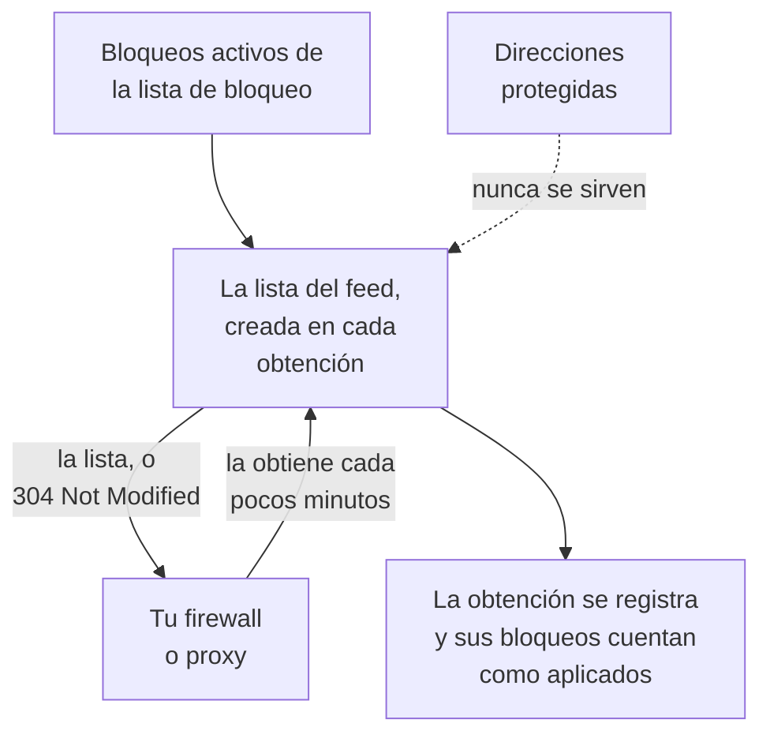

# Feeds de lista de bloqueo para firewalls y proxies

Un feed de lista de bloqueo es una URL secreta desde la que tu firewall o proxy lee la [lista de bloqueo](/docs/telemetry/security-cases#lista-de-bloqueo) de tu proyecto cada pocos minutos. Palo Alto Networks, FortiGate, Check Point, Cisco Secure Firewall, OPNsense y pfSense la leen como una lista externa, y los comandos que copias de OneUptime la aplican con nftables, ipset, nginx, HAProxy o el Firewall de Windows. Es tu firewall el que contacta con OneUptime: OneUptime nunca necesita una ruta hacia tu red ni una contraseña de tu firewall.

:::cards
- [Crear un feed](#crear-un-feed): Elige el firewall, copia el secreto y sigue sus pasos.
- [Configurar tu firewall](#configurar-tu-firewall): Los pasos para cada firewall y proxy, y con qué frecuencia obtiene el feed.
- [Cuándo se aplica un bloqueo](#cuándo-se-aplica-un-bloqueo): Solo cuando un firewall ha obtenido una lista que lo contiene.
- [Rotar o revocar el secreto](#rotar-o-revocar-el-secreto): Un secreto nuevo con un día de solapamiento, o ninguno, de inmediato.
:::

## Cómo funciona



Cada obtención crea la lista a partir de los bloqueos activos en ese momento. Un bloqueo que caduca o se levanta desaparece de la siguiente obtención, y una dirección protegida nunca está en ella, aunque se protegiera después de bloquearse. Un bloqueo solo cuenta como aplicado en el feed cuando un firewall ha obtenido una lista que lo contiene.

## Antes de empezar

- Un firewall o proxy que lea una lista de direcciones desde una URL `https`, o un host Linux o Windows en el que puedas ejecutar comandos como root o como administrador.
- Una salida hacia OneUptime por HTTPS desde el firewall: `https://oneuptime.com` o la dirección de tu propio servidor de OneUptime.
- Un rol que pueda crear feeds: Propietario del proyecto, Administrador del proyecto o Administrador de seguridad. Miembro de seguridad y Visor de seguridad pueden leer los feeds y sus obtenciones. Consulta [Roles](/docs/permissions/reference#roles).

## Crear un feed

:::steps
### Abre Feeds de lista de bloqueo

Abre **Productos → Eventos de seguridad → Playbooks → Feeds de lista de bloqueo**.

### Crea el feed

Haz clic en **Crear Feed de lista de bloqueo** y elige el **Firewall** que lo lee. **Nombre** es cómo llama la lista de bloqueo al feed donde se aplica un bloqueo; si lo dejas vacío, toma el nombre del firewall, por ejemplo «FortiGate feed». En **Más campos**, **Direcciones servidas** elige entre IPv4 e IPv6, solo IPv4 o solo IPv6, y **Direcciones de origen permitidas** limita quién puede leer el feed.

### Copia el secreto

La página del feed se abre con su secreto, que se muestra una sola vez: OneUptime solo guarda su hash. Cópialo y haz clic en **Hecho**. Hasta que salgas de la página, sus pasos incluyen el secreto por ti.

### Sigue los pasos de tu firewall

**Configura tu firewall** muestra la URL que hay que pegar, cómo envía el secreto tu firewall y los pasos en su propia consola, ya completados. Elige ahí otro firewall para ver sus pasos en su lugar. Tras la primera obtención de tu firewall, el estado del feed indica **Leyendo**, y **Obtenciones** muestra la obtención.
:::

## Qué entrega un feed

| Archivo | Para | Qué contiene |
| --- | --- | --- |
| `blocklist.txt` | Palo Alto Networks, pfSense, ipset, HAProxy, Firewall de Windows y cualquier otro firewall | Una dirección o un rango por línea. |
| `blocklist.txt?comments=1` | FortiGate, Check Point, Cisco Secure Firewall y OPNsense, que omiten las líneas que empiezan por `#` | Cada dirección o rango tras una línea que dice por qué está bloqueado. |
| `nftables.nft` | nftables | Un archivo para `nft -f` que vacía los conjuntos `blocklist_v4` y `blocklist_v6` de la tabla `inet oneuptime` y los vuelve a llenar. |
| `nginx.conf` | nginx | Una línea `deny` por cada dirección o rango. |
| El nombre de un archivo seguido de `.md5`, como `blocklist.txt.md5` | Cisco Secure Firewall | El MD5 del archivo, para que el firewall descargue la lista solo cuando ha cambiado. |

La URL de un feed es `https://oneuptime.com/api/blocklist-feed/<feed ID>/<file>`, y la página del feed la muestra completa para tu firewall. Con `?comments=1`, la lista queda así:

```text
# OneUptime case CASE-42 until 2026-11-21 10:42 UTC
203.0.113.7
# OneUptime blocklist until lifted
198.51.100.0/24
```

Un feed entrega los bloqueos activos cuya acción es **Bloquear**. Nunca entrega un desafío, que un firewall no puede hacer, y un feed que solo entrega IPv4 o solo IPv6 deja fuera las demás direcciones. El archivo de nftables omite una dirección que ya contiene un rango de la lista, ya que nftables rechaza las entradas que se solapan en un conjunto.

Cuando no hay nada bloqueado, `blocklist.txt` contiene una sola dirección, `192.0.2.1` (`2001:db8::1` en un feed que solo entrega IPv6). Es una dirección reservada para documentación, de la que no procede ningún tráfico de internet: Palo Alto Networks y Cisco conservan la última lista que leyeron cuando una lista llega vacía, así que una lista vacía seguiría bloqueando lo que levantaste.

Cada respuesta lleva un `ETag`. Un firewall que lo devuelve en `If-None-Match` recibe `304 Not Modified` mientras la lista no cambie, y los comandos que te da OneUptime lo hacen.

## Cómo envía el secreto un firewall

| Cómo | Qué envía el firewall | Lo usan |
| --- | --- | --- |
| Autenticación básica | Cualquier nombre de usuario, como `oneuptime`, con el secreto como contraseña | Palo Alto Networks (solo por HTTPS), FortiGate y Check Point |
| Token bearer | `Authorization: Bearer <secret>` | Los comandos para nftables, ipset, nginx, HAProxy y el Firewall de Windows |
| Secreto en la URL | `https://oneuptime.com/api/blocklist-feed/<feed ID>/<secret>/blocklist.txt` | Cisco Secure Firewall, OPNsense y pfSense, que no documentan ninguna forma de enviarlo |

Una solicitud sin secreto, o con uno incorrecto, recibe `401 Unauthorized`. Una URL con un secreto incorrecto recibe `404 Not Found`, igual que una dirección que no existe. El propio servidor web de OneUptime no escribe las URL de los feeds en su registro de acceso, así que un secreto en una URL no acaba ahí.

## Limitar quién puede leer un feed

**Direcciones de origen permitidas**, en **Más campos**, admite hasta 50 direcciones y rangos, uno por línea, como `203.0.113.7` o `198.51.100.0/24`. Una solicitud desde cualquier otra dirección recibe `403 Forbidden`, incluso con el secreto correcto. Déjalo vacío para que cualquier dirección que tenga el secreto pueda leer el feed.

Cada dirección puede obtener un feed 60 veces por minuto, y obtener feeds 600 veces por minuto en total. A partir de ahí, recibe `429 Too Many Requests` con un encabezado `Retry-After`.

## Cuándo se aplica un bloqueo

Un bloqueo cuenta como aplicado en un feed en cuanto un firewall ha obtenido una lista que lo contiene, después de crearse el bloqueo, y durante diez minutos después de cada una de esas obtenciones. Una respuesta `304 Not Modified` cuenta como una obtención de la misma lista. En la **Lista de bloqueo**, el chip del feed en **Aplicado en** se pone entonces en verde, y su descripción emergente indica cuánto tiempo después del bloqueo lo obtuvo el firewall, por ejemplo «Un firewall obtuvo este bloqueo de FortiGate feed 3 min después de su creación. Última obtención hace 2 minutos.»

Tras diez minutos sin obtención, el chip indica que el firewall no ha vuelto a obtener el feed: puede que el firewall siga bloqueando la dirección, pero OneUptime no puede saberlo. Así que haz que tu firewall obtenga el feed cada cinco minutos o con más frecuencia. Un firewall que lo obtiene con menos frecuencia, como OPNsense, sigue bloqueando entre sus obtenciones, y OneUptime solo considera el bloqueo aplicado allí durante los diez minutos que siguen a cada una.

Un bloqueo que caduca o se levanta desaparece de la siguiente obtención, y su chip espera a que un firewall obtenga la lista sin él. Cuando OneUptime no puede leer qué direcciones están protegidas, el feed responde `503 Service Unavailable` con `Retry-After: 60` en lugar de una lista que podría contener alguna, y el firewall conserva la lista que tiene.

## Cuando un firewall deja de leer

OneUptime aprende con qué frecuencia se obtiene cada feed. Cuando un feed lleva sin obtenerse tres veces su intervalo habitual, y al menos diez minutos, su estado indica **Dejó de leer**, la **Lista de bloqueo** lo nombra encima de su lista, y los Propietarios del proyecto reciben un único correo: «Your firewall stopped reading the blocklist feed _nombre del feed_». Hasta que un firewall ha obtenido un feed dos veces, OneUptime espera una obtención cada cinco minutos, cada hora de OPNsense y cada día de pfSense.

La siguiente obtención lo borra, y una parada posterior envía otro correo. Un feed cuyo secreto se revocó nunca cuenta como detenido.

## Rotar o revocar el secreto

**Rotar secreto**, en la página del feed, crea un secreto nuevo y lo muestra una sola vez. El secreto que reemplaza sigue funcionando 24 horas, para que puedas dar el nuevo a cada firewall; **Obtenciones** marca como **Secreto anterior** una obtención que todavía envió el antiguo. Volver a rotar dentro de esas 24 horas termina de inmediato con el secreto más antiguo.

**Revocar secreto** termina con el secreto, y con el anterior, de inmediato: úsalo cuando un secreto se haya filtrado. El feed deja entonces de responder a nadie, y sus firewalls conservan la lista que tienen sin actualizarla, hasta que **Rotar secreto** crea un secreto nuevo. Eliminar un feed termina con él, con su secreto y con sus obtenciones.

## Configurar tu firewall

La página del feed muestra estos pasos para el firewall que elijas, con la URL, el nombre de usuario y, justo después de crear el secreto, el secreto ya completados.

| Firewall | Archivo | Secreto | Obtener cada | Admite como máximo |
| --- | --- | --- | --- | --- |
| Palo Alto Networks | `blocklist.txt` | Autenticación básica | 5 minutos, el mínimo que ofrece | 30 listas personalizadas y 50.000 direcciones en total (150.000 en las series PA-3200, PA-5200 y PA-7000) |
| FortiGate | `blocklist.txt?comments=1` | Autenticación básica | 5 minutos (de 1 a 43.200; 5 por defecto) | 300.000 direcciones entre todos sus feeds de amenazas |
| Check Point | `blocklist.txt?comments=1`, IPv4 | Autenticación básica | 5 minutos (cada hora por defecto) | 50.000 direcciones por feed |
| Cisco Secure Firewall | `blocklist.txt?comments=1` y su MD5 | En la URL | 5 minutos (2 horas por defecto) | |
| OPNsense | `blocklist.txt?comments=1` | En la URL | 1 hora, el mínimo que ofrece | |
| pfSense | `blocklist.txt` | En la URL | 1 día, el mínimo que ofrece | |
| nftables, ipset, nginx, HAProxy, Firewall de Windows | El suyo propio | Token bearer | 1 minuto | |

### Palo Alto Networks

1. En la interfaz web, ve a **Objects → External Dynamic Lists** y haz clic en **Add**.
2. Establece **Type** en **IP List** y **Source** en la URL del feed, `https://oneuptime.com/api/blocklist-feed/<feed ID>/blocklist.txt`.
3. Activa **Client Authentication**, con **Username** `oneuptime` y el secreto del feed como **Password**.
4. Establece **Check for updates** en **Every Five Minutes**, haz clic en **OK** y haz commit.
5. En **Policies → Security**, añade una regla con la lista como **Source Address** y la acción **Deny**, y haz commit.

Palo Alto Networks solo envía el nombre de usuario y la contraseña por HTTPS. Solo lee un comentario detrás de una dirección, nunca en una línea propia, así que su feed es la lista simple. Consulta [Configure the Firewall to Access an External Dynamic List](https://docs.paloaltonetworks.com/pan-os/11-1/pan-os-admin/policy/use-an-external-dynamic-list-in-policy/configure-the-firewall-to-access-an-external-dynamic-list).

### FortiGate

1. Ve a **Security Fabric → External Connectors**, haz clic en **Create New** y elige **IP Address** en **Threat Feeds**.
2. Establece **URL of external resource** en la URL del feed, `https://oneuptime.com/api/blocklist-feed/<feed ID>/blocklist.txt?comments=1`.
3. Activa **HTTP basic authentication**, con **Username** `oneuptime` y el secreto del feed como **Password**.
4. Establece **Refresh Rate** en 5 minutos y haz clic en **OK**.
5. En **Policy & Objects → Firewall Policy**, usa el feed como **Source** de una política y establece **Action** en **DENY**.

Consulta [Configuring a threat feed](https://docs.fortinet.com/document/fortigate/7.6.0/administration-guide/379433/configuring-a-threat-feed).

### Check Point

1. En SmartConsole, abre el **Object Explorer** y elige **New → More → Network Object → Network Feed**.
2. Establece **Feed URL** en la URL del feed, `https://oneuptime.com/api/blocklist-feed/<feed ID>/blocklist.txt?comments=1`, **Format** en **Flat list** y **Data type** en **IP Address**.
3. En **Advanced Settings**, introduce **Username** `oneuptime` y el secreto del feed como contraseña de **Authentication**.
4. Establece **Check feed interval** en 5 minutos, haz clic en **Test Feed** y luego en **OK**.
5. Usa el feed como **Source** de una regla de Access Control cuya acción sea **Drop**, e instala la política.

Check Point documenta direcciones IPv4 para un Network Feed, así que un feed creado para él solo entrega IPv4. Consulta [Network Feed](https://sc1.checkpoint.com/documents/R82/WebAdminGuides/EN/CP_R82_SecurityManagement_AdminGuide/Content/Topics-SECMG/Network_Feed.htm).

### Cisco Secure Firewall

1. En el centro de administración, elige **Objects → Security Intelligence** y haz clic en **Add Network Lists and Feeds**.
2. Establece **Type** en **Feed**, **Feed URL** en la URL del feed, `https://oneuptime.com/api/blocklist-feed/<feed ID>/<secret>/blocklist.txt?comments=1`, y **MD5 URL** en la misma URL con `.md5` detrás de `blocklist.txt`.
3. Establece **Update Frequency** en 5 minutos y guarda.
4. En tu política de control de acceso, abre **Security Intelligence → Networks**, añade el feed a la **Block List** y luego guarda y despliega.

Cisco necesita una URL MD5 para una frecuencia de actualización de 30 minutos o menos, y sus dispositivos gestionados reciben actualizaciones del centro de administración cada 30 minutos, así que un bloqueo les llega hasta 30 minutos después de que se obtenga el feed. Consulta [Creating Security Intelligence feeds](https://docs.manage.security.cisco.com/cdfmc/t_creating_security_intelligence_feeds.html).

### OPNsense

1. Ve a **Firewall → Aliases** y añade un alias de tipo **URL Table (IPs)**.
2. Establece **Content** en la URL del feed, `https://oneuptime.com/api/blocklist-feed/<feed ID>/<secret>/blocklist.txt?comments=1`, y **Refresh Frequency** en 0 días y 1 hora.
3. Guarda y haz clic en **Apply**, y luego, en **Firewall → Rules**, añade una regla que bloquee el tráfico cuyo **Source** sea el alias.

OPNsense obtiene una tabla de URL como mucho una vez por hora, así que OneUptime solo confirma sus bloqueos durante los diez minutos que siguen a cada obtención. Mientras tanto, OPNsense los sigue bloqueando. Consulta [Aliases](https://docs.opnsense.org/manual/aliases.html).

### pfSense

1. Ve a **Firewall → Aliases**, haz clic en **Add** y elige **URL Table (IPs)**.
2. Introduce la URL del feed, `https://oneuptime.com/api/blocklist-feed/<feed ID>/<secret>/blocklist.txt`, y ajusta la frecuencia de actualización a 1 día.
3. Haz clic en **Save** y en **Apply Changes** y luego, en **Firewall → Rules**, añade una regla con el alias como **Source** y la acción **Block**.

> [!WARNING]
> pfSense obtiene una tabla de URL como mucho una vez al día: demasiado lento para bloquear un ataque mientras ocurre. Úsalo para bloqueos largos, junto a un firewall que obtenga el feed cada pocos minutos.

Consulta [Alias Types](https://docs.netgate.com/pfsense/en/latest/firewall/aliases-types.html).

### nftables

Como root, ejecuta una vez los comandos que muestra la página del feed. Crean la tabla `inet oneuptime` con dos conjuntos, `blocklist_v4` y `blocklist_v6`, reglas en sus cadenas `input` y `forward` que descartan el tráfico de las direcciones que contienen, y el script `/usr/local/sbin/oneuptime-blocklist`, que guarda el secreto en `/etc/oneuptime-blocklist`, legible solo por root.

```bash
# Run once, as root.
install -d -m 700 /etc/oneuptime-blocklist /var/lib/oneuptime-blocklist
printf 'Authorization: Bearer %s\n' 'YOUR_FEED_SECRET' > /etc/oneuptime-blocklist/auth
chmod 600 /etc/oneuptime-blocklist/auth
cat > /usr/local/sbin/oneuptime-blocklist <<'SCRIPT'
#!/bin/sh
# Loads the OneUptime blocklist into nftables when it changed.
set -eu
URL='https://oneuptime.com/api/blocklist-feed/<feed ID>/nftables.nft'
STATE=/var/lib/oneuptime-blocklist
if ! nft list table inet oneuptime >/dev/null 2>&1; then
  rm -f "$STATE/etag"
  nft -f - <<'NFT'
table inet oneuptime {
  set blocklist_v4 { type ipv4_addr; flags interval; auto-merge; }
  set blocklist_v6 { type ipv6_addr; flags interval; auto-merge; }
  chain input {
    type filter hook input priority filter; policy accept;
    ip saddr @blocklist_v4 drop
    ip6 saddr @blocklist_v6 drop
  }
  chain forward {
    type filter hook forward priority filter; policy accept;
    ip saddr @blocklist_v4 drop
    ip6 saddr @blocklist_v6 drop
  }
}
NFT
fi
TMP=$(mktemp)
trap 'rm -f "$TMP" "$TMP.h"' EXIT
ETAG=$(cat "$STATE/etag" 2>/dev/null || true)
CODE=$(curl --silent --show-error --max-time 60 --header @/etc/oneuptime-blocklist/auth \
  ${ETAG:+--header "If-None-Match: $ETAG"} \
  --dump-header "$TMP.h" --output "$TMP" --write-out '%{http_code}' "$URL")
[ "$CODE" = 304 ] && exit 0
[ "$CODE" = 200 ] || { echo "oneuptime-blocklist: the feed answered $CODE" >&2; exit 1; }
nft -f "$TMP"
sed -n 's/^[Ee][Tt][Aa][Gg]:[[:space:]]*//p' "$TMP.h" | tr -d '\r' > "$STATE/etag"
SCRIPT
chmod 700 /usr/local/sbin/oneuptime-blocklist
echo '* * * * * root flock -n /run/oneuptime-blocklist.lock /usr/local/sbin/oneuptime-blocklist' > /etc/cron.d/oneuptime-blocklist
/usr/local/sbin/oneuptime-blocklist
```

El script se ejecuta cada minuto desde `/etc/cron.d/oneuptime-blocklist`. Solo carga `nftables.nft` cuando la lista ha cambiado, en una sola transacción, así que los conjuntos nunca están a medio llenar. Consulta [Sets](https://wiki.nftables.org/wiki-nftables/index.php/Sets).

### ipset e iptables

Como root, ejecuta una vez los comandos que muestra la página del feed. Crean dos conjuntos, `oneuptime_v4` y `oneuptime_v6`, y reglas en la cadena `PREROUTING` de la tabla `raw`, para iptables e ip6tables, que descartan el tráfico de las direcciones que contienen.

El script se ejecuta cada minuto desde cron. Cuando la lista ha cambiado, llena dos conjuntos nuevos y los intercambia por los anteriores, así que las reglas nunca ven un conjunto a medio llenar. Consulta [ipset](https://ipset.netfilter.org/ipset.man.html).

### nginx

Añade la línea include al bloque `server` de cada sitio que quieras proteger y luego ejecuta una vez, como root, los comandos que muestra la página del feed:

```nginx
server {
    include /etc/nginx/oneuptime-blocklist.conf;
}
```

```bash
# Run once, as root.
install -d -m 700 /etc/oneuptime-blocklist /var/lib/oneuptime-blocklist
printf 'Authorization: Bearer %s\n' 'YOUR_FEED_SECRET' > /etc/oneuptime-blocklist/auth
chmod 600 /etc/oneuptime-blocklist/auth
touch /etc/nginx/oneuptime-blocklist.conf
cat > /usr/local/sbin/oneuptime-blocklist <<'SCRIPT'
#!/bin/sh
# Writes the OneUptime blocklist for nginx when it changed, and reloads nginx.
set -eu
URL='https://oneuptime.com/api/blocklist-feed/<feed ID>/nginx.conf'
STATE=/var/lib/oneuptime-blocklist
TMP=$(mktemp)
trap 'rm -f "$TMP" "$TMP.h"' EXIT
ETAG=$(cat "$STATE/etag" 2>/dev/null || true)
CODE=$(curl --silent --show-error --max-time 60 --header @/etc/oneuptime-blocklist/auth \
  ${ETAG:+--header "If-None-Match: $ETAG"} \
  --dump-header "$TMP.h" --output "$TMP" --write-out '%{http_code}' "$URL")
[ "$CODE" = 304 ] && exit 0
[ "$CODE" = 200 ] || { echo "oneuptime-blocklist: the feed answered $CODE" >&2; exit 1; }
cp /etc/nginx/oneuptime-blocklist.conf "$STATE/last.conf"
cp "$TMP" /etc/nginx/oneuptime-blocklist.conf
if nginx -t -q; then nginx -s reload; else cp "$STATE/last.conf" /etc/nginx/oneuptime-blocklist.conf; exit 1; fi
sed -n 's/^[Ee][Tt][Aa][Gg]:[[:space:]]*//p' "$TMP.h" | tr -d '\r' > "$STATE/etag"
SCRIPT
chmod 700 /usr/local/sbin/oneuptime-blocklist
echo '* * * * * root flock -n /run/oneuptime-blocklist.lock /usr/local/sbin/oneuptime-blocklist' > /etc/cron.d/oneuptime-blocklist
/usr/local/sbin/oneuptime-blocklist

# Then add this line to the server block of the site to protect, and reload nginx:
#   include /etc/nginx/oneuptime-blocklist.conf;
```

El script se ejecuta cada minuto desde cron. Cuando la lista ha cambiado, escribe `/etc/nginx/oneuptime-blocklist.conf`, comprueba la configuración con `nginx -t` y recarga nginx, y vuelve a poner el archivo anterior si la comprobación falla.

Detrás de un balanceador de carga o una CDN, nginx ve la dirección del balanceador, no la del visitante, salvo que esté configurado el módulo realip: establece `set_real_ip_from` en las direcciones del balanceador y `real_ip_header` en el encabezado que envía, o bloquea en el balanceador. Consulta [ngx_http_access_module](https://nginx.org/en/docs/http/ngx_http_access_module.html).

### HAProxy

Como root, crea el archivo de la lista y añade dos líneas a `haproxy.cfg`, y luego recarga HAProxy una vez: su API Runtime solo actualiza una lista que HAProxy ya lee.

```text
global
    stats socket /run/haproxy/admin.sock mode 660 level admin

frontend www
    http-request deny if { src -n -f /etc/haproxy/oneuptime-blocklist.lst }
```

Luego ejecuta el resto de los comandos que muestra la página del feed. El script se ejecuta cada minuto desde cron y, cuando la lista ha cambiado, escribe `/etc/haproxy/oneuptime-blocklist.lst` y actualiza HAProxy mediante su API Runtime, sin recargarlo. Consulta [The Runtime API](https://docs.haproxy.org/3.4/management.html#9.3).

### Firewall de Windows

En PowerShell como administrador, ejecuta una vez los comandos que muestra la página del feed. Guardan un script y el secreto en `C:\ProgramData\OneUptime\Blocklist`, que solo pueden leer SYSTEM y el grupo Administrators, y registran la tarea programada «OneUptime Blocklist», que ejecuta el script cada minuto como SYSTEM.

El script mantiene reglas de entrada que bloquean cada dirección de la lista, 1.000 por regla: «OneUptime blocklist 0», «OneUptime blocklist 1» y así sucesivamente. Consulta [Set-NetFirewallRule](https://learn.microsoft.com/en-us/powershell/module/netsecurity/set-netfirewallrule).

### Otros firewalls

1. Apunta tu firewall o proxy a la URL del feed, `https://oneuptime.com/api/blocklist-feed/<feed ID>/blocklist.txt`: una dirección o un rango por línea.
2. Envía el secreto del feed como contraseña de autenticación básica, con cualquier nombre de usuario, o como token bearer.
3. Haz que obtenga la lista cada 5 minutos o con más frecuencia: un bloqueo cuenta como aplicado allí durante diez minutos después de cada obtención.

### Kubernetes

Bloquea en el perímetro o en el WAF en la nube que hay delante del clúster, conectado como destino de la lista de bloqueo en **Conexiones de seguridad** o **Conexiones a la nube**, o en un proxy que ejecutes delante de él con los comandos de nginx o HAProxy. El controlador comunitario Ingress NGINX se retiró y su repositorio se archivó en marzo de 2026, así que OneUptime no documenta sus anotaciones. Consulta [Ingress NGINX Retirement](https://kubernetes.io/blog/2025/11/11/ingress-nginx-retirement/).

## Límites

| Qué | Límite |
| --- | --- |
| Entradas en un feed | 20.000 |
| Direcciones de origen permitidas | 50 direcciones y rangos |
| Obtenciones de un feed desde una dirección | 60 por minuto |
| Obtenciones de todos los feeds desde una dirección | 600 por minuto |
| Un secreto reemplazado sigue funcionando | 24 horas |
| Un bloqueo cuenta como aplicado tras una obtención | 10 minutos |
| Obtenciones conservadas | 30 días |

## Solución de problemas

:::details El firewall recibe 401 Unauthorized
El secreto que envía no es el del feed. Comprueba que la contraseña, o el token bearer, sea el secreto completo, sin nada antes ni después. Un secreto reemplazado hace más de 24 horas ya no funciona: **Rotar secreto** crea uno nuevo.
:::

:::details El firewall recibe 404 Not Found
La URL nombra un feed que no existe, un archivo que un feed no entrega o un secreto incorrecto. Vuelve a copiar la URL desde la página del feed.
:::

:::details El firewall recibe 403 Forbidden
Las **Direcciones de origen permitidas** del feed no incluyen la dirección desde la que el firewall lo obtiene. **Obtenciones** muestra la dirección de la que vino cada obtención.
:::

:::details El chip de un bloqueo dice que espera a que un firewall obtenga el feed
Ningún firewall ha obtenido el feed desde que se creó el bloqueo. Revisa **Obtenciones** en la página del feed: un firewall que obtiene el feed cada cinco minutos aplica el bloqueo en menos de cinco minutos.
:::

## Próximos pasos

:::cards
- [Casos de seguridad y playbooks](/docs/telemetry/security-cases): Bloquea una dirección desde un caso, a mano o desde un playbook.
- [Inteligencia de amenazas](/docs/telemetry/threat-intelligence): Trae a OneUptime las direcciones maliciosas conocidas.
- [Eventos de seguridad](/docs/telemetry/security-events): Encuentra las direcciones que vale la pena bloquear.
:::
