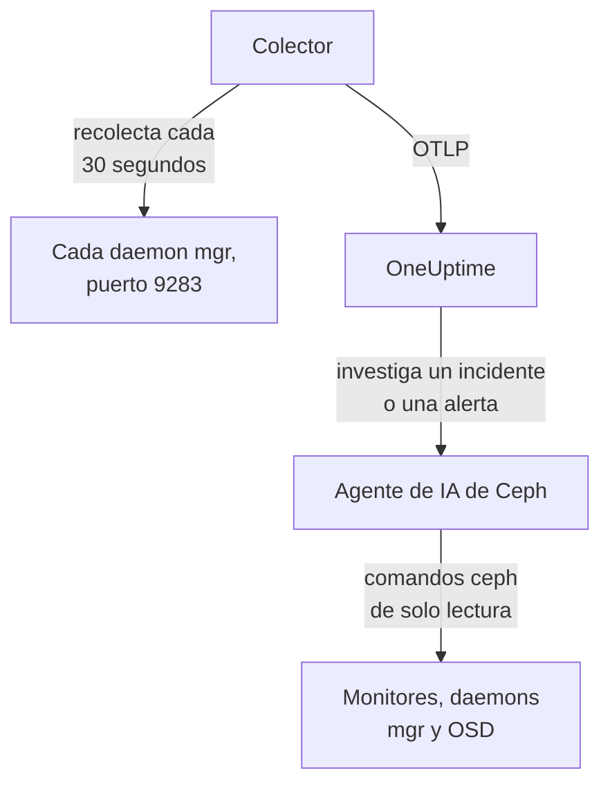

# Agente de Ceph

El agente de Ceph de OneUptime supervisa un clúster de Ceph: su estado, el quórum de monitores, los OSD, los pools y los placement groups. Recopila el módulo `prometheus` del mgr de Ceph en cada daemon mgr, marca cada métrica con el nombre de tu clúster y la envía a OneUptime, donde el clúster aparece con sus OSD, pools y daemons. Los [monitores de Ceph](/docs/monitor/ceph-monitor) alertan sobre lo que llega.

:::cards
- [Instalar el agente](#instala-el-agente): Activa el módulo del mgr y luego el script de instalación o Docker Compose.
- [Qué recopila el agente](#qué-recopila-el-agente): Las series detrás de las páginas de Ceph, las métricas y las plantillas de alerta.
- [Agente de IA](#agente-de-ia): Deja que OneUptime AI lea el clúster mientras investiga.
- [Solución de problemas](#solución-de-problemas): Un script de diagnóstico y los problemas habituales.
:::

## Cómo funciona

El agente son dos contenedores que ejecutas con Docker Compose en una máquina. Un OpenTelemetry Collector recopila el módulo `prometheus` del mgr en cada daemon mgr cada 30 segundos. Solo el mgr activo responde con métricas, así que cuando conmuta a uno en espera, las métricas siguen llegando sin ningún cambio. El agente de IA de Ceph, a su lado, permite que OneUptime AI ejecute comandos `ceph` de solo lectura mientras investiga un incidente o una alerta.



El clúster se registra con sus primeros datos, con el nombre que el agente marca en cada métrica como `ceph.cluster.name`.

## Antes de empezar

- Docker Engine 20.10 o posterior con el plugin Docker Compose v2, en una máquina que llegue a tus daemons mgr de Ceph en el puerto 9283.
- Una shell en un nodo de administración de Ceph, donde la CLI `ceph` funcione con permisos de administrador.
- Una clave de ingesta. Crea una en **Ajustes del proyecto → Telemetría y APM → Claves de ingesta** y copia su valor.
- HTTPS saliente desde esa máquina hacia tu URL de OneUptime.

## Instala el agente

:::steps
### Activar el módulo prometheus del mgr

En un nodo de administración de Ceph:

```bash
ceph mgr module enable prometheus
```

Cada daemon mgr sirve entonces métricas de Prometheus en el puerto `9283`, en `/metrics`. Solo el mgr activo devuelve métricas: los mgr en espera responden con una respuesta vacía, o con un error HTTP si `mgr/prometheus/standby_behaviour` está en `error`. Por eso el agente recopila cada mgr. Lístalos:

```bash
ceph mgr stat                    # active mgr
ceph orch ps --daemon-type mgr   # all mgrs (cephadm clusters)
```

### Instala e inicia el agente

:::tabs
@tab install.sh
Descarga el script de instalación y ejecútalo en la máquina que alojará el agente:

```bash
curl -sSL https://raw.githubusercontent.com/OneUptime/oneuptime/master/agents/CephAgent/install.sh -o install.sh
bash install.sh
```

El script pide tu URL de OneUptime, la clave de ingesta, un nombre para el clúster y los endpoints de los mgr, y si el [agente de IA](#agente-de-ia) puede aplicar correcciones. Donde `ceph` funciona con permisos de administrador, también ofrece crear el cliente de Ceph propio del agente de IA. Se instala en `/opt/oneuptime-ceph-agent`, escribe un archivo `.env` con `0600` e inicia el agente con Docker Compose. Volver a ejecutar el script reutiliza todo lo que hay en ese `.env` en lugar de volver a preguntar, y así es como [actualizas el agente](#actualizar-el-agente).
@tab Docker Compose
Descarga `docker-compose.yml` y `otel-collector-config.yaml` del [directorio CephAgent](https://github.com/OneUptime/oneuptime/tree/master/agents/CephAgent) en una carpeta nueva:

```bash
mkdir oneuptime-ceph-agent && cd oneuptime-ceph-agent
curl -fsSLO https://raw.githubusercontent.com/OneUptime/oneuptime/master/agents/CephAgent/docker-compose.yml
curl -fsSLO https://raw.githubusercontent.com/OneUptime/oneuptime/master/agents/CephAgent/otel-collector-config.yaml
```

Crea un archivo `.env` junto a ellos:

```bash title=".env"
ONEUPTIME_URL=YOUR_ONEUPTIME_URL
ONEUPTIME_TELEMETRY_INGESTION_KEY=YOUR_TELEMETRY_INGESTION_TOKEN
CEPH_CLUSTER_NAME=my-ceph-cluster
CEPH_MGR_ENDPOINTS=[ceph-mon-1:9283,ceph-mon-2:9283,ceph-mon-3:9283]
```

Enumera cada daemon mgr, el activo y los que están en espera, separados por comas y entre corchetes: los corchetes hacen que el colector lea el valor como una lista de destinos de recopilación. Inicia el agente:

```bash
docker compose up -d
```

El contenedor del agente de IA también se inicia y espera un cliente de Ceph propio: consulta [Agente de IA](#agente-de-ia).
:::

### Comprueba que el agente se está ejecutando

```bash
docker compose ps
docker logs -f oneuptime-ceph-agent
```

`docker compose ps` muestra el colector (`oneuptime-ceph-agent`) y el agente de IA (`oneuptime-ceph-ai-agent`). Los logs del colector deberían mostrar esta línea una vez iniciado:

```text
Everything is ready. Begin running and processing data.
```

### Busca el clúster en OneUptime

Abre **Productos → Infraestructura → Ceph → Todos los clústeres**. El clúster aparece con su `CEPH_CLUSTER_NAME` en un minuto aproximadamente, con sus OSD, pools y daemons.
:::

## Variables de entorno

El script de instalación las escribe en `/opt/oneuptime-ceph-agent/.env`; una instalación con Docker Compose las lee del `.env` que está junto a `docker-compose.yml`. Después de cambiar una, ejecuta `docker compose up -d` en esa carpeta.

| Variable | Obligatoria | Descripción |
| --- | --- | --- |
| `ONEUPTIME_URL` | Sí | Tu URL de OneUptime, como `https://oneuptime.com` o tu instancia autoalojada. Usa `http://` y su puerto si la instancia solo admite HTTP. |
| `ONEUPTIME_TELEMETRY_INGESTION_KEY` | Sí | La clave de ingesta de **Ajustes del proyecto → Telemetría y APM → Claves de ingesta**. |
| `CEPH_CLUSTER_NAME` | Sí | El nombre del clúster en OneUptime, marcado en cada métrica como el atributo de recurso `ceph.cluster.name`. Mantenlo estable: cambiarlo más tarde registra un segundo clúster. Su valor predeterminado es `ceph`. |
| `CEPH_MGR_ENDPOINTS` | Sí | Cada daemon mgr como una lista `host:port` separada por comas y entre corchetes, como `[ceph-mon-1:9283,ceph-mon-2:9283,ceph-mon-3:9283]`. El script de instalación añade los corchetes por ti. |

Los ajustes propios del agente de IA están en [Agente de IA](#agente-de-ia).

## Cómo recopila el agente

- **Cada mgr, cada 30 segundos.** El módulo `prometheus` del mgr guarda en caché cada recopilación durante `mgr/prometheus/scrape_interval` (15 segundos por defecto). Nunca recopiles con más frecuencia: solo volverías a leer la caché.
- **`honor_labels: true`.** Las etiquetas que exporta Ceph (`ceph_daemon`, `pool_id`, etiquetas de instancia por daemon) se conservan tal cual. Sin esto, la etiqueta `instance` se reescribiría para cada destino de recopilación y cambiaría cada vez que cambia el mgr activo, lo que rompe todas las series.

## Qué recopila el agente

El agente envía todo lo que exporta el módulo `prometheus` del mgr. Las páginas de Ceph, el catálogo de métricas y las plantillas de alerta de OneUptime se basan en estas series:

| Categoría | Métricas |
| --- | --- |
| Estado del clúster | `ceph_health_status` (0 = OK, 1 = WARN, 2 = ERR), `ceph_health_detail` (una serie por cada comprobación de estado activa, con las etiquetas `name` y `severity`, desde Quincy; la base de las plantillas de alerta de comprobaciones de estado y de las **Comprobaciones de estado activas** de la vista general), `ceph_healthcheck_slow_ops`, `ceph_daemon_health_metrics` (por daemon, según `type`), `ceph_mon_quorum_status`, `ceph_mon_metadata`, `ceph_cluster_total_bytes`, `ceph_cluster_total_used_bytes` |
| OSD | `ceph_osd_up`, `ceph_osd_in`, `ceph_osd_apply_latency_ms`, `ceph_osd_commit_latency_ms`, `ceph_osd_stat_bytes`, `ceph_osd_stat_bytes_used`, `ceph_osd_numpg`, `ceph_osd_metadata`, por OSD según la etiqueta `ceph_daemon` (como `osd.3`) |
| Pool | `ceph_pool_stored`, `ceph_pool_max_avail`, `ceph_pool_objects`, `ceph_pool_rd`, `ceph_pool_wr`, `ceph_pool_rd_bytes`, `ceph_pool_wr_bytes`, `ceph_pool_metadata`. Las series de datos solo llevan una etiqueta `pool_id`; el nombre del pool está en `ceph_pool_metadata`. |
| Placement groups | `ceph_pg_total`, `ceph_pg_active`, `ceph_pg_clean`, `ceph_pg_degraded`, `ceph_pg_undersized` (todas por pool, según `pool_id`), `ceph_num_objects_degraded`, `ceph_num_objects_misplaced` |
| Daemons | `ceph_mgr_metadata`, `ceph_mds_metadata` y `ceph_rgw_metadata`, además de los metadatos de monitores y OSD de arriba. Cada una nombra un daemon y lleva su versión en la etiqueta `ceph_version`: la página **Daemons** los enumera. |

### Más destinos de recopilación

El módulo del mgr cubre el estado y la capacidad del clúster. Para verlo más de cerca, añade más jobs en `scrape_configs` dentro de `otel-collector-config.yaml`:

- **`ceph-exporter` (Reef 18.2 y posteriores).** cephadm ejecuta un daemon `ceph-exporter` en cada host del clúster, que sirve contadores de rendimiento por daemon en el puerto `9926`. Añade un destino por host.
- **`node_exporter`.** El compañero habitual para las métricas de CPU, memoria, disco y red de cada host de Ceph, en el puerto `9100` por defecto.

Ambos reciben el atributo de recurso `ceph.cluster.name` del procesador `resource` incluido, así que llegan al mismo clúster en OneUptime.

## Opcional — Enviar el registro del clúster de Ceph

El agente puede seguir `/var/log/ceph/ceph.log` y enviarlo a OneUptime, lo que llena la página **Registro del clúster** del clúster. Está desactivado por defecto porque el agente debe ejecutarse en un host que tenga el registro del clúster: por defecto, un host de monitor.

:::steps
### Activa el receiver

En `otel-collector-config.yaml`, descomenta el receptor `filelog` y el pipeline `logs`.

### Montar el directorio de registros

En `docker-compose.yml`, descomenta el volumen que monta el directorio en el colector:

```yaml
- /var/log/ceph:/var/log/ceph:ro
```

### Reiniciar el agente

```bash
docker compose up -d
```
:::

Las líneas se envían a medida que se escriben. OneUptime lee el formato de `ceph.log` (hora, daemon, nivel `INF`/`WRN`/`ERR`, mensaje) al mostrarlas, y el procesador `resource` marca `ceph.cluster.name`, así que el registro llega a este clúster.

## Etiquetar el clúster con etiquetas del proyecto

Un atributo de recurso que empieza por `oneuptime.label.` se convierte en una etiqueta del proyecto en el clúster: `oneuptime.label.<dimension>=<value>` es la etiqueta `<dimension>:<value>`. Añade los atributos al procesador `resource` en `otel-collector-config.yaml`, junto a `ceph.cluster.name`:

```yaml
processors:
  resource:
    attributes:
      # ...existing attributes...
      - key: oneuptime.label.team
        value: storage
        action: upsert
      - key: oneuptime.label.env
        value: production
        action: upsert
```

El colector lee su configuración solo al iniciarse: ejecuta `docker compose restart oneuptime-ceph-agent`. El clúster muestra entonces las etiquetas `team:storage` y `env:production`. Las etiquetas se comparan sin distinguir mayúsculas de minúsculas, así que una etiqueta `Production` existente se reutiliza en lugar de duplicarse, y el agente nunca quita una etiqueta que alguien añadió en OneUptime.

## Ejecutar como servicio de systemd

Para iniciar el agente con la máquina y reiniciarlo cuando falle, instala su unidad de systemd. Supone que el agente está en `/opt/oneuptime-ceph-agent`, donde lo pone el script de instalación:

```bash
sudo curl -fsSL https://raw.githubusercontent.com/OneUptime/oneuptime/master/agents/CephAgent/systemd/oneuptime-ceph-agent.service -o /etc/systemd/system/oneuptime-ceph-agent.service
sudo systemctl daemon-reload
sudo systemctl enable --now oneuptime-ceph-agent
```

## Actualizar el agente

El agente informa como su **Versión del agente** de la versión del colector que fijan sus archivos. Cuando es más antigua que la versión que fija esta versión de OneUptime, aparece una señal de advertencia a su lado en la **Vista general** del clúster. Selecciónala para ver estos comandos. Un agente instalado antes de que sus archivos informaran una versión no muestra ninguna hasta que se actualiza de esta forma.

La imagen del colector está fijada en `docker-compose.yml` y su configuración es un archivo junto a él, así que descargar las imágenes no basta para que el agente avance. Vuelve a ejecutar `install.sh`: reutiliza todos los valores de tu `.env` existente (no se vuelve a preguntar nada), renueva `docker-compose.yml` y `otel-collector-config.yaml` (un archivo que editaste se conserva como `<file>.bak.<timestamp>`), descarga las imágenes y vuelve a crear el agente para que el colector lea su nueva configuración. La carpeta `ceph/` del agente de IA se queda como está.

```bash
curl -sSL https://raw.githubusercontent.com/OneUptime/oneuptime/master/agents/CephAgent/install.sh -o install.sh
bash install.sh
```

¿Lo instalaste con Docker Compose? En la carpeta del agente, vuelve a descargar los dos archivos (y vuelve a hacer cualquier cambio que les hicieras), luego descarga las imágenes y vuelve a crear el agente:

```bash
curl -fsSLO https://raw.githubusercontent.com/OneUptime/oneuptime/master/agents/CephAgent/docker-compose.yml
curl -fsSLO https://raw.githubusercontent.com/OneUptime/oneuptime/master/agents/CephAgent/otel-collector-config.yaml
docker compose pull
docker compose up -d --force-recreate
```

## Desinstalar el agente

```bash
cd /opt/oneuptime-ceph-agent
docker compose down
```

Si creaste el cliente de Ceph del agente de IA, elimínalo en un nodo de administración con `ceph auth del client.oneuptime-ai`.

## Agente de IA

El `docker-compose.yml` del agente también ejecuta el **Agente de IA de Ceph**, `oneuptime-ceph-ai-agent` (imagen `oneuptime/resource-ai-agent:release`). Mientras OneUptime AI investiga un incidente o una alerta en este clúster, ejecuta a través de él comandos `ceph` de solo lectura — `ceph health detail`, `ceph osd tree`, `ceph pg dump_stuck`, `ceph crash ls` — y, solo si lo permites, aplica correcciones como volver a marcar un OSD como in o quitar `noout`. Se registra como el clúster llamado `CEPH_CLUSTER_NAME`, igual que el colector, y aparece en la página **IA → Agente de IA** del clúster en OneUptime.

- **Las investigaciones con IA están activadas por defecto.** En cuanto el agente se conecta, OneUptime AI investiga con él los incidentes y alertas de este clúster, y la **Vista general** del clúster muestra el estado del agente. Para detenerlo, establece `ONEUPTIME_AI_INVESTIGATION=false` donde se ejecuta el agente (**Cambiar** en **Lo que puede hacer la IA**, en la página del agente de IA, muestra cómo), u omite el agente.
- **Su propio cliente de Ceph es el límite estricto.** Se conecta como `client.oneuptime-ai`, con el `ceph.conf` mínimo del clúster y el keyring de ese cliente en una carpeta `ceph/` junto a `docker-compose.yml` (montada en solo lectura en `/etc/ceph`). Con caps de lectura, nada de lo que ejecuta puede cambiar el clúster. En una instalación nueva, `install.sh` ofrece crear el cliente; volver a ejecutarlo nunca lo hace. Nunca pongas el keyring de admin en esa carpeta.
- Es de **solo lectura** salvo que establezcas `ONEUPTIME_AI_ALLOW_WRITES=true` y des al cliente los caps de las correcciones (el README del agente los enumera); `ONEUPTIME_AI_WRITE_TARGETS` (por ejemplo `osd.*,cluster`) limita lo que una corrección puede tocar. `ONEUPTIME_AI_FIXES`, en el mismo `.env`, indica cómo se ejecutan las correcciones — `ask-for-approval` (una persona aprueba cada una), `automatic` o `bypass-approval` — y la página del agente de IA lo muestra en solo lectura ([Lo que puede hacer la IA, fijado por el agente](/docs/ai/infrastructure-ai-agents#what-ai-may-do-set-by-the-agent)).
- Se conecta hacia fuera a los monitores (TCP 3300 y 6789) y a los daemons mgr y OSD (TCP 6800–7300), se ejecuta como UID 1000 sin capabilities y nunca ejecuta `auth`, `config-key`, `tell` ni nada que borre datos. Elimina el servicio `oneuptime-ceph-ai-agent` de `docker-compose.yml` si no usas OneUptime AI.

Para crear el cliente a mano, ejecuta esto en un nodo de administración de Ceph, en la carpeta del agente (copia los dos archivos en la carpeta `ceph/` de la máquina del agente si es otra):

```bash
mkdir -p ceph
ceph config generate-minimal-conf > ceph/ceph.conf
ceph auth get-or-create client.oneuptime-ai mon 'allow r' mgr 'allow r' osd 'allow r' -o ceph/ceph.client.oneuptime-ai.keyring
sudo chown 1000:1000 ceph/ceph.client.oneuptime-ai.keyring
sudo chmod 600 ceph/ceph.client.oneuptime-ai.keyring
docker compose up -d
```

Qué puede ejecutar, cómo funcionan las correcciones y cómo solucionar sus problemas: [Infrastructure AI Agents](/docs/ai/infrastructure-ai-agents#ceph-clusters).

## Solución de problemas

:::details Ejecuta primero el script de diagnóstico
El agente incluye un script, [`troubleshoot.sh`](https://github.com/OneUptime/oneuptime/blob/master/agents/CephAgent/troubleshoot.sh), que comprueba toda la cadena: el runtime de contenedores, cada endpoint de mgr configurado, el nombre del clúster marcado en cada métrica, la forma del token, las propias métricas del colector y si OneUptime acepta la clave de ingesta. Avisa cuando ningún endpoint devuelve `ceph_health_status`, o cuando solo hay uno configurado, ya que solo el mgr activo sirve métricas. La comprobación de la clave es la que más importa. OneUptime rechaza una clave incorrecta con `401` (`422` para una clave desactivada o una clave de navegador), y el colector trata ambas como permanentes: descarta el lote y registra un error `Exporting failed`, fácil de pasar por alto mientras el contenedor sigue sano. El script pide `GET <url>/otlp/v1/validate` desde dentro de la red del agente para obtener un `200` (válida) o un `401` (no válida) directos, y en servidores más antiguos recurre a `POST /fluentd/v1/logs`.

```bash
curl -sSL https://raw.githubusercontent.com/OneUptime/oneuptime/master/agents/CephAgent/troubleshoot.sh -o troubleshoot.sh
bash troubleshoot.sh    # add -d <dir> if you installed outside /opt/oneuptime-ceph-agent
```

Termina con un veredicto que nombra la causa más probable.
:::

:::details No aparece ningún clúster en OneUptime
1. Lee los logs del colector: `docker logs oneuptime-ceph-agent`. Un `401` al exportar significa una clave de ingesta incorrecta; una conexión rechazada significa una `ONEUPTIME_URL` incorrecta.
2. Comprueba que un mgr sirve métricas: `curl http://ACTIVE_MGR_HOST:9283/metrics | head` debería imprimir líneas `ceph_*`. Si no es así, activa el módulo con `ceph mgr module enable prometheus`.
3. Comprueba que `CEPH_MGR_ENDPOINTS` está entre corchetes. Sin ellos, el colector lee toda la lista separada por comas como un único destino, que no existe.
:::

:::details El clúster aparece como desconectado
Un clúster pasa a desconectado cuando OneUptime no ha recibido nada de él durante 15 minutos; OneUptime lo comprueba cada 5 minutos, y el tiempo en que él mismo no recibía datos no cuenta. Comprueba que el colector se está ejecutando (`docker compose ps`), que sus logs no muestran errores de exportación y que la máquina sigue llegando a tu URL de OneUptime. El clúster vuelve a estar conectado con sus siguientes datos.
:::

:::details Las métricas se detienen tras una conmutación del mgr
Probablemente solo recopilas el mgr que antes estaba activo. Enumera cada daemon mgr en `CEPH_MGR_ENDPOINTS`: recopilar los que están en espera apenas cuesta nada, y responden con respuestas vacías.
:::

:::details Errores de recopilación de los mgr en espera en los logs del colector
Es lo esperado cuando `mgr/prometheus/standby_behaviour` está en `error` en tu clúster: los mgr en espera responden entonces con HTTP 500. La recopilación del mgr activo sigue funcionando, así que los errores son ruido; vuelve a poner el comportamiento en `default` para silenciarlos.
:::

:::details Las métricas llegan al clúster equivocado
OneUptime registra un clúster de Ceph por su `ceph.cluster.name`, que el agente toma de `CEPH_CLUSTER_NAME`. Cambiarlo después de los primeros datos crea un segundo clúster en lugar de renombrar el primero.
:::

## Próximos pasos

:::cards
- [Monitor de Ceph](/docs/monitor/ceph-monitor): Alerta sobre el estado, los OSD, los placement groups, la capacidad, los fallos y las operaciones lentas.
- [Agente de Proxmox](/docs/telemetry/proxmox): ¿Ejecutas Ceph bajo Proxmox VE? Supervisa también el clúster.
- [Infrastructure AI Agents](/docs/ai/infrastructure-ai-agents): Qué puede ejecutar el agente de IA de Ceph y cómo funcionan las correcciones.
- [Colector OpenTelemetry en el host](/docs/telemetry/host-otel-collector): La vista del sistema operativo de cada host de Ceph.
:::
