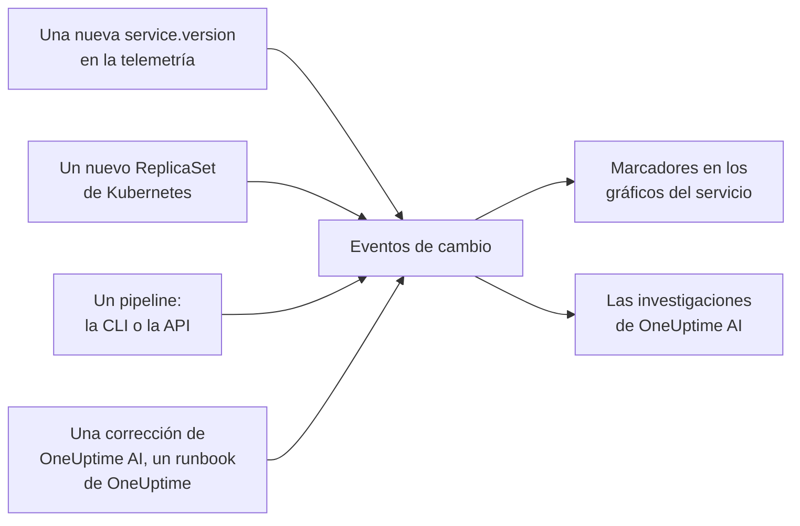

# Despliegues y cambios

OneUptime lleva un registro de lo que cambió en tu proyecto: despliegues, rollouts de Kubernetes, cambios de configuración y las correcciones que ejecutó él mismo. Cada cambio se dibuja como un marcador en los gráficos de su servicio, y OneUptime AI los lee cuando investiga un incidente, así que «empezó justo después del despliegue de las 10:02» es lo primero que sabes, no lo último.

:::cards
- [Lo que OneUptime registra por su cuenta](#lo-que-oneuptime-registra-por-su-cuenta): Despliegues y rollouts a partir de la telemetría, y sus propias correcciones.
- [Registrar un despliegue desde un pipeline](#registrar-un-despliegue-desde-un-pipeline): La CLI, GitHub Actions y la API.
- [Cómo usa OneUptime AI los cambios](#cómo-usa-oneuptime-ai-los-cambios): Los cambios sospechosos de cada investigación.
- [Referencia](#referencia): Campos, atributos y límites.
:::

## Cómo funciona



## Lo que OneUptime registra por su cuenta

Para estos no tienes que enviar nada. OneUptime los registra a partir de la telemetría que ya recibe y de lo que hace él mismo.

| Cambio | Se registra cuando | Origen |
| --- | --- | --- |
| Un despliegue | Un servicio empieza a informar una `service.version` que nunca había informado en su entorno | `service-version` |
| Un rollout | Los pods de un Deployment de Kubernetes empiezan a ejecutar un ReplicaSet que nunca habían ejecutado: una imagen nueva, una variable de entorno o una referencia de configuración que cambió, o un reinicio | `kubernetes` |
| Una corrección que ejecutó OneUptime AI | Un agente de IA informa del resultado de un comando que cambia algo, como `kubectl rollout restart` | `oneuptime-ai` |
| Un runbook | Un runbook que ejecutó OneUptime termina, falla o se cancela después de haber empezado | `runbook` |

- **La primera versión que informa un servicio es su punto de partida, no un despliegue.** Un servicio que lleva meses en marcha no se despliega en el momento en que OneUptime empieza a recibir su telemetría.
- **Una reversión a una versión vista en los últimos 30 días no se registra,** porque esa versión no es nueva. Una reversión que ejecuta OneUptime AI se registra como una corrección.
- **Con más de 6 versiones o ReplicaSets nuevos en una hora, se deja de registrar hasta que termina la hora.** De lo contrario, una «versión» que cambia con cada pod, como una marca de tiempo de compilación, registraría un despliegue por cada pod.

Un despliegue solo se registra para un servicio que informa `service.version`. Defínelo, junto con el entorno y el commit, en los atributos de recurso de tu SDK o collector de OpenTelemetry:

```bash
OTEL_RESOURCE_ATTRIBUTES="service.version=2.3.1,deployment.environment.name=production,vcs.ref.head.revision=$GIT_SHA"
```

Un rollout necesita el [agente de Kubernetes](/docs/telemetry/kubernetes-agent), que marca la telemetría de cada pod con su Deployment y su ReplicaSet.

## Registrar un despliegue desde un pipeline

Un pipeline puede registrar un despliegue, o cualquier otro cambio, en el momento en que ocurre: un cambio de configuración, una migración, un feature flag. Escribe con una clave de ingesta de telemetría de tu proyecto, del mismo tipo que la que usan tus aplicaciones para enviar telemetría. Crea una en **Ajustes del proyecto → Telemetría y APM → Claves de ingesta**.

Una clave fijada a un servicio registra cada cambio en ese servicio.

:::tabs
@tab CLI
```bash
oneuptime deploy \
  --service checkout \
  --service-version 2.3.1 \
  --commit "$GIT_SHA" \
  --environment production \
  --url https://oneuptime.com \
  --ingestion-key "$ONEUPTIME_TELEMETRY_INGESTION_KEY"
```
@tab GitHub Actions
```yaml title=".github/workflows/deploy.yml"
- name: Record the deploy in OneUptime
  env:
    ONEUPTIME_URL: https://oneuptime.com
    ONEUPTIME_TELEMETRY_INGESTION_KEY: ${{ secrets.ONEUPTIME_TELEMETRY_INGESTION_KEY }}
  run: |
    npx -y @oneuptime/cli deploy \
      --service checkout \
      --service-version "${{ github.ref_name }}" \
      --commit "${{ github.sha }}" \
      --repository "${{ github.server_url }}/${{ github.repository }}" \
      --environment production
```
@tab API
```bash
curl -X POST https://oneuptime.com/telemetry/change-events/v1/ingest \
  -H "Content-Type: application/json" \
  -H "x-oneuptime-token: $ONEUPTIME_TELEMETRY_INGESTION_KEY" \
  -d '{"events": [{"serviceName": "checkout", "version": "2.3.1", "commit": "1a2b3c4", "environment": "production"}]}'
```
:::

En un OneUptime autoalojado, usa tu propia dirección en lugar de `https://oneuptime.com`. La API responde con cuántos eventos guardó y cuántos omitió:

```json
{ "ingested": 1, "skipped": 0 }
```

Consulta [`oneuptime deploy`](/docs/cli/command-reference#oneuptime-deploy) para ver todas las opciones de la CLI.

## Cómo usa OneUptime AI los cambios

Cada [investigación de IA](/docs/ai/ai-sre) de un incidente o de una alerta parte de los cambios registrados en las 2 horas anteriores, y en los 10 minutos posteriores, para un pipeline que registra su despliegue una vez terminado el rollout. Primero van los cambios de los servicios, clústeres y hosts con los que está vinculado el incidente.

Para un máximo de 4 de ellos que nombran un servicio, OneUptime lee la telemetría del servicio en los 30 minutos anteriores y posteriores al cambio, y marca el cambio como **sospechoso** cuando el servicio empeoró de forma medible justo después:

| Señal | Sospechoso cuando |
| --- | --- |
| Spans fallidos | La tasa de errores al menos se duplicó y subió al menos un punto porcentual, sobre al menos 10 spans fallidos |
| Latencia | El p99 creció al menos la mitad, y al menos 100 ms |
| Excepciones | Al menos el triple por minuto, y al menos 10 en total |
| Excepciones nuevas | Un tipo de excepción visto por primera vez en la versión que publicó el cambio, entre 10 minutos antes del cambio y 30 minutos después, se produjo al menos 3 veces |

OneUptime decide qué cambio es sospechoso a partir de estas cifras, no de lo que dice el título de un cambio. La investigación comprueba primero un cambio sospechoso, dice si causó el incidente y dice si revertirlo es la corrección segura más rápida.

En una investigación y en [Preguntar a la IA](/docs/ai/ask-ai), `recent_changes` lista los cambios de cualquier intervalo, y `get_change_details` muestra lo que publicó un despliegue: los commits desde el despliegue anterior del servicio, sus autores, los pull requests y los archivos que tocaron. Para eso hacen falta el commit en el cambio y un repositorio conectado a través de la [GitHub App](/docs/ai/github-app).

## Referencia

### Campos

| Campo | Qué es |
| --- | --- |
| `title` | Qué cambió, como `Deploy 2.3.1`. Un despliegue que envía `version` puede omitirlo |
| `eventType` | El tipo de cambio: `deployment` (el predeterminado), `config-change`, `scaling`, `rollback`, `feature-flag` o uno propio |
| `serviceName` | El servicio al que pertenece. Sin él, el cambio es de todo el proyecto |
| `time` | Cuándo ocurrió, en ISO 8601 o en segundos o milisegundos epoch. Por defecto, el momento en que llegó |
| `description` | Los detalles del cambio |
| `version` | La versión desplegada |
| `previousVersion` | La versión a la que sustituyó |
| `commit` | El commit desplegado (también `commitSha` o `sha`) |
| `repository` | El repositorio del commit (también `repositoryUrl`) |
| `branch` | La rama desplegada |
| `pullRequest` | El pull request desplegado |
| `environment` | El entorno en el que se desplegó |
| `attributes` | Hasta 50 atributos más, como texto, números o booleanos |

Los campos de nivel superior se guardan como atributos con los nombres de OpenTelemetry: `version` como `service.version`, `commit` como `vcs.ref.head.revision`, `repository` como `vcs.repository.url.full`, `branch` como `vcs.ref.head.name`, `pullRequest` como `vcs.change.id` y `environment` como `deployment.environment.name`. Un atributo enviado con uno de esos nombres prevalece sobre su campo.

Los atributos cuyos nombres empiezan por `oneuptime.` son propios de OneUptime y se eliminan de lo que envía un pipeline. Cada cambio que registra un pipeline lo indica en `oneuptime.change.source`, que vale `api`.

### Límites

| Límite | Valor |
| --- | --- |
| Eventos en una solicitud | 100 |
| Título | 500 caracteres |
| Descripción | 5.000 caracteres |
| Atributos | 50 |
| Hora | Una hora de hace más de 366 días, o de más de 60 minutos en el futuro, se sustituye por la hora en que llegó el evento |

## Próximos pasos

:::cards
- [AI SRE](/docs/ai/ai-sre): Qué lee una investigación y cómo corrige lo que encuentra.
- [Referencia de comandos](/docs/cli/command-reference): Todos los comandos de la CLI.
- [OpenTelemetry](/docs/telemetry/open-telemetry): Enviar la telemetría de tus servicios, con sus versiones.
:::
