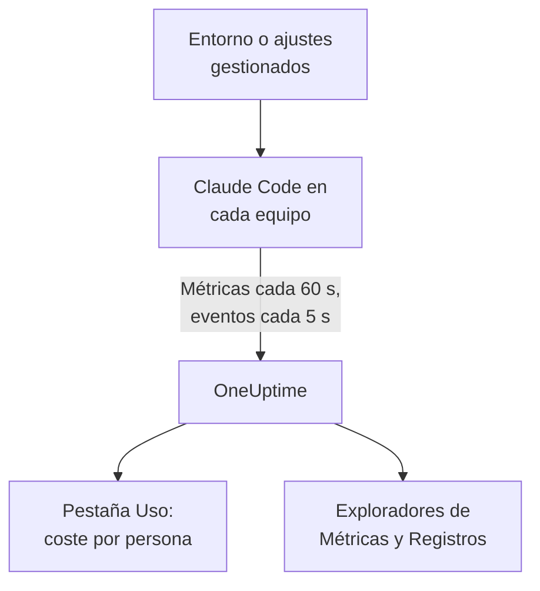

# Claude Code

Claude Code exporta por sí mismo métricas y eventos de OpenTelemetry, directamente a OneUptime: sin collector ni gateway de por medio. Actívalo con unas pocas variables de entorno, o para toda una flota con un solo archivo de ajustes gestionados, y ve el coste, los tokens, las sesiones, los commits y las ediciones aceptadas por desarrollador.

:::cards
- [Configura un equipo](#configura-un-equipo): Seis variables de entorno y un reinicio.
- [Despliégalo en la flota](#despliégalo-en-la-flota): Un archivo de ajustes gestionados en cada equipo.
- [Atribuye el gasto a personas](#atribuye-el-uso-a-personas-y-equipos): Quién ha iniciado sesión, y cuándo debes definir tú la identidad.
- [Solución de problemas](#solución-de-problemas): Qué comprobar cuando no llega nada.
:::

## Cómo funciona



Claude Code envía:

- **Coste y tokens**: `claude_code.cost.usage` (USD) y `claude_code.token.usage`, por modelo, por agente principal o subagente, y por el agente, skill, plugin o servidor MCP que hizo la llamada.
- **Actividad**: sesiones, commits, pull requests, líneas de código añadidas y eliminadas, y tiempo activo.
- **Decisiones de edición**: `claude_code.code_edit_tool.decision` cuenta las ediciones aceptadas y rechazadas, así que la tasa de aceptación es `accept / (accept + reject)`, por lenguaje y por herramienta.
- **Eventos**: prompts, resultados de herramientas, solicitudes y errores de API, cambios de modo de permisos y conexiones a servidores MCP, como registros de log OTLP.

Cada punto de métrica y cada evento lleva `user.email` cuando el desarrollador ha iniciado sesión con una cuenta de Claude, y OneUptime lo lee como el empleado en las métricas, que es donde están el coste y los tokens.

## Antes de empezar

1. Crea una clave de ingesta de telemetría en **Ajustes del proyecto → Telemetría y APM → Claves de ingesta**.
2. Tu endpoint OTLP es `https://oneuptime.com/otlp`, o `https://YOUR-ONEUPTIME-HOST/otlp` si alojas OneUptime tú mismo.
3. Usa una sola clave para toda la flota. Acaba en cada equipo de desarrollador, así que trátala como una credencial compartida que solo puede enviar datos, y rótala como cualquier otra.

## Configura un equipo

:::steps
### Exporta las variables

Añádelas a tu perfil de shell (`.zshrc` o `.bashrc`), o expórtalas en el terminal desde el que inicias Claude Code:

```bash
export CLAUDE_CODE_ENABLE_TELEMETRY=1
export OTEL_METRICS_EXPORTER=otlp
export OTEL_LOGS_EXPORTER=otlp
export OTEL_EXPORTER_OTLP_PROTOCOL=http/protobuf
export OTEL_EXPORTER_OTLP_ENDPOINT="https://oneuptime.com/otlp"
export OTEL_EXPORTER_OTLP_HEADERS="x-oneuptime-token=YOUR_INGESTION_TOKEN"
```

| Variable | Qué hace |
| --- | --- |
| `CLAUDE_CODE_ENABLE_TELEMETRY` | El interruptor principal: sin él no se exporta nada. |
| `OTEL_METRICS_EXPORTER`, `OTEL_LOGS_EXPORTER` | `otlp` envía a OneUptime. `otlp,console` además imprime lo que se envía, útil mientras configuras. |
| `OTEL_EXPORTER_OTLP_PROTOCOL` | `http/protobuf`; `http/json` y `grpc` también funcionan. |
| `OTEL_EXPORTER_OTLP_ENDPOINT` | La URL base. Claude Code añade `/v1/metrics` y `/v1/logs` por sí mismo. |
| `OTEL_EXPORTER_OTLP_HEADERS` | Pares `key=value` separados por comas; aquí, tu clave de ingesta. |

### Reinicia Claude Code

Las variables se leen cuando arranca Claude Code. Las métricas se envían cada 60 segundos y los eventos cada 5 segundos, así que usa Claude Code un minuto antes de mirar.

### Comprueba que llegan datos

Abre **Métricas** y busca `claude_code.token.usage`, después abre **Productos → IA / LLM** y ve a **Uso**: tu coste aparece con tu correo, con la marca **de las métricas de GenAI**.
:::

Para enviar las métricas y los eventos a sitios distintos, define en su lugar `OTEL_EXPORTER_OTLP_METRICS_ENDPOINT` y `OTEL_EXPORTER_OTLP_LOGS_ENDPOINT`, con la ruta completa (`https://oneuptime.com/otlp/v1/metrics`, `https://oneuptime.com/otlp/v1/logs`).

## Despliégalo en la flota

Para una organización, distribuye las mismas variables en un archivo de ajustes gestionados. Tiene la forma de `settings.json`, con las variables en un bloque `env`:

```json title="managed-settings.json"
{
  "env": {
    "CLAUDE_CODE_ENABLE_TELEMETRY": "1",
    "OTEL_METRICS_EXPORTER": "otlp",
    "OTEL_LOGS_EXPORTER": "otlp",
    "OTEL_EXPORTER_OTLP_PROTOCOL": "http/protobuf",
    "OTEL_EXPORTER_OTLP_ENDPOINT": "https://oneuptime.com/otlp",
    "OTEL_EXPORTER_OTLP_HEADERS": "x-oneuptime-token=YOUR_INGESTION_TOKEN",
    "OTEL_RESOURCE_ATTRIBUTES": "team.id=platform,cost_center=eng-123"
  }
}
```

:::steps
### Coloca el archivo donde Claude Code lo lee

| Plataforma | Ruta |
| --- | --- |
| macOS | `/Library/Application Support/ClaudeCode/managed-settings.json` |
| Linux y WSL | `/etc/claude-code/managed-settings.json` |
| Windows | `C:\Program Files\ClaudeCode\managed-settings.json` |

Claude Code ya no lee la antigua ruta de Windows `C:\ProgramData\ClaudeCode\managed-settings.json`. Si ya distribuyes un archivo de ajustes gestionados, añade en su lugar un archivo complementario, como `managed-settings.d/10-telemetry.json` junto a él: Claude Code fusiona primero `managed-settings.json` y después cada archivo `*.json` de `managed-settings.d/` en orden alfabético.

### Comprueba un equipo

Ejecuta `/status` en Claude Code. La línea `Setting sources` debe decir `Enterprise managed settings (file)`, o `(drop-ins)` o `(file + drop-ins)` para un archivo complementario. Otra fuente entre paréntesis significa que ganó una fuente de mayor rango, y la tuya no se usó.

### Mira cómo llega la flota

En la pestaña **Uso**, cada desarrollador aparece como una fila en cuanto ha usado Claude Code con los nuevos ajustes.
:::

El mismo JSON también puede venir de los ajustes gestionados por el servidor en la consola de administración de claude.ai (obtenidos al arrancar y cada hora), de un perfil de configuración de macOS en el dominio `com.anthropic.claudecode`, o de un valor `Settings` bajo `HKLM\SOFTWARE\Policies\ClaudeCode` en Windows.

:::details Qué fuente gestionada gana, y cómo se combinan las variables de telemetría
Por defecto, Claude Code usa la fuente de mayor rango que define alguna clave de política, e ignora las demás: los ajustes gestionados por el servidor, luego una política MDM o del sistema, luego los archivos de ajustes gestionados, y luego el valor de registro `HKCU` por usuario. El bloque `env` es la excepción: desde la versión 2.1.223 se fusiona variable por variable entre las fuentes de administración.

Las variables de telemetría no: las variables `OTEL_EXPORTER_OTLP_*`, los interruptores de contenido `OTEL_LOG_*`, `OTEL_LOGS_EXPORTER` y las variables del trazado en beta vienen juntas de la fuente de mayor rango que defina alguna de ellas, así que un endpoint de una fuente nunca se combina con las credenciales de otra. Si una fuente de mayor rango define alguna, un archivo complementario de telemetría no aporta nada.

Los ajustes gestionados por el servidor necesitan un paso más: un `OTEL_EXPORTER_OTLP_ENDPOINT` no vacío solo se aplica después de que cada desarrollador acepte un diálogo de aprobación de seguridad en una sesión interactiva, y los cambios en los ajustes del exportador se aplican en el siguiente arranque. Los archivos y las políticas MDM no tienen diálogo.
:::

:::details Rotar la clave de ingesta sin editar cada equipo
En lugar de una cabecera fija, define `"otelHeadersHelper": "/path/to/generate-otel-headers.sh"` en los ajustes. El script imprime un objeto JSON plano de cabeceras, como `{"x-oneuptime-token":"..."}`. Claude Code lo ejecuta al arrancar y de nuevo cada `CLAUDE_CODE_OTEL_HEADERS_HELPER_DEBOUNCE_MS` milisegundos (`1740000` por defecto, 29 minutos). Los fallos aparecen en `/status`.
:::

## Atribuye el uso a personas y equipos

**El empleado es `user.email`.** Claude Code lo envía cuando el desarrollador ha iniciado sesión con una cuenta de Claude, y no hay ninguna variable para desactivarlo. OneUptime lo lee en cada punto de coste y de tokens, sin configuración.

**Otros inicios de sesión no envían correo.** Con una clave de API, o con Claude en Amazon Bedrock, Google Cloud o Microsoft Foundry, no hay cuenta de Claude en la sesión, y Claude Code solo envía `user.id` y `session.id`. Define tú la identidad, por equipo, en los ajustes gestionados o en un script de arranque:

```bash
export OTEL_RESOURCE_ATTRIBUTES="user.email=jdoe@example.com,team.id=platform"
```

**`user.id` no es una persona.** Es un id aleatorio que Claude Code escribe en `~/.claude.json` en el primer arranque: uno por instalación, y uno nuevo si se borra el archivo. Sin correo, cada instalación aparece en su propia fila. Una excepción: una sesión iniciada en un gateway de aplicaciones de Claude envía la identidad con la que se inició sesión (`user.id` es el sujeto del proveedor de identidad, `user.email` el correo) e ignora las claves `user.*` que definas tú.

**Los equipos y centros de costes** salen de `OTEL_RESOURCE_ATTRIBUTES`: OneUptime lee `team.id`, `team`, `cost_center` y `department`. Los valores no pueden contener espacios, y las comillas no los protegen: escribe `team=Platform_Engineering`, o usa codificación porcentual, como en `team=Platform%20Engineering`. Claude Code copia estas claves en cada punto de datos (`OTEL_METRICS_INCLUDE_RESOURCE_ATTRIBUTES`, activado por defecto), y OneUptime las lee de cualquiera de las dos formas. Una clave que defines nunca sustituye a una que Claude Code define por sí mismo.

## Lo que muestra OneUptime

En **Productos → IA / LLM → Uso**, `claude_code.cost.usage` alimenta las tablas **Empleado**, **Equipo** y **Modelo**, y `claude_code.token.usage` los totales de tokens. Dos reglas deciden lo que ves:

- **Las métricas suplen a los spans; nunca se suman a ellos.** Si el mismo proyecto recibe spans de GenAI con coste de tus propias aplicaciones, el gasto de Claude Code no aparece. Envía Claude Code a un proyecto propio. Consulta [Primero los spans, las métricas los suplen](/docs/telemetry/ai-llm-observability#primero-los-spans-las-métricas-los-suplen).
- **Una fila de métricas solo lleva el coste.** Sus celdas de llamadas y tokens muestran `—`, y las tablas **Proveedor** y **Aplicación / Servicio** se quedan vacías: las métricas no nombran ningún proveedor ni pertenecen a ningún servicio de OneUptime.

Todo lo demás, como la tasa de aceptación, las líneas de código, los commits y las pull requests por desarrollador, o el gasto por `query_source`, lo representas en un [panel](/docs/dashboards/index) a partir de las métricas de abajo, y alertas sobre ello con un [monitor de métricas](/docs/monitor/metrics-monitor).

## Métricas

Cada métrica es un contador, y lleva los atributos estándar además de los suyos.

| Métrica | Unidad | Sus propios atributos |
| --- | --- | --- |
| `claude_code.session.count` | ninguna | `start_type`: `fresh`, `resume`, `continue`, `agents_view` |
| `claude_code.lines_of_code.count` | ninguna | `type`: `added`, `removed`; `model` |
| `claude_code.commit.count` | ninguna | ninguno |
| `claude_code.pull_request.count` | ninguna | ninguno |
| `claude_code.cost.usage` | USD | `model`; `query_source`: `main`, `subagent`, `auxiliary`; `speed`: `fast`, `normal`; `effort`; `agent.name`, `skill.name`, `plugin.name`, `marketplace.name`, `mcp_server.name`, `mcp_tool.name` |
| `claude_code.token.usage` | tokens | `type`: `input`, `output`, `cacheRead`, `cacheCreation`; y los mismos atributos que `claude_code.cost.usage` |
| `claude_code.code_edit_tool.decision` | ninguna | `tool_name`: `Edit`, `Write`, `NotebookEdit`; `decision`: `accept`, `reject`; `source`; `language` |
| `claude_code.active_time.total` | s | `type`: `user` (en el teclado), `cli` (herramientas y respuestas del modelo) |

Los atributos estándar son `session.id`, `app.version`, `app.entrypoint`, `organization.id`, `user.account_uuid`, `user.account_id`, `user.id`, `user.email` y `terminal.type`, más tus `OTEL_RESOURCE_ATTRIBUTES`. Algunos se pueden desactivar: consulta [Reduce el volumen de métricas](#reduce-el-volumen-de-métricas).

- Los tipos de token de caché están en camelCase: `cacheRead` y `cacheCreation`. Los totales de tokens de OneUptime solo cuentan `input` y `output`.
- En las métricas de coste y de tokens, los nombres de tus propios agentes y servidores MCP, y de los plugins y skills de terceros, aparecen como `custom` o `third-party` salvo que esté definido `OTEL_LOG_TOOL_DETAILS=1` (Claude Code 2.1.273 o posterior).

## Eventos

Los eventos llegan como registros de log OTLP, cada uno con `event.name`, `event.timestamp` y `event.sequence`. Los que más usarás:

| Evento | Qué registra |
| --- | --- |
| `claude_code.user_prompt` | Un prompt: su longitud y su comando; el texto solo si lo activas |
| `claude_code.api_request` | Una solicitud al modelo: `model`, `cost_usd`, `cost_usd_micros`, `duration_ms`, `input_tokens`, `output_tokens`, tokens de caché |
| `claude_code.api_error` | Una solicitud que falló tras sus reintentos: `model`, `error`, `status_code`, `attempt` |
| `claude_code.tool_result` | Una ejecución de herramienta: `tool_name`, `success`, `duration_ms`, y la decisión que la permitió |
| `claude_code.tool_decision` | Si se permitió una herramienta, y qué lo decidió |
| `claude_code.mcp_server_connection` | Un servidor MCP que se conecta o falla |

Claude Code envía muchos más, como rechazos, cambios de modo de permisos y eventos de plugins, hooks y skills: la [referencia de monitorización](https://code.claude.com/docs/en/monitoring-usage) de Anthropic los enumera todos. En `cost_usd_micros`, el coste es un número entero de millonésimas de USD, que se suma sin desvíos de redondeo.

## Reduce el volumen de métricas

Claude Code pone `session.id` en cada punto de datos por defecto, y cada sesión es una serie nueva. En una flota, ese único atributo dispara el volumen de métricas, y el informe de costes no lo necesita:

```bash
export OTEL_METRICS_INCLUDE_SESSION_ID=false
```

| Variable | Predeterminado | Añade |
| --- | --- | --- |
| `OTEL_METRICS_INCLUDE_SESSION_ID` | `true` | `session.id`, un valor nuevo en cada sesión |
| `OTEL_METRICS_INCLUDE_VERSION` | `false` | `app.version` |
| `OTEL_METRICS_INCLUDE_ACCOUNT_UUID` | `true` | `user.account_uuid` y `user.account_id` |
| `OTEL_METRICS_INCLUDE_ENTRYPOINT` | `false` | `app.entrypoint` |
| `OTEL_METRICS_INCLUDE_RESOURCE_ATTRIBUTES` | `true` | Tus claves de `OTEL_RESOURCE_ATTRIBUTES` |
| `OTEL_METRICS_INCLUDE_REPOSITORY` | `false` | Los atributos `vcs.*` del repositorio |

`user.email`, `user.id`, `organization.id` y `terminal.type` no tienen interruptor. Los eventos son la señal más activa: cada desarrollador activo envía cada 5 segundos (`OTEL_LOGS_EXPORT_INTERVAL`, en milisegundos). Súbelo para enviar menos lotes y más grandes, o define `OTEL_LOGS_EXPORTER=none` si solo necesitas el coste y el uso, que están todos en las métricas.

## El contenido de prompts y herramientas está desactivado por defecto

Claude Code no exporta prompts, respuestas, argumentos ni salidas de herramientas a menos que actives cada uno:

| Variable | Predeterminado | Qué activa `1` |
| --- | --- | --- |
| `OTEL_LOG_USER_PROMPTS` | desactivado | El texto de los prompts |
| `OTEL_LOG_ASSISTANT_RESPONSES` | desactivado | El texto de las respuestas; sin definir, sigue a `OTEL_LOG_USER_PROMPTS` |
| `OTEL_LOG_TOOL_DETAILS` | desactivado | Los parámetros de herramientas, los comandos Bash, y los nombres reales de agentes, plugins, skills y servidores MCP |
| `OTEL_LOG_TOOL_CONTENT` | desactivado | La entrada y la salida de las herramientas, solo en spans de traza |
| `OTEL_LOG_RAW_API_BODIES` | desactivado | Los cuerpos completos de las solicitudes y respuestas de la API (`file:<dir>` los escribe en disco en su lugar) |

Te recomendamos dejarlos desactivados: las métricas y los eventos con datos ocultos ya responden quién gastó qué, con qué modelo y con qué tasa de aceptación. Capturar contenido lleva los prompts, el código fuente y la salida de las herramientas a un almacén de telemetría con controles de acceso distintos a los de tus repositorios. Si lo activas para una investigación, `CLAUDE_CODE_OTEL_CONTENT_MAX_LENGTH` (`61440` por defecto) limita cuánto viaja por registro, y las **Reglas de depuración** y los **Filtros de descarte** de las trazas, en **Trazas → Ajustes**, lo enmascaran o descartan antes de guardarlo.

## Las métricas llegan como deltas

Claude Code envía métricas delta por defecto: cada punto es el aumento desde la última exportación, no un total acumulado. Cuando las representes o alertes sobre ellas, suma los puntos de la ventana, y no apliques una función de tasa ni de reinicio de contador como harías con un contador acumulativo: las cifras salen mal sin parecer rotas.

```bash
export OTEL_EXPORTER_OTLP_METRICS_TEMPORALITY_PREFERENCE=cumulative
```

Fija `cumulative` solo si todos los exportadores de tu organización lo usan, y no mezcles los dos en una flota.

## Trazas (beta)

Claude Code también tiene un exportador de trazas en beta, que dibuja cada interacción como un árbol de spans: `claude_code.interaction`, con `claude_code.llm_request` y `claude_code.tool` debajo.

```bash
export CLAUDE_CODE_ENHANCED_TELEMETRY_BETA=1
export OTEL_TRACES_EXPORTER=otlp
```

> [!WARNING]
> Mantén la beta de trazas fuera del proyecto que usas para el gasto. Sus spans de modelo llevan `gen_ai.system` y `gen_ai.request.model`, así que OneUptime los enumera en **Llamadas**, pero sus tokens están en `input_tokens` y `output_tokens`, no en las claves `gen_ai.usage.*`, así que llegan sin tokens y sin coste. En cuanto existen, son las filas que muestran las tablas **Empleado**, **Equipo** y **Modelo**, a 0 $, en lugar del gasto de las métricas.

En las sesiones del Agent SDK y en las sesiones no interactivas `-p`, Claude Code recoge un `TRACEPARENT` entrante, así que sus spans se unen a la traza de quien lo llama; las sesiones interactivas lo ignoran. Solo envía la cabecera `traceparent` al modelo cuando `ANTHROPIC_BASE_URL` no está definida o es la API de Anthropic; detrás de tu propio proxy, define `CLAUDE_CODE_PROPAGATE_TRACEPARENT=1`.

## Solución de problemas

:::details No llega nada en absoluto
Comprueba primero `CLAUDE_CODE_ENABLE_TELEMETRY=1`: sin ella, ninguna otra variable hace nada. Después añade `console` a los exportadores (`OTEL_METRICS_EXPORTER=otlp,console`) y observa el terminal: si se imprimen puntos, Claude Code funciona y el problema es el endpoint, la clave o la red.
:::

:::details El archivo de ajustes gestionados parece ignorado
Ejecuta `/status` y lee la línea `Setting sources`. Si no aparece ninguna fuente gestionada, el archivo está en una ruta incorrecta, no es JSON válido o la cuenta del desarrollador no puede leerlo. Si aparece otra fuente, esa ganó, y la tuya no se usó. Los ajustes gestionados por el servidor además esperan a que el desarrollador acepte el diálogo de aprobación en una sesión interactiva.
:::

:::details El gasto aparece como Sin atribuir, o como una fila por instalación
Esos desarrolladores no han iniciado sesión con una cuenta de Claude: usan una clave de API, Amazon Bedrock, Google Cloud o Microsoft Foundry. Define `user.email` en `OTEL_RESOURCE_ATTRIBUTES` para ellos, como muestra [Atribuye el uso a personas y equipos](#atribuye-el-uso-a-personas-y-equipos).
:::

:::details Falta el equipo o el centro de costes
Comprueba que `OTEL_RESOURCE_ATTRIBUTES` está definida en el equipo, no contiene espacios y no reutiliza una clave que Claude Code define por sí mismo: gana el valor de Claude Code.
:::

:::details Las cifras parecen demasiado pequeñas o demasiado grandes
Claude Code envía deltas: suma los puntos de la ventana, como explica [Las métricas llegan como deltas](#las-métricas-llegan-como-deltas). Y espera un minuto completo: las métricas se envían cada 60 segundos.
:::

:::details La clave se rechaza
OneUptime rechaza un `x-oneuptime-token` incorrecto. Copia de nuevo la clave desde **Ajustes del proyecto → Telemetría y APM → Claves de ingesta**, y comprueba que la cabecera dice `x-oneuptime-token=YOUR_INGESTION_TOKEN` sin espacios alrededor del `=`.
:::

## Próximos pasos

:::cards
- [Asistentes de programación con IA](/docs/telemetry/ai-coding-assistants): Cómo se atribuye el gasto en todos los asistentes de programación.
- [Observabilidad de IA / LLM](/docs/telemetry/ai-llm-observability): Conversaciones, alertas, coste y presupuestos para tus propias llamadas de IA.
- [Monitor de métricas](/docs/monitor/metrics-monitor): Alerta sobre el gasto o los tokens por desarrollador.
:::
