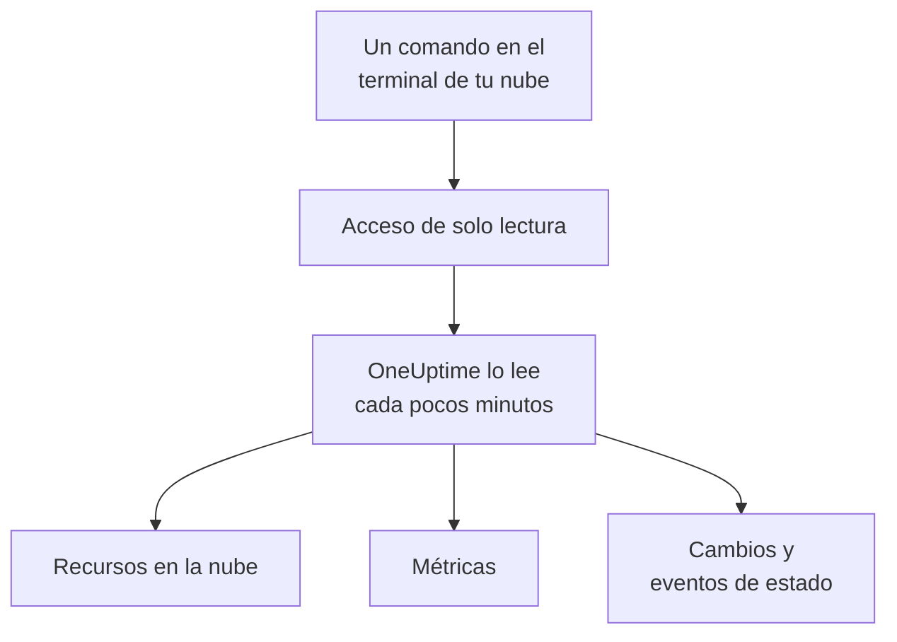

# Conectar una cuenta en la nube

Conecta una cuenta de AWS, una suscripción de Azure o un proyecto de Google Cloud desde el panel, y OneUptime enumera cada recurso que contiene, lee sus métricas clave y registra lo que cambió en ellos y lo que tu proveedor de nube dice sobre su estado. Ejecutas un comando en el terminal del navegador de tu nube y pegas lo que imprime: no hay ningún recopilador que ejecutar ni nada que instalar.

:::cards
- [Amazon Web Services](#amazon-web-services): Un rol de IAM con el que OneUptime inicia sesión, o una clave de acceso.
- [Microsoft Azure](#microsoft-azure): Una aplicación con el rol Monitoring Reader.
- [Google Cloud](#google-cloud): Una cuenta de servicio con cuatro roles de solo lectura.
- [Qué lee OneUptime](#qué-lee-oneuptime): Recursos, métricas, cambios y eventos de estado, con qué frecuencia y cuánto cuesta.
- [Seguridad de datos](#seguridad-de-datos): Lo que la conexión permite leer a Seguridad de datos, y lo que añade cada nivel al comando.
- [Permitir que la IA corrija problemas](#permitir-que-la-ia-corrija-problemas): Un comando más, y OneUptime AI puede corregir lo que encuentra.
:::

## Cómo funciona



- **El acceso solo puede leer.** El comando crea un acceso que lee tus recursos y su configuración, sus métricas, lo que cambió y los eventos de estado de tu proveedor, y nada más: las acciones que se enumeran abajo en AWS, el rol **Monitoring Reader** en Azure y cuatro roles de lector en Google Cloud. OneUptime nunca lee datos ni secretos con él, salvo líneas de log cuando permites que la IA lea los logs de una cuenta, y muestras de contenido cuando las activas para [Seguridad de datos](#seguridad-de-datos). Elimínalo para cortar el acceso de OneUptime.
- **OneUptime lee según una programación.** Cada 5 minutos para Azure y Google Cloud, y cada 10 minutos para AWS, salvo que elijas otro intervalo al conectar. Cada lectura registra también lo que cambió desde la anterior, y cada 30 minutos una lectura vuelve a enumerar cada recurso.
- **Cada recurso tiene su propia página.** Los recursos aparecen en **Nube → Todos los recursos** con sus métricas clave, propietarios y etiquetas. La página de un recurso enumerado muestra también sus **Recursos conectados** (dónde se ejecuta, qué le envía tráfico), sus endpoints, etiquetas y ajustes, y sus **Incidentes**, **Alertas** y **Cambios**.
- **Cada cuenta tiene su propia página.** Las cuentas aparecen en **Nube → Cuentas** con sus recursos por tipo y región, sus **Cambios** y una **Topología** de cómo encajan sus recursos.
- **OneUptime AI lee lo que cambió.** Una investigación de un incidente o una alerta vinculados a un recurso en la nube lee primero los cambios de ese recurso, y vuelve a leer el registro de actividad de la cuenta al empezar.

## Antes de empezar

- **Un propietario o administrador del proyecto.** Solo ellos pueden conectar, probar y editar cuentas en la nube.
- **El terminal de tu nube** (AWS CloudShell, Azure Cloud Shell o Google Cloud Shell), con una sesión iniciada por alguien que pueda crear un rol o usuario de IAM, un registro de aplicación o una cuenta de servicio.

## Amazon Web Services

:::steps
### Abrir el formulario de AWS

Ve a **Nube → Conectar** y elige **Amazon Web Services**.

### Ejecutar el comando en AWS CloudShell

Elige cómo inicia sesión OneUptime. Un **Rol de IAM** es la forma recomendada: no se guarda nada secreto y puedes eliminar el rol en cualquier momento. El formulario muestra el comando escrito para tu proyecto: crea un rol que confía en la cuenta de AWS de OneUptime con el ID externo de tu proyecto, e imprime el ARN del rol.

En **Qué leer**, elige esta cuenta o todas las cuentas de tu AWS Organization. Ejecuta el comando de la organización en su cuenta de administración: añade un StackSet que coloca el mismo rol en cada cuenta, ahora y a medida que se unen cuentas, y permite al rol de la cuenta de administración enumerar las cuentas. Una conexión lee hasta 50 cuentas.

Usa una **Clave de acceso** cuando no sea posible un rol: solo lee su propia cuenta. Este comando crea un usuario con los mismos permisos e imprime su clave:

```bash
aws iam create-user --user-name OneUptimeReadOnly > /dev/null 2>&1 || true
aws iam put-user-policy --user-name OneUptimeReadOnly --policy-name OneUptimeReadOnly --policy-document '{"Version":"2012-10-17","Statement":[{"Effect":"Allow","Action":["cloudwatch:GetMetricData","cloudwatch:ListMetrics","tag:GetResources","iam:ListAccountAliases","cloudformation:ListResources","ec2:DescribeInstances","ec2:DescribeVolumes","ec2:DescribeVpcs","ec2:DescribeNatGateways","autoscaling:DescribeAutoScalingGroups","elasticloadbalancing:DescribeLoadBalancers","elasticloadbalancing:DescribeLoadBalancerAttributes","elasticloadbalancing:DescribeTargetGroups","elasticloadbalancing:DescribeTargetGroupAttributes","elasticloadbalancing:DescribeTargetHealth","elasticloadbalancing:DescribeTags","ecs:ListClusters","ecs:DescribeClusters","ecs:ListServices","ecs:DescribeServices","lambda:ListFunctions","rds:DescribeDBInstances","rds:DescribeDBClusters","elasticache:DescribeReplicationGroups","sqs:ListQueues","sqs:GetQueueAttributes","sns:ListTopics","sns:GetTopicAttributes","sns:ListSubscriptionsByTopic","dynamodb:ListTables","dynamodb:DescribeTable","kinesis:ListStreams","kinesis:DescribeStreamSummary","states:ListStateMachines","states:DescribeStateMachine","cloudfront:ListDistributions","elasticfilesystem:DescribeFileSystems","es:ListDomainNames","es:DescribeDomains","apprunner:ListServices","apprunner:DescribeService","cloudtrail:LookupEvents","health:DescribeEvents","health:DescribeEventDetails","rds:DescribeEvents","autoscaling:DescribeScalingActivities","ec2:DescribeInstanceStatus","ecs:DescribeTaskDefinition","lambda:GetFunctionConfiguration","lambda:GetFunctionConcurrency","lambda:GetAlias","servicequotas:ListServiceQuotas","logs:DescribeLogGroups","logs:FilterLogEvents"],"Resource":"*"},{"Effect":"Allow","Action":["apigateway:GET"],"Resource":["arn:aws:apigateway:*::/restapis","arn:aws:apigateway:*::/restapis/*","arn:aws:apigateway:*::/apis","arn:aws:apigateway:*::/apis/*"]}]}'
aws iam create-access-key --user-name OneUptimeReadOnly
```

### Pegar lo que imprimió el comando de AWS

Pega todo lo que imprimió el comando en **Lo que imprimió el comando**. OneUptime extrae el ARN del rol, o el ID de la clave de acceso y su secreto.

### Probar y conectar AWS

OneUptime prueba la conexión al abrirse este paso: inicia sesión, cuenta los recursos que encuentra y dice cuánto cuesta leerlos. Selecciona **Conectar** para guardar.
:::

El rol y el usuario pueden hacer esto, y nada más:

| Para qué los usa OneUptime | Acciones |
| --- | --- |
| Encontrar los recursos que informan métricas, y leer sus métricas | `cloudwatch:GetMetricData`, `cloudwatch:ListMetrics` |
| Nombrar cada recurso y leer sus etiquetas | `tag:GetResources`, `iam:ListAccountAliases` |
| Enumerar cada recurso y su configuración, a través de Cloud Control | `cloudformation:ListResources`, `ec2:DescribeInstances`, `ec2:DescribeVolumes`, `ec2:DescribeVpcs`, `ec2:DescribeNatGateways`, `autoscaling:DescribeAutoScalingGroups`, `elasticloadbalancing:DescribeLoadBalancers`, `elasticloadbalancing:DescribeLoadBalancerAttributes`, `elasticloadbalancing:DescribeTargetGroups`, `elasticloadbalancing:DescribeTargetGroupAttributes`, `elasticloadbalancing:DescribeTargetHealth`, `elasticloadbalancing:DescribeTags`, `ecs:ListClusters`, `ecs:DescribeClusters`, `ecs:ListServices`, `ecs:DescribeServices`, `lambda:ListFunctions`, `rds:DescribeDBInstances`, `rds:DescribeDBClusters`, `elasticache:DescribeReplicationGroups`, `sqs:ListQueues`, `sqs:GetQueueAttributes`, `sns:ListTopics`, `sns:GetTopicAttributes`, `sns:ListSubscriptionsByTopic`, `dynamodb:ListTables`, `dynamodb:DescribeTable`, `kinesis:ListStreams`, `kinesis:DescribeStreamSummary`, `states:ListStateMachines`, `states:DescribeStateMachine`, `cloudfront:ListDistributions`, `elasticfilesystem:DescribeFileSystems`, `es:ListDomainNames`, `es:DescribeDomains`, `apprunner:ListServices`, `apprunner:DescribeService`, `apigateway:GET` |
| Leer lo que cambió: los eventos de administración de la cuenta | `cloudtrail:LookupEvents` |
| Leer los propios eventos de estado de AWS para la cuenta | `health:DescribeEvents`, `health:DescribeEventDetails` |
| Leer el estado actual y los eventos recientes de un recurso durante una investigación | `rds:DescribeEvents`, `autoscaling:DescribeScalingActivities`, `ec2:DescribeInstanceStatus`, `ecs:DescribeTaskDefinition`, `lambda:GetFunctionConfiguration`, `lambda:GetFunctionConcurrency`, `lambda:GetAlias` |
| Leer las cuotas de la cuenta durante una investigación | `servicequotas:ListServiceQuotas` |
| Leer líneas de log, solo cuando permites que la IA lea los logs de una cuenta | `logs:DescribeLogGroups`, `logs:FilterLogEvents` |
| Enumerar las cuentas de la organización, desde su cuenta de administración | `organizations:ListAccounts` |

`apigateway:GET` solo se permite sobre las definiciones de las propias API, nunca sobre sus claves, y solo el rol de la cuenta de administración puede enumerar las cuentas de la organización. AWS Health solo responde a cuentas con un plan de soporte Business, Enterprise On-Ramp o Enterprise: sin uno, OneUptime vuelve a preguntar un día después.

> [!NOTE]
> En un OneUptime autoalojado, la vía del **Rol de IAM** necesita una identidad de AWS propia de OneUptime: define `CLOUD_CONNECT_AWS_ACCESS_KEY_ID` y `CLOUD_CONNECT_AWS_SECRET_ACCESS_KEY` con la clave de un usuario de IAM que pueda llamar a `sts:AssumeRole`. Sin ellas, el formulario ofrece una **Clave de acceso**.

## Microsoft Azure

:::steps
### Abrir el formulario de Azure

Ve a **Nube → Conectar** y elige **Microsoft Azure**.

### Ejecutar el comando en Azure Cloud Shell

El comando crea una aplicación con el rol **Monitoring Reader** en tu suscripción actual, e imprime sus datos con la fecha en que vence su secreto:

```bash
SCOPE="/subscriptions/$(az account show --query id --output tsv)"
OUT=$(az ad sp create-for-rbac --name OneUptimeReadOnly --role "Monitoring Reader" --scopes "$SCOPE")
APP=$(echo "$OUT" | jq -r .appId)
END=$(az ad app credential list --id "$APP" --query "max([].endDateTime)" --output tsv)
echo "$OUT" | jq --arg end "$END" '. + {endDateTime: $end}'
```

En **Qué leer**, elige en su lugar todas las suscripciones del inquilino, y el rol se asigna al grupo de administración raíz del inquilino:

```bash
SCOPE="/providers/Microsoft.Management/managementGroups/$(az account show --query tenantId --output tsv)"
OUT=$(az ad sp create-for-rbac --name OneUptimeReadOnly --role "Monitoring Reader" --scopes "$SCOPE")
APP=$(echo "$OUT" | jq -r .appId)
END=$(az ad app credential list --id "$APP" --query "max([].endDateTime)" --output tsv)
echo "$OUT" | jq --arg end "$END" '. + {endDateTime: $end}'
```

### Pegar lo que imprimió el comando de Azure

Pega todo lo que imprimió el comando en **Lo que imprimió el comando**. OneUptime extrae el `tenant`, el `appId`, el `password` y la fecha en que vence.

### Probar y conectar Azure

OneUptime prueba la conexión al abrirse este paso. Selecciona **Conectar** para guardar.
:::

Para leer más suscripciones con la misma aplicación, dale el rol en cada una:

```bash
az role assignment create --assignee <APP_ID> --role "Monitoring Reader" --scope /subscriptions/<SUBSCRIPTION_ID>
```

OneUptime lee cada suscripción que la aplicación puede leer, hasta 50, salvo que enumeres algunas en **Suscripciones**. El secreto de la aplicación deja de funcionar en la fecha en que vence: desde 30 días antes, cada lectura avisa de ello. Ejecuta de nuevo el comando y pega lo que imprime para darle uno nuevo.

## Google Cloud

:::steps
### Abrir el formulario de Google Cloud

Ve a **Nube → Conectar** y elige **Google Cloud**.

### Ejecutar el comando en Google Cloud Shell

Ejecútalo en el proyecto que quieres supervisar. Activa las API que lee OneUptime, crea una cuenta de servicio con los roles **Monitoring Viewer**, **Cloud Asset Viewer**, **Logs Viewer** y **Service Health Viewer**, e imprime su clave:

```bash
PROJECT_ID=$(gcloud config get-value project)
gcloud services enable monitoring.googleapis.com cloudasset.googleapis.com logging.googleapis.com cloudresourcemanager.googleapis.com servicehealth.googleapis.com
gcloud iam service-accounts create oneuptime-read-only --display-name "OneUptime (read only)" > /dev/null 2>&1 || true
gcloud projects add-iam-policy-binding "$PROJECT_ID" --member "serviceAccount:oneuptime-read-only@$PROJECT_ID.iam.gserviceaccount.com" --role roles/monitoring.viewer --condition=None > /dev/null
gcloud projects add-iam-policy-binding "$PROJECT_ID" --member "serviceAccount:oneuptime-read-only@$PROJECT_ID.iam.gserviceaccount.com" --role roles/cloudasset.viewer --condition=None > /dev/null
gcloud projects add-iam-policy-binding "$PROJECT_ID" --member "serviceAccount:oneuptime-read-only@$PROJECT_ID.iam.gserviceaccount.com" --role roles/logging.viewer --condition=None > /dev/null
gcloud projects add-iam-policy-binding "$PROJECT_ID" --member "serviceAccount:oneuptime-read-only@$PROJECT_ID.iam.gserviceaccount.com" --role roles/servicehealth.viewer --condition=None > /dev/null
gcloud iam service-accounts keys create oneuptime-key.json --iam-account "oneuptime-read-only@$PROJECT_ID.iam.gserviceaccount.com"
cat oneuptime-key.json && rm oneuptime-key.json
```

En **Qué leer**, elige en su lugar todos los proyectos de la organización, y los roles se asignan a la organización del proyecto:

```bash
PROJECT_ID=$(gcloud config get-value project)
ORG_ID=$(gcloud projects get-ancestors "$PROJECT_ID" --format="value(id)" | tail -1)
gcloud services enable monitoring.googleapis.com cloudasset.googleapis.com logging.googleapis.com cloudresourcemanager.googleapis.com servicehealth.googleapis.com
gcloud iam service-accounts create oneuptime-read-only --display-name "OneUptime (read only)" > /dev/null 2>&1 || true
gcloud organizations add-iam-policy-binding "$ORG_ID" --member "serviceAccount:oneuptime-read-only@$PROJECT_ID.iam.gserviceaccount.com" --role roles/monitoring.viewer --condition=None > /dev/null
gcloud organizations add-iam-policy-binding "$ORG_ID" --member "serviceAccount:oneuptime-read-only@$PROJECT_ID.iam.gserviceaccount.com" --role roles/cloudasset.viewer --condition=None > /dev/null
gcloud organizations add-iam-policy-binding "$ORG_ID" --member "serviceAccount:oneuptime-read-only@$PROJECT_ID.iam.gserviceaccount.com" --role roles/logging.viewer --condition=None > /dev/null
gcloud organizations add-iam-policy-binding "$ORG_ID" --member "serviceAccount:oneuptime-read-only@$PROJECT_ID.iam.gserviceaccount.com" --role roles/servicehealth.viewer --condition=None > /dev/null
gcloud iam service-accounts keys create oneuptime-key.json --iam-account "oneuptime-read-only@$PROJECT_ID.iam.gserviceaccount.com"
cat oneuptime-key.json && rm oneuptime-key.json
```

### Pegar la clave

Pega todo lo que imprimió el comando. OneUptime lee el propio proyecto de la clave y guarda la clave cifrada.

### Probar y conectar Google Cloud

OneUptime prueba la conexión al abrirse este paso. Selecciona **Conectar** para guardar.
:::

Para leer más proyectos con la misma cuenta de servicio, dale los cuatro roles en cada uno y enuméralos en **Proyectos**:

```bash
for ROLE in roles/monitoring.viewer roles/cloudasset.viewer roles/logging.viewer roles/servicehealth.viewer; do gcloud projects add-iam-policy-binding <PROJECT_ID> --member "serviceAccount:oneuptime-read-only@<KEY_PROJECT_ID>.iam.gserviceaccount.com" --role "$ROLE"; done
```

La conexión de una organización lee hasta 50 de sus proyectos, salvo que enumeres algunos en **Proyectos**.

## Seguridad de datos

La misma conexión puede permitir que [Seguridad de datos](/docs/data-security/index) lea los almacenes de datos de la cuenta: sus buckets, bases de datos y data warehouses. En **Más campos**, **Seguridad de datos** está en **Desactivado** hasta que elijas otra opción, y el comando que muestra el formulario cambia con ella:

| Seguridad de datos | Qué puede leer Seguridad de datos | Qué añade el comando |
| --- | --- | --- |
| **Desactivado** | Ninguno de los almacenes de la cuenta | Nada |
| **Solo configuración** | Quién puede acceder a cada almacén, y cómo son su cifrado, sus copias de seguridad y su registro de actividad. Nunca datos. | En AWS, una segunda política insertada, `OneUptimeDataSecurity`, de acciones de lectura. En Azure y Google Cloud, nada: **Monitoring Reader** y **Cloud Asset Viewer** ya la leen. |
| **Configuración y muestras de contenido** | Eso, y muestras de objetos y filas, para encontrar datos sensibles en ellos | En AWS, la misma política con `s3:ListBucket`, `s3:GetObject` y `kms:Decrypt` solo a través de S3. En Azure, **Storage Blob Data Reader**. En Google Cloud, `roles/storage.objectViewer`, `roles/bigquery.dataViewer` y la API de BigQuery. |

En AWS, el comando del rol añade la política con una línea más. En el nivel de contenido, es:

```bash
aws iam put-role-policy --role-name "$ROLE" --policy-name OneUptimeDataSecurity --policy-document '{"Version":"2012-10-17","Statement":[{"Effect":"Allow","Action":["s3:ListAllMyBuckets","s3:GetBucketLocation","s3:GetBucketPolicyStatus","s3:GetBucketPublicAccessBlock","s3:GetAccountPublicAccessBlock","s3:GetBucketAcl","s3:GetBucketPolicy","s3:GetEncryptionConfiguration","s3:GetBucketVersioning","s3:GetBucketLogging","s3:GetBucketOwnershipControls","s3:GetReplicationConfiguration","s3:GetBucketTagging","rds:DescribeDBInstances","rds:DescribeDBClusters","rds:DescribeDBSnapshots","rds:DescribeDBSnapshotAttributes","rds:DescribeDBClusterSnapshots","rds:DescribeDBClusterSnapshotAttributes","dynamodb:ListTables","dynamodb:DescribeTable","dynamodb:DescribeContinuousBackups","redshift:DescribeClusters","redshift:DescribeLoggingStatus","es:ListDomainNames","es:DescribeDomains","elasticache:DescribeReplicationGroups","elasticfilesystem:DescribeFileSystems","kms:ListAliases"],"Resource":"*"},{"Effect":"Allow","Action":["s3:ListBucket"],"Resource":"arn:aws:s3:::*"},{"Effect":"Allow","Action":["s3:GetObject"],"Resource":"arn:aws:s3:::*/*"},{"Effect":"Allow","Action":["kms:Decrypt"],"Resource":"*","Condition":{"StringLike":{"kms:ViaService":"s3.*.amazonaws.com"}}}]}'
```

IAM limita las políticas insertadas propias de un usuario a 2.048 caracteres en total, así que con una **Clave de acceso** la política va en un grupo, `OneUptimeDataSecurity`, al que se une el usuario:

```bash
aws iam create-user --user-name OneUptimeReadOnly > /dev/null 2>&1 || true
aws iam put-user-policy --user-name OneUptimeReadOnly --policy-name OneUptimeReadOnly --policy-document '{"Version":"2012-10-17","Statement":[{"Effect":"Allow","Action":["cloudwatch:GetMetricData","cloudwatch:ListMetrics","tag:GetResources","iam:ListAccountAliases","cloudformation:ListResources","ec2:DescribeInstances","ec2:DescribeVolumes","ec2:DescribeVpcs","ec2:DescribeNatGateways","autoscaling:DescribeAutoScalingGroups","elasticloadbalancing:DescribeLoadBalancers","elasticloadbalancing:DescribeLoadBalancerAttributes","elasticloadbalancing:DescribeTargetGroups","elasticloadbalancing:DescribeTargetGroupAttributes","elasticloadbalancing:DescribeTargetHealth","elasticloadbalancing:DescribeTags","ecs:ListClusters","ecs:DescribeClusters","ecs:ListServices","ecs:DescribeServices","lambda:ListFunctions","rds:DescribeDBInstances","rds:DescribeDBClusters","elasticache:DescribeReplicationGroups","sqs:ListQueues","sqs:GetQueueAttributes","sns:ListTopics","sns:GetTopicAttributes","sns:ListSubscriptionsByTopic","dynamodb:ListTables","dynamodb:DescribeTable","kinesis:ListStreams","kinesis:DescribeStreamSummary","states:ListStateMachines","states:DescribeStateMachine","cloudfront:ListDistributions","elasticfilesystem:DescribeFileSystems","es:ListDomainNames","es:DescribeDomains","apprunner:ListServices","apprunner:DescribeService","cloudtrail:LookupEvents","health:DescribeEvents","health:DescribeEventDetails"],"Resource":"*"},{"Effect":"Allow","Action":["apigateway:GET"],"Resource":["arn:aws:apigateway:*::/restapis","arn:aws:apigateway:*::/restapis/*","arn:aws:apigateway:*::/apis","arn:aws:apigateway:*::/apis/*"]}]}'
aws iam create-group --group-name OneUptimeDataSecurity > /dev/null 2>&1 || true
aws iam put-group-policy --group-name OneUptimeDataSecurity --policy-name OneUptimeDataSecurity --policy-document '{"Version":"2012-10-17","Statement":[{"Effect":"Allow","Action":["s3:ListAllMyBuckets","s3:GetBucketLocation","s3:GetBucketPolicyStatus","s3:GetBucketPublicAccessBlock","s3:GetAccountPublicAccessBlock","s3:GetBucketAcl","s3:GetBucketPolicy","s3:GetEncryptionConfiguration","s3:GetBucketVersioning","s3:GetBucketLogging","s3:GetBucketOwnershipControls","s3:GetReplicationConfiguration","s3:GetBucketTagging","rds:DescribeDBInstances","rds:DescribeDBClusters","rds:DescribeDBSnapshots","rds:DescribeDBSnapshotAttributes","rds:DescribeDBClusterSnapshots","rds:DescribeDBClusterSnapshotAttributes","dynamodb:ListTables","dynamodb:DescribeTable","dynamodb:DescribeContinuousBackups","redshift:DescribeClusters","redshift:DescribeLoggingStatus","es:ListDomainNames","es:DescribeDomains","elasticache:DescribeReplicationGroups","elasticfilesystem:DescribeFileSystems","kms:ListAliases"],"Resource":"*"},{"Effect":"Allow","Action":["s3:ListBucket"],"Resource":"arn:aws:s3:::*"},{"Effect":"Allow","Action":["s3:GetObject"],"Resource":"arn:aws:s3:::*/*"},{"Effect":"Allow","Action":["kms:Decrypt"],"Resource":"*","Condition":{"StringLike":{"kms:ViaService":"s3.*.amazonaws.com"}}}]}'
aws iam add-user-to-group --user-name OneUptimeReadOnly --group-name OneUptimeDataSecurity
aws iam create-access-key --user-name OneUptimeReadOnly
```

En Azure, el nivel de contenido añade **Storage Blob Data Reader** en el mismo ámbito que **Monitoring Reader**:

```bash
SCOPE="/subscriptions/$(az account show --query id --output tsv)"
OUT=$(az ad sp create-for-rbac --name OneUptimeReadOnly --role "Monitoring Reader" --scopes "$SCOPE")
APP=$(echo "$OUT" | jq -r .appId)
az role assignment create --assignee "$APP" --role "Storage Blob Data Reader" --scope "$SCOPE" > /dev/null
END=$(az ad app credential list --id "$APP" --query "max([].endDateTime)" --output tsv)
echo "$OUT" | jq --arg end "$END" '. + {endDateTime: $end}'
```

En Google Cloud, añade los dos roles y activa `bigquery.googleapis.com`:

```bash
PROJECT_ID=$(gcloud config get-value project)
gcloud services enable monitoring.googleapis.com cloudasset.googleapis.com logging.googleapis.com cloudresourcemanager.googleapis.com servicehealth.googleapis.com bigquery.googleapis.com
gcloud iam service-accounts create oneuptime-read-only --display-name "OneUptime (read only)" > /dev/null 2>&1 || true
gcloud projects add-iam-policy-binding "$PROJECT_ID" --member "serviceAccount:oneuptime-read-only@$PROJECT_ID.iam.gserviceaccount.com" --role roles/monitoring.viewer --condition=None > /dev/null
gcloud projects add-iam-policy-binding "$PROJECT_ID" --member "serviceAccount:oneuptime-read-only@$PROJECT_ID.iam.gserviceaccount.com" --role roles/cloudasset.viewer --condition=None > /dev/null
gcloud projects add-iam-policy-binding "$PROJECT_ID" --member "serviceAccount:oneuptime-read-only@$PROJECT_ID.iam.gserviceaccount.com" --role roles/logging.viewer --condition=None > /dev/null
gcloud projects add-iam-policy-binding "$PROJECT_ID" --member "serviceAccount:oneuptime-read-only@$PROJECT_ID.iam.gserviceaccount.com" --role roles/servicehealth.viewer --condition=None > /dev/null
gcloud projects add-iam-policy-binding "$PROJECT_ID" --member "serviceAccount:oneuptime-read-only@$PROJECT_ID.iam.gserviceaccount.com" --role roles/storage.objectViewer --condition=None > /dev/null
gcloud projects add-iam-policy-binding "$PROJECT_ID" --member "serviceAccount:oneuptime-read-only@$PROJECT_ID.iam.gserviceaccount.com" --role roles/bigquery.dataViewer --condition=None > /dev/null
gcloud iam service-accounts keys create oneuptime-key.json --iam-account "oneuptime-read-only@$PROJECT_ID.iam.gserviceaccount.com"
cat oneuptime-key.json && rm oneuptime-key.json
```

Un comando de un nivel inferior sustituye la política de AWS por la de ese nivel. **Desactivado** no añade nada, así que deja en su sitio lo que concedió un comando anterior hasta que lo elimines: la política `OneUptimeDataSecurity` en AWS, con `aws iam delete-role-policy --role-name <your role> --policy-name OneUptimeDataSecurity`, y los roles del nivel de contenido en Azure y Google Cloud. En cualquier caso, Seguridad de datos deja de leer al momento: solo lee lo que indica el nivel de la conexión. [Configurar Seguridad de datos](/docs/data-security/setup) enumera cada acción de la política, y lo que Seguridad de datos conserva de lo que lee.

## Qué lee OneUptime

| | AWS | Azure | Google Cloud |
| --- | --- | --- | --- |
| Recursos | Cada recurso de los tipos que conoce OneUptime, en cada región que usas, desde Cloud Control | Cada recurso de las suscripciones, desde Resource Graph | Cada recurso de los proyectos, desde Cloud Asset Inventory |
| Métricas | Las métricas clave de cada servicio, como la CPU, la red y las comprobaciones de estado de una instancia | Hasta 8 métricas clave por recurso | Las métricas clave de cada tipo de recurso |
| Cambios | Los eventos de administración de CloudTrail | Los eventos administrativos del registro de actividad | El registro de auditoría Admin Activity |
| Eventos de estado | AWS Health | Service Health y Resource Health | Service Health |
| Se lee cada | 10 minutos | 5 minutos | 5 minutos |
| Un recurso eliminado | Se archiva cuando una enumeración completa ya no lo incluye | Se archiva cuando una enumeración completa ya no lo incluye | Se archiva cuando una enumeración completa ya no lo incluye |

Cada lectura retoma donde se detuvo la anterior, así que cada punto de datos y cada cambio se escribe una sola vez. La primera lectura de una conexión nueva empieza en menos de un minuto y retrocede una hora para las métricas y 2 horas para los cambios; tras una pausa, una lectura retrocede como máximo 6 horas. Un recurso que solo informa métricas, y que ninguna enumeración incluye, se archiva tras 7 días sin métricas.

Las llamadas que hace OneUptime se facturan a tu cuenta en la nube, a los precios de tu nube. Enumerar recursos y leer cambios y eventos de estado no cuesta nada en las tres nubes; leer métricas sí. La prueba estima el coste de lo que encuentra, y leer con menos frecuencia cuesta menos: cambia **Frecuencia de lectura de métricas** en **Más campos**.

| Nube | Precio |
| --- | --- |
| AWS | CloudWatch `GetMetricData`: $0.01 por cada 1,000 métricas, y cada métrica clave de un recurso es una métrica por lectura |
| Azure | Las primeras 1,000,000 lecturas de métricas al mes de cada suscripción son gratuitas, luego $0.01 por cada 1,000 |
| Google Cloud | Las primeras 1,000,000 series temporales leídas al mes son gratuitas, luego $0.50 por millón |

## Qué ves en OneUptime

- **La página de una cuenta.** En **Nube → Cuentas**, el resumen de una cuenta cuenta sus recursos por tipo y región y dice cuándo la leyó por última vez una conexión. Sus **Recursos** los enumeran, sus **Cambios** enumeran lo que cambió en ella, lo más reciente primero, y su **Topología** dibuja sus regiones, las redes que contienen y lo que se ejecuta en cada una, con los incidentes y alertas abiertos sobre los recursos a los que están vinculados. Su **Feed** registra cómo llegó la cuenta a OneUptime, cuándo su agente de IA de la nube se conectó o se restableció, y quién cambió lo que OneUptime AI puede hacer en ella.
- **Los cambios de un recurso.** Un cambio se guarda como un evento de cambio vinculado al recurso que cambió y a su cuenta, y se dibuja como un marcador en los gráficos de métricas del recurso, junto con sus incidentes y alertas. Los gráficos filtrados a ningún recurso dejan fuera el registro de actividad de una cuenta en la nube, para que una cuenta muy activa no tape tus despliegues; los eventos de estado del proveedor siguen en ellos.
- **Incidentes y alertas.** Vincula un recurso en la nube a un monitor, un incidente o una alerta en sus recursos vinculados, y sus incidentes y alertas se enumeran en la página del recurso. Un monitor de sitio web, API, SSL, ping o puerto cuyo host lleva a un endpoint de un recurso, directamente o a través de su DNS, muestra el recurso en **Recursos en la nube sugeridos** en su tarjeta **Recursos vinculados**: selecciona **Vincular recurso** para vincularlo.

## Permitir que la IA corrija problemas

OneUptime AI lee cada cuenta conectada mientras investiga, con el acceso de solo lectura de arriba. Para que también pueda corregir problemas, como reiniciar un servicio, aumentar su capacidad o revertirlo, abre la cuenta en **Nube → Cuentas** y selecciona **Permitir que la IA corrija problemas** en la tarjeta **Agente de IA** de su **Vista general**.

El cuadro de diálogo hace una sola pregunta, **¿Hasta dónde puede llegar la IA?**: **Preguntarme primero**, la opción predeterminada, en la que OneUptime AI propone cada corrección y una persona la aprueba con un clic, o **Aplicar por su cuenta las correcciones seguras**, en la que los cambios seguros se ejecutan por sí solos y los más arriesgados siguen esperando aprobación. Todo lo demás tiene un valor predeterminado seguro en **Más campos**. Después muestra un solo comando, escrito para esta cuenta: ejecútalo en AWS CloudShell, Azure Cloud Shell o Google Cloud Shell, con la sesión iniciada como alguien que pueda crear roles en la cuenta. El comando crea un rol que solo puede hacer los cambios activados e inicia con él el agente de IA de la nube en tu cuenta. El agente se conecta por sí solo en pocos minutos, y el cuadro de diálogo lo indica: no hay nada que volver a pegar.

El agente es un pequeño contenedor que se ejecuta todo el mes en tu cuenta, facturado por tu nube a sus precios de lista:

| Nube | Qué se ejecuta | Aproximadamente |
| --- | --- | --- |
| AWS | Una tarea de ECS Fargate de 0.25 vCPU y 0.5 GB, y su dirección IPv4 pública, a los precios de `us-east-1` | $13 al mes |
| Azure | Una réplica de Container Apps de 0.25 vCPU y 0.5 GiB, tras la concesión gratuita mensual de la suscripción de 180,000 vCPU-segundos y 360,000 GiB-segundos | $14 al mes |
| Google Cloud | Una instancia de Cloud Run de 1 vCPU y 0.5 GiB con la CPU siempre asignada, que ocupa una vCPU completa, tras el nivel gratuito mensual de 240,000 vCPU-segundos y 450,000 GiB-segundos | $45 al mes |

Qué puede cambiar el agente, cómo se clasifica y se deshace cada cambio, y cómo leer sus registros: [Agentes de IA para la infraestructura](/docs/ai/infrastructure-ai-agents#en-una-cuenta-en-la-nube).

## Solución de problemas

:::details La prueba dice que la clave o el secreto no se aceptaron
Copia todo lo que imprimió el comando y pégalo de nuevo. Una clave creada hace un minuto puede tardar un minuto en funcionar. Un secreto de Azure vencido también se rechaza: ejecuta de nuevo el comando.
:::

:::details La prueba inicia sesión, pero no puede leer
Ejecuta de nuevo el comando: concede los roles que necesita OneUptime. En AWS, ejecuta el comando que muestra el formulario para este proyecto: un rol creado para otro proyecto confía en el ID externo de ese proyecto, no en el de este.
:::

:::details Google Cloud no deja que el comando cree una clave
Una directiva de organización, `iam.disableServiceAccountKeyCreation`, puede prohibir las claves de cuenta de servicio. Pide al administrador de tu organización una excepción para el proyecto, o [envía las métricas con tu propio recopilador](/docs/telemetry/cloud-resources).
:::

:::details No aparece ningún recurso
La primera lectura enumera cada recurso de la cuenta, informe métricas o no. Si una conexión no funciona, **Ver error** en **Nube → Conectar** dice por qué falló su última lectura.
:::

:::details Faltan algunas cuentas de la organización
Una conexión lee hasta 50 cuentas, suscripciones o proyectos, y cada lectura lo indica cuando hay más. Conecta las demás con una conexión propia.
:::

## Próximos pasos

:::cards
- [Recursos en la nube](/docs/telemetry/cloud-resources): Ejecuta tu propio OpenTelemetry Collector en su lugar, o transmite las métricas de CloudWatch.
- [Despliegues y cambios](/docs/telemetry/change-events): Cada cambio que registra OneUptime, y cómo los lee OneUptime AI.
- [Monitor de métricas](/docs/monitor/metrics-monitor): Crea alertas sobre las métricas de un recurso.
:::
